[← Зміст довідки](../)


# Бухгалтерські звітні документи

## Бухгалтерські звітні документи

_Шлях у довідці: Розділи програми › Зарплата › Звіти › Бухгалтерські звітні документи_

В цьому розділі:

[Створення бухгалтерського звіту](#payreportspayreports-reestrstatement_payreportspayreports)

[Створення Табелю обліку робочого часу](#payreportspayreports-reestrstatement_payreportspayreports)

[Формування документів по кадрам](#payreportspayreports-reestrstatement_payreportspayreports)

Розділ Зарплата містить засоби для створення типових бухгалтерських звітних документів по заробітній платі.

Перелік основних документів міститься в розділі Звіти. Змінити перелік звітів можливо у [Налаштуваннях модуля](PayToolsZvit.html#paytoolszvit-reestrstatement_paytoolszvit).

Модуль Звіти можна відкрити:

- із головного меню програми Зарплата - Звіти

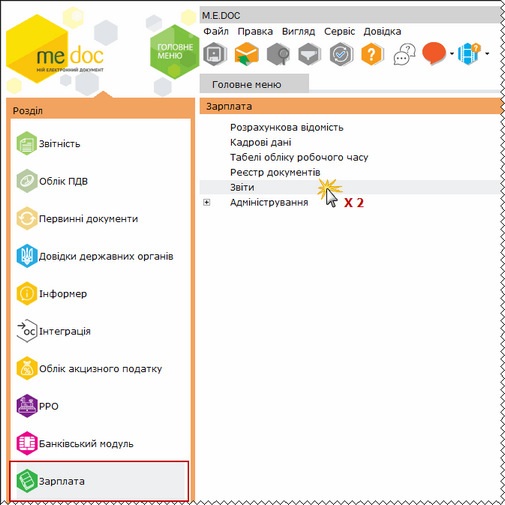

Натисніть, щоб збільшити малюнок

- із відкритого вікна Розрахункової відомості по натисканню кнопки Звіти на панелі інструментів

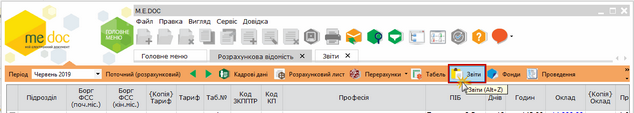

Натисніть, щоб збільшити малюнок

Щоб створити бухгалтерський звіт:

1. У модулі Звіти розділу Зарплата оберіть потрібний для формування звіт подвійним кліком лівої кнопки миші.

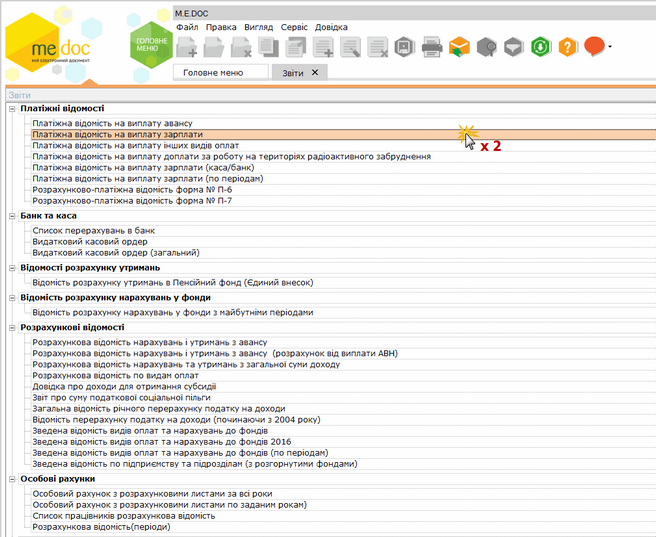

Натисніть, щоб збільшити малюнок

2. Відкриється вікно попередніх налаштувань звіту.

Для кожного звіту параметри налаштувань індивідуальні. На малюнку представлений типовий набір параметрів для формування звіту.

- У полі Звітний період оберіть звітний період, на підставі даних якого буде сформовано звіт. За замовчанням встановлено поточний період.
- У полі Сортувати по оберіть порядок сортування, в якому виведуться дані в сформованому звіті.
Для вибору доступні значення:
- по табельному номеру;
- прізвище, ім'я та по-батькові.
- У блоці атрибутів Підприємство встановіть позначку біля варіанту, на підставі яких саме даних формувати звіт:
- по всьому підприємству;
- по обраним працівникам;
- по обраним підрозділам.

За умови вибору варіанту По обраним працівникам обов'язково потрібно відкрити Розрахункову відомість та виділити запис потрібного робітника. Саме для цього робітника і сформується звіт.

За умови вибору варіанту По обраним підрозділам у блоці Лист підрозділів, що розташований нижче відобразиться перелік підрозділів підприємства. Встановіть галочки напроти тих підрозділів, на підставі даних яких потрібно сформувати звіт. Для того, щоб виділити всі підрозділи одночасно, натисніть кнопку Вибрати всі, для того, щоб зняти виділення з усіх записів, натисніть кнопку Зняти всі.

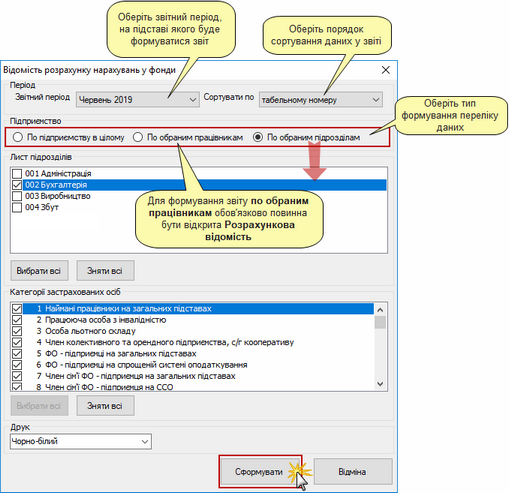

Натисніть, щоб збільшити малюнок

3. Після встановлення необхідних параметрів натисніть кнопку Сформувати.

4. Сформований звіт відкриється в окремому вікні спеціального редактору. Всі сформовані звіти відображаються тільки в режимі перегляду, їх не можна редагувати.

У вікні редактору доступні такі функції:

- Друк - дозволяє надрукувати сформований звіт;
- Зберегти - дозволяє зберегти звіт в одному із найуживаніших форматів.

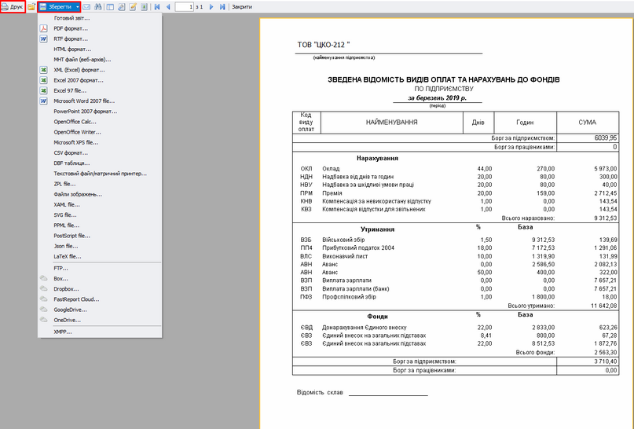

Натисніть, щоб збільшити малюнок

[До початку](#payreportspayreports-reestrstatement_payreportspayreports)

До програми  M.E.Doc інтегрована форма первинної облікової документації: Табель обліку робочого часу. Програмний варіант Табелю розроблено за типовою формою № П-5, затвердженою Наказом Держкомстату України від 05.12.2008 року № 489.

За необхідності форма Табелю може бути доповнена іншими показниками, потрібними для обліку робочого часу на підприємстві.

У M.E.Doc інтегровано два варіанта Табелю:

- Табель обліку робочого часу (кольоровий з годинами);
- Табель обліку робочого часу (скорочений).

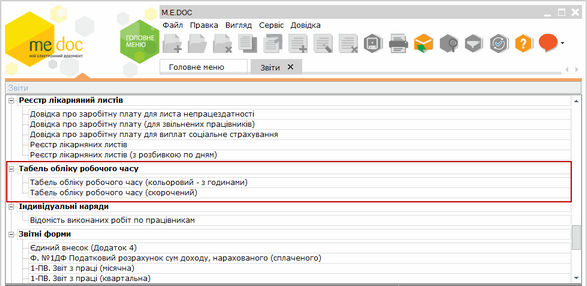

Щоб створити Табель обліку робочого часу:

1. У модулі Звіти розділу Зарплата оберіть потрібний для формування варіант табелю подвійним кліком лівої кнопки миші.

2. Відкриється вікно попередніх налаштувань Табелю.

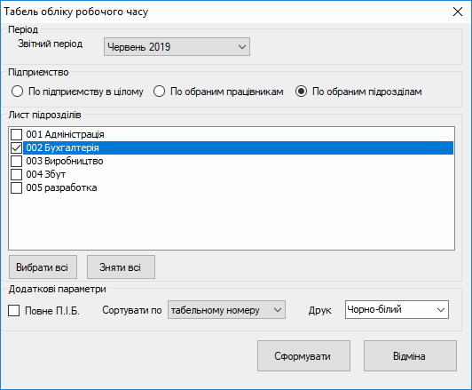

- У полі Звітний період оберіть звітний період, на підставі даних якого буде сформовано Табель. За замовчанням встановлено поточний період. Формування Табелю можливе як у поточному періоді, так і за минулі звітні періоди.
- У блоці атрибутів Підприємство встановіть позначку біля варіанту, на підставі яких саме даних формувати Табель:
- По підприємству в цілому;
- По обраним працівникам;
- По обраним підрозділам.

За умови вибору варіанту По обраним працівникам обов'язково потрібно відкрити Розрахункову відомість та встановити позначки у записах потрібних робітників. Саме для цих робітників і сформується Табель.

За умови вибору варіанту По обраним підрозділам у блоці Лист підрозділів, що розташований нижче, відобразиться перелік підрозділів підприємства. Встановіть галочки напроти тих підрозділів, на підставі даних яких потрібно сформувати Табель. Для виділення всіх підрозділів одночасно натисніть кнопку Вибрати всі, для зняття виділення з усіх записів натисніть кнопку Зняти всі.

- При встановленій позначці Повне П.І.Б у звіті буде відображено прізвище, ім'я та по батькові повністю.
- У полі Сортувати по встановлюється сортування Табеля - по табельному номеру або по П.І.Б.
- У полі Друк оберіть тип виводу звіту на друк: кольоровий чи чорно-білий.

3. Після встановлення необхідних параметрів натисніть кнопку Сформувати.

4. Сформований Табель відкриється в окремому вікні спеціального редактору. Всі сформовані звіти відображаються тільки в режимі перегляду, їх не можна редагувати.

У вікні редактору доступні такі функції:

- Друк - дозволяє надрукувати сформований звіт;
- Зберегти - дозволяє зберегти звіт в одному із найуживаніших форматів.

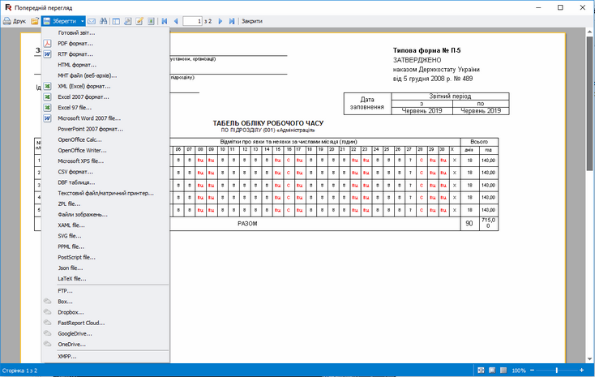

Табель обліку робочого часу (скорочений)
Натисніть, щоб збільшити малюнок

[До початку](#payreportspayreports-reestrstatement_payreportspayreports)

Формування документів по кадрам

Для формування документів по кадрам:

1. Перейдіть до підрозділу Кадровий облік та відкрийте групу звітів Документи по кадрам.

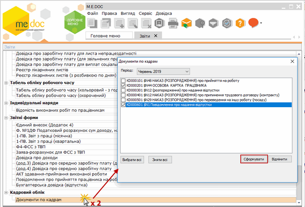

Натисніть, щоб збільшити малюнок

2. У вікні, що відкриється, оберіть необхідний документ (чи кілька документів) та натисніть Сформувати.

3. Створені звіти відкриються у окремих вкладках. У кожному звіті оберіть працівника, дані якого необхідно відобразити в документі та натисніть кнопку Заповнити.

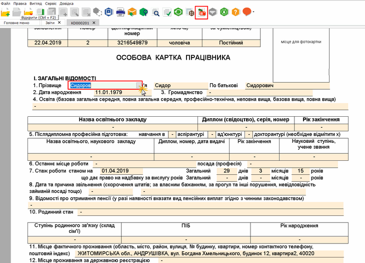

Натисніть, щоб збільшити малюнок

Є можливість автоматично заповнити звіт даними обраного працівника:

1. Відкрийте Розрахункову відомість та встановити позначку у рядку потрібного працівника.

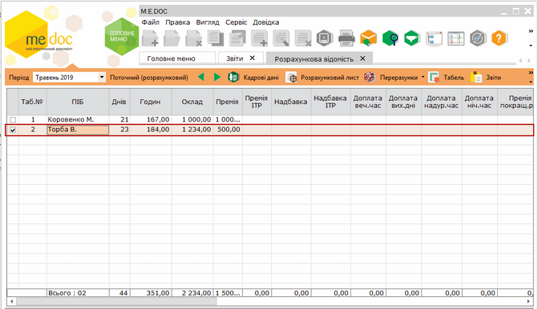

Натисніть, щоб збільшити малюнок

2. Перейдіть до підрозділу Кадровий облік та відкрийте групу звітів Документи по кадрам. У вікні, що відкриється, оберіть необхідний документ (чи кілька документів) та натисніть Сформувати.

3. Система виведе повідомлення, чи заповнювати документ даними з розрахункової відомості. Натисніть Так.

4. Створені звіти відкриються у окремих вкладках. Кожен звіт буде автоматично заповнено даними обраного співробітника:

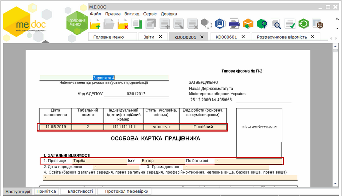

Натисніть, щоб збільшити малюнок

Створені звіти доступні у розділі програми Звітність - Реєстр звітів.

[До початку](#payreportspayreports-reestrstatement_payreportspayreports)


