[← Зміст довідки](../)


# Створення звітів на підставі даних розрахункової відомості

## Створення звітів на підставі даних розрахункової відомості

_Шлях у довідці: Розділи програми › Зарплата › Звіти › Створення звітів на підставі даних розрахункової відомості_

В цьому розділі:

[Створення форми 1-ПВ на підставі даних розрахункової відомості](#payreportszvity-reestrstatement_payreportszvity)

[Формування Об'єднаної звітності  ПДФО та ЄСВ](#payreportszvity-reestrstatement_payreportszvity)

[Формування звіту Заява-розрахунок та Повідомлення про виплату коштів](#payreportszvity-reestrstatement_payreportszvity)

Заповнити форму 1-ПВ можливо одним із способів:

- за допомогою модуля Звітність - Реєстр звітів;
- за допомогою модуля Звіти розділу Зарплата.

Заповнення форми 1-ПВ за допомогою модуля Звітність - Реєстр звітів

1. У головному меню оберіть розділ Звітність і подвійним кліком лівої кнопки миші відкрийте модуль Реєстр звітів.

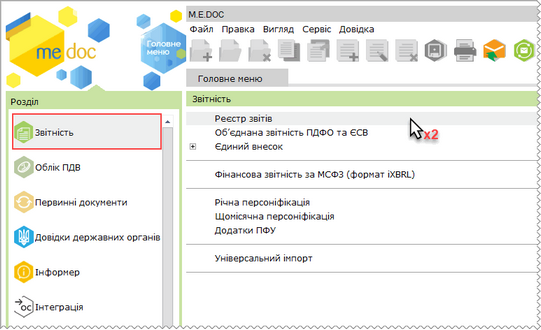

Натисніть, щоб збільшити малюнок

2. Оберіть період в якому потрібно створити звіт.

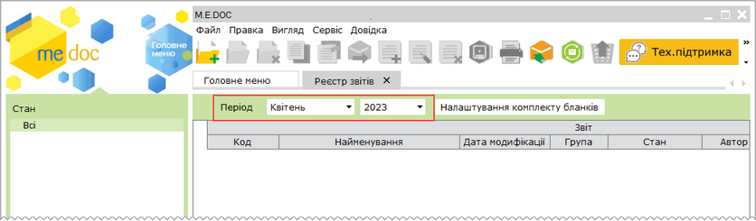

3. Виберіть команду Файл - Створити.

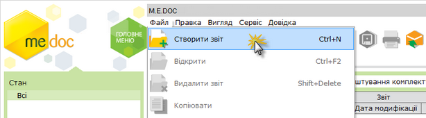

4. Відкриється вікно Створення звіту.

В розділі Державна служба статистики - праці реєстру бланків оберіть документ S0301011 1-ПВ. Звіт з праці (місячна) або S0301115 1-ПВ. Звіт з праці (квартальна).

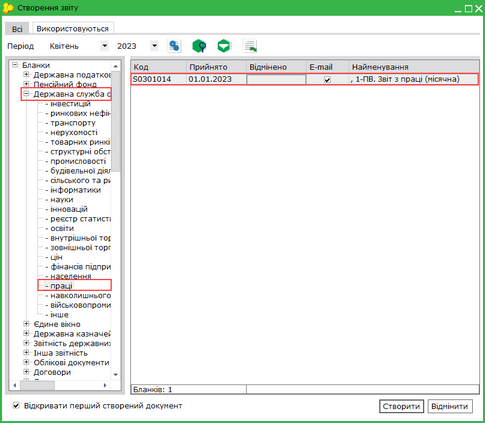

Натисніть, щоб збільшити малюнок

5. Натисніть кнопку Cтворити.

6. Система виведе повідомлення, чи заповнювати документ даними з розрахункової відомості. Натисніть Так.

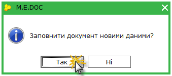

8. У окремій вкладці відкриється заповнений даними документ.

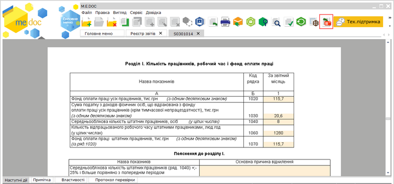

Натисніть, щоб збільшити малюнок

9. В разі зміни даних по заробітній платі у розрахунковій відомості, натисніть кнопку Заповнити  на панелі інструментів.

Система виведе повідомлення, чи заповнювати документ даними з розрахункової відомості. Натисніть Так.

10. Збережіть звіт, натиснувши кнопку  або комбінацію клавіш Ctrl+S.

[До початку](#payreportszvity-reestrstatement_payreportszvity)

Заповнення форми 1-ПВ у розділі Звіти модуля Зарплата

1. У головному меню оберіть модуль Зарплата – Звіти.

2. У розділі Звітні форми оберіть звіт 1-ПВ. Звіт з праці (місячна) або 1-ПВ. Звіт з праці (квартальна) та відкрийте його подвійним кліком лівої кнопки миші.

3. У вікні формування звіту оберіть звітний період та спосіб формування звіту (По всьому підприємству, По обраним підрозділам, По обраним працівникам) та натисніть Сформувати.

4. У повідомленні, чи заповнювати документ даними з розрахункової відомості, натисніть Так.

[До початку](#payreportszvity-reestrstatement_payreportszvity)

Формування Об'єднаної звітності  ПДФО та ЄСВ

Заповнити форму Об'єднаної звітності  ПДФО та ЄСВ можливо одним із способів:

- за допомогою модуля Звітність - Об'єднана звітність  ПДФО та ЄСВ;
- за допомогою модуля Звіти розділу Зарплата.

Заповнення Об'єднаної звітності  ПДФО та ЄСВ за допомогою модуля Звітність - Об'єднана звітність  ПДФО та ЄСВ

1. У головному меню оберіть розділ Звітність і далі подвійним кліком лівої кнопки миші відкрийте модуль Об'єднана звітність  ПДФО та ЄСВ.

2. Оберіть період в якому потрібно сформувати звіт.

3. Відкрийте Додаток 1 або Додаток 4 , Додаток 5, Додаток 6, обов’язково вкажіть Номер місяця (крім Додатка 5), за який потрібно заповнити звіт. На панелі інструментів натисніть кнопку Заповнити . Зверніть увагу, що заповнення таблиць даними з модуля Об'єднана звітність  ПДФО та ЄСВ, відбувається тільки у відкритих додатках.

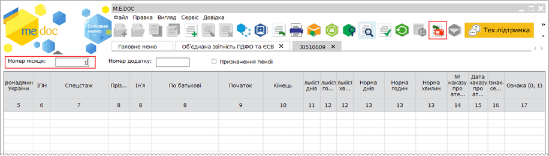

Натисніть, щоб збільшити малюнок

4. Система виведе повідомлення, чи заповнювати документ новими даними з розрахункової відомості. Натисніть Так.

5. Таблиці заповняться відповідними даними з розрахункової відомості.

[До початку](#payreportszvity-reestrstatement_payreportszvity)

Заповнення Об'єднаної звітності  ПДФО та ЄСВ у модулі Звіти розділу Зарплата

1. У головному меню оберіть модуль Зарплата – Звіти.

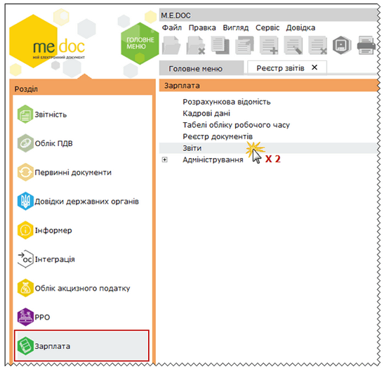

Натисніть, щоб збільшити малюнок

2. У розділі Звітні форми оберіть звіт Об'єднана звітність  ПДФО та ЄСВ та відкрийте подвійним кліком лівої кнопки миші.

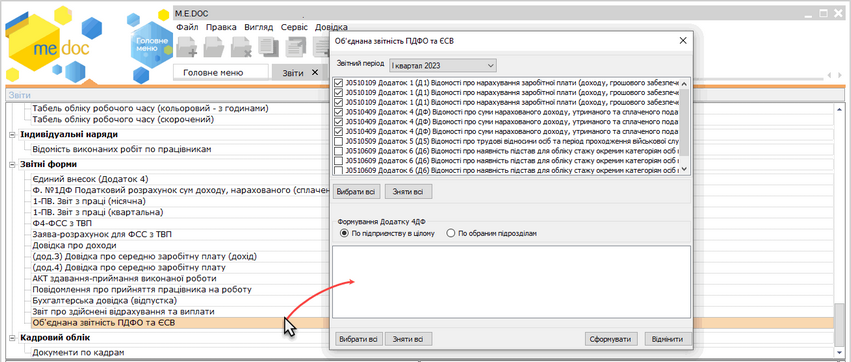

Натисніть, щоб збільшити малюнок

3. У вікні, що відкриється, оберіть всі необхідні додатки для автоматичного заповнення та натисніть Сформувати. Податковий розрахунок буде створено автоматично.

У вікні створення звітів порядок розташування Додатків відповідає місяцям кварталу, за який формується звіт. Наприклад, перший у списку Додаток 1 за І квартал звітного року відповідає місяцю Січень звітного року, другий Додаток 1- Лютий і т.д. Якщо необхідно сформувати один з додатків за певний місяць кварталу, необхідно обрати додаток, розміщений на відповідній позиції в списку Додатків.

Зверніть увагу, якщо якийсь з додатків не було обрано, то при повторному формуванні звіту, необхідно знову обирати усі необхідні  додатки. В іншому випадку такий додаток сформується в окремий звіт. При кожному новому формуванні звіту формується окремий пакет Розрахунку з обраними Додатками.

4. Система виведе повідомлення, чи заповнювати документи даними з розрахункової відомості. Натисніть Так.

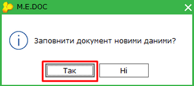

Натисніть, щоб збільшити малюнок

Для Додатків 1, 4, 5, 6 є можливість автоматичного заповнення.

Зверніть увагу! Для автоматичного заповнення Додатка 6 необхідно вказати спецстаж працівника у розділі Кадрові дані - Особова картка працівника - Пільги - Спецстаж.

[До початку](#payreportszvity-reestrstatement_payreportszvity)

Формування звіту Заява-розрахунок та Повідомлення про виплату коштів

Заповнити форму Заява-розрахунок (С1100101) можливо одним із способів:

- за допомогою модуля Звітність - Реєстр звітів;
- за допомогою модуля Звіти розділу Зарплата.

Заповнення форми Заява-розрахунок та Повідомлення про виплату коштів за допомогою модуля Звітність - Реєстр звітів

1.  У головному меню оберіть розділ Звітність і подвійним кліком лівої кнопки миші відкрийте модуль Реєстр звітів.

2.  Оберіть період в якому потрібно створити звіт.

3.  Виберіть команду Файл - Створити.

4.  Відкриється вікно Створення звіту. У розділі ФСС України - Звітність реєстру бланків оберіть документ Заява-розрахунок.

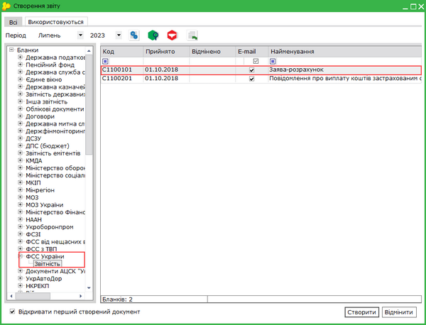

Натисніть, щоб збільшити малюнок

5. Натисніть кнопку Cтворити.

6. Система виведе повідомлення, чи заповнювати документ даними з розрахункової відомості. Натисніть Так.

7. У окремій вкладці відкриється вже заповнений потрібними даними документ.

[До початку](#payreportszvity-reestrstatement_payreportszvity)

Заповнення форми Заява-розрахунок та Повідомлення про виплату коштів у модулі Звіти розділу Зарплата

1. У головному меню оберіть модуль Зарплата – Звіти.

2. У розділі Звітні форми оберіть звіт Заява-розрахунок для ФСС ТВП та відкрийте його подвійним кліком лівої кнопки миші.

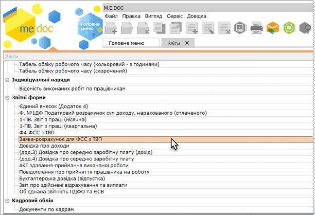

Натисніть, щоб збільшити малюнок

3. У вікні, що відкриється, оберіть звітний період, необхідний документ та натисніть кнопку Сформувати.

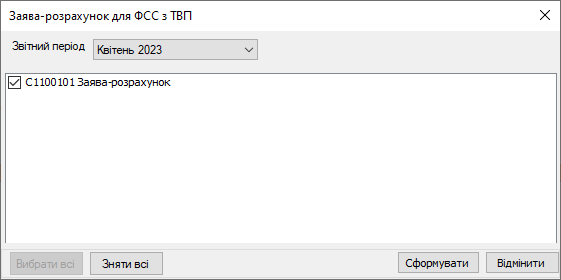

4. Для автоматичного заповнення форми Повідомлення про виплату коштів перейдіть до модуля Реєстр документів, оберіть документ Заборгованість по виплатам. Встановіть відмітки біля необхідних записів та відкрийте розділ Звіти.

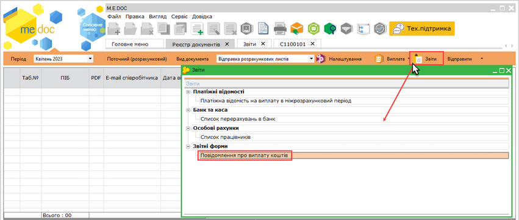

Натисніть, щоб збільшити малюнок

5. Оберіть документ Повідомлення про виплату коштів. У вікні, що відкриється, оберіть спосіб формування звіту: По підприємству в цілому, По обраним працівникам, По обраним підрозділам. Натисніть кнопку Сформувати.

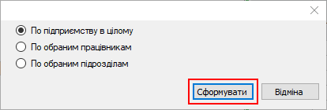

[До початку](#payreportszvity-reestrstatement_payreportszvity)


