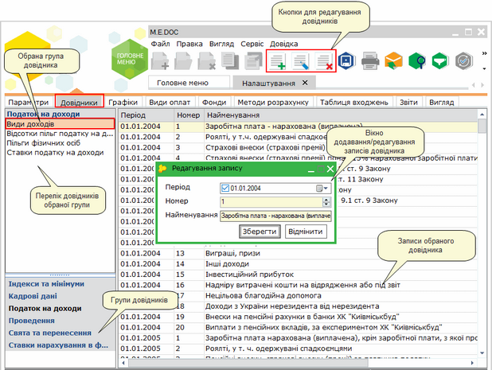
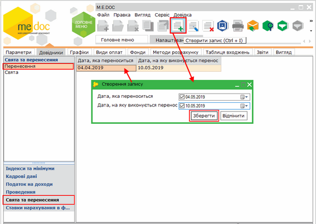
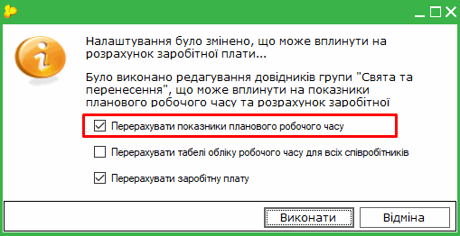
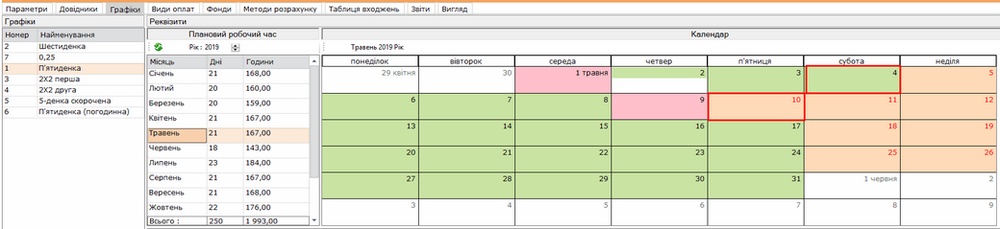
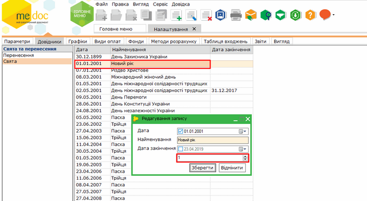
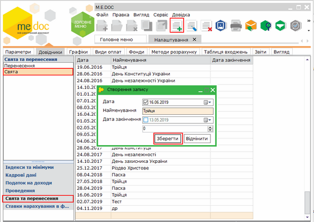
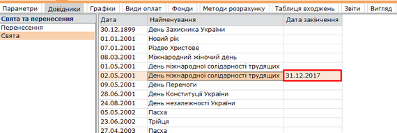

[← Зміст довідки](../)


# Довідники

## Довідники

_Шлях у довідці: Розділи програми › Зарплата › Адміністрування › Налаштування › Довідники_

Натисніть, щоб збільшити малюнок

Система використовує багато вбудованих довідників. У Довідниках вказані основні дані для розрахунку заробітної плати, нарахувань до фондів та формування проведень.

Для зручності, довідники згруповані за видами зібраної в них інформації: індекси та мінімуми, кадрові дані, податок на доходи, проведення, свята та перенесення, ставки нарахування в фонди.

В довідники можна вносити та редагувати дані. Для цього призначені кнопки ,  та  на панелі інструментів.

---

У розділі Свята та перенесення є можливість налаштовувати перенесення робочих днів та додавати свята:

Перенесення робочих днів:

1. Перейдіть у розділ Свята та перенесення - Перенесення. Натисніть кнопку  .

2. У полі Дата, яка переноситься вкажіть дату, яку необхідно перенести. В полі Дата, на яку виконується перенос вкажіть дату, на яку необхідно виконати перенос.

3. Натисніть кнопку Зберегти.

Натисніть, щоб збільшити малюнок

4. Для застосування переносу збережіть налаштування, за допомогою кнопки .

5. У вікні, що з’явиться, встановіть опцію Перерахувати показники планового робочого часу та натисніть кнопку Виконати. Перенесення буде застосовано для працівників, у яких в налаштуваннях графіку ввімкнено параметр Використовувати перенесення робочих днів.

Натисніть, щоб збільшити малюнок

Додавання святкових днів:

У довіднику Свята міститься інформація про святкові дні.

Свята, занесені до довідника, можуть бути змінними та постійними. Свята, що мають ознаку "1", є постійним, їх не потрібно щороку додавати до довідника, оскільки дата свята не змінюється (Новий рік, Різдво тощо):

Натисніть, щоб збільшити малюнок

Трійця, Пасха, мають ознаку "0", тому такі свята  щороку мають бути занесені до довідника. Щоб додати свято натисніть кнопку  та введіть дані у вікні, що відкриється:

Натисніть, щоб збільшити малюнок

Дата закінчення у довіднику містить інформацію про відміну свята, наприклад, 2 травня - День міжнародної солідарності трудящих:

Натисніть, щоб збільшити малюнок


