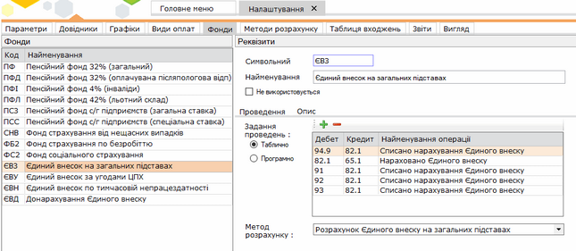

[← Зміст довідки](../)


# Фонди

## Фонди

_Шлях у довідці: Розділи програми › Зарплата › Адміністрування › Налаштування › Фонди_

Натисніть, щоб збільшити малюнок

Містить список фондів, до яких виконуються нарахування, параметри та короткий опис обраного нарахування до фондів.

За необхідності фонди можна додавати та створювати програми розрахунку.

1. Для того, щоб додати новий фонд натисніть кнопку  на панелі інструментів. Якщо новий фонд подібний до вже існуючого, скопіюйте його, скориставшись кнопкою .

2. Новий фонд додається в кінці списку, відображається синім кольором. Виділіть строку та налаштуйте параметри новоствореного фонду:

- Символьний код - введіть вручну із клавіатури код фонду. Максимальна кількість символів - 3 знаки.
- Найменування - введіть назву фонду.
- Не використовується - наявність галочки в цьому полі вказує на те, що внески в обраний фонд не будуть нараховуватись при розрахунку заробітної плати.
- Вкладка Проведення містить список бухгалтерських проведень. При додаванні чи редагуванні проводиться вибір бухгалтерських проведень із довідника "Типові проведення". Для того, щоб додати проведення, натисніть кнопку .
- Вкладка Опис містить загальну інформацію про фонди.


