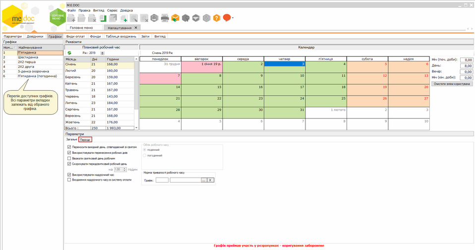
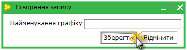
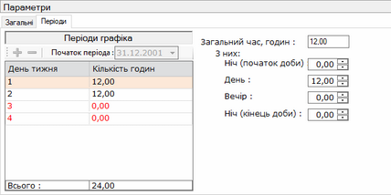
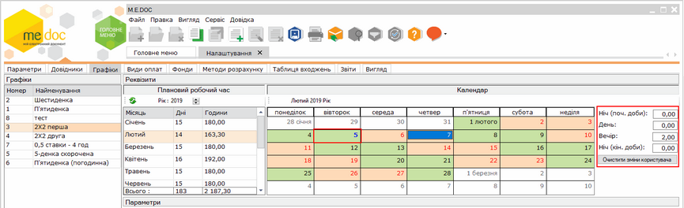
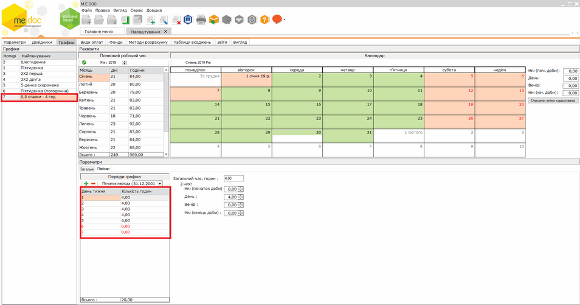
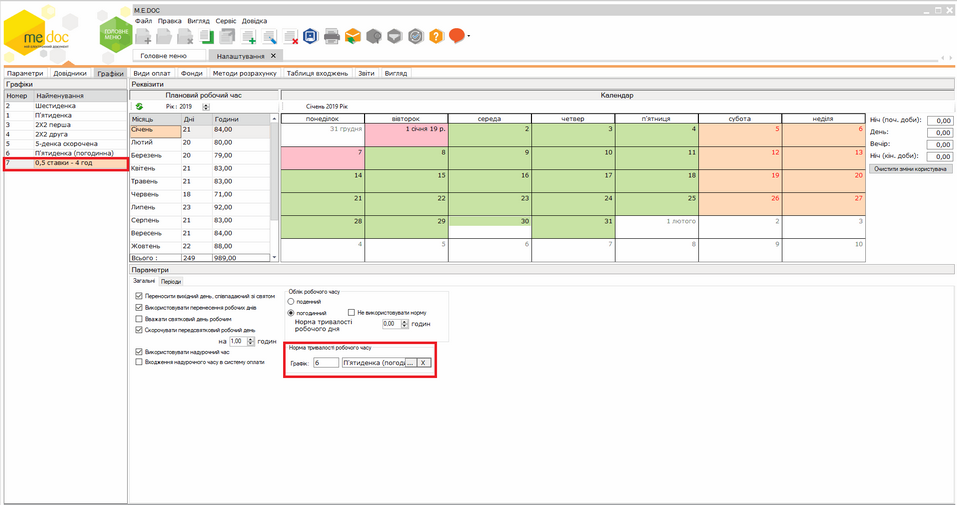

[← Зміст довідки](../)


# Графіки

## Графіки

_Шлях у довідці: Розділи програми › Зарплата › Адміністрування › Налаштування › Графіки_

Натисніть, щоб збільшити малюнок

Графіки використовуються для розрахунку планового робочого часу працівників.

У групі параметрів Графіки представлено перелік доступних графіків роботи працівників. Відображення інших параметрів даної вкладки залежать від обраного графіку роботи.

Розробником надано декілька стандартних графіків для використання розрахунку заробітної плати. За потреби Ви можете додати та налаштувати власний графік роботи працівника.

1. Для додавання нового графіку роботи натисніть кнопку  на панелі інструментів.

У вікні Створення запису введіть назву нового графіку.

Натисніть кнопку Зберегти.

2. На вкладці Періоди, в групі параметрів Періоди графіка, зазначені дата початку періоду, порядок розташування в періоді робочих і вихідних днів, кількість робочих і вихідних днів та тривалість кожного з робочих днів. Дні періоду можна додавати і вилучати, тривалість робочих днів - коригувати.

Натисніть, щоб збільшити малюнок

Налаштуйте параметри в групі Періоди графіка:

- Дата в полі Початок періоду встановлюється автоматично. В разі зміни дати вручну, зверніть увагу, що період повинен починатись з першого понеділка місяця.
- Для того, щоб додати показник періодичності натисніть кнопку . З'явиться рядок з номером дня тижня у періоді. Вручну із клавіатури введіть кількість робочих годин для цього дня.
Таким чином заповнюються всі робочі дні тижня. Для вихідних днів кількість робочих годин повинні дорівнювати 0.

- Праворуч від групи параметрів Періоди графіка необхідно визначити скільки робочих годин припадає на кожну частину доби. Поле "Загальний час, годин" заповнюється автоматично.

3. Кількість робочих днів та годин у групі параметрів Плановий робочий час розраховуються автоматично на підставі даних в групі Періоди графіка.

4. В календарі відображається місяць, який обраний в групі Плановий робочий час:

- зеленим кольором позначені робочі дні;
- помаранчевим кольором позначені вихідні дні;
- рожевим кольором позначені святкові дні.

Обравши необхідний день в календарі, є можливість вказати норму робочого часу для цього дня. За допомогою полів: Ніч (поч.доби), День, Вечір, Ніч (кін. Доби) вкажіть необхідну кількість годин, відпрацьованих у потрібний час доби. Дата, на яку внесені, зміни відображається синім кольором. Щоб видалити внесені вручну зміни, оберіть дату та натисніть кнопку Очистити зміни користувача.

Натисніть, щоб збільшити малюнок

5. В нижній частині вікна на вкладці Загальні налаштуйте необхідні параметри:

- Переносити вихідний день, співпадаючий зі святом - якщо святковий день випадає на вихідний (неробочий), то його буде перенесено на наступний робочий день;
- Використовувати перенесення робочих днів - дозволяє використовувати при розрахунках дані, внесені в довідник Свята та перенесення - Перенесення;
- Вважати святковий день робочим - встановлює святковий день робочим, за умови, що робоча зміна випадає на свято;
- Скорочувати передсвятковий робочий день - до графіку застосовується скорочення передсвяткового дня; з'являється додаткове поле, де вказується на скільки саме годин скорочувати робочий день;
- Використовувати надурочний час - у графіку робочого часу дозволяється використання понаднормового робочого часу, якщо у полі Норма робочого часу вказано графік роботи з кількістю годин менше ніж у графіку роботи, надурочний час буде розраховано автоматично;
- Входження надурочного часу в систему оплати - використовувати оплату за понаднормовий робочий час у системі оплати.
- в групі Облік робочого часу оберіть потрібний тип: поденно або погодинно. При виборі погодинного типу обліку обов'язково потрібно встановити кількість годин тривалості робочого часу за нормою;

6. За допомогою параметру Норма тривалості робочого часу виконується налаштування графіку для неповного робочого часу:

- Створіть новий графік із скороченим періодом роботи. Наприклад, понеділок - 4.00 год., вівторок - 4.00 год., середа -4.00 год., четвер- 4.00 год., п'ятниця- 4.00 год. Решта днів - вихідні.

Натисніть, щоб збільшити малюнок

- Встановіть значення параметру Норма тривалості робочого часу "П'ятиденка (погодинна)" або будь-який інший. Таким чином, за норму буде застосовано 8 годинний робочий тиждень.

Натисніть, щоб збільшити малюнок


