[← Зміст довідки](../)


# Види оплат

## Види оплат

_Шлях у довідці: Розділи програми › Зарплата › Адміністрування › Налаштування › Види оплат_

В цьому розділі:

[Додавання нового індивідуального виду оплати](#paytoolsoplat-reestrstatement_paytoolsoplat)

[Додавання другої системи оплати праці](#paytoolsoplat-reestrstatement_paytoolsoplat)

[Змінення відсотків доплати за роботу у вихідний або святковий день для всіх працівників](#paytoolsoplat-reestrstatement_paytoolsoplat)

[Додавання премії](#paytoolsoplat-reestrstatement_paytoolsoplat)

[Розрахунок авансу для працівників з неповним робочим часом](#paytoolsoplat-reestrstatement_paytoolsoplat)

Додавання нового індивідуального виду оплати

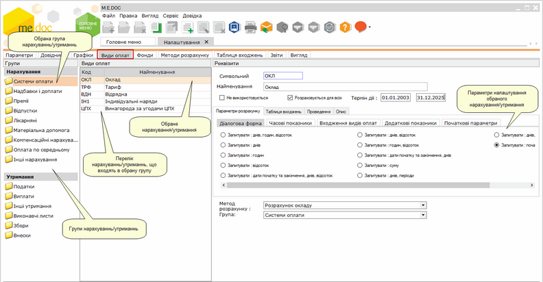

Натисніть, щоб збільшити малюнок

Містить перелік нарахувань та утримань, що використовуються при розрахунку заробітної плати, параметри розрахунку кожного виду оплати та їх опис.

Засоби, що розміщені на даній вкладці дозволяють додавати нові індивідуальні нарахування та/або утримання для розрахунку заробітної плати.

1. Для того, щоб додати новий індивідуальний вид оплати, оберіть групу та натисніть кнопку  на панелі інструментів.

Якщо новий вид оплати подібний до вже існуючого, скопіюйте його: виділіть існуючий вид оплати та натисніть кнопку .

2. Новий вид оплати додається в кінці списку, відображається іншим кольором. Виділіть рядок та налаштуйте параметри новоствореного виду оплати:

- Символьний код - введіть вручну із клавіатури код виду оплати. Максимальна кількість символів - 3 знаки.
- Найменування - введіть назву виду оплати.
- Не використовується - наявність галочки в цьому полі вказує на те, що обраний вид оплати не буде використано в програмі розрахунку заробітної плати та в таблиці входжень.
- Розраховується для всіх - наявність галочки в цьому полі вказує на те, що розрахунок обраного виду оплати буде автоматично провадитись для всіх працівників.
- Вкладка Параметри розрахунку містить  групи параметрів:
- Діалогова форма - налаштовуються одиниці виміру, в яких буде відображено даний вид оплати;
- Часові показники - налаштовується розрахунок виду оплати відносно облікового робочого часу;
- Входження видів оплат - відображається розділ та підрозділ до яких входить обраний вид оплати;
- Додаткові показники - налаштовуються додаткові параметри, що впливають на розрахунки заробітної плати;
- Початкові параметри - містить кнопку, що дозволяє повернути параметри, встановлені за замовчанням.
- Вкладка Таблиця входжень містить таблицю входжень, в якій вказано, до яких розділів (Розрахунки, Нарахування, Утримання, Фонди, Середній заробіток, Користувача, Податки) включається обраний вид оплати. Наприклад, премія включається в розділ Нарахування для розрахунку лікарняних, відпустки і компенсації за невикористану відпустку, в розділ Утримання - для розрахунку прибуткового податку, військового збору, виконавчого листа, в розділ Фонди - для нарахування внесків до пенсійного фонду.
- Вкладка Проведення містить список бухгалтерських проведень. При додаванні чи редагуванні проводиться вибір бухгалтерських проведень із довідника "Типові проведення". Для додавання проведення натисніть кнопку .
- Вкладка Опис містить загальну інформацію про вид оплати.

[До початку](#paytoolsoplat-reestrstatement_paytoolsoplat)

Додавання другої системи оплати праці

Виконайте такі дії:

1. На вкладці Види оплат створіть вид оплати, що буде використовуватись для другої системи оплати праці. Для цього виділіть вид оплати Оклад або Тариф та оберіть команду контекстного меню Копіювати або натисніть кнопку панелі інструментів .

2. У полі Найменування в області Реквізити змініть назву скопійованого виду оплати, наприклад, Оклад-2.

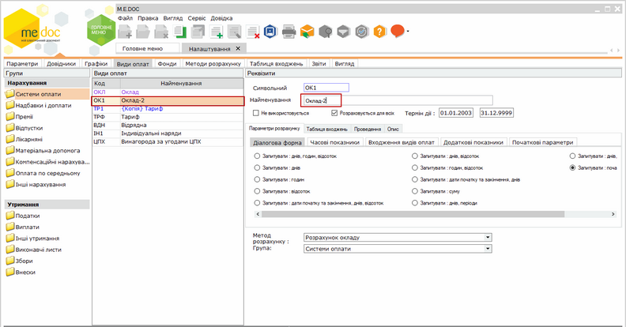

Натисніть, щоб збільшити малюнок

3. Перейдіть у розділ Зарплата/Кадрові дані та відкрийте Особову картку співробітника подвійним натисканням на рядку співробітника.

4. Додайте новий вид оплати. Для цього натисніть кнопку . Відкриється вікно Додавання нарахування.

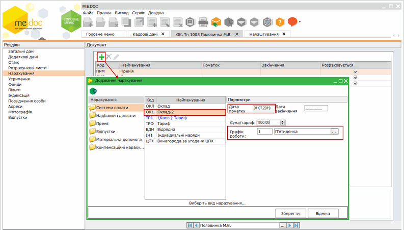

Натисніть, щоб збільшити малюнок

4. У області Найменування оберіть назву оплати, що буде використовуватись для другої системи оплати праці. Встановіть значення дати початку, суми тарифу та графік роботи у однойменних полях області Параметри. Для збереження налаштувань натисніть кнопку Зберегти.

В основному окладі, який використовувася раніше необхідно прибрати відмітку Розраховується.

Оклад згідно другої системи оплати розраховується автоматично і відображається у Розрахунковому листі. Також збільшується кількість фактично відпрацьованих днів.

Якщо кількість фактично відпрацьованих днів збільшувати не потрібно, виконайте наступні налаштування:

1. На вкладці Види оплат оберіть групу Системи оплати.

2. Оберіть вид оплати, що використовується для другої системи оплати праці.

3. Перейдіть на вкладку Часові показники та зніміть позначку Збільшує кількість відпрацьованого часу згідно параметрів графіка роботи працівника.

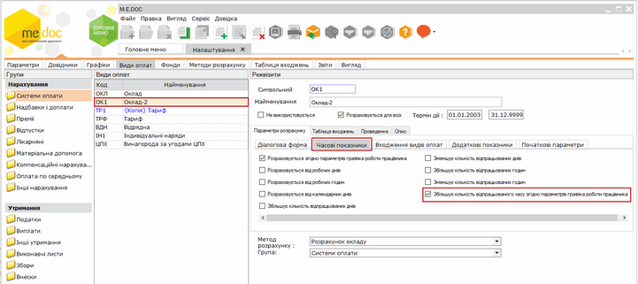

Натисніть, щоб збільшити малюнок

Якщо зміна окладу відбувається не з першого числа місяця:

1. Видаліть відмітку Розраховується для окладу, що використовувався раніше.

2. Додайте нарахування Оклад, вкажіть дату початку та закінчення дії даної системи оплати, суму та графік роботи.

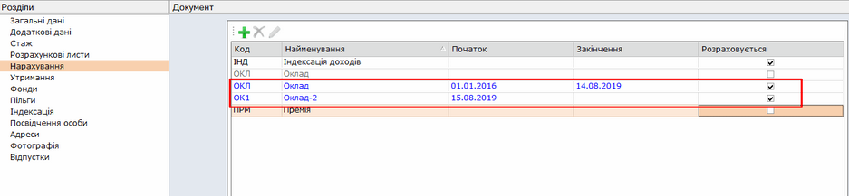

Натисніть, щоб збільшити малюнок

3. Додайте нову систему оплати, в якій вкажіть дату початку дії, суму та графік роботи.

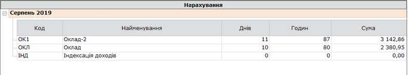

Натисніть, щоб збільшити малюнок

[До початку](#paytoolsoplat-reestrstatement_paytoolsoplat)

Змінення відсотків доплати за роботу у вихідний або святковий день для всіх працівників

Виконайте налаштування у наступній послідовності:

1. На вкладці Види оплат оберіть групу Надбавки і доплати.

2. Оберіть вид оплати Доплата за роботу в вихідні дні (або Доплата за роботу в святкові дні).

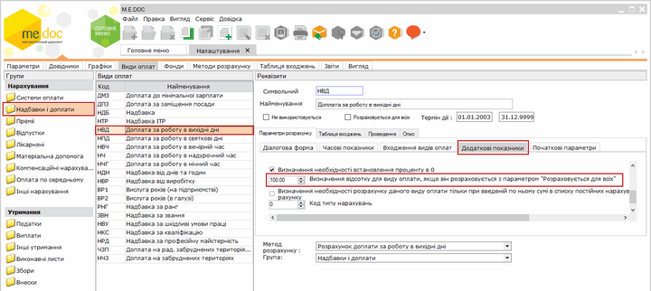

Натисніть, щоб збільшити малюнок

3. Перейдіть на вкладку Додаткові показники та в опції Визначення відсотку для виду оплати, якщо він розраховується з параметром "Розраховується для всіх" встановіть необхідне значення відсотку оплати.

[Розрахунок нарахування доплати за роботу у вихідний або святковий день](PayBoards.html#payboards-reestrstatement_payboards) проводиться автоматично через табель.

[До початку](#paytoolsoplat-reestrstatement_paytoolsoplat)

Додавання премії

Виконайте дії:

1. На вкладці Види оплат перейдіть у розділ Премії та створіть вид оплати, що буде використовуватись як "Премія". Для цього скопіюйте існуючий вид оплати Премія - оберіть команду контекстного меню Копіювати або натисніть кнопку панелі інструментів .
Або створіть новий вид оплати - натисніть кнопку  на панелі інструментів.

2. Оберіть створений вид оплати у списку Види оплат. У полі Найменування, розташованому у області Реквізити, змініть назву створеного виду оплати, наприклад, Нова премія.

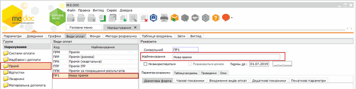

Натисніть, щоб збільшити малюнок

3. Перейдіть на вкладку Вигляд, оберіть розділ Шаблони документів.

4. Скопіюйте шаблон документу для виду оплати Премія - оберіть команду контекстного меню Копіювати або натисніть кнопку на панелі інструментів . Або створіть нову схему відображення - натисніть кнопку  на панелі інструментів.

5. Оберіть створений шаблон  у списку Шаблони документів. У полі Найменування введіть назву нового шаблону, що відповідатиме створеному виду оплати (у нашому прикладі - Нова премія).

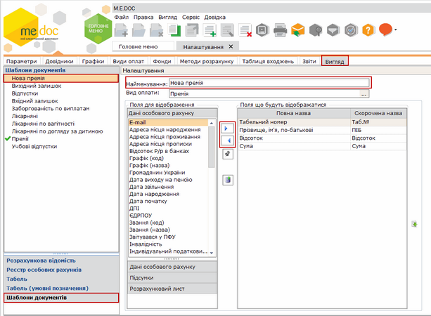

Натисніть, щоб збільшити малюнок

6. Встановіть позначку  - "використовувати по замовчуванню". Для цього натисніть два рази лівою кнопкою миші на назві створеного шаблону.

7. Для збереження змін закрийте вкладку Налаштування. Відкриється вікно повідомлення :

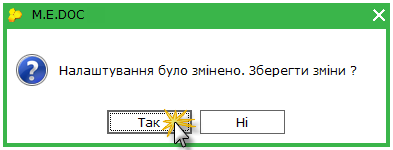

Підтвердьте збереження змін, натиснувши кнопку Так.

8. Перейдіть у розділ [Реєстр документів](PayDoc.html#paydoc-reestrstatement_paydoc). Створена премія буде відображена у вікні розділу.

Натисніть, щоб збільшити малюнок

[До початку](#paytoolsoplat-reestrstatement_paytoolsoplat)

Розрахунок авансу для працівників з неповним робочим часом

Виконайте дії:

1. На вкладці Види оплат оберіть розділ Утримання - Виплати - Аванс - Додаткові показники.

2. У параметрі Розрахунок з врахуванням неповного робочого часу для працівників з графіком роботи  підключено довідник, з якого необхідно обрати графік з неповним робочим часом:

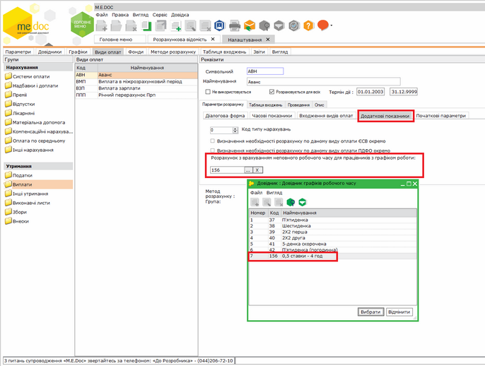

Натисніть, щоб збільшити малюнок

3. Розрахунок авансу для співробітників, що працюють за вказаними в налаштуваннях графіками буде виконано з врахуванням неповного робочого часу:

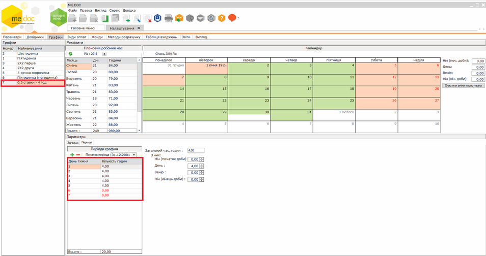

Натисніть, щоб збільшити малюнок

[До початку](#paytoolsoplat-reestrstatement_paytoolsoplat)


