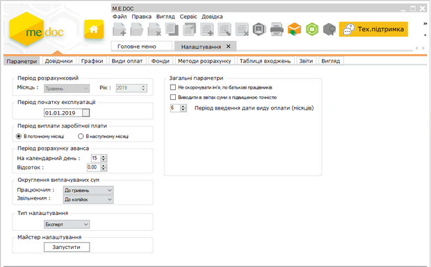

[← Зміст довідки](../)


# Параметри

## Параметри

_Шлях у довідці: Розділи програми › Зарплата › Адміністрування › Налаштування › Параметри_

Натисніть, щоб збільшити малюнок

- Період розрахунковий - відображає поточний період розрахунку заробітної плати працівників.
- Період початку експлуатації - дата початку відліку звітних періодів у системі. Обирається із підключеного до поля календаря або вводиться із клавіатури.
- Період виплати заробітної плати - в залежності від вимог вашого підприємства, встановіть позначку біля потрібного варіанту: проводити виплату заробітної плати в поточному місяці або в наступному.
- Період розрахунку аванса - вкажіть день (число) або відсоток розрахунку аванса.
- Округлення виплачуваних сум - оберіть варіант округлення нарахованих сум до сплати для працюючих робітників та звільнених: округлювати до гривень, до 10 копійок, до 50 копійок.
- Тип налаштування - передбачено 2 типи налаштування:
- стандарт - розрахований на потреби більшості користувачів, забезпечує легку та зручну роботу без додаткових налаштувань.
- експерт - режим призначений для досвідчених користувачів, включає розширений набір налаштувань, що забезпечує можливості налагоджень методів розрахунку, "тонкої" настройки видів оплат, фондів тощо. При виборі цього режиму з'являється додаткова вкладка "Методи розрахунку".

Розробник наполегливо радить використовувати режим СТАНДАРТ!

- Майстер налаштувань -  кнопка Запустити дозволяє визвати Майстер налаштування системи Зарплата. При зміні періоду початку експлуатації всі дані розрахункових листів за минулі та поточний періоди будуть видалені!.
Зверніть увагу! На останньому кроці Майстра розташовані опції, по встановленню яких видаляються попередні дані довідників системи.

- Не скорочувати ім'я, по батькові працівників - наявність даної галочки вказує на відображення в Розрахунковій відомості імені та по-батькові працівника повністю.
- Виводити в звітах суми з підвищеною точністю - наявність даної галочки вказує на відображення розрахованих сум до 3-х знаків після коми.
- Період введення дати виду оплати (місяців) - дозволяє встановити кількість місяців, після перевищення яких система не дозволить вносити види оплат заднім числом.


