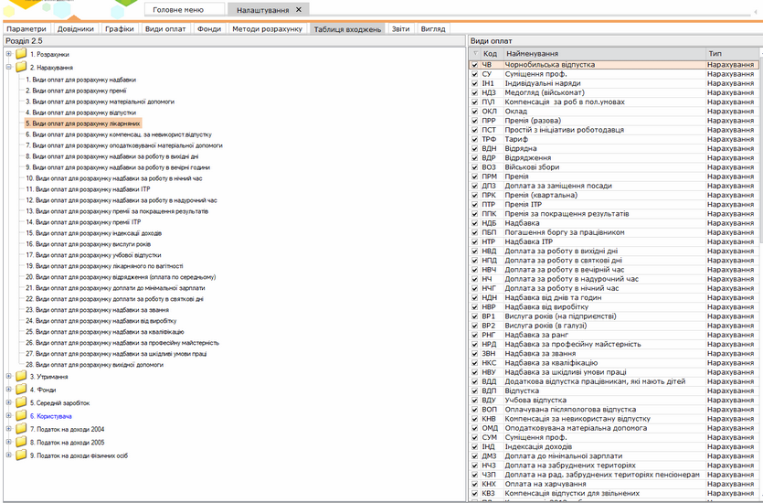

[← Зміст довідки](../)


# Таблиця входжень

## Таблиця входжень

_Шлях у довідці: Розділи програми › Зарплата › Адміністрування › Налаштування › Таблиця входжень_

Натисніть, щоб збільшити малюнок

Містить вказані типові налагодження видів оплат для розрахунків.

Розрахунок заробітної плати провадиться відповідно до вказаних в Таблиці входжень груп пов'язаних між собою видів нарахувань/утримань або фондів.

За потреби, групи пов'язаних між собою видів нарахувань/утримань або фондів в Таблиці входжень можна самостійно коригувати. Для цього:

1. В лівій частині вікна налагодження таблиці входжень оберіть потрібний вид розрахунку, вид оплат або фонд.

2. В правій частині встановіть галочки у переліку видів оплат, які використовуються для розрахунку обраного виду нарахувань/утримань або фондів.

Передбачена можливість створювати індивідуальні входження. Для цього:

1. Оберіть розділ 6. Користувача.

2. Натисніть кнопку  на панелі інструментів. Відкриється вікно Створення запису.

3. Введіть найменування нового підрозділу таблиці входжень та натисніть кнопку Зберегти.

4. В правій частині вікна, в переліку видів оплат встановіть галочки біля видів оплат, необхідних для утворення специфічного зв'язку.


