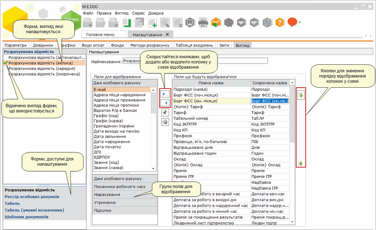
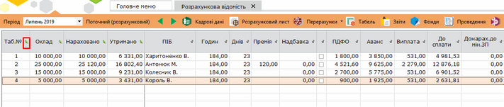

[← Зміст довідки](../)


# Вигляд

## Вигляд

_Шлях у довідці: Розділи програми › Зарплата › Адміністрування › Налаштування › Вигляд_

Натисніть, щоб збільшити малюнок

Дана вкладка містить засоби, що дозволяють налагоджувати зовнішній вигляд (відображення та порядок розташування колонок) основних електронних форм (розрахункової відомості, кадрових даних, табелю обліку робочого часу, реєстру документів) за власних потреб, а також створювати індивідуальні схеми вигляду форм.

При обраній схемі відображення Розрахункова відомість автоналаштування у розрахунковій відомості будуть відображатись всі наявні у працівників нарахування/утримання.

Для створення індивідуального виду електронної форми:

1. Оберіть електронну форму, на основі якої буде створено новий вигляд.

2. Натисніть кнопку  на панелі інструментів.

3. Нова схема відображення додається в кінці списку. Виділіть рядок та налаштуйте параметри новоствореної схеми:

- Найменування - введіть назву нової схеми відображення.
- Оберіть групу полів та в групі поле для відображення. Натисніть кнопку . Назва поля переміститься у вікно Поля, що будуть відображатись. Для видалення поля зі схеми оберіть поле у вікні Поля, що будуть відображатись та натисніть кнопку .

Додаткове налаштування вигляду розрахункових відомостей

При налаштуванні вигляду розрахункових відомостей можна ввімкнути відображення у відомості всіх наявних видів оплат.

По натисканню кнопки  Автоматично налаштовувати поля з видами оплат, окрім налаштованих полів (Поля, що будуть відображатись), будуть відображатись поля за всіма наявними видами оплат.

За допомогою кнопки  є можливість зафіксувати необхідні колонки в лівій частині розрахункової відомості.

Натисніть, щоб збільшити малюнок


