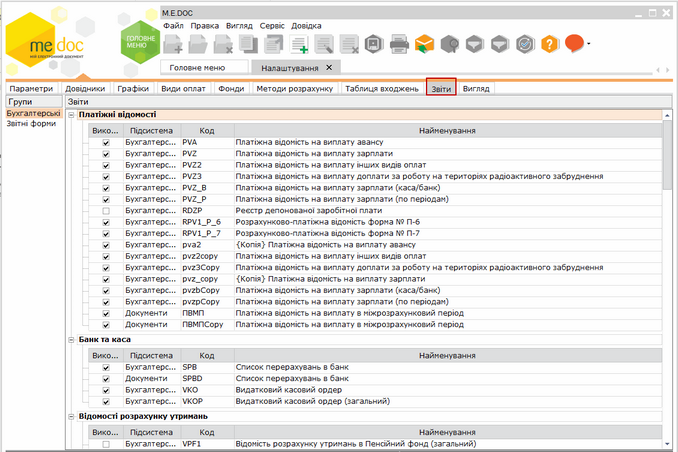

[← Зміст довідки](../)


# Звіти

## Звіти

_Шлях у довідці: Розділи програми › Зарплата › Адміністрування › Налаштування › Звіти_

Натисніть, щоб збільшити малюнок

Містить перелік типових бухгалтерських та звітних документів по заробітній платі, що розподілені по групам за призначенням.

Наявність галочки у колонці Використов. вказує на те, що даний звіт відображається в переліку доступних для створення звітів в розділі [Звіти](PayReportsPayReports.html#payreportspayreports-reestrstatement_payreportspayreports).
Встановіть або зніміть галочку у даному полі відповідно до ваших потреб.

Передбачена можливість створювати власні форми звітів. Для цього:

1. Натисніть кнопку  на панелі інструментів.

2. Відкриється окреме вікно Коригування звіту. Введіть найменування нового звіту. Обов'язково оберіть групу, в яку буде додано новий звіт. Встановіть галочки у відповідних полях.

За необхідності натисніть на кнопку Коригувати шаблон та створіть власний або відкоригуйте існуючий шаблон звіту.

3. Новий звіт додається в кінці списку вказаної групи звітів, відображається синім кольором.


