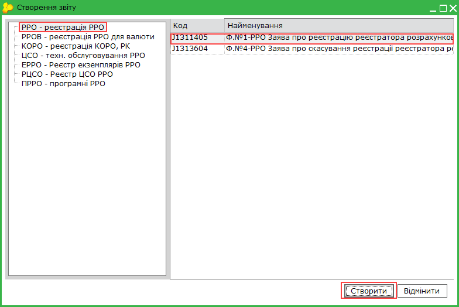
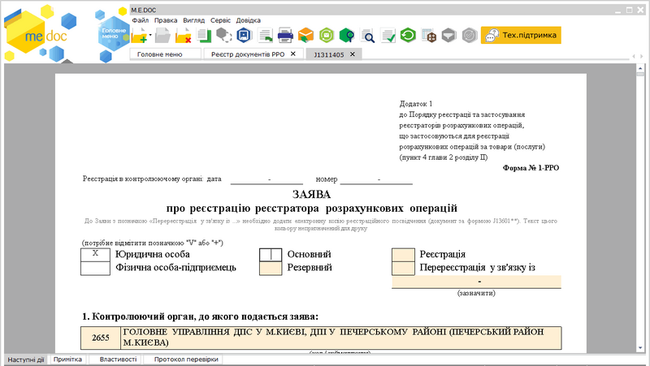
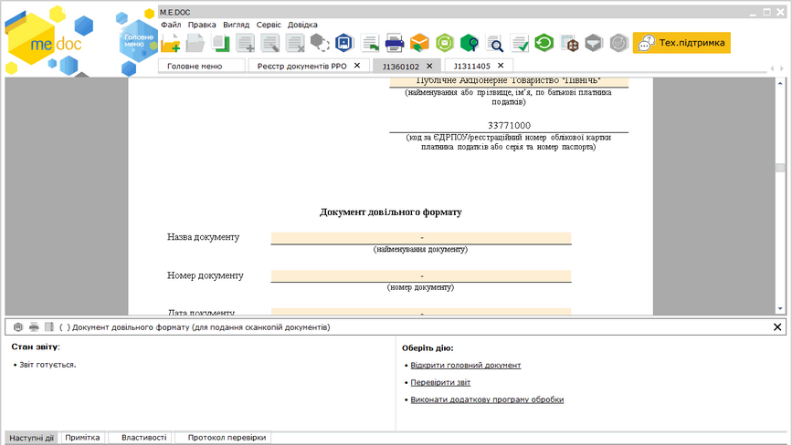
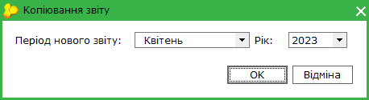
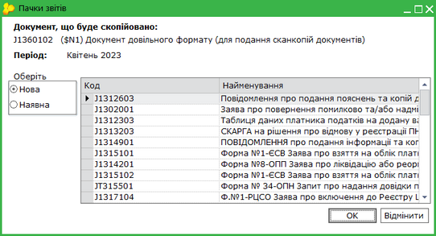
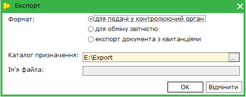
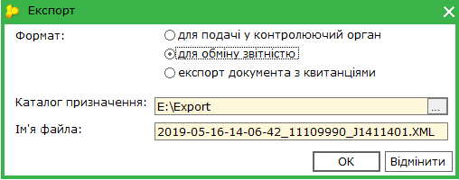
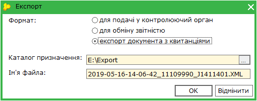
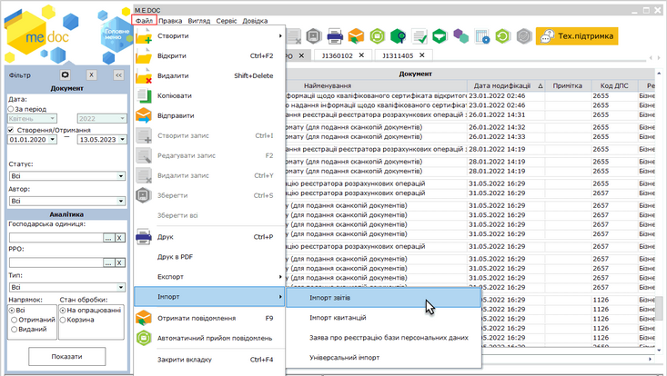

[← Зміст довідки](../)


# Робота з документами РРО

## Робота з документами РРО

_Шлях у довідці: Розділи програми › Реєстр документів РРО та ПРРО › Робота з документами РРО_

Робота з документами РРО щодо реєстрації та використання екземплярів реєстраторів розрахункових операцій здійснюється у Реєстрі документів РРО. Також у реєстрі зберігаються документи щодо РРО, отримані від ДПС.

У даному розділі довідки розглянуто наступне:

- [Як створити документ РРО](#rrorstfunkc-rro_reestr_funkc_stvor)
- [Копіювання документа](#rrorstfunkc-rrorstfunkc_copy)
- [Редагування документа](#rrorstfunkc-rrorstfunkc_edit)
- [Підписання ЕП та відправлення акцизних документів електронним каналом зв'язку](#rrorstfunkc-rrorstfunkc_vidp)
- [Експорт документів РРО](#rrorstfunkc-rrorstfunkc_export)
- [Імпорт документів РРО](#rrorstfunkc-rrorstfunkc_imp)
- [Друк документів РРО у PDF](#rrorstfunkc-rrorstfunkc_print_pdf)
- [Робота з довідниками РРО](UCRRO_dovidnyky.html#ucrro_dovidnyky-ucrro_dovidnyky)

### Як створити документ РРО

_Шлях у довідці: Розділи програми › Реєстр документів РРО та ПРРО › Робота з документами РРО › Як створити документ РРО_

Створення документів щодо РРО

Для створення нового документа РРО:

1. Скористайтесь одним із способів:

- на панелі інструментів натисніть кнопку Створити ;
- виберіть команду Файл - Створити;
- у контекстному меню оберіть команду Створити.

2. Оберіть потрібний розділ на панелі ліворуч. У списку праворуч оберіть необхідний тип документа PPO. Натисніть кнопку Створити.

3. У окремому вікні відкриється бланк документа, який потрібно заповнити.

Поля, що підсвічені жовтим кольором, обов'язкові для заповнення.

Натисніть, щоб збільшити малюнок

4. Внесіть дані в поля, які потребують заповнення.

5. Оберіть команду Правка - Перевірити документ або F4 для перевірки документа.

Перевіряється правильність заповнення полів, і, у випадку помилок, система підсвітить червоним кольором поля, що необхідно виправити. Виправте помилки та знову виконайте перевірку.

6. Збережіть документ, натиснувши кнопку  або комбінацію клавіш Ctrl+S.

Створення Документа довільного формату (для подання сканкопій документів)

При створенні Заяв:

- Заява про реєстрацію реєстратора розрахункових операцій за ф. № 1-РРО;
- Заява про скасування реєстрації реєстратора розрахункових операцій за ф. № 4-РРО;
- Заява про реєстрацію реєстратора розрахункових операцій з купівлі-продажу іноземної валюти за ф. № 1-РРОВ;
- Заява про скасування реєстрації реєстратора розрахункових операцій з купівлі-продажу іноземної валюти за ф. № 4-РРОВ;
- Заява на включення до реєстру центрів сервісного обслуговування реєстраторів розрахункових операцій за ф. № 1-РЦСО

формується пакет документів, що містить головний документ Заява ... та один Документ довільного формату (для подання сканкопій документів).

Якщо до заяви необхідно додати ще один Документ довільного формату, виконайте наступні дії:

1. У таблиці реєстру виділіть Заяву, до якої необхідно додати Документ, та оберіть один із способів:

- на панелі інструментів натисніть кнопку Створити;
- виберіть команду Файл - Створити;
- у контекстному меню оберіть команду Створити.

У меню, що відкриється, оберіть пункт Документ довільного формату.

2. Відкриється вкладка документа Документ довільного формату (для подання сканкопій документів). Заповніть необхідні поля документа.

3. Щоб додати сканкопію документа, встановіть курсор у поле Найменування файлу документу та натисніть кнопку . У вікні, що відкриється, оберіть потрібний файл. Назва обраного файлу відобразиться у полі документа.

Натисніть, щоб збільшити малюнок

Можливо прикріпити тільки один файл у PDF форматі, розміром не більше 2 Мб.

4. Збережіть Документ довільного формату (для подання сканкопій документів), натиснувши кнопку  , або комбінацію клавіш Ctrl+S. У таблиці реєстру Документ довільного формату (для подання сканкопій документів) буде відображено як підпорядкований документ пакету до відповідної Заяви ... .

Під час збереження виконається перевірка правильності заповнення полів і, у випадку помилок, система підсвітить червоним кольором поля, що необхідно виправити. Виправте помилки та знову збережіть документ.

Перевірити документ також можливо, обравши команду меню Правка - Перевірити документ, натиснувши F4, або, виконавши команду Перевірити звіт на вкладці Наступні дії.

Щоб швидко повернутися до головного документа, на вкладці Наступні дії натисніть Відкрити головний документ.

5. Якщо необхідно додати сканкопію наступного документа, виконайте дії, описані у пунктах 1 - 4. Для кожної сканкопії створюється окремий Документ довільного формату (для подання сканкопій документів).

Копіювання Документів довільного формату (для подання сканкопій документів)

Можливо скопіювати існуючі Документи довільного формату (для подання сканкопій). Для цього:

1. У таблиці Реєстру виділіть Документ довільного формату (для подання сканкопій), які необхідно скопіювати у Заяву.

2. Виконайте команду Копіювати:

- на панелі інструментів натисніть кнопку Копіювати ;
- виберіть команду Файл - Копіювати;
- у контекстному меню оберіть команду Копіювати;

3. Відкриється вікно Копіювання звіту, де запропоновано обрати період документа:

4. Відкриється вікно Пачки звітів:

Натисніть, щоб збільшити малюнок

Оберіть головний документ Заява, до якого будуть додані Документи довільного формату. Можливо обрати вже існуючий документ, або створити новий, обравши відповідну опцію у області Оберіть пачку.

5. Для копіювання документів натисніть ОК. Скопійовані Документи довільного формату будуть додані у обрану Заяву та відображені у таблиці реєстру.

При копіюванні Документів у наявну Заяву для копіювання можливо обрати кілька Документів довільного формату одночасно, при виділенні документів мишею натисніть та утримуйте клавішу <Ctrl> (обрати певні документи) або <Shift> (обрати перший та останній документ групи).

Також можливо виконати копіювання у вікні відкритого Документів довільного формату.

### Копіювання документа

_Шлях у довідці: Розділи програми › Реєстр документів РРО та ПРРО › Робота з документами РРО › Копіювання документа_

Для копіювання документа РРО:

1. Виділіть документ, копію якого потрібно створити. Для копіювання групи документів виділіть потрібне курсором миші, утримуючи клавішу <Shift> або <Ctrl>.

2. Оберіть один із способів копіювання:

- на панелі інструментів натисніть кнопку Копіювати - ;
- із контекстного меню команда Копіювати;
- команда Файл - Копіювати.

Також функція копіювання документа доступна і у відкритому вікні документа: на панелі інструментів кнопка Копіювати -  та у меню Файл - Копіювати.

Із вікна відкритого документа копіюється тільки поточний документ.

3. Відкриється вікно Копіювання звіту, де запропоновано обрати період документа:

За замовчуванням встановлюється дата виписки документа, що копіюється.

4. Після вибору дати натисніть кнопку ОК.

Скопійований документ відкриється у новій вкладці. Скопійовані документи можна редагувати.

### Редагування документа

_Шлях у довідці: Розділи програми › Реєстр документів РРО та ПРРО › Робота з документами РРО › Редагування документа_

Редагування документа доступне для непідписаних та невідправлених документів.

Документ відкривається на редагування одним зі способів:

- подвійне натискання мишею на рядку документа в реєстрі;
- кнопка  Відкрити на панелі інструментів;
- пункт головного меню Файл - Відкрити;
- пункт контекстного меню Відкрити;
- комбінація клавіш Ctrl+F2.

### Підписання ЕП та відправка документів РРО у ДПС

_Шлях у довідці: Розділи програми › Реєстр документів РРО та ПРРО › Робота з документами РРО › Підписання ЕП та відправка документів РРО у ДПС_

Для відправки документ повинен бути заповненим, перевіреним та збереженим.

Існує декілька способів відправки документів:

1. Із вкладки "Наступні дії"

Даний спосіб дозволяє відправити лише один документ - відкритий або виділений в Реєстрі документів РРО.

В доступних діях з документом передбачено декілька варіантів для зручності користувача:

Передати документ на підпис

На виконання цієї команди документ блокується від редагування та набуває статусу На підпис бухгалтеру (статус залежить від [обраного комплекту підписів](FormCompanyParams.html#formcompanyparams-admcomanyparams_pen) для документів РРО). Документ знаходиться в стані очікування.
В Наступних діях стає доступним можливість [Підписати документ](UC_ECP.html#uc_ecp-ecp).
Після накладення підписів документ набуває статусу Готовий до подачі, стає доступною функція Відправити документ. Програма запропонує підписати файл будь-яким сертифікатом шифрування з комплекту підписів, що [налаштований](FormCompanyParams.html#formcompanyparams-admcomanyparams_pen) для документів РРО - таким чином підписується "конверт", в який поміщається файл для відправки.

Підписати документ

На виконання команди відразу розпочнеться стандартний процес [підписання документа](UC_ECP.html#uc_ecp-ecp) ЕП.
Після накладення підписів та печатки установи документ набуває статусу Готовий до подачі, стає доступною функція Відправити. Програма запропонує підписати файл будь-яким сертифікатом шифрування з комплекту підписів, що [налаштований](FormCompanyParams.html#formcompanyparams-admcomanyparams_pen) для документів РРО - таким чином підписується "конверт", в який поміщається файл для відправки.

Відправити у контролюючий орган

На виконання команди розпочнеться [підписання документа](UC_ECP.html#uc_ecp-ecp) ЕП та одразу відправка документа адресату.

2. Безпосередньо з Реєстру документів РРО

Даний спосіб дозволяє відправляти як один документ, так и групу документів одночасно.

У реєстрі виберіть потрібний акцизний документ або групу акцизних документів та оберіть один із варіантів:

- на панелі інструментів натисніть кнопку Відправити - ;
- виберіть команду Файл - Відправити;
- у контекстному меню оберіть команду Відправити;
- на вкладці наступні дії оберіть команду Відправити у контролюючий орган.

На виконання команди розпочнеться [підписання документа](UC_ECP.html#uc_ecp-ecp) ЕП та одразу відправка документа адресату. По закінченню процедури, система виведе протокол відправки документів.

Також зверніть увагу:

- Після підписання документів комплектом електронних підписів, у відповідних місцях бланку документів встановлюється позначка ЕП, що свідчить про накладений підпис/печатку. Якщо в Картці підприємства [налаштовані зразки підписів](UCOrg.html#ucorg-sprorg_podp) та печатки підприємства, то після підписання документа у відповідних місцях бланку відображаються завантажені у програму сканкопії зразків для більшої наочності.
- Для того, щоб документ роздруковувався разом із зображеннями підпису та печатки, необхідно встановити позначку в полі Накладати графічні зображення підписів та печатки під час друку в [Параметрах системи](FormCompanyParams.html#formcompanyparams-admcompanyparams_zv).
- Можливо налаштувати перевірку чи відповідає ім'я особи, що зазначена у документі, сертифікату, яким підписується документ. Для цього у модулі Адміністрування - Параметри системи на вкладці [Документообіг](FormCompanyParams.html#formcompanyparams-admcompanyparams_sdo) потрібно встановити опцію РРО у області налаштувань Перевіряти ПІБ відповідальної особи у документі з ПІБ сертифікату. Якщо опцію РРО встановлено та сертифікат не належить вказаній особі, підписання документа не виконуватиметься. На вкладці Протокол перевірки після перевірки документа буде відображено повідомлення: Для вказаної відповідальної особи відсутній відповідний за іменем власника сертифікат підписання.

Перевірка виконуватиметься для наступних документів:

- Ф.3-ЕРРО Запит про надання витягу з Реєстру екземплярів РРО;
- Ф.2-РЦСО Запит про надання витягу з Реєстру ЦСО РРО;
- Ф.№1-РЦСО Заява про включення до Реєстру ЦСО РРО;
- Ф.№1-ЕРРО Заява про включення/виключення до/із реєстру екземплярів реєстраторів розрахункових операцій або внесення змін;
- Ф.№4-ЦСО Акт про встановлення несправності фіскального блока під час гарантійного (післягарантійного) ремонту;
- Ф.№3-ЦСО Повідомлення про укладання договору про технічне обслуговування та ремонт реєстратора розрахункових операцій;
- Ф.№2-КОРО Заява про скасування реєстрації книги обліку розрахункових операцій;
- Ф.№4-РРОВ Заява про скасування реєстрації реєстратора розрахункових операцій з купівлі-продажу іноземної валюти;
- Ф.№4-РРО Заява про скасування реєстрації реєстратора розрахункових операцій;
- Ф.№7-РРОВ Заява про реєстрацію журналу використання реєстратора розрахункових операцій з купівлі-продажу іноземної валюти;
- Ф.№1-РРОВ Заява про реєстрацію реєстратора розрахункових операцій з купівлі-продажу іноземної валюти;
- Ф.№1-РРО Заява про реєстрацію реєстратора розрахункових операцій;
- Ф.№1-КОРО Заява про реєстрацію книги обліку розрахункових операцій та/або розрахункової книжки.

### Експорт документів РРО

_Шлях у довідці: Розділи програми › Реєстр документів РРО та ПРРО › Робота з документами РРО › Експорт документів РРО_

В цьому розділі:

[Експорт документів у формат XML для подання у контролюючі органи](#rrorstfunkc-rrorstfunkc_export)

[Експорт документів у формат XML для подання у Головну установу](#rrorstfunkc-rrorstfunkc_export)

[Експорт документів з квитанціями](#rrorstfunkc-rrorstfunkc_export)

Експорт документів РРО призначений для збереження документів у обраному каталозі або електронному носії.

При експорті документа із програми його назва та розширення відповідають регламентованим правилам подання документів до контролюючих органів. Документи перевіряються на заповнюваність обов'язкових реквізитів у документі згідно затверджених схем XSD. Ці перевірки аналогічні тим, які виконуються при прийманні документів у контролюючих органах.

У Реєстрі реалізована можливість експортувати як один файл, так и групу файлів одночасно. Для групового видалення записів реєстру виділіть потрібне курсором миші використовуючи стандартні методи виділення кількох записів ОС Windows.

Функція експорту доступна і у відкритому вікні документа: у меню Файл - Експорт - Експорт. Із вікна відкритого документа експортується тільки поточний документ.

Експорт документів для подання у контролюючі органи

Дана функція призначена для збереження документів на електронному носії чи у обраному каталозі і використовується для подання документів до контролюючих органів.

Експорт документів виконується у наступній послідовності:

1. Виділіть потрібний для експорту документ у Реєстрі документів РРО.

2. Експорт документа викликається одним із наступних способів:

- команда Файл - Експорт - Експорт;
- із контекстного меню команда Експорт.

Функція експорту доступна і у відкритому вікні документа: меню Файл - Експорт - Експорт.

3. На виконання функції експорту відкривається модальне вікно Експорт. Оберіть опцію для подачі у контролюючий орган:

4. Вкажіть каталог, де зберегти створений файл у полі Каталог призначення.

При збереженні документа його назва та розширення регламентовані правилами подання документів до ДПС - у форматі .xml.

5. Натисніть ОК.

6. Система повідомить про закінчення процесу експорту.

[До початку](#rrorstfunkc-rrorstfunkc_export)

Експорт документів у формат XML для подання у Головну установу

Дана функція призначена для збереження документів на електронному носії чи у обраному каталозі з метою передачі їх у Головну установу для подальшого аналізу. Експорт документів для подання у Головну установу виконується у форматі «Внутрішній (нотивний) XML».

Експорт документів виконується у наступній послідовності:

1. Виділіть потрібний для експорту документ у Реєстрі документів РРО.

2. Експорт документа викликається одним із наступних способів:

- команда Файл - Експорт - Експорт;
- із контекстного меню команда Експорт.

Функція експорту доступна і у відкритому вікні документа: у меню Файл - Експорт - Експорт.

3. На виконання функції експорту відкривається модальне вікно Експорт. Оберіть опцію для обміну звітністю:

4. Вкажіть каталог, де зберегти створений файл у полі Каталог призначення. Ім'я файлу генерується автоматично, містить в собі дату, час створення та код ЕДРПОУ підприємства.

5. Натисніть ОК.

6. Система повідомить про закінчення процесу експорту.

[До початку](#rrorstfunkc-rrorstfunkc_export)

Експорт документів з квитанціями

Дана функція призначена для збереження документів на електронному носії чи у обраному каталозі, для яких отримано квитанції. Експорт документів виконується у форматі XML, крім даних документів зберігається інформація, що міститься у квитанціях.

Експорт документів виконується у наступній послідовності:

1. Виділіть потрібний для експорту документ у Реєстрі документів РРО.

2. Експорт документа викликається одним із наступних способів:

- команда Файл - Експорт - Експорт;
- із контекстного меню команда Експорт.

Функція експорту доступна і у відкритому вікні документа: у меню Файл - Експорт - Експорт.

3. На виконання функції експорту відкривається модальне вікно Експорт. Оберіть опцію експорт документа з квитанцією:

4. Вкажіть каталог, де зберегти створений файл у полі Каталог призначення. Ім'я файлу генерується автоматично, містить в собі дату, час створення та код ЕДРПОУ підприємства.

5. Натисніть ОК.

6. Система повідомить про закінчення процесу експорту.

[До початку](#rrorstfunkc-rrorstfunkc_export)

### Імпорт документів РРО

_Шлях у довідці: Розділи програми › Реєстр документів РРО та ПРРО › Робота з документами РРО › Імпорт документів РРО_

Дана функція призначена для імпорту документів РРО, створених в інших бухгалтерських системах.

1. У меню оберіть команду Файл - Імпорт - Імпорт звітів.

Натисніть, щоб збільшити малюнок

2. На виконання команди відкриється вікно вибору файлів вказаного формату, які імпортуються.

3. Вкажіть шлях до каталогу розміщення файлів. Оберіть файли та натисніть Відкрити для початку процесу імпорту.

4. По закінченні процедури система виведе протокол імпорту даних.

### Друк документів РРО у PDF

_Шлях у довідці: Розділи програми › Реєстр документів РРО та ПРРО › Робота з документами РРО › Друк документів РРО у PDF_

Дана функція дозволяє зберегти обрані документи на диску комп’ютера у файлах формату .pdf.

Для друку документів у PDF необхідно виділити потрібні документи.
У Реєстрі документів РРО реалізована можливість друку як одного файлу, так и групи файлів одночасно. Для групового друку документів виділіть потрібне курсором миші, використовуючи стандартні методи виділення кількох записів ОС Windows.

Для друку документів у PDF:

1. Оберіть один із способів:

- із контекстного меню команда Друк в PDF;
- команда меню Файл - Друк в PDF.

2. У вікні Огляд папок вкажіть каталог, у якому потрібно зберегти файли .pdf.

3. Система повідомить про закінчення операції друку.

Також функція друку документа  у PDF доступна і у відкритому вікні документа: команда меню Файл - Друк в PDF. Із вікна відкритого документа у форматі PDF зберігається тільки поточний документ.


