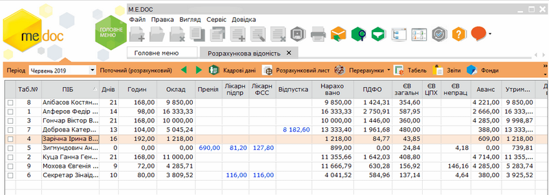
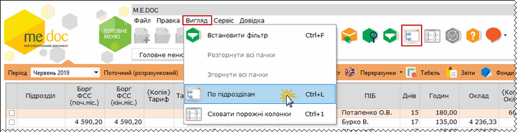
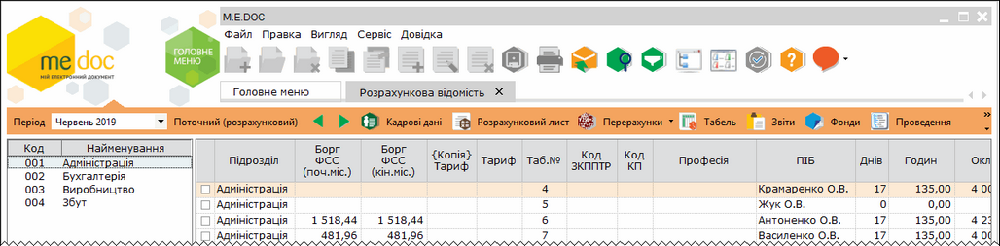
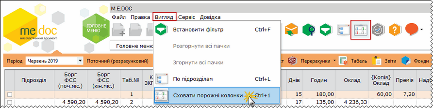
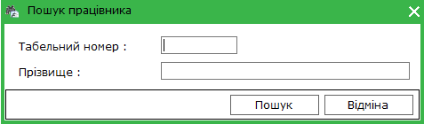
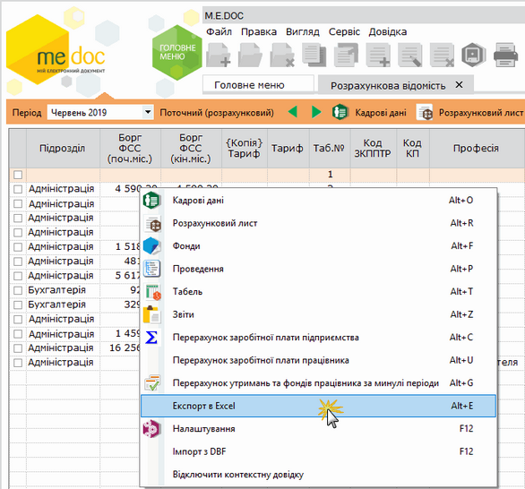

[← Зміст довідки](../)


# Розрахункова відомість

## Розрахункова відомість

_Шлях у довідці: Розділи програми › Зарплата › Розрахункова відомість_

В цьому розділі:

[Сортування списку співробітників по підрозділах](#reestrstatement-reestrstatement_reestrstatement)

[Режим "Сховати порожні колонки"](#reestrstatement-reestrstatement_reestrstatement)

[Фільтри користувача](ReestrStatement_userFiltr.html#reestrstatement_userfiltr-reestrstatement_userfiltr)

[Імпорт даних з файлів DBF](ReestrStatement_DBFImport.html#reestrstatement_dbfimport-reestrstatement_dbfimport)

[Швидкий пошук запису](#reestrstatement-reestrstatement_reestrstatement)

[Експорт в Еxcel](#reestrstatement-reestrstatement_reestrstatement)

Розрахункова відомість побудована у вигляді таблиці - реєстру, окремий рядок реєстру відображає коротку інформацію про розрахунок заробітної плати, нарахування і утримання по кожному працівнику. Подвійний клік лівої клавіші миші на записі відкриває розрахунковий лист працівника.

Розрахункова відомість заповнюється автоматично на підставі даних з особових карток, а також на підставі даних, внесених у розрахункові листи.

Також можливо вносити дані безпосередньо у розрахунковій відомості, для цього оберіть відповідне поле та введіть бажану суму. Сума занесена в "ручному" режимі відображатиметься синім кольором.

Зверніть увагу, при увімкненому параметрі Автоматично налаштовувати поля з видами оплат (натиснуто кнопку ) у розділі Зарплата – Адміністрування – Налаштування – Вигляд – Розрахуноква відомість внесення сум в "ручному" режимі неможливе.

У вікні розрахункової відомості розташована додаткова панель інструментів, що надає можливість відкрити та внести зміни в [особову картку працівника](PayLicSchets.html#paylicschets-reestrstatement_paylicschets), [розрахунковий лист](CalcPaperMng.html#calcpapermng-reestrstatement_calcpapermng), [табель робочого часу](PayBoards.html#payboards-reestrstatement_payboards), переглянути фонди, проведення, [сформувати звіти](PayReports.html#payreports-reestrstatement_zvit), [налаштування](PayTools.html#paytools-reestrstatement_paytools), перерахунок заробітної плати по працівнику та по підприємству.

Натисніть, щоб збільшити малюнок

[У налаштуваннях системи](PayToolsVyd.html#paytoolsvyd-reestrstatement_paytoolsvyd) представлені наступні схеми відображення розрахункової відомості:

- Розрахункова відомість (скорочена)
- Розрахункова відомість (середня)
- Розрахункова відомість (велика)
- Розрахункова відомість (автоналаштування)

За необхідності, передбачено індивідуальне налагодження розрахункової відомості.

Перейти в наступний період або повернутись у попередній можливо за допомогою кнопок  у верхній частині вкладки.

В демонстраційному режимі програми закрита можливість переходу в інший розрахунковий період розрахункової відомості.

Сортування списку співробітників по підрозділах

Для зручності роботи у відомості реалізована функція відображення списку співробітників у розрізі підрозділів підприємства.

Для того, щоб ввімкнути відображення списку співробітників по підрозділах, скористайтесь одним із наступних способів:

- на панелі інструментів натисніть кнопку По підрозділам;
- оберіть команду Вигляд/По підрозділам;
- натисніть комбінацію клавіш Ctrl+L.

Натисніть, щоб збільшити малюнок

Зліва з'явиться додаткова панель, що містить коди та назви підрозділів підприємства. Оберіть потрібний розділ, і праворуч у таблиці буде відображений  список робітників, що працюють у цьому підрозділі.

Натисніть, щоб збільшити малюнок

[До початку](#reestrstatement-reestrstatement_reestrstatement)

Режим "Сховати порожні колонки"

Також для роботи у великих розрахункових відомостях надана можливість сховати колонки, в яких усі значення 0,00.

Для того, щоб сховати порожні колонки, скористайтесь одним із наступних способів:

- на панелі інструментів натисніть кнопку Сховати порожні колонки;
- виберіть команду Вигляд/Сховати порожні колонки;
- натисніть комбінацію клавіш Ctrl+1.

Натисніть, щоб збільшити малюнок

[До початку](#reestrstatement-reestrstatement_reestrstatement)

Швидкий пошук запису

Для швидкого пошуку запису скористайтесь одним із наступних способів:

- на панелі інструментів натисніть кнопку Знайти запис ;
- виберіть команду меню Правка - Знайти запис;
- натисніть комбінацію клавіш Ctrl+G.

У вікні, що відкриється, введіть табельний номер або прізвище працівника та натисніть Пошук:

[До початку](#reestrstatement-reestrstatement_reestrstatement)

Експорт в Еxcel

Експортувати дані розрахункової відомості у форматі Еxcel можливо одним із способів:

- Встановіть курсор в будь-яке поле, натисніть праву кнопку миші та оберіть пункт Експорт в Еxcel:

Натисніть, щоб збільшити малюнок

-  Оберіть команду головного меню Файл - Експорт- Експорт.

У вікні, що відкриється, вкажіть шлях для збереження файлу.

[До початку](#reestrstatement-reestrstatement_reestrstatement)


