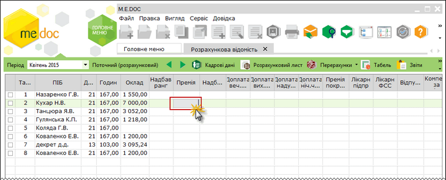
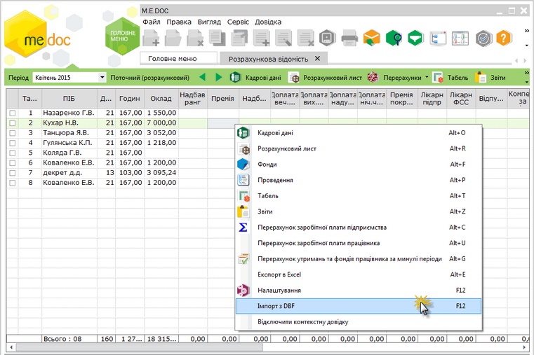
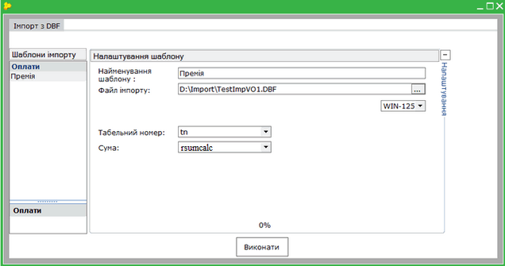

[← Зміст довідки](../)


# Імпорт даних з файлів DBF

## Імпорт даних з файлів DBF

_Шлях у довідці: Додатково: ReestrStatement_DBFImport › Імпорт даних з файлів DBF_

#### Імпорт даних з файлів DBF

Функція дозволяє переносити до Розрахункової відомості суми оплат, які збережені у файлі формату DBF. Файл DBF повинен містити інформацію про табельні номери співробітників, що використовуються для встановлення відповідності даних, та суми оплат, які імпортуються.

Імпортувати дані можливо лише у поточний період.

Імпорт даних виконується у наступній послідовності:

1. У вікні вкладки «Розрахункова відомість» встановіть курсор у колонку даних, які будуть імпортуватися. Для цього натисніть ліву кнопку миші у комірці потрібної колонки (наприклад, Премія):

Натисніть, щоб збільшити малюнок

2. Скористайтеся одним із наступних способів:

- виберіть команду контекстного меню Імпорт з DBF;
- натисніть клавішу F12.

Натисніть, щоб збільшити малюнок

3. Відкриється вікно налаштування імпорту:

Натисніть, щоб збільшити малюнок

4. У області Шаблони імпорту оберіть назву шаблону, який буде використовуватись для імпорту даних. Шаблон містить налаштування, необхідні для виконання імпорту певного виду оплат. Назва шаблону створюється автоматично і визначається видом імпортованих даних.

Якщо певний вид оплати імпортується вперше, назва шаблону відсутня у списку Шаблони імпорту. Для того, щоб додати шаблон, необхідно встановити курсор у відповідну колонку на вкладці «Розрахункова відомість» і викликати функцію імпорту.

Доданий шаблон імпорту зберігається у списку вікна і може використовуватись надалі.

5. У полі Файл імпорту оберіть файл формату .dbf, що містить дані для імпорту. Шлях до файлу зберігається у шаблоні. Якщо у подальшому файл буде видалено чи переміщено, недійсний шлях до файлу позначиться червоним кольором.

6. При необхідності, змініть кодування символів, яке використовується у файлі. За замовчуванням, встановлено кодування WIN-1251.

7.  У полі Табельний номер із списку оберіть назву поля dbf-файлу, яке містить дані про табельні номери співробітників. У полі Сума оберіть назву поля, яке містить суму оплати.
Поля Табельний номер та Сума обов’язкові до заповнення і визначають коректність виконання імпорту. Імена полів запам'ятовуюється у шаблоні. Заповнені поля позначаються галочками зеленого кольору.

8. Для виконання операції імпорту натисніть кнопку Виконати.

[До початку](ReestrStatement.html#reestrstatement-reestrstatement_reestrstatement)


