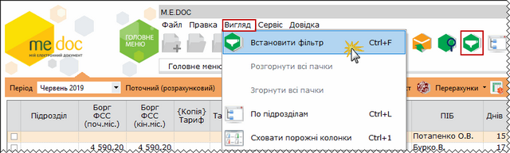
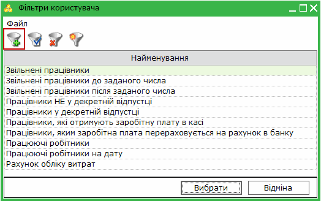
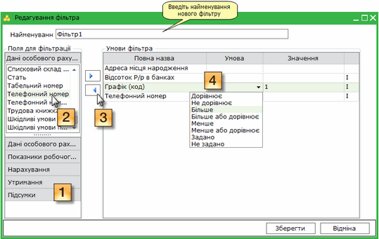
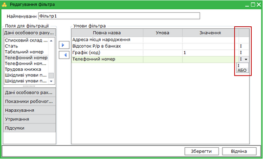
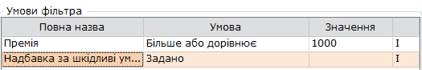

[← Зміст довідки](../)


# Фільтри користувача

## Фільтри користувача

_Шлях у довідці: Додатково: ReestrStatement_userFiltr › Фільтри користувача_

Фільтри користувача

Передбачена можливість створення та використання складних фільтрів користувача.

Для того, щоб застосувати фільтр, скористайтесь одним із наступних способів:

- на панелі інструментів натисніть кнопку Встановити фільтр;
- виберіть команду Вигляд/Встановити фільтр;
- натисніть комбінацію клавіш Ctrl+F.

Натисніть, щоб збільшити малюнок

За замовчуванням, пропонуються наступні специфічні фільтри:

- Звільнені працівники
- Звільнені працівники до заданого числа
- Звільнені працівники після заданого числа
- Працівники НЕ у декретній відпустці
- Працівники, які отримують заробітну плату в касі
- Працівники, яким заробітна плата перераховується на рахунок в банку
- Працюючі робітники

Для того, щоб створити власний фільтр, натисніть кнопку Додати фільтр чи комбінацію клавіш Ctrl+І.

У вікні Редагування фільтра виконайте наступні дії:

1. Оберіть групу полів для фільтрації.

2. В обраній групі виділіть поле, по якому буде виконуватися фільтрування даних.

3. Натисніть кнопку . Обране поле переміститься в блок Умови фільтрації.

Для того, щоб видалити поле з умов фільтрації, виділіть потрібне поле та скористайтесь кнопкою .

4. За потреби, налаштуйте обраний параметр:
       - у колонці Умови оберіть з випадаючого списку потрібну умову;
       - у колонці Значення введіть потрібне значення вручну з клавіатури.

Натисніть, щоб збільшити малюнок

5. Кожен фільтр може мати необмежену кількість умов, головне - це правильно налаштувати їх взаємодію один з одним та розуміти вплив на кінцевий результат.

Для поєднання різних умов фільтрації використовуються оператори І та АБО.

|  |  |
| --- | --- |
| І | умова має використовуватись обов'язково |
| АБО | використовується одна з зазначених умов |

Натисніть, щоб збільшити малюнок

Приклад:

На підприємстві працює N працівників, серед яких:

|  |  |  |  |
| --- | --- | --- | --- |
| П.І.Б. | Заробітна плата | Премія | Шкідливі умови праці |
| Іванов І.І. | 3000 | 1200 | + |
| Сидоров С.С. | 3000 | 1000 | + |
| Петров П.П. | 3000 | - | + |
| Ковальчук К.К. | 3000 | - | - |
| Онищєнко О.О. | 1500 | 500 | + |
| Моєсеєв М.М. | 6000 | 3000 | - |

Необхідно виявити працівників, які працюють у шкідливих умовах праці, при цьому отримують незадовільну премію (менше 1000 грн.)

Створюємо новий фільтр, додаємо наступні умови:

Зверніть увагу! Для відображення результату, в Розрахунковій відомості повинні бути наявні колонки з видами оплат, по яких виконується фільтрування.

Система аналізує дані працівників.
Для виведення результатів фільтру умова для оператора "І" має обов'язково давати результат "ТАК".
Для оператора "АБО" результатом "ТАК" може бути одна з умов.
В даному прикладі, для виведення результату має бути результат "ТАК" від обох операторів.

|  |  |  |  |  |
| --- | --- | --- | --- | --- |
| П.І.Б. | Премію   не задано? | Премія <=  1000 грн | Шкідливі умови праці?  Оператор "І" - обов'язкова умова | Результат |
| Оператор "АБО" - одна з умов | |
| Іванов І.І. | ні | ні | так | не виведено |
| Сидоров С.С. | ні | так | так | виведено |
| Петров П.П. | так | ні | так | виведено |
| Ковальчук К.К. | так | ні | ні | не виведено |
| Онищєнко О.О. | ні | так | так | виведено |
| Моєсеєв М.М. | ні | ні | ні | не виведено |

6. Після налаштування фільтра натисніть кнопку Зберегти.

У вікні Фільтри користувача також доступні такі функції:

|  |  |  |
| --- | --- | --- |
| Редагувати фільтр | F2 | Редагування вже існуючого користувацького фільтра. |
| Видалити фільтр | Ctrl+Y | Безповоротне вилучення фільтра. |
| Копіювати фільтр | Ctrl+N | Копіювання фільтра.  Передбачає створення копії існуючого фільтра у разі повторення більшості даних для подальшого їх редагування. |

[Наверх](ReestrStatement.html#reestrstatement-reestrstatement_reestrstatement)


