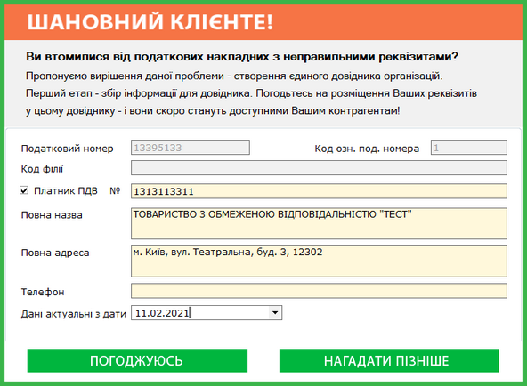
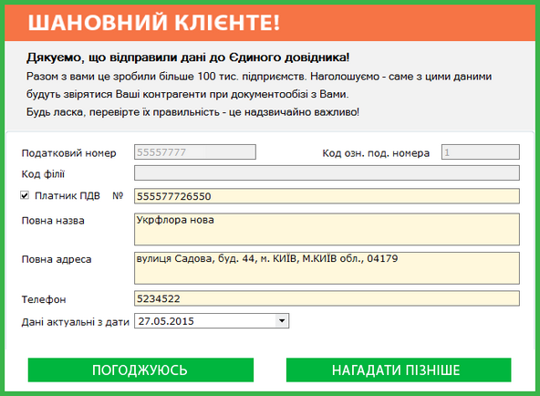
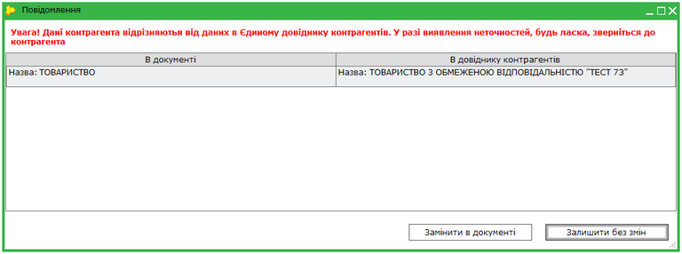
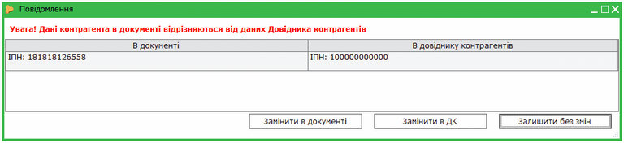
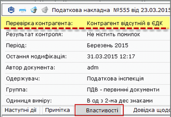
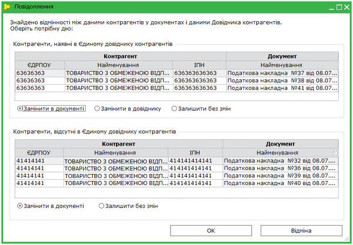
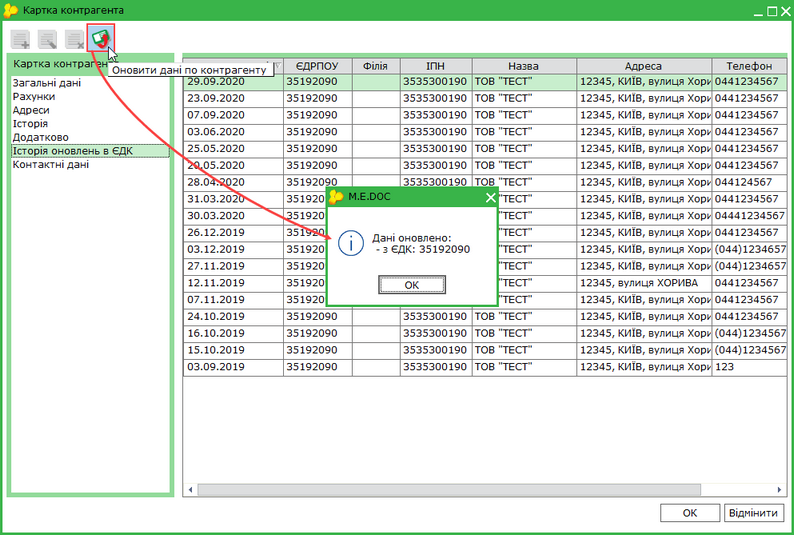
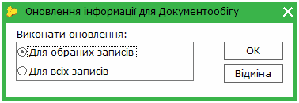
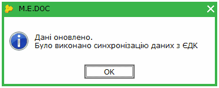
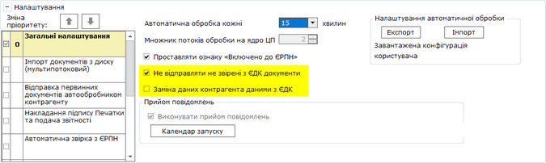

[← Зміст довідки](../)


# Звірка даних довідника контрагентів програми із ЄДК на сервері документообігу

## Звірка даних довідника контрагентів програми із ЄДК на сервері документообігу

_Шлях у довідці: Допоміжні сервіси › Звірка даних довідника контрагентів програми із ЄДК на сервері документообігу_

В цьому розділі:

[Як відправити реквізити установи в ЄДК?](#servisedk-servisedk)

[Якщо реквізити установи змінюються після синхронізації з ЄДК](#servisedk-servisedk)

Звірка даних контрагентів при перевірці документів:

[у відкритому документі](#servisedk-servisedk)

[групова перевірка у Реєстрі первинних документів](#servisedk-servisedk)

[Звірка Довідника контрагентів з ЄДК](#servisedk-servisedk)

[Звірка даних з ЄДК при автоматичній обробці документів](#servisedk-servisedk)

Для зручності користувачів у програмі є можливість звірки даних довідника контрагентів програми із Єдиним довідником контрагентів (далі - ЄДК) на сервері документообігу.

Реквізити контрагентів присутні у первинних документах (податкових накладних, розрахунках коригування). Правильніть заповнення цих документів гарантує суттєве зменшення випадків відмови при реєстрації в ЄРПН та погодженні з контрагентами, оскільки реквізити установ надавали Ваші контрагенти.

Умовою для коректного функціонування сервісу є наявність стабільного з'єднання з мережею Інтернет.

Для звірки даних сервіс підключається до серверу документообігу та отримує дані з ЄДК.

Всім користувачам програми пропонується відправити реквізити картки підприємства для збереження у довіднику організацій на сервері документообігу. Із цих даних сформований ЄДК, який постійно поповнюється та оновлюється. Дані ЄДК використовуються для звірки з довідником контрагентів програми.

Якщо дані контрагента відсутні у ЄДК, оновлення картки контрагента виконується за базою даних платників ДПСУ.

Звірка даних здійснюється:

1.  У Довіднику контрагентів.

2.  У Картці контрагента.

3.  При автоматичній обробці документів.

4.  Під час перевірки документів (у вкладці Наступні дії та по F4):

Податкова накладна;

Додаток № 2 до податкової накладної.

5. При груповій перевірці документів у Реєстрі первинних документів.

6. При відправленні документів у статусі Готується та Імпортований.

Як відправити реквізити установи у ЄДК?

Користувачам програми, які ще не скористались можливістю розмістити реквізити картки підприємства у ЄДК, пропонується це зробити:

Натисніть, щоб збільшити малюнок

Для відправлення картки потрібно обрати Погоджуюсь.

Розпочнеться процедура накладання ЕП печатки установи, після чого картка буде відправлена.

Реквізити вашої установи будуть додані у ЄДК на сервері документообігу та стануть доступними для використання вашими контрагентами.

Користувачам, які вже відправили реквізити картки до ЄДК, буде запропоновано виконати звірку даних довідника контрагентів програми із ЄДК:

Натисніть, щоб збільшити малюнок

У полі Дані актуальні з дати необхідно вносити (обирати) дату, з якої актуальні реквізити установи.

[До початку](#servisedk-servisedk)

Якщо реквізити установи змінюються після синхронізації з ЄДК

Якщо у Картці підприємства змінюються реквізити, які занесені у Єдиний довідник контрагентів, їх також потрібно оновити у цьому довіднику.

Пропозиція оновити дані відображається після збереження змін у Картці підприємства.

Також оновлення даних можна за допмогою команди головного меню Сервіс - Оновити дані в Єдиному довіднику контрагентів.

[До початку](#servisedk-servisedk)

Автоматичне звірення даних контрагентів при перевірці документів

Звірка запускається автоматично, але лише після успішної перевірки заповнення полів ПН/РК. Якщо при перевірці документа виявлені помилки, звірка даних не виконується.

Звірка даних з ЄДК при перевірці відкритого документа

1. Функція звірки даних з ЄДК запускається при перевірці у відкритому документі (із вкладки Наступні дії та по F4).

Повідомлення програми щодо звірки даних з можливими варіантами дій залежить від того, чи були раніше синхронізовані дані у довіднику контрагентів програми із ЄДК.

- якщо дані в документі відрізняються від даних у довіднику контрагентів програми, який вже звірений з ЄДК - пропонується замінити дані контрагента в документі на актуальні чи залишити їх без змін. Рішення про можливу заміну повинен прийняти користувач.

Натисніть, щоб збільшити малюнок

- якщо документ містить дані контрагента, який відсутній у ЄДК, пропонується один із варіантів:
- замінити дані контрагента в документі,
- замінити дані контрагента в довіднику контрагентів програми,
- залишити без змін.

Натисніть, щоб збільшити малюнок

Результати виконаної звірки з ЄДК відображаються у «Властивостях документа» у новому полі Перевірка контрагента:

Натисніть, щоб збільшити малюнок

[До початку](#servisedk-servisedk)

Звірка даних з ЄДК при груповій перевірці документів

Звірка даних також виконується при груповій перевірці документів у Реєстрі первинних документів.

Натисніть, щоб збільшити малюнок

У колонці Звірка з ЄДК у таблиці модуля Реєстр первинних документів позначається результат виконаної звірки даних:

"" – у ЄДК нема даних контрагента;

"" – дані співпадають;

"" – дані не співпадають.

"" – дані не перевірені через відсутність з’єднання з ЄДК. Якщо документ набуває ознаки Відсутнє з'єднання з ЄДК (на момент перевірки), при відправці повторно відбудеться звірка.

При груповій відправці документів у статусі Імпортований чи Готується, незалежно від відповіді користувача на запитання "Ви бажаєте перевірити всі виділені звіти? У випадку натискання "Ні" всі звіти будуть переміщені одразу на підпис", виконується звірка даних з ЄДК.

Зверніть увагу! У документах виконується автоматична звірка даних по контрагенту з ЄДК.

Звірка даних по контрагенту виконується тільки при перевірці першої ПН/РК. У решті ПН/РК, виписаних за день цьому контрагенту, автоматична звірка не запускається, оскільки була виконана раніше.  Тобто, автоматична звірка з ЄДК у документах по кожному контрагенту виконується лише 1 раз на день.

Якщо дані контрагента в ЄДК оновлені вже після звернення сервісу, можлива ситуація, що в документі будуть неактуальні реквізити контрагента.

Для виправлення цієї ситуації користувач повинен самостійно синхронізувати дані з ЄДК через довідник контрагентів програми.

Якщо контрагент відсутній у довіднику, буде створений відповідний запис після звірки з ЄДК.

Звірка даних відбувається на дату створення документа. Тобто з історії оновлень в ЄДК вибираються актуальні реквізити контрагента на дату документа.

Якщо виконується оновлення даних контрагента, для якого в документі є лише ІПН, при наявності в ЄДК декількох таких контрагентів, всі вони завантажуються у довідник.

Наприклад, це можуть бути декілька філій установ, які мають однаковий ІНП.

Оновлення даних та можлива заміна даних буде виконуватися по головній установі.

Якщо документ призначений філії, для оновлення даних з ЄДК потрібно у ПН/РК вказувати код ЄДРПОУ та код філії.

[До початку](#servisedk-servisedk)

Звірка довідника контрагентів програми з ЄДК

Із довідника контрагентів звірення даних запускається вручну користувачем, і може виконуватися декілька разів за день.

Можливо виконувати як оновлення даних певного контрагента у його картці, так і групове оновлення записів довідника.

Оновлення даних у картці контрагента

1. У картці контрагента натисніть кнопку Оновити дані по контрагенту.

2. Сервіс виконає звірку даних з ЄДК та відобразить результат:

Натисніть, щоб збільшити малюнок

Інформацію щодо оновлення даних контрагента можливо переглянути на вкладці Історія оновлень в ЄДК. Записи на вкладці доступні для перегляду та відкриваються подвійним кліком миші. Редагувати записи контрагента, звірені з ЄДК, неможливо. У вкладці Загальні дані у полі Дані актуальні з дати відображається дата, з якої актуальні реквізити контрагента. Якщо дата не внесена, звірка з ЄДК не відбувалась.

Групове оновлення даних довідника

1. Виділіть записи контрагентів, які потрібно оновити. (окремі, утримуючі клавішу <Ctrl>, розташовані послідовно - <Shift>).

2. Оберіть пункт меню Правка - Оновити дані по контрагенту або натисніть кнопку .

3. Позначте потрібний варіант оновлення записів:

4. Сервіс виконає звірку даних з ЄДК та відобразить результат:

Зверніть увагу! Дані в картках контрагента, які були синхронізовані з ЄДК, недоступні для редагування.

[До початку](#servisedk-servisedk)

Звірка даних з ЄДК при автоматичній обробці документів

У процесі автоматичної обробки документів при відправленні їх контрагентам та в ДПС можливо налаштовувати звірку даних контрагентів з ЄДК.

У налаштуваннях сервісу автоматичної обробки документів встановлюються опції:

- Не відправляти не звірені з ЄДК документи;
- Заміна даних контрагента даними з ЄДК.

Натисніть, щоб збільшити малюнок

Відповідно до встановленних опцій за результатами звірки, дані контрагента у документах будуть або замінені, або документи не будуть відправлені.

Більш докладно звірка даних описана у довідці до модуля [Автоматична обробка документів](UCGlobalAutoProcJournal.html#ucglobalautoprocjournal-pdocs_avto).

[До початку](#servisedk-servisedk)


