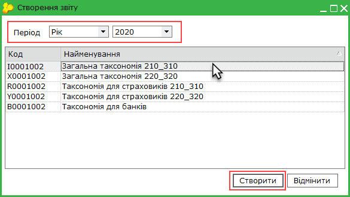
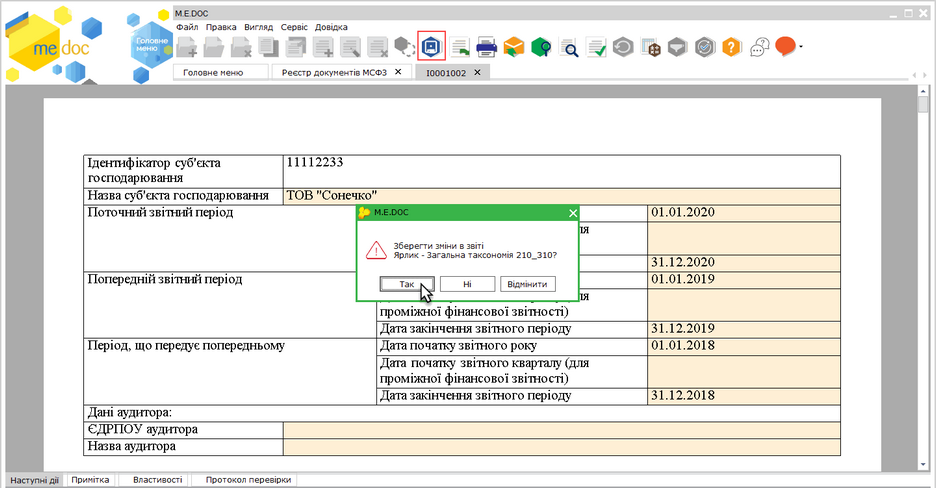
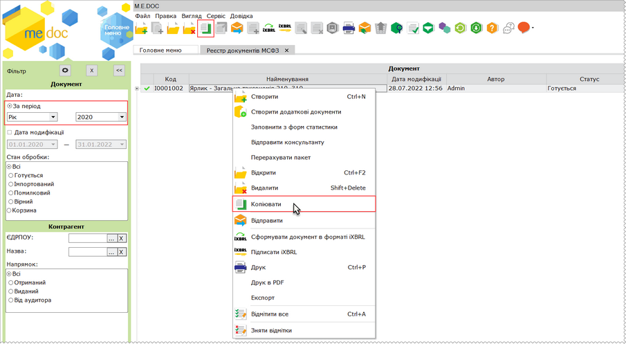
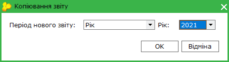
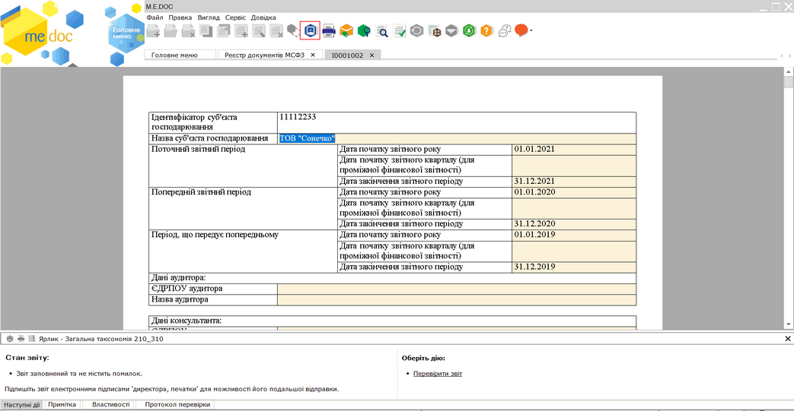
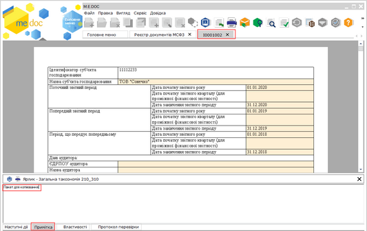
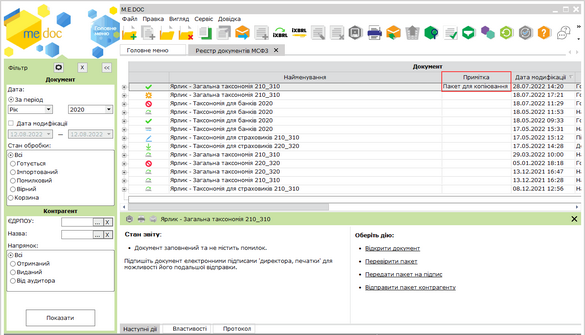
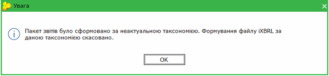

[← Зміст довідки](../)


# Алгоритм створення звітності за МСФЗ на період відсутності звітів таксономії 2021

## Алгоритм створення звітності за МСФЗ на період відсутності звітів таксономії 2021

_Шлях у довідці: Додатково: Taxonomy_of_IFRS_2021_Explanation › Алгоритм створення звітності за МСФЗ на період відсутності звітів таксономії 2021_

Звертаємо вашу увагу на те, що триває робота над створенням української таксономії 2021 з боку регуляторів (НКЦПФР, НБУ, Міністерства фінансів України) та європейських експертів. Можливість формувати пакети звітності за таксономією 2021 у ПЗ M.E.Doc стане доступною, одразу після затвердження нових форматів таксономії.

Незважаючи на відсутність затвердженої таксономії UA XBRL МСФЗ 2021 р., користувачі можуть розпочати попередню підготовку для заповнення звітності за 2021 рік.

У програмі передбачено наступний  алгоритм дій щодо попереднього створення звітності за МСФЗ на період відсутності звітів таксономії 2021:

1. Створіть новий пакет звітності за 2020 рік.

   Скористайтесь одним із способів:

- на панелі інструментів натисніть кнопку Створити ;
- виберіть команду Файл - Створити;
- у контекстному меню оберіть команду Створити.

 Якщо пакет звітів створено та заповнено у сторонній програмі, його можна експортувати. У такому випадку пакет, що експортується, повинен бути збережений за таксономією 2020 р.

2. Створений новий пакет звітності за 2020 рік заповнювати не потрібно. Закрийте вікно створеного ярлика пакету звітів та підтвердіть збереження звіту, натиснувши Так, у вікні, що відкриється. Або ж, для збереження нового пакета натисніть кнопку  на панелі інструментів перед закриттям вкладки.

Натисніть, щоб збільшити малюнок

3. Виділіть створений (експортований) пакет звітності за 2020 рік у таблиці реєстру та скопіюйте його у період рік  2021.

Для копіювання скористайтеся одним із способів:

- на панелі інструментів натисніть кнопку Копіювати - ;
- із контекстного меню команда Копіювати;
- команда Файл - Копіювати.

Натисніть, щоб збільшити малюнок

4. Відкриється вікно Копіювання звіту. Оберіть у полі Період нового звіту значення рік та у полі Рік оберіть значення 2021. Натисніть ОК:

5. У окремому вікні відкриється бланк ярлика до скопійованого пакета звітності, який потрібно заповнити.

Натисніть, щоб збільшити малюнок

Також заповніть необхідні звіти пакету та збережіть зміни.  Внесіть дані в поля, які потребують заповнення або, якщо пакет звітів було експортовано, перевірте коректність даних у звітах.

6. Збережіть документ, натиснувши кнопку  або комбінацію клавіш Ctrl+S.

Після затвердження нових форматів таксономії 2021 ви зможете виконати конвертацію попередньо створеного пакета звітності в новий затверджений пакет звітності. Для цього необхідно буде лише скопіювати попередньо заповнений пакет. При копіюванні автоматично створиться новий ярлик (відповідно до пакета звітності I0001003, R0001003, X0001003, Y0001003, B0001003) за таксономією 2021. Дані із попередньо створеного пакета будуть перенесені у відповідні поля пакета звітності за таксономією 2021. Вам потрібно буде, за потреби, лише дозаповнити нові поля, які не містив попередньо створений пакет звітності.

7. Знайдіть пакет звітів, що створений за таксономією 2020 і використовувався для копіювання, та видаліть його з реєстру Для пошуку пакета скористайтеся полем За період на панелі Фільтр.

Щоб позначити призначення пакетів звітності можна скористатися полем Примітка. Для цього у вікні ярлика пакету на вкладці Примітка введіть текст, що позначатиме призначення пакета. Введений текст відображатиметься у колонці Примітка реєстру документів МСФЗ.

Натисніть, щоб збільшити малюнок

Натисніть, щоб збільшити малюнок

Зверніть увагу, при спробі сформувати пакет у форматі iXBRL для попередньо створеного пакета звітності, буде виведено повідомлення:

Натисніть, щоб збільшити малюнок


