[← Зміст довідки](../)


# Банківський модуль

## Банківський модуль

_Шлях у довідці: Розділи програми › Банківський модуль_

Банківський модуль дозволяє формувати та/або імпортувати повідомлення про відкриття/закриття рахунків, для подальшого подання цих документів до органів Державної податкової служби з метою відкриття/закриття рахунків та реєстрації змін у рахунках платників податків, затверджувати та зашифровувати документи засобами ЕП, відправляти документи електронними каналами зв’язку, а також приймати і відображати квитанції про доставку документів.

Основним призначенням розділу є сервіс автоматичної обробки повідомлень, що представляє собою процес автоматичного імпорту документів із вказаного каталогу, підписання сертифікатами відповідальних осіб та печаткою установи, відправлення на адресу органів Державної податкової служби, отримання повідомлень про доставку та обробку документів та отримання Файлу-відповіді з подальшим експортуванням його на жорсткий диск комп'ютера.

У зв’язку із виходом наказу [№ 721 «Про затвердження Порядку подання повідомлень про відкриття/закриття рахунків платників податків у банках та інших фінансових установах до контролюючих органів»](http://zakon5.rada.gov.ua/laws/show/z1058-15/page) реалізована обробка відповідей від ДПС в zip-форматі.

Для коректної роботи прийому квитанцій в zip-форматі обов’язково потрібно встановити дозвіл на прийняття файлів у форматі zip в поштових клієнтах!

У даному розділі розглянуті такі теми:

- [Що потрібно зробити перед початком роботи?](#ucaccopenclose-ucaccopenclose_before)
- [Налаштування обробки документів](#ucaccopenclose-ucaccopenclose_nalasht)
- [Журнал автоматичної обробки](#ucaccopenclose-ucaccopenclose_jurn)
- Монітор повідомлень про відкриття/закриття рахунків
- [Опис основних функціональних елементів інтерфейсу](#ucaccopenclose-ucaccopenclose_monitor_opys)
- [Як створити повідомлення про відкриття/закриття рахунків](#ucaccopenclose-ucaccopenclose_monitor_stvor)
- [Як імпортувати повідомлення про відкриття/закриття рахунків](#ucaccopenclose-ucaccopenclose_monitor_imp)
- [Відправлення документів електронним каналом зв’язку](#ucaccopenclose-ucaccopenclose_monitor_vidp)
- [Прийом і відображення квитанцій про доставку документів та Файлу-відповіді](#ucaccopenclose-ucaccopenclose_monitor_pryy)
- [Створення Додатку 7](#ucaccopenclose-ucaccopenclose_dod7)
- [Банківські виписки](UCBankStatements.html#ucbankstatements-ucbankstatements)

### Що потрібно зробити перед початком роботи?

_Шлях у довідці: Розділи програми › Банківський модуль › Що потрібно зробити перед початком роботи?_

До початку роботи з Банківським модулем потрібно налаштувати параметри картки установи, параметри системи та налаштування розділу. У цих модулях повинні бути заповнені необхідні поля, які використовуються при роботі розділу.

У КАРТЦІ ПІДПРИЄМСТВА:

Заповніть наступні параметри картки підприємства (Довідники - Картка підприємства - вкладка Додатково):

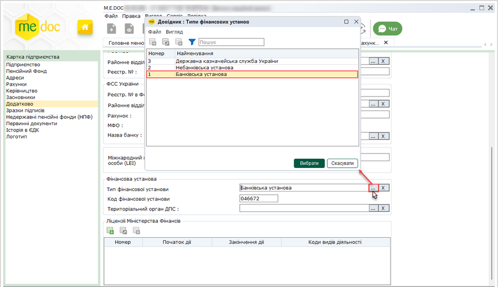

Натисніть, щоб збільшити малюнок

1. У полі Тип фінансової установи вкажіть значення типу, до якого відноситься ваша установа:
 - Державна казначейська служба України;
 - Небанківська установа;
 - Банківська установа.

2. У полі Код фінансової установи вкажіть код банку - його МФО.

3. У полі Тер. орган Міністерства доходів і зборів із вбудованого довідника Податкові інспекції оберіть найменування органу державної податкової служби.

Значення, обране у даному полі, приймає участь при формуванні найменувань документів про відкриття/закриття рахунків.

У ПАРАМЕТРАХ СИСТЕМИ:

Обов'язково налаштуйте комплект підписів, якими будуть підписуватись документи про відкриття/закриття рахунків.
(Адміністрування - Параметри системи - закладка Підпис).

Оберіть комплекти підписів для типу Звітність про відкриття/закриття рахунків та Інкасові доручення згідно власних потреб.

- Більш докладно про налаштування комплектів підписів

1. У блоці Комплект підписів оберіть тип Звітність про відкриття/закриття рахунків.

2. Під назвою типу, із списку оберіть варіант комплекту накладання електронних підписів на документи посадовими особами: Відповідальна особа - Відповідальна особа - Печатка

3. Нижче виведеться перелік всіх існуючих в системі сертифікатів з типом Печатка, а поля Відповідальна особа відображаються пустими.

Для визначення відповідальних осіб та редагування списку підписантів, виділіть поле, список якого потрібно змінити, та натисніть кнопку .

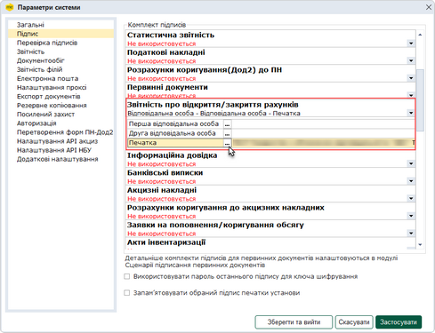

Натисніть, щоб збільшити малюнок

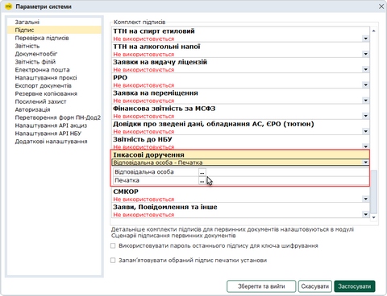

Натисніть, щоб збільшити малюнок

4. Відкриється окреме вікно Налаштування комплекту підписів. За допомогою кнопки Додати оберіть потрібний сертифікат.

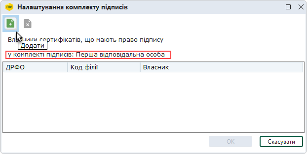

Таким же чином оберіть другу відповідальну особу.

5. При підписанні документа буде виводитись список заданих відповідальних осіб.

У НАЛАШТУВАННЯХ БАНКІВСЬКОГО МОДУЛЯ:

Налаштування Банківського модуля описано у наступному розділі даної довідки [Налаштування обробки документів](#ucaccopenclose-ucaccopenclose_nalasht).

(Банківський модуль - Налаштування)

У НАЛАШТУВАННЯХ ПОШТОВОГО КЛІЄНТА:

У зв’язку із виходом наказу [№ 721 «Про затвердження Порядку подання повідомлень про відкриття/закриття рахунків платників податків у банках та інших фінансових установах до контролюючих органів»](http://zakon5.rada.gov.ua/laws/show/z1058-15/page)

реалізована обробка відповідей від ДПС в zip-форматі.

Для коректної роботи прийому квитанцій в zip-форматі обов’язково потрібно встановити дозвіл на прийняття файлів у форматі zip в поштових клієнтах!

### Налаштування обробки документів

_Шлях у довідці: Розділи програми › Банківський модуль › Налаштування обробки документів_

До початку роботи з модулем обов'язково потрібно налаштувати параметри роботи розділу. Налаштувати процес автоматичного імпорту, збереження, підписання, відправки повідомлень про відкриття/закриття рахунків, експорт Файлу-відповіді та Квитанції № 2 про результати обробки повідомлення.

Для налаштування параметрів оберіть Банківський модуль - Налаштування.

Відкриється модальне вікно Налаштування обробки документів.

- Автоматична обробка кожні \_\_ хвилин
Дозволяє задавати проміжок часу в хвилинах, через який сервіс буде циклічно виконувати задані в налаштуваннях дії.

1. Налаштування Імпорту

У даному розділі налаштовуються параметри автоматичного імпорту документів. Встановіть потрібні параметри для роботи сервісу:

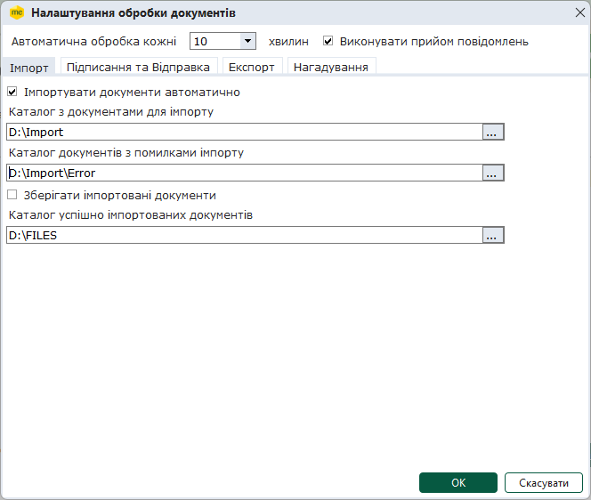

- Виконувати прийом повідомлень
Встановлена опція визначає, що буде виконуватися автоматичний прийом вхідних повідомлень.

- Імпортувати документи автоматично
Визначає, чи будуть повідомлення про відкриття/закриття рахунків імпортуватись автоматично (із вказаного каталогу).
Якщо опція встановлена, стають доступними для заповнення та редагування поля, що розташовані нижче.

- Каталог з документами для імпорту
Поле доступне для заповнення, якщо встановлена опція Імпортувати документи автоматично.
Вкажіть шлях до розташування каталогу, із якого сервіс імпортуватиме повідомлення про відкриття/закриття рахунків у програмний комплекс.

Каталог для імпорту має бути вказаний обов'язково. Якщо каталог не вказано, імпорт повідомлень не виконується.

- Каталог документів з помилками імпорту
Поле доступне для заповнення, якщо встановлена опція Імпортувати документи автоматично.
Вкажіть шлях до розташування каталогу, де будуть зберігатися документи, що проімпортувались з помилками.
Це необхідно для аналізу причини виникнення помилок з метою виправлення та повторного завантаження документів.

- Зберігати імпортовані документи
Якщо опція встановлена, документи, що успішно імпортувались у програмний комплекс, будуть автоматично збережені в указаному каталозі.

- Каталог успішно імпортованих документів
Поле доступне для заповнення, якщо встановлена опція Зберігати імпортовані документи.
Вкажіть шлях до розташування каталогу, в який сервіс буде зберігати документи, що успішно імпортувались у програмний комплекс.
Документи зберігаються у підкаталогах, назва яких відповідає даті імпорту документів.

Каталог для імпортованих документів має бути вказаний обов'язково. Якщо каталог не вказано, автоматичне збереження імпортованих документів не виконується.

2. Налаштування Підписання та Відправки

У даному розділі налаштовуються параметри автоматичного підписання документів комплектом електронних підписів та відправки документів до органів державної податкової служби.

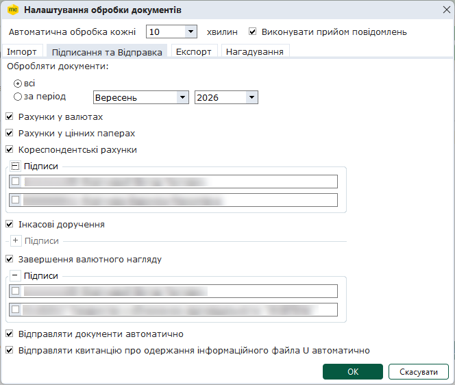

- Обробляти документи
Оберіть період, за який система має відправляти документи електронним каналом зв'язку.

Встановіть галочки напроти тих типів документів, які потрібно відправити в ДПC:

- Рахунки у валютах;
- Рахунки у цінних паперах;
- Кореспондентські рахунки;
- Інкасові доручення;
- Завершення валютного нагляду.

За замовчанням обрані всі типи документів.

Для обраних типів документів здійснюється автоматичний імпорт документів у форматі XML, підписання імпортованих документів відповідними комплектами підписів та автоматична відправка у ДПС підписаних документів з наступним автоматичним отриманням квитанцій.

Безпосередньо під полями, що відповідають типам документів, відображається інформації про комплекти підписів, що застосовуються для цих типів документів:

- для типів документів Рахунки у валютах, Рахунки у цінних паперах та Кореспондентські рахунки застосовується комплект підписів Звітність про відкриття / закриття рахунків;
- для документів Інкасові доручення застосовується комплект Інкасові доручення;
-  для документів Завершення валютного нагляду застосовується комплект Заяви, Повідомлення та інше.

У вікні відображаються лише ті підписи, що налаштовані у відповідному комплекті у розділі Адміністрування – [Параметри системи - Підпис](FormCompanyParams.html#formcompanyparams-admcomanyparams_pen).

Для перегляду інформації про відповідний комплект підписів натисніть на кнопку . Щоб приховати інформацію про комплекти підписів, натисніть на кнопку .

Для кожного типу документа, що буде опрацьовуватися, необхідно обов’язково обрати підписи, які будуть застосовуватись при обробці цього типу документа. У разі якщо жодного підпису не обрано, виводитиметься відповідне повідомлення. Завершити налаштування можна тільки після вибору необхідних підписантів.

3. Налаштування Підписання та Відправки

- Автоматично підписувати документи наступними сертифікатами
У даному розділі відображається список підписантів документів, які були [обрані у параметрах системи](#ucaccopenclose-ucaccopenclose_before) (комплект Звітність про відкриття/закриття рахунків).
Встановіть галочки напроти тих сертифікатів ЕП, якими система буде автоматично підписувати повідомлення. Якщо галочка відсутня, сервіс буде чекати особистого підписання документа відповідальною особою, перш ніж продовжить подальшу автоматичну обробку.

- Відправляти документи автоматично
Оскільки в багатьох фінансових установах співробітникам-підписувачам заборонено підписувати документи печаткою установи, обов’язкове введення секретного ключа печатки установи при запуску автоматичної обробки документів не вимагається. Якщо ж підписання печаткою установи є обов'язковим, необхідно встановити відмітку в налаштуваннях розділу в даному полі.

- Відправляти квитанцію про одержання інформаційного файла U
Якщо опцію встановлено, виконується автоматичне підписання та відправка Квитанції № 1 у відповідь на отриманий Інформаційний файл U. Підписання Квитанції здійснюється комплектом підписів, що вказані у області налаштувань Автоматично підписувати документи наступними сертифікатами. Якщо ж опцію не встановлено, відправку Квитанції № 1 необхідно здійснювати співробітникам фінансової установі за допомогою команди головного меню Файл – Відправити квитанцію на повідомлення. Також, команда Відправити квитанцію на повідомлення доступна з контекстного меню та з вкладки Наступні дії.

4. Налаштування Експорту

У даному розділі налаштовуються параметри автоматичного експорту квитанцій та файлів відповідей до вказаного каталогу.

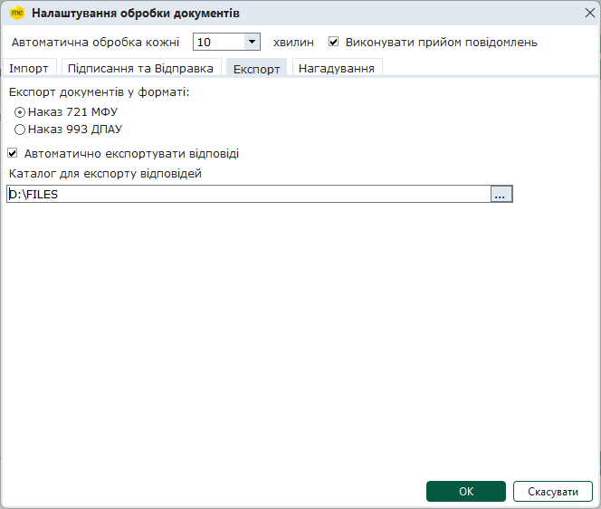

- Експорт документів у формат
Оберіть формат експорту Файлів-відповідей:
 - формат, відповідно наказу 853 МФУ або
 - формат, відповідно наказу 993 ДПАУ.

- Автоматично експортувати відповіді
Наявність встановленої галочки в цьому полі визначає, чи будуть отримані відповіді та Квитанції № 2 автоматично зберігатись на жорсткому диску комп'ютера в указаному каталозі.
Документи вивантажуються у форматі \*.xml
Якщо встановити дану галочку, стає доступним для заповнення та редагування поле, що розташоване нижче.
Функція недоступна для документів Завершення валютного нагляду.

- Каталог для експорту відповідей
Дане поле доступне для заповнення тільки за умови, що встановлена галочка в полі "Автоматично експортувати відповіді".
Вкажіть шлях до розташування каталогу, в який сервіс буде вивантажувати отримані відповіді  у форматі \*.xml.

Каталог для експорту має бути вказаний обов'язково, інакше система не буде зберігати документи автоматично.

5. Налаштування Нагадування

Даний розділ призначений для ввімкнення та налаштування сервісу відстеження документів про відкриття/закриття рахунків, що знаходяться в статусі Відправлено більше вказаного строку та подальшого повідомлення користувачів по пошті.

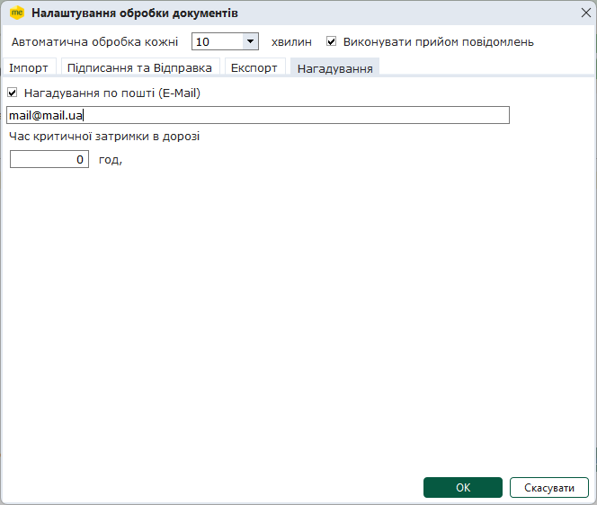

- Нагадування по пошті (E-Mail)
Встановлена галочка в цьому полі вмикає сервіс нагадування по пошті.
Якщо встановлена галочка, стає доступним для заповнення поле справа. Введіть в дане поле адресу електронної пошти, на яку система відправлятиме повідомлення в разі виконання вказаної умови.

- Час критичної затримки в дорозі
Вкажіть кількість годин, допустимих для знаходження повідомлень в дорозі (максимально допустиме значення – 48 години); за наявності документів в стані «Відправлено» більше вказаного часу, система відсилатиме інформаційне повідомлення на вказану електронну адресу.

В реєстрі Монітору повідомлень про відкриття/закриття рахунків додано новий стан «Більше N годин», де N – кількість годин, вказана користувачем.

Зверніть увагу! Сервіс нагадування по пошті працює тільки при ввімкненій Автоматичній обробці документів.

Після закінчення налаштування всіх параметрів, збережіть налаштування, натиснувши кнопку ОК.

### Журнал автоматичної обробки

_Шлях у довідці: Розділи програми › Банківський модуль › Журнал автоматичної обробки_

В цьому розділі:

[Короткий опис структури Банківського модуля](#ucaccopenclose-ucaccopenclose_jurn)

[Запуск та робота сервісу](#ucaccopenclose-ucaccopenclose_jurn)

Журнал автоматичної обробки призначений для організації процесів автоматичного виконання масового імпорту повідомлень про відкриття/закриття рахунків, створених в інших фінансово-облікових системах, автоматичного підписання, відправлення документів у органи державної податкової служби, отримання повідомлень про доставку, а також Файлів-відповідей та експорту відповідей на жорсткому диску комп'ютера.

Робота сервісу автоматичної обробки відбувається за такою схемою:

1. Створюються документ повідомлення у сторонній фінансово-обліковій системі.

2. Документи про відкриття/закриття рахунків експортується у вказаний каталог на жорсткому диску у формат \*.XML та/або у форматі, що затверджений НБУ.

3. У ПК M.E.Doc користувач налаштовує та запускає сервіс автоматичної обробки.

4. Із вказаного каталогу сервіс імпортує повідомлення про відкриття/закриття рахунків у програмний комплекс у відповідний модуль.

5. Згідно з налаштуваннями повідомлення підписуються та відправляються на електронну адресу Державної податкової служби з метою їх реєстрації.

6. Із вказаною періодичністю система перевіряє поштову скриньку на наявність Квитанцій про доставку та відповідей.

7. За наявності відповіді на відправлене повідомлення, Файл-відповідь зберігається в указаному каталозі жорсткого диску.

8. До моменту примусового зупинення сервісу користувачем або виходу із програмного комплексу, сервіс буде безперервно виконувати імпорт та відправлення документів із вказаним проміжком часу, а також перевіряти поштову скриньку на наявність нових вхідних повідомлень.

Короткий опис структури Банківського модуля

Модуль складається із 3 основних функціональних частин:

1. Панель інструментів

На панелі розташовані кнопки виклику таких функцій:

|  |  |
| --- | --- |
|  | Запуск автоматичної обробки |
|  | Зупинення автоматичної обробки |

2. Панель стану роботи модуля

Відображає поточний стан роботи сервісу автоматичної обробки.

3. Журнал виконання операцій автоматичної обробки

В процесі роботи функції автоматичної обробки відображає дії сервісу у хронологічному порядку виконання. Слугує для відслідковування користувачем ходу виконання обробки.

Містить наступну інформацію:

- Подія - відображає саме яка дія була виконана сервісом автоматичної обробки.
- Користувач - відображає ім'я облікового запису користувача, який запустив сервіс автоматичної обробки.
- Дата - дата та час виконання події.
- ПІБ - прізвище ім'я та по батькові користувача, який запустив сервіс автоматичної обробки.
- Опис - детальніший опис події.
- Документ - відображає назву, номер та дату документа, який був оброблений сервісом.

Для відображення інформації у Журналі у полях Події за оберіть дати початку та закінчення інтервалу часу, за який потрібно переглянути події. У разі потреби, у полі Останні оберіть кількість подій для відображення, за замовчуванням встановлено 500 подій. Для перегляду подій за обраний період натисніть кнопку Показати.

[До початку](#ucaccopenclose-ucaccopenclose_jurn)

Запуск та робота сервісу

Зверніть увагу! Перед запуском сервісу автоматичної обробки обов'язково потрібно виконати необхідні налаштування. Детальніше про налаштування див. розділ [Що потрібно зробити перед початком роботи?](#ucaccopenclose-ucaccopenclose_before)

Для того, щоб запустити автоматичну обробку натисніть на кнопку  на панелі інструментів.

В першу чергу перевіряється поштова скринька на наявність вхідних повідомлень, відкриється стандартне вікно підписання документа, де потрібно ввести пароль доступу до секретних ключів. Натисніть ОК. Розпочнеться процес завантаження надісланих повідомлень.

Після перевірки пошти, сервіс розпочне виконувати дії, задані при налаштуванні.

Зверніть увагу! При першому підписанні сертифікатом ЕП у полі Зберігати пароль протягом сеансу автоматично проставлена позначка, тобто користувачу не потрібно вводити секретний ключ кожного разу, надалі система буде підписувати документи автоматично.

Весь процес роботи сервісу відображається у хронологічному порядку виконання у журналі виконаних операцій.

До моменту примусового зупинення сервісу користувачем або виходу із програмного комплексу, сервіс буде безперервно виконувати імпорт та відправлення документів із вказаним проміжком часу, а також перевіряти поштову скриньку на наявність нових вхідних повідомлень.

Для того, щоб зупинити автоматичну обробку натисніть на кнопку  на панелі інструментів. Якщо автоматична обробка не запущена, кнопка зупинки неактивна.

Для того, щоб внести зміни в налаштування автоматичної обробки, необхідно попередньо зупинити сервіс та закрити модуль Журнал автоматичної обробки

[До початку](#ucaccopenclose-ucaccopenclose_jurn)

### Монітор повідомлень про відкриття/закриття рахунків

_Шлях у довідці: Розділи програми › Банківський модуль › Монітор повідомлень про відкриття/закриття рахунків_

#### Опис основних функціональних елементів інтерфейсу

_Шлях у довідці: Розділи програми › Банківський модуль › Монітор повідомлень про відкриття/закриття рахунків › Опис основних функціональних елементів інтерфейсу_

Монітор повідомлень про відкриття/закриття рахунків призначений для відображення документів про відкриття/закриття рахунків відповідно до їх стану в поточний момент.

Монітор умовно представлений у 2-х розрізах: Рік та Реєстр (панель відображення).

Монітор за РІК являє собою матрицю, де по горизонталі відображаються стани документів, розподілені по місяцях, по вертикалі - календарні дні місяців, а на перетині - кількість документів.

Тобто, у моніторі за рік можна побачити скільки документів було створено, відправлено, прийнято тощо на певну дату.

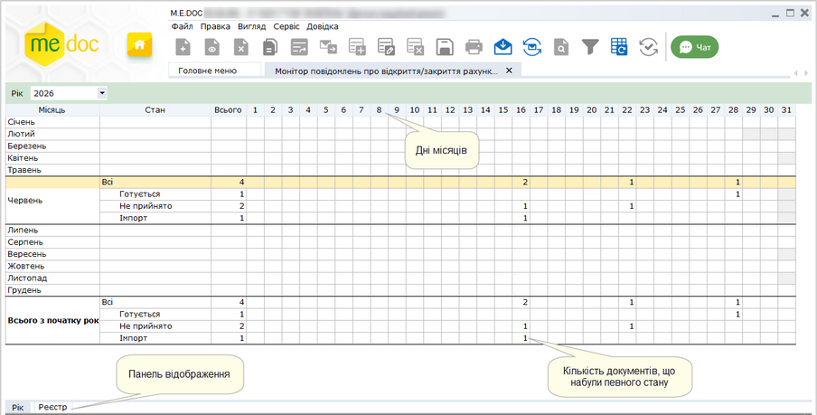

Натисніть, щоб збільшити малюнок

РЕЄСТР являє побудований у вигляді таблиці, окремий рядок якої відображає коротку інформацію про кожний документ. Переглянути більш повну інформацію можна у окремій вкладці, яка відкривається подвійним кліком по потрібному запису.

У лівій частині модуля розташована навігаційна панель. Панель містить розділи, що призначені для полегшення пошуку документів. При виборі певного розділу на панелі навігації, в робочій області відображаються документи, що відповідають заданим умовам фільтрації.

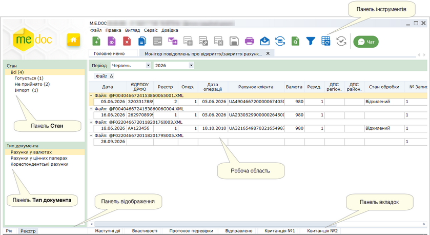

Натисніть, щоб збільшити малюнок

Панель відображення

- Рік - матриця, яка відображає кількість всіх документи, що були створені та проімпортовані за рік;
- Реєстр - відображає створені або імпортовані документи у заданому звітному періоді.

Панель Стан

Містить фільтри, що відповідають етапам роботи з документами:

- Готується - документи, що були створені та готуються до подання до органів державної податкової служби;
- Відправлені - документи, відправлені електронною поштою у органи державної податкової служби та очікують обробки (не отримано повідомлення та квитанцій);
- Імпортовані - документи, що були проімпортовані у програму.
- Отримана перша квитанція - документи, на які отримано Квитанцію № 1 про доставку документа;
- Отримана друга квитанція - документ, на які отримано Квитанцію № 2 про те, що рахунки взяті на облік;
- Здано - документи, на які отримані Файли-відповіді;
- Не прийнято - документи, на які отримано Квитанцію № 2 з повідомленням про помилки;
- Прийнято із зауваженнями - документи, на які отримано Квитанцію № 2 з повідомленням про помилки в окремих рядках документа, рядки Повідомлень, що не містять помилок ДПС приймає до обробки.

Панель Тип документа

Містить фільтри, що відповідають типам документів: Рахунки у валютах, Рахунки у цінних паперах, Кореспондентські рахунки. У робочій області відображаються документи обраного типу.

Також, в залежності від обраного типу документа, в робочій області відображаються свої колонки таблиці.

Панель інструментів

Містить кнопки виклику таких функцій:

|  |  |
| --- | --- |
|  | Створення документа |
|  | Перегляд (редагування) поточного документа |
|  | Вилучення поточного документа |
|  | Створення копії документа. |
|  | Відправити документ електронною поштою за допомогою вбудованого поштового клієнта |
|  | Отримати повідомлення |

Також на панелі інструментів міститься панель вибору звітного періоду .

Робоча область

Містить безпосередньо записи монітору повідомлень про відкриття/закриття рахунків.

За замовчанням записи робочої області згруповані за найменуванням файлу. За необхідності параметри групування можна змінити: на додаткову панель над робочою областю перетягніть потрібні колонки таблиці.

Колонка реєстру № Запису містить порядкові номери рядків Повідомлень. Після отримання для документа Квитанції № 2 у колонці Стан обробки відображається стан Прийнято, Відхилено або Помилка <код помилки> для певного рядка, номер якого зазначено у колонці № Запису.

Панель вкладок звіту

Містить службову інформацію щодо обраного документа. Панель доступна як у відкритому документі, так і з реєстру документів (за умови виділення потрібного документа).

Містить наступні вкладки:

- Наступні дії – містить інформацію щодо поточного стану документа, а також перелік можливих дій з документом у цьому стані. Слугує певною підказкою користувачу про доступні дії, які можна виконати з документом у певному стані;
- Властивості – у режимі читання містить всю службову інформацію про документ, таку як: стан, період створення, дата та час останньої модифікації, інформація про сертифікати, якими підписано документ тощо. Інформація на цій вкладці постійно оновлюється та доповнюється при будь-яких змінах документа;
- Відправлено – дана вкладка з’являється на панелі після відправлення документа адресату. Містить службову інформацію що стосується відправки документа, таку як: реквізити одержувача, дату та час відправлення, текст документа у форматі xml тощо;
- Квитанція №1 – дана вкладка з’являється на панелі після отримання першої квитанції (про прийом документа). Містить дату/час доставки та текст квитанції.
Текст Квитанції № 1 можна роздрукувати, а також зберегти у форматі \*.RTF. Для цього призначені кнопки  - Зберегти та  - Роздрукувати, що розміщені біля заголовку вкладки;

- Квитанція №2 – дана вкладка з’являється на панелі після отримання другої квитанції (з результатами перевірки). Містить дату/час доставки та текст квитанції.
Текст Квитанції № 2 можна роздрукувати, а також зберегти у форматі \*.RTF. Для цього призначені кнопки  - Зберегти та  - Роздрукувати, що розміщені біля заголовку вкладки.

#### Як створити повідомлення про відкриття/закриття рахунків

_Шлях у довідці: Розділи програми › Банківський модуль › Монітор повідомлень про відкриття/закриття рахунків › Як створити повідомлення про відкриття/закриття рахунків_

Дозволяє створити новий документ у потрібному звітному періоді на основі обраного типу документа.

Для створення повідомлення про відкриття/закриття рахунків виконайте дії у наступній послідовності:

1. Оберіть період в якому потрібно створити документ.

2. Для створення нового документа скористайтесь одним із наступних способів:

- на панелі інструментів натисніть кнопку Створити;
- виберіть команду Файл - Створити;
- у контекстному меню оберіть команду Створити;
- натисніть комбінацію клавіш Ctrl+N.

3. Відкриється вікно Вибір документа. Оберіть потрібний документ та натисніть кнопку ОК.

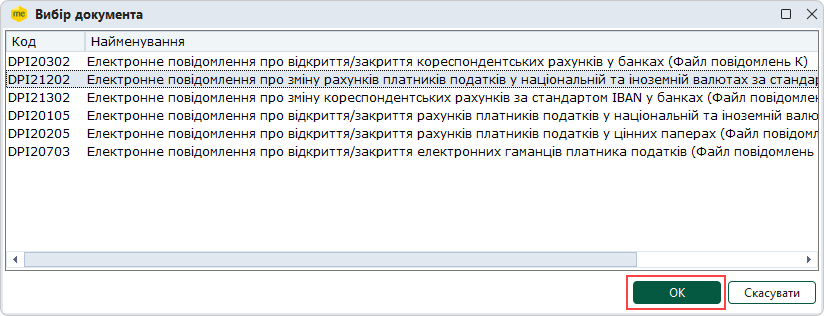

4. Щойно створений файл відкриється у окремій вкладці.

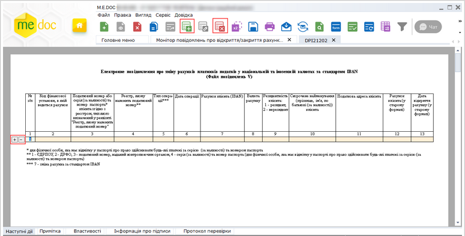

Натисніть, щоб збільшити малюнок

6. Внесіть дані в поля, які потребують заповнення із клавіатури.

Скористайтесь наступними правилами заповнення документів:

- Поля, які можна заповнювати та редагувати виділені жовтим кольором. Якщо курсор встановити у такому полі, колір зміниться на зелений.
- Для переходу до наступного поля, що потрібно заповнити, використовуються функціональна клавіша Tab, стрілки Вверх, Вниз, Вправо, Вліво клавіатури та ліва кнопка миші.
- При внесенні або редагуванні значень у полях, що заповнюються, доступні стандартні функції Windows – відмінити (Ctrl+Z), вирізати (Ctrl+X), копіювати (Ctrl+C) та вставити (Ctrl+V). Ці функції викликаються із меню Правка та кнопками на панелі інструментів вікна.

Додавання нового рядка під обраним відбувається одним із наступних способів:

à

за допомогою кнопки  на панелі інструментів вікна;

à

за допомогою кнопки  зліва від обраного рядка у таблиці;

à

натиснувши комбінацію клавіш Ctrl+I.

Вилучення обраного рядка відбувається одним із наступних способів:

à

за допомогою кнопки  на панелі інструментів вікна;

à

за допомогою кнопки  зліва від обраного рядка у таблиці;

à

натиснувши комбінацію клавіш Ctrl+Y.

7. Оберіть команду Правка/Перевірити документ  або  F4 для перевірки звіту.

Перевіряється правильність заповнення полів і у випадку помилок, система підсвітить червоним кольором поля, що необхідно виправити. Виправте помилки та знову виконайте перевірку.

8. Збережіть звіт, натиснувши кнопку  або комбінацію клавіш Ctrl+S.

9. Всі подальші дії з підготовки документа для подання до органів державної податкової служби (друк, збереження на електронному носії) виконуються із вікна відкритого документа.

#### Як імпортувати повідомлення про відкриття/закриття рахунків

_Шлях у довідці: Розділи програми › Банківський модуль › Монітор повідомлень про відкриття/закриття рахунків › Як імпортувати повідомлення про відкриття/закриття рахунків_

Для того, щоб імпортувати документи із суміжних систем, у меню Файл оберіть команду Імпорт - Імпорт звітності банку.

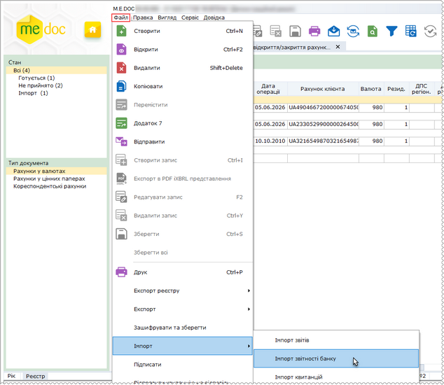

Натисніть, щоб збільшити малюнок

Відкриється вікно Відкриття файлу. Оберіть каталог, де розташовано файли документів про відкриття/закриття рахунків.

Виділіть файл курсором миші та натисніть кнопку Відкрити.

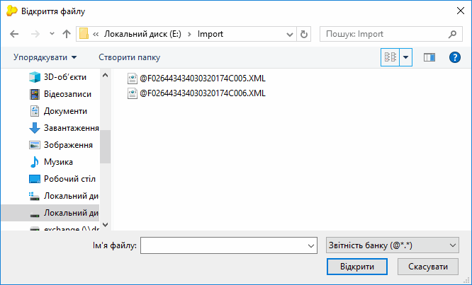

Якщо ім’я файлу, що імпортується, співпадає з іменем файлу, що вже присутній у реєстрі модуля, буде виведено відповідне повідомлення.

Натисніть Так, якщо необхідно імпортувати файли з дублюючими іменами. Якщо ж імпорт дублюючих файлів виконувати не потрібно, натисніть Ні.

По натисканню Скасувати скасовується операція імпорту для всіх обраних файлів.

Розпочнеться процедура імпорту. По закінченні процедури, система виведе протокол імпорту даних.

Документи поміщаються у модуль у певний звітний період.

#### Підписання та відправлення документів

_Шлях у довідці: Розділи програми › Банківський модуль › Монітор повідомлень про відкриття/закриття рахунків › Підписання та відправлення документів_

В цьому розділі:

[Підписання документів засобами ЕП](#ucaccopenclose-ucaccopenclose_monitor_vidp)

[Відправлення документів електронним каналом зв'язку](#ucaccopenclose-ucaccopenclose_monitor_vidp)

Підписання документів ЕП

Для роботи з усіма сертифікатами у програмі використовується універсальна бібліотека, тому процедура підпису для всіх сертифікатів однакова.

1. Відкрийте документ, що потрібно відправити до органів державної податкової служби.

2. На панелі вкладок документа, у закладці Наступні дії оберіть опцію Передати звіт на підпис.

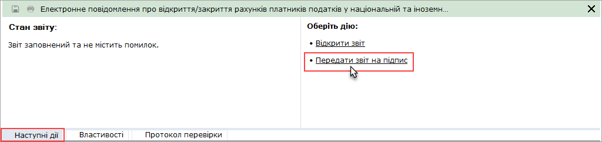

Відкриється вікно Підпис, тип підпису «Відповідальна особа». Далі вкажіть шлях до розміщення каталогу з секретними ключами та введіть пароль секретного ключа відповідної посадової особи у однойменні поля форми.

Зверніть увагу! Якщо встановити галочку у полі «Зберігати пароль протягом сеансу», то при наступному підписанні даним сертифікатом в межах поточного сеансу користування дана процедура виконається автоматично.

Якщо для зберігання ключа ви використовуєте захищений носій, підключіть носій до комп'ютера та у вікні Підпис встановіть опцію Використовувати захищений носій. У полі Пароль до носія введіть пароль доступу до захищеного носія.

Зверніть увагу! Для кожного типу підпису використовується окремий захищений носій!

Натисніть ОК для продовження.

Згідно з налаштованим комплектом підписів наступним кроком потрібно підписати документ Печаткою установи. Процедура підписання печаткою аналогічна описаній вище, за винятком вибору сертифікату.

[До початку](#ucaccopenclose-ucaccopenclose_monitor_vidp)

Відправлення документів

Після того, як документ був підписаний згідно з налаштованим комплектом підписів, на панелі стану документа стає доступною опція Відправити у контролюючий орган

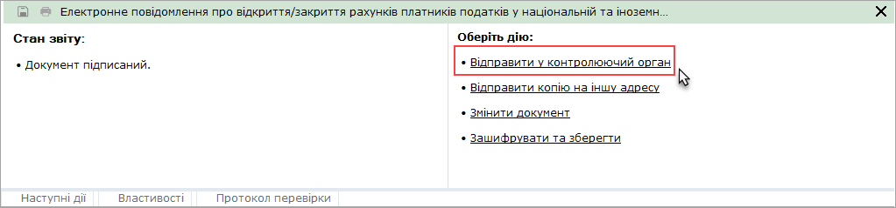

На виконання цієї команди, система повторно запропонує підписати файл сертифікатом печатки установи - таким чином підписується "конверт", в який поміщається файл для відправки.

Зверніть увагу! Якщо при підписанні печаткою установи раніше була встановлена опція Зберігати пароль протягом сеансу, то дана процедура виконається автоматично (в межах поточного сеансу користування).

Відкриється вікно Вибір адресата. Оберіть адресу органів ДПСУ.

Повідомлення відправлено. При цьому, на панелі стану документа з’явиться додаткова вкладка «Відправлено», що містить інформацію про код та назву одержувача звіту, адресу одержувача, дата та час відправлення тощо.

[До початку](#ucaccopenclose-ucaccopenclose_monitor_vidp)

#### Прийом і відображення квитанцій про доставку документів та Файлу-відповіді

_Шлях у довідці: Розділи програми › Банківський модуль › Монітор повідомлень про відкриття/закриття рахунків › Прийом і відображення квитанцій про доставку документів та Файлу-відповіді_

Як тільки в органах Державної податкової служби був прийнятий звіт, генерується Квитанція № 1 про доставку документа та Квитанція № 2 з результатами обробки звіту, які надсилаються відправникові.

Повідомлення та квитанція надходять як звичайна вхідна кореспонденція. Для цього потрібно натиснути кнопку на панелі інструментів  або функціональну клавішу F9. При наявності відповідей система повідомить про це.

Файли Повідомлення та Квитанції прикріпляються до документа, що відправлявся. Вміст прийнятих Повідомлення та Квитанції можна переглянути на панелі стану документа, де з’являються додаткові вкладки Квитанція № 1 та Квитанція № 2 відповідно.

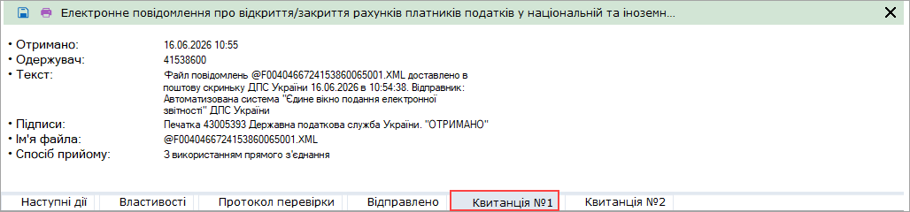

Також на Рахунки у валютах, Рахунки у цінних паперах надсилається Файл-відповідь. Він так само отримується як звичайна кореспонденція, про що повідомляє система.

Файл-відповідь також прикріплюється до документа, на який її було отримано. Відповідь можна переглянути у додатковій вкладці Відповідь.

Формування квитанції-відповіді на Інформаційний файл U

Документ Електронне інформаційне повідомлення про припинення (зняття з обліку) платника податків (Інформаційний файл U) формується ДПС у разі припинення (зняття з обліку) платника податків та надсилається до фінансової установи, в якій відкрито рахунок платника податків.

Після ознайомлення з документом, у відповідь на отриманий Інформаційний файл U фінансова установа повинна сформувати та направити в ДПС Квитанцію № 1.

Зверніть увагу! Формування та відправка Квитанції № 1 може виконується співробітником фінансової установи вручну, або ж у автоматичному режимі. Налаштування автоматичної відправки Квитанції № 1 виконуються у модулі [Налаштування](#ucaccopenclose-ucaccopenclose_nalasht).

Для формування квитанції вручну оберіть Інформаційний файл U у таблиці модуля та виконайте команду головного меню Файл – Відправити квитанцію на повідомлення. Виконайте підписання квитанції комплектом ЕП та відправте підписану квитанцію у ДПС. Також, відправити в ДПС Квитанцію № 1 можна за допомогою команди Відправити квитанцію на повідомлення з контекстного меню та з вкладки Наступні дії.

#### Створення Додатку 7

_Шлях у довідці: Розділи програми › Банківський модуль › Монітор повідомлень про відкриття/закриття рахунків › Створення Додатку 7_

Додаток 7 - Копія електронного файлу-відповіді щодо взяття на облік/закриття рахунку Платника податків в органі державної податкової служби (долучається до справи Платника податків у фінансовій установі) платника.

Додаток 7 створюється на підставі документів, що мають в наявності відповідні квитанції.

Для того, щоб створити Додаток 7 виконайте дії в наступній послідовності:

1. Виділіть файл, на підставі якого потрібно створити Додаток 7.

2. Скористайтесь одним із наступних способів:

- виберіть команду Файл - Додаток 7;
- у контекстному меню оберіть команду Додаток 7.

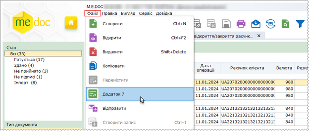

Натисніть, щоб збільшити малюнок

3. На виконання команди у окремому вікні відкриється документ.
Поля Додатку 7 доступні для заповнення та редагування.
Після перевірки та заповнення документа є можливість його роздрукувати.


