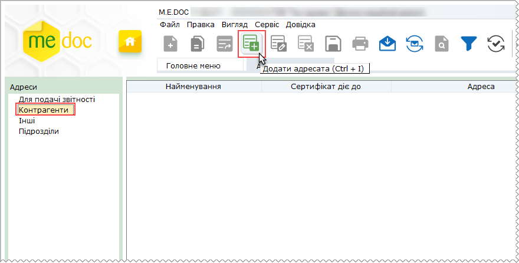
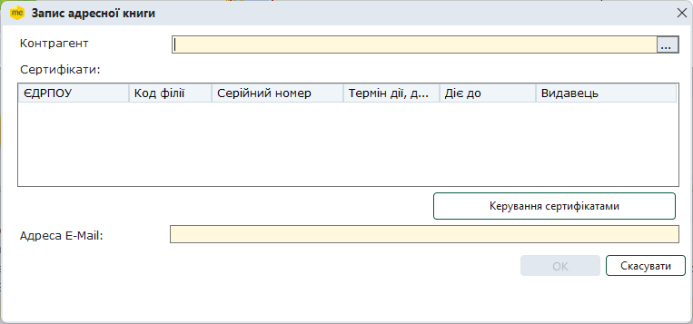
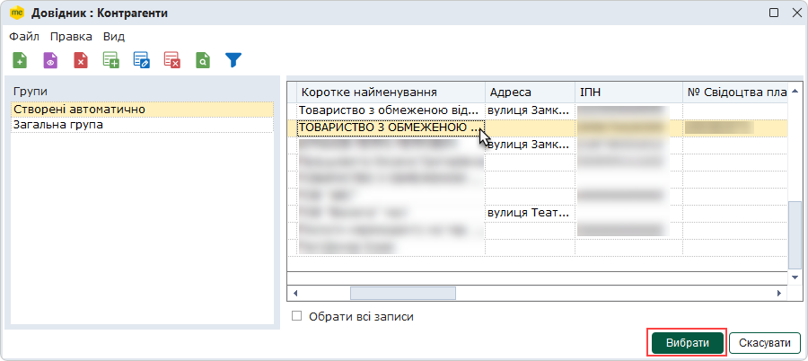
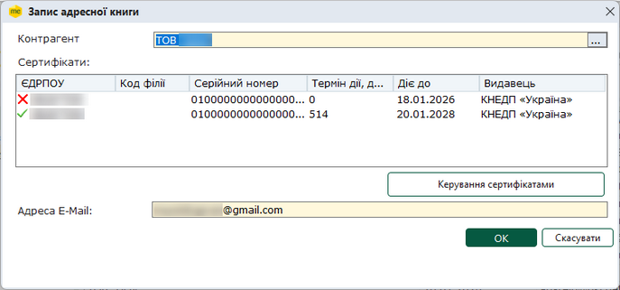
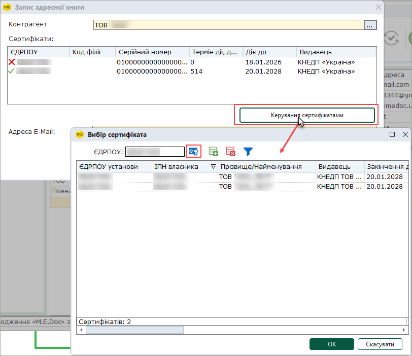
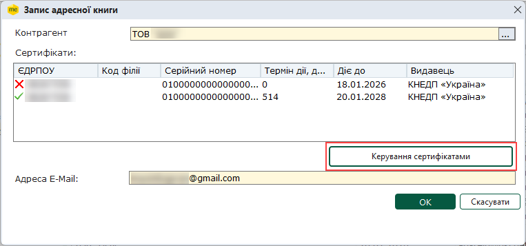
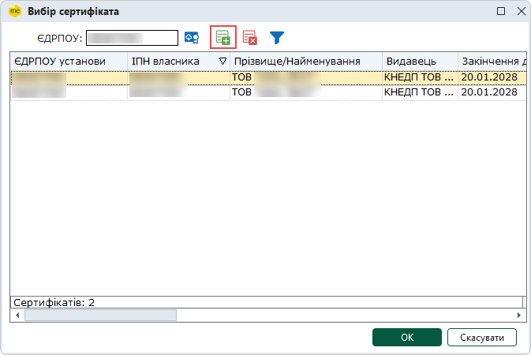
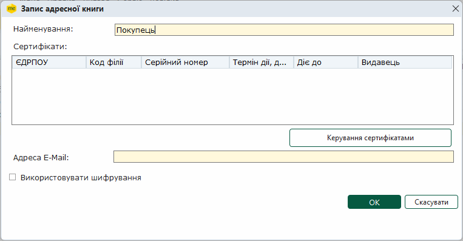
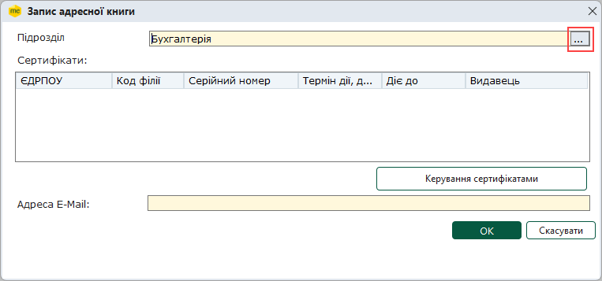

[← Зміст довідки](../)


# Адресна книга

## Адресна книга

_Шлях у довідці: Розділи програми › Довідники › Адресна книга_

В цьому розділі:

[Електронні адреси звітних органів](#ucaddrbook-spraddrbook)

[Додавання записів Контрагентів до адресної книги](#ucaddrbook-spraddrbook)

[Завантаження сертифікатів Контрагентів з диску](#ucaddrbook-spraddrbook)

[Додавання записів адресної книги у розділи Інші та Підрозділи](#ucaddrbook-spraddrbook)

Для зручності обміну звітністю, відправлення документів електронною поштою, у програмний комплекс вбудовано поштовий клієнт. Неодмінним атрибутом будь-якої поштової програми є адресна книга. Це свого роду спеціальна база даних, сховище E-mail адрес ваших адресатів - всіх, з яким ви обмінюєтесь документами за допомогою електронної пошти.

Всі записи адресної книги згруповані за призначенням адресатів:

- Для подачі звітності - містить електронні адреси контролюючих органів та прикріплені до них сертифікати ЕП. Записи, що містяться у даній групі адресної книги заповнюється і редагується автоматично під час оновлення програми. Тобто, користувач не може додавати, видаляти та редагувати дані звітних органів.
- Контрагенти - електронні адреси та сертифікати ЕП фізичних та юридичних осіб, з якими співпрацює установа. Більш повна інформація  про цих адресатів міститься у довіднику [Контрагенти](UCPartnerRst.html#ucpartnerrst-sprpartner). Записи у групу можуть додаватись звичайним способом або із довідника [Контрагенти](UCPartnerRst.html#ucpartnerrst-sprpartner).
- Інші - група призначена для зберігання електронних адрес та сертифікатів ЕП (за наявності) будь-яких адресатів, з якими підприємство обмінюється документами. З адресатами даної групи можна листуватись не використовуючи шифрування.
- Підрозділи - містить електронні адреси та прикріплені до них сертифікати ЕП структурних одиниць (філій) підприємства.

При виділенні певної групи в правій частині відображається її вміст - саме записи адресної книги.

Електронні адреси звітних органів

Для здійснення електронного документообігу із контролюючими установами в адресній книзі створена група Для подачі звітності, куди автоматично внесені адреси Центрів обробки електронної звітності (ЦОЕЗ) Податкової інспекції, ФСС з ТВП, Державної служби статистики тощо.

До цих адрес вже "прикріплені" сертифікати КНЕДП "Україна", що використовуються в централізованій системі приймання електронної звітності.

Користувач не може додавати, видаляти та редагувати дані звітних органів. Реєстр адресатів для подачі звітності редагується автоматично під час оновлення програми.

[До початку](#ucaddrbook-spraddrbook)

Додавання записів Контрагентів до адресної книги

1. Щоб додати новий запис до Адресної книги, оберіть розділ Контрагенти.

2. На панелі інструментів виберіть команду Створити запис, або натисніть комбінацію клавіш Ctrl+I.

3. Відкриється вікно Запис адресної книги. У полі Контрагент натисніть кнопку .

4. Відкриється вікно довідника Контрагенти. Оберіть запис Контрагента, дані якого потрібно додати до Адресної книги, та натисніть кнопку Вибрати.

Перед додаванням записів Контрагентів у Адресну книгу, рекомендується попередньо внести дані Контрагента у довідник [Контрагенти](UCPartnerRst.html#ucpartnerrst-sprpartner).

5. Для відправлення пошти адресатам, обов'язково потрібно завантажити сертифікати цих адресатів. Якщо сертифікати Контрагента були завантажені у реєстр програми під час заповнення довідника [Контрагенти](UCPartnerRst.html#ucpartnerrst-sprpartner), у вікні Запис адресної книги відобразяться назва та сертифікати обраного Контрагента.

Недійсні сертифікати позначаються символом - .

Для продовження роботи натисніть кнопку ОК. Доданий запис Контрагента відобразиться у вікні Адресної книги.

6.  Якщо при заповненні довідника Контрагенти сертифікати не завантажувались, можливо завантажити сертифікати у вікні Запис адресної книги, натиснувши кнопку Завантажити з Інтернета:

У вікні Запис адресної книги відобразяться завантажені сертифікати.
Натисніть кнопку ОК вікна Запис адресної книги. Доданій контрагент відобразиться у вікні Адресної книги.

7. Поле Адреса E-Mail заповнюється автоматично значенням із сертифіката.

Однак, поштову адресу можна змінити вручну з клавіатури. В цьому випадку пошта буде відправлятись на вказану адресу.

При редагуванні адреси вручну, зміни відбуваються лише в адресній книзі, у файлі сертифікату адреса не змінюється.

В адресній книзі також доступні наступні функції:

|  |  |
| --- | --- |
| Видалити | Дозволяє безповоротно вилучити запис. |
| Відкрити | Редагування даних в разі необхідності. |

[До початку](#ucaddrbook-spraddrbook)

Завантаження сертифікатів Контрагентів з диску

Якщо Контрагент користується послугами кваліфікованого надавача електронних довірчих послуг, що не надає можливість завантаження сертифікатів через мережу Інтернет, для додавання таких сертифікатів збережіть файли сертифікатів Контрагента на жорсткому диску. Після чого, завантажте сертифікати у програму:

1. Натисніть 2 рази лівою кнопкою миші на записі потрібного контрагента у адресній книзі.

2. У вікні Запис адресної книги натисніть кнопку Керування сертифікатами:

3. Відкриється вікно Вибір сертифіката. Натисніть кнопку :

4. У вікні, що відкриється оберіть каталог, у якому збережено сертифікат. Натисніть кнопку Відкрити.

5. Перелік сертифікатів, що містяться у обраному каталозі, відобразяться у вікні Вибір сертифіката.

Оберіть потрібний сертифікат та натисніть кнопку ОК.

6. Обраний сертифікат відобразиться у вікні Вибір сертифікату.

Для продовження роботи натисніть кнопку ОК.

[До початку](#ucaddrbook-spraddrbook)

Додавання записів адресної книги

1. Додавання даних адресатів у розділи Інші та Підрозділи виконується аналогічно додаванню [даних Контрагентів](#ucaddrbook-spraddrbook).

Завантажити сертифікати у цих розділах можливо лише з жорсткого диску комп'ютера по натисканню кнопки Керування сертифікатами.

2. В залежності від групи адресата, що створюється, перше обов'язкове поле відрізняється відповідно:

 - у групі Інші - ввести вручну із клавіатури назву адресата;

Для групи Інші існує додаткове поле Використовувати шифрування. Відсутність галочки в даному полі вказує на те, при відправлені на вказану адресу листи не шифруватимуться.

 - у групі Підрозділ - вибрати значення із довідника [Підрозділи](UCDepartments.html#ucdepartments-sprdepartment).

[До початку](#ucaddrbook-spraddrbook)


