[← Зміст довідки](../)


# Управління користувачами

## Управління користувачами

_Шлях у довідці: Розділи програми › Адміністрування › Управління користувачами_

В цьому розділі:

[Створення груп користувачів](#ucadminusers-admusr)

[Створення та заповнення картки користувача](#ucadminusers-admusr)

[Імпорт груп користувачів з ACTIVE DIRECTORY](#ucadminusers-admusr)

[Оновлення даних користувачів з ACTIVE DIRECTORY](#ucadminusers-admusr)

[Створення та заповнення картки користувача з ACTIVE DIRECTORY](#ucadminusers-admusr)

[Як призначити групу користувачу](#ucadminusers-admusr)

[Як призначити роль користувачу](#ucadminusers-admusr)

[Як додати установу, до якої користувач має доступ](#ucadminusers-admusr)

У модулі Управління користувачами зберігається інформація зареєстрованих користувачів системи.

Модуль має складну структуру, в якій реєстр користувачів є залежним від груп Групи - умовні категорії, що об'єднують користувачів по будь-яким спільним ознакам, наприклад, "Бухгалтерія", "3 поверх". Саме тому довідник умовно складається із двох частин: Групи та Користувачі.

Зліва у Групах відображається список груп користувачів, справа у Користувачах - список користувачів вибраної групи При обранні певної групи у вікні справа відображається список користувачів, які входять до обраної групи.

Модуль побудований у вигляді таблиці, окремий рядок якої відображає коротку інформацію про кожного користувача. Переглянути більш повну інформацію про користувача можна у окремому вікні Користувач, яке відкривається подвійним кліком по потрібному запису.

Дозволяє додавати нових користувачів, редагувати та видаляти існуючих.

При першому запуску програми таблиця містить лише обліковий запис адміністратора. Користувач з роллю Адміністратор за замовчанням має повний доступ до всіх модулів та функцій програми. Цей обліковий запис із програми не видаляється.

Для того, щоб змінити пароль Адміністратора в меню Сервіс оберіть команду Змінити пароль користувача, або клацніть два рази лівою кнопкою миші на записі Адміністратора..

Зверніть увагу! Система прав доступу в програмному комплексі реалізовано таким чином, що обов'язково має бути чіткий взаємозв'язок між об'єктами системи РОЛЬ - КОРИСТУВАЧ - УСТАНОВА. Тобто, користувачу неможливо призначити роль не призначивши доступ до установи (групи установ) в межах цієї ролі. Виняток становить лише роль "Адміністратор".

Створення груп користувачів

Перш ніж створити нового користувача необхідно створити групу, якій він буде підпорядкований. Є можливість створювати ієрархічних список груп.

Для того, щоб створити нову групу, виконайте такі дії:

1. Скористайтесь одним із наступних способів:

- у меню Файл оберіть команду Додати групу;
- у контекстному меню оберіть команду Додати групу;
- натисніть кнопку Додати групу на панелі інструментів;
- натисніть комбінацію клавіш Ctrl+N.

Для створення підпорядкованої групи ієрархічного списку, виділіть рядок відносно якого буде додаватись підгрупа.

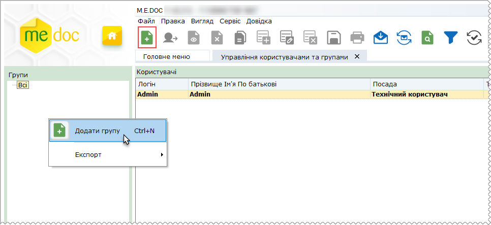

2. У вікні Група введіть назву групи, що створюється.

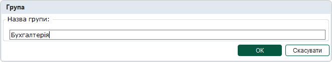

3. Натисніть кнопку ОК.

Нова група з'явиться у переліку груп.

В списку груп користувачів також доступні наступні функції:

|  |  |
| --- | --- |
| Видалити | Дозволяє безповоротно вилучити запис.  УВАГА!   При видаленні групи видаляється увесь її вміст - всі підпорядковані їй записи користувачів, без можливості відновлення. |
| Редагувати | Редагування даних в разі необхідності. |

[До початку](#ucadminusers-admusr)

Створення та заповнення картки користувача

Для того, щоб додати нового користувача скористайтесь одним із наступних способів:

- у меню Файл оберіть команду Створити картку користувача;
- у контекстному меню оберіть команду Створити картку користувача;
- натисніть кнопку Створити картку користувача на панелі інструментів;
- натисніть комбінацію клавіш Ctrl+I.

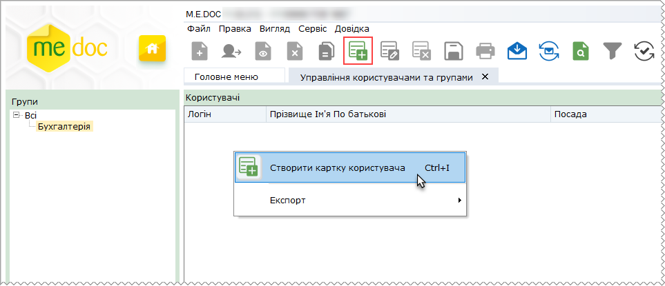

Відкриється окрема вкладка Користувач. Заповніть запропоновані поля форми.

Поля, що підсвічені жовтим кольором, є обов'язковими для заповнення.

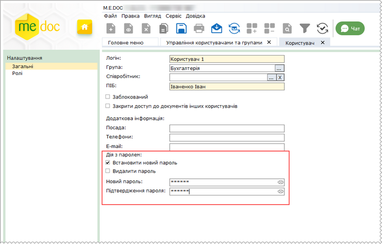

Натисніть, щоб збільшити малюнок

- Логін - ім'я облікового запису користувача в сиcтемі, вводиться кожен раз при вході в програму. Запис вноситься із клавіатури.
- Група - умовна назва групи користувача, відображає значення [призначеної групи користувачу](#ucadminusers-admusr), щоб обрати групу, натисніть кнопку .
- Співробітник - код ДРФО, ім'я та по батькові співробітника, що буде працювати під створюваним користувачем. Значення обирається з довідника Співробітники. Щоб обрати співробітника, натисніть кнопку .
- ПІБ - прізвище ім'я та по батькові користувача. Якщо для облікового запису встановлено співробітника (поле Співробітник), поле ПІБ заблоковане для редагування, у полі відображається значення з довідника Співробітники.
- Заблокований - якщо опція встановлена, доступ обраного користувача до програми блокується. При спробі авторизації у програмі користувачу буде виведено повідомлення: «Користувача заблоковано. Зверніться, будь ласка, до адміністратора».

Зверніть увагу, у разі зазначення кількості спроб для невдалого введення пароля у розділі [Адміністрування - Консоль адміністратора – Авторизація – Використовувати посилений захист](UcAdmConsole.html#ucadmconsole-zagalni) при перевищенні встановленої кількості спроб доступ користувача до програми також буде заблоковано (опція Заблокований встановлюється автоматично). Керування опцією Заблокований доступне лиже користувачам з правами адміністратора. Подія невдалої спроби авторизації у програмі з причини введення неправильного пароля фіксується у Журналі подій.

- Закрити доступ до документів інших користувачів - якщо опцію встановлено, у Реєстрі звітів відображатимуться лише ті документи, які були створені або імпортовані авторизованим користувачем (поточний користувач є автором документа). Якщо опцію не встановлено, користувач має можливість переглядати та редагувати документи, що створені іншими користувачами.
- Посада - назва посади користувача в установі. Запис вноситься із клавіатури. Необов'язкове для заповнення.
- Телефони - номер телефону для покращення внутрішньої комунікації співробітників. Запис вноситься із клавіатури. Необов'язкове для заповнення.
- E-mail - електронна адреса користувача.
- Встановити новий пароль - ознака встановлюється, якщо потрібно призначити або змінити пароль користувача, якщо опцію встановлено, доступні поля для встановлення та підтвердження пароля.
- Видалити пароль - ознака встановлюється, якщо потрібно видалити пароль користувача, якщо опцію встановлено, поля для встановлення та підтвердження пароля стають неактивними, при збереженні картки пароль буде очищено (збережеться як порожній).

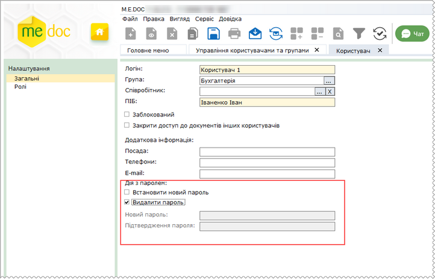

Натисніть, щоб збільшити малюнок

- Новий пароль - секретний набір символів, призначений для підтвердження особи при вході в програму. Запис вноситься із клавіатури.
- Підтвердження пароля - підтвердження пароля, що встановлюється. Запис вноситься із клавіатури.

Якщо для облікового запису користувача встановлено пароль, у таблиці розділу, у колонці Пароль, відображається позначка:

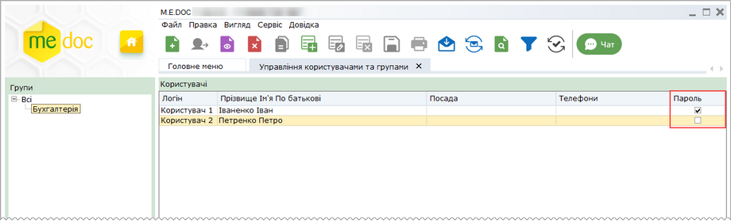

Натисніть, щоб збільшити малюнок

В реєстрі користувачів також доступні наступні функції:

|  |  |
| --- | --- |
| Видалити | Дозволяє безповоротно вилучити запис обраного користувача. |
| Редагувати | Редагування даних користувача в разі необхідності. |

[До початку](#ucadminusers-admusr)

Імпорт груп користувачів з ACTIVE DIRECTORY

Щоб мати можливість імпортувати групи користувачів з ACTIVE DIRECTORY, необхідно попередньо встановити опцію Використовувати ACTIVE DIRECTORY у модулі програми [Адміністрування - Консоль адміністратора – Авторизація – Використовувати ACTIVE DIRECTORY](UcAdmConsole.html#ucadmconsole-zagalni).

Щоб імпортувати групи з ACTIVE DIRECTORY, виконайте такі дії:

1. Скористайтесь одним із способів:

- у меню Файл оберіть команду Імпортувати групу з AD;
- у контекстному меню оберіть команду Імпортувати групу з AD.

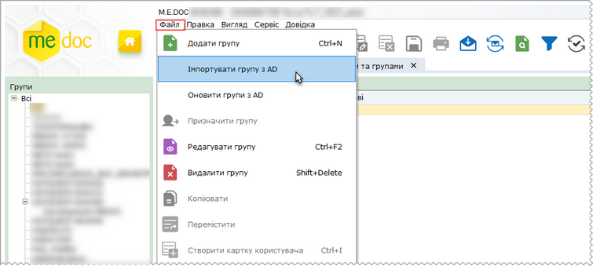

Натисніть, щоб збільшити малюнок

2. У вікні, що відкриється оберіть групу ACTIVE DIRECTORY, яку потрібно імпортувати. Натисніть кнопку Вибрати:

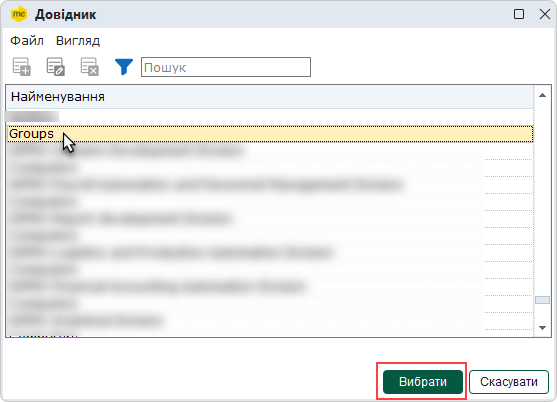

3. Дані обраної групи та всі облікові записи користувачів, що належать до групи, будуть імпортовані у програму та відображені на вкладці Управління користувачами та групами.

[До початку](#ucadminusers-admusr)

Оновлення даних користувачів з ACTIVE DIRECTORY

Щоб мати можливість імпортувати групи користувачів з ACTIVE DIRECTORY, необхідно попередньо встановити опцію Використовувати ACTIVE DIRECTORY у модулі програми [Адміністрування - Консоль адміністратора – Авторизація – Використовувати ACTIVE DIRECTORY](UcAdmConsole.html#ucadmconsole-zagalni).

Щоб оновити дані користувачів з ACTIVE DIRECTORY, виконайте такі дії:

1. На панелі Групи виділіть назву групи користувачів, яку потрібно оновити, та скористайтесь одним із способів:

- у меню Файл оберіть команду Імпортувати групу з AD;
- у контекстному меню оберіть команду Імпортувати групу з AD.

Натисніть, щоб збільшити малюнок

2. У вікні, що відкриється оберіть групу ACTIVE DIRECTORY, дані якої потрібно оновити. Натисніть кнопку Вибрати:

3. Відкриється вікно Оновлення групи, що містить протокол порівняння даних облікових записів користувачів у базі програми з даними користувачів з ACTIVE DIRECTORY. Програма запропонує виконати операції за результатами перевірки: оновити існуючі облікові записи, видалити записи з групи у програмі, якщо вони відсутні у ACTIVE DIRECTORY, перемістити користувачів у іншу групу, додати нових користувачів. Перелік облікових записів, для яких доступна певна операція, відображається у окремому розділі.

 Щоб переглянути перелік облікових записів, для яких доступна та чи інша операція, оберіть розділ у верхній частині вікна.

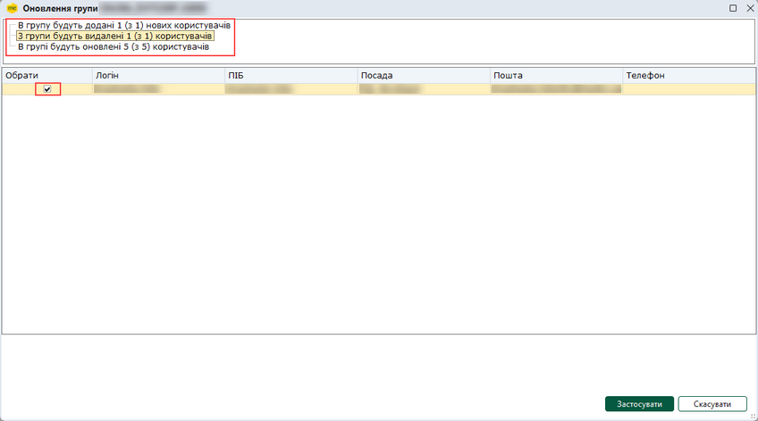

Натисніть, щоб збільшити малюнок

При виборі розділу оновлення або переміщення даних, у вікні наводиться інформація по обліковому запису, що буде оновлена.

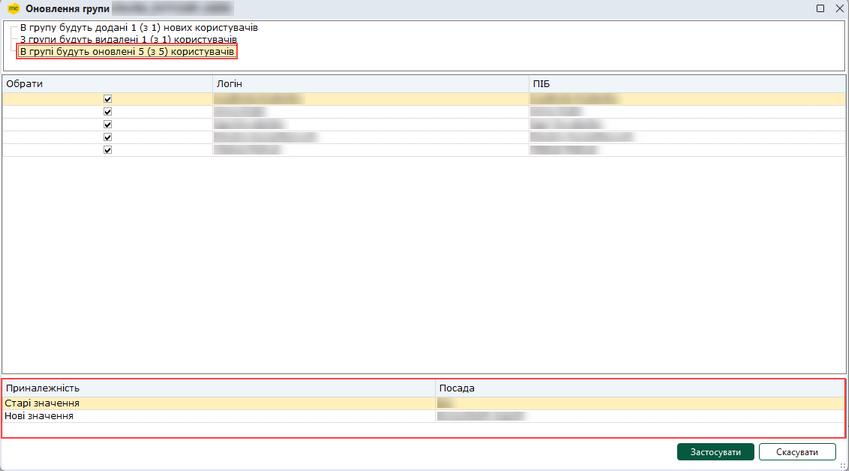

Натисніть, щоб збільшити малюнок

4. Для кожного розділу оберіть облікові записи, дані яких потрібно оновити. Для цього встановіть відмітки на початку рядка. За замовчуванням, обрано всі записи.

5. Для оновлення обраних облікових записів натисніть Застосувати.

6. Оновлені облікові записи користувачів, будуть відображені на вкладці Управління користувачами та групами.

Зверніть увагу. При оновленні даних з ACTIVE DIRECTORY облікові записи видаляються лише з обраної групи, по якій відбувається оновлення. У базі програмі ці облікові записи зберігаються та переміщуються у групу Всі.

- Оновити дані користувачів з ACTIVE DIRECTORY для всіх наявних груп можна, виконавши команду Оновити групи з AD. Команда доступна у головному меню Файл та у контекстному меню. По виконанню команди здійснюється оновлення всіх існуючих груп користувачів у програмі: оновлення облікових записів, переміщення облікових записів у іншу групу, додавання нових користувачів.
- Обліковий запис користувача, який присутній в декількох групах ACTIVE DIRECTORY, в програмі М.Е.DOC залишатиметься в останній завантаженій групі.
- У розділі програми [Адміністрування - Консоль адміністратора – Авторизація – Використовувати ACTIVE DIRECTORY](UcAdmConsole.html#ucadmconsole-zagalni) можна налаштувати виконання автоматичного оновлення даних облікових записів користувачів з ACTIVE DIRECTORY, що буде виконуватись при кожній авторизації у програмі та під час роботи програми через вказаний проміжок часу.

[До початку](#ucadminusers-admusr)

Створення та заповнення картки користувача з ACTIVE DIRECTORY

Щоб мати можливість створювати картки користувачів на основі даних з ACTIVE DIRECTORY, необхідно попередньо встановити опцію Використовувати ACTIVE DIRECTORY у модулі програми [Адміністрування - Консоль адміністратора – Авторизація – Використовувати ACTIVE DIRECTORY](UcAdmConsole.html#ucadmconsole-zagalni).

Щоб додати нового користувача на основі даних з ACTIVE DIRECTORY:

1. Скористайтесь одним із наступних способів:

- у меню Файл оберіть команду Створити картку користувача;
- у контекстному меню оберіть команду Створити картку користувача;
- натисніть кнопку Створити картку користувача на панелі інструментів;
- натисніть комбінацію клавіш Ctrl+I.

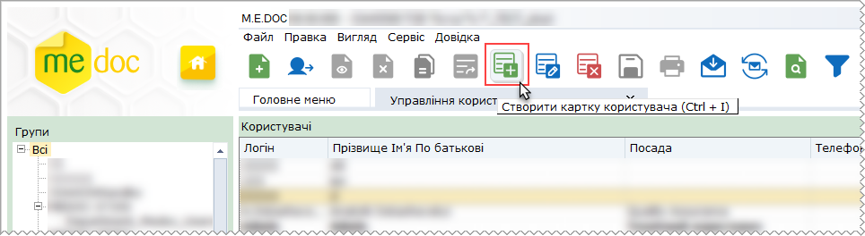

2. У вікні, що відкриється встановіть опцію Додати користувача з AD та натисніть кнопку ОК:

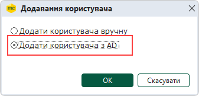.

3. У наступному вікні знайдіть користувача ACTIVE DIRECTORY, якого необхідно додати у програму. Виконати пошук облікового запису користувача можна за логіном, групою користувача або ж серед усіх користувачів ACTIVE DIRECTORY, для цього встановіть відповідну опцію та натисніть кнопку Додати: Інформація про знайдені облікові записи з'явиться у вікні Додавання користувача.

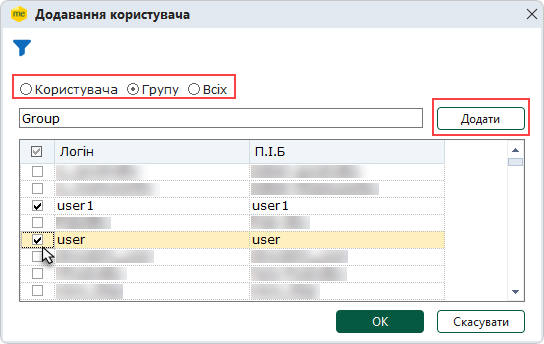

4. Встановіть позначки у рядках облікових записів користувачів, яких потрібно додати у програму. Щоб швидко обрати всіх користувачів ACTIVE DIRECTORY, встановіть позначку у заголовку таблиці. Натисніть кнопку ОК.

5. Обрані облікові записи користувачів будуть відображені на вкладці Управління користувачами та групами.

[До початку](#ucadminusers-admusr)

Як призначити групу користувачу

Для того, щоб призначити або змінити групу користувачу, виконайте такі дії:

1. На панелі "Групи" оберіть саму верхню групу Всі.

2. У списку користувачів оберіть потрібного користувача та скористайтесь одним із наступних способів:

- у меню Файл оберіть команду Призначити групу;
- на панелі інструментів натисніть кнопку Призначити групу;
- у контекстному меню оберіть команду Призначити групу.

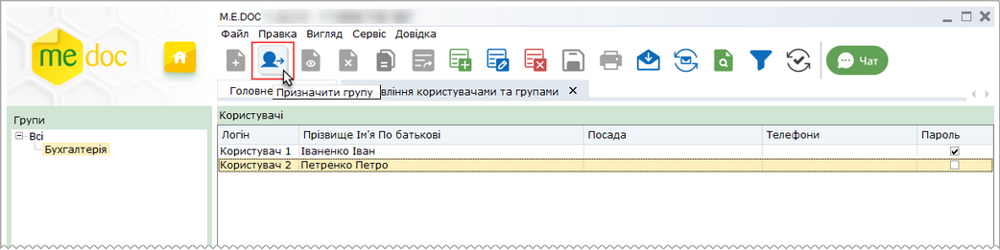

Натисніть, щоб збільшити малюнок

3. У вікні Призначити групу оберіть потрібну групу та натисніть ОК.

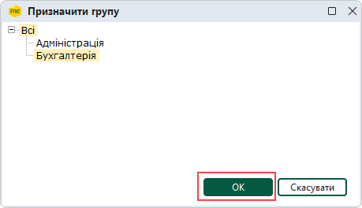

Користувача буде додано у вказану групу.

[До початку](#ucadminusers-admusr)

Як призначити роль користувачу

Роль визначає певні права доступу користувачів до окремих модулів і функцій програми.

Відкрийте картку користувача та перейдіть у розділ Ролі.

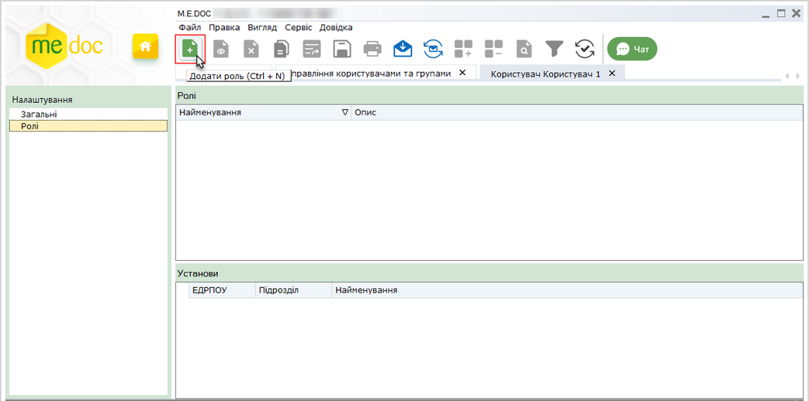

Натисніть, щоб збільшити малюнок

Розділ містить [перелік ролей](UCManageRoles.html#ucmanageroles-ucmanageroles), що присвоюються користувачу у системі. Окрім ролей також призначається перелік установ, до яких користувач має доступ.

Для того, щоб додати роль скористайтесь одним із наступних способів:

- у меню Файл оберіть команду Додати роль;
- у контекстному меню оберіть команду Додати роль;
- натисніть кнопку Додати роль на панелі інструментів;
- натисніть комбінацію клавіш Ctrl+N.

Відкриється вікно Ролі. Оберіть потрібну роль та натисніть кнопку Ок.

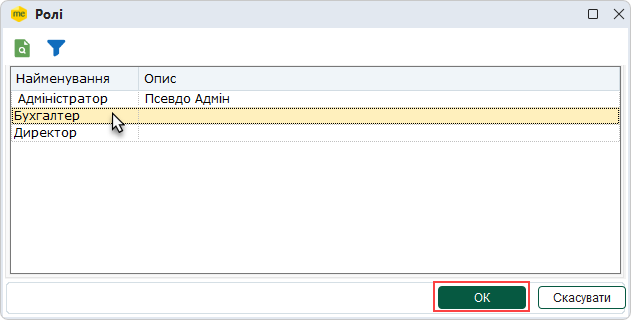

Роль буде додано в перелік ролей користувача. За необхідності, роль можна видалити, натиснувши на кнопку .

Якщо потрібно призначити ще одну роль користувачу, виконайте знову вище описані дії.

Для збереження внесених даних, натисніть кнопку .

[До початку](#ucadminusers-admusr)

Як додати установу, до якої користувач має доступ

Передбачена можливість надавати доступ користувачу до окремих установ, що зареєстровані в програмному комплексі.

Відкрийте картку користувача та перейдіть у розділ Ролі.

Зверніть увагу! Опція додавання установи активна лише якщо користувачу призначено хоча б одну роль.

Для того, щоб додати установу скористайтесь одним із наступних способів:

- у меню Файл оберіть команду Додати установу;
- у контекстному меню оберіть команду Додати установу;
- натисніть кнопку Додати установу на панелі інструментів;
- натисніть комбінацію клавіш Ctrl+I.

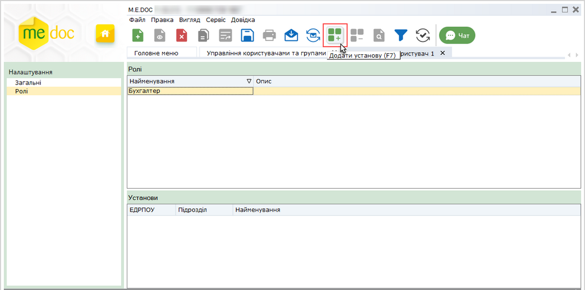

Натисніть, щоб збільшити малюнок

Відкриється вікно Установи. Оберіть потрібну установу та натисніть кнопку Ок.

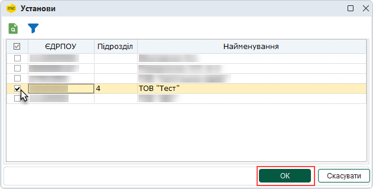

Установу буде додано в перелік установ, до яких користувач має доступ. За необхідності, установу можна видалити, натиснувши на кнопку .

Якщо потрібно додайте ще установу, до якої користувач має доступ, виконайте знову вище описані дії.

Для збереження внесених даних, натисніть кнопку .

[До початку](#ucadminusers-admusr)


