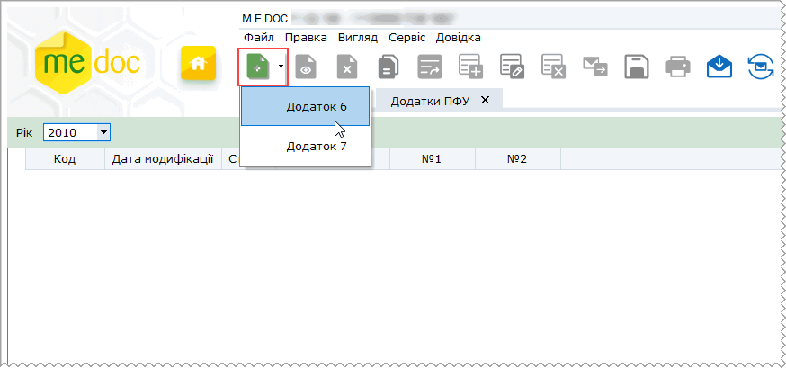
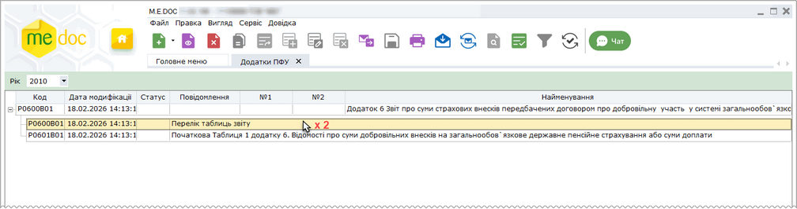

[← Зміст довідки](../)


# Додатки ПФУ

## Додатки ПФУ

_Шлях у довідці: Розділи програми › Звітність › Додатки ПФУ_

Згідно з Постановою правління Пенсійного фонду України від 05.11.2009 № 26-1, зареєстрованої в Міністерстві юстиції України 24.11.2009 № 1136/17152, Додатки 5-7 до персоніфікованої звітності страхувальники формують та подають до органів Пенсійного фонду один раз на рік до 1 квітня року, наступного за звітним періодом. Базовим звітним періодом для них є календарний рік.

Додатки подаються тільки за 2010 р.

У даному розділі описаний порядок створення додатків. Формування Додатків у програмі здійснюється у модулі Додатки ПФУ.

Модуль доступний із Головного меню програми Звітність - Додатки ПФУ.

Для створення додатків у полі для обрання звітного періоду вкажіть звітний рік та натисніть кнопку Створити  на панелі інструментів програми (або однойменна команда в меню Файл). Із списку оберіть потрібний додаток. Для фізичних осіб - підприємців меню міститиме повний перелік додатків - 5, 6 та 7. Якщо ж обрана установа - юридичне підприємство, наявними будуть тільки додатки 6 та 7.

Обраний в меню додаток з'явиться у полі реєстру додатків. Реєстр має структуру ієрархічного списку. В розгорнутому вигляді містить документи: Перелік таблиць звіту та саме таблиці, що відповідають певному Додатку. У колонках реєстру відображена поточна інформація про документи: назва, його статус, дата останньої модифікації тощо.

Для створення Додатку треба заповнити відповідні таблиці. Для цього потрібно відкрити форму Таблиці для редагування та внести необхідні дані.

Після заповнення усіх потрібних документів потрібно відкрити, перевірити та зберегти документ Додаток … (це Перелік таблиць звіту). В цю форму буде автоматично внесена інформація із створених документів (кількість аркушів, заповнених рядків тощо).

Натисніть, щоб збільшити малюнок

Тепер документи можна експортувати для подання до ПФУ (див. інструкцію з подання [щомісячної персоніфікації](UCMonthPers.html#ucmonthpers-ucmonthpers)).


