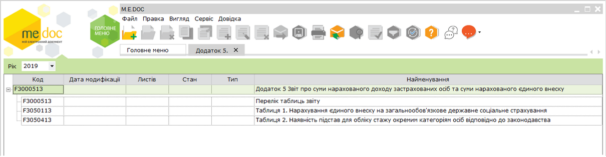
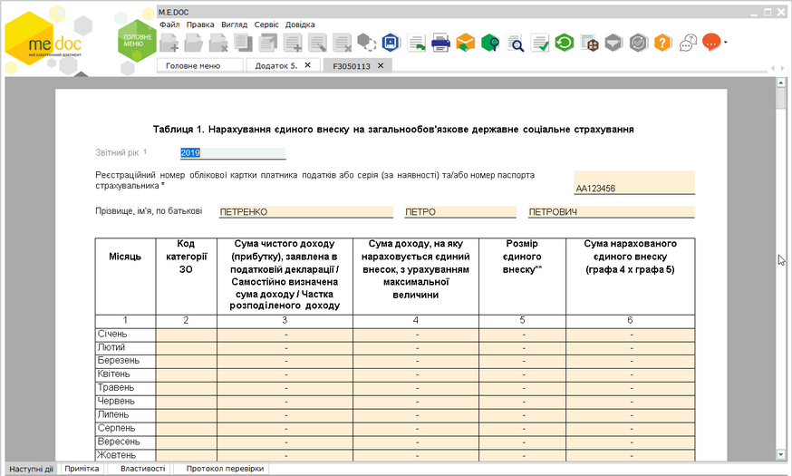
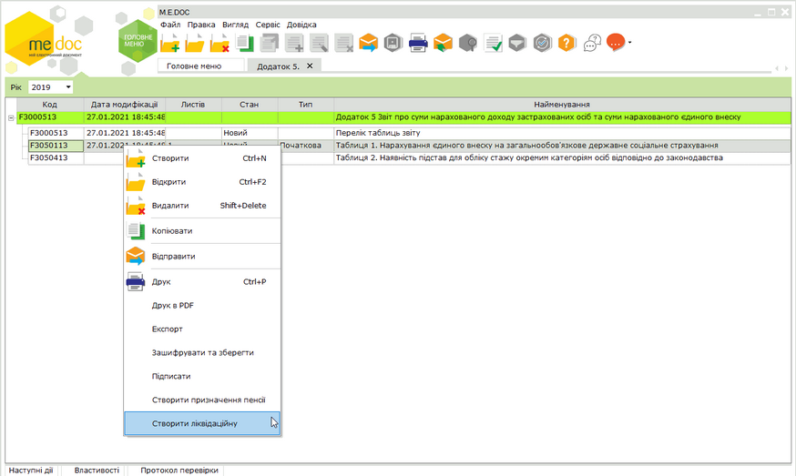
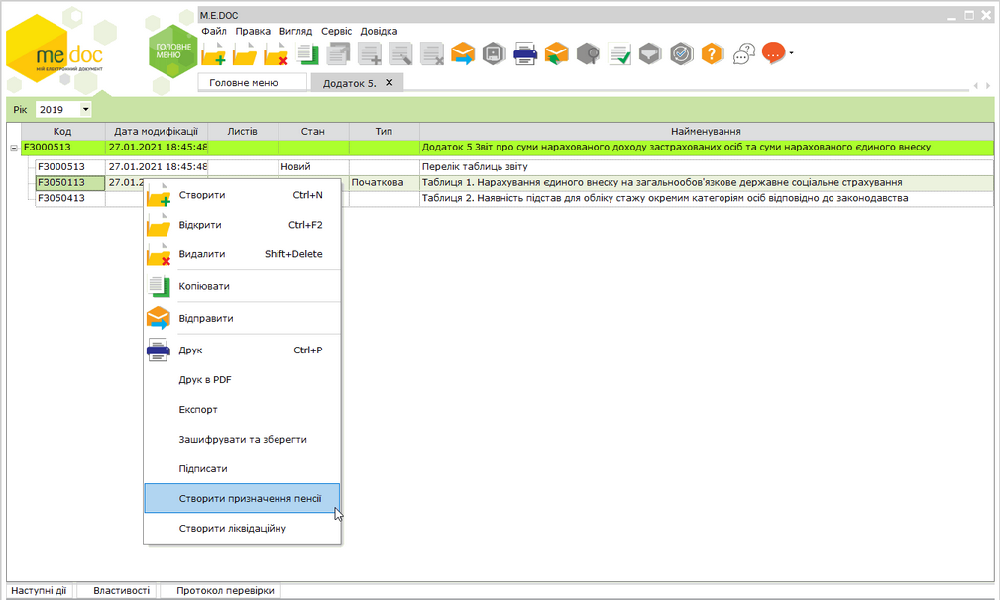
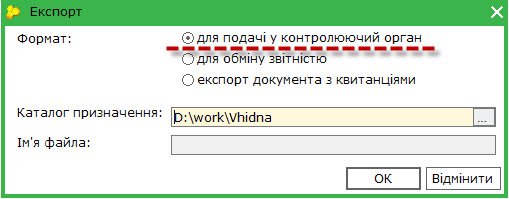

[← Зміст довідки](../)


# Додаток 5 Звіт про суми нарахованого доходу застрахованих осіб та суми нарахованого єдиного внеску

## Додаток 5 Звіт про суми нарахованого доходу застрахованих осіб та суми нарахованого єдиного внеску

_Шлях у довідці: Додатково: UCAppPFU5 › Додаток 5 Звіт про суми нарахованого доходу застрахованих осіб та суми нарахованого єдиного внеску_

ВАЖЛИВО!

На виконання наказу Міністерства фінансів України N 670 від 05.11.2020 року «Про затвердження Змін до Порядку формування та подання страхувальниками звіту щодо сум нарахованого єдиного внеску на загальнообов'язкове державне соціальне страхування» додано нові форми звітів (версія 13).

Додаток 5

ФО - підприємці, у тому числі ті, які обрали спрощену систему оподаткування, формують та подають до фіскальних органів Звіт самі за себе один раз на рік до 10 лютого року, що настає за звітним періодом.

Звітним періодом є календарний рік. Додаток 5 включає Таблиці 1, 2.

Особи, які провадять незалежну професійну діяльність, формують та подають самі за себе до фіскальних органів Звіт один раз на рік до 01 травня року, що настає за звітним періодом.

Звітним періодом для них є календарний рік. Додаток 5 включає Таблиці 1, 2.

Оскільки даний додаток відноситься до групи звітів з ЄСВ, для коректного його формування потрібно заповнити Реєстр співробітників та відповідні поля в картці установи.

Див. більше у розділі [Обов'язкові поля, які потрібно заповнити у картці установи та картках працівників](UCContribution.html#uccontribution-contribution_before).

[Створення Додатку 5](#ucapppfu5-ucapppfu5_create)

[Імпорт Додатку 5 з інших програм](#ucapppfu5-ucapppfu5_import)

[Подання Додатку 5 до контролюючого органу](#ucapppfu5-ucapppfu5_export)

### Створення Додатку 5

_Шлях у довідці: Додатково: UCAppPFU5 › Додаток 5 Звіт про суми нарахованого доходу застрахованих осіб та суми нарахованого єдиного внеску › Створення Додатку 5_

Додаток 5 Звіт про суми нарахованого доходу застрахованих осіб та суми нарахованого єдиного внеску формується у окремому модулі програми Звітність - Єдиний внесок - Додаток 5.

Модуль відкривається у окремій вкладці з назвою Додаток 5.

Увага! У зв’язку із вимогами Наказу № 511 передбачено формування різних пачок Додатку 5 для ФОП та самозайнятих осіб.

Формування певної пачки в програмі залежить від встановленої відмітки Особи, які забезпечують себе роботою самостійно в Картка підприємства - Пенсійний фонд.

Додаток 5 містить ярлик з переліком таблиць звіту та таблиці:

- Таблиці 1, 2 - для ФО - підприємців, у тому числі ті, які обрали спрощену систему оподаткування, формують та подають до фіскальних органів.
- Таблиці 1, 2  - для осіб, які провадять незалежну професійну діяльність, формують та подають самі за себе до фіскальних органів.

Створення та заповнення документів звіту

1. Оберіть звітний період.

2. Для створення окремої таблиці відкрийте її подвійним натисканням лівою кнопкою миші.

3. Таблиця відкриється у окремій вкладці, наприклад:

Натисніть, щоб збільшити малюнок

4. Заповніть поля звіту. [Заповнення звітів додатку відбувається за звичайними правилами](UCPravila.html#ucpravila-pravyla).

5. Всі створені звіти потрібно перевірити та зберегти.

6. Надалі відкрити, перевірити та зберегти [Перелік таблиць звіту](#ucapppfu5-ucapppfu5_d5).

7. Звіт [додаток 5 готовий до подання](#ucapppfu5-ucapppfu5_export).

#### Таблиця 1. Нарахування єдиного внеску на загальнообов'язкове державне соціальне страхування фізичними особами - підприємцями

_Шлях у довідці: Додатково: UCAppPFU5 › Додаток 5 Звіт про суми нарахованого доходу застрахованих осіб та суми нарахованого єдиного внеску › Створення Додатку 5 › Таблиця 1. Нарахування єдиного внеску на загальнообов'язкове державне соціальне страхування фізичними особами - підприємцями_

Чим регулюється:

Заповнення та подання звіту регулюється Порядком формування та подання страхувальниками звіту щодо сум нарахованого єдиного внеску на загальнообов'язкове державне соціальне  страхування ([Наказ Мінфіну № 435 від 14.04.2015 «Про затвердження Порядку формування та подання страхувальниками звіту щодо сум нарахованого єдиного внеску на загальнообов’язкове державне соціальне страхування»](http://zakon4.rada.gov.ua/laws/show/z0460-15) ).

Ким подається:

Заповнюється фізичними особами – підприємцями, які протягом усього звітного року працювали на загальній системі оподаткування.

Особливості заповнення:

- Реквізит 01. Звіт за рік: вказується звітний рік (чотири цифри), за який формується та подається звіт. Цей реквізит заповнюється однаково для всіх таблиць додатка 5.
- Реквізит 02. Реєстраційний номер облікової картки платника податків або серія (за наявності) та/або номер паспорта страхувальника: Зазначається податковий номер або серія та номер паспорта страхувальника (що має відповідну відмітку в паспорті про сплату податків за серією та номером паспорта).
- Прізвище, ім’я, по батькові: Зазначається прізвище, ім'я, по батькові ФОП українською мовою в називному відмінку

У Таблиці вказуються всі передбачені в ній показники.

- У графі 1 Місяць автоматично заповнені місяці звітного року.
- У графі 2 Код категорії ЗО оберіть з довідника код категорії застрахованої особи.
- У графі 3 Сума чистого доходу (прибутку), заявлена в податковій декларації / Самостійно визначена сума доходу / Частка розподіленого доходу відображається сума чистого доходу (прибутку), заявлена в податковій декларації про майновий стан і доходи фізичної особи – підприємця в розрізі місяців звітного періоду (року).

Розподіл річного чистого доходу (прибутку) по місяцях відбувається на основі Книги обліку доходів і витрат платника.

Відповідно до п. 2 ч. 1 ст. 7 Закону про ЄСВ, підприємець зобов'язаний сплачувати ЄСВ у розмірі не менше мінімального страхового внеску тільки в ті місяці, коли був отриманий дохід (прибуток).

У разі якщо платником не отримано дохід (прибуток) у звітному році або окремому місяці звітного року, він має право самостійно визначити базу нарахування, але не більше максимальної величини бази нарахування ЄСВ. При цьому сума ЄСВ не може бути меншою за розмір мінімального страхового внеску.

Сума чистого доходу за рік (рядок "Усього" графи 2) повинна відповідати сумі чистого оподатковуваного доходу, зазначеній у Податковій декларації про майновий стан та доходи (рядок 01 розділу II Додатка 5 до Декларації).

- У графі 4 Сума доходу, на яку нараховується єдиний внесок, з урахуванням максимальної величини зазначається дохід, відображений у графі 2 з урахуванням максимальної величини бази нарахування ЄСВ у розрізі місяців звітного року.

Якщо сума доходу, на яку нараховується ЄСВ, у відповідному місяці графи 2 менше максимальної величини бази нарахування ЄСВ, вона переноситься до графи 3 без змін.

Якщо сума доходу, на яку нараховується ЄСВ, у відповідному місяці графи 2 більше максимальної величини бази нарахування ЄСВ, то в графі 3 зазначається максимальний розмір бази нарахування ЄСВ у відповідному місяці.

Згідно п. 2 ч. 1 ст. 7 Закону про ЄСВ підприємець зобов'язаний сплачувати ЄСВ у розмірі не менше мінімального страхового внеску тільки в ті місяці, коли був отриманий дохід (прибуток).

Розмір мінімального ЄСВ визначається шляхом множення розміру мінімальної зарплати на ставку ЄСВ, встановлену законом на місяць, за який нараховується дохід (п. 5 ч. 1 ст. 1 Закону про ЄСВ).

Якщо отриманий дохід у будь-якому місяці звітного періоду менше розміру для нарахування мінімального страхового внеску (тобто менше розміру мінімальної зарплати для цього місяця), то підприємцем в такому місяці не буде виконано вимогу п. 2 ч. 1 ст. 7 Закону про ЄСВ щодо сплати мінімального ЄСВ-внеску в прибутковому місяці. Тому в графі 3 необхідно вказати розмір мінімальної зарплати для цього місяця, оскільки за недоплату ЄСВ контролюючі органи можуть застосувати штрафні санкції відповідно до п. 5 пп. 2 розд. VII Інструкції № 449.

У разі якщо платником не отримано дохід (прибуток) у звітному році або окремому місяці звітного року, він має право самостійно визначити базу нарахування, але не більше максимальної величини бази нарахування ЄСВ.

- У графі 5 Розмір єдиного внеску відображається розмір єдиного внеску, встановлений Законом України «Про збір та облік єдиного внеску на загальнообов’язкове державне соціальне страхування» – 34,7%, а у разі прийняття добровільної участі у загальнообов’язковому державному соціальному страхуванні з тимчасової втрати працездатності - 36,6%, у загальнообов’язковому державному соціальному страхуванні від нещасного випадку на виробництві - 36,21%, у всіх видах загальнообов’язкового державного соціального страхування - 38,11%.
- У графі 6 Сума нарахованого єдиного внеску (гр. 3 х гр. 4) відображається сума нарахованого єдиного внеску, розрахована шляхом множення суми, зазначеної у графі 4, на розмір єдиного внеску в розрізі кожного місяця.

Після формування таблиці потрібно оновити поля (кнопка Оновити на панелі інструментів або F5), перевірити звіт (кнопка Перевірити звіт на вкладці Наступні дії) та зберегти (кнопка Зберегти на панелі інструментів або Ctrl+S).

#### Таблиця 2. Наявність підстав для обліку стажу окремим категоріям осіб відповідно до законодавства

_Шлях у довідці: Додатково: UCAppPFU5 › Додаток 5 Звіт про суми нарахованого доходу застрахованих осіб та суми нарахованого єдиного внеску › Створення Додатку 5 › Таблиця 2. Наявність підстав для обліку стажу окремим категоріям осіб відповідно до законодавства_

Чим регулюється:

Заповнення та подання звіту регулюється Порядком формування та подання страхувальниками звіту щодо сум нарахованого єдиного внеску на загальнообов'язкове державне соціальне  страхування ([Наказ Мінфіну № 435 від 14.04.2015 «Про затвердження Порядку формування та подання страхувальниками звіту щодо сум нарахованого єдиного внеску на загальнообов’язкове державне соціальне страхування»](http://zakon4.rada.gov.ua/laws/show/z0460-15) ).

Ким подається:

Таблиця призначена для визначення страхувальником періодів (строків) трудової або іншої діяльності, що відповідно до законів, якими встановлюються умови пенсійного забезпечення, відмінні від загальнообов’язкового державного пенсійного страхування, зараховуються при визначенні права на відповідну пенсію, а також періоди страхового стажу, не пов’язані із трудовою та/або професійною діяльністю.

У випадку, коли у страхувальника відсутні робочі місця, робота на яких зараховується до спеціального стажу, таблиця  не формується та не подається до територіального органу доходів і зборів.

Код підстави для обліку стажу окремим категоріям осіб відповідно до законодавства зазначається у вигляді восьми розрядного коду,  що складається з чотирьох частин.

Особливості заповнення:

- Реєстраційний номер облікової картки платника податків /серія (за наявності) та/або номер паспорта за формою БКNNХХХХХХ/ПХХХХХХХХХ ЗО : Зазначається податковий номер або серія та номер паспорта страхувальника (що має відповідну відмітку в паспорті про сплату податків за серією та номером паспорта).
- Реквізит. П. І. Б. страхувальника: Зазначається прізвище, ім'я, по батькові ФОП українською мовою.
- Реквізит 02. Звітний рік. Зазначається звітний рік, за який формується та подається звіт (чотири цифри).
- Реквізит 03. Тип — позначка “Х” вноситься у клітинку відповідного варіанту:
- початкова - за певний звітний місяць форма подається вперше;
- призначення пенсії  - заповнюється у разі призначення пенсії за період до дати формування заяви на призначення пенсії.
- Реквізит 04. Місяць автоматично заповнені місяці звітного року.
- Реквізит 05. Код підстави для обліку спецстажу: Код підстави для обліку стажу окремим категоріям осіб відповідно до законодавства зазначається у вигляді восьмирозрядного коду, що складається з чотирьох частин. Для кодування підстав для обліку стажу окремим категоріям осіб відповідно до законодавства використовуються серійно-порядкові коди із Довідника кодів підстав для обліку стажу окремим категоріям осіб відповідно до законодавства (додаток 3).
- Реквізит 06. Початок періоду (день): зазначається 01 число січня місяця у форматі «1», якщо застрахована особа працювала за особливих умов у попередніх звітних періодах, або дата початку терміну дії висновку атестаційної комісії щодо особливих умов праці. Якщо застрахована особа розпочала роботу за особливих умов у звітному періоді, то зазначається день та місяць початку такої роботи.
- Реквізит 7. Кінець періоду (день): зазначається останнє число року у форматі «31», якщо застрахована особа  працювала за особливих умов протягом звітного періоду або день припинення діяльності чи закінчення терміну дії висновку атестаційної комісії щодо особливих умов праці.
- Реквізити 8, 9. Заповнюється варіант необхідної одиниці виміру та фактична тривалість спеціального стажу за кодом підстави: заповнюється один із можливих показників фактичної  тривалості  стажу для  конкретної  підстави за умовами праці, тобто: кількість днів, або годин і хвилин в залежності від діючого обліку праці у страхувальника в звітному  році для конкретної застрахованої особи, які відпрацьовано в умовах праці, що надають підстави для зарахування спеціального стажу.
- Реквізит 10. Норма тривалості роботи для її зарахування за повний місяць спец стажу (дні або години, хвилини): зазначається норма тривалості стажу для конкретної підстави за умовами праці в залежності від обраного варіанту необхідної одиниці виміру в реквізиті 8, 9 тобто: кількість днів, або годин і хвилин в залежності від діючого обліку праці у страхувальника в звітному  році для конкретної застрахованої особи, що дає право на зарахування спеціального стажу в звітному періоді за повний календарний місяць.
- Реквізит 11. Ознака (СЕЗОН): у відповідному рядку вказується один з кодів ознаки «сезон» залежно від  прийнятої схеми та результатів обліку на виробництві з сезонним характером праці.

Код 1 – повністю в межах місяця; код 2 – якщо робота в звітному місяці не завершена; код 3 – якщо робота була завершена в звітному місяці.

Після формування таблиці потрібно оновити поля (кнопка Оновити на панелі інструментів або F5), перевірити звіт (кнопка Перевірити звіт на вкладці Наступні дії) та зберегти (кнопка Зберегти на панелі інструментів або Ctrl+S).

#### Формування звіту «Додаток 5. Звіт про суми нарахованого доходу застрахованих осіб та суми нарахованого єдиного внеску»

_Шлях у довідці: Додатково: UCAppPFU5 › Додаток 5 Звіт про суми нарахованого доходу застрахованих осіб та суми нарахованого єдиного внеску › Створення Додатку 5 › Формування звіту «Додаток 5. Звіт про суми нарахованого доходу застрахованих осіб та суми нарахованого єдиного внеску»_

Після створення всіх таблиць звіту потрібно відкрити подвійним кліком лівої клавіші миші загальний звіт з переліком таблиць (ярлик), який у модулі має назву Перелік таблиць звіту.

Звіт заповнюється автоматично після створення та збереження відповідних звітів. Цей звіт містить перелік таблиць, які були заповнені, в ньому автоматично проставлені кількість аркушів та кількість рядків у звітах.

Звіт потрібно відкрити, перевірити (F4), оновити поля (F5) та зберегти (Ctrl+S).

Після формування всього пакету документів з єдиного внеску, у електронній таблиці модулю у відповідних колонках навпроти створених звітів будуть проставлені дата модифікації, кількість листів та рядків.

Увага! При перевірці загального звіту виконується групова перевірка всіх таблиць, які входять до комплекту звіту з ЄСВ.

### Створення ліквідаційних звітів

_Шлях у довідці: Додатково: UCAppPFU5 › Додаток 5 Звіт про суми нарахованого доходу застрахованих осіб та суми нарахованого єдиного внеску › Створення ліквідаційних звітів_

Звіт з типом Ліквідаційна подається, якщо страхувальник подає звіт за останній звітний період (період з дня закінчення попереднього звітного періоду до дня державної реєстрації припинення підприємницької діяльності чи до дня прийняття відповідними органами (особами) рішення про ліквідацію або припинення діяльності страхувальника).

Звіт з типом Ліквідаційна створюється тільки в поточному періоді тільки на бланках версії «J» або «F».

Для створення форми із типом Ліквідаційна (Таблиці 1) виконайте такі дії:

1. Оберіть період, в якому потрібно створити ліквідаційну форму.

2. Виділіть у модулі відповідну таблицю та оберіть в контекстному меню пункт Створити ліквідаційну.

Натисніть, щоб збільшити малюнок

Створюється нова пачка із таблицею із типом Ліквідаційна.

Дозволене створення декількох таблиць із типом Ліквідаційна в одній непідписаній невідправленій пачці. Для створення наступної ліквідаційної таблиці в пачці Ліквідаційна потрібно виділити таблицю та обрати в контекстному меню пункт Створити ліквідаційну. У вікні запиту на створення нової пачки натиснути на кнопку Ні.

Буде створена ще одна таблиця із типом Ліквідаційна.

### Створення звітів зі статусом Призначення пенсії

_Шлях у довідці: Додатково: UCAppPFU5 › Додаток 5 Звіт про суми нарахованого доходу застрахованих осіб та суми нарахованого єдиного внеску › Створення звітів зі статусом Призначення пенсії_

Звіт з типом «Призначення пенсії» подається, якщо звіт подається для призначення пенсії за період до дати формування заяви на призначення пенсії. При цьому тип «початкова» не зазначається.

У попередніх звітних періодах до 01.01.2016 відображаються та подаються форми версії «І».

Починаючи з періоду 01.01.2016 відображаються та подаються форми версії «J» або «F».

Для створення форми із типом Призначення пенсії (Таблиці 1, 2, 3, 4) виконайте такі дії:

1. Оберіть період, в якому потрібно створити додаткову форму.

2. Виділіть у модулі відповідну таблицю та оберіть в контекстному меню пункт Створити призначення пенсії.

Натисніть, щоб збільшити малюнок

Створюється нова пачка із таблицею із типом Призначення пенсії.

Дозволене створення декількох таблиць із типом «Призначення пенсії» в одній непідписаній невідправленій пачці Призначення пенсії. Для створення наступної таблиці в пачці Призначення пенсії потрібно виділити таблицю та обрати в контекстному меню пункт Створити призначення пенсії. У вікні запиту на створення нової пачки натиснути на кнопку Ні.

Буде створена ще одна таблиця із типом Призначення пенсії.

### Імпорт Додатку 5 з інших програм

_Шлях у довідці: Додатково: UCAppPFU5 › Додаток 5 Звіт про суми нарахованого доходу застрахованих осіб та суми нарахованого єдиного внеску › Імпорт Додатку 5 з інших програм_

Додаток 5 імпортується  з pfz файлів (для версії "I") або  файлів xml (для версій "J" або "F").

Для імпортування Додатку 5 виконайте дії у наступній послідовності:

1. В меню Файл модулю оберіть Імпорт - Імпорт звітів.

2. Відкриється діалогове вікно Открыть.

Звичайним для операційної системи Windows способом оберіть каталог, де збережений файл (\*.pfz або \*.xml).

У полі Тип файлів з випадного списку оберіть Документи XML, PFZ, PCK, ZVB, ZDI чи Документи XML, PFZ.

3. Виділіть імпортований файл(и) курсором миші та натисніть кнопку Открыть.

4. По закінченні процедури, система виведе протокол імпорту даних. У протоколі вказується, які документи імпортовані.

Якщо імпорт не виконаний, буде повідомлена причина.

5. Імпортований додаток поміщається у вказаний звітний період. Додаток матиме статус Вхідний, записи таблиць додатку виділяються синім кольором.

6. Документи додатку можна відкривати та редагувати.

### Подання Додатку 5 до контролюючого органу

_Шлях у довідці: Додатково: UCAppPFU5 › Додаток 5 Звіт про суми нарахованого доходу застрахованих осіб та суми нарахованого єдиного внеску › Подання Додатку 5 до контролюючого органу_

Для подання в ДФСУ підготовленого Додатку 5 у програмі є можливість:

- [надрукувати додаток](#ucapppfu5-ucapppfu5_export)
- [зберегти на електронному носії](#ucapppfu5-ucapppfu5_export)
- [відправити електронними каналами зв'язку](#ucapppfu5-ucapppfu5_export)

Друк Додатку 5

Окремі документи додатку можна надрукувати із вікна відкритого документу:

- команда Файл - Друк,
- кнопка  на панелі інструментів вікна,
- комбінація клавіш (Ctrl+P).

Весь Додаток 5 можна надрукувати із модуля.

Для цього потрібно:

1. Виділити Додаток (встановити курсор на запис Додаток 5. Звіт про ...).

2. Обрати команду Друк в меню Файл або у контекстному меню.

3. Натиснути (Сtrl+P).

В обох випадках відкривається вікно для вибору принтера та настроювання параметрів друку.

Збереження Додатку на електронному носії

Експорт Додатку 5 виконується із модуля [аналогічно експорту пачки звітів Додатка 4](UCContribution.html#uccontribution-contribution_report_pfu_saving).

1. Виділіть Додаток (встановіть курсор на запис Додаток 5. Звіт про ...).

2. Експортуйте звіт на електронний носій одним із способів:

- із меню Файл - Експорт;
- із контекстного меню - Експорт

3. У відкритому вікні Експорт оберіть опцію "для подачі у контролюючий орган" та вкажіть диск чи каталог, у який буде збережений файл.

4. Ім'я файла програма сформує автоматично згідно вимог контролюючого органу.

Звіт зберігається на диску непідписаним (Без ЕЦП).

Відправлення Додатку

1. Відправлення Додатку 5 в ДФСУ виконується [аналогічно відправленню звіту Додатка 4 ЄСВ](UCContribution.html#uccontribution-contribution_report_pfu_e-mail)  та запускається:

- із вкладки Наступні дії - Підписати звіт,
- командою Файл - Відправити,
- кнопкою  на панелі інструментів вікна модулю.

2. Одразу запускається процедура підпису Додатку обраним комплектом підписів.

3. По закінченні процедури підпису обирається одержувач звіту - Податкова інспекція.

4. Після завершення всіх операцій запускається процес відправлення звіту і в наступному вікні програма повідомляє про його результат.


