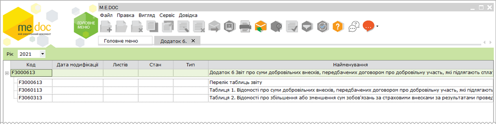
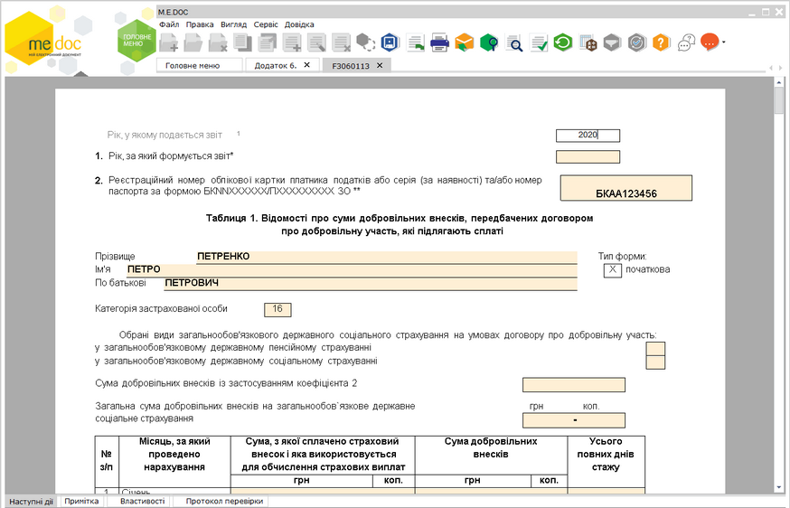
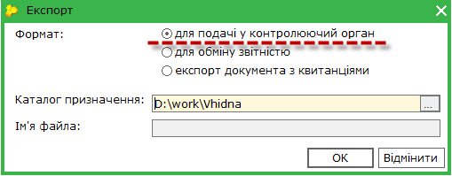

[← Зміст довідки](../)


# Додаток 6 Звіт про суми добровільних внесків, передбачених договором про добровільну участь, які підлягають сплаті, та суми доплати до фіскальних органів

## Додаток 6 Звіт про суми добровільних внесків, передбачених договором про добровільну участь, які підлягають сплаті, та суми доплати до фіскальних органів

_Шлях у довідці: Додатково: UCAppPFU6 › Додаток 6 Звіт про суми добровільних внесків, передбачених договором про добровільну участь, які підлягають сплаті, та суми доплати до фіскальних органів_

ВАЖЛИВО!

На виконання наказу Міністерства фінансів України N 670 від 05.11.2020 року «Про затвердження Змін до Порядку формування та подання страхувальниками звіту щодо сум нарахованого єдиного внеску на загальнообов'язкове державне соціальне страхування» додано нові форми звітів (версія 13).

Додаток 6

Особи, які досягли 16-річного віку та не належать до платників єдиного внеску, визначених пунктами 2 - 14 частини першої статті 4 Закону, у тому числі іноземці та особи без громадянства, які постійно проживають або працюють на території України, громадяни України, які постійно проживають або працюють за межами України, якщо інше не встановлено міжнародними договорами, згода на обов’язковість яких надана Верховною Радою України, та уклали договір на добровільну участь у системі загальнообов'язкового державного пенсійного страхування, а також члени фермерського господарства, особистого селянського господарства - на загальнообов’язкове державне соціальне страхування на випадок безробіття, у зв’язку з тимчасовою втратою працездатності, від нещасного випадку на виробництві та професійного захворювання, які спричинили втрату працездатності, і пенсійне страхування та уклали договір на добровільну участь у системі загальнообов’язкового державного соціального страхування, формують та подають самі за себе Звіт протягом 30 календарних днів після закінчення строків дії договору.

Звітним періодом є тривалість дії договору, а якщо договором про добровільну участь передбачено одноразову сплату особою єдиного внеску за попередні періоди, в яких особа не підлягала загальнообов’язковому державному соціальному страхуванню (у тому числі з 01 січня 2004 року по 31 грудня 2010 року), - період, за який одноразово сплачено єдиний внесок за попередні періоди.

Оскільки даний додаток відноситься до групи звітів з ЄСВ, для коректного його формування потрібно заповнити Реєстр співробітників та відповідні поля в картці установи.

Див. більше у розділі [Обов'язкові поля, які потрібно заповнити у картці установи та картках працівників](UCContribution.html#uccontribution-contribution_before).

[Створення Додатку 6](#ucapppfu6-ucapppfu6_create)

[Імпорт Додатку 6 з інших програм](#ucapppfu6-ucapppfu6_import)

[Подання Додатку 6 до контролюючого органу](#ucapppfu6-ucapppfu6_export)

### Створення Додатку 6

_Шлях у довідці: Додатково: UCAppPFU6 › Додаток 6 Звіт про суми добровільних внесків, передбачених договором про добровільну участь, які підлягають сплаті, та суми доплати до фіскальних органів › Створення Додатку 6_

Додаток 6 Звіт про суми добровільних внесків, передбачених договором про добровільну участь, які підлягають сплаті, та суми доплати до фіскальних органів формується у окремому модулі програми Звітність - Єдиний внесок - Додаток 6.

Модуль відкривається у окремій вкладці з назвою Додаток 6 і містить ярлик з переліком таблиць звіту та таблиці:

Створення та заповнення документів звіту

1. Оберіть звітний період:

2. Для створення окремої таблиці відкрийте її подвійним натисканням лівою кнопкою миші.

3. Таблиця відкриється у окремій вкладці, наприклад:

Натисніть, щоб збільшити малюнок

4. Заповніть поля звіту. [Заповнення звітів додатку відбувається за звичайними правилами](UCPravila.html#ucpravila-pravyla).

5. Всі створені звіти потрібно перевірити та зберегти.

6. Надалі відкрити, перевірити та зберегти [Перелік таблиць звіту](#ucapppfu6-ucapppfu6_d6).

7. Звіт [додаток 6 готовий до подання](#ucapppfu6-ucapppfu6_export).

#### Таблиця 1 Відомості про суми добровільних внесків, передбачених договором про добровільну участь, які підлягають сплаті

_Шлях у довідці: Додатково: UCAppPFU6 › Додаток 6 Звіт про суми добровільних внесків, передбачених договором про добровільну участь, які підлягають сплаті, та суми доплати до фіскальних органів › Створення Додатку 6 › Таблиця 1 Відомості про суми добровільних внесків, передбачених договором про добровільну участь, які підлягають сплаті_

Чим регулюється:

Заповнення та подання звіту регулюється Порядком формування та подання страхувальниками звіту щодо сум нарахованого єдиного внеску на загальнообов'язкове державне соціальне  страхування ([Наказ Мінфіну № 435 від 14.04.2015 «Про затвердження Порядку формування та подання страхувальниками звіту щодо сум нарахованого єдиного внеску на загальнообов’язкове державне соціальне страхування»](http://zakon4.rada.gov.ua/laws/show/z0460-15) ).

Ким подається:

Таблиця 1 складається особами, які досягли 16-річного віку та не належать до платників єдиного внеску, визначеними пунктами 2 - 14 частини першої статті 4 Закону, у тому числі іноземці та особи без громадянства, які постійно проживають або працюють на території України, громадяни України, які постійно проживають або працюють за межами України, якщо інше не встановлено міжнародними договорами, згода на обов’язковість яких надана Верховною Радою України, та уклали договір на добровільну участь у системі загальнообов'язкового державного пенсійного страхування, а також члени фермерського господарства, особистого селянського господарства - на загальнообов’язкове державне соціальне страхування на випадок безробіття, у зв’язку з тимчасовою втратою працездатності, від нещасного випадку на виробництві та професійного захворювання, які спричинили втрату працездатності, і пенсійне страхування та уклали договір на добровільну участь у системі загальнообов’язкового державного соціального страхування, формують та подають самі за себе Звіт протягом 30 календарних днів після закінчення строків дії договору.

Особливості заповнення:

- Реквізит 01. Рік за який формується звіт: Зазначається рік, за який формується звіт. У разі якщо звіт подається за декілька років одночасно, формується один титульний аркуш і окремо за кожний рік таблиця 1 додатка 6.
- Реквізит 02. Реєстраційний номер облікової картки платника податків /серія (за наявності) та/або номер паспорта за формою БКNNХХХХХХ/ПХХХХХХХХХ ЗО: зазначається податковий номер або серія та номер паспорта страхувальника (що має відповідну відмітку в паспорті про сплату податків за серією та номером паспорта) та інші реєстраційні відомості про платника, що подає цей звіт.
- Реквізит. Прізвище, ім’я, по батькові: вноситься повністю прізвище, ім`я та по-батькові відповідно до україномовної сторінки паспорта застрахованої особи, а для застрахованих осіб із числа іноземців – відповідно до засвідченого у встановленому законодавством України порядку перекладу українською мовою паспортного документа.
- Реквізит. Тип форми - позначка «Х» вноситься у клітинку початкова, коли за певний звітний рік форма подається вперше;
- Реквізит. Категорія застрахованої особи: Зазначається категорія застрахованої особи згідно з Таблицею відповідності кодів категорії  застрахованої особи та кодів бази нарахування і розмірів ставок єдиного внеску на загальнообов'язкове державне соціальне страхування.
- Для особи, яка бере добровільну участь у системі загальнообов'язкового державного пенсійного страхування, код категорії - 16.
- У разі якщо фізична особа – підприємець бере участь на добровільних засадах у одному із видів загальнообов’язкового державного страхування потрібно зазначити вид страхування у клітинці на проти виду та проставити позначку «Х».
- Реквізит. Сума добровільних внесків із застосуванням коефіцієнта 2: зазначається сума внесків із коефіцієнтом 2.
- У графі «Місяць за який проведено нарахування» заноситься місяць за який особа добровільно сплатила суми добровільних внесків на загальнообов’язкове державне соціальне страхування.
- У графі «Сума, з якої сплачено страховий внесок і яка використовується для обчислення страхових виплат» зазначається сума, з якої сплачено добровільні страхові внески і яка використовується для обчислення пенсії за звітний місяць.
- У графі «Сума добровільних внесків» зазначаються суми добровільних внесків за місяцями, які повинні бути не менше суми мінімального страхового внеску та не більше максимального розміру страхового внеску.
- У графі «Усього повних днів стажу» за кожним місяцем зазначається кількість календарних днів, що зараховуються до стажу, відповідно до даних про дію договору про добровільну участь у системі загальнообов'язкового державного пенсійного страхування у звітному році.

Після формування таблиці потрібно оновити поля (кнопка Оновити на панелі інструментів або F5), перевірити звіт (кнопка Перевірити звіт на вкладці "Наступні дії") та зберегти (кнопка Зберегти на панелі інструментів або Ctrl+S).

#### Таблиця 2. Відомості про збільшення або зменшення сум зобов'язань за страховими внесками за результатами проведеної перевірки

_Шлях у довідці: Додатково: UCAppPFU6 › Додаток 6 Звіт про суми добровільних внесків, передбачених договором про добровільну участь, які підлягають сплаті, та суми доплати до фіскальних органів › Створення Додатку 6 › Таблиця 2. Відомості про збільшення або зменшення сум зобов'язань за страховими внесками за результатами проведеної перевірки_

Чим регулюється:

Заповнення та подання звіту регулюється Порядком формування та подання страхувальниками звіту щодо сум нарахованого єдиного внеску на загальнообов'язкове державне соціальне  страхування ([Наказ Мінфіну № 435 від 14.04.2015 «Про затвердження Порядку формування та подання страхувальниками звіту щодо сум нарахованого єдиного внеску на загальнообов’язкове державне соціальне страхування»](http://zakon4.rada.gov.ua/laws/show/z0460-15) ).

Ким подається:

Дана таблиця подається фізичними особи-підприємцями та особами, які провадять незалежну професійну діяльність, яким за результатами проведеної перевірки збільшено або зменшено зобов'язання, формують і подають до фіскальних органів Звіт протягом одного календарного місяця після здійснення відповідних розрахунків.

Звіт формується і подається до фіскальних органів на підставі акта перевірки страхувальника (обов’язковим є зазначення номера і дати акта) і містить суми, на які збільшено або зменшено зобов'язання (у такому випадку допускається внесення від'ємного значення).

Особливості заповнення:

- Реквізит 01. Рік за який формується звіт: Зазначається рік, за який формується звіт. У разі якщо звіт подається за декілька років одночасно, формується один титульний аркуш і окремо за кожний рік таблиця 3 додатка 6.
- Реквізит 02. Реєстраційний номер облікової картки платника податків /серія (за наявності) та/або номер паспорта за формою БКNNХХХХХХ/ПХХХХХХХХХ ЗО: зазначається податковий номер або серія та номер паспорта страхувальника (що має відповідну відмітку в паспорті про сплату податків за серією та номером паспорта) та інші реєстраційні відомості про платника, що подає цей звіт.
- Реквізити. Дата Акта перевірки; № Акта перевірки - вказується дата складання Акта перевірки страхувальника у форматі ДД.ММ.РРРР та номер Акта перевірки. Зазначення номера і дати складання Акта перевірки страхувальника є обов'язковим.
- Реквізит. Прізвище, ім’я, по батькові: вноситься повністю прізвище, ім`я та по-батькові відповідно до україномовної сторінки паспорта застрахованої особи, а для застрахованих осіб із числа іноземців – відповідно до засвідченого у встановленому законодавством України порядку перекладу українською мовою паспортного документа.
- Реквізит. Тип форми: позначка «Х» вноситься у клітинку початкова, коли за певний звітний рік форма подається вперше.
- Реквізит. Категорія застрахованої особи: Зазначається категорія застрахованої особи згідно з Таблицею відповідності кодів категорії застрахованої особи та кодів бази нарахування і розмірів ставок єдиного внеску на загальнообов'язкове державне соціальне страхування.
- Для підприємців, яким збільшено (зменшено) суму зобов'язань з ЄСВ за результатами проведеної перевірки, код категорії - 40.
- У графі «Місяць та рік, за який проведено нарахування» зазначається місяць (дві цифри) та рік (чотири цифри), за який фізичній особі - підприємцю збільшено (зменшено) суму зобов'язань з ЄСВ.
- У графі «Сума, з якої розраховано зобов'язання за страховими внесками» зазначається сума, на яку нараховуються зобов'язання за страховими внесками. Розраховується за формулою: Сума доходу (розрахована виходячи із зобов'язань) = Сума зобов'язань х 100 / Ставка ЄСВ у відповідному місяці.
- У графі «Сума зобов'язань» зазначається сума зобов'язань з ЄСВ, яку необхідно доплатити у зв'язку з проведеною перевіркою або яка підлягає поверненню. Якщо зобов'язання з ЄСВ підлягає зменшенню, то у графі Сума зобов'язань допускається внесення від'ємного значення.

Після формування таблиці потрібно оновити поля (кнопка Оновити на панелі інструментів або F5), перевірити звіт (кнопка Перевірити звіт на вкладці "Наступні дії") та зберегти (кнопка Зберегти на панелі інструментів або Ctrl+S).

#### Формування звіту «Додаток 6. Звіт про суми добровільних внесків, передбачених договором про добровільну участь, які підлягають сплаті, та суми доплати до фіскальних органів»

_Шлях у довідці: Додатково: UCAppPFU6 › Додаток 6 Звіт про суми добровільних внесків, передбачених договором про добровільну участь, які підлягають сплаті, та суми доплати до фіскальних органів › Створення Додатку 6 › Формування звіту «Додаток 6. Звіт про суми добровільних внесків, передбачених договором про добровільну участь, які підлягають сплаті, та суми доплати до фіскальних органів»_

Після створення всіх таблиць звіту потрібно відкрити подвійним кліком лівої клавіші миші загальний звіт з переліком таблиць (ярлик), який у модулі має назву Перелік таблиць звіту.

Звіт заповнюється автоматично після створення та збереження відповідних звітів. Цей звіт містить перелік таблиць, які були заповнені, в ньому автоматично проставлені кількість аркушів та кількість рядків у звітах.

Звіт потрібно відкрити, перевірити (F4), оновити поля (F5) та зберегти (Ctrl+S).

Після формування всього пакету документів з єдиного внеску, у електронній таблиці модулю у відповідних колонках навпроти створених звітів будуть проставлені дата модифікації, кількість листів та рядків.

Увага! При перевірці загального звіту виконується групова перевірка всіх таблиць, які входять до комплекту звіту з ЄСВ.

### Імпорт Додатку 6 з інших програм

_Шлях у довідці: Додатково: UCAppPFU6 › Додаток 6 Звіт про суми добровільних внесків, передбачених договором про добровільну участь, які підлягають сплаті, та суми доплати до фіскальних органів › Імпорт Додатку 6 з інших програм_

Додаток 6 імпортується  з pfz файлів (для версії "I") або  файлів xml (для версій "J" або "F").

Для імпортування Додатку 6 виконайте дії у наступній послідовності:

1. В меню Файл модулю оберіть Імпорт - Імпорт звітів.

2. Відкриється діалогове вікно Открыть.

Звичайним для операційної системи Windows способом оберіть каталог, де збережений файл (\*.pfz або \*.xml).

У полі Тип файлів з випадного списку оберіть Документи XML, PFZ, PCK, ZVB, ZDI чи Документи XML, PFZ.

3. Виділіть імпортований файл(и) курсором миші та натисніть кнопку Открыть.

4. По закінченні процедури, система виведе протокол імпорту даних. У протоколі вказується, які документи імпортовані.

Якщо імпорт не виконаний, буде повідомлена причина.

5. Імпортований додаток поміщається у вказаний звітний період. Додаток матиме статус Вхідний, записи таблиць додатку виділяються синім кольором.

6. Документи додатку можна відкривати та редагувати.

### Подання Додатку 6 до контролюючого органу

_Шлях у довідці: Додатково: UCAppPFU6 › Додаток 6 Звіт про суми добровільних внесків, передбачених договором про добровільну участь, які підлягають сплаті, та суми доплати до фіскальних органів › Подання Додатку 6 до контролюючого органу_

Для подання в ДФСУ підготовленого Додатку 6 у програмі є можливість:

- [надрукувати додаток](#ucapppfu6-ucapppfu6_export)
- [зберегти на електронному носії](#ucapppfu6-ucapppfu6_export)
- [відправити електронними каналами зв'язку](#ucapppfu6-ucapppfu6_export)

Друк Додатку 6

Окремі документи додатку можна надрукувати із вікна відкритого документу:

- команда Файл > Друк,
- кнопка  на панелі інструментів вікна,
- комбінація клавіш (Ctrl+P).

Весь Додаток 6 можна надрукувати із модуля:

1. Виділити Додаток (встановити курсор на запис Додаток 6. Звіт про ...).

2. Обрати команду Друк в меню Файл або у контекстному меню.

3. Натиснути (Сtrl+P).

В обох випадках відкривається вікно для вибору принтера та настроювання параметрів друку.

Збереження Додатку на електронному носії

Експорт Додатку 6 виконується із модуля [аналогічно експорту пачки звітів Додатка 4](UCContribution.html#uccontribution-contribution_report_pfu_saving).

1. Виділіть Додаток (встановіть курсор на запис Додаток 6. Звіт про ...).

2. Експортуйте звіт на електронний носій одним із способів:

- із меню Файл - Експорт;
- із контекстного меню - Експорт

3. У відкритому вікні Експорт оберіть опцію "для подачі у контролюючий орган" та вкажіть диск чи каталог, у який буде збережений файл.

4. Ім'я файла програма сформує автоматично згідно вимог контролюючого органу.

Звіт зберігається на диску непідписаним (Без ЕЦП).

Відправлення Додатку

1. Відправлення Додатку 6 в ДФСУ виконується [аналогічно відправленню звіту Додатка 4 ЄСВ](UCContribution.html#uccontribution-contribution_report_pfu_e-mail)  та запускається:

- із вкладки Наступні дії - Підписати звіт,
- командою Файл - Відправити,
- кнопкою  на панелі інструментів вікна модулю.

2. Одразу запускається процедура підпису Додатку обраним комплектом підписів.

3. По закінченні процедури підпису обирається одержувач звіту - Податкова інспекція.

4. Після завершення всіх операцій запускається процес відправлення звіту і в наступному вікні програма повідомляє про його результат.


