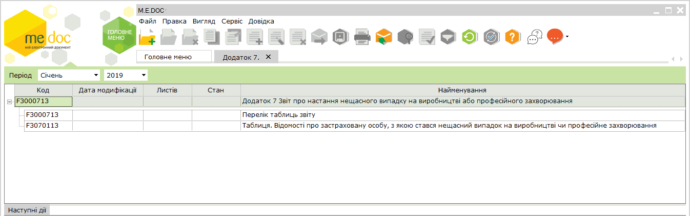
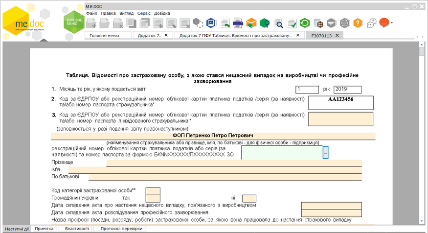
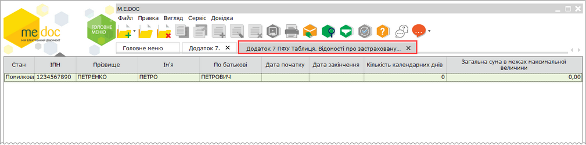

[← Зміст довідки](../)


# Додаток 7 Звіт про настання нещасного випадку на виробництві або професійного захворювання

## Додаток 7 Звіт про настання нещасного випадку на виробництві або професійного захворювання

_Шлях у довідці: Розділи програми › Звітність › Додаток 7 Звіт про настання нещасного випадку на виробництві або професійного захворювання_

ВАЖЛИВО!

На виконання наказу Міністерства фінансів України N 670 від 05.11.2020 року «Про затвердження Змін до Порядку формування та подання страхувальниками звіту щодо сум нарахованого єдиного внеску на загальнообов'язкове державне соціальне страхування» додано нові форми звітів (версія 13).

Додаток 7

Формується у разі настання нещасного випадку на виробництві чи професійного захворювання із застрахованою особою. Страхувальники, ФОП, члени фермерського господарства, особистого селянського господарства, формують та подають звіт протягом п'яти робочих днів після дати складання акта настання нещасного випадку, пов'язаного з виробництвом, або з дати складання акта розслідування професійного захворювання за формою П-4.

Оскільки даний додаток відноситься до групи звітів з ЄСВ, для коректного його формування потрібно заповнити Реєстр співробітників та відповідні поля в картці установи.

Див. більше у розділі [Обов'язкові поля, які потрібно заповнити у картці установи та картках працівників](UCContribution.html#uccontribution-contribution_before).

[Створення Додатку 7](#ucapppfu7-ucapppfu7_create)

[Імпорт Додатку 7 з інших програм](#ucapppfu7-ucapppfu7_import)

[Подання Додатку 7 до контролюючого органу](#ucapppfu7-ucapppfu7_export)

### Створення Додатку 7

_Шлях у довідці: Розділи програми › Звітність › Додаток 7 Звіт про настання нещасного випадку на виробництві або професійного захворювання › Створення Додатку 7_

Додаток 7 "Звіт про настання нещасного випадку на виробництві або професійного захворювання" формується у окремому модулі програми Звітність - Єдиний внесок - Додаток 7.

Модуль відкривається у окремій вкладці з назвою Додаток 7.

Додаток 7 містить Таблицю. Відомості про застраховану особу... та ярлик з переліком таблиць звіту.

Таблиця. Відомості про застраховану особу в свою чергу може включати будь яку кількість окремих документів з відомостями про застрахованих осіб, з якими стався нещасний випадок. У таблиці послідовно створюються та заповнюються такі документи.

Створення та заповнення документів звіту

1. Для створення окремих документів застрахованих осіб перейдіть у вкладку Таблиця. Відомості про застраховану особу..., відкривши її подвійним натисканням лівою кнопкою миші.

2. Створіть документ одним із способів:

- виконайте команду меню  Файл - Створити - Створити звіт;
- натисніть кнопку на панелі інструментів  та оберіть Створити звіт.

3. Звіт відкриється у окремій вкладці, наприклад:

Натисніть, щоб збільшити малюнок

4. Заповніть поля звіту. [Заповнення звітів додатку відбувається за звичайними правилами](UCPravila.html#ucpravila-pravyla).

5. Всі створені звіти потрібно перевірити та зберегти. Кожен створений звіт відображається на вкладці Додаток 7 ПФУ Таблиця. Відомості про застраховану особу ...

Натисніть, щоб збільшити малюнок

6. Надалі відкрити, перевірити та зберегти Перелік таблиць звіту.

7. Звіт [додаток 7 готовий до подання](#ucapppfu7-ucapppfu7_export).

### Імпорт Додатку 7 з інших програм

_Шлях у довідці: Розділи програми › Звітність › Додаток 7 Звіт про настання нещасного випадку на виробництві або професійного захворювання › Імпорт Додатку 7 з інших програм_

Додаток 7 імпортується лише з pfz файлів (для версії "I") або  файлів xml (для версій "J" або "F").

Для імпортування Додатку 7 виконайте дії у наступній послідовності:

1. В меню Файл модуля оберіть Імпорт - Імпорт звітів.

2. Відкриється діалогове вікно Відкриття файлу.

Звичайним для операційної системи Windows способом оберіть каталог, де збережений файл \*.pfz/\*.xml.

У полі Тип файлів з випадного списку оберіть Документи XML, PFZ, PCK, ZVB, ZDI чи Документи XML, PFZ.

3. Виділіть імпортований файл(и) курсором миші та натисніть кнопку Відкрити.

4. По закінченні процедури, система виведе протокол імпорту даних. У протоколі вказується, які документи імпортовані.

Якщо імпорт не виконаний, буде повідомлена причина.

5. Імпортований додаток поміщається у вказаний звітний період. Додаток матиме статус Вхідний, записи таблиць додатку виділяються синім кольором.

6. Документи додатку можна відкривати та редагувати.

### Подання Додатку 7 до контролюючого органу

_Шлях у довідці: Розділи програми › Звітність › Додаток 7 Звіт про настання нещасного випадку на виробництві або професійного захворювання › Подання Додатку 7 до контролюючого органу_

Для подання в ДПСУ підготовленого Додатку 7 у програмі є можливість:

- [надрукувати додаток](#ucapppfu7-ucapppfu7_export)
- [зберегти на електронному носії](#ucapppfu7-ucapppfu7_export)
- [відправити електронними каналами зв'язку](#ucapppfu7-ucapppfu7_export)

Друк Додатку 7

Окремі документи додатку можна надрукувати із вікна відкритого документа:

- команда Файл - Друк,
- кнопка  на панелі інструментів вікна,
- комбінація клавіш (Ctrl+P).

Весь Додаток 7 можна надрукувати із модуля:

1. Виділити Додаток (встановити курсор на запис Додаток 7. Звіт про ...).

2. Обрати команду Друк в меню Файл або у контекстному меню.

3. Натиснути (Сtrl+P).

В обох випадках відкривається вікно для вибору принтера та настроювання параметрів друку.

Збереження Додатку на електронному носії

Звіт Додаток 7 повинен включати таблицю(і) 1 та Перелік таблиць звіту.

Експорт Додатку 7 виконується із модуля [аналогічно експорту пачки звітів Додатка 4](UCContribution.html#uccontribution-contribution_report_pfu_saving).

1. Виділіть Додаток (встановіть курсор на запис Додаток 7. Звіт про ...).

2. Експортуйте звіт на електронний носій одним із способів:

- із меню Файл - Експорт;
- із контекстного меню - Експорт

3. У відкритому вікні Експорт оберіть опцію для подачі у контролюючий орган та вкажіть диск чи каталог, у який буде збережений файл.

4. Ім'я файла програма сформує автоматично згідно вимог контролюючого органу - файл з розширенням \*.xml.

Звіт зберігається на диску непідписаним (без ЕП).

Відправка Додатку

1. Відправка Додатку 7 в ДПСУ виконується [аналогічно відправленню звіту Додатка 4 ЄСВ](UCContribution.html#uccontribution-contribution_report_pfu_e-mail)  та запускається:

- із вкладки Наступні дії - Підписати звіт,
- командою Файл - Відправити,
- кнопкою  на панелі інструментів вікна модуля.

2. Одразу запускається процедура підпису Додатку обраним комплектом підписів.

3. По закінченні процедури підпису обирається одержувач звіту - Податкова інспекція.

4. Після завершення всіх операцій запускається процес відправлення звіту і в наступному вікні програма повідомляє про його результат.


