[← Зміст довідки](../)


# Архівування документів

## Архівування документів

_Шлях у довідці: Розділи програми › Адміністрування › Архівування документів_

В цьому розділі:

[Налаштування архівації документів](#ucarchivemngr-ucarchivemngr)

[Як працювати з архівом](#ucarchivemngr-ucarchivemngr)

[Перенесення документів у архів](#ucarchivemngr-ucarchivemngr)

Переміщення первинних документів у архів дозволяє зменшити обсяг даних, що обробляються у програмі, та пришвидшує її роботу.

Документи, що були перенесені до архіву, видаляються з бази даних програми і зберігаються на жорсткому диску комп’ютера у архівних файлах.

Зменшення фактичного розміру самої бази даних не відбувається, зменшується тільки обсяг даних, завдяки чому збільшується швидкодія програмного комплексу.

Щоб мати можливість переглядати записи про первинні документи, що знаходяться в архівній базі, необхідно завантажити файл архіву у програму. Записи про архівні документи (завантажені у програму) відображаються у відповідних модулях: Реєстр податкових документів та Реєстр електронних документів.

Також, у Реєстрі звітів можна перемістити у архів пакет документів, необхідний для остаточного рішення Комісії ДПС щодо прийняття або відхилення ПН/РК, повідомлення про подання пояснень та копій документів СМКОР, що перебувають у фінальному статусі Прийнятий або Неприйнятий:

- Повідомлення про подання пояснень та копій документів щодо податкових накладних/розрахунків коригування, реєстрацію яких зупинено;
- Повідомлення про подання інформації та копій документів щодо невідповідності платника податку критеріям ризиковості платника податку;
- Таблиця даних платника податків на додану вартість;
- Скарга на рішення про відмову у реєстрації ПН/РК в Єдиному реєстрі податкових накладних.

з доданими до пакетів Документами довільного формату.

Файли архівів документів можуть знаходитись у двох станах: підключений до бази програми та відключений. Архівні документи, що знаходяться у архіві, підключеному до програми, доступні для перегляду, друку та експорту у відповідних модулях програми. Якщо архівна база відключена – користувачі можуть лише переглядати записи про архівні документи.

Дії з архівними документами обмежені – можливий лише перегляд, експорт та друк у разі підключення архіву до основної бази.

Видалення файлу архіву з диску комп’ютера призведе до втрати даних про архівні документи. У разі пошкодження або втрати основної бази документів, також будуть втрачені відомості про архівні документи.

Налаштування архівації документів

1. Перейдіть у розділ Адміністрування – Архівування документів.

2. Активуйте функцію архівування, встановивши опцію Архівування періодів. Якщо опція не встановлена, архівування не виконується.

3. У полі За періодом зі списку оберіть період, за який будуть створюватися архівні файли: Місяць, Квартал, Рік.

4. У полі Шлях зберігання архіву вкажіть каталог на жорсткому диску комп’ютера, в якому зберігатимуться архівні файли.

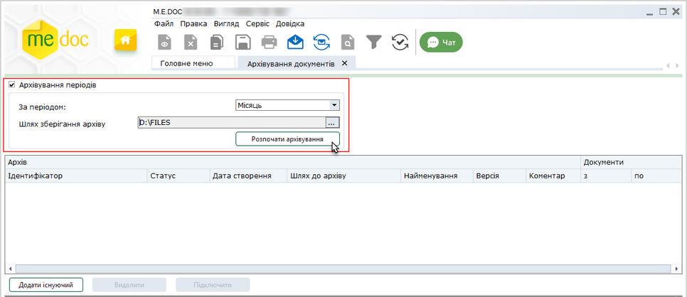

Натисніть, щоб збільшити малюнок

5. Для створення архівів натисніть кнопку Розпочати архівування.

6. Відкриється вікно повідомлення:

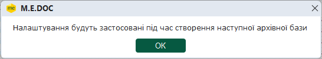

Для продовження натисніть ОК.

7. Будуть створені файли архівів відповідно до обраного періоду архівування. Наприклад, якщо обрано період місяць, буде створено файли архіву для кожного місяця, в якому існують відпрацьовані документи. До архіву переносяться документи, що мають стан обробки Архів.

Після завершення архівування буде відображено протокол виконання операції.

8. У вікні модуля відобразиться перелік архівних файлів, що були створені.

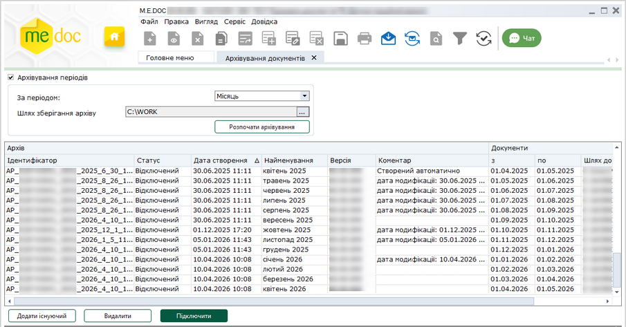

Натисніть, щоб збільшити малюнок

У розділі Документи, у колонках з (включно) і по (не включно) вказані діапазони дат виписки документів, що зберігаються у файлі архіву.

Якщо не знайдено жодного документа, що має стан Архів, буде виведено відповідне повідомлення, файл архіву створено не буде.

[До початку](#ucarchivemngr-ucarchivemngr)

Як працювати з архівами

Додавання архіву

Щоб мати можливість переглядати записи про первинні документи, які знаходяться в архівній базі, необхідно завантажити файли архівів у програму. Записи про архівні документи (завантажені у програму) відображаються у відповідних модулях Реєстр податкових документів, Реєстр електронних документів та Реєстр звітів (повідомлення про подання пояснень та копій документів СМКОР). Для архівних документів у колонці реєстру Архів проставляється позначка .

Щоб додати архіви для перегляду у програмі натисніть кнопку Додати існуючий.

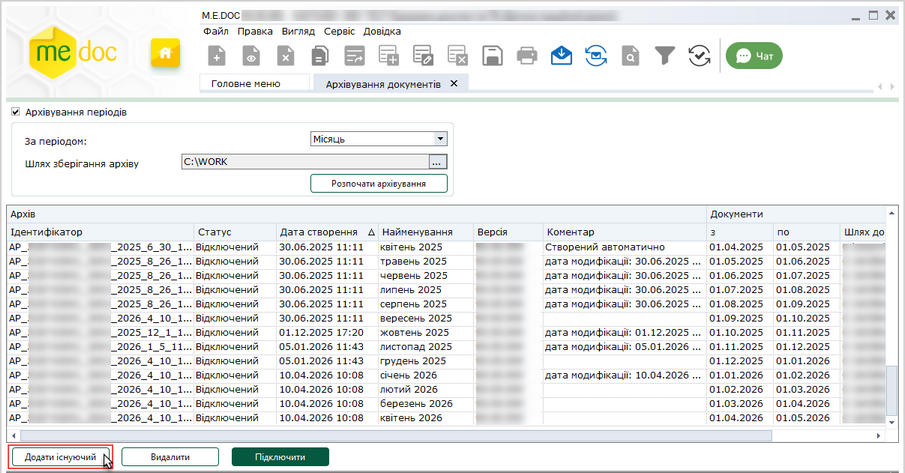

Натисніть, щоб збільшити малюнок

У вікні Відкриття файлу, що відкриється, оберіть файл архіву, який необхідно додати, та натисніть кнопку Відкрити.

Доданий архів відобразиться у вікні модуля. За замовчуванням доданий архів набуває стану Підключений, тобто документи, що містяться у файлі архіву, доступні у відповідному реєстрі для перегляду, експорту та друку.

Додати можливо лише архів, що містить документи з кодом ЄДРПОУ поточного підприємства.

[До початку](#ucarchivemngr-ucarchivemngr)

Видалення архіву

Для видалення архіву зі списку, оберіть рядок архіву та натисніть кнопку Видалити.

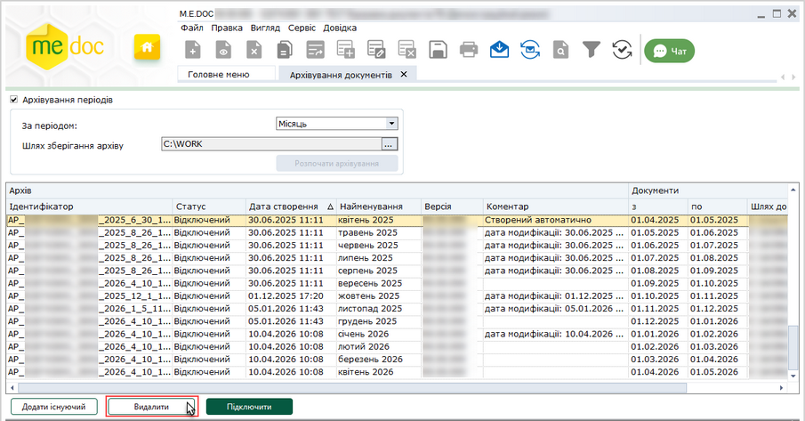

Натисніть, щоб збільшити малюнок

Відкриється вікно повідомлення:

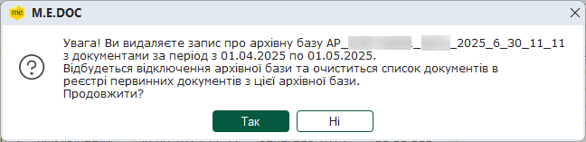

Для підтвердження видалення натисніть Так.

Видалений архів не буде відображатися у списку вікна модуля, але залишається на жорсткому диску у вказаному каталозі.

Документи, що містяться у архіві, який було видалено, недоступні для перегляду у програмі.

[До початку](#ucarchivemngr-ucarchivemngr)

Відключення та підключення архівів

Файли архівів документів можуть знаходитись у двох статусах: Підключений до бази програми та Відключений. Архівні документи, що знаходяться у архіві, підключеному до програми, доступні для перегляду, друку та експорту у відповідному реєстрі документів. Якщо архівна база відключена – користувачі можуть лише переглядати записи про архівні документи у реєстрі. За замовчуванням доданий у програму архів набуває стану Підключений.

Для відключення архіву оберіть рядок архіву, що має статус Підключений, та натисніть кнопку Відключити.

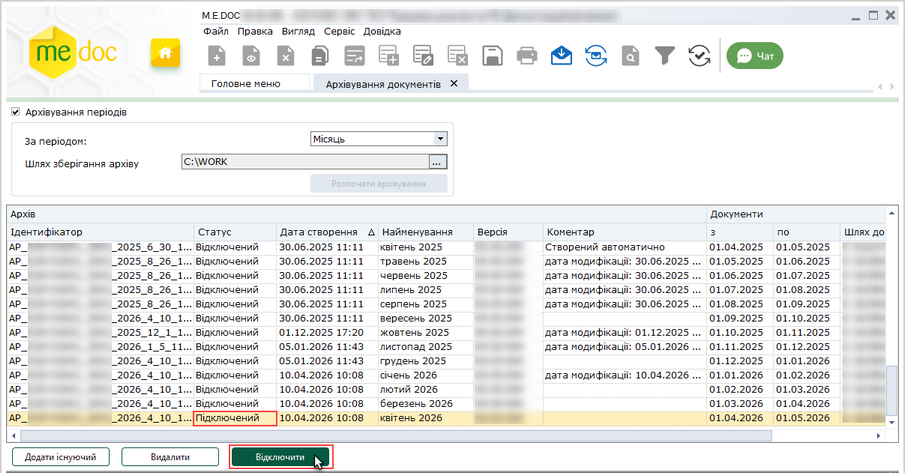

Натисніть, щоб збільшити малюнок

Статус обраного архіву зміниться на Відключений, кнопка змінить назву на Підключити:

Натисніть, щоб збільшити малюнок

Документи, що містяться у відключеному архіві, доступні користувачам лише для перегляду загальної інформації про документ у вигляді записів у реєстрі документів.

Для підключення архіву до бази програми оберіть рядок відключеного архіву та натисніть кнопку Підключити. Документи, що містяться у архіві, стануть доступні користувачам у відповідних модулях для перегляду, друку та експорту.

[До початку](#ucarchivemngr-ucarchivemngr)

Перенесення документів у архів

У Реєстр податкових документів, Реєстр електронних документів та Реєстрі звітів, документи, які знаходяться у файлах архівів, позначаються символом  у колонці Архів.

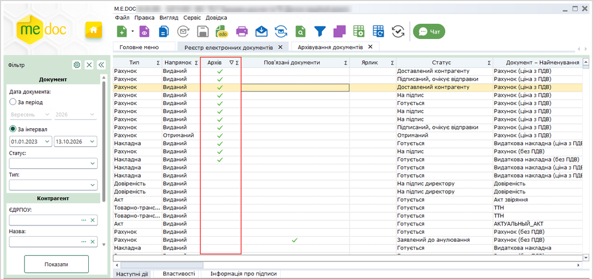

Натисніть, щоб збільшити малюнок

До архіву переміщуються документи, що мають стан обробки Архів. Встановлення стану обробки Архів можна виконати одним із способів:

Встановлення стану обробки Архів для виділених документів

У таблиці Реєстру виділіть документ чи групу документів та оберіть один із способів:

- виконайте команду контекстного меню Помістити в Архів;
- оберіть пункт головного меню Файл – Помістити в Архів.

У Реєстрі податкових документів та Реєстр електронних документів помістити в архів можливо будь-які документи.

У Реєстрі звітів помістити у архів можна лише повідомлення про подання пояснень та копій документів СМКОР, а також пов'язані з ними документи довільного формату (для подання сканкопій документів), що мають статус Прийнятий або Неприйнятий. Для переміщення у архів оберіть головний документ пакета.

Встановлення стану обробки Архів для великої кількості документів у Реєстрі податкових документів та Реєстрі електронних документів

1. У відповідному Реєстрі на панелі Фільтр встановіть параметри відбору для документів, які необхідно перемістити у архів. Натисніть кнопку Показати.

2. У Реєстрі будуть відібрані документи, що відповідають встановленим параметрам Фільтру.

- Зверніть увагу, максимальна кількість документів, що може бути відображена у вікні Реєстру - 15000. Загальна кількість документів, що задовольняє встановленим параметрам панелі Фільтр, наводиться у нижній частині вікна програми. Зверніть увагу, у загальній кількості документів враховуються як заархівовані, так і незаархівовані документи.
- Стан обробки Архів та подальше перенесення документів у файл архіву виконується для документів, що задовольняють встановленим параметрам Фільтру та не мають стану Архів на момент виконання команди Помістити все в Архів.

3. Для встановлення стану обробки Архів для документів, що відповідають параметрам, обраним на панелі Фільтр, виконайте команду головного меню Сервіс – Помістити все в Архів.

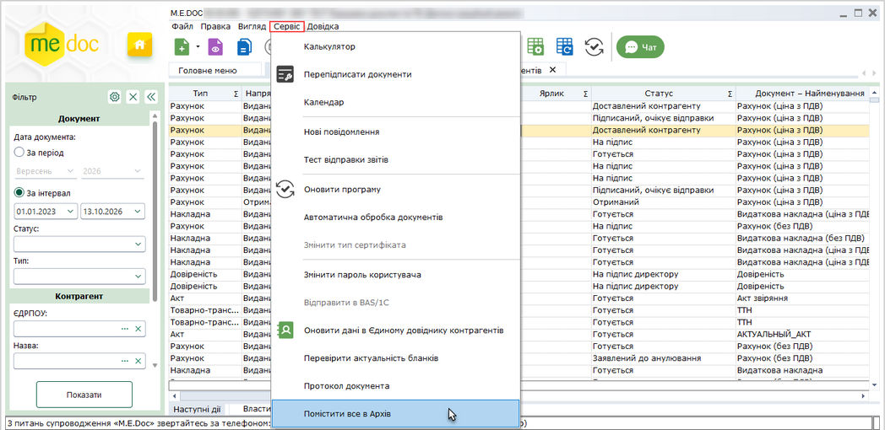

Натисніть, щоб збільшити малюнок

4. Відкриється вікно повідомлення з кількістю документів, для яких буде встановлено стан обробки Архів:

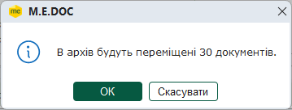

5. Для продовження архівування натисніть ОК. Операція може тривати деякий час.

Можна перервати виконання операції, натиснувши кнопку Відмінити.

6. Програма повідомить про результат виконання операції. У вікні повідомлення наводиться кількість документів, для яких було встановлено стан обробки Архів, та загальна кількість відібраних за допомогою Фільтру документів.

- У вікні зазначено загальну кількість відібраних документів (як заархівовані, так і незаархівовані). У архів переміщуються документи, що задовольняють встановленим параметрам Фільтру та не мають стану Архів на момент виконання команди Помістити все в Архів.
- Якщо операцію переміщення у архів було відмінено, у вікні наводиться кількість документів, для яких було встановлено стан Архів, до скасування операції.

Якщо встановлена опція [Архівування періодів](#ucarchivemngr-ucarchivemngr), документи, для яких встановлено стан обробки Архів, автоматично переносяться із бази програми у файли архівів, згідно з встановленими [налаштуваннями архівування](#ucarchivemngr-ucarchivemngr). Після виконання команди Помістити в Архів, виводиться вікно повідомлення:

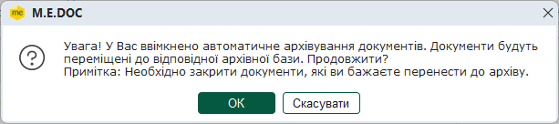

Для підтвердження перенесення документів у архів натисніть ОК.

Програма повідомить про завершення операції.

Якщо опція [Архівування періодів](#ucarchivemngr-ucarchivemngr) не встановлена, обрані документи набувають стану обробки Архів, переміщення документів у архів не виконується. Щоб перемістити такі документи у архів, у розділі Адміністрування - Архівування документів необхідно встановити опцію Архівування періодів та натиснути кнопку [Розпочати архівування](#ucarchivemngr-ucarchivemngr).

Переглянути список архівних документів у Реєстрі можна, обравши фільтр Стан обробки - Архів.

На вкладці Наступні дії для таких документів відображається повідомлення «Документ знаходиться в архіві <Ім’я файлу архіву>». Ця інформація відображається як у вікні Реєстру, так і у вікні відкритого документа.

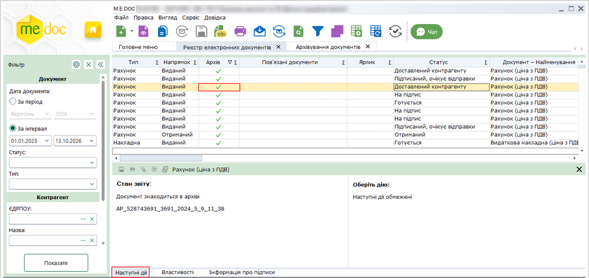

Натисніть, щоб збільшити малюнок

УВАГА!

Документи, переміщені у архів, не зберігаються у [резервній копії](UCBackup.html#ucbackup-admbackup) бази даних програми.

[До початку](#ucarchivemngr-ucarchivemngr)


