[← Зміст довідки](../)


# Управління сертифікатами

## Управління сертифікатами

_Шлях у довідці: Розділи програми › Адміністрування › Управління сертифікатами_

Про сертифікати відкритого ключа ЕП

Для здійснення електронного документообігу (наприклад, відправки звітності у контролюючи органи) у ПК M.E.Doc, необхідна наявність електронного підпису (ЕП), який використовується для ідентифікації автора і/або підписувача електронного документа іншими суб'єктами електронного документообігу.

Технологія роботи ЕП ґрунтується на відповідності пари ключів: секретного (особистого) і відкритого. Документ підписується ЕП за допомогою особистого ключа, який є тільки у його власника. Цьому секретному ключу відповідає відкритий ключ, за допомогою якого можна перевірити достовірність підпису.

Документ, що встановлює зв'язок між відкритим ключем і його власником - Сертифікат відкритого ключа. Сертифікат містить в собі персональну інформацію про його власника (ім'я і реквізити), інформацію про кваліфікованого надавача електронних довірчих послуг, що видав його, відкритий ключ власника сертифіката, унікальний реєстраційний номер, термін дії сертифіката і електронний підпис кваліфікованого надавача електронних довірчих послуг, який засвідчує цілісність і достовірність сертифіката.

Отримати сертифікат ЕП можна у кваліфікованого надавача електронних довірчих послуг, робота з яким [підтримується у програмі](#ucasigncert-admcert_cert).

ПК M.E.Doc надає можливість підготувати комплект документів та сформувати [заявку на отримання сертифікатів відкритих ключів](#ucasigncert-admcert_req) у КНЕДП "ЦСК «Україна»".

Для тих, хто вже використовує сертифікати [доступна функція оновлення сертифікатів](#ucasigncert-admcert_update).

Використання кваліфікованих електронних довірчих послуг у державних установах регулюється Постановою Кабінету Міністрів України від 1 серпня 2023 р. № 798 "Про затвердження Порядку використання електронних довірчих послуг в органах державної влади, органах місцевого самоврядування, підприємствах, установах та організаціях державної форми власності".

Для кожного особистого ключа використовується окремий носій.

Захищений носій секретних ключів – надійний електронний пристрій, що призначений для зберігання особистого ключа та має вбудовані апаратно-програмні засоби, що забезпечують захист записаних на нього даних від несанкціонованого доступу, їх копіювання та використання. Захищений носій, зазвичай, виконується у вигляді USB-пристрою, та може різнитися за модифікацією.

За бажанням, захищений носій може використовувати будь-яке підприємство, що дбає про власну безпеку.

Захищений носій можна придбати у кваліфікованого надавача електронних довірчих послуг. Як сформувати рахунок на придбання захищеного носія у КНЕДП "ЦСК «Україна»", дивіться у розділі [Як замовити захищений апаратний носій](#ucasigncert-admcert_nosij_faktura).

Докладно про збереження секретного ключа на захищеному носії дивіться у розділі [Як зберегти секретний ключ на захищеному носії](#ucasigncert-admcert_req_protekt).

Про операції, що можуть бути виконані з ключем, який збігається на захищеному носії, дивіться у розділі [Операції з ключем на захищеному носії](#ucasigncert-admcert_key_oper).

Управління сертифікатами

Модуль Сертифікати призначений для адміністрування даних сертифікатів відкритих ключів підприємства: формування заявок на отримання сертифікатів ЕП, завантаження та/або видалення сертифікатів, відстеження терміну дії сертифікатів, анулювання та/або блокування сертифікатів, заміни пароля секретного ключа тощо.

Модуль складається з 3-х розділів:

- [Встановлені сертифікати](#ucasigncert-admcert_cert). Таблиця завантажених сертифікатів ЕП поточної установи.
Дозволяє завантажувати у програму сертифікати, видаляти сертифікати, замінювати пароль секретного ключа, відкликати/блокувати сертифікати, оновлювати дані у картці підприємства.

- [Заявки на сертифікат](#ucasigncert-admcert_basic). Таблиця сформованих заявок на отримання сертифікатів ЕП.
Дозволяє формувати заявки на отримання нових сертифікатів ЕП та продовження дії поточних сертифікатів, генерувати файли заявок для подання до кваліфікованого надавача електронних довірчих послуг, вилучати заявки із списку.

- [Встановлені сертифікати РРО/ПРРО](#ucasigncert-admcert_cert_rro). Таблиця завантажених сертифікатів ЕП для підпису розрахункових документів при роботі з РРО/ПРРО.
Дозволяє завантажувати у програму сертифікати, видаляти сертифікати, замінювати пароль секретного ключа, відкликати/блокувати сертифікати, оновлювати дані у картці підприємства.

- [Заявки на сертифікат РРО/ПРРО](#ucasigncert-admcert_req_rro). Таблиця сформованих заявок на отримання сертифікатів для підпису розрахункових документів при роботі з РРО/ПРРО.
Дозволяє формувати заявки на отримання нових сертифікатів ЕП для роботи з РРО/ПРРО та продовження дії поточних сертифікатів, генерувати файли заявок для подання до кваліфікованого надавача електронних довірчих послуг, вилучати заявки із списку.

### Встановлені сертифікати

_Шлях у довідці: Розділи програми › Адміністрування › Управління сертифікатами › Встановлені сертифікати_

В цьому розділі:

[Завантаження сертифікатів з електронних носіїв та з CMP-сервера](#ucasigncert-admcert_cert)

[Завантаження сертифікатів із сайту кваліфікованого надавача електронних довірчих послуг](#ucasigncert-admcert_cert)

[Завантаження сертифікатів із іншого комп’ютера з доступом до мережі Інтернет](#ucasigncert-admcert_cert)

[Зміна пароля секретного ключа](#ucasigncert-admcert_cert)

[Скасування або блокування сертифікатів](#ucasigncert-admcert_cert)

[Перевірка сертифіката на відповідність кореневому](#ucasigncert-admcert_cert)

[Автоматична перевірка змінення статусу сертифікатів](#ucasigncert-admcert_cert)

[Друк паперової форми сертифіката](#ucasigncert-admcert_cert)

[Збереження сертифікатів](#ucasigncert-admcert_cert)

[Збереження даних реєстру Встановлені сертифікати](#ucasigncert-admcert_cert)

Даний підрозділ призначений для управління сертифікатами відкритого ключа ЕП.

У таблиці підрозділу відображаються завантажені сертифікати ЕП поточної установи.
Сертифікати, термін дії яких закінчився, в таблиці виділяються червоним кольором.

Зі скороченим переліком КНЕДП, сертифікати яких підтримуються, ви можете ознайомитись на нашому сайті за посиланням: [https://www.medoc.ua/uk/faq/jak-resursi-neobhdn-dlja-roboti-medoc](https://www.medoc.ua/uk/faq/jak-resursi-neobhdn-dlja-roboti-medoc).

Завантаження сертифікатів з електронних носіїв та з CMP-сервера

Сертифікати ЕП необхідно завантажити у програму. Можна завантажити сертифікати збережені у файл або з CMP-сервера.

1. Оберіть один із способів:

- на панелі інструментів натисніть кнопку Завантажити сертифікат - ;
- у контекстному меню оберіть команду Завантажити сертифікат;
- оберіть команду головного меню Файл - Завантажити сертифікат.

Далі оберіть спосіб завантаження сертифіката:

- З диска – завантаження сертифікатів, які зберігаються у вигляді файлів на комп’ютері або зовнішньому носії;
- На основі секретного ключа – завантаження сертифікатів з CMP-сервера за ідентифікатором секретного ключа.

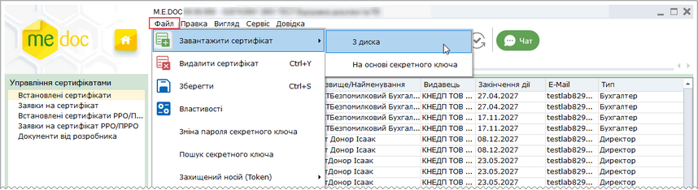

Натисніть, щоб збільшити малюнок

2. Якщо сертифікати зберігаються у вигляді файлів, оберіть пункт меню З диска. Далі у вікні, що відкриється, вкажіть шлях до каталогу, де зберігаються файли сертифікатів, виділіть сертифікати, які потрібно завантажити, та натисніть кнопку Відкрити:

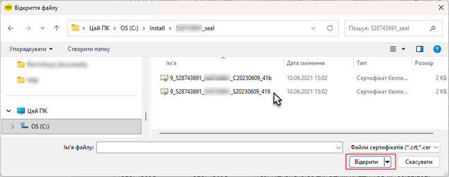

Натисніть, щоб збільшити малюнок

Якщо потрібно завантажити сертифікати з CMP-сервера, за ідентифікатором секретного ключа, оберіть пункт меню На основі секретного ключа. Далі у вікні, що відкриється, оберіть вкладку, що відповідає способу збереження секретного ключа: Файловий або Токен.

Для завантаження сертифіката на основі файлового секретного ключа:

Оберіть вкладку Файловий та заповніть поля:

-  Кваліфікований надавач електронних довірчих послуг - оберіть зі списку назву КНЕДП (за замовчуванням обрано значення Визначити автоматично);
-  Оберіть секретний ключ - натисніть іконку  та у вікні, що відкриється, виберіть секретний ключ;
-  Пароль секретного ключа - введіть пароль до ключа.

Для завершення завантаження натисніть Завантажити.

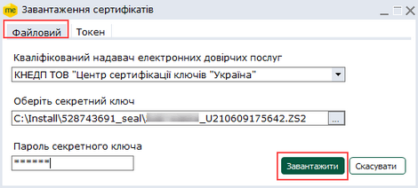

Натисніть, щоб збільшити малюнок

Для завантаження сертифіката на основі секретного ключа на захищеному носії (токені):

Оберіть вкладку Токен та заповніть поля:

-  Кваліфікований надавач електронних довірчих послуг - оберіть зі списку назву КНЕДП (за замовчуванням обрано значення Визначити автоматично);
-  Оберіть захищений носій - натисніть іконку  та у вікні, що відкриється, виберіть назву захищеного носія, що підключений до комп'ютера;
-  Пароль носія - введіть пароль до захищеного носія.

Для завершення завантаження натисніть Завантажити.

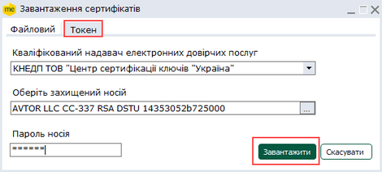

Натисніть, щоб збільшити малюнок

3. Сертифікат(и) завантажиться у програму, і запис з його основними даними (код, прізвище отримувача чи найменування установи, ЄДРПОУ установи, видавець сертифіката, закінчення дії сертифіката та адреса E-mail) з’явиться в таблиці встановлених сертифікатів.

- Для сертифікатів, виданих на основі ID-картки, у випадку, коли в сертифікаті явно не вказано його тип, здійснюється автоматичне визначення типу сертифіката. При завантаженні у програму, якщо сертифікат містить дані про ПІБ власника, за замовчуванням встановлюється тип "Директор", якщо ПІБ відсутні – тип "Печатка".

Тип сертифіката можливо змінити у розділі Встановлені сертифікати за допомогою команди головного меню Сервіс –Змінити тип сертифіката.

- За замовчуванням на вкладці Встановлені сертифікати відображаються як чинні сертифікати, так і сертифікати, які ще не розпочали свою дію (якщо такі завантажено у програму). Сертифікати, що поки не набули чинності, відображені у реєстрі сірим кольором.

По команді меню Вигляд – Показати всі сертифікати можливо переглянути прострочені сертифікати, завантажені у програму (позначені червоним кольором).

4. Програма запропонує виконати налаштування комплекту підписів:

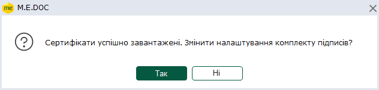

Щоб відкласти налаштування підписів, натисніть Ні. Налаштування комплектів підписів потрібно буде виконати у розділі [Адміністрування - Параметри системи - Підпис](FormCompanyParams.html#formcompanyparams-admcomanyparams_pen).

Щоб налаштувати комплекти підписів, натисніть Так.

При завантаженні сертифікатів програма перевірить чи налаштовано відповідний комплект підписів у модулі [Адміністрування - Параметри системи - Підпис](FormCompanyParams.html#formcompanyparams-admcomanyparams_pen), якщо відповідні комплекти підписів відсутні, програма виконає їх налаштування автоматично.

Відкриється вікно Налаштування комплектів підписів. Перевірте правильність автоматичних налаштувань підписів. У разі потреби, оберіть тип звітності, для якої потрібно задати комплект підписів. Під назвою типу звітності із списку, що відкривається, оберіть потрібний варіант комплекту підписів (наприклад, Бухгалтер - Директор - Печатка).

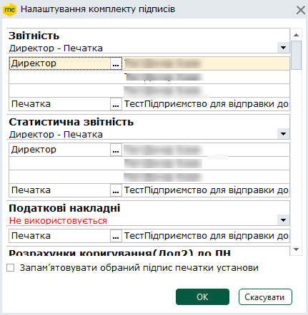

Оберіть всі необхідні комплекти та натисніть ОК.

В реєстрі завантажених сертифікатів доступні наступні функції:

|  |  |
| --- | --- |
| Зберегти | Збереження обраного у таблиці сертифіката на будь-який електронний носій. Вибір носія відбувається звичайними засобами Windows. |
| Видалити | Стандартна для програми функція, яка дозволяє безповоротно вилучити обраний сертифікат. |
| Властивості | Перегляд властивостей обраного сертифіката. Викликається також із контекстного меню або подвійним кліком лівої клавіші миші по назві сертифіката. |

[До початку](#ucasigncert-admcert_cert)

Завантаження сертифікатів із сайту кваліфікованого надавача електронних довірчих послуг

Безпосередньо із програми можна завантажити або поновити свої сертифікати (наприклад, при втраті) із сайту кваліфікованого надавача електронних довірчих послуг.

1. На панелі інструментів виберіть команду Завантажити з Інтернету.

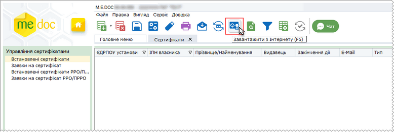

Натисніть, щоб збільшити малюнок

2. За кодом ЄДРПОУ установи відбуватиметься пошук наявних сертифікатів на сайті кваліфікованого надавача електронних довірчих послуг.

3. Всі знайдені сертифікати, що відповідатимуть коду ЄДРПОУ установи, будуть автоматично завантажені у програму. Записи з основними даними сертифікатів з’являться в таблиці встановлених сертифікатів.

Якщо сертифікати за кодом ЄДРПОУ не знайдені, система повідомить про це в окремому вікні.

[До початку](#ucasigncert-admcert_cert)

Завантаження сертифікатів із іншого комп’ютера з доступом до Інтернету

Якщо доступ в Інтернет із комп’ютера з програмою відсутній - з’єднатись із сайтом КНЕДП "ЦСК «Україна»" з іншого комп’ютера з доступом до Інтернету за посиланням [http://www.uakey.com.ua/](https://www.uakey.com.ua/).

Перелік сертифікатів знаходиться у розділі Сертифікати - Каталог сертифікатів - Сертифікати клієнтів.

Знайдіть сформований сертифікат, переміщуючись у каталозі за допомогою клавіатури. Для спрощення та прискорення, скористайтесь функцією пошуку: за кодом ЄДРПОУ або назвою установи (назва має бути введена українською мовою).

Знайдений сертифікат потрібно зберегти на комп’ютері користувача. Для цього натисніть на піктограмі , у вікні, що відкрилося, вкажіть шлях, де зберегти сертифікат та натисніть Зберегти.

Збережені таким чином сертифікати потрібно [завантажити у програму](#ucasigncert-admcert_cert) описаним вище способом.

[До початку](#ucasigncert-admcert_cert)

Зміна пароля секретного ключа

В програмному комплексі реалізована можливість зміни пароля до секретного ключа підписувача.

Ця функція призначена лише для сертифікатів КНЕДП "ЦСК «Україна»"!

1. Виберіть сертифікат, до якого потрібно змінити пароль секретного ключа.

2. Натисніть правою клавішею миші по обраному сертифіката. У контекстному меню, що відкрилось, виберіть команду Зміна пароля секретного ключа.

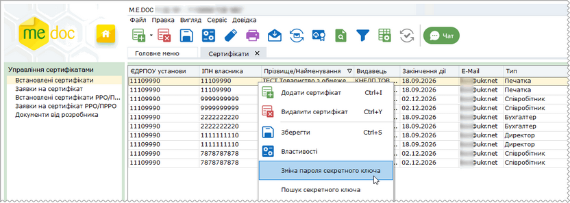

Натисніть, щоб збільшити малюнок

3. Відкриється вікно Огляд папок. Вкажіть шлях до каталогу, де збережені секретні ключі.

4. Відкриється наступне вікно Зміна паролю. Введіть старий та новий паролі у відповідні поля та натисніть кнопку ОК.

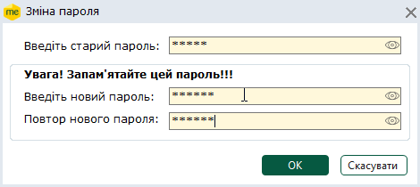

Якщо адміністратор встановив [використання посиленого захисту ЕП](FormCompanyParams.html#formcompanyparams-admcompanyparams_zahyst), то в цьому вікні відобразяться вимоги до пароля в залежності від встановлених налаштувань (мінімальна довжина та/або складність пароля).

5. Система повідомить про успішну зміну пароля.

[До початку](#ucasigncert-admcert_cert)

Скасування або блокування сертифікатів

Всі сертифікати мають обмежений термін дії. Дати початку і закінчення терміну дії вказуються в сертифікаті. Сертифікат дійсний від дати початку до дати закінчення терміну дії.

Сертифікат може припинити свою дію раніше зазначеного в ньому терміні дії. Процедура, при якій кваліфікований надавач електронних довірчих послуг припиняє дію сертифіката передчасно, називається скасуванням або блокуванням сертифіката. Різниця між ними полягає в тому, що після блокування дія сертифіката може бути відновлена, тоді як операція скасування безповоротно анулює сертифікат.

1. Натисніть правою клавішею миші на рядку обраного сертифіката. У контекстному меню, що відкрилось, виберіть команду Скасувати або Заблокувати.

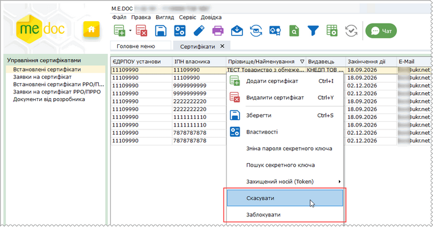

Натисніть, щоб збільшити малюнок

2. Відкриється сторінка ресурсу КНЕДП "ЦСК «Україна», де оберіть операцію, яку необхвдно виконати: Блокування або Скасування. Виконайте потрібну операцію, дотримуючись інструкцій, наведених на сторінках ресурсу КНЕДП "ЦСК «Україна».

[До початку](#ucasigncert-admcert_cert)

Перевірка сертифіката на відповідність кореневому

В реєстрі реалізована перевірка сертифікатів на дійсність.

Для перевірки сертифіката виконайте такі дії:

1. Виділіть один або декілька сертифікатів.

2. В контекстному меню оберіть пункт Перевірка сертифіката.

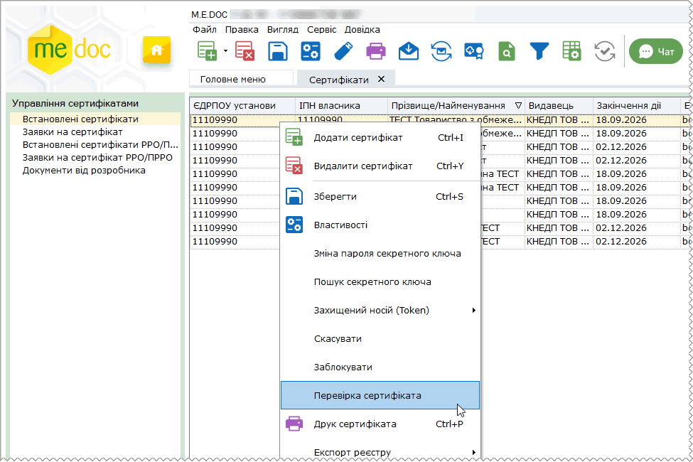

3. У разі успішної перевірки відобразиться вікно повідомлення.

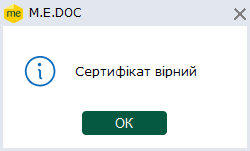

У разі виникнення помилок при перевірці відобразиться вікно із переліком помилок.

[До початку](#ucasigncert-admcert_cert)

Автоматична перевірка змінення статусу сертифікатів

Для сертифікатів КНЕДП "ЦСК «Україна»" реалізований механізм автоматичної перевірки зміни статусів сертифікатів.

Кожну годину (а також при кожному вході в підприємство) програма перевіряє чи не був змінений статус сертифікатів. Якщо з моменту попередньої перевірки у статусах сертифікатів відбулися зміни, на екрані з'явиться інформаційне вікно. Якщо жодних змін у статусах сертифікатів не знайдено, вікно не відображається. Інформаційне вікно повідомлятиме вас про зміни у статусах сертифікатів незалежно від того, у якому модулі програми ви працюєте.

Вікно містить три кнопки, що відповідають статусам сертифікатів: Заблоковано, Скасовано, Створено нові. Щоб переглянути список сертифікатів, для яких відбулось змінення статусу, натисніть на кнопку, що відповідає статусу сертифіката. Якщо для певного статусу змін не виявлено, відповідна кнопка неактивна.

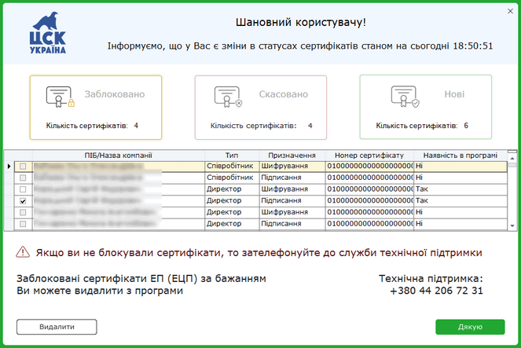

Натисніть, щоб збільшити малюнок

У вікні відображені не всі сертифікати, а лише ті, статус яких змінився з моменту останньої перевірки.

Безпосередньо в інформаційному вікні можливо видалити сертифікати, що стали недійсними, або завантажити нові сертифікати (якщо у [налаштуваннях ролі користувача](UCManageRoles.html#ucmanageroles-ucmanageroles) надано відповідні права). Для цього:

1. Натисніть відповідну кнопку (Скасовано або Створено нові).

2. Оберіть потрібний сертифікат, встановивши відмітку у рядку таблиці.

3. Натисніть кнопку (Видалити або Завантажити).

Видалити можна лише ті сертифікати, які встановлені у програмі M.E.Doc.

Для завантаження доступні лише ті сертифікати, які дозволено публікувати на сайті КНЕДП. Згода на публікацію встановлюється у заявці на отримання сертифіката. Якщо згоду на публікацію сертифіката не надано, то відповідний сертифікат буде неможливо завантажити, з’явиться колонка Заборона публікації, в якій для нього буде проставлено значення Так.

[До початку](#ucasigncert-admcert_cert)

Друк паперової форми сертифіката

Для друку паперової форми сертифіката ЕП:

1. Виділіть сертифікат, який потрібно роздрукувати.

2. Скористайтесь одним із способів:

- на панелі інструментів натисніть на кнопку ;
- виберіть команду Файл - Друк сертифіката;
- у контекстному меню оберіть команду Друк сертифіката;
- натисніть комбінацію клавіш Сtrl+P.

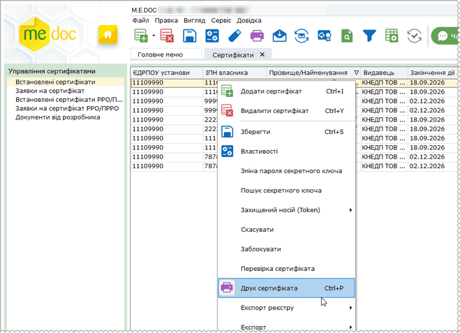

Натисніть, щоб збільшити малюнок

3. На виконання команди у окремому вікні відкриється бланк сертифіката для попереднього перегляду. На панелі інструментів натисніть кнопку Друк.

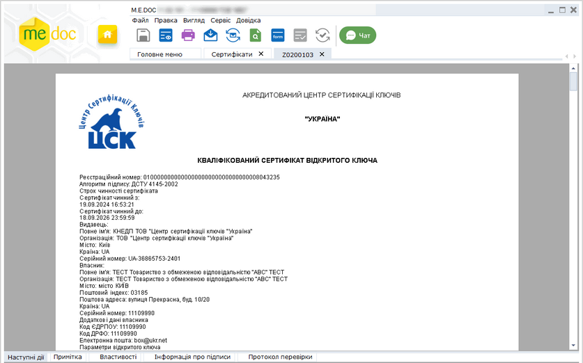

Натисніть, щоб збільшити малюнок

4. Відкриється стандартне вікно Печать. Встановіть потрібні параметри та натисніть кнопку Печать.

[До початку](#ucasigncert-admcert_cert)

Збереження сертифікатів

В програмному комплексі можна зберегти сертифікати на комп’ютер або зовнішній носій.

Для збереження сертифікатів виконайте такі дії:

1. Виділіть один або декілька сертифікатів.

2. Скористайтесь одним із способів:

- на панелі інструментів натисніть на кнопку ;
- виберіть команду Файл - Зберегти;
- у контекстному меню оберіть команду Зберегти;
- натисніть комбінацію клавіш Сtrl+S.

3. У вікні Windows, що відкрилось, стандартним способом вкажіть шлях до каталогу для збереження файлу та натисніть на кнопку ОК.

Відобразиться повідомлення про збереження файлів до обраної папки.

[До початку](#ucasigncert-admcert_cert)

Збереження даних реєстру Встановлені сертифікати

Для збереження даних реєстру Встановлені сертифікати  у файл формату xlsx виконайте такі дії:

1. Скористайтесь одним із способів:

- виберіть команду Експорт реєстру – Експорт таблиці в Excel;
- у контекстному меню оберіть команду Експорт реєстру – Експорт таблиці в Excel.

2. У вікні, що відкриється, вкажіть шлях до каталогу для збереження файлу та ім'я файлу, натисніть на кнопку ОК.

Програма повідомить про результати виконання експорту.

[До початку](#ucasigncert-admcert_cert)

### Встановлені сертифікати РРО/ПРРО

_Шлях у довідці: Розділи програми › Адміністрування › Управління сертифікатами › Встановлені сертифікати РРО/ПРРО_

Даний підрозділ призначений для управління даними сертифікатів електронних підписів та/або печаток, що використовуються у роботі з програмними реєстраторами розрахункових операцій (ПРРО).

У таблиці підрозділу відображаються завантажені сертифікати РРО поточної установи.

Для завантаження сертифікатів РРО, що отримані електронною поштою, збережені на зовнішньому електронному носії або на комп’ютері користувача:

1. Оберіть один із способів:

- на панелі інструментів натисніть кнопку Додати сертифікат - ;
- у контекстному меню оберіть команду Додати сертифікат;
- оберіть команду головного меню Файл - Додати сертифікат;
- скористайтесь комбінацією клавіш Ctrl+I.

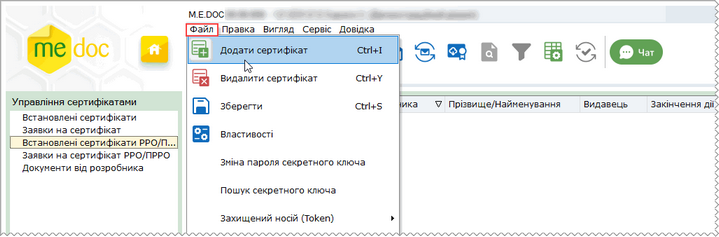

Натисніть, щоб збільшити малюнок

2. У вікні, що відкрилось, вкажіть шлях до каталогу, де зберігаються файли сертифікатів. Файли сертифікатів позначені піктограмою .

Оберіть потрібний сертифікат (або декілька) та натисніть на кнопку Відкрити.

3. Сертифікат(и) завантажиться у програму, і запис з його основними даними (код, прізвище отримувача чи найменування установи, ЄДРПОУ установи, видавець сертифіката, закінчення дії сертифіката та адреса E-mail) з’явиться в таблиці встановлених сертифікатів.

В реєстрі завантажених сертифікатів доступні наступні функції:

|  |  |
| --- | --- |
| Зберегти | Збереження обраного у таблиці сертифіката на будь-який електронний носій. Вибір носія відбувається звичайними засобами Windows. |
| Видалити | Стандартна для програми функція, яка дозволяє безповоротно вилучити обраний сертифікат. |
| Властивості | Перегляд властивостей обраного сертифіката. Викликається також із контекстного меню або подвійним кліком лівої клавіші миші по назві сертифіката. |

Для сертифікатів, які використовуються при роботі з ПРРО, доступні операції:

[Завантаження сертифікатів із сайту кваліфікованого надавача електронних довірчих послуг](#ucasigncert-admcert_cert)

[Зміна пароля секретного ключа](#ucasigncert-admcert_cert)

[Відкликання або заблокування сертифікатів](#ucasigncert-admcert_cert)

[Перевірка сертифіката на відповідність кореневому](#ucasigncert-admcert_cert)

[Друк паперової форми сертифіката](#ucasigncert-admcert_cert)

[Збереження сертифікатів](#ucasigncert-admcert_cert)

[Збереження секретного ключа на захищеному носії](#ucasigncert-admcert_req_protekt)

[Збереження секретного ключа у хмарному сховищі CloudKey](#ucasigncert-admcert_req_cloud)

[До початку](#ucasigncert-admcert_cert_rro)

### Як замовити захищений апаратний носій

_Шлях у довідці: Розділи програми › Адміністрування › Управління сертифікатами › Як замовити захищений апаратний носій_

Захищений носій секретних ключів – надійний електронний пристрій, що призначений для зберігання особистого ключа та має вбудовані апаратно-програмні засоби, що забезпечують захист записаних на нього даних від несанкціонованого доступу, їх копіювання та використання.

Захищений носій, зазвичай, виконується у вигляді USB-пристрою, та може різнитися за модифікацією.

За допомогою програми M.E.Doc ви можете обрати модифікацію захищених носіїв, що пропонуються КНЕДП "ЦСК «Україна»", та сформувати необхідні документи для їх отримання.

Зверніть увагу! Для кожного особистого ключа використовується окремий носій.

Щоб замовити захищені носії:

1. Перейдіть у розділ Встановлені сертифікати.

2. Скористайтесь одним із способів:

- на панелі інструментів натисніть кнопку  ;
- оберіть команду меню Файл - Захищений носій (Token) - Замовити;
- оберіть команду контекстного меню Захищений носій (Token) - Замовити;

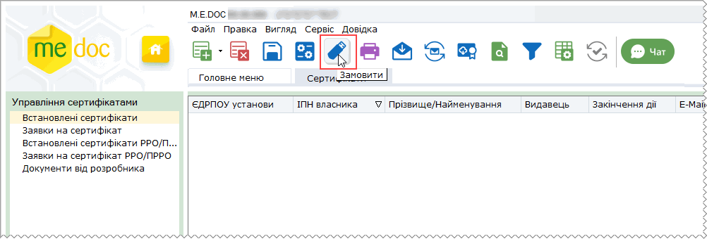

3. Відкриється вікно Замовити захищений апаратний носій. У вікні наводиться зображення доступних носіїв та їх вартість. Щоб переглянути технічні характеристики, наведіть курсор миші на зображення носія:

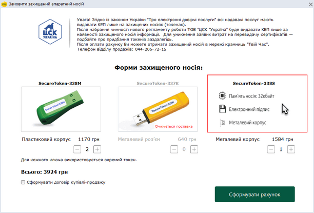

Натисніть, щоб збільшити малюнок

4. Оберіть модифікацію захищеного носія. Для цього під описом носія вкажіть кількість, яку ви бажаєте замовити. Щоб збільшити або зменшити кількість натискайте кнопки  або .

У вікні буде відображено вартість замовлення, залежно від обраної кількості носіїв та їх параметрів.

5. Якщо необхідно сформувати договір купівлі-продажу, встановіть відповідну відмітку у нижній частині вікна та оберіть тип вашої організації: бюджетна або госпрозрахункова.

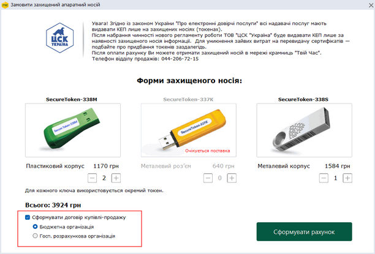

Натисніть, щоб збільшити малюнок

6. Перевірте правильність замовлення та натисніть кнопку Сформувати рахунок.

7. У результаті обробки замовлення буде створено два документа: рахунок та довіреність. Якщо була встановлена відмітка Сформувати договір купівлі-продажу, додатково буде створений документ: договір для госпрозрахункових організацій, або договір для бюджетних організацій.

Документи будуть відкриті на окремих вкладках. Перевірте дані, що були заповнені автоматично, та введіть дані у поля, що залишились незаповненими.

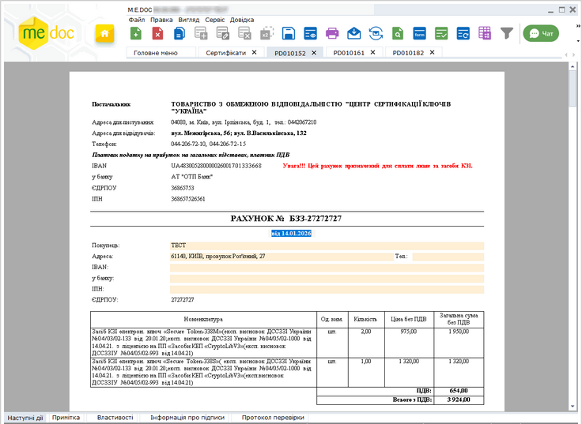

Натисніть, щоб збільшити малюнок

Документи доступні для перегляду на редагування у розділі [Реєстр звітів](UCDocRstByPer5.html#ucdocrstbyper5-rdocs_interface).

8. Роздруковані та оформлені належним чином документи необхідно надати у КНЕДП "ЦСК «Україна»", або у одну з крамниці "Твій час".

Отримати захищені носії ви зможете після оплати рахунку та надходження коштів за замовлення.

Про збереження секретного ключа на захищеному носії дивіться у розділі [Як зберегти секретний ключ на захищеному носії](#ucasigncert-admcert_req_protekt).

### Заявки на сертифікати

_Шлях у довідці: Розділи програми › Адміністрування › Управління сертифікатами › Заявки на сертифікати_

В цьому розділі:

[Створення заявок на отримання нових сертифікатів](#ucasigncert-admcert_req)

[Створення заявок на оновлення сертифікатів](#ucasigncert-admcert_update)

[Створення заявок на перевидачу сертифікатів](#ucasigncert-admcert_perevydacha)

Даний модуль призначений для формування заявок на отримання сертифікатів у КНЕДП "ЦСК «Україна»".

У програмі можна [отримати нові сертифікати](#ucasigncert-admcert_req) та [оновити існуючі сертифікати](#ucasigncert-admcert_update) (продовжити термін дії сертифікатів). Оновлення можливе для тих сертифікатів, до кінця терміну дії яких залишилось 45 або менше днів, та в яких не відбулось змін у даних сертифіката.

#### Для отримання нових сертифікатів

_Шлях у довідці: Розділи програми › Адміністрування › Управління сертифікатами › Заявки на сертифікати › Для отримання нових сертифікатів_

Для створення заявки на отримання нового сертифіката в КНЕДП "ЦСК «Україна»":

1. Скористайтесь одним із наступних способів:

- на панелі інструментів натисніть кнопку Сформувати заявки;
- виберіть команду Файл - Сформувати заявки;
- у контекстному меню оберіть команду Сформувати заявки;
- натисніть комбінацію клавіш Ctrl+I.

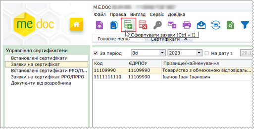

Натисніть, щоб збільшити малюнок

2. Якщо для сертифікатів, що встановлені у програмі, виконуються умови продовження терміну дії, відкриється вікно:

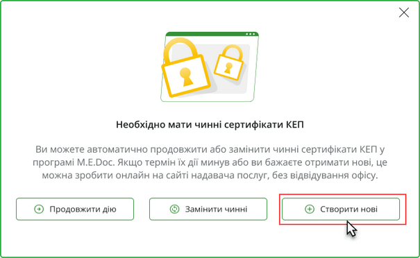

Натисніть, щоб збільшити малюнок

Для замовлення нових сертифікатів натисніть кнопку Створити нові.

3. Відкриється сторінка ресурсу КНЕДП "ЦСК «Україна»" з інформацією про формування нових сертифікатів. На сторінці також можна переглянути відеоінструкції про отримання КЕП. Ознайомтесь з наведеною інформацією та для замовлення нових сертифікатів виконайте вказівки КНЕДП "ЦСК «Україна»".

#### Для продовження сертифікатів користувачем

_Шлях у довідці: Розділи програми › Адміністрування › Управління сертифікатами › Заявки на сертифікати › Для продовження сертифікатів користувачем_

В цьому розділі:

[Коли можливе оновлення сертифікатів](#ucasigncert-admcert_update)

[Продовження сертифікатів](#ucasigncert-admcert_update)

[Автоматичне створення електронних заявок на оновлення сертифікатів](#ucasigncert-admcert_update)

[Отримання сертифіката із сайту КНЕДП "ЦСК «Україна»"](#ucasigncert-admcert_update)

[Доопрацювання заявок у разі скасування автоматичного створення](#ucasigncert-admcert_update)

Функція автоматичного оновлення сертифікатів дозволяє користувачу самостійно продовжити термін дії існуючих сертифікатів. Оновлення виконується шляхом створення заявок на основі чинних сертифікатів. Автоматичне оновлення сертифікатів можливе за умови наявності адміністратора реєстрації, який обслуговує даного користувача.

Функція оновлення доступна для сертифікатів КНЕДП, робота з якими [підтримується у програмі](#ucasigncert-admcert_cert), та до кінця терміну дії яких залишилось 45 або менше днів.

Продовження можливе для сертифікатів, [налаштованих у комплекті підписів](FormCompanyParams.html#formcompanyparams-admcomanyparams_pen), за відсутності змін у даних, які вносяться у сертифікати  (ПІБ, адреса, назва організації тощо).

Якщо комплект підписів не налаштований, програма запропонує оновити завантажені сертифікати, що відповідають вказаним вище умовам.

Перевірка можливості оновлення (продовження терміну дії) сертифікатів

При першому вході у програму виконується перевірка можливості оновлення сертифікатів, що передбачає:

- перевірку наявності сертифікатів у комплекті підписів (налаштованих у [Параметрах системи - Підпис](FormCompanyParams.html#formcompanyparams-admcomanyparams_pen));
- якщо такі сертифікати знайдені, перевіряється їх термін дії (якщо комплект підписів не налаштований, перевіряється термін дії всіх завантажених сертифікатів). Якщо до кінця терміну дії залишилось 45 або менше днів, виконується наступний етап;
- за реєстраційним номером ДРФО посадових осіб із сертифікатів та ЄДРПОУ установи формується запит до КНЕДП;
- за позитивним результатом цієї перевірки відкриється вікно Продовження сертифікатів, у якому програма запропонує користувачу отримати рахунок:

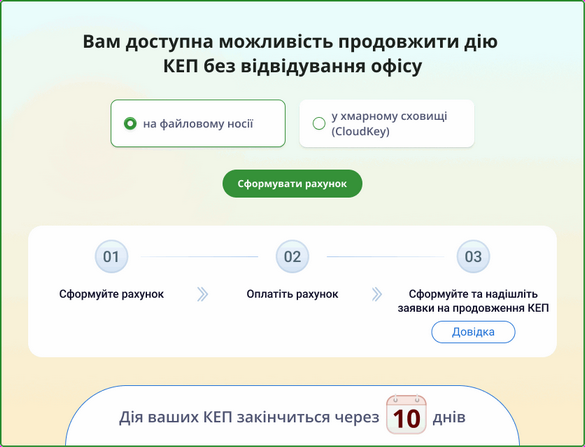

Натисніть, щоб збільшити малюнок

або сформувати заявку на сертифікати (за наявності сплачених рахунків):

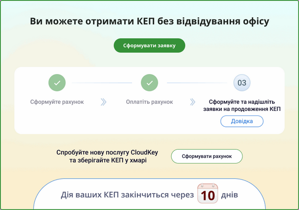

Натисніть, щоб збільшити малюнок

Сформувати та оплатити рахунок

Натисніть кнопку Сформувати рахунок або Отримати рахунок.

Програма сформує рахунок-фактуру , що може бути оплачений у будь-якій банківській установі.

Рахунок заповнюється автоматично, та виписується на продовження всіх сертифікатів, для яких виконуються умови продовження. Термін дії сертифікатів – 2 роки, встановлюється автоматично. Створений рахунок відкривається у окремій вкладці.

Створити та відправити заявку на продовження сертифікатів

Натисніть кнопку Сформувати заявку. Запуститься [Майстер оновлення сертифікатів](#ucasigncert-admcert_update) та розпочнеться формування заявок.

Завантажити оновлені сертифікати

Після оплати рахунку та опрацювання заявок адміністратором реєстрації отримайте оновлені сертифікати та [завантажте](#ucasigncert-admcert_update) їх у програму.

Оновлення сертифікатів можливе лише у випадку, якщо не відбулось змін у даних, внесених у сертифікат!

[До початку](#ucasigncert-admcert_update)

Продовження сертифікатів

Якщо сертифікати відповідають [умовам](#ucasigncert-admcert_update), що необхідні для оновлення, ви можете оновити (продовжити термін дії) сертифікатів одним з способів:

- Натисніть кнопку Сформувати заявку у вікні Продовження сертифікатів. Вікно Продовження сертифікатів відкривається автоматично під час першого запуску програми. У разі, якщо сплачено послугу продовження терміну дії сертифіката, вікно Продовження сертифікатів має вигляд:

Натисніть, щоб збільшити малюнок

По натисканню кнопки Сформувати заявку запускається [Майстер оновлення сертифікатів](#ucasigncert-admcert_update), який покроково допоможе сформувати заявку на оновлення.

У разі, якщо сплачено послугу збереження секретного ключа у хмарному сховищі CloudKey, вікно Продовження сертифікатів має вигляд:

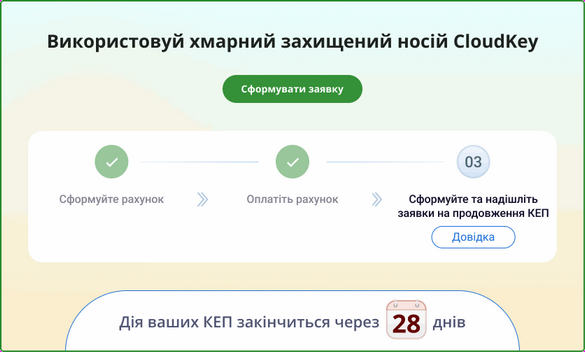

Натисніть, щоб збільшити малюнок

При виконанні умов продовження сертифікатів вікно з пропозицією продовження сертифікатів також відкривається:

- на виконання команди меню Сервіс – Автоматичне продовження сертифікатів, команда меню доступна у будь-якому модулі програми;
- по натисканню кнопки Придбати ЕП у підрозділі Сертифікати - Встановлені сертифікати (кнопка присутня у разі виконання умов оновлення сертифікатів).

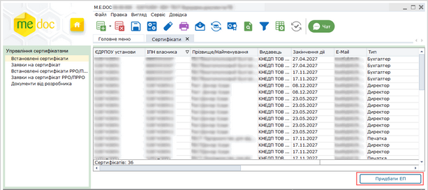

Натисніть, щоб збільшити малюнок

- Оберіть команду Сформувати заявки у підрозділі  Сертифікати - Заявки на сертифікат. Відкриється вікно:

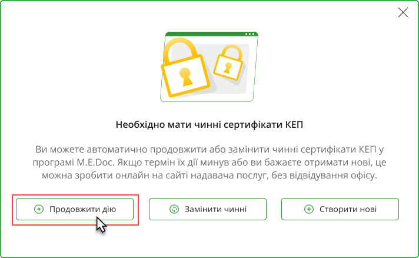

Натисніть кнопку Продовжити дію. Запуститься [Майстер оновлення сертифікатів](#ucasigncert-admcert_update), який покроково допоможе сформувати рахунок-фактуру та заявку на оновлення, відправити їх в КНЕДП, а після формування сертифікатів КНЕДП "Україна" - завантажити їх у програму.

[До початку](#ucasigncert-admcert_update)

Автоматичне створення електронних заявок на оновлення сертифікатів

Майстер оновлення сертифікатів запускається:

- по натисканню кнопки Сформувати заявку у [вікні Продовження сертифікатів](#ucasigncert-admcert_update);
- по натисканню кнопки Продовжити дію, Замінити чинні або Створити нові у вікні [Формування заявок на сертифікат](#ucasigncert-admcert_update);
- або по натисканню кнопки Відправте заявку у головному вікні програми (кнопка доступна у разі виконання умов оновлення сертифікатів).

У першому вікні Майстра виводиться список сертифікатів, які можливо оновити:

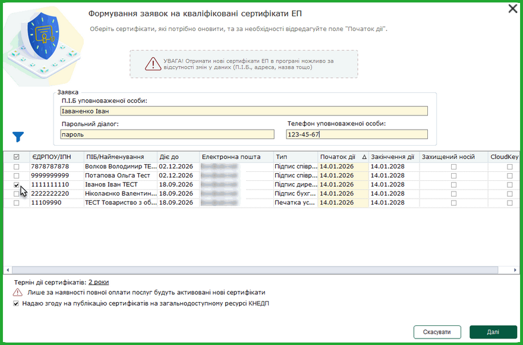

Натисніть, щоб збільшити малюнок

1. Заповніть обов'язкові поля заявки (позначені жовтим кольором). В полі Парольний діалог вкажіть діалог-пароль. Це будь-яке слово чи словосполучення, яке слугує підтвердженням в разі, якщо потрібно заблокувати даний сертифікат.

Створюється універсальна заявка на одночасне формування сертифікатів підписання та шифрування.

2. Встановіть позначки у рядках сертифікатів, для яких потрібно створити заявку. Щоб швидко знайти потрібний сертифікат, скористайтеся рядком фільтрів, що відкривається по натисканню кнопки .

3. Для самостійного визначення дати початку дії сертифіката натисніть лівою кнопкою миші на полі Початок дії у рядку потрібного сертифіката. У вікні календаря, що відкриється, оберіть необхідну дату початку дії сертифіката.

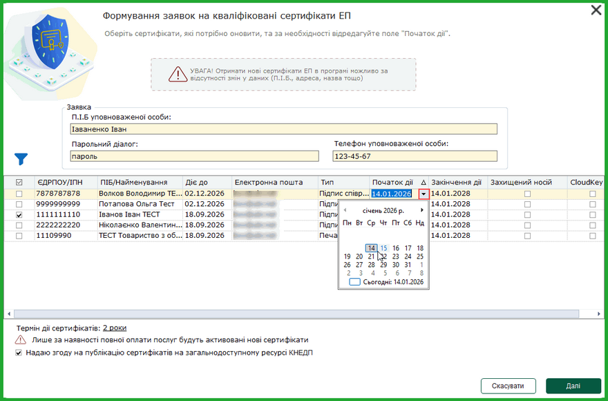

Натисніть, щоб збільшити малюнок

При спробі ввести дату початку дії більшу за вказану у полі Закінчення дії, автоматично буде проставлена дата закінчення діючих сертифікатів. Якщо введено дату меншу за поточну, у полі Початок дії автоматично проставляється поточна дата. Відповідно до встановленої дати початку дії сертифіката у полі Закінчення дії проставляється дата, що розраховується залежно від обраного терміну дії (рік або два роки).

4. Щоб сертифікати були доступні для завантаження, встановіть позначку Надаю згоду на публікацію сертифікатів на загальнодоступному ресурсі КНЕДП. Сертифікат буде опублікований на сайті КНЕДП "ЦСК «Україна»" [http://www.uakey.com.ua/](http://www.uakey.com.ua/), де його можна отримати через мережу Інтернет. Опубліковані сертифікати можуть бути завантажені за допомогою [автоматичної перевірки змінення статусів сертифікатів](#ucasigncert-admcert_cert).

5. Перевірте вибрані дані. Для переходу до наступного кроку натисніть кнопку Далі.

6. Якщо ви відмовились від публікації сертифікатів на ресурсі КНЕДП, відкриється вікно повідомлення:

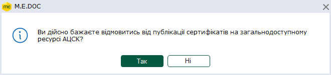

7. Відкриється вікно Генерація секретного ключа... У заголовку вікна відображено порядковий номер сертифіката та загальна кількість сертифікатів, що повинні бути опрацьовані:

   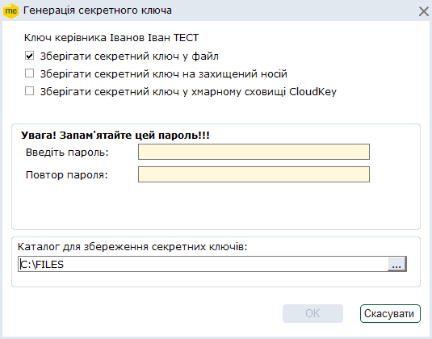

У вікні можна обрати спосіб зберігання особистих ключів кваліфікованого електронного підпису. Для цього оберіть одну з опцій:

- Зберігати секретний ключ у файл;
- Зберігати секретний ключ на захищений носій;
- Зберігати секретний ключ у хмарному сховищі CloudKey.

7.1. Якщо ви використовуєте для збереження секретного ключа захищений носій, під'єднайте носій до комп'ютера.

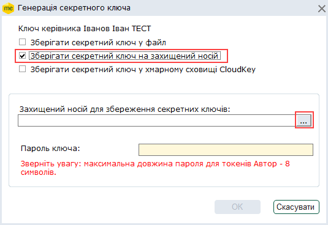

У полі Захищений носій для збереження секретних ключів натисніть  , у вікні що відкриється оберіть назву потрібного захищеного носія.

У полі Пароль ключа введіть пароль доступу до носія.

- Будьте уважні! Кількість спроб вводу пароля обмежено виробником носія. У разі перевищення ліміту спроб захищений носій буде очищено.
- Якщо на захищеному носії зберігається секретний ключ, виданий на інший номер ЄДРПОУ, та який більше не використовується, перед записом нового ключа необхідно виконати операцію [очищення захищеного носія](#ucasigncert-admcert_key_oper).
- Ключ шифрування та ключ підписання зберігаються в один файл (універсальний ключ).

Докладно про збереження секретного ключа на захищеному носії дивіться у розділі [Як зберегти секретний ключ на захищеному носії](#ucasigncert-admcert_req_protekt). Також, зберегти секретний ключ на токені можливо при [перевидачі сертифіката](#ucasigncert-admcert_perevydacha).

Придбати захищений носій можна за допомогою розділу [Як замовити захищений апаратний носій](#ucasigncert-admcert_nosij_faktura).

Після генерації секретний ключ записується на обраний носій.

Будьте уважні! Секретний ключ використовується для підпису звітності, тому подбайте про його безпеку. Для продовження натисніть ОК.

7.2. Якщо ви використовуєте збереження секретного ключа у хмарному сховищі CloudKey, встановіть відповідну відмітку та у полі Введіть пароль введіть пароль, який буде використовуватися для доступу до секретного ключа.

Опція Зберігати секретний ключ у хмарному сховищі CloudKey доступна у разі, якщо попередньо був сформований та оплачений рахунок на послугу CloudKey.

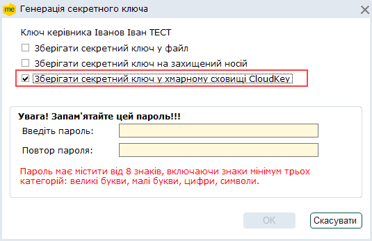

Докладно про збереження секретного ключа у захищеному у хмарному сховищі у розділі [Збереження секретного ключа у хмарному сховищі CloudKey](#ucasigncert-admcert_req_cloud).

7.3. Якщо ви зберігаєте секретні ключі на диску комп'ютера, встановіть позначку Зберегти секретний ключ у файл.

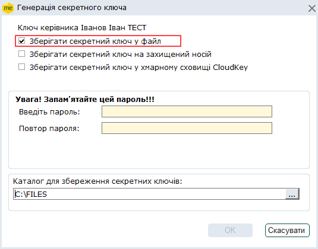

У відповідні поля введіть пароль до секретного ключа та повторіть його для підтвердження правильності введення.

Далі вкажіть шлях до каталогу для збереження файлів секретних ключів у полі Каталог для збереження секретних ключів.

8. Підтвердьте вибір, натиснувши кнопку OК.

9. Результатом генерації буде створення файлів заявки та секретного ключа і збереження їх у обраний спосіб, про що система оповістить користувача.

Якщо ви обрали збереження секретного ключа за допомогою послуги CloudKey, файл секретного ключа буде збережено у хмарному сховищі провайдера довірчих послуг.

Якщо ви обрали збереження секретного ключа на захищеному носії, секретний ключ записується на обраний носій.

Ключ шифрування та ключ підписання зберігаються в один файл (універсальний ключ).

10. Створиться універсальна заявка на одночасне формування сертифікатів підписання та шифрування:

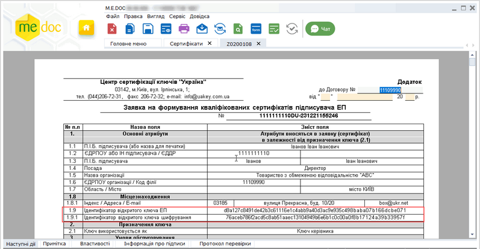

Натисніть, щоб збільшити малюнок

11. Запуститься процедура підпису заявки. Введіть пароль секретного ключа. Кожна заявка підписується ключем сертифіката, який оновлюється.

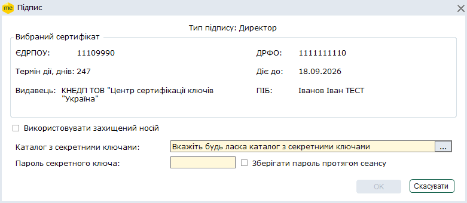

Операції, описані у пунктах 7 - 11, будуть автоматично повторені для всіх обраних сертифікатів. Якщо ви зберігаєте ключи на захищеному носії, перед генерацією наступного ключа необхідно підключити до комп'ютера відповідний носій.

12. Заявка буде автоматично відправлена до КНЕДП "ЦСК «Україна»".

13. Якщо оплата не здійснювалась, або кошти ще не надійшли до КНЕДП, відкриється вікно, у якому оберіть:

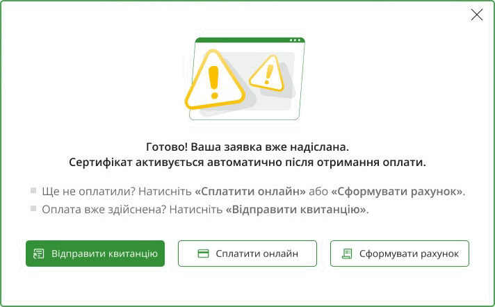

- Сплатити онлайн - оплатити послуги за допомогою платіжної системи онлайн, відкриється вікно платіжної системи, у якому вкажіть необхідні реквізити та виконайте оплату, дотримуючись вказівок платіжної системи;
- Сформувати рахунок - сформувати рахунок на оплату послуги, програма сформує рахунок-фактуру на сплату послуг, що може бути оплачений у будь-якій банківській установі;
- Відправити квитанцію - якщо оплату здійснено, відправте файл квитанції нашим спеціалістам у чаті підтримки.

14. Якщо оновлення сертифікатів було заздалегідь оплачене, та кошти надійшли до КНЕДП, відкриється вікно повідомлення про успішне відправлення заявки:

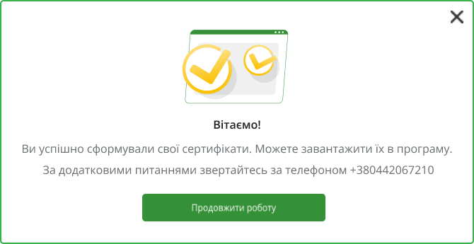

Зверніть увагу! Обробка заявки виконується після надходження оплати.

Отримання сертифіката із сайту КНЕДП "ЦСК «Україна»"

Після обробки заявок на шлюзі КНЕДП "ЦСК «Україна»" при перевірці поштових повідомлень надійде квитанція № 1 з результатом прийняття/відхилення заявки.

Причиною ж відхилення заявки може бути відсутність на шлюзі попередньої заявки на сертифікат, або ж випадок, коли заявка підписана некоректним ЕП.

Прийняті по першій квитанції заявки оброблюються адміністратором реєстрації. Результатом успішної обробки буде фінальна квитанція № 2 "Документ прийнято".

Квитанція № 2 може містити й негативну відповідь з повідомленням про відхилення заявки адміністратором. У такому разі квитанція містить причину відхилення, вказану адміністратором реєстрації.

Якщо заявка успішно оброблена, користувач отримав позитивну квитанцію № 2, у модулі Сертифікати - Заявки на сертифікат можна отримати сертифікат з сайту КНЕДП.

Завантажте оновлені сертифікати одним із способів:

- вкладка Наступні дії - Запит сертифіката;
- меню Правка - Запит сертифіката;
- із контекстного меню Запит сертифіката.

Якщо сертифікат сформований, він завантажується у базу даних програми та відображатиметься у модулі, про що буде сповіщено:

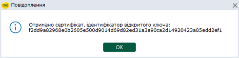

Натисніть, щоб збільшити малюнок

Якщо ж сертифікат не буде знайдено на сервері КНЕДП, користувач отримає повідомлення:

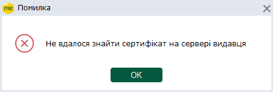

[До початку](#ucasigncert-admcert_update)

Доопрацювання заявок у разі скасування автоматичного створення

У будь-який момент ви можете відмовитись від продовження автоматичного створення заявок на сертифікат.

Програма створить бланки заявок на оновлення сертифікатів, що доступні у таблиці розділу Заявки на сертифікат.

Заявка на оновлення буде створена на основі даних із сертифіката, який оновлюється. Ці дані недоступні для зміни. Якщо секретний ключ ще не згенеровано, ви можете виправити лише значення полів, що позначені жовтим кольором.

Щоб згенерувати заявку на отримання сертифікатів та секретний ключ із бланку, у вікні відкритої заявки на вкладці Наступні дії  натисніть Згенеруйте заявку і секретний ключ:

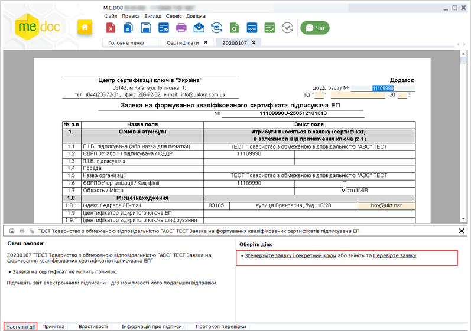

Натисніть, щоб збільшити малюнок

Або ж у розділі Заявки на сертифікат виберіть потрібну заявку (або декілька заявок) та натисніть на панелі інструментів кнопку Згенерувати секретний ключ .

Доступні команди визначаються етапом, на якому було зупинено автоматичне формування заявки. Після підписання заявки на вкладці Наступні дії стає доступною функція Відправити заявку на сервер ЦСК.

Зверніть увагу! Експорт, імпорт та копіювання заявок на оновлення сертифікатів НЕМОЖЛИВІ.

[До початку](#ucasigncert-admcert_update)

#### Перевидача сертифіката

_Шлях у довідці: Розділи програми › Адміністрування › Управління сертифікатами › Заявки на сертифікати › Перевидача сертифіката_

За допомогою перевидачі створюється сертифікат ідентичний існуючому. У перевиданому сертифікаті змінюється лише дата початку дії сертифіката - дата початку дії замінюється датою перевидачі сертифіката.

Функція доступна для сертифікатів, що підпадають під [умови продовження сертифіката](#ucasigncert-admcert_update), незалежно від терміну дії сертифіката.

Цей спосіб буде зручним у випадку, коли на захищеному носії необхідно зберегти секретний ключ існуючого сертифіката, термін дії якого ще не скінчився.

1. Перейдіть у підрозділ Адміністрування - Сертифікати - Заявки на сертифікат.

2. Скористайтесь одним із наступних способів:

- натисніть кнопку панелі інструментів ;
- виберіть команду контекстного меню Файл - Сформувати заявки;
- натисніть комбінацію клавіш Ctrl+I.

3. У вікні, що відкриється на виконання команди, натисніть кнопку Замінити чинні:

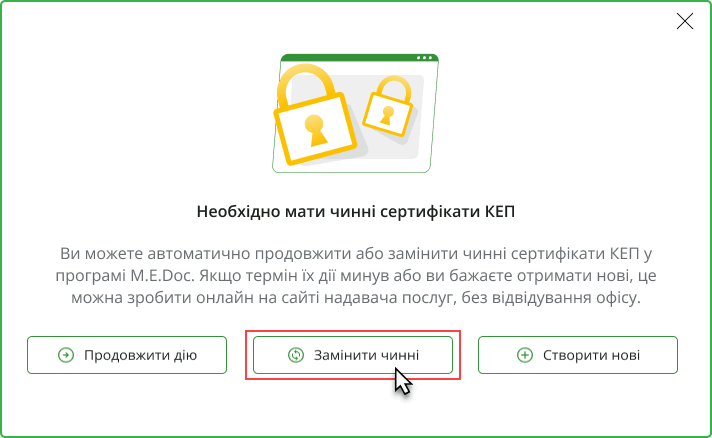

4. У наступному вікні заповніть необхідні поля та оберіть сертифікати, які потрібно перевидати. Щоб швидко знайти потрібний сертифікат, скористайтеся рядком фільтрів, що відкривається по натисканню кнопки .

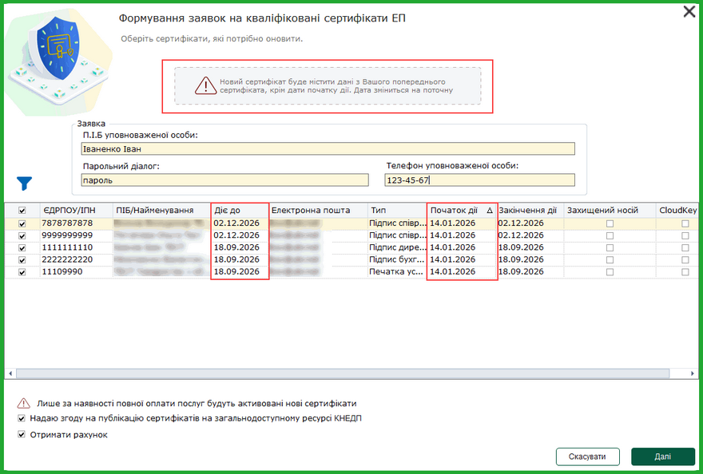

Натисніть, щоб збільшити малюнок

Створюється універсальна заявка на одночасну перевидачу сертифікатів підписання та шифрування.

Щоб сертифікати були доступні для завантаження, встановіть позначку Надаю згоду на публікацію сертифікатів на загальнодоступному ресурсі КНЕДП. Сертифікат буде опублікований на сайті КНЕДП "ЦСК «Україна»" [http://www.uakey.com.ua/](http://www.uakey.com.ua/), де його можна отримати через мережу Інтернет. Опубліковані сертифікати можуть бути завантажені за допомогою [автоматичної перевірки зміни статусів сертифікатів](#ucasigncert-admcert_cert).

5. Перевірте вибрані дані. Для переходу до наступного кроку натисніть кнопку Далі.

6. Відкриється вікно Генерація секретного ключа... У заголовку вікна відображено порядковий номер сертифіката та загальна кількість сертифікатів, що повинні бути опрацьовані:

   

У вікні можна обрати спосіб зберігання особистих ключів кваліфікованого електронного підпису. Для цього оберіть одну з опцій:

- Зберігати секретний ключ у файл;
- Зберігати секретний ключ на захищений носій;
- Зберігати секретний ключ у хмарному сховищі CloudKey.

6.1. Якщо ви використовуєте для збереження секретного ключа захищений носій, під'єднайте носій до комп'ютера.

У полі Захищений носій для збереження секретних ключів натисніть  , у вікні що відкриється оберіть назву потрібного захищеного носія.

У полі Пароль ключа введіть пароль доступу до носія.

- Будьте уважні! Кількість спроб вводу пароля обмежено виробником носія. У разі перевищення ліміту спроб захищений носій буде очищено.
- Якщо на захищеному носії зберігається секретний ключ, виданий на інший номер ЄДРПОУ, та який більше не використовується, перед записом нового ключа необхідно виконати операцію [очищення захищеного носія](#ucasigncert-admcert_key_oper).
- Ключ шифрування та ключ підписання зберігаються в один файл (універсальний ключ).

Докладно про збереження секретного ключа на захищеному носії дивіться у розділі [Як зберегти секретний ключ на захищеному носії](#ucasigncert-admcert_req_protekt). Також, зберегти секретний ключ на токені можливо при [перевидачі сертифіката](#ucasigncert-admcert_perevydacha).

Придбати захищений носій можна за допомогою розділу [Як замовити захищений апаратний носій](#ucasigncert-admcert_nosij_faktura).

Якщо ви обрали збереження секретного ключа на захищеному носії, секретний ключ записується на обраний носій.

Будьте уважні! Секретний ключ використовується для підпису звітності, тому подбайте про його безпеку. Для продовження натисніть ОК.

6.2. Якщо ви використовуєте збереження секретного ключа у хмарному сховищі CloudKey, встановіть відповідну відмітку та у полі Введіть пароль введіть пароль, який буде використовуватися для доступу до секретного ключа.

Опція Зберігати секретний ключ у хмарному сховищі CloudKey доступна у разі, якщо попередньо був сформований та оплачений рахунок на послугу CloudKey.

6.3. Якщо ви зберігаєте секретні ключі на диску комп'ютера, встановіть позначку Зберегти секретний ключ у файл.

У відповідні поля введіть пароль до секретного ключа та повторіть його для підтвердження правильності введення.

Далі вкажіть шлях до каталогу для збереження файлів секретних ключів у полі Каталог для збереження секретних ключів.

7. Підтвердьте вибір, натиснувши кнопку OК.

8. Результатом генерації буде створення файлів заявки та секретного ключа і збереження їх за вказаним шляхом, про що система оповістить користувача.

Якщо ви обрали збереження секретного ключа за допомогою послуги CloudKey, файл секретного ключа буде збережено у хмарному сховищі провайдера довірчих послуг.

Якщо ви обрали збереження секретного ключа на захищеному носії, секретний ключ записується на обраний носій.

Ключ шифрування та ключ підписання зберігаються в один файл (універсальний ключ).

Створиться універсальна заявка на одночасне формування сертифікатів підписання та шифрування.

9. Запуститься процедура підпису заявки. Введіть пароль секретного ключа. Заявка підписується ключем сертифіката, який перевидається.

10. Заявка буде автоматично відправлена до КНЕДП "ЦСК «Україна»".

11. Якщо оплата не здійснювалась, або кошти ще не надійшли до КНЕДП, відкриється вікно, у якому оберіть:

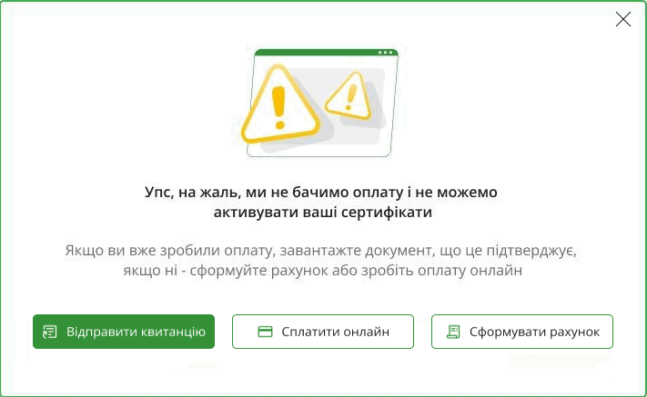

- Сплатити онлайн - оплатити послуги за допомогою платіжної системи онлайн, відкриється вікно платіжної системи, у якому вкажіть необхідні реквізити та виконайте оплату, дотримуючись вказівок платіжної системи;
- Сформувати рахунок - сформувати рахунок на оплату послуги, програма сформує рахунок-фактуру на сплату послуг, що може бути оплачений у будь-якій банківській установі;
- Відправити квитанцію - якщо оплату здійснено, відправте файл квитанції нашим спеціалістам у чаті підтримки.

12. Якщо оновлення сертифікатів було заздалегідь оплачене, та кошти надійшли до КНЕДП, відкриється вікно повідомлення про успішне відправлення заявки:

Зверніть увагу! Обробка заявки виконується після надходження оплати.

13. Якщо оновлення сертифікатів було заздалегідь оплачене, та кошти надійшли до КНЕДП, відкриється вікно повідомлення про успішне відправлення заявки.

Після завершення операції перевидачі, сертифікат, що був перевиданий, скасовується.

#### Заявки на сертифікат РРО/ПРРО

_Шлях у довідці: Розділи програми › Адміністрування › Управління сертифікатами › Заявки на сертифікати › Заявки на сертифікат РРО/ПРРО_

У розділі формуються заявки на отримання сертифікатів для підпису розрахункових документів при роботі з РРО/ПРРО.

1. Для створення заявки скористайтесь одним із наступних способів:

- на панелі інструментів натисніть кнопку Сформувати заявки;
- виберіть команду Файл - Сформувати заявки;
- у контекстному меню оберіть команду Сформувати заявки;
- натисніть комбінацію клавіш Ctrl+I.

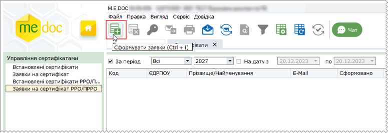

Натисніть, щоб збільшити малюнок

2. Якщо для сертифікатів, що встановлені у програмі, виконуються умови продовження терміну дії, відкриється вікно:

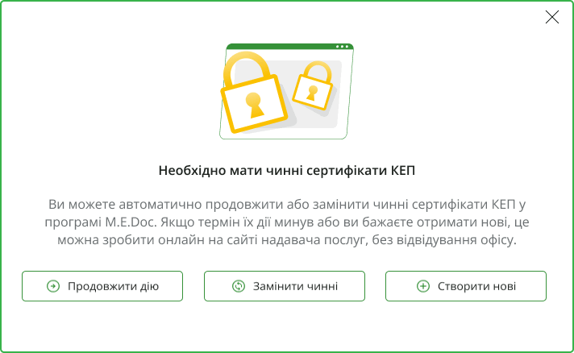

Для формування заявки РРО натисніть:

- Продовжити дію - продовжити термін дії існуючих сертифікатів (докладно дивіться у розділі [Для продовження сертифікатів](#ucasigncert-admcert_update));
- Замінити чинні - створити сертифікат ідентичний існуючому, змінивши дата початку дії сертифіката (докладно дивіться у розділі [Перевидача сертифіката](#ucasigncert-admcert_perevydacha));
- Створити нові - замовлення нових сертифікатів.

По натисканню кнопки Створити нові відкриється сторінка ресурсу КНЕДП "ЦСК «Україна»" з інформацією про формування нових сертифікатів. На сторінці також можна переглянути відеоінструкції про отримання КЕП. Ознайомтесь з наведеною інформацією та для замовлення нових сертифікатів виконайте вказівки КНЕДП "ЦСК «Україна»".

По натисканню кнопки Продовжити дію відкриється вікно Формування заявок на кваліфіковані сертифікати ЕП (функція  доступна для сертифікатів КНЕДП, робота з якими [підтримується у програмі](#ucasigncert-admcert_cert), та до кінця терміну дії яких залишилось 45 або менше днів):

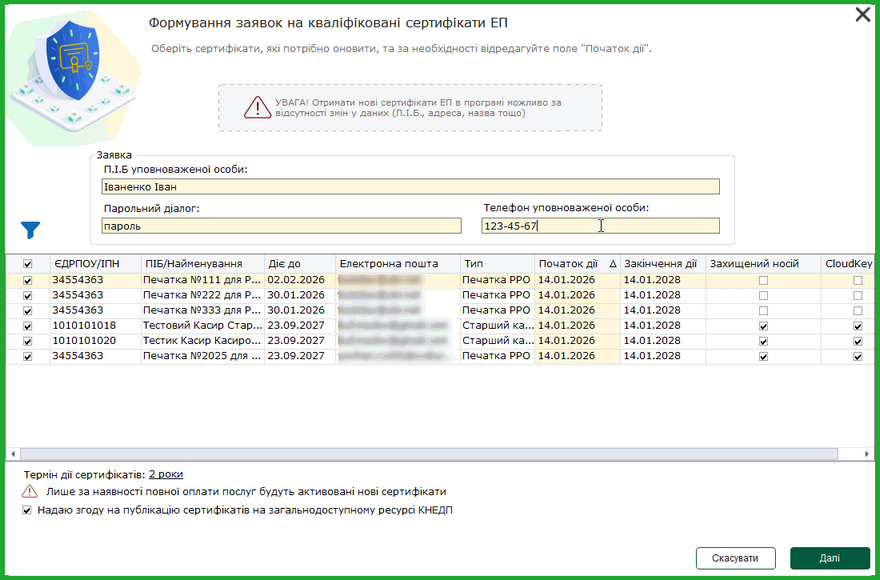

Натисніть, щоб збільшити малюнок

Виконайте продовження сертифіката як описано у розділі [Для продовження сертифікатів користувачем](#ucasigncert-admcert_update).

По натисканню кнопки Замінити чинні відкриється вікно Формування заявок на кваліфіковані сертифікати ЕП (функція доступна для сертифікатів, що підпадають під [умови продовження сертифіката](#ucasigncert-admcert_update), незалежно від терміну дії сертифіката):

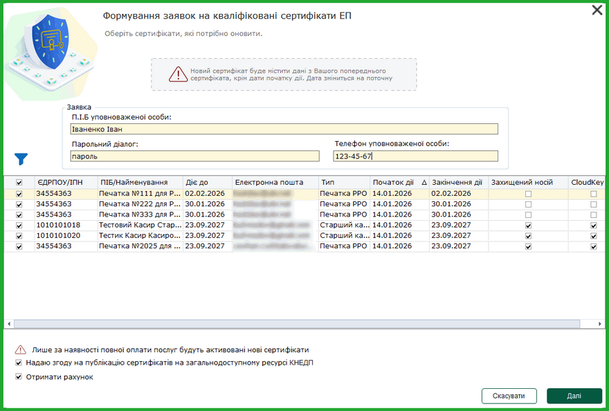

Натисніть, щоб збільшити малюнок

Виконайте дії, що описані у розділі [Перевидача сертифіката](#ucasigncert-admcert_perevydacha).

[До початку](#ucasigncert-admcert_req_rro)

### Як зберегти секретний ключ на захищеному носії

_Шлях у довідці: Розділи програми › Адміністрування › Управління сертифікатами › Як зберегти секретний ключ на захищеному носії_

В цьому розділі:

[Збереження ключа при продовженні терміну дії сертифіката](#ucasigncert-admcert_req_protekt)

[Збереження ключа при перевидачі сертифіката](#ucasigncert-admcert_req_protekt)

За допомогою програми M.E.Doc можливо зберегти секретний ключ на захищеному носії кількома способами:

при продовженні терміну дії сертифіката;

- при [перевидачі сертифіката](#ucasigncert-admcert_perevydacha).
- Зверніть увагу! Для кожного особистого ключа використовується окремий носій.
- Якщо на захищеному носії зберігається секретний ключ, виданий на інший номер ЄДРПОУ, та який більше не використовується, перед записом нового ключа необхідно виконати операцію [очищення захищеного носія](#ucasigncert-admcert_key_oper).
- На одному носії для певної особи (підприємства) можливо зберегти набір секретних ключів - підпис та шифрування.

Збереження при продовженні сертифіката

1. Підключіть до комп'ютера захищений носій, на якому необхідно зберегти секретний ключ.

2. Створіть заявку на продовження терміну дії сертифіката як описано у розділі [Для продовження сертифікатів користувачем](#ucasigncert-admcert_update).

3. У вікні Генерація секретного ключа оберіть опцію Зберегти секретний ключ на захищений носій:

У заголовку вікна відображено порядковий номер сертифіката та загальна кількість сертифікатів, що повинні бути опрацьовані.

4. У полі Захищений носій для збереження секретних ключів натисніть  , у вікні що відкриється оберіть назву потрібного захищеного носія.

5. У полі Пароль носія введіть пароль, який використовується для доступу до захищеного носія.

Будьте уважні! Кількість спроб вводу пароля обмежено виробником носія. У разі перевищення ліміту спроб захищений носій буде очищено.

6. Файл секретного ключа буде збережено на захищеному носії. Також створені файли заявки та секретного ключа будуть збережені за вказаним шляхом. Система повідомить вас про успішне збереження ключа.

Примітка:

Якщо для продовження ви одночасно обрали кілька сертифікатів, дії по генерації секретного ключа потрібно буде виконати для кожної сертифіката окремо.

Якщо ви зберігаєте ключи на захищеному носії, перед генерацією наступного ключа необхідно підключити до комп'ютера відповідний йому носій.

[До початку](#ucasigncert-admcert_req)

Збереження ключа при перевидачі сертифіката

1. Підключіть до комп'ютера захищений носій, на якому необхідно зберегти секретний ключ.

2. Створіть заявку на продовження терміну дії сертифіката як описано у розділі [Перевидача сертифіката](#ucasigncert-admcert_perevydacha).

3. У вікні Генерація секретного ключа...: оберіть опцію Зберегти секретний ключ на захищений носій:

У заголовку вікна відображено порядковий номер сертифіката та загальна кількість сертифікатів, що повинні бути опрацьовані.

4. У полі Захищений носій для збереження секретних ключів натисніть  , у вікні що відкриється оберіть назву потрібного захищеного носія.

5. У полі Пароль носія введіть пароль, який використовується для доступу до захищеного носія.

Будьте уважні! Кількість спроб вводу пароля обмежено виробником носія. У разі перевищення ліміту спроб захищений носій буде очищено.

6. Файл секретного ключа буде збережено на захищеному носії. Також створені файли заявки та секретного ключа будуть збережені за вказаним шляхом. Система повідомить вас про успішне збереження ключа.

Примітка:

Якщо для продовження ви одночасно обрали кілька сертифікатів, дії по генерації секретного ключа потрібно буде виконати для кожної сертифіката окремо.

Якщо ви зберігаєте ключи на захищеному носії, перед генерацією наступного ключа необхідно підключити до комп'ютера відповідний йому носій.

[До початку](#ucasigncert-admcert_req)

### Збереження секретного ключа у хмарному сховищі CloudKey

_Шлях у довідці: Розділи програми › Адміністрування › Управління сертифікатами › Збереження секретного ключа у хмарному сховищі CloudKey_

В цьому розділі:

[Збереження ключа при продовженні терміну дії сертифіката](#ucasigncert-admcert_req_protekt)

[Зміна пароля секретного ключа](#ucasigncert-admcert_req_cloud)

- CloudKey - послуга, що дозволяє зберігати ключ електронного підпису у провайдера довірчих послуг всередині захищеного апаратно-програмного пристрою.
- Для збереження секретного ключа у хмарному сховищі необхідно попередньо сформувати та оплатити рахунок на послугу CloudKey.

За допомогою програми M.E.Doc можливо зберегти секретний ключ у захищеному у хмарному сховищі CloudKey:

при продовженні терміну дії сертифіката;

- при [перевидачі сертифіката](#ucasigncert-admcert_perevydacha).

Збереження при продовженні сертифіката

1. Перейдіть у підрозділ Адміністрування - Сертифікати - Заявки на сертифікат.

2. Створіть заявку на продовження терміну дії сертифіката, як описано у розділі [Для продовження сертифікатів користувачем](#ucasigncert-admcert_update).

3. У вікні Генерація секретного ключа оберіть опцію Зберігати секретний ключ у хмарному сховищі CloudKey:

4. У полі Введіть пароль введіть пароль, який буде використовуватися для доступу до хмарного сховища.

5. У полі Повтор пароля підтвердіть введений пароль.

Пароль потрібно запам'ятати та подбати про його захист. Пароль використовується при підписанні та шифруванні документів.

6. Вкажіть шлях до каталогу для збереження файлу заявки. Підтвердьте вибір, натиснувши кнопку OK.

7. У наступному вікні введіть номер мобільного телефону для підтвердження генерації секретного ключа. Натисніть кнопку Відправити повідомлення:

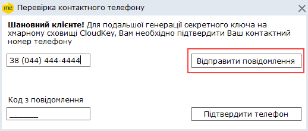

8. На вказаний номер прийде SMS-повідомлення з кодом. Введіть отриманий код у полі Код з повідомленням та натисніть Підтвердити телефон.

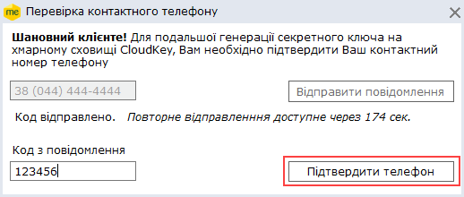

9. У наступному вікні програма повідомить про результат перевірки. Для продовження натисніть ОК.

10. Файл секретного ключа буде збережено у хмарному сховищі провайдера довірчих послуг. У вікні повідомлення буде наведено ім'я ключа та ім'я файлу, у якому збережено Заявку.

[До початку](#ucasigncert-admcert_req_cloud)

Зміна пароля секретного ключа

Ця функція призначена лише для сертифікатів КНЕДП "ЦСК «Україна»"!

1. Виберіть сертифікат, до якого потрібно змінити пароль секретного ключа.

2. Натисніть правою клавішею миші по обраному сертифіката. У контекстному меню, що відкрилось, виберіть команду CloudKey – Зміна пароля або виконайте команду головного меню Файл – CloudKey – Зміна пароля.

Натисніть, щоб збільшити малюнок

3. Відкриється наступне вікно Зміна пароля. Введіть старий та новий паролі у відповідні поля та натисніть кнопку ОК.

Якщо адміністратор встановив [використання посиленого захисту ЕП](FormCompanyParams.html#formcompanyparams-admcompanyparams_zahyst), то в цьому вікні відобразяться вимоги до пароля в залежності від встановлених налаштувань (мінімальна довжина та/або складність пароля).

4. Система повідомить про успішну зміну пароля.

[До початку](#ucasigncert-admcert_req_cloud)

### Операції з ключем на захищеному носії

_Шлях у довідці: Розділи програми › Адміністрування › Управління сертифікатами › Операції з ключем на захищеному носії_

В цьому розділі:

[Змінення пароля доступу до захищеного носія](#ucasigncert-admcert_key_oper)

[Очищення захищеного носія](#ucasigncert-admcert_key_oper)

[Пошук секретного ключа](#ucasigncert-admcert_key_oper)

[Перегляд встановлених носіїв](#ucasigncert-admcert_key_oper)

[Перегляд детальної інформації про ключі на захищеному носії](#ucasigncert-admcert_key_oper)

За допомогою програми M.E.Doc з секретним ключем, який збережено на захищеному носії, можливо виконувати наступні операції:

- змінювати пароль доступу до захищеного носія;
- видаляти секретний ключ захищеного носія;
- дізнатися назву захищеного носія, що зберігає секретний ключ певного сертифіката.

Операції з захищеним носієм виконуються у підрозділі Адміністрування - Сертифікати - Встановленні сертифікати.

Зміна пароля доступу до захищеного носія

1. У таблиці підрозділу оберіть необхідний сертифікат.

2. Підключіть до комп'ютера захищений носій.

3. Виконайте команду меню Файл - Захищений носій (Token) - Зміна пароля, або оберіть команду контекстного меню Захищений носій (Token) - Зміна пароля.

Натисніть, щоб збільшити малюнок

4. Відкриється вікно Зміна пароля:

5. У полі Пристрій для збереження секретних ключів натисніть , у вікні що відкриється оберіть назву потрібного захищеного носія.

Знайти назву потрібного захищеного носія можна за допомогою функції [пошук секретного ключа](#ucasigncert-admcert_key_oper). Носій повинен бути підключений до комп'ютера.

5. Введіть старий пароль до захищеного носія.

Будьте уважні! Кількість спроб вводу пароля обмежено виробником носія. У разі перевищення ліміту спроб захищений носій буде очищено. Після чого буде можливе тільки [форматування токена](#ucasigncert-admcert_key_oper).

6. У відповідні поля введіть новий пароль до захищеного носія та повторіть його для підтвердження правильності введення. Для продовження натисніть ОК.

7. Система повідомить вас про успішне змінення пароля.

[До початку](#ucasigncert-admcert_req)

Очищення захищеного носія

Будьте уважні! Після очищення захищеного носія відновити секретні ключі буде неможливо. Щоб отримати секретні ключі замість втрачених, необхідно замовити нові сертифікати (подати заявку, сплатити рахунок тощо).

1. Підключіть до комп'ютера захищений носій, який потрібно очистити.

2. Виконайте команду меню Файл - Захищений носій (Token) - Цілковите очищення, або оберіть команду контекстного меню Захищений носій (Token) - Цілковите очищення.

3. Якщо до комп'ютера підключено декілька захищених носіїв, відкриється вікно Оберіть пристрій. Оберіть назву потрібного захищеного носія.

3. Відкриється вікно Цілковите очищення.

Перевірте чи правильно обрано захищений носій для очищення. Будьте уважні! З токена видаляються всі секретні ключі. Видалені дані відновити неможливо.

4. У полях Введіть новий пароль та Повтор нового пароля введіть новий пароль до захищеного носія та повторіть його для підтвердження правильності введення.

5. Для продовження натисніть ОК.

6. У вікні повідомлення, що відкриється, підтвердіть намір очистити захищений носій.

7. Система повідомить вас про успішне змінення пароля.

Якщо очищується захищений носій "AVTOR", що може використовуватись як флеш-накопичувач, видалені будуть лише дані секретного ключа. Інша інформація, збережена на накопичувачі, залишається неушкодженою.

[До початку](#ucasigncert-admcert_req)

Пошук секретного ключа

Ця функція буде корисна, якщо ви використовуєте декілька захищених носіїв одночасно. За допомогою функції пошуку секретного ключа ви швидко визначите, який саме носій, відповідає обраному сертифіката.

Захищені носій повинні бути підключені до комп'ютера.

1. У таблиці підрозділу оберіть сертифікат, для якого необхідно визначити носій секретного ключа.

2. Виконайте команду меню Файл - Захищений носій (Token) - Пошук секретного ключа, або оберіть команду контекстного меню Захищений носій (Token) - Пошук секретного ключа.

4. У вікні, що відкриється, буде відображені назва та код захищеного носія, який відповідає обраному сертифіката.

Якщо ж носій не знайдено, з'явиться відповідне повідомлення.

[До початку](#ucasigncert-admcert_req)

Перегляд встановлених носіїв

За допомогою функції можна переглянути перелік всіх захищених носіїв, під'єднаних на момент запиту, та імена секретних ключів, що згенеровані на даних токенах.

1. Підключіть до комп'ютера захищений носій (носії), який потрібно переглянути.

2. Виконайте команду меню Файл - Захищений носій (Token) - Встановлені носії, або оберіть команду контекстного меню Захищений носій (Token) - Встановлені носії.

3. У вікні, що відкриється, буде відображено перелік всіх захищених носіїв, під'єднаних на момент запиту, та імена секретних ключів, що згенеровані на даних токенах.

[До початку](#ucasigncert-admcert_req)

Перегляд детальної інформації про ключі на захищеному носії

За допомогою функції можна переглянути детальну інформацію про секретні ключі, що збережені на захищеному носії:

1. Підключіть до комп'ютера захищений носій (носії), який потрібно переглянути.

2. Виконайте команду меню Файл - Захищений носій (Token) - Встановлені носії, або оберіть команду контекстного меню Захищений носій (Token) - Встановлені носії.

3. У вікні, що відкриється, буде відображено перелік всіх захищених носіїв, під'єднаних на момент запиту, та імена секретних ключів, що згенеровані на даних токенах.

4. Подвійним кліком миші відкрийте необхідний носій, або виділіть носій у переліку та натисніть кнопку  Перелік ключів на панелі інструментів вікна Встановлені носії.

5. Програма автоматично зчитає доступні ключі та відобразить їх на екрані.

[До початку](#ucasigncert-admcert_req)

### Робота з токенами ІІТ "Алмаз" та "Кристал"

_Шлях у довідці: Розділи програми › Адміністрування › Управління сертифікатами › Робота з токенами ІІТ "Алмаз" та "Кристал"_

В цьому розділі:

[Очищення захищеного носія "Алмаз" за допомогою програми M.E.Doc](#ucasigncert-admcert_iit)

[Очищення захищеного носія "Кристал" за допомогою програми M.E.Doc](#ucasigncert-admcert_iit)

[Перевірка режиму роботи захищеного носія "Алмаз" та встановлення нативного режиму ІІТ](#ucasigncert-admcert_iit)

[Перевірка режиму роботи захищеного носія "Кристал" та встановлення нативного режиму ІІТ](#ucasigncert-admcert_iit)

[Збереження ключа на очищений токен](#ucasigncert-admcert_iit)

У програмі M.E.Doc підтримується робота з токенами ІІТ "Алмаз" та "Кристал".

Користувачі можуть зберігати секретні ключі на токени "Алмаз" та "Кристал" при виконанні операцій: [генерація нового сертифіката](#ucasigncert-admcert_req), [продовження терміну дії](#ucasigncert-admcert_req_protekt) сертифіката, [перевидачі сертифіката](#ucasigncert-admcert_perevydacha).

Для збереження ключів на токен ІІТ "Алмаз" чи "Кристал" повинні виконуватись умови:

- токен пустий (не містить ключів);
- режим роботи токена - нативний (не PKCS#11).

Важливо! При генерації нового сертифіката, продовженні терміну дії сертифіката, перевидачі сертифіката генерація нового ключа на токен неможлива, якщо на токені вже є збережені ключі.

Для генерації ключів при продовженні чи перевидачі сертифікатів необхідні 2 токени. Перший токен - на якому збережені ключі, що продовжуються або перевидаються, та другий токен -  на який буде виконуватись генерація, цей токен повинен бути пустим (не містити ключів).

Перевірити, чи містить токен дані, можна, виконавши команду головного меню програми M.E.Doc: [Файл - Захищений носій (Token) - Встановлені носії](#ucasigncert-admcert_key_oper).

Якщо токен містить дані, перед генерацією ключа на цей токен виконайте дії:

1. Виконайте очищення токена "[Алмаз](#ucasigncert-admcert_iit)" або "[Кристал](#ucasigncert-admcert_iit)" за допомогою програми M.E.Doc або утиліти ІІТ.

2. Переконайтеся, що токен працює в нативному режимі ІІТ (не PKCS#11) (розділи [Перевірка режиму роботи захищеного носія "Алмаз" та встановлення нативного режиму ІІТ](#ucasigncert-admcert_iit) та [Перевірка режиму роботи захищеного носія "Кристал" та встановлення нативного режиму ІІТ](#ucasigncert-admcert_iit)).

Будьте уважні при видаленні даних з токена, якщо планується продовження чи перевидача сертифікатів!

Для генерації ключів при продовженні чи перевидачі сертифікатів необхідний токен, на якому збережені ключі, що продовжуються або перевидаються. У разі, якщо дані з цього токена будуть видалені, продовження чи перевидача сертифіката буде неможлива.

Очищення захищеного носія "Алмаз" за допомогою програми M.E.Doc

Будьте уважні!

Під час форматування вся інформація, збережена на токені, знищується.

Після очищення захищеного носія відновити секретні ключі буде неможливо. Щоб отримати секретні ключі замість втрачених, необхідно замовити нові сертифікати (подати заявку, сплатити рахунок тощо).

Щоб видалити дані з токена (відформатувати токен):

1. Підключіть до комп'ютера захищений носій, який потрібно очистити.

2. Виконайте команду меню Файл - Захищений носій (Token) - Цілковите очищення, або оберіть команду контекстного меню Захищений носій (Token) - Цілковите очищення.

3. Якщо до комп'ютера підключено декілька захищених носіїв, відкриється вікно Оберіть пристрій. Оберіть назву потрібного захищеного носія та натисніть ОК:

3. Відкриється вікно Цілковите очищення:

Перевірте чи правильно обрано захищений носій для очищення. Будьте уважні! З токена видаляються всі секретні ключі. Видалені дані відновити неможливо.

4. У полях Введіть пароль та Повтор пароля введіть пароль до захищеного носія та повторіть його для підтвердження правильності введення.

5. Для продовження натисніть ОК.

6. У вікні повідомлення, що відкриється, підтвердіть намір очистити захищений носій.

7. Система повідомить вас про успішне змінення пароля.

[До початку](#ucasigncert-admcert_iit)

Очищення захищеного носія "Кристал" за допомогою програми M.E.Doc

Будьте уважні!

Під час форматування вся інформація, збережена на токені, знищується.

Після очищення захищеного носія відновити секретні ключі буде неможливо. Щоб отримати секретні ключі замість втрачених, необхідно замовити нові сертифікати (подати заявку, сплатити рахунок тощо).

Щоб видалити дані з токена (відформатувати токен):

1. Підключіть до комп'ютера захищений носій, який потрібно очистити.

2. Виконайте команду меню Файл - Захищений носій (Token) - Цілковите очищення, або оберіть команду контекстного меню Захищений носій (Token) - Цілковите очищення.

3. Якщо до комп'ютера підключено декілька захищених носіїв, відкриється вікно Оберіть пристрій. Оберіть назву потрібного захищеного носія, натисніть ОК:

3. Відкриється вікно Цілковите очищення:

Перевірте чи правильно обрано захищений носій для очищення. Будьте уважні! З токена видаляються всі секретні ключі. Видалені дані відновити неможливо.

4. У області Адміністратор у полях Введіть пароль та Повтор пароля введіть пароль адміністратора до захищеного носія та повторіть його для підтвердження правильності введення.

5.  У області Оператор у полях Введіть пароль та Повтор пароля введіть пароль оператора до захищеного носія та повторіть його для підтвердження правильності введення.

6. Для продовження натисніть ОК.

7. У вікні повідомлення, що відкриється, підтвердіть намір очистити захищений носій.

8. Система повідомить вас про успішне змінення пароля.

[До початку](#ucasigncert-admcert_iit)

Перевірка режиму роботи захищеного носія "Алмаз"

Для токенів "Алмаз" рекомендується використовувати нативний режим роботи ІІТ.

Щоб перевірити режим, в якому працює токен:

1. Підключіть токен до комп'ютера.

2. Запустіть програмний комплекс конфігурування (утиліту ІІТ), що надається виробником. Для цього запустіть на виконання файл EKAlmaz1CConfiguration.exe. Відкриється вікно програми:

Натисніть, щоб збільшити малюнок

3. У вікні програми оберіть назву потрібного токена на панелі ліворуч. У меню, що розташовано у правій частині вікна програми, оберіть пункт Ініціалізувати PKCS#11.

Натисніть, щоб збільшити малюнок

4. Відкриється вікно повідомлення. Вікно містить одне з повідомлень, що вказує на режим роботи токена:

- Текст повідомлення: «Ініціалізація пристрою для використання в якості PKCS#11-сумісного потребує його форматування, що призведе до знищення ключів і даних у пристрої. Продовжити?» - вказує на те, що токен працює в Нативному режимі ІІТ:

Натисніть, щоб збільшити малюнок

Натисніть No, щоб закрити вікно повідомлення.

- Текст повідомлення «Ініціалізація пристрою для використання в якості PKCS#11-сумісного вже виконана. Для виконання повторної ініціалізації необхідно відформатувати пристрій» - вказує на те, що токен працює в режимі PKCS#11-сумісного. Для коректної роботи необхідно [відформатувати токен](#ucasigncert-admcert_iit):

Натисніть, щоб збільшити малюнок

Натисніть ОК, щоб закрити вікно повідомлення.

[До початку](#ucasigncert-admcert_iit)

Перевірка режиму роботи захищеного носія "Кристал" та встановлення нативного режиму ІІТ

Щоб перевірити режим, в якому працює токен:

1. Підключіть токен до комп'ютера.

2. Запустіть програмний комплекс конфігурування (утиліту ІІТ), що надається виробником. Для цього запустіть на виконання файл EKeyCrystal1Cfg.exe. Відкриється вікно програми:

Натисніть, щоб збільшити малюнок

3. У вікні програми оберіть назву потрібного токена на панелі ліворуч. У меню, що розташовано у правій частині вікна програми, оберіть пункт Ініціалізувати PKCS#11.

Натисніть, щоб збільшити малюнок

4. Відкриється вікно повідомлення. Вікно містить одне з повідомлень, що вказує на режим роботи токена:

- Текст повідомлення: «Ініціалізація пристрою для використання в якості PKCS#11-сумісного потребує його форматування, що призведе до знищення ключів і даних у пристрої. Продовжити?» - вказує на те, що токен працює в Нативному режимі ІІТ:

Натисніть, щоб збільшити малюнок

Натисніть No, щоб закрити вікно повідомлення.

- Текст повідомлення: «Ініціалізація пристрою для використання в якості PKCS#11-сумісного вже виконана. Для виконання повторної ініціалізації необхідно відформатувати пристрій паролем виробника (перевести у режим без розподілу ролей)» - вказує на те, що токен працює в режимі PKCS#11-сумісного:

Натисніть, щоб збільшити малюнок

Натисніть ОК, щоб закрити вікно повідомлення.

5. Якщо токен працює в режимі PKCS#11, для коректної роботи необхідно відформатувати токен, використовуючи пароль виробника. Для цього у вікні утиліти ІІТ натисніть правою кнопкою миші на назву токена. У вікні, що відкриється, оберіть пункт Форматувати паролем виробника:

Натисніть, щоб збільшити малюнок

6. У вікні Форматування пристрою паролем виробника у полі Пароль виробника введіть пароль, що надається виробником. У полі Новий пароль введіть новий пароль доступу до токена. Підтвердіть новий пароль, повторивши його у полі Підтвердження. Натисніть кнопку Форматувати:

Натисніть, щоб збільшити малюнок

Якщо у вас нема пароля виробника, сформуйте послідовність, обравши пункт меню Сформувати послідовність для виробника, та зверніться до ІІТ для отримання пароля.

Після отримання пароля виконайте форматування токена паролем виробника.

7. Підтвердіть намір форматувати токен, у вікні повідомлення натисніть Yes:

Натисніть, щоб збільшити малюнок

8. Щоб розпочати форматування, у наступному вікні повідомлення натисніть ОК:

Натисніть, щоб збільшити малюнок

9. Утиліта повідомить про результат виконання операції, для продовження роботи натисніть ОК:

Натисніть, щоб збільшити малюнок

[До початку](#ucasigncert-admcert_iit)

Збереження ключа на очищений токен

Генерація нових ключів на токен неможлива, якщо на токені вже є збережені ключі. Також неможливо продовження ключа на цей самий токен.

Для збереження ключа на токен необхідно попередньо очистити токен "[Алмаз](#ucasigncert-admcert_iit)" або "[Кристал](#ucasigncert-admcert_iit)" засобами програми M.E.Doc або утилітою ІІТ.

Після чого за допомогою програми M.E.Doc зберегти згенеровані ключі на токен як описано у розділі [Як зберегти секретний ключ на захищеному носії](#ucasigncert-admcert_req_protekt).

За допомогою програми M.E.Doc можливо зберегти секретний ключ на захищеному носії кількома способами:

при [продовженні терміну дії сертифіката](#ucasigncert-admcert_req_protekt);

- при [перевидачі сертифіката](#ucasigncert-admcert_perevydacha).

[До початку](#ucasigncert-admcert_iit)


