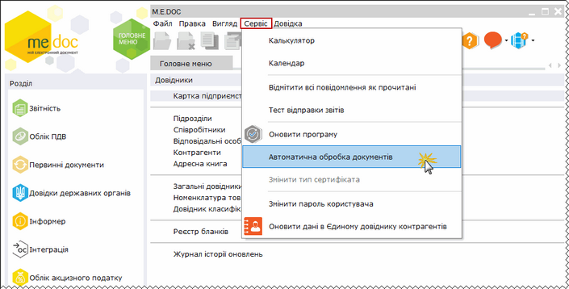
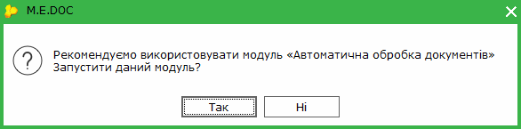
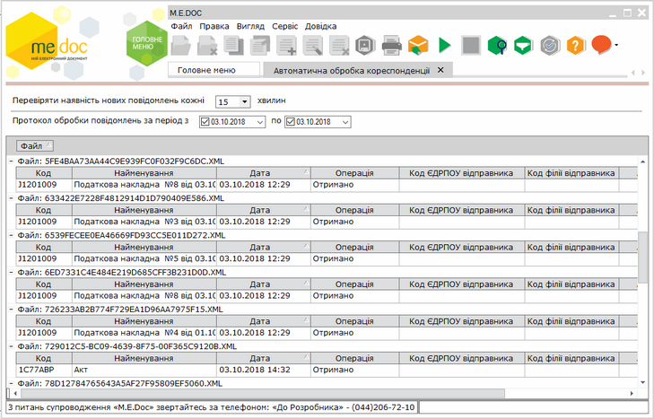
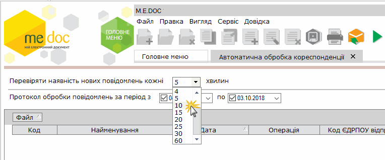
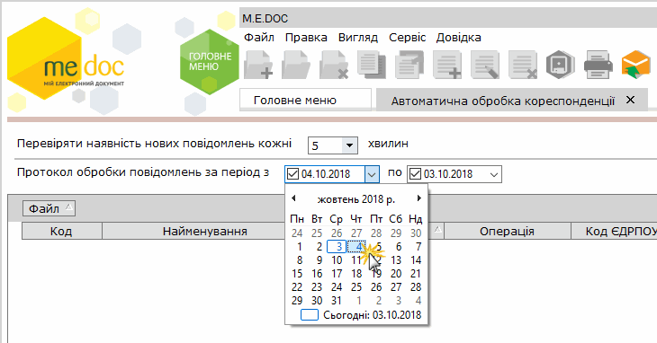

[← Зміст довідки](../)


# Автоматична обробка кореспонденції

## Автоматична обробка кореспонденції

_Шлях у довідці: Додатково: UCAutoJrn › Автоматична обробка кореспонденції_

Сервіс Автоматична обробка кореспонденції призначений для автоматичної перевірки поштової скриньки установи та отримання нових повідомлень через встановлений користувачем проміжок часу.

Для того, щоб запустити автоматичну обробку пошти у меню Сервіс оберіть пункт Автоматична обробка документів.

Натисніть, щоб збільшити малюнок

Відкриється вікно повідомлення:

По натисканню кнопки Так відкриється модуль Автоматичної обробки документів, у якому можливо виконати [налаштування календаря прийому повідомлень](UCGlobalAutoProcJournalFunc.html#ucglobalautoprocjournalfunc-pdocs_avto_func), а також, увімкнути/відключити сервіс автоматичного прийому повідомлень.

По натисканню кнопки Ні відкриється вкладка Автоматична обробка кореспонденції:

Натисніть, щоб збільшити малюнок

Перед запуском сервісу виконайте налаштування:

1. Встановіть бажану періодичність перевірки нових повідомлень у полі Перевіряти наявність нових повідомлень.

Нлаштувати більш гнучкий графік автоматичного прийому повідомлень можливо у модулі [Автоматична обробка документів](UCGlobalAutoProcJournalFunc.html#ucglobalautoprocjournalfunc-pdocs_avto_func).

2. У полі Протокол обробки повідомлень за період з.. по вкажіть дату початку та закінчення періоду, в межах якого відображати протокол перевірки нових вхідних повідомлень.
За замовчанням встановлюється поточна дата.

Для того, щоб запустити автоматичну обробку натисніть на кнопку  на панелі інструментів.

Відкриється стандартне вікно підписання документа, де потрібно ввести пароль доступу до секретних ключів. Натисніть ОК. Розпочнеться процес завантаження надісланих повідомлень.

При цьому вікно обробки пошти може бути не активним.

При отриманні нових повідомлень з’являється спливаюче віконце з повідомленням.

До моменту примусового зупинення сервісу користувачем або виходу із програмного комплексу, сервіс буде безперервно виконувати перевірку вхідних повідомлень із вказаним проміжком часу. При наступному запуску програми, сервіс потрібно включати знову.

Для того, щоб зупинити автоматичну обробку натисніть на кнопку  на панелі інструментів.


