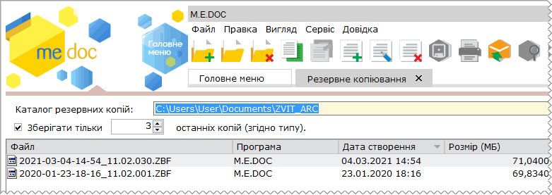
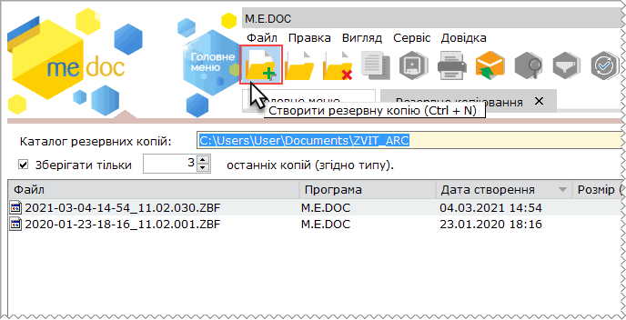
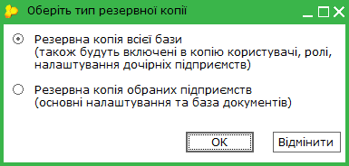
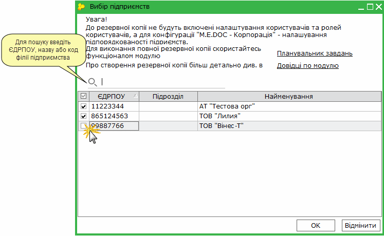
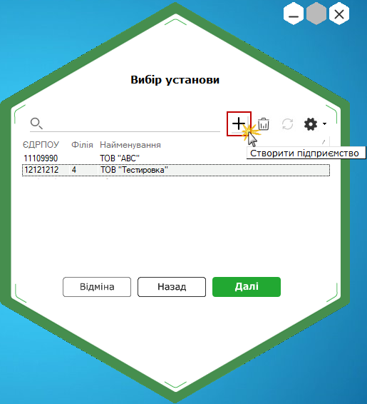
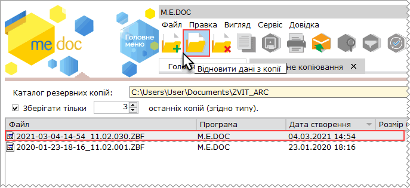
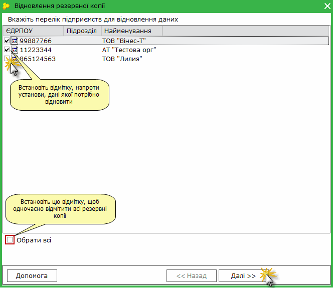

[← Зміст довідки](../)


# Резервне копіювання

## Резервне копіювання

_Шлях у довідці: Розділи програми › Адміністрування › Резервне копіювання_

В цьому розділі:

[Створення резервної копії](#ucbackup-admbackup)

[Відновлення резервної копії](#ucbackup-admbackup)

Модуль призначений для створення резервної копії баз даних програми. Резервна копія використовується для відновлення даних у випадку їх втрати, пошкодження або перенесення на інший комп'ютер. За допомогою модуля користувач може створити резервну копію у будь який час.

У верхній частині вікна модуля розміщено поле із шляхом до каталогу збереження резервних копій, що встановлений за замовчуванням:

Для зберігання резервних копій можливо обрати будь-який зручний для вас каталог.

Якщо необхідно зберігати визначену кількість резервних копій, встановіть опцію Зберігати тільки ... останніх копій (згідно типу) та зазначте кількість останніх створених резервних копій, що потрібно зберігати. Попередні резервні копії, що перевищують задану кількість, видалятимуться. Зберігається вказана кількість резервних копій кожного типу: ZBF та ZBK.

У таблиці модуля відображаються перелік створених раніше резервних копій баз даних програми (якщо такі існують у обраному каталозі).

Інформація, що зберігається у резервній копії залежить від типу резервного копіювання: Резервна копія всієї бази або Резервна копія обраних підприємств.

До Резервної копії обраних підприємств не зберігаються налаштування [користувачів](UCAdminUsers.html#ucadminusers-admusr) та [ролей користувачів](UCManageRoles.html#ucmanageroles-ucmanageroles), а при використанні конфігурації M.E.Doc. Корпорація - не зберігаються [налаштування підпорядкованості підприємств](UCIncRst.html#ucincrst-m_e_doc-corp_pidzvitni).

Для збереження всієї інформації бази даних із бібліотеками програми, станом на певну дату, скористайтесь функціоналом [Менеджер архіву програми](BackupManager.html#backupmanager-backupmanager).

За замовчуванням файл копії Резервна копія обраних підприємств містить у своїй назві дату та час збереження та версію ПО і має розширення .ZBK - YYYY-MM-DD-XX-XX\_VV.VV.VVV\_NNNNNNNN.ZBK:

де YYYY-MM-DD-XX-XX\_VV.VV.VVV\_NNNNNNNN - відповідно рік, місяць, день, час створення архіву, версія ПО, у якому було створено копію, та ЄДРПОУ підприємства (ЄДРПОУ підприємства вказується за умови створення резервної копії поточного підприємства).

Копія Резервна копія всієї бази має назву - YYYY-MM-DD-XX-XX\_VV.VV.VVV.ZBF.

Створення резервної копії

1. На панелі інструментів виберіть команду Створити, або натисніть комбінацію клавіш Ctrl+N.

2. Відкриється вікно Оберіть тип резервної копії, у якому встановіть потрібну опцію:

- Резервна копія всієї бази – створення повної резервної копії бази програми, що крім основних налаштувань підприємств та бази документів міститиме налаштування користувачів та їх ролей та налаштування підпорядкованості підприємств;
- Резервна копія обраних підприємств – створення резервної копії обраних підприємств, що міститиме основні налаштування та базу документів, при виборі цієї опції у наступному вікні оберіть підприємства, для яких необхідно створити резервну копію.

Натисніть кнопку ОК.

3. Якщо було обрана Резервна копія обраних підприємств, відкриється вікно Вибір підприємства.

За замовчуванням, напроти всіх установ, що ведуться у системі стоять галочки. Якщо потрібне резервне копіювання певної установи, встановіть галочку напроти потрібного підприємства (або декількох). Щоб швидко встановити/видалити всі відмітки встановіть/видаліть відмітку у заголовку таблиці. Щоб знайти потрібне підприємство у списку, введіть ЄДРПОУ, назву або код філії підприємства у полі пошуку над таблицею. У списку будуть відображені лише ті підприємства, що відповідають введеним значенням.

Для продовження натисніть кнопку ОК.

4. Відкриється діалогове вікно збереження файлу за вказаним шляхом. За необхідності змініть каталог, де буде зберігатись файл резервної копії.

Натисніть Зберегти.

5. Розпочнеться процес створення резервної копії. Система повідомить про закінчення процедури. Інформація про створену резервну копію буде відображена у окремому записі в таблиці модуля.

6. При необхідності, резервну копію можна видалити. Для цього виберіть потрібний файл у таблиці модуля та натисніть кнопку  на панелі задач.

У розділі [Адміністрування - Параметри системи - Резервне копіювання](FormCompanyParams.html#formcompanyparams-admcompanyparams_rk) можливо налаштувати автоматичне створення резервної копії всієї базі при кожному завершенні роботи з програмою.

УВАГА!

В резервну копію, що створюється в даному модулі, не потрапляють документи, які [переміщені у архів](UCArchiveMngr.html#ucarchivemngr-ucarchivemngr), незалежно від обраного типу резервної копії.

[До початку](#ucbackup-admbackup)

Відновлення резервної копії

УВАГА!

При відновленні даних з Резервної копії всієї бази (.ZBF), ВИДАЛЯЮТЬСЯ ВСІ дані поточної версії програми ТА ЗАМІЩУЮТЬСЯ даними резервної копії.

Відновити дані з резервної копії в програмному комплексі можна двома способами:

1. При створенні нового підприємства.

Додавання нового підприємства відбувається з вікна Вибір установи, що відкривається при запуску програми.

1. На панелі інструментів виберіть команду Створити підприємство.

2. Відкриється вікно Майстер заповнення даних про підприємство.

3. Виберіть спосіб реєстрації підприємства: [Відновлення резервної копії](Connect_org.html#connect_org-connect_org_3).

2. З модуля Резервне копіювання.

Зверніть yвагу! Якщо підприємство вже існує у базі програми, відновити копію типу Резервна копія обраних підприємств з модулю Резервне копіювання неможливо.

Для відновлення необхідно видалити підприємство з бази програми, або скористатися функцією відновлення з вікна Майстра заповнення даних про підприємство. Більш детально див. розділ [Додавання підприємства - Відновлення резервної копії](Connect_org.html#connect_org-connect_org_3).

1. В реєстрі резервних копій оберіть запис тієї резервної копії, з якої бажаєте відновити дані.

На панелі інструментів виберіть команду Відновити дані з копії.

2. Відкриється вікно Відновлення резервної копії.  Встановіть галочку напроти установи, дані якої потрібно відновити.

Для відновлення резервної копії натисніть кнопку Далі.

3. Розпочнеться процес відновлення. Система повідомить про закінчення процедури.

[До початку](#ucbackup-admbackup)


