[← Зміст довідки](../)


# Монітор обробки інкасових доручень

## Монітор обробки інкасових доручень

_Шлях у довідці: Розділи програми › Банківський модуль › Монітор обробки інкасових доручень_

Модуль призначений для обміну електронними документами між органами ДПС та банками в процесі передачі інкасових доручень (розпоряджень) за допомогою засобів електронного документообігу M.E.Doc.

За допомогою розділу можливо:

- отримати вхідні документи:
- Інкасове доручення (розпорядження);
- Лист про відкликання інкасового доручення (розпорядження).
- створити, підписати та відправити документи:
- Повідомлення з інформацією про стан виконання інкасового доручення (розпорядження).
- Квитанція про отримання інкасового доручення (розпорядження)/листа про відкликання інкасового доручення (розпорядження);
- Повідомлення з інформацією про результат розгляду листа про відкликання інкасового доручення (розпорядження).

У даному розділі довідки розглянуто:

- [Опис основних функціональних елементів інтерфейсу](#ucbankincrst-nbu2gnaubankinc_opis)
- [Отримання вхідних документів](#ucbankincrst-nbu2gnaubankinc_oprac)
- [Створення електронних документів](#ucbankincrst-nbu2gnaubankinc_stvor)
- [Підписання та відправка електронних документів](#ucbankincrst-nbu2gnaubankinc_vidp)
- [Створення повідомлень та квитанцій на основі вхідного документа](#ucbankincrst-nbu2gnaubankinc_stvor)

### Опис основних функціональних елементів інтерфейсу модуля

_Шлях у довідці: Розділи програми › Банківський модуль › Монітор обробки інкасових доручень › Опис основних функціональних елементів інтерфейсу модуля_

Модуль Монітор обробки інкасових доручень, побудований у вигляді таблиці-реєстру, окремий рядок якої відображає коротку інформацію про кожен документ.

У лівій частині модуля розташована навігаційна панель. Панель містить поля, що призначені для полегшення пошуку документів. При виборі певного значення на панелі навігації, в робочій області відображаються документи, що відповідають заданим умовам фільтрації.

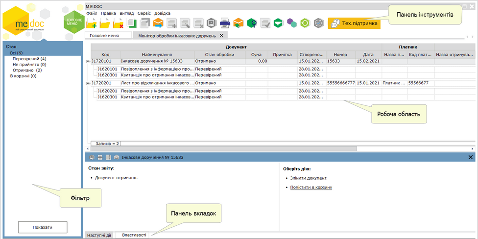

Натисніть, щоб збільшити малюнок

Фільтр

За допомогою Фільтру можна здійснювати пошук документів за датою створення, встановіть позначку для вибору певного періоду. У полі За період вкажіть період (місяць, рік), в межах якого були створені документи. Для відображення документів за обраними параметрами натисніть кнопку Показати.

Щоб відібрати документи за станом обробки, у області Стан обробки встановіть відмітку, що відповідає стану документа. Для перегляду вилучених документів, встановіть опцію Корзина.

Для того, щоб очистити Фільтр від даних, натисніть на кнопку .

Якщо панель Фільтра не потрібна та/або заважає, її можна згорнути. Для цього натисніть на кнопку . Щоб розгорнути Фільтр, натисніть на згорнуту панель.

Робоча область

Містить безпосередньо записи Реєстру документів відправлених/отриманих за допомогою Монітору обробки інкасових доручень: відображає записи, що відповідають заданим умовам фільтрації.

Документи, що містять помилки відображаються червоним кольором.

Таблиця умовно розділена на три частини:

- Документ - містить інформацію про основні атрибути документів: назва документа, дата створення, номер документа, стан обробки документа тощо;
- Платник - містить інформацію про платника: назва та код платника, зазначені у документі Інкасове доручення (розпорядження);
- Отримувач - містить інформацію про отримувача:  назва та код отримувача, зазначені у документі Інкасове доручення (розпорядження).

Щоб відкрити документ, оберіть його у списку та скористайтеся одним із способів:

- натисніть 2 рази лівою кнопкою миші на документі у списку;
- виконайте команду меню Файл - Відкрити;
- оберіть команду Відкрити у контекстному меню;
- натисніть кнопку Відкрити  на панелі інструментів;
- скористайтесь комбінацією клавіш Ctrl+F2.

Панель вкладок

Містить службову інформацію щодо обраного документа. Панель доступна як у відкритому документі, так і з Реєстру (за умови виділення потрібного документа, набір вкладок залежить від стану та етапу обробки документа).

- Наступні дії – містить інформацію щодо поточного стану документа, а також перелік можливих дій з документом у цьому стані. Слугує підказкою користувачу про доступні дії, які можна виконати з документом у поточному стані;
- Властивості – у режимі читання містить всю службову інформацію про документ, таку як: стан, період створення, дата та час останньої модифікації, інформація про сертифікати, якими підписано документ тощо. Інформація на цій вкладці постійно оновлюється та доповнюється при будь-яких змінах документа;
- Протокол – містить перелік подій, що відбулись з документом під час його обробки в хронологічному порядку. При виборі події справа на панелі відображається її детальний опис.

Панель інструментів.

Містить кнопки, що надають швидкий доступ до найбільш часто використовуваних функцій. Наведіть покажчик миші на інструмент і чекайте протягом секунди, для відображення короткої підказки, що описує його призначення.

|  |  |
| --- | --- |
|  | Створення документа. |
|  | Перегляд (редагування) поточного документа. |
|  | Вилучення поточного документа. Вилучений документ переміщується у [Корзину](UCTrash.html#uctrash-uctrash). |
|  | Створення копії документа. Копія документа створюється, якщо він може повторюватися у рамках звітних періодів, а також у випадку, якщо потрібно відредагувати та повторно відіслати раніше відправлений електронною поштою звіт. |
|  | Відправити документ. |
|  | Отримати повідомлення. |

### Отримання вхідного документа

_Шлях у довідці: Розділи програми › Банківський модуль › Монітор обробки інкасових доручень › Отримання вхідного документа_

Вхідні документи:

- Інкасове доручення (розпорядження);
- Лист про відкликання інкасового доручення (розпорядження).

надходять як звичайна вхідна кореспонденція. Отримати вхідний документ (перевірити наявність вхідних повідомлень) можливо, скориставшись одним із способів:

- на панелі інструментів кнопкою ;
- із меню Файл - Отримати повідомлення;
- за допомогою клавіші F9.

Для отриманих від ДПС документів Інкасове доручення (розпорядження) та Лист про відкликання інкасового доручення (розпорядження) виконується автоматична перевірка сертифікатів, якими підписано документи. В таблиці модуля у групі колонок Перевірка сертифікату відображаються результати перевірки сертифікатів на сервері OCSP відповідного кваліфікованого надавача електронних довірчих послуг:

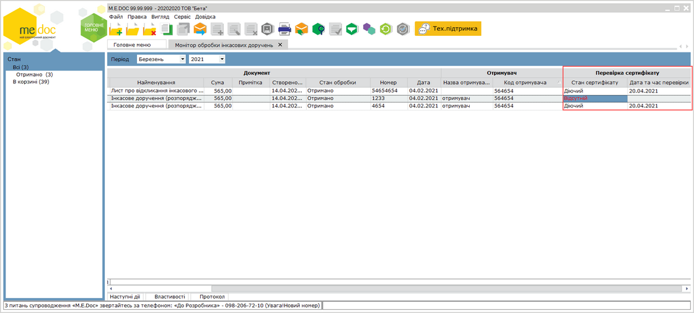

Натисніть, щоб збільшити малюнок

### Створення нового документа

_Шлях у довідці: Розділи програми › Банківський модуль › Монітор обробки інкасових доручень › Створення нового документа_

В цьому розділі:

[Створення документів на основі отриманого Інкасового доручення (розпорядження) та/або Листа про відкликання інкасового доручення (розпорядження)](#ucbankincrst-nbu2gnaubankinc_stvor)

[Створення нових документів за допомогою команди Створити](#ucbankincrst-nbu2gnaubankinc_stvor)

Зверніть увагу! Для подальшої відправки у електронному вигляді та/або експорту необхідно здійснювати створення документів на [основі отриманого Інкасового доручення та/або Листа](#ucbankincrst-nbu2gnaubankinc_stvor).

Створення документів на основі отриманого Інкасового доручення (розпорядження) та/або Листа про відкликання інкасового доручення (розпорядження)

1. У вікні реєстру Монітору обробки інкасових доручень оберіть вхідний документ Інкасове доручення (розпорядження) та/або Лист про відкликання інкасового доручення (розпорядження), на основі якого необхідно створити документи.

2. Оберіть один із способів:

- виберіть команду меню Файл - Створити на основі;
- у контекстному меню оберіть команду Створити на основі.

Далі оберіть назву документа, який потрібно створити:

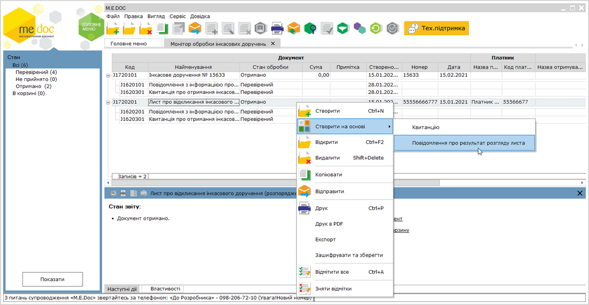

Натисніть, щоб збільшити малюнок

3. Відкриється вкладка, що відповідає створюваному документу:

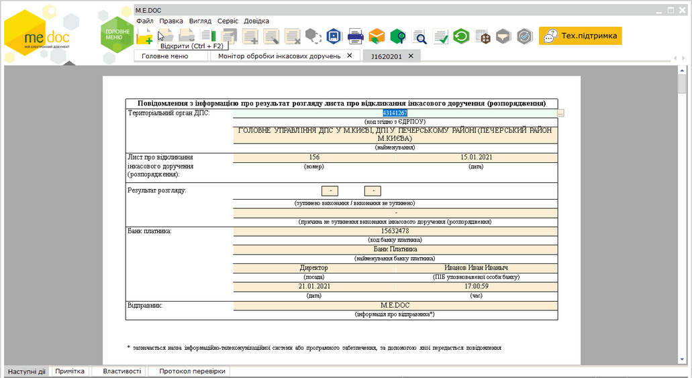

Натисніть, щоб збільшити малюнок

Поля створеного документа автоматично заповнюються даними документа, на основі якого створюється Квитанція або Повідомлення про результат розгляду листа.

4. Перевірте коректність заповнення документа та дозаповніть необхідні поля. Для збереження створеного документа закрийте вкладку та натисніть кнопку Так у вікні повідомлення.

[До початку](#ucbankincrst-nbu2gnaubankinc_stvor)

Створення нових документів за допомогою команди Створити

Зверніть увагу! Документи, створені за допомогою команди Створити, не призначені для відправки у електронному вигляді, а також експорту та імпорту. Для подальшого обміну документами необхідно створювати документи на [основі отриманого Інкасового доручення та/або Листа](#ucbankincrst-nbu2gnaubankinc_stvor).

Для створення нового документа:

1. Скористайтесь одним із способів:

- на панелі інструментів натисніть кнопку Створити ;
- виберіть команду Файл - Створити;
- у контекстному меню оберіть команду Створити.

2. Встановіть період, у якому створюється документ. У списку оберіть необхідний тип документа. Натисніть кнопку Створити.

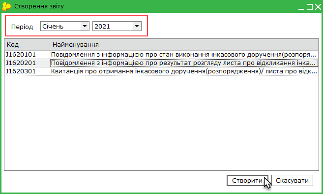

3. У окремому вікні відкриється бланк документа, який потрібно заповнити.

Поля, що підсвічені жовтим кольором, доступні для заповнення та редагування.

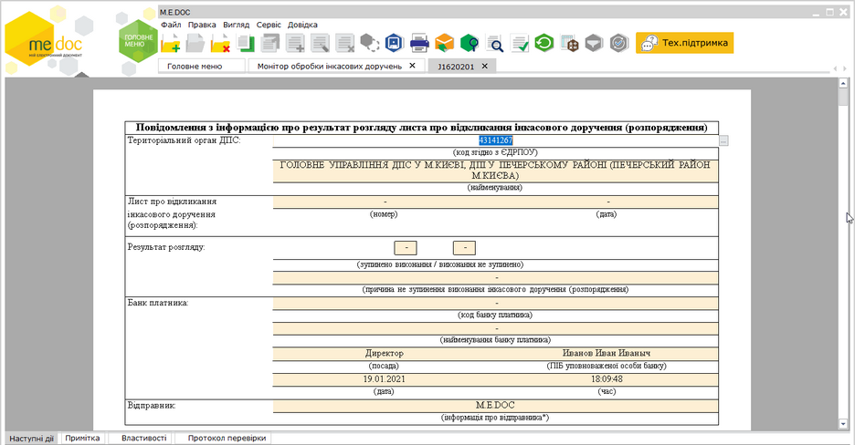

Натисніть, щоб збільшити малюнок

4. Внесіть дані в поля, які потребують заповнення.

5. Оберіть команду Правка - Перевірити документ або F4 для перевірки документа.

Перевіряється правильність заповнення полів, і, у випадку помилок, система підсвітить червоним кольором поля, що необхідно виправити. Виправте помилки та знову виконайте перевірку.

6. Збережіть документ, натиснувши кнопку  або комбінацію клавіш Ctrl+S.

[До початку](#ucbankincrst-nbu2gnaubankinc_stvor)

### Копіювання документа

_Шлях у довідці: Розділи програми › Банківський модуль › Монітор обробки інкасових доручень › Копіювання документа_

Зверніть увагу! Скопійовані документи не призначені для відправки у електронному вигляді, а також експорту та імпорту. Для подальшого обміну документами необхідно створювати документи на [основі отриманого Інкасового доручення та/або Листа](#ucbankincrst-nbu2gnaubankinc_stvor).

Для копіювання документа:

1. Виділіть документ, копію якого потрібно створити. Для копіювання групи документів виділіть потрібне курсором миші, утримуючи клавішу <Shift> або <Ctrl>.

2. Оберіть один із способів копіювання:

- на панелі інструментів натисніть кнопку Копіювати - ;
- із контекстного меню команда Копіювати;
- команда Файл - Копіювати.

Також функція копіювання документа доступна і у відкритому вікні документа: на панелі інструментів кнопка Копіювати -  та у меню Файл - Копіювати.

Із вікна відкритого документа копіюється тільки поточний документ.

3. Відкриється вікно Копіювання звіту, де запропоновано обрати період документа:

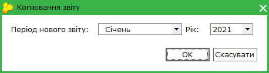

За замовчуванням встановлюється дата виписки документа, що копіюється.

4. Після вибору дати натисніть кнопку ОК.

Скопійований документ відкриється у новій вкладці. Скопійовані документи можна редагувати.

### Редагування документа

_Шлях у довідці: Розділи програми › Банківський модуль › Монітор обробки інкасових доручень › Редагування документа_

Редагування документа доступне для непідписаних та невідправлених документів.

Документ відкривається на редагування одним зі способів:

- подвійне натискання мишею на рядку документа в реєстрі;
- кнопка  Відкрити на панелі інструментів;
- пункт головного меню Файл - Відкрити;
- пункт контекстного меню Відкрити;
- комбінація клавіш Ctrl+F2.

### Підписання та відправка документів

_Шлях у довідці: Розділи програми › Банківський модуль › Монітор обробки інкасових доручень › Підписання та відправка документів_

В цьому розділі:

[Налаштування комплекту підписів для документів модуля Монітор обробки інкасових доручень](#ucbankincrst-nbu2gnaubankinc_vidp)

[Підписання та відправка документа](#ucbankincrst-nbu2gnaubankinc_vidp)

Налаштування комплекту підписів для документів модуля Монітор обробки інкасових доручень

Обов'язково налаштуйте комплект підписів, якими будуть підписуватись документи, обравши комплекти підписів для типу Інкасові доручення. Налаштування комплектів підписів виконується у розділі [Адміністрування - Параметри системи - Підпис](FormCompanyParams.html#formcompanyparams-admcomanyparams_pen).

1. У блоці Комплект підписів оберіть тип Інкасові доручення.

2. Під назвою типу, із списку оберіть варіант комплекту накладання електронних підписів відповідно до потреб вашого підприємства.

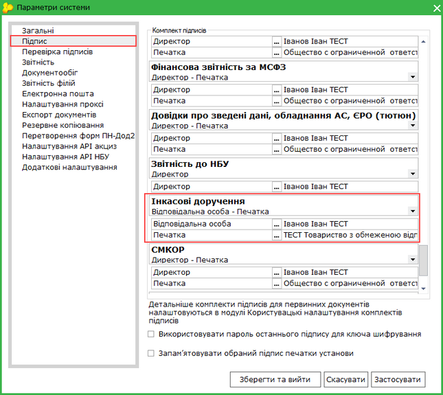

Натисніть, щоб збільшити малюнок

3. Для редагування підписантів, виділіть тип сертифікату та натисніть кнопку .

4. Відкриється вікно Налаштування комплекту підписів. За допомогою кнопки Додати оберіть потрібний сертифікат.

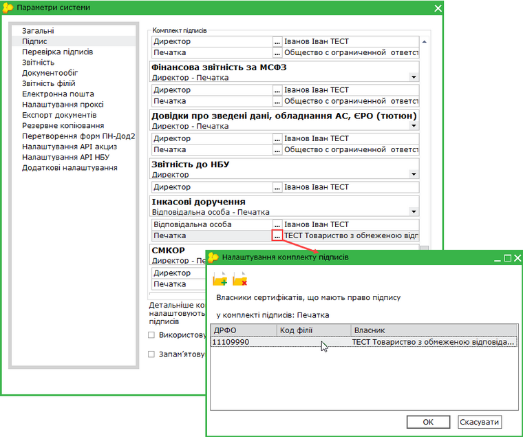

Натисніть, щоб збільшити малюнок

5. При підписанні документа буде виводитись список заданих відповідальних осіб.

[До початку](#ucbankincrst-nbu2gnaubankinc_vidp)

Підписання та відправка документа

Існує декілька способів відправки документів:

1. Із вкладки "Наступні дії"

Даний спосіб дозволяє відправити лише один документ - відкритий або виділений в реєстрі.

В доступних діях з документом передбачено декілька варіантів для зручності користувача:

Передати документ на підпис

На виконання цієї команди документ блокується від редагування та набуває статусу На підписі. Документ знаходиться в стані очікування.
В Наступних діях стає доступним можливість [Підписати документ](UC_ECP.html#uc_ecp-ecp).
Після накладення підписів стає доступною функція Відправити документ.

Підписати документ

На виконання команди відразу розпочнеться стандартний процес [підписання документа](UC_ECP.html#uc_ecp-ecp).
Після накладення підписів та печатки установи, стає доступною функція Відправити.

2. Безпосередньо з Реєстру Монітору обробки інкасових доручень

Даний спосіб дозволяє відправляти як один документ, так і групу документів одночасно.

У реєстрі виберіть потрібний документ або групу документів та оберіть один із варіантів:

- на панелі інструментів натисніть кнопку Відправити - ;
- виберіть команду Файл - Відправити;
- у контекстному меню оберіть команду Відправити.

На виконання команди Відправити/Відправити документ розпочнеться [підписання документа](UC_ECP.html#uc_ecp-ecp) та відправка документа адресату. По закінченню процедури, система виведе протокол відправки документів.

[До початку](#ucbankincrst-nbu2gnaubankinc_vidp)

### Експорт документів

_Шлях у довідці: Розділи програми › Банківський модуль › Монітор обробки інкасових доручень › Експорт документів_

В цьому розділі:

[Експорт документів у формат XML для подання у контролюючі органи](#ucbankincrst-nbu2gnaubankinc_export)

[Експорт документів для обміну звітністю](#ucbankincrst-nbu2gnaubankinc_export)

[Експорт документів з квитанціями](#ucbankincrst-nbu2gnaubankinc_export)

Експорт призначений для збереження документів у обраному каталозі або електронному носії.

При експорті документа із програми його назва та розширення відповідають регламентованим правилам подання документів до контролюючих органів. Документи перевіряються на заповнюваність обов'язкових реквізитів у документі згідно затверджених схем XSD. Ці перевірки аналогічні тим, які виконуються при прийманні документів у контролюючих органах.

У Реєстрі реалізована можливість експортувати як один файл, так і групу файлів одночасно. Для групового виділення записів реєстру виділіть потрібне курсором миші використовуючи стандартні методи виділення кількох записів ОС Windows.

Функція експорту доступна і у відкритому вікні документа: у меню Файл - Експорт - Експорт. Із вікна відкритого документа експортується тільки поточний документ.

Експорт документів для подання у контролюючі органи

Дана функція призначена для збереження документів на електронному носії чи у обраному каталозі і використовується для подання документів до контролюючих органів.

1. Виділіть потрібний для експорту документ у реєстрі.

2. Оберіть один із наступних способів:

- команда Файл - Експорт - Експорт;
- із контекстного меню команда Експорт.

Функція експорту доступна і у відкритому вікні документа: меню Файл - Експорт - Експорт.

3. На виконання функції експорту відкриється вікно Експорт. Оберіть опцію для подачі у контролюючий орган:

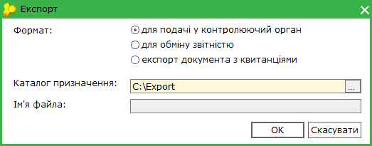

4. Вкажіть каталог, де зберегти створений файл у полі Каталог призначення.

При збереженні документа його назва та розширення регламентовані правилами подання документів до ДПС - у форматі .xml.

5. Натисніть ОК.

6. Система повідомить про закінчення процесу експорту.

[До початку](#ucbankincrst-nbu2gnaubankinc_export)

Експорт документів для обміну звітністю

1. У таблиці  реєстру виділіть документ, який потрібно експортувати.

Для групового експорту документів виділіть будь-які документи, утримуючи клавішу <Shift> або <Ctrl>.

2. Експорт викликається одним із наступних способів:

- команда Файл - Експорт - Експорт;
- із контекстного меню команда Експорт.

3. На виконання функції експорту відкриється вікно Експорт. Оберіть опцію для обміну звітністю:

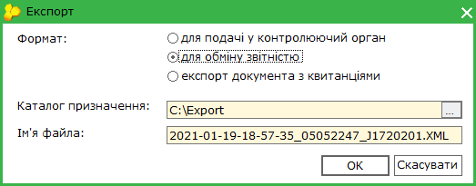

4. У полі Каталог призначення вкажіть каталог для збереження експортованих даних. Ім'я файлу генерується автоматично, містить в собі дату, час створення та код ЕДРПОУ підприємства.

5. Натисніть ОК.

6. Система повідомить про закінчення процесу експорту:

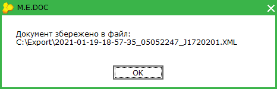

[До початку](#ucbankincrst-nbu2gnaubankinc_export)

Експорт документів з квитанціями

Функція призначена для збереження документів на електронному носії чи у обраному каталозі, для яких отримано квитанції. Експорт документів виконується у форматі XML, крім даних документів зберігається інформація, що міститься у квитанціях.

1. Виділіть потрібний для експорту документ.

2. Експорт документа викликається одним із наступних способів:

- команда Файл - Експорт - Експорт;
- із контекстного меню команда Експорт.

Функція експорту доступна і у відкритому вікні документа: у меню Файл - Експорт - Експорт.

3. На виконання функції експорту відкриється вікно Експорт. Оберіть опцію експорт документа з квитанцією:

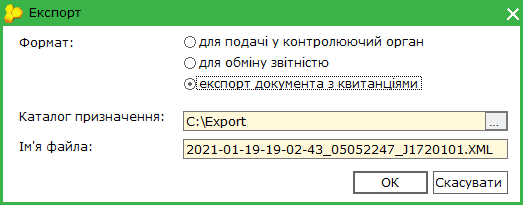

4. Вкажіть каталог, де зберегти створений файл у полі Каталог призначення. Ім'я файлу генерується автоматично, містить в собі дату, час створення та код ЕДРПОУ підприємства.

5. Натисніть ОК.

6. Система повідомить про закінчення процесу експорту.

[До початку](#ucbankincrst-nbu2gnaubankinc_export)

### Імпорт документів

_Шлях у довідці: Розділи програми › Банківський модуль › Монітор обробки інкасових доручень › Імпорт документів_

Дана функція призначена для імпорту документів, створених в інших бухгалтерських системах.

1. У меню оберіть команду Файл - Імпорт - Імпорт звітів.

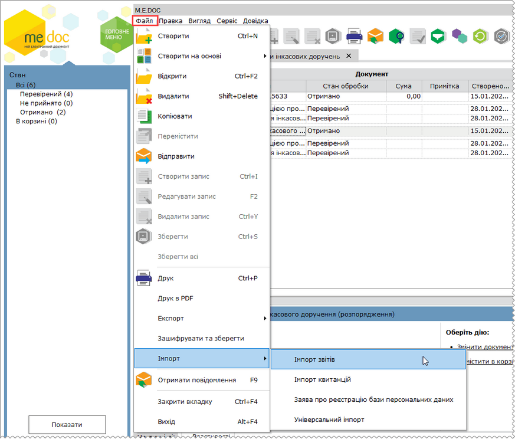

Натисніть, щоб збільшити малюнок

2. На виконання команди відкриється вікно вибору файлів, які імпортуються.

3. Вкажіть шлях до каталогу розміщення файлів. Оберіть файли та натисніть Відкрити для початку процесу імпорту.

4. По закінченні процедури система виведе протокол імпорту даних. Імпортований документ з'явиться у таблиці реєстру.

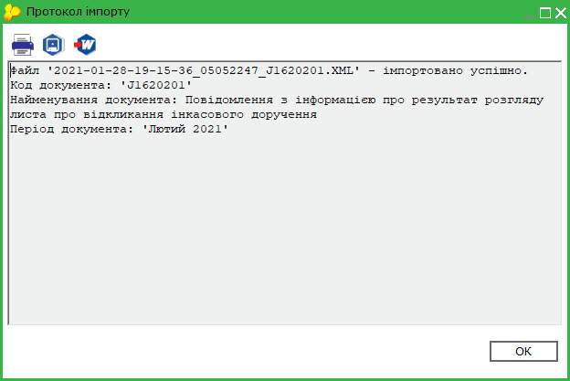

### Друк документів у PDF

_Шлях у довідці: Розділи програми › Банківський модуль › Монітор обробки інкасових доручень › Друк документів у PDF_

Дана функція дозволяє зберегти обрані документи на диску комп’ютера у файлах формату .pdf.

Для друку документів у PDF необхідно виділити потрібні документи.

Можна друкувати як один файл, так і групу файлів одночасно. Для групового друку документів виділіть документи курсором миші, утримуючи клавішу <Shift> або <Ctrl>.

Для друку документів у PDF:

1. Оберіть один із способів:

- із контекстного меню команда Друк в PDF;
- команда меню Файл - Друк в PDF.

2. У вікні Огляд папок вкажіть каталог, у якому потрібно зберегти файли .pdf.

3. Система повідомить про закінчення операції друку.

Також функція друку документа  у PDF доступна і у відкритому вікні документа: команда меню Файл - Друк в PDF. Із вікна відкритого документа у форматі PDF зберігається тільки поточний документ.


