[← Зміст довідки](../)


# Банківські виписки

## Банківські виписки

_Шлях у довідці: Розділи програми › Банківський модуль › Банківські виписки_

В цьому розділі:

[Імпорт виписок](#ucbankstatements-ucbankstatements)

[Створення листа/повідомлення](#ucbankstatements-ucbankstatements)

[Робота з вкладеннями](#ucbankstatements-ucbankstatements)

[Додавання вкладення](#ucbankstatements-ucbankstatements)

[Видалення вкладення](#ucbankstatements-ucbankstatements)

[Перегляд листа/повідомлення](#ucbankstatements-ucbankstatements)

[Відправка листа/повідомлення з вкладенням](#ucbankstatements-ucbankstatements)

[Відправка на довільну адресу](#ucbankstatements-ucbankstatements)

[Експорт листа/повідомлення з вкладенням](#ucbankstatements-ucbankstatements)

Модуль призначений для імпортування та відправки банками виписок, листів та інших документів контрагентам, а також для перегляду отриманих виписок.

Великі обсяги виписок можна імпортувати та відправляти за допомогою модуля [Автоматична обробка документів](UCGlobalAutoProcJournal.html#ucglobalautoprocjournal-pdocs_avto). Модуль доступний за наявності відповідної ліцензії.

В модулі в залежності від ліцензії відображаються вихідні/вхідні виписки із вкладеннями.

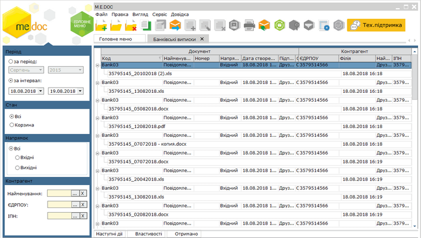

Натисніть, щоб збільшити малюнок

За замовчуванням виписки мають розгорнутий вигляд. За необхідності згорнути всі  виписки скористайтесь пунктом головного меню Вигляд - Згорнути всі пачки.

Щоб повернутись до розгорнутого вигляду, скористайтесь пунктом головного меню Вигляд - Розгорнути всі пачки.

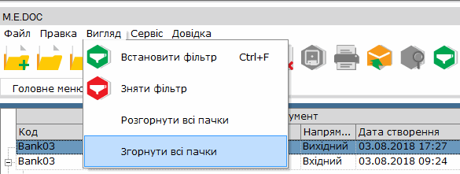

Відбір виписок можна виконати за такими параметрами фільтра:

Період

- за період - вкажіть місяць та рік, в межах якого були створені потрібні  документи;
- за інтервал - вкажіть дату початку та закінчення довільного інтервалу, в межах якого були виписані потрібні  документи.

Стан

Містить перемикач, що відповідають стану документів:

- Всі - всі документи;
- Корзина - документи, видалені в корзину.

Напрямок

Містить перемикач між напрямками  документів:

- Всі - всі документи  незалежно від напрямку;
- Вхідні - отримані документи  від контрагентів;
- Вихідні - створені документи, призначені для відправки контрагентам.

Контрагент

- Найменування
Дозволяє знайти документи, які були виписані на ім'я або отримані від певного контрагента.
Найменування контрагента можна як ввести з клавіатури, так і вибрати із довідника "Контрагенти", який відкривається після натиснення на кнопку вибору . При виборі контрагента із довідника автоматично заповнюються поля ЄДРПОУ та ІПН.

- ЄДРПОУ
Дозволяє знайти документи контрагента, що були відправлені/прийняті, якщо відомо його код установи за Єдиним державним реєстром підприємств та організацій України. Вводиться з клавіатури, обирається з підключеного довідника (кнопку вибору ) або заповнюється автоматично при виборі інших даних контрагента з довідника.

- ІПН
Дозволяє знайти документи контрагента, що були відправлені/прийняті, якщо відомо його індивідуальний податковий номер. Вводиться з клавіатури, обирається з підключеного довідника (кнопка вибору ) або заповнюється автоматично при виборі інших даних контрагента з довідника.

[До початку](#ucbankstatements-ucbankstatements)

Імпорт виписок

До модуля можна імпортувати файли будь-якого формату (в тому числі doc, xls, txt тощо).

Назва файлу повинна мати вигляд ХХХХХХХХХХ\_DD-MM-YY, де ХХХХХХХХХХ – код ЄДРПОУ клієнта, DD-MM-YY – дата формування.

За допомогою імпорту створюються листи із вкладеннями. Для імпорту виконайте такі дії:

1. В головному меню виберіть команду Файл - Імпорт - Імпорт банківських виписок.

   На виконання відкриється вікно Імпорт банківської виписки.

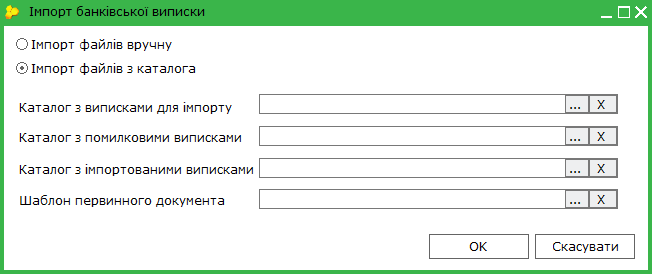

2. У вікні Імпорт банківської виписки заповніть поля:

- ознака Імпорт файлів вручну - дозволяє обрати один або декілька файлів з довільного каталогу. При виборі цієї ознаки поле Каталог з виписками для імпорту блокується для заповнення;
- ознака Імпорт файлів з каталога - дозволяє проімпортувати всі файли з каталога, вказаного в полі Каталог з виписками для імпорту;
- Каталог з виписками для імпорту - каталог, файли з якого буде проімпортовано, якщо встановлено ознаку Імпорт файлів з каталога;
- Каталог з помилковими виписками - каталог, куди будуть переміщені файли, які не пройшли перевірку;
- Каталог з імпортованими виписками - каталог, куди будуть переміщені файли, які пройшли перевірку та були проімпортовані до програми;
- Шаблон первинного документа - шаблон первинного документа "Банківська виписка", який буде супроводжувати проімпортовані файли.

   Видалити обрані каталоги та шаблон можна кнопками  праворуч від полів.

3. Натисніть на кнопку ОК.
    Якщо було обрано Імпорт файлів вручну, то відкриється стандартне вікно вибору файлів.
    Оберіть один або декілька файлів та натисніть на кнопку Відкрити. Розпочнеться імпорт файлів.

   Якщо було обрано Імпорт файлів з каталога, то одразу розпочнеться імпорт файлів.

По завершенню імпорту відобразиться Протокол створення документів із кладеннями з результатами імпорту.

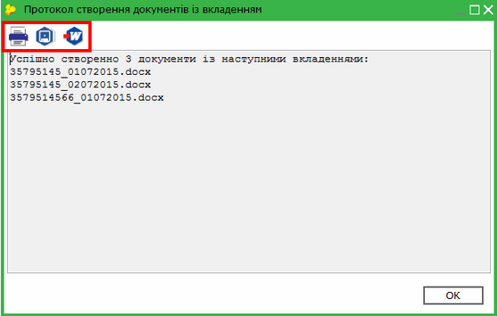

Протокол можна роздрукувати, зберегти та відкрити для перегляду за допомогою кнопок на панелі інструментів у вікні протоколу.

Результати виконання записуються в лог-файл програми.

Файли для імпорту проходять перевірку на наявність контрагента в Довіднику контрагентів та наявність у контрагента ліцензії на модуль.

Для файлів, що пройшли перевірку, автоматично формується лист за вказаним шаблоном із файлом-вкладенням. Ці листи відображаються в модулі "Банківські виписки". Самі файли переміщуються до папки, вказаної в полі Каталог з імпортованими виписками.

Файли, які не пройшли перевірку на наявність контрагента та наявність у контрагента ліцензії на модуль, переміщуються до папки, вказаної в полі Каталог з помилковими виписками.

Проімпортовані листи з вкладеннями доступні для підпису, відправки, а також для додавання та видалення вкладень.

Імпорт також може виконуватись за допомогою модуля [Автоматична обробка документів](UCGlobalAutoProcJournal.html#ucglobalautoprocjournal-pdocs_avto), операція Імпорт банківських виписок.

[До початку](#ucbankstatements-ucbankstatements)

Створення листа/повідомлення

Для додавання листа/повідомлення виконайте такі дії:

1. У вікні реєстру скористайтесь одним із наступних способів:

- на панелі інструментів натисніть кнопку Створити;
- виберіть команду Файл - Створити;
- у контекстному меню оберіть команду Створити;
- натисніть комбінацію клавіш Ctrl+N.

   На виконання відкриється вікно вибору шаблону документа. В цьому вікні відображаються тільки шаблони типу Банківська виписка.

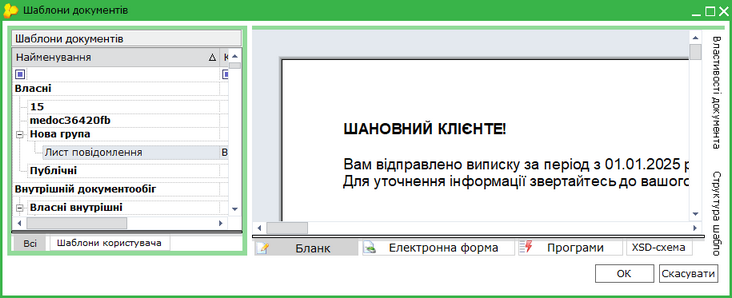

2. Оберіть шаблон та натисніть на кнопку Створити.

Новий лист/повідомлення буде створено та одразу [відкрито для перегляду](#ucbankstatements-ucbankstatements).

Шаблон Листа повідомлення з типом документа Банківська виписка необхідно попередньо створити у розділі [Первинні документи - Шаблони первинних документів](UCRtfDocTemplate.html#ucrtfdoctemplate-pdocs_shablon_stvor).

[До початку](#ucbankstatements-ucbankstatements)

Робота з вкладеннями

Існує можливість [додавати](#ucbankstatements-ucbankstatements), [видаляти](#ucbankstatements-ucbankstatements), відкривати та зберігати вкладення.

Додавання та видалення вкладення можливе з вікна модуля та з вікна перегляду виписки.

Для відкриття для перегляду або збереження вкладення виконайте такі дії:

1. У вікні модуля скористайтесь одним із наступних способів:

- на панелі інструментів натисніть кнопку Редагувати запис;
- виберіть команду Файл - Редагувати запис;
- у контекстному меню оберіть команду Створити Редагувати запис;
- натисніть комбінацію клавіш F2.

   або

   У [вікні перегляду виписки](#ucbankstatements-ucbankstatements) на панелі вкладок, у закладці Вкладення натисніть на  посилання на файл вкладення.

2. На виконання відкриється вікно вибору дій з файлом.

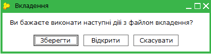

3. При натисканні на кнопку Зберегти відкривається вікно вибору папки для збереження. Зберігається файл вкладення та підписи, якщо файл підписаний. Підписи зберігаються окремими файлами p7s.

4. При натисканні на кнопку Відкрити файл відкривається для перегляду у програмі відповідно до формату файлу.

[До початку](#ucbankstatements-ucbankstatements)

Додавання вкладення

Для додавання вкладення до листа виконайте такі дії:

1. У вікні модуля виділіть лист та скористайтесь одним із наступних способів:

- на панелі інструментів натисніть кнопку Створити запис;
- виберіть команду Файл - Створити запис;
- у контекстному меню оберіть команду Створити запис;
- натисніть комбінацію клавіш Ctrl+I.

   На виконання відкриється стандартне вікно вибору файлів.

2. Оберіть один або декілька файлів.

3. Натисніть на кнопку Відкрити.

Відобразиться повідомлення "Вкладення додано успішно", вкладення буде додано до листа.

Додати вкладення також можна у [вікні перегляду виписки](#ucbankstatements-ucbankstatements).

[До початку](#ucbankstatements-ucbankstatements)

Видалення вкладення

Видалити вкладення можна тільки з непідписаних та невідправлених листів.

Для видалення вкладення з листа виконайте такі дії:

1. У вікні модуля виділіть лист та скористайтесь одним із наступних способів:

- на панелі інструментів натисніть кнопку Видалити запис;
- виберіть команду Файл - Видалити запис;
- у контекстному меню оберіть команду Видалити запис;
- натисніть комбінацію клавіш Ctrl+Y.

   На виконання відкриється стандартне вікно запиту "Ви дійсно бажаєте видалити вкладення з документу?".

3. Натисніть на кнопку Так для видалення.

Обране вкладення буде видалено із листа.

Видалити вкладення також можна у [вікні перегляду виписки](#ucbankstatements-ucbankstatements).

[До початку](#ucbankstatements-ucbankstatements)

Перегляд листа/повідомлення

Для перегляду листа виділіть його та скористайтесь одним із наступних способів:

- на панелі інструментів натисніть кнопку Відкрити;
- виберіть команду Файл - Відкрити;
- у контекстному меню оберіть команду Відкрити;
- натисніть комбінацію клавіш Ctrl+F2;
- двічі натисніть мишею на рядку виписки.

Відкриється вікно перегляду. На панелі вкладок, у закладці "Вкладення" можна побачити посилання на файл вкладення та дату його імпорту.

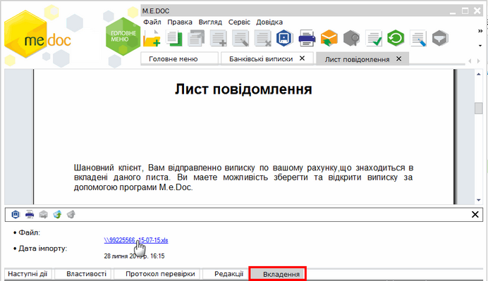

При натисканні на посилання з'являється вікно вибору дій з файлом. З цього вікна файл вкладення можна зберегти, відкрити для перегляду або видалити.

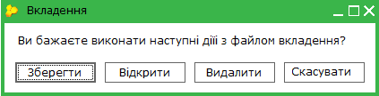

При натисканні на кнопку Зберегти відкривається вікно вибору папки для збереження. Зберігається файл вкладення та підписи, якщо файл підписаний. Підписи зберігаються окремими файлами p7s.

При натисканні на кнопку Відкрити файл відкривається для перегляду у програмі відповідно до формату файлу.

При натисканні на кнопку Видалити файл видаляється. Видалити вкладення можна тільки з непідписаних та невідправлених виписок.

У вікні перегляду можна також вручну додати одне або декілька вкладень. Додати вкладення можна тільки до непідписаних та невідправлених листів.

Для додавання вкладення потрібно в головному меню обрати пункт Правка/ Додати вкладення та обрати одне або декілька вкладень у стандартному вікні вибору файлів.

[До початку](#ucbankstatements-ucbankstatements)

Відправка листа/повідомлення з вкладенням

Для відправки листа виконайте такі дії:

1. У вікні модуля оберіть один або декілька листів та скористайтесь одним із наступних способів:

- на панелі інструментів натисніть кнопку Відправити;
- виберіть команду Файл - Відправити;
- у контекстному меню оберіть команду Відправити.

    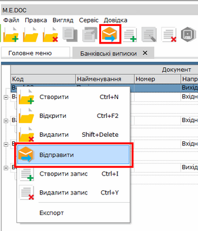

   На виконання відкриється вікно Підпис для відповідальної особи.

Підписання виписок виконується комплектом підписів "Відповідальна особа - Печатка", який налаштовується за шляхом [Адміністрування - Параметри системи - Підпис](FormCompanyParams.html#formcompanyparams-admcomanyparams_pen) в комплекті "Банківські виписки".

2. У поле Пароль секретного ключа введіть пароль секретного ключа та натисніть на кнопку ОК для продовження.

3. Повторіть процедуру для печатки.

Лист відправлений.

Відправка також може виконуватись за допомогою модуля [Автоматична обробка документів](UCGlobalAutoProcJournal.html#ucglobalautoprocjournal-pdocs_avto), операція Відправка первинних документів контрагенту. Для відправки листів потрібно в полі Типи документів обрати «Банківська виписка».

[До початку](#ucbankstatements-ucbankstatements)

Відправка на довільну адресу

Можна переслати вхідний лист/повідомлення контрагенту.

Для відправки листа виконайте такі дії:

1. У вікні модуля оберіть один або декілька вхідних листів та скористайтесь одним із наступних способів:

- на вкладці "Наступні дії" натисніть Відправити на довільну адресу;
- на панелі інструментів натисніть на кнопку Відправити;
- у контекстному меню оберіть команду Відправити.

   На виконання відкриється вікно Підпис для відповідальної особи.

2. У поле Пароль секретного ключа введіть пароль секретного ключа та натисніть на кнопку ОК для продовження.

3. Повторіть процедуру для печатки та печатки-шифрування.

4. Відкриється вікно вибору адресата з Довідника контрагентів.

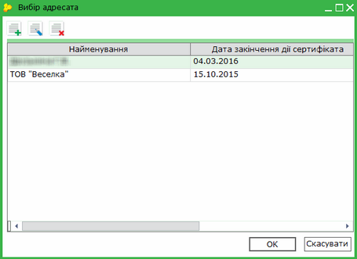

5. Оберіть контрагента з переліку та натисніть на кнопку ОК.

Лист відправлений.

[До початку](#ucbankstatements-ucbankstatements)

Експорт листа/повідомлення з вкладенням

Для експорту листа виконайте такі дії:

1. У вікні модуля скористайтесь одним із наступних способів:

- виберіть команду Файл - Експорт;
- у контекстному меню оберіть команду Експорт.

   На виконання відкриється вікно Експорт.

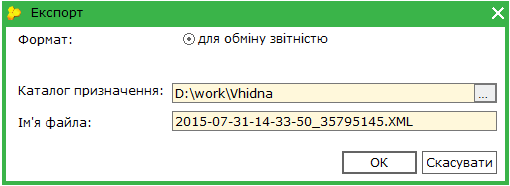

2. У вікні Експорт заповніть поля:

- Каталог призначення - оберіть каталог для експорту;
- Ім'я файла - вкажіть ім'я файлу. Вказана за замовчуванням можна змінити.

3. Натисніть на кнопку ОК. Лист та  вкладення буде проімпортовано до обраної папки.

Зберігається лист, файл вкладення та підписи, якщо файл підписаний. Підписи зберігаються окремими файлами p7s.

4. По завершенню відобразиться Протокол експорту.

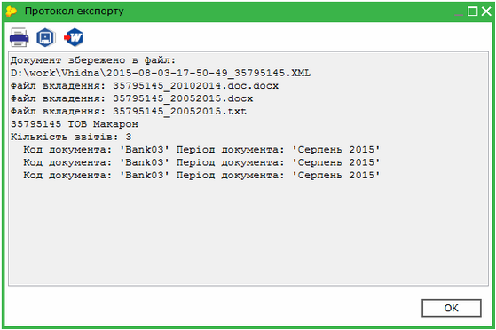

Протокол можна роздрукувати, зберегти та відкрити для перегляду за допомогою кнопок на панелі інструментів у вікні протоколу.

При груповому експорті листи експортуються в один файл, а вкладення та підписи зберігаються окремо.

Перелік листів можна експортувати в таблицю Excel. Для цього виберіть команду Файл - Експорт - Експорт таблиці в Excel. До файлу потрапляють листи, які відображаються в модулі відповідно до встановленого фільтра.

[До початку](#ucbankstatements-ucbankstatements)


