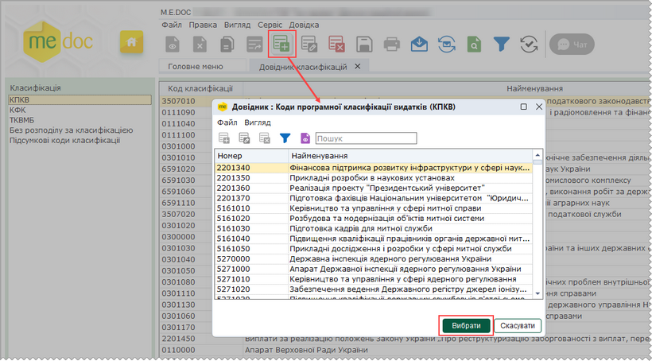
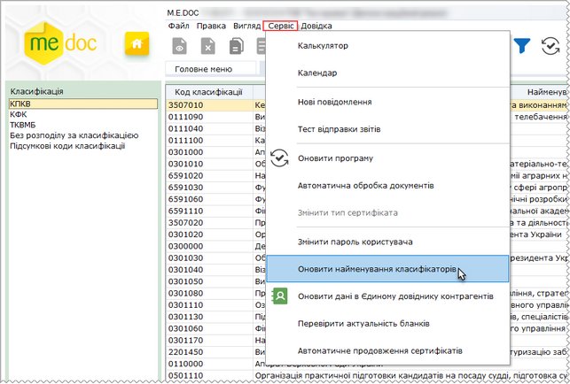
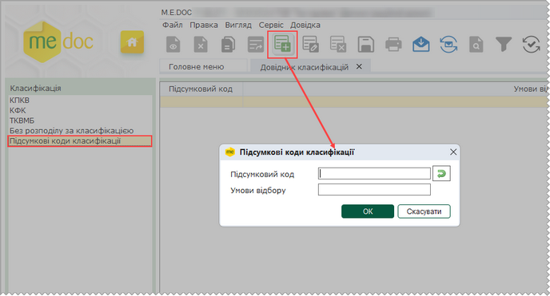

[← Зміст довідки](../)


# Довідник класифікацій

## Довідник класифікацій

_Шлях у довідці: Розділи програми › Довідники › Довідник класифікацій_

В цьому розділі:

[Додавання кодів у довідник](#ucclassif-sprclassif_add)

[Оновлення довідника класифікацій](#ucclassif-sprclassif_upd)

[Створення підсумкових кодів класифікацій](#ucclassif-table_classification_adjust_general)

Довідник класифікацій призначений для формування списку кодів класифікацій, які використовуються в даній установі.

Цей довідник налаштовується користувачем самостійно на основі вибору стандартних кодів із бюджетних довідників програми.

Редагувати вибрані коди заборонено.

Користувач повинен підтримувати довідник в актуальному стані, і самостійно оновлювати використовувані коди, якщо оновлення програми вносить зміни у бюджетні довідники.

У Довіднику відображаються такі типи класифікацій:

КПКВ - коди програмної класифікації видатків;

ТКВМБ - тимчасова класифікація видатків місцевих бюджетів;

КФК - коди функціональної класифікації видатків - старі коди, що ще застосовуються;

Без розподілу за класифікацією (Не задано) - якщо в звіті не передбачений класифікаційний розріз (форма 1 "Баланс", Додаток 14 "Пояснювальна записка до фінансового звіту", тощо.

(У властивостях таких бланків у полі Класифікація відображається "Не задано")

[Підсумкові коди класифікації](#ucclassif-table_classification_adjust_general) - використовуються у випадку, якщо для документа дані за декількома видами класифікацій складаються за певною умовою.

Всі бюджетні довідники у програмі є системними, в них ЗАБОРОНЕНО вносити, видаляти записи та редагувати їх.

Заборона стосується також і Довідника класифікацій, в який можливо додавати та видаляти коди, але неможливо їх редагувати.

### Додавання кодів у довідник

_Шлях у довідці: Розділи програми › Довідники › Довідник класифікацій › Додавання кодів у довідник_

При першому відкритті довідник не містить записів.

Коди додаються почергово у виділений зліва тип класифікацій (КПКВ, КФК, ТКВМБ).

1. Внесення кодів у довідник виконується одним із способів:

- на панелі інструментів модулю натисніть на кнопку  ,
- оберіть команду в меню Файл - Додати класифікацію,
- оберіть із контекстного меню  - Додати класифікацію,
- сполученням функціональних клавіш (Ctrl+I).

2. Відкриється довідник з назвою обраної класифікації.

Натисніть, щоб збільшити малюнок

3.  Знайдіть у довіднику потрібні коди та почергово додайте їх у довідник класифікацій.

4.  Помилково внесений код видаляється із Довідника класифікацій одним із способів:

- кнопкою  на панелі інструментів модулю,
- командою в меню Файл - Видалити класифікацію,
- із контекстного меню  - Видалити класифікацію,
- сполученням функціональних клавіш (Ctrl+Y).

### Оновлення довідника класифікацій

_Шлях у довідці: Розділи програми › Довідники › Довідник класифікацій › Оновлення довідника класифікацій_

Записи у довіднику класифікацій не оновлюються автоматично при оновленні бюджетних довідників!

(Бюджетні довідники містяться в модулі Довідники - Загальні довідники - Бюджетні).

Тому, після встановлення оновлення програми, яке вносить зміни у бюджетні довідники, користувачу необхідно самостійно оновити Довідник класифікацій.

Для цього призначена функція Оновити найменування класифікаторів, яка викликається із меню Сервіс.

Натисніть, щоб збільшити малюнок

Після виконання команди записи у всьому Довіднику класифікацій будуть оновлені відповідно із внесеними змінами у бюджетних довідниках.

### Створення підсумкових кодів класифікацій

_Шлях у довідці: Розділи програми › Довідники › Довідник класифікацій › Створення підсумкових кодів класифікацій_

Налаштування підсумкових кодів класифікацій використовується у випадку, якщо для обраного документа дані за декількома видами класифікацій складаються за певною умовою.

Створення підсумкових класифікацій та налагодження умов для відбору за такими підсумковими кодами виконується у Довіднику класифікацій - Підсумкові коди класифікацій.

Натисніть, щоб збільшити малюнок

Для того, щоб додати класифікацію, натисніть на кнопку Додати класифікацію () на панелі інструментів Довідника та у вікні Підсумкові коди класифікацій внесіть:

- код підсумкової класифікації - у полі Підсумковий код;
- умови для налагодження підсумкового коду - у полі Умови відбору;

Якщо підсумковий код співпадає з умовою відбору, натисніть кнопку  для копіювання значення.

Збережіть дані, натиснувши ОК, запис умови буде доданий у довідник класифікацій.

При відкритті звіту з ознакою Разом за класифікацією у окремому вікні буде запропоновано обрати умови створення підсумкового звіту - за загальним підсумком чи за створеним підсумковим кодом класифікації.

Зверніть увагу! Якщо обирається формування звіту за створеним підсумковим кодом класифікації, то при перегляді складових значень поля у такому звіті у полі Разом відображаються суми за загальним підсумком.


