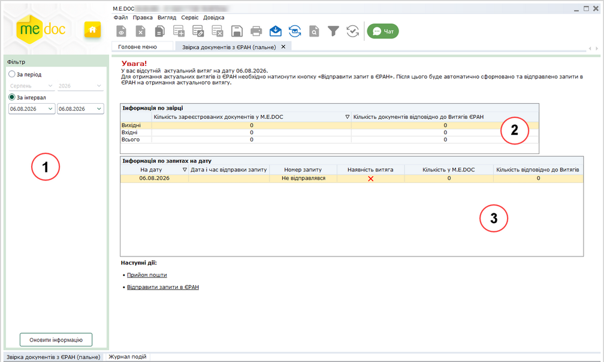
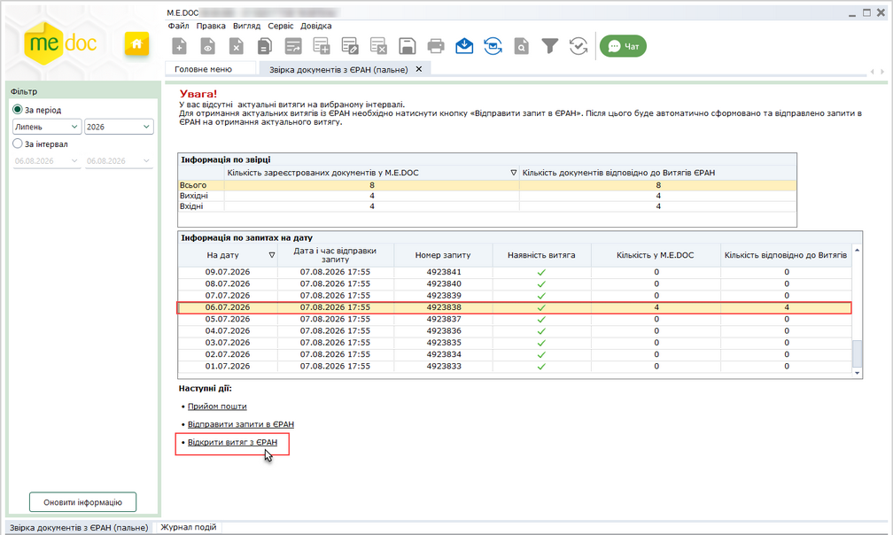

[← Зміст довідки](../)


# Звірка документів з ЄРАН (пальне)

## Звірка документів з ЄРАН (пальне)

_Шлях у довідці: Розділи програми › Облік акцизу › Звірка документів з ЄРАН (пальне)_

В цьому розділі:

[Опис структури модулю](#uccomparisoneran-uccomparisoneran)

[Процес звірки документів](#uccomparisoneran-uccomparisoneran)

[Журнал подій](#uccomparisoneran-uccomparisoneran)

Модуль Звірка документів з ЄРАН (пальне) призначений для порівняння кількості документів, які зареєстровані на дану установу в Єдиному реєстрі акцизних накладних та кількості таких документів у програмі.

Модуль також доступний з Реєстру акцизних документів (пальне) по команді головного меню Сервіс – Звірка документів з ЄРАН.

Кількість зареєстрованих документів у ЄРАН підраховується за наявними фізично у програмі виданими та отриманими документами: Запит щодо отримання відомостей з Єдиного реєстру акцизних накладних та Витягів з Єдиного реєстру акцизних накладних.

Кількість документів у програмі враховує усі зареєстровані документи, окрім тих, що знаходяться в корзині.

Звірка документів виконується за їх кількістю, а також безпосередньо перевіряється наявність у програмі самих документів.

Звірка документів з ЄРАН дає можливість:

- визначити відсутні документи у програмі;
- відправити запити в ЄРАН одразу на декілька вказаних дат;
- отримати витяги з документами, прийнявши пошту у модулі.

Модуль автоматично рахує кількість зареєстрованих документів у програмі та кількість документів в ЄРАН згідно витягів.

Модуль автоматично аналізує та визначає, якого типу необхідно сформувати та відправити запити, і потім формує і відправляє запити "на дату" і "за списком".

Звірка документів виконується по даті реєстрації в ЄРАН.

Відправлені із модулю запити та отримані витяги також поміщаються у модуль Інформаційна довідка.

Оскільки у модулі за результатами звірення даних автоматично формуються запити в ЄРАН, повинні бути правильно заповнені основні поля в картці підприємства, дані з яких використовуються у запиті:

- код ЄДРПОУ установи;
- найменування;
- ІПН;
- код та назва територіального органу ДПС;
- електронна адреса.

Опис структури модулю

Модуль складається із декількох функціональних частин:

Натисніть, щоб збільшити малюнок

1. Фільтр

Задається інтервал дат, у якому потрібно виконати звірку або конкретний звітний період року.

Максимальний діапазон дат, який можливо встановити у фільтрі За інтервал - місяць (31 день). Початок та кінець діапазону може знаходитися в будь якому дні місяця.

Якщо обрати звітний період, встановлюється інтервал від першого дня періоду до поточної дати включно і звірка буде виконуватися за цей період.

Зверніть увагу!

1. При відкритті модуля завжди за замовчуванням у фільтрі За інтервал буде встановлений інтервал минула дата.

2. Якщо декілька днів не було сеансу роботи з ПЗ М.Е.Doc, то при відкритті модулю буде встановлена дата останнього використання програми.

Для відображення інформації щодо звірки даних потрібно натиснути кнопку Оновити інформацію.

2. Таблиця результатів звірки

У таблиці відображається загальна інформація про виконане звірки даних, окремо за вихідними та вхідними документами, а також за їх загальною кількістю.

Завжди при вході у модуль користувач буде бачити звірку за минулу дату. Відповідно фільтр «За інтервал» буде налаштований на минулу дату.

Зверніть увагу!

Актуальним вважається витяг, якщо дата відправки запиту перевищує мінімум на 1 день дату реєстрації, на яку планується звірка.

3. Інформація по запитах на дату

Таблиця призначена для перегляду більш детальної інформації про запит. Користувач за даними таблиці може визначити - на які запити є витяги, на які запити в базі програми відсутні документи, і саме головне: чи є актуальним його ВИТЯГ з ЄРАН.

Таблиця містить декілька колонок:

- На дату (поле Дата у запиті);
- Дата і час відправки запиту (Дата відправки запиту);
- Номер запиту;
- Наявність витяга на запит (проставляється ознака, чи наявний витяг на конкретний запит);
- Кількість у M.E.DОС та Кількість відповідно до Витягів (кількість документів згідно дати реєстрації).

У таблиці відображаються лише запити "На дату".

Різні значення кількості документів у останній колонці свідчать про те, що у користувача не співпадає кількість запитів та витягів чи витяги є неактуальними.

Для перегляду витягу на запит потрібно виділити рядок з відміткою  у колонці Наявність витяга на запит, та натиснути Відкрити витяг з ЄРАН.

[До початку](#uccomparisoneran-uccomparisoneran)

Процес звірки документів

Для виконання звірки виконайте дії:

1. На панелі фільтрів оберіть інтервал дат, за який необхідна звірка.

2. Натисніть кнопку Оновити інформацію. Буде виконаний автоматичний перерахунок документів у базі згідно з наявними витягами за вибраний інтервал часу.

3. У таблиці Інформація про звірку буде відображатися результат звірення кількості запитів/витягів.

4. Перегляньте детальні результати звірки за вхідними та вихідними документами.

5. Для завантаження у програму відсутніх документів із ЄРАН (як витягів, так і файлів АН/РК), сформуйте новий запит, натиснувши посилання Відправити запити в ЄРАН.

6. Формування запиту виконується за таким алгоритмом:

- Якщо є актуальний запит та  витяг на запит і кількість документів по звірці рівна,  то запит не формується і не відправляється.
- Якщо є актуальний запит, але відсутній витяг, після перевірки дублів запитів сформується та відправиться запит На дату та без ознаки Імпорт документу з квитанціями.
- Якщо є актуальний витяг, а кількість документів по звірці нерівна,  сформується та відправиться запит в ЄРАН За списком із ознакою Імпорт документу з квитанціями.  Причому, якщо таких дат у вибраному інтервалі буде декілька – то сформується ОДИН запит За списком по відсутніх документах у базі по всьому інтервалу.
- Якщо актуального витягу не буде, сформується та відправиться запит в ЄРАН На дату (обов’язково з двома відмітками: Видані та Отримані), і без ознаки Імпорт документу з квитанціями.

7. Далі на запит накладається ЕП печатки установи і він буде відправлений в ЄРАН.

8. Через деякий час прийміть вхідну кореспонденцію, натиснувши за посиланням Прийом пошти.

9. Після завантаження отриманих витягів виконується перерахунок та оновлюються дані у таблиці.

10. Для перегляду витягу на запит потрібно виділити рядок з відміткою  у колонці Наявність витяга на запит, та натиснути Відкрити витяг з ЄРАН.

Натисніть, щоб збільшити малюнок

Зверніть увагу!

1. Звірка документів виконується по даті реєстрації в ЄРАН.

2. Звірка виконується із витягами "на дату", що отримані на відправлені запити, в яких користувачем було відмічено два типи документів - і видані, і отримані.

3. Якщо для документа існує перший та другий примірник, кожен примірник враховується у кількості документів як окремий документ.

4. Якщо у запиті буле відмічено тільки один тип документа (або видані, або отримані), користувач отримає повідомлення про відсутність актуального витягу.

5. Навіть за умови, якщо в програмі буде присутній витяг із ЄРАН із датою, більшою ніж сама дата реєстрації, але в ньому буде лише одна відмітка - або видані, або лише отримані - все одно користувач буде сповіщений про те, що відсутній актуальний витяг.

[До початку](#uccomparisoneran-uccomparisoneran)

Журнал подій

У модулі в окремій закладці знаходиться Журнал подій, у якому відображається детальний опис подій та робіт, виконаних користувачами.

Дані Журналу... можливо роздрукувати, експортувати у Word та Excel файли.

Для відображення даних у цьому Журналі... необхідно встановити параметр аудиту у модулі [Журнал подій.](UCLogs.html#uclogs-admlogs)

[До початку](#uccomparisoneran-uccomparisoneran)


