[← Зміст довідки](../)


# Звірка документів з ЄРПН

## Звірка документів з ЄРПН

_Шлях у довідці: Розділи програми › Облік ПДВ › Звірка документів з ЄРПН_

В цьому розділі:

[Опис структури модулю](#uccomparisonerpn-uccomparisonerpn)

[Процес звірки відправлених на реєстрацію ПН/РК](#uccomparisonerpn-uccomparisonerpn)

[Процес звірки зупинених у реєстрації ПН та РК (СМКОР)](#uccomparisonerpn-uccomparisonerpn)

[Збереження інформації по ПН та РК, реєстрацію яких зупинено та інформації по запитах на дату](#uccomparisonerpn-uccomparisonerpn)

- [Збереження інформації по запитах на дату](#uccomparisonerpn-uccomparisonerpn)
- [Збереження інформації про ПН та РК, реєстрацію яких зупинено, за обраний проміжок часу](#uccomparisonerpn-uccomparisonerpn)
- [Збереження інформації про ПН та РК, реєстрацію яких зупинено, без обмеження по періоду](#uccomparisonerpn-uccomparisonerpn)

[Журнал подій](#uccomparisonerpn-uccomparisonerpn)

Модуль Звірка документів з ЄРПН призначений для порівняння кількості документів, які зареєстровані на дану установу в ЄРПН та кількості таких документів у програмі.

Кількість зареєстрованих документів у ЄРПН підраховується за наявними фізично у програмі виданими та отриманими документами:

- Запит щодо отримання відомостей з Єдиного реєстру податкових накладних;
- Витяг з Єдиного реєстру податкових накладних;
- Запит щодо отримання відомостей з Єдиного реєстру податкових накладних стосовно податкових накладних та розрахунків коригування, реєстрацію яких зупинено;
- Витяг щодо отримання відомостей з Єдиного реєстру податкових накладних стосовно податкових накладних та розрахунків коригування, реєстрацію яких зупинено.

Кількість документів у програмі враховує усі зареєстровані документи, за винятком тих, що знаходяться в корзині.

Модуль є частиною Реєстру первинних документів, але виконаний окремо для того, щоб не перевантажувати запитами Реєстр.

Звірка документів виконується за їх кількістю, а також перевіряється наявність у програмі самих документів.

Оскільки не завжди користувачі мають у наявності ВХІДНІ документи від контрагентів (або вихідні від’ємні Додатки 2), кожному користувачу важливо розуміти яка кількість зареєстрованих на нього документів відсутня у базі.

Модуль також надає можливість оперативно реагувати та відстежувати зміни станів реєстрації Податкових накладних та Розрахунків коригування, реєстрацію яких зупинено Системою моніторингу критеріїв оцінки ризиків (СМКОР), зокрема вхідних.

Звірка документів з ЄРПН надає можливість:

- визначити відсутні документи у програмі,
- відправити запити в ЄРПН одразу на декілька вказаних дат
- отримати витяги з документами, прийнявши пошту у модулі.

Модуль автоматично рахує кількість зареєстрованих документів у програмі та кількість документів в ЄРПН згідно витягів. Автоматично аналізує та визначає, якого типу запити необхідно сформувати та відправити, після чого формує і відправляє запити на дату і за списком.

Звірка документів виконується по даті реєстрації в ЄРПН.

Відправлені із модулю запити та отримані витяги також розміщуються у модуль [Інформаційна довідка](UCGovQry.html#ucgovqry-ucgovqry).

Оскільки у модулі за результатами звірення даних автоматично формуються запити в ЄРПН, повинні бути правильно заповнені основні поля в [Картці підприємства](UCOrg.html#ucorg-sprorg_org), які переносяться у запит:

- код ЄДРПОУ установи;
- найменування;
- ІПН;
- код та назва територіального органу ДПС;
- електронна адреса.

Опис структури модулю

Модуль складається із декількох частин:

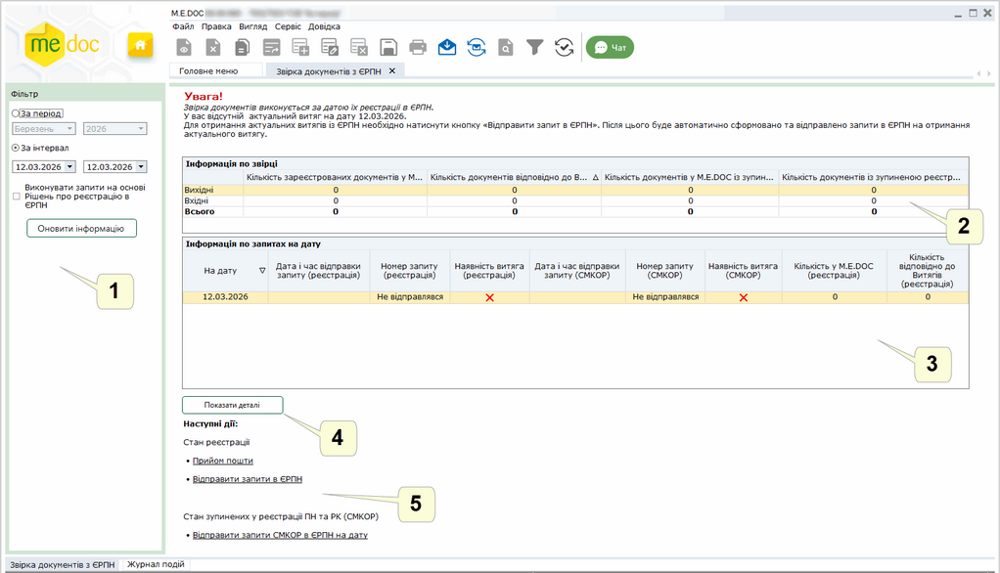

Натисніть, щоб збільшити малюнок

1. Фільтр

Задається інтервал дат, у якому потрібно виконати звірку або конкретний звітний період року.

Максимальний діапазон дат, який можливо встановити у фільтрі За інтервал - місяць (31 день). Початок та кінець діапазону може знаходитися у будь-якому дні місяця.

Якщо обрати звітний період, встановлюється інтервал від першого дня періоду до поточної дати включно і звірка буде виконуватися за цей період.

Для відображення інформації щодо звірки даних натисніть кнопку Оновити інформацію.

Якщо встановлено опцію Виконувати запити на основі Рішень про реєстрацію в ЄРПН виконується звірка з ЄРПН з метою автоматичного отримання розблокованих ПН\РК відповідно до даних «РІШЕННЬ про реєстрацію або відмову в реєстрації ПН/РК в ЄРПН». По натисканню кнопки Оновити інформацію виконується пошук Рішень, що надходили за обраний період.
Далі виконуватиметься перевірка наявності ПН\РК, що зазначені у Рішеннях, для ПН\РК, що відсутні у базі програми, формуватиметься Запит та відправлятиметься до ЄРПН. У сформованому Запиті автоматично встановлюються опції За списком та Імпорт документу з квитанцією.

Зверніть увагу!

1. При відкритті модуля завжди за замовчуванням у фільтрі За інтервал буде встановлений інтервал минула дата.

2. Якщо декілька днів не було сеансу роботи з ПЗ М.Е.Doc, то при відкритті модулю буде встановлений інтервал - останні дні заходу.

Вікно, у якому відображаються результати звірки, складається із таблиць:

2. Інформація по звірці

У таблиці відображається загальна інформація про виконане звірення даних, окремо за вихідними та вхідними документами, а також за їх загальною кількістю.

Завжди при вході у модуль користувач буде бачити звірку за минулу дату. Відповідно фільтр За інтервал буде налаштований на минулу дату.

Зверніть увагу!

Актуальним вважається витяг, якщо дата відправки запиту перевищує мінімум на 1 день дату реєстрації, на яку планується звірка.

Для перегляду більш детальної інформації призначена інша таблиця Інформація по запитах на дату.

3. Інформація по запитах на дату

У таблиці наводиться інформація - на які запити є витяги, на які запити в базі програми відсутні документи, і саме головне: чи є актуальним ВИТЯГ з ЄРПН.

Таблиця містить декілька колонок:

- На дату - значення поля Дата у запиті;
- Напрямок - при відображенні інформації з ЄРПН про ПН/РК, які отримані філією та/або відправлені філією, дані відображаються у окремих рядках таблиці, у колонці Напрямок відображається напрямок документів: Отримані та/або Видані;
- Дата і час відправки запиту - дата відправки запиту;
- Номер запиту (реєстрація);
- Наявність витяга (реєстрація) - проставляється ознака, чи наявний витяг на конкретний запит;
- Кількість у M.E.DОС (реєстрація) та Кількість відповідно до Витягів (реєстрація) - кількість документів згідно з датою реєстрації у базі програми та відповідно до отриманих витягів;
- Наявність витяга (СМКОР) – у колонці встановлюється  за наявності "Витягу щодо отримання відомостей з Єдиного реєстру податкових накладних стосовно податкових накладних та розрахунків коригування, реєстрацію яких зупинено" за вказану дату, при відсутності Витягу проставляється .
- Номер запиту (СМКОР) – номер "Запит щодо отримання відомостей з Єдиного реєстру податкових накладних стосовно податкових накладних та розрахунків коригування, реєстрацію яких зупинено", за яким було отримано Витяг;

У таблиці відображаються лише запити на дату.

Різні значення кількості документів у останній колонці свідчать про те, що у користувача не співпадає кількість запитів та витягів чи витяги є неактуальними.

Для перегляду витягу на запит потрібно виділити рядок в таблиці, в якому присутня відмітка Наявність витяга (реєстрація), та натиснути на кнопку Відкрити витяг з ЄРПН у наступних діях.

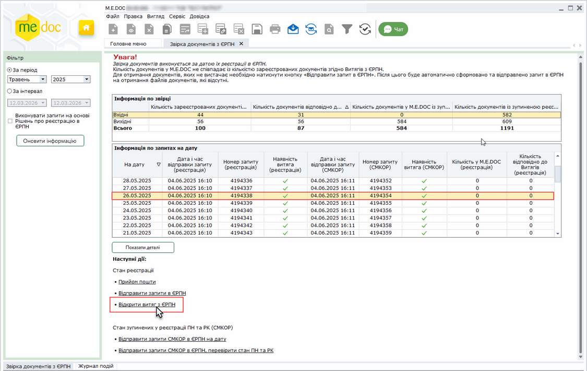

Натисніть, щоб збільшити малюнок

Кнопка Відкрити витяг з ЄРПН доступна тільки, якщо в таблиці Інформація по запитах на дату виділено рядок, в якому присутня відмітка Наявність витяга (реєстрація).

4. Кнопка Показати деталі

По натисканню на кнопку Показати деталі відкривається таблиця Інформація по ПН та РК, реєстрацію яких зупинено з докладною інформацією про ПН/РК, реєстрацію яких зупинено СМКОР. Детальна інформація відображається відповідно до даних отриманого "Витягу щодо отримання відомостей з Єдиного реєстру податкових накладних стосовно податкових накладних та розрахунків коригування, реєстрацію яких зупинено".

Щоб приховати детальну інформацію натисніть на кнопку Приховати деталі.

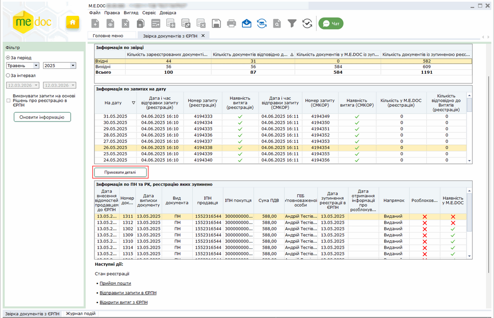

Натисніть, щоб збільшити малюнок

5. Область Наступні дії

У області містяться посилання для відправки Запитів та отримання Витягів:

Стан реєстрації:

- Прийом пошти - для завантаження отриманих "Витяг з Єдиного реєстру податкових накладних";
- Відправити запити в ЄРПН - для відправки "Запитів щодо отримання відомостей з Єдиного реєстру податкових накладних".

Докладно дивіться розділ [Процес звірки документів](#uccomparisonerpn-uccomparisonerpn).

Стан зупинених у реєстрації ПН та РК (СМКОР):

Посилання для робити з "Запитами щодо отримання відомостей з Єдиного реєстру податкових накладних стосовно податкових накладних та розрахунків коригування, реєстрацію яких зупинено":

- Відправити запити СМКОР в ЄРПН на дату – сформувати та відправити Запит на обрану дату або за обраний період часу;
- Відправити запити СМКОР в ЄРПН, перевірити стан ПН та РК – сформувати та відправити Запит за списком ПН/РК, реєстрацію яких зупинено;
- Відправити запити СМКОР в ЄРПН, отримати розблоковані ПН та РК – формування Запиту на отримання "Витяг щодо отримання відомостей з Єдиного реєстру податкових накладних стосовно податкових накладних та розрахунків коригування, реєстрацію яких зупинено" та отримання розблокованих ПН/РК, які відсутні у програмі. (Посилання доступне, якщо наявні розблоковані ПН/РК, що відсутні у M.E.Doc.)

Докладно дивіться розділ [Процес звірки зупинених у реєстрації ПН та РК (СМКОР)](#uccomparisonerpn-uccomparisonerpn).

Щоб зосередити увагу користувача лише на діях, які є актуальними, кнопки відображаються за виконання умов:

- коли таблиця Інформація по ПН та РК, реєстрацію яких зупинено порожня, відображається лише кнопка Відправити запити СМКОР в ЄРПН на дату;
- коли у таблиці Інформація по ПН та РК, реєстрацію яких зупинено немає інформації про розблоковані ПН/РК, відображаються кнопки:
- Відправити запити СМКОР в ЄРПН на дату;
- Відправити запити СМКОР в ЄРПН, перевірити стан ПН та РК.

[До початку](#uccomparisonerpn-uccomparisonerpn)

Процес звірки відправлених на реєстрацію ПН/РК

Для виконання звірки виконайте дії у наступній послідовності:

1. На панелі фільтрів оберіть інтервал дат, за який необхідна звірка. У разі необхідності отримати розблоковані ПН\РК відповідно до даних «РІШЕННЬ про реєстрацію або відмову в реєстрації ПН/РК в ЄРПН» встановіть опцію Виконувати запити на основі Рішень про реєстрацію в ЄРПН.

2. Натисніть кнопку Оновити інформацію. Буде виконаний автоматичний перерахунок документів у базі згідно з наявними витягами за вибраний інтервал часу.

3. У таблиці Інформація про звірку буде відображатися результат звірення кількості запитів/витягів.

4. Перегляньте детальні результати звірки за вхідними та вихідними документами.

5. Для завантаження у програму відсутніх документів із ЄРПН (як витягів, так і файлів ПН та РК), сформуйте новий запит, натиснувши на посилання Відправити запити в ЄРПН.

Отримані документи завантажуються у Реєстр податкових документів. Алгоритм відображення документів у таблиці Реєстру залежіть від наявності документа у реєстрі, та статусу документа. Докладно дивіться у розділі [Відображення документів, отриманих з ЄРПН](UCGovQry.html#ucgovqry-ucgovqry_info).

6. Формування запиту виконується за таким алгоритмом:

- Якщо є актуальний запит та  витяг на запит і кількість документів по звірці рівна, то запит не формується і не відправляється.
- Якщо є актуальний запит, але відсутній витяг, після перевірки дублів запитів сформується та відправиться запит «На дату» та без ознаки Імпорт документу з квитанцією.
- Якщо є актуальний витяг, а кількість документів по звірці нерівна, сформується та відправиться запит в ЄРПН «За списком» із ознакою Імпорт документу з квитанцією. Причому, якщо таких дат у вибраному інтервалі буде декілька – то сформується ОДИН запит «За списком» по відсутніх документах у базі по всьому інтервалу.
- Якщо актуального витягу не буде, сформується та відправиться запит в ЄРПН «На дату» (обов’язково з двома відмітками: видані та отримані), і без ознаки Імпорт документу з квитанцією;
- для організацій, у яких у Картці підприємства заповнено поле Код філії та не заповнено поле Організація, від імені якої буде здійснюватись реєстрація податкових накладних в ЄРПН, формуються окремі Запити:
- запит щодо отримання відомостей про ПН/РК, що отримані філією;
- запит щодо отримання відомостей про ПН/РК, що відправлені філією.

При відображення інформації по ПН/РК, що отримані філією та/або відправлені філією, дані відображаються у окремих рядках таблиці Інформація по запитах на дату, у колонці Напрямок відображається напрямок документів: Отримані або Видані.

7. Далі на запит накладається ЕП печатки установи і він буде відправлений в ЄРПН.

8.  Через деякий час прийміть вхідну кореспонденцію, натиснувши за посиланням Прийом пошти.

9.  Після завантаження отриманих витягів виконується перерахунок та оновлюються дані у таблиці.

10. Для перегляду витягу на запит потрібно виділити рядок в таблиці, в якому присутня відмітка Наявність витяга на запит, та натиснути на кнопку Відкрити витяг з ЄРПН у наступних діях.

Зверніть увагу!

1. Звірка документів виконується по даті реєстрації в ЄРПН.

2. Звірка виконується із витягами "на дату", що отримані на відправлені запити, в яких користувачем було відмічено два типи документів - і видані, і отримані.

3. Якщо у запиті буле відмічено тільки один тип документа (або видані, або отримані), користувач отримає повідомлення про відсутність актуального витягу.

4. Навіть за умови, якщо в програмі буде присутній витяг із ЄРПН із датою, більшою ніж сама дата реєстрації, але в ньому буде лише одна відмітка - або "Видані", або лише "Отримані" - все одно користувач буде сповіщений про те, що відсутній актуальний витяг.

[До початку](#uccomparisonerpn-uccomparisonerpn)

Процес звірки зупинених у реєстрації ПН та РК (СМКОР)

Для виконання звірки виконайте дії у наступній послідовності:

1. На панелі фільтрів оберіть інтервал дат, за який необхідна звірка.

2. Виконайте команду Наступні дії - Відправити запити СМКОР в ЄРПН на дату. Запит буде сформовано та відправлено автоматично.

3. У таблиці Інформація про звірку буде відображатися результат звірення кількості запитів/витягів. У області Інформація по запитах на дату у колонці Наявність витяга (СМКОР) встановлюється  за наявності Витягу за вказану дату, при відсутності Витягу проставляється . Також у колонці Номер запиту (СМКОР) зазначається номер запиту, за яким було отримано Витяг.

4. Після отримання Витягу, заповнюються дані таблиці Інформація про ПН та РК, реєстрацію яких зупинено. Для перегляду детальної інформації про дані Витягів натисніть кнопку Переглянути деталі. Для ПН/РК, що присутні у програмі, у колонці Наявність у M.E.Doc проставляється позначка :

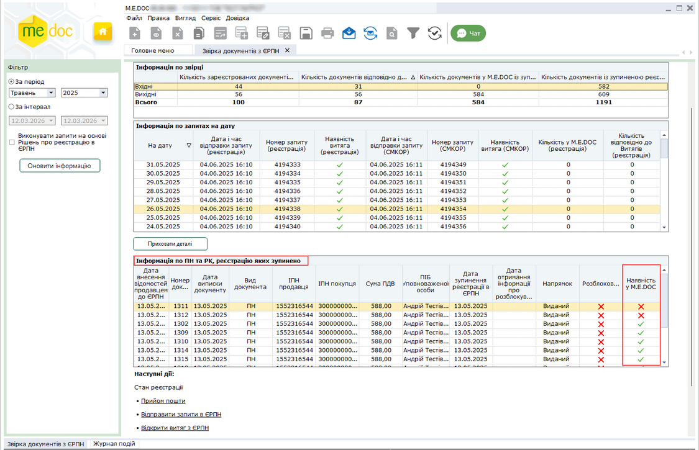

Натисніть, щоб збільшити малюнок

5. Для отримання інформації про розблоковані ПН/РК виконайте команду Наступні дії - Відправити запити СМКОР в ЄРПН, перевірити стан ПН та РК. Буде автоматично сформовано та відправлено Запит за списком ПН/РК, реєстрацію яких зупинено. Запит формується за списком ПН/РК, інформація про які містяться у таблиці Інформація про ПН та РК, реєстрацію яких зупинено.

Після отримання Витягу, заповнюються дані таблиці Інформація по ПН та РК, реєстрацію яких зупинено. Для розблокованих ПН/РК у колонці Розблоковано проставляється позначка , у колонці Дата отримання інформації про розблокування відображається дата отримання Витягу, зверніть увагу, встановлюється дата не фактичного розблокування документів, а дата та час, коли інформація про це була отримана у програмі:

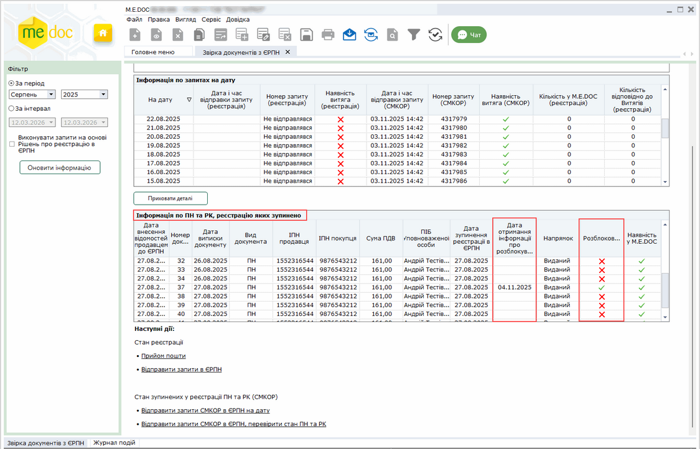

Натисніть, щоб збільшити малюнок

6. Для отримання відсутніх у програмі розблокованих ПН/РК сформуйте "Запит щодо отримання відомостей з Єдиного реєстру податкових накладних стосовно податкових накладних та розрахунків коригування, реєстрацію яких зупинено". Для цього виконайте команду Наступні дії - Відправити запити СМКОР в ЄРПН, отримати розблоковані ПН та РК (команда доступна, якщо наявні розблоковані ПН/РК, що відсутні у M.E.Doc). Запит формується за списком зі встановленою відміткою Імпорт документа з квитанцією.

Отримані документи завантажуються у Реєстр податкових документів.

Для перегляду ПН або РК, реєстрацію яких зупинено СМКОР та які присутні у програмі, натисніть два рази лівою кнопкою миші на рядку документа у таблиці Інформація про ПН та РК, реєстрацію яких зупинено. Зверніть увагу, переглянути документ можна, якщо він збережений у базі даних програми - у колонці Наявність у M.E.Doc присутня позначка . Документ відкривається у новій вкладці:

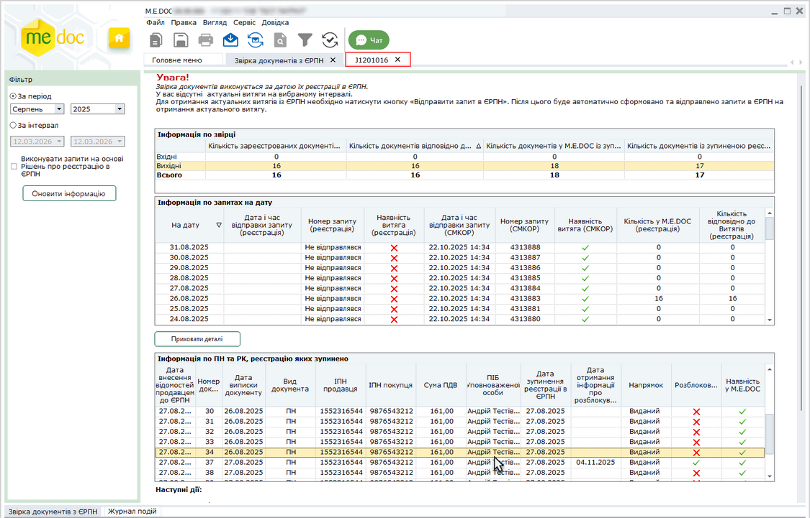

Натисніть, щоб збільшити малюнок

[До початку](#uccomparisonerpn-uccomparisonerpn)

Збереження інформації по ПН та РК, реєстрацію яких зупинено та інформації по запитах на дату

Збереження інформації по запитах на дату

Для збереження даних таблиці Інформації по запитах на дату у файл Excel виконайте дії:

1. На панелі фільтрів оберіть інтервал часу, за який необхідно зберегти інформацію та натисніть кнопку Оновити інформацію.

2. Оберіть один із способів:

- команду головного меню Файл – Експорт реєстру – Експорт в Excel таблиці "Інформація по запитах на дату";
- команду контекстного меню: Експорт реєстру – Експорт в Excel таблиці "Інформація по запитах на дату":

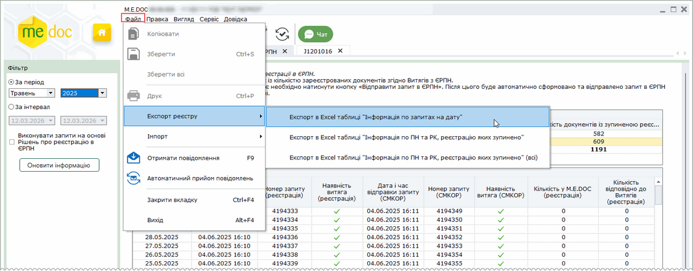

Натисніть, щоб збільшити малюнок

3. У вікні Збереження файлу оберіть шлях для збереження даних та введіть ім'я файлу. Натисніть Зберегти.

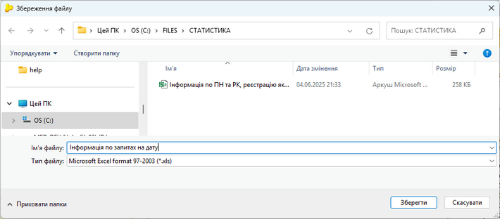

Натисніть, щоб збільшити малюнок

4. Програма повідомить про результат виконання операції

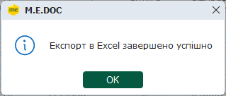

Збереження інформації про ПН та РК, реєстрацію яких зупинено, за обраний проміжок часу

Для збереження даних таблиці Інформація по ПН та РК, реєстрацію яких зупинено у файл Excel виконайте дії:

1. На панелі фільтрів оберіть інтервал часу, за який необхідно зберегти інформацію та натисніть кнопку Оновити інформацію.

2. Оберіть один із способів:

- команду головного меню Файл – Експорт реєстру – Експорт в Excel таблиці "Інформація по ПН та РК, реєстрацію яких зупинено";
- команду контекстного меню: Експорт реєстру – Експорт в Excel таблиці "Інформація по ПН та РК, реєстрацію яких зупинено":

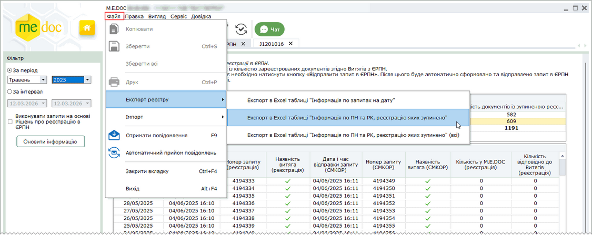

Натисніть, щоб збільшити малюнок

3. У вікні Збереження файлу оберіть шлях для збереження даних та введіть ім'я файлу. Натисніть Зберегти.

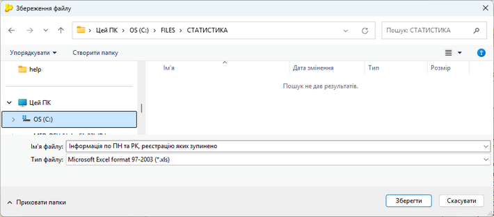

Натисніть, щоб збільшити малюнок

4. Програма повідомить про результат виконання операції

Збереження інформації про ПН та РК, реєстрацію яких зупинено, без обмеження по періоду

Для збереження даних таблиці Інформація по ПН та РК, реєстрацію яких зупинено у файл Excel без обмеження по періоду виконайте дії:

1. Оберіть один із способів:

- команду головного меню Файл – Експорт реєстру – Експорт в Excel таблиці "Інформація по ПН та РК, реєстрацію яких зупинено (всі)";
- команду контекстного меню: Експорт реєстру – Експорт в Excel таблиці "Інформація по ПН та РК, реєстрацію яких зупинено (всі)":

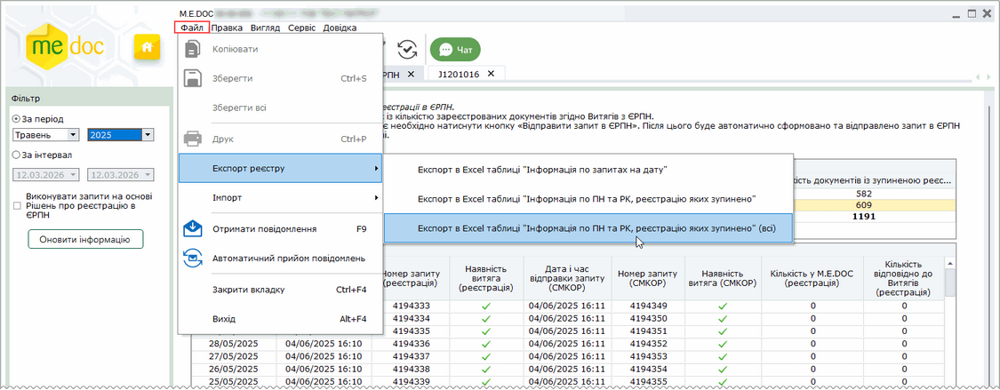

Натисніть, щоб збільшити малюнок

3. У вікні Збереження файлу оберіть шлях для збереження даних та введіть ім'я файлу. Натисніть Зберегти.

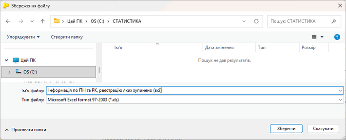

Натисніть, щоб збільшити малюнок

4. Програма повідомить про результат виконання операції

[До початку](#uccomparisonerpn-uccomparisonerpn)

Журнал подій

У модулі в окремій закладці знаходиться Журнал подій, у якому відображається детальний опис подій та робіт, виконаних користувачами.

Дані Журналу можна роздрукувати, експортувати у Word та Excel файли.

Для відображення даних у цьому Журналі необхідно встановити параметр аудиту [у модулі Журнал подій](UCLogs.html#uclogs-admlogs).

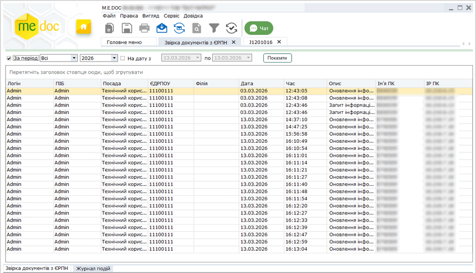

Натисніть, щоб збільшити малюнок

[До початку](#uccomparisonerpn-uccomparisonerpn)


