[← Зміст довідки](../)


# Єдиний внесок

### Єдиний внесок

_Шлях у довідці: Розділи програми › Звітність › Єдиний внесок_

Звіт з єдиного соціального внеску формується за правилами, регламентованими:

- Порядком формування та подання страхувальниками звіту щодо сум нарахованого єдиного внеску на загальнообов'язкове державне соціальне  страхування, затвердженим Наказом МФУ від 14.04.2015 № 435 {Із змінами, внесеними згідно з Наказами МФУ № 441 від 104.2016, № 813 від 07.09.2016, № 511 від 15.05.2018, № 670 від 05.11.2020};
- Інструкцією про порядок нарахування і сплати єдиного внеску на загальнообов'язкове державне соціальне страхування, затвердженою Наказом від 20.04.2015 № 449 {Із змінами, внесеними згідно з Наказами МФУ № 393 від 28.03.2016, № 813 від 07.09.2016, № 469 від 04.05.2018, № 283 від 10.06.2020}.

ВАЖЛИВО!

На виконання наказу Міністерства фінансів України N 670 від 05.11.2020 року «Про затвердження Змін до Порядку формування та подання страхувальниками звіту щодо сум нарахованого єдиного внеску на загальнообов'язкове державне соціальне страхування» додано нові форми звітів (версія 13):

|  |  |
| --- | --- |
| J3000413 | Додаток 4. Додаток 4. Звіт про суми нарахованої заробітної плати (доходу, грошового забезпечення, допомоги, компенсації) застрахованих осіб та суми нарахованого єдиного внеску на загальнообов'язкове державне соціальне страхування |
| F3005113  F3000513 | (для самоз. осіб) Додаток 5 Звіт про суми нарахованого доходу застрахованих осіб та суми нарахованого єдиного внеску  Додаток 5 Звіт про суми нарахованого доходу застрахованих осіб та суми нарахованого єдиного внеску |
| F3000613 | Додаток 6 Звіт про суми добровільних внесків, передбачених договором про добровільну участь, які підлягають сплаті, та суми доплати |
| J3000713 | Додаток 7 Звіт про настання нещасного випадку на виробництві або професійного захворювання |

З 01.02.2021 року щомісячні звіти за новою формою (версія 13), затвердженою наказом Міністерства фінансів України від 05.11.2020 р. № 670, підприємства, установи, організації, фізичні особи подають тільки з типом форми ліквідаційна (у разі проведення державної реєстрації припинення до 28 лютого 2021 року) та з типом форми додаткова та скасовуюча за періоди з січня 2016 року по грудень 2020 року включно.

З 1 січня 2021 року звітність з ЄСВ подається у складі «Податкового розрахунку сум доходу, нарахованого (сплаченого) на користь платників податків – фізичних осіб, і сум утриманого з них податку, а також сум нарахованого єдиного внеску» відповідно до наказу Міністерства фінансів України від 15.12.2020 р. № 773 «Про внесення змін до наказу Міністерства фінансів України від 13 січня 2015 року № 4», періодичність подання Розрахунку квартал. Перший раз Розрахунок подається за I квартал 2021 року, протягом 40 календарних днів, що настають за останнім календарним днем звітного кварталу. Відповідні форми Розрахунку будуть додані в програму в наступних оновленнях.

В даній довідці описана процедура створення Додатку 4 попередньої версіі (12) до 1 січня 2021 року.

#### Форми та строки подання звіту

_Шлях у довідці: Розділи програми › Звітність › Єдиний внесок › Форми та строки подання звіту_

Додаток 4

Додаток 4 формують страхувальники, які використовують працю фізичних осіб на умовах трудового договору (контракту) або на інших умовах, передбачених законодавством, чи за цивільно-правовими договорами (крім цивільно-правового договору, укладеного з ФО - підприємцем, якщо виконувані роботи (надані послуги) відповідають видам діяльності, зазначеним в Єдиному державному реєстрі юридичних осіб та фізичних осіб - підприємців). Страхувальники зобов'язані формувати звіт за найманих працівників та подавати до контролюючих органів Звіт протягом 20 календарних днів, що настають за останнім днем звітного періоду.

Додаток 5

ФО - підприємці, у тому числі ті, які обрали спрощену систему оподаткування, формують та подають до контролюючих органів Звіт самі за себе один раз на рік до 10 лютого року, що настає за звітним періодом.

Звітним періодом є календарний рік. Додаток 5 включає Таблиці 1, 2.

Особи, які провадять незалежну професійну діяльність, формують та подають самі за себе до контролюючих органів Звіт один раз на рік до 01 травня року, що настає за звітним періодом.

Звітним періодом для них є календарний рік. Додаток 5 включає Таблиці 1, 2.

Додаток 6

Особи, які досягли 16-річного віку та не належать до платників єдиного внеску, визначених пунктами 2 - 14 частини першої статті 4 Закону, у тому числі іноземці та особи без громадянства, які постійно проживають або працюють на території України, громадяни України, які постійно проживають або працюють за межами України, якщо інше не встановлено міжнародними договорами, згода на обов’язковість яких надана Верховною Радою України, та уклали договір на добровільну участь у системі загальнообов'язкового державного пенсійного страхування, а також члени фермерського господарства, особистого селянського господарства - на загальнообов’язкове державне соціальне страхування на випадок безробіття, у зв’язку з тимчасовою втратою працездатності, від нещасного випадку на виробництві та професійного захворювання, які спричинили втрату працездатності, і пенсійне страхування та уклали договір на добровільну участь у системі загальнообов’язкового державного соціального страхування, формують та подають самі за себе Звіт протягом 30 календарних днів після закінчення строків дії договору.

Звітним періодом є тривалість дії договору, а якщо договором про добровільну участь передбачено одноразову сплату особою єдиного внеску за попередні періоди, в яких особа не підлягала загальнообов’язковому державному соціальному страхуванню (у тому числі з 01 січня 2004 року по 31 грудня 2010 року), - період, за який одноразово сплачено єдиний внесок за попередні періоди.

Додаток 7

Формується у разі настання нещасного випадку на виробництві чи професійного захворювання із застрахованою особою страхувальники, зазначені в пунктах 1, 2, 4 цього розділу, та члени фермерського господарства, особистого селянського господарства, які зазначені в пункті 5 цього розділу, формують та подають Звіт протягом п'яти робочих днів після дати складання акта про настання нещасного випадку, пов'язаного з виробництвом, або з дати складання акта розслідування професійного захворювання за формою П-4.

#### Додаток 4 " Звіт про суми нарахованої заробітної плати застрахованих осіб та суми нарахованого єдиного внеску на загальнообов’язкове державне соціальне страхування"

_Шлях у довідці: Розділи програми › Звітність › Єдиний внесок › Додаток 4 " Звіт про суми нарахованої заробітної плати застрахованих осіб та суми нарахованого єдиного внеску на загальнообов’язкове державне соціальне страхування"_

У цьому розділі описано:

- [Що потрібно зробити до початку формування звіту?](#uccontribution-contribution_before)
- [Процедура формування звіту з єдиного внеску](Contribution_creation.html#contribution_creation-contribution_creation)
- [Таблиця 5 "Трудові відносини застрахованих осіб"](Contribution_creation.html#contribution_creation-contribution_creation_t5)
- [Таблиця 6 "Відомості про нарахування заробітної плати (доходу) застрахованим особам"](Contribution_creation.html#contribution_creation-contribution_creation_t6)
- [Сортування записів на одного співробітника](Contribution_creation.html#contribution_creation-contribution_creation_t6_sort)
- [Таблиця 7 "Наявність підстав для обліку стажу окремим категоріям осіб відповідно до законодавства"](Contribution_creation.html#contribution_creation-contribution_creation_t7)
- [Таблиця 1 "Нарахування внесків на загальнообов'язкове державне пенсійне страхування"](Contribution_creation.html#contribution_creation-contribution_creation_t1)
- [Формування звіту "Додаток 4. Звіт про суми нарахованої заробітної плати..."](Contribution_creation.html#contribution_creation-contribution_creation_label)
- [Групова перевірка звітів](Contribution_creation.html#contribution_creation-contribution_creation_check)
- [Створення скасовуючих звітів](#uccontribution-contribution_cancel)
- [Створення звітів зі статусом "Додаткова"](#uccontribution-contribution_dod)
- [Імпорт звіту з єдиного внеску з інших систем](Contribution_import.html#contribution_import-contribution_import)
- [Імпорт із pfz файлів](Contribution_import.html#contribution_import-contribution_import_pfz)
- [Імпорт із dbf файлів](Contribution_import.html#contribution_import-contribution_import_dbf)
- [Консолідація всіх початкових звітів в один звіт](#uccontribution-contribution_import_consolid)
- [Подання звіту з єдиного внеску в ДПС України](#uccontribution-contribution_report_pfu)
- [Друк документів звіту з єдиного внеску](#uccontribution-contribution_report_pfu_print)
- [Збереження звіту з єдиного внеску на електронному носії (без підпису ЕП)](#uccontribution-contribution_report_pfu_saving)
- [Відправлення звіту з єдиного внеску електронною поштою](#uccontribution-contribution_report_pfu_e-mail)
- [Додаткові функції у модулі](Contribution_service.html#contribution_service-contribution_service)
- [Експорт даних Таблиць (5-9) в DBF файл](Contribution_service.html#contribution_service-contribution_service_export_dbf)
- [Копіювання звіту](Contribution_service.html#contribution_service-contribution_service_copy)
- [Оновлення реєстру співробітників за даними Таблиці 6](Contribution_service.html#contribution_service-contribution_service_upd)
- [Групове заповнення даних по співробітниках у Таблиці 6](Contribution_service.html#contribution_service-contribution_service_t6_replace)

##### Що потрібно зробити до початку формування звіту?

_Шлях у довідці: Розділи програми › Звітність › Єдиний внесок › Додаток 4 " Звіт про суми нарахованої заробітної плати застрахованих осіб та суми нарахованого єдиного внеску на загальнообов’язкове державне соціальне страхування" › Що потрібно зробити до початку формування звіту?_

До початку формування звіту з єдиного внеску потрібно:

1. Переглянути Реєстр співробітників,

2. Переглянути картку установи,

У цих модулях повинні бути заповнені всі поля, які використовуються при формуванні цього звіту.

Ці дані потрібно встановити лише один раз і надалі вони будуть автоматично підтягуватися у відповідні таблиці звіту.

3. Внести дані у новий довідник Понижуючий коефіцієнт розміру єдиного внеску, якщо установа використовує понижуючий коефіцієнт ЄСВ.

Зверніть увагу! З 01.01.2016 понижуючий коефіцієнт розміру єдиного внеску НЕ ВИКОРИСТОВУЄТЬСЯ! Дані у довідник вносити не потрібно.

У довіднику Понижуючий коефіцієнт розміру єдиного внеску

Зверніть увагу! З 01.01.2016 понижуючий коефіцієнт розміру єдиного внеску НЕ ВИКОРИСТОВУЄТЬСЯ, тому цей довідник не заповнюється.

Відкрийте Довідники - Перелік довідників - Пенсійний фонд - Понижуючий коефіцієнт розміру єдиного внеску - Створити.

Створіть новий запис у довіднику :

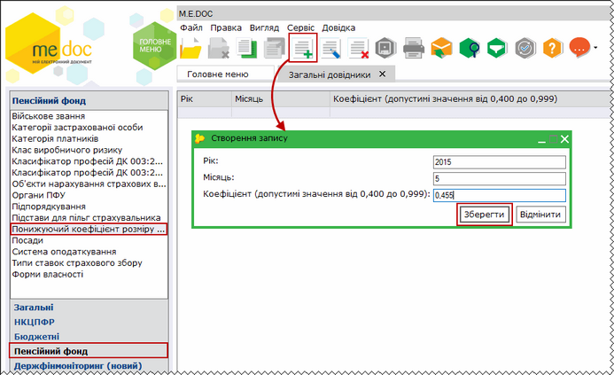

Натисніть, щоб збільшити малюнок

Вкажіть:

- Рік - 2015;
- Місяць - 5 (місяць, за який ви подаєте звіт);
- Коефіцієнт - внесіть вручну значення понижуючого коефіцієнта єдиного внеску.

Довідник використовується при формуванні Таблиці 6.

У КАРТЦІ ФІЗИЧНОЇ ОСОБИ:

Заповніть наступні параметри картки співробітника (Довідники - Співробітники - картка Фізична особа):

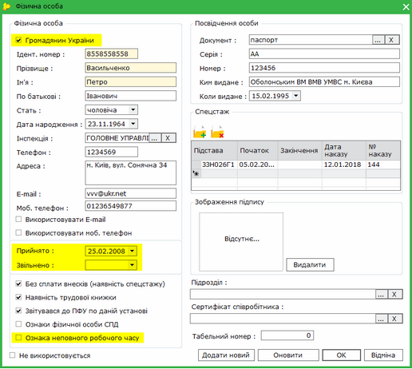

Натисніть, щоб збільшити малюнок

1. Для осіб, які є громадянами України, потрібно встановити галочку у полі Громадянин України.

2. Для працівників, що є фізичними особами підприємцями (ФОП) - відмітьте поле Ознака фізичної особи СПД.

ФОП, які виконують роботи за цивільно-правовими договорами, не включаються до звітності з єдиного внеску, і при встановленій відмітці у цьому полі вони не попадатимуть у таблиці, але такі ФОП будуть присутні у формі 1ДФ.

3. Перевірте, чи заповнені поля:

- Прийнято
- Звільнено

Ці дані використовуються при створенні Таблиці 5.

4. Якщо працівник має право на спецстаж, потрібно заповнити групу параметрів з назвою "Спецстаж":

- у полі Код підстави оберіть код із підключеного довідника,
- у полях Дата початку та Дата закінчення внесіть дати початку та закінчення дії спецстажу;

Поле "Дата початку" обов'язкове для заповнення!

- у полі Дата наказу  - оберіть дату прийняття наказу про атестацію робочого місця в установі, що дає право працюючому на спецстаж,
- у полі № наказу – внесіть номер цього наказу.

Поля Дата наказу та № наказу можуть бути незаповнені, але в таблиці 7 в такому разі буде виводитися попередження і вона матиме статус "Помилковий".

Записи із групи Спецстаж "підтягуються" у Таблицю 7.

5. Нове поле Ознака неповного робочого часу - проставляється для співробітників, які працюють неповний робочий час.

Ознака автоматично переноситься в Таблицю 6.

Ці дані потрібно внести в картку співробітника лише один раз і надалі вони будуть автоматично підтягуватися у відповідні таблиці звіту. Якщо не внести ці дані в картку, потрібно буде кожного разу заповнювати їх у таблицях.

НАПОЛЕГЛИВО РЕКОМЕНДУЄМО ПІДТРИМУВАТИ РЕЄСТР СПІВРОБІТНИКІВ У АКТУАЛЬНОМУ СТАНІ, і вносити одразу всі зміни в картки фізичних осіб. ЗА ДАНИМИ ІЗ РЕЄСТРУ АВТОМАТИЧНО ФОРМУЮТЬСЯ ТАБЛИЦІ 5, 6 та 7 звіту.

У КАРТЦІ ПІДПРИЄМСТВА:

Довідники - Картка підприємства

У вкладці Підприємство:

1. У полі Назва перевірте правильність обраного із довідника органу ДПСУ.

2. Оберіть із довідника дані в полі Організаційно правова форма.

У вкладці Додатково:

1. Оберіть із довідника дані в полі Основний вид діяльності за КВЕД.

Останніми даними заповнюються поля "Організаційно-правова форма господарювання" та "Код основного виду економічної діяльності" в Таблиці 1.

У вкладці Пенсійний фонд:

Заповніть наступні параметри:

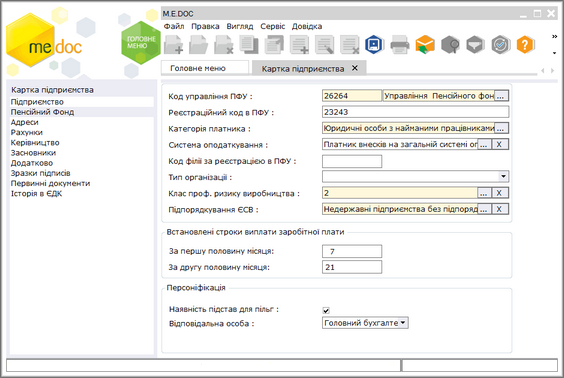

Натисніть, щоб збільшити малюнок

1. В полі Код управління ПФУ:

Для підприємств, створених після 01.10.2013 р. при відсутності коду управління ПФУ потрібно вибрати із довідника код 28000 Пенсійний фонд України. Цей код починає діяти з 18.11.2013.

Для установ, які були зареєстровані платниками ЄСВ до цієї дати, використовуються дані реєстрації в ПФУ.

Поле "Код філії за реєстрацією в ПФУ" не заповнюється.

2. У полі Тип організації оберіть значення із списку. Поле може бути незаповненим ("пусто"), якщо тип установи не відповідає ні одному із наведених варіантів.

Ці дані використовуються при формуванні Таблиць 1 та 6.

3. Клас проф. ризику виробництва - для всіх організацій обирається із підключеного довідника згідно присвоєному установі класу при його реєстрації в Фонді соціального страхування від нещасних випадків.

Поле використовується при формуванні Таблиці 1 звіту з єдиного внеску.

4. У полі Підпорядкування ЄСВ оберіть дані із підключеного довідника.

Цими даними заповнюється поле "Міністерство, інший центральний орган виконавчої влади" в Таблиці 1.

5. Група Встановлені строки виплати заробітної плати:

В полях За першу половину місяця та За другу половину місяця введіть відповідно день виплати заробітної плати за першу половину місяця і другу половину місяця.
Використовується в Додатку до Таблиці 1 (група 4 "Встановлені строки виплати заробітної плати").

6.  Якщо на підприємстві існують пільги на сплату єдиного внеску, відмітьте поле Наявність підстав для пільг.

Якщо це поле не відмічене, буде неможливо створити Таблицю 7.

7. Відповідальна особа:

Оберіть із списку (Керівник, Головний бухгалтер, Інша особа) посадову особу, яка в установі відповідає за подання звітів з ЄСВ.

Якщо обрана Інша особа, з'являться додаткові поля для заповнення:

- ІПН відповідальної особи
- ПІБ відповідальної особи

##### Створення скасовуючих звітів

_Шлях у довідці: Розділи програми › Звітність › Єдиний внесок › Додаток 4 " Звіт про суми нарахованої заробітної плати застрахованих осіб та суми нарахованого єдиного внеску на загальнообов’язкове державне соціальне страхування" › Створення скасовуючих звітів_

До створення скасовуючих документів наполегливо рекомендуємо переглянути нормативні матеріали, які регламентують створення таких звітів.

- [Наказ Мінфіну № 435 від 14.04.2015 «Про затвердження Порядку формування та подання страхувальниками звіту щодо сум нарахованого єдиного внеску на загальнообов’язкове державне соціальне страхування»](http://zakon4.rada.gov.ua/laws/show/z0460-15)
- [Наказ Мінфіну № 449 від 20.04.2015 «Про затвердження Інструкції про порядок нарахування і сплати єдиного внеску на загальнообов'язкове державне соціальне страхування»](http://zakon2.rada.gov.ua/laws/show/z0508-15)
- [Наказ Мінфіну № 441 від 11.04.2016 «Про внесення змін до Порядку формування та подання страхувальниками звіту щодо сум нарахованого єдиного внеску на загальнообов’язкове державне соціальне страхування»](http://zakon2.rada.gov.ua/laws/show/z0682-16/)
- [Наказ Мінфіну № 511 від 15.05.2018 «Про внесення змін до Порядку формування та подання страхувальниками звіту щодо сум нарахованого єдиного внеску на загальнообов'язкове державне соціальне страхування»](https://zakon.rada.gov.ua/laws/show/z0692-18#Text)
- [Наказ Мінфіну № 469 від 04.05.2018 «Про внесення змін до Інструкції про порядок нарахування і сплати єдиного внеску на загальнообов’язкове державне соціальне страхування»](https://zakon.rada.gov.ua/laws/show/z0645-18#Text)
- [Наказ Мінфіну N 670 від 05.11.2020 «Про затвердження Змін до Порядку формування та подання страхувальниками звіту щодо сум нарахованого єдиного внеску на загальнообов'язкове державне соціальне страхування»](https://zakon.rada.gov.ua/laws/show/z1289-20#Text)

З 01.02.2021 року щомісячні звіти за новою формою (версія 13), затвердженою наказом Міністерства фінансів України від 05.11.2020 р. № 670, підприємства, установи, організації, фізичні особи подають тільки з типом форми ліквідаційна (у разі проведення державної реєстрації припинення до 28 лютого 2021 року) та з типом форми додаткова та скасовуюча за періоди з січня 2016 року по грудень 2020 року включно.

Звіт зі статусом "скасовуюча" подається, якщо страхувальником було допущено помилку в реквізитах (крім сум).

У таблиці 6 звіту можуть виправлятися дані лише на одну застраховану особу.

Скасовуючі документи подаються після закінчення звітного періоду. Статус "скасовуюча" можливий лище для таблиць 5, 6, 7, 8, 9.

У випадку подання скасовуючих документів одночасно з ними подаються початкові документи із зазначеними вірними відомостями.

Посадова особа установи, яка відповідає за подання звіту з ЄСВ, повинна самостійно контролювати наявність початкових звітів в тому періоді, де скасовуються дані.

Для створення форми з ознакою Скасовуюча (Таблиці 5, 6, 7, 8, 9) потрібно:

1. Обрати період, в якому потрібно створити скасовуючу форму,

2. Виділити у модулі відповідну таблицю,

3. Із контекстного меню обрати Створити скасовуючу, або у меню обрати Правка - Створити скасовуючу.

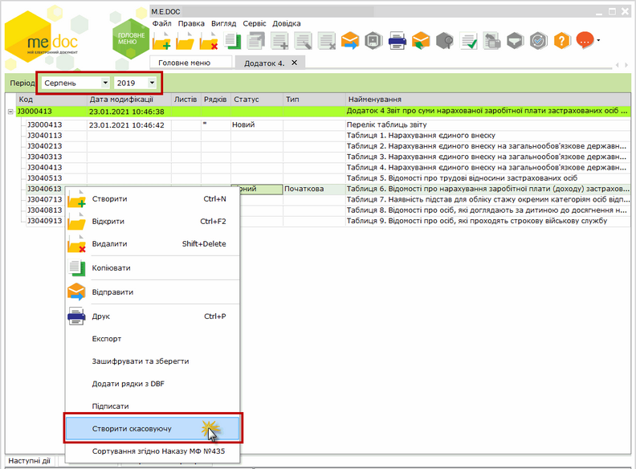

Натисніть, щоб збільшити малюнок

4. У "старому" періоді створюється новий комплект звітів, в якому для даної таблиці будуть присутні 2 форми - початкова та скасовуюча.

(Створені скасовуючі/додаткові форми версії «І» відображаються та подаються у попередніх звітних періодах)

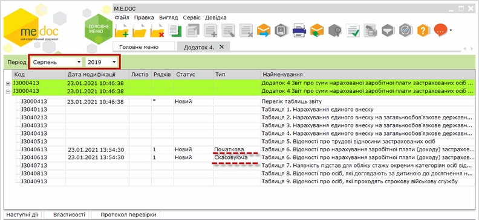

Натисніть, щоб збільшити малюнок

5. У скасовуючій формі заповнюється період, за який вона подається, та тип форми:

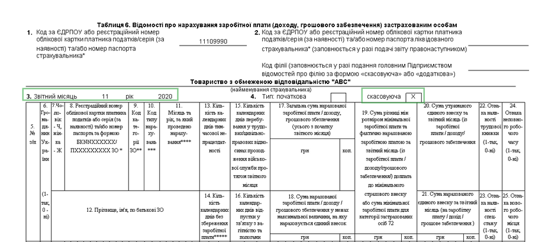

Натисніть, щоб збільшити малюнок

Потрібно відкрити скасовуючу форму та внести в неї записи з недостовірними відомостями, а потім - форму з типом "початкова" та внести в неї достовірні дані.

Зміни у сумах нарахованих доходу та внесків при формуванні та поданні скасовуючих документів не допускаються. При виявленні помилок у сумах виконується перерахунок у таблиці 6 у звітному періоді.

Комплект, який сформований для виправлення помилок, не повинен включати таблиці 1-4, але повинен включати Перелік таблиць звіту.

6. Всі звіти комплекту, включно з Переліком таблиць..., потрібно оновити поля (F5), перевірити (F4) та зберегти (Ctrl+S).

7. Після виконання всіх цих дій пачка звітів готова для подання.

##### Створення звітів зі статусом "Додаткова"

_Шлях у довідці: Розділи програми › Звітність › Єдиний внесок › Додаток 4 " Звіт про суми нарахованої заробітної плати застрахованих осіб та суми нарахованого єдиного внеску на загальнообов’язкове державне соціальне страхування" › Створення звітів зі статусом "Додаткова"_

Використовується для виправлення відомостей про ЗО, якщо у додатку 4 за попередній період не було зазначено застраховану особу, з якою було укладено або розірвано трудовий договір (наприклад, просто забули вказати!!!).

Можливий лише для Таблиці 5 та Таблиці 7. Подається після закінчення звітного періоду.

Створення додаткової виконується аналогічно скасовуючій.

З 01.02.2021 року щомісячні звіти за новою формою (версія 13), затвердженою наказом Міністерства фінансів України від 05.11.2020 р. № 670, підприємства, установи, організації, фізичні особи подають тільки з типом форми ліквідаційна (у разі проведення державної реєстрації припинення до 28 лютого 2021 року) та з типом форми додаткова та скасовуюча за періоди з січня 2016 року по грудень 2020 року включно.

Для створення форми з ознакою "Додаткова" (Таблиці 5, 7) потрібно:

1. Обрати період, в якому потрібно створити додаткову форму,

2. Виділити у модулі відповідну таблицю,

3. Із контекстного меню обрати - Створити додаткову або Правка - Створити додаткову.

4. У "старому" періоді створюється новий комплект звітів, в якому для даної таблиці буде присутня форма зі статусом "Додаткова".

Відкрийте таблицю, внесіть актуальні дані.

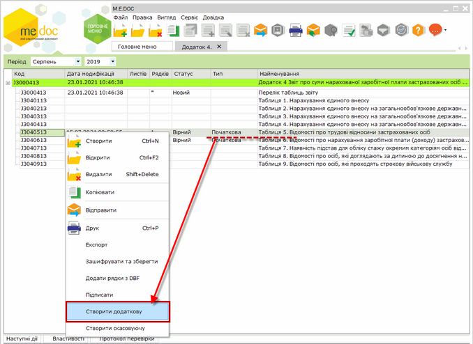

Натисніть, щоб збільшити малюнок

5. Далі відкрийте та перевірте перелік таблиць звіту.

6. Після виконання всіх цих дій пачка звітів готова для подання.

##### Консолідація всіх початкових звітів в один звіт

_Шлях у довідці: Розділи програми › Звітність › Єдиний внесок › Додаток 4 " Звіт про суми нарахованої заробітної плати застрахованих осіб та суми нарахованого єдиного внеску на загальнообов’язкове державне соціальне страхування" › Консолідація всіх початкових звітів в один звіт_

Виконується за допомогою функції Консолідувати звіти.

Ця функція призначена для установ, які повинні подавати в ПФУ єдиний звіт, а також у випадку, якщо документи однієї установи створювалися на різних комп'ютерах і були імпортовані у програму як окремі початкові звіти.

Використовується у випадку, якщо в програму імпортовано декілька пакетів ПОЧАТКОВИХ звітів (звіти у яких мають тип форми "Початкова") і потрібно звести дані всіх цих пакетів в один консолідований.

Виконується із меню Файл - Консолідувати звіти

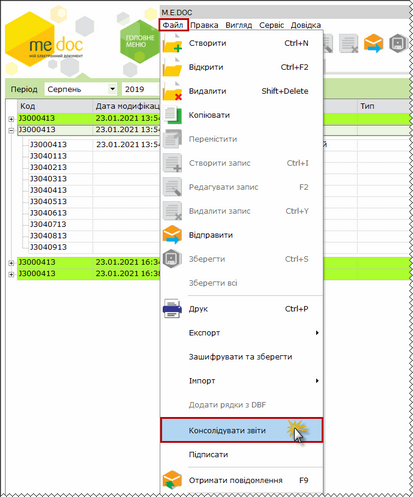

Натисніть, щоб збільшити малюнок

Після консолідації залишається лише один початковий звіт, інші початкові звіти видаляються із модуля без можливості відновлення.

Після консолідації потрібно відкрити всі Таблиці, оновити поля (F5), перевірити (F4) та зберегти звіти (Ctrl+S).

##### Подання звіту з єдиного внеску в ДПС України

_Шлях у довідці: Розділи програми › Звітність › Єдиний внесок › Додаток 4 " Звіт про суми нарахованої заробітної плати застрахованих осіб та суми нарахованого єдиного внеску на загальнообов’язкове державне соціальне страхування" › Подання звіту з єдиного внеску в ДПС України_

Закрита можливість подання всіх НОВИХ додатків ЄСВ (Додаток 4, Додаток 5, Додаток 6 та Додаток 7) із демо версії програми.

Створення та подання нових додатків виконується у програмі, що має ліцензію «Звітність».

У демо версію можливий тільки імпорт з інших програм і лише у форматі .pfz (для версії "I") або .xml (для версій "J" та "F"). Для такого імпортованого звіту доступне відправлення в ДПСУ з накладанням ЕП, інші варіанти експорту неможливі.

Безкоштовне створення та подання даних звітів можливе у програмі СОТА.

Для подання підготовленого комплекту звітів у ліцензійній версії програми є можливість:

- [Надрукувати всі звіти комплекту](#uccontribution-contribution_report_pfu_print)
- [Зберегти комплект на електронному носії](#uccontribution-contribution_report_pfu_saving)
- [Відправити його електронною поштою](#uccontribution-contribution_report_pfu_e-mail)

###### Друк документів звіту з єдиного внеску

_Шлях у довідці: Розділи програми › Звітність › Єдиний внесок › Додаток 4 " Звіт про суми нарахованої заробітної плати застрахованих осіб та суми нарахованого єдиного внеску на загальнообов’язкове державне соціальне страхування" › Подання звіту з єдиного внеску в ДПС України › Друк документів звіту з єдиного внеску_

Окремі звіти можна надрукувати із вікна відкритого документа - команда Файл - Друк, кнопка  на панелі інструментів та (Ctrl+P).

Весь комплект звітів з єдиного внеску можна надрукувати із модулю.

Для цього потрібно:

1. У модулі виділити потрібний комплект (встановити курсор на головний запис Додаток 4...).

2. Обрати Файл - Друк, Сtrl+P або кнопку .

###### Збереження звіту з єдиного внеску на електронному носії (без підпису ЕП)

_Шлях у довідці: Розділи програми › Звітність › Єдиний внесок › Додаток 4 " Звіт про суми нарахованої заробітної плати застрахованих осіб та суми нарахованого єдиного внеску на загальнообов’язкове державне соціальне страхування" › Подання звіту з єдиного внеску в ДПС України › Збереження звіту з єдиного внеску на електронному носії (без підпису ЕП)_

Страхувальник повинен подавати звіт з єдиного соціального внеску в повному обсязі, тобто звіт повинен включати весь комплект таблиць, які повинна подавати установа.

Збереження комплекту звітів виконується за допомогою функції Експорт. Після обрання користувачем такої функції програма повідомляє про наявність неперевірених чи помилкових звітів у окремому інформаційному повідомленні.

Із програми дозволений експорт звітів зі статусом Помилковий, але програма завжди попереджає про наявність звітів з таким статусом.

Для збереження комплекту (пачки) звітів на електронному носії потрібно:

1. У модулі виділити потрібну пачку (встановити курсор на головний запис Додаток 4...).

2. Експортувати її на електронний носій одним із способів:

- із меню Файл - Експорт;
- із контекстного меню Експорт

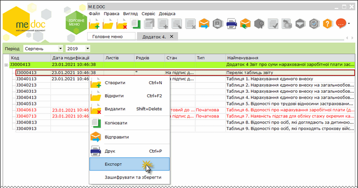

Натисніть, щоб збільшити малюнок

3. Якщо в комплекті є неперевірені чи помилкові документи, програма попереджає про їх наявність.

Користувач може відмінити експорт, відкрити та виправити помилки у таких звітах.

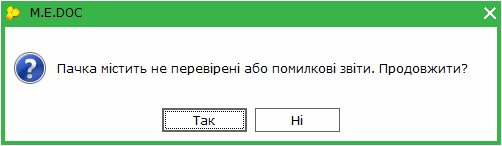

4. У відкритому вікні Експорт оберіть опцію "для подачі у контролюючий орган" та вкажіть диск чи каталог, у який буде збережений файл.

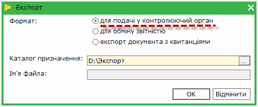

5. Ім'я файла програма сформує автоматично згідно вимог контролюючого органу. Звіт зберігається на диску непідписаним (без ЕП).

6. Після завершення процедури експорту програма у окремому вікні повідомляє про результат експорту.

7. Документи будуть збережені на обраному носії - в файли з розширенням .xml для усіх таблиць, які були створені.

 Всі звіти з ЄСВ (Додаток 4, 5, 6, 7) подаються та приймаються в пакеті, який представляє набір XML файлів.

 Сформований XML файл основного документа пакету (Перелік таблиць звіту) містить посилання на всі створені таблиці, і відповідно, у всіх таблицях є посилання на основний документ.

 За цими ознаками в Центрі обробки електронних звітів (шлюзі прийому звітності) виконується контроль повноти надісланого пакету.

###### Відправлення звіту з єдиного внеску

_Шлях у довідці: Розділи програми › Звітність › Єдиний внесок › Додаток 4 " Звіт про суми нарахованої заробітної плати застрахованих осіб та суми нарахованого єдиного внеску на загальнообов’язкове державне соціальне страхування" › Подання звіту з єдиного внеску в ДПС України › Відправлення звіту з єдиного внеску_

Звіти з ЄСВ (Додаток 4, 5, 6, 7) подаються та приймаються в пакеті, який представляє набір XML файлів.

Сформований XML файл основного документа пакету (Перелік таблиць звіту) містить посилання на всі створені таблиці, і відповідно, у всіх таблицях є посилання на основний документ.

За цими ознаками в Центрі обробки електронних звітів (шлюзі прийому звітності) виконується контроль повноти надісланого пакету.

Увага! Квитанції з результатами перевірки звіту приєднуються до кожної таблиці. Для того щоб впевнитись у прийнятті звіту, необхідно перевірити квитанції до кожної таблиці звіту. Якщо хоча б одна квитанція буде негативною, то весь звіт вважається неприйнятим (аналогічно до податкової звітності).

Для запуску процедури відправлення звіту електронною поштою потрібно виділити його у реєстрі звітів (встановити курсор на головний запис таблиці) та обрати:

- Файл - Відправити
- натиснути на кнопку  на панелі інструментів вікна модулю;
- у вкладці Наступні дії - Підписати звіт.

Спочатку формується файл звіту для відправлення, виконується накладення підписів на звіт, його шифрування та відправлення.

Накладення підписів

Після формування файлу звіту запускається його підписання - бухгалтером, директором, печаткою (програма запросить наявні для установи сертифікати).

Послідовність накладення підписів на звітні документи визначається звітним органом. Перелік підписів, які повинні накладатися на документи, встановлюється у модулі Адміністрування - Параметри системи - Підписи - Налаштувати комплект підписів. У групі Звітність потрібно відмітити посадових осіб та печатку, які підписуватимуть звіти.

Для накладення підпису потрібно у полі "Каталог з секретними ключами" встановити шлях до каталогу, а у полі "Пароль секретного ключа" - вручну із клавіатури внести пароль. Після накладення підпису бухгалтера таким же чином послідовно накладається підпис директора та печаткою.

Далі запускається наступний етап - вибір одержувача, шифрування файлу звіту та його відправлення.

Відправлення звіту

Одержувач звіту вказується у наступному вікні - Податкова інспекція. Файл шифрується сертифікатом центру обробки електронних звітів ДПСУ.

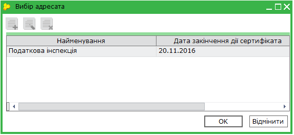

Після шифрування програма повторно запропонує підписати файл сертифікатом печатки установи - це не помилка, таким чином підписується "конверт", в який поміщається файл для відправки.

Після завершення всіх операцій запускається процес відправлення звіту і в наступному вікні програма повідомляє про його результат.

Приймання електронних квитанцій

Якщо звіт було відправлено безпосередньо із програми, приймання повідомлень та квитанцій виконується за допомогою функції Отримати повідомлення.

Електронні квитанції надходять на поштову скриньку, із якої відправлявся звіт. Прийняти квитанції із програми можна одним із способів:

- із меню Файл/ Отримати повідомлення;
- за допомогою функціональної клавіші F9;
- кнопкою  на панелі інструментів головного вікна програми.

Після цього запускається перевірка наявності вхідних повідомлень і якщо такі повідомлення є, вони завантажуються. Для прийняття у програму їх потрібно розшифрувати (ввести пароль захисту секретного ключа печатки установи):

Якщо надійшли повідомлення (та квитанції), спочатку відкриється вікно Отримано повідомлення.

Після закриття цього вікна Повідомлення та квитанції поміщаються безпосередньо у звіт, який було відправлено (з'являються вкладки на нижній панелі вкладок).

Якщо Ви відправили звіт з Єдиного внеску в контролюючий орган і довгий час немає Повідомлення та Квитанцій, в жодному разі не відправляйте цей самий звіт знову.
Для того, щоб повторно відправити звіт, скопіюйте його та знову відправте електронним каналом зв’язку.

## Зміна тексту квитанції про обробку звіту ПФУ

_Шлях у довідці: Єдиний внесок › (поза змістом)_

У тексті квитанції Ви можете побачити Коди результату обробки Вашого звіту.

Розшифровка значення коду результату наведено нижче за текстом квитанції.

Наприклад, Квитанція 1 виглядає так:
\_\_\_\_\_\_\_\_\_\_\_\_\_\_\_\_\_\_\_\_\_\_\_\_\_\_\_\_\_\_\_\_\_\_\_\_\_\_\_\_\_\_\_\_\_\_\_\_\_\_\_\_\_\_\_\_\_\_\_\_\_\_\_\_\_\_\_\_\_\_\_\_\_\_\_\_\_\_\_\_\_\_\_\_\_\_\_\_\_\_\_\_\_\_\_\_\_\_\_

"00

Дата обробки: 14.02.2013 17:50:41

Файл: 28000000000126ZZZZZZZ14022013174521E04FE.pfz

Підписувачі:

9182736455 Скляренко Валентина Віталіївна  - головний бухгалтер

1928374655 Гетьман Юрій Петрович – директор

00000126 Товариство з обмеженою відповідальністю «TLD» – електронна печатка.

Звіт «Звіт про суми нарахованої заробітної плати (доходу, грошового забезпечення, допомоги, компенсації) застрахованих осіб та суми нарахованого єдиного внеску на загальнообов`язкове державне соціальне страхування до органів Пенсійного фонду України» - Додаток 4 за період: 01.2013 р. успішно прийнято та направлено для подальшого опрацювання.

За результатом приймання та обробки електронного звіту в Пенсійному фонді України буде сформовано другу квитанцію, що буде надіслана на електронну адресу, з якої було відправлено документ (або посереднику)."

\_\_\_\_\_\_\_\_\_\_\_\_\_\_\_\_\_\_\_\_\_\_\_\_\_\_\_\_\_\_\_\_\_\_\_\_\_\_\_\_\_\_\_\_\_\_\_\_\_\_\_\_\_\_\_\_\_\_\_\_\_\_\_\_\_\_\_\_\_\_\_\_\_\_\_\_\_\_\_\_\_\_\_\_\_\_\_\_\_\_\_\_\_\_\_\_\_\_\_

де "00" - код результату обробки звіту.

"За результатом приймання та обробки електронного звіту в Пенсійному фонді України буде сформовано другу квитанцію, що буде надіслана на електронну адресу, з якої було відправлено документ (або посереднику)." - розшифровка значення коду.


