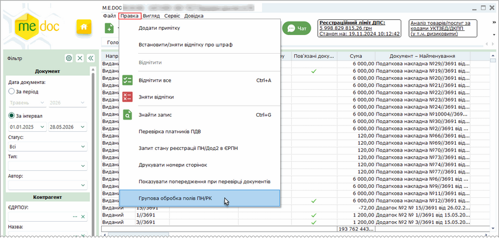
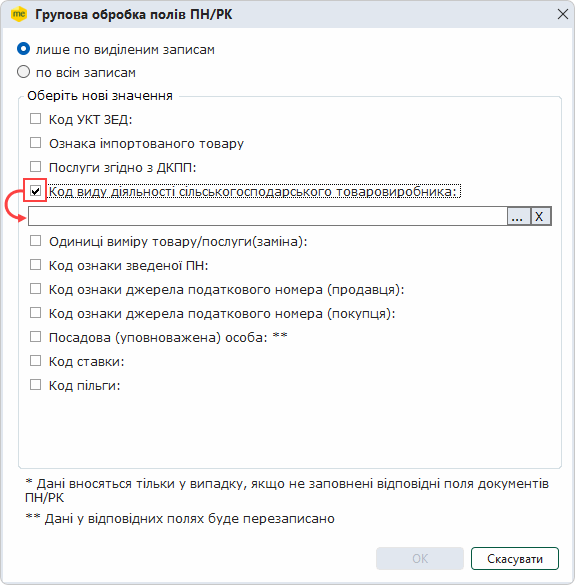
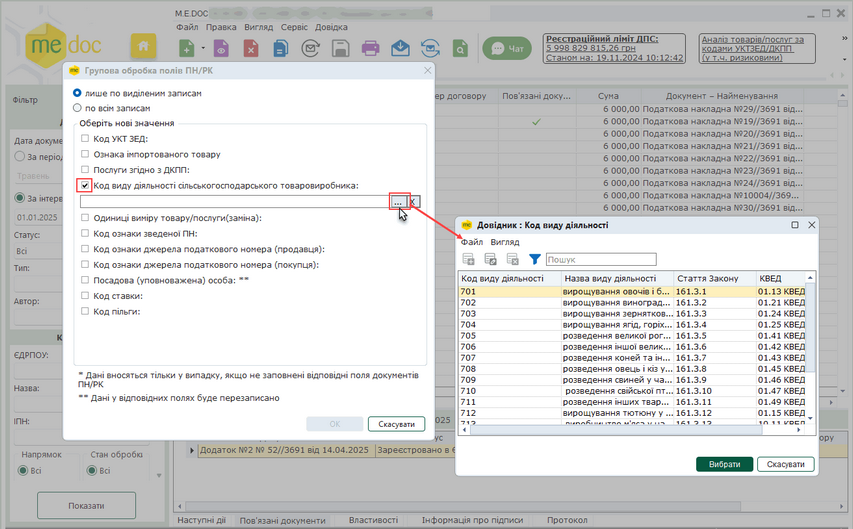

[← Зміст довідки](../)


# Реєстр податкових документів

## Реєстр податкових документів

_Шлях у довідці: Розділи програми › Первинні документи › Реєстр податкових документів_

Реєстр податкових документів призначений для створення, редагування та збереження Податкових накладних та Розрахунків коригування. з метою обміну даними документами з контрагентами та контролюючими органами. Електронні податкові накладні використовуються також при формуванні [Реєстру виданих та отриманих податкових накладних](UCDocNaklRstMain5.html#ucdocnaklrstmain5-docnaklrst). Ви можете обмінюватись податковими накладними та розрахунками коригування з вашими контрагентами за допомогою електронної пошти (з використанням ЕП). Для цього Вам потрібно мати сертифікат ЕП печатки цих контрагентів.

У даному розділі довідки:

- [Опис основних функціональних елементів інтерфейсу](PDocs_reestr_funkc.html#pdocs_reestr_funkc-pdocs_reestr_int)
- [Фільтр - початок роботи з реєстром документів](PDocs_reestr_funkc.html#pdocs_reestr_funkc-pdocs_reestr_filtr)
- [Архів документів](PDocs_reestr_funkc.html#pdocs_reestr_funkc-pdocs_reestr_arhiv)
- [Робота з первинними документами](PDocs_reestr_funkc.html#pdocs_reestr_funkc-pdocs_reestr_funkc)
- [Податкові накладні та Розрахунки коригування](UCNaklExchangeRst.html#ucnaklexchangerst-ucnaklexchangerst_)
- [Маршрути обробки податкових накладних](PDocs_reestr_marshrut.html#pdocs_reestr_marshrut-pdocs_reestr_marshrut)
- [Як створити документ на основі існуючого](Creat_doc_.html#creat_doc_-creat_doc_)
- [Створення вихідної ПН на основі вхідної](PDocs_Creat_vyhid.html#pdocs_creat_vyhid-pdocs_creat_vyhid)
- [Зв'язані документи](Conn_doc.html#conn_doc-conn_doc)
- [Групова обробка полів](#ucdfdocsrst-doc_group_field_edit)
- [Експорт податкових документів](Exp_perv.html#exp_perv-exp_perv)

### Групова обробка полів

_Шлях у довідці: Розділи програми › Первинні документи › Реєстр податкових документів › Групова обробка полів_

Групова обробка пустих полів надає можливість автоматизувати заповнення пустих граф документів Податкова накладна та Додаток 2.

За допомогою цієї функції можливо заповнювати графи:

- Код товару згідно з УКТ ЗЕД;
- Ознака імпортованого товару;
- Код послуги згідно з ДКПП;
- Код виду діяльності сільськогосподарського товаровиробника;
- Одиниці виміру товару/послуги (заміна);
- Код ознаки зведеної ПН.

Групове заповнення пустих граф здійснюється у непідписаних виданих документах.

Для внесення даних у документи виконайте дії в наступній послідовності:

1. Якщо заміну потрібно виконати для вибіркових документів, виділіть записи цих документів у таблиці реєстру. Для заповнення даних у всіх Податкових накладних та Додатках 2 записи виділяти не потрібно.

2. У меню Правка оберіть функцію Групова обробка полів ПН/РК.

Натисніть, щоб збільшити малюнок

3. Відкриється вікно Групова обробка полів ПН/РК.

4. Оберіть необхідні параметри:

- якщо потрібно виконати заповнення даних в обраних записах, встановіть позначку в полі лише по виділеним записам, інакше оберіть значення по всім записам;
- для вибору значень із довідників, встановіть позначки у відповідних полях. У вікні з'являться додаткові поля для вибору значень. Натисніть кнопку . Оберіть у довіднику потрібне значення:

Натисніть, щоб збільшити малюнок

- якщо потрібно видалити дані, обрані з довідника, у відповідному полі натисніть кнопку ;

5. Після внесення потрібних параметрів у вікні Групова обробка полів ПН/РК натисніть кнопку ОК. (Якщо в діалоговому вікні вимкнути всі галочки, кнопка ОК стає неактивною).

6. Система повідомить про закінчення процедури.

Зверніть увагу:

1. При встановленій опції Код УКТ ЗЕД вибране значення коду буде автоматично проставлене у пустих графах ПН/РК «Код товару згідно з УКТ ЗЕД», але тільки у тих рядках, в яких не заповнена графа «Код послуги згідно ДКПП».

2. При встановленій опції Ознака імпортованого товару у ПН та/або Дод.2 автоматично проставляються відмітки у пустих графах «Ознака імпортованого товару», за умови, що графа «Код послуги згідно ДКПП» не заповнена.

3. При встановленій опції Послуги згідно ДКПП пусті графи «Код послуги згідно ДКПП» заповнюються обраним значенням, якщо графи «Ознака імпортованого товару» та «Код товару згідно з УКТ ЗЕД» відповідного рядка не заповнені.

4. При заповненні даних Одиниці виміру товару/послуги (заміна) також заповнюються графа з кодом одиниць виміру, зверніть увагу, виконується не лише заповнення пустих полів, а й заміна існуючих значень. Щоб заповнити лише умовне позначення одиниці виміру без заповнення кодів одиниці виміру, встановіть опцію Заміна без коду одиниці виміру.

5. При встановленій опції Код ознаки зведеної ПН виконується заповнення граф: Зведена податкова накладна у Податкових накладних та До зведеної податкової накладної у Розрахунках коригування. Значення для заповнення обираються у довіднику Код ознаки зведеної ПН. Якщо серед обраних документів знаходяться ПН та РК більш ранніх версій, заповнення кодів зведеної ПН у цих документах не виконується.

6. При встановлені опцій Код ознаки джерела податкового номера (продавця) та Код ознаки джерела податкового номера (покупця) виконується заповнення відповідних полів ПН/РК. Значення коду обирається із підключеного довідника Код ознаки джерела податкового номера. Заповнення полів Код ознаки джерела податкового номера виконується лише для тих ПН/РК, у яких відповідні поля не містять значень.

7. При встановлені опцій Посадова (уповноважена) особа виконується заповнення графи Власне ім’я ПРІЗВИЩЕ ПН/РК. Значення для заповнення обирається із підключеного довідника Співробітники. При виконанні групової обробки виконується заміна вмісту графи ПН/РК Власне ім’я ПРІЗВИЩЕ обраним значенням.

8. При встановлені опцій Код ставки за замовчуванням виконується не лише заповнення пустих полів, а й заміна наявних значень. Щоб заповнити графу Код ставки лише для рядків, у яких ця графа не містить значень, встановіть опцію Заміна без коду ставки.


