[← Зміст довідки](../)


# Реєстр електронних документів

## Реєстр електронних документів

_Шлях у довідці: Розділи програми › Первинні документи › Реєстр електронних документів_

Реєстр електронних документів призначений для створення, редагування та збереження первинних документів (актів виконаних робіт, рахунків фактур, платіжних доручень тощо, а також, Універсальних документів із вкладеннями різних форматів), як зовнішніх - з метою обміну ними з контрагентами, так і внутрішніх - для власних потреб підприємства. Ви можете обмінюватись первинними документами з Вашими контрагентами за допомогою електронних каналів зв'язку (з використанням ЕП). Для цього Вам потрібно мати сертифікат ЕП печатки цих контрагентів.

У даному розділі довідки:

- [Опис основних функціональних елементів інтерфейсу](PDocs_reestr_funkc.html#pdocs_reestr_funkc-pdocs_reestr_int)
- [Фільтр - початок роботи з реєстром документів](PDocs_reestr_funkc.html#pdocs_reestr_funkc-pdocs_reestr_filtr)
- [Архів документів](PDocs_reestr_funkc.html#pdocs_reestr_funkc-pdocs_reestr_arhiv)
- [Робота з первинними документами](PDocs_reestr_funkc.html#pdocs_reestr_funkc-pdocs_reestr_funkc)
- [Створення електронного первинного документа](#ucdfdocsrstnew-pdocs_reestr_funkc_stvor)
- [Версії документа](#ucdfdocsrstnew-pdocs_reestr_funkc_vesii)
- [Робота з вкладеннями](#ucdfdocsrstnew-pdocs_reestr_vklad)
- [Документ, що потребує заповнення з боку отримувача](#ucdfdocsrstnew-pdocs_reestr_zapovnennia)
- [Документ, що не підлягає обробці з боку отримувача](#ucdfdocsrstnew-pdocs_reestr_bez_oderzhavacha)
- [Документ, що потребує першого підпису отримувача](#ucdfdocsrstnew-pdocs_reestr_pershyj_pidpys)
- [Багатосторонній обмін документами](#ucdfdocsrstnew-obmin_shema)
- [Відправка пакету документів у банк](#ucdfdocsrstnew-pdocs_reestr_bank)
- [Відправка фінансової звітності до біржі](#ucdfdocsrstnew-pdocs_reestr_birzha)
- [Як створити документ на основі існуючого](Creat_doc_.html#creat_doc_-creat_doc_)
- [Зв'язані документи](Conn_doc.html#conn_doc-conn_doc)
- [Посилання на первинний документ](#ucdfdocsrstnew-obmin_link_sota)
- [Візування електронного документа](#ucdfdocsrstnew-pdocs_reestr_viza)
- [Анулювання первинного документа](#ucdfdocsrstnew-pdocs_reestr_anulyuvannia)
- [Відкликання первинного документа](#ucdfdocsrstnew-pdocs_reestr_vidklyk)
- [Ярлики та примітки до документів](#ucdfdocsrstnew-doc_label)
- [Універсальний документ із вкладеннями](Doc_Dov_Form.html#doc_dov_form-doc_dov_form)
- [Синхронізація електронних документів з системою Medoc ЕДО](#ucdfdocsrstnew-pdocs_reestr_synhro)
- [Експорт первинних документів](#ucdfdocsrstnew-exp_perv_el)

### Як створити електронний первинний документ

_Шлях у довідці: Розділи програми › Первинні документи › Реєстр електронних документів › Як створити електронний первинний документ_

Для створення нового первинного документа виконайте дії в наступній послідовності:

1. Оберіть один із способів:

- на панелі інструментів натисніть кнопку Створити - Обрати шаблон документа;
- виберіть команду Файл - Створити - Обрати шаблон документа;
- у контекстному меню оберіть команду Створити - Обрати шаблон документа.

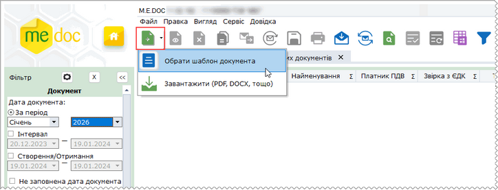

Натисніть, щоб збільшити малюнок

2. Відкриється вікно Створення звіту.

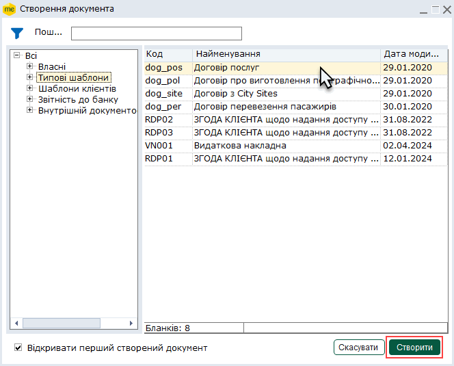

Вікно Створення звіту містить навігаційну панель (ліворуч), в якій у вигляді дерева відображені групи документів:

- Всі – містить всі шаблони, які доступні у програмі, як глобальні (зберігаються у Глобальному реєстрі шаблонів), так і локальні (зберігаються у базі даних програми).
- Власні – основний робочий каталог, в якому містяться шаблони, створені користувачем, як локальні, так і опубліковані у Глобальному реєстрі шаблонів. Має структуру:
- підкаталог Публічні – містить глобальні шаблони користувача, що розміщені на сервері «ПТАХ» (опубліковані у Глобальному реєстрі шаблонів);
- шаблони користувача, які зберігаються локально на комп’ютері та не опубліковані у Глобальному реєстрі шаблонів. Локальні шаблони можуть зберігатись у окремих підкаталогах, що створюються користувачем.
- Типові шаблони – каталог в якому надаються типові електронні версії шаблонів для бухгалтерського обліку та первинної документації. Типові шаблони надаються та змінюються розробником.
- Шаблони клієнтів – каталог з глобальними шаблонами організацій-контрагентів (опубліковані у Глобальному реєстрі шаблонів). Містить підкаталоги, що мають коротку назву, за якою організація-контрагент надає свої послуги або продукти на ринку.
- Звітність до банку - форми для [відправки статистичної та фінансової звітності](#ucdfdocsrstnew-pdocs_reestr_bank), а також супроводжуючих документів у банк.

При виборі групи (ліворуч) у вікні справа відображається перелік шаблонів, що відносяться до цієї групи.

Із переліку можна обрати один або декілька шаблонів. Вибір декількох шаблонів відбувається за стандартною для ОС Windows процедурою:

- при натиснутій клавіші Ctrl лівою кнопкою миші обираються довільно розташовані шаблони;
- при натиснутій клавіші Shift - лівою кнопкою миші обирається діапазон розташованих підряд шаблонів.

Після вибору шаблону (або шаблонів) для початку процесу створення документів натисніть кнопку Створити у нижній частині вікна або натисніть подвійним кліком лівої клавіші миші по потрібному шаблону (в разі створення одного звіту).

Якщо у полі Відкривати перший створений документ стоїть позначка, одразу відкриється створений документ, а при груповому створенні документів відкриється тільки перший у переліку документ. Якщо позначка у цьому полі не проставлена, запис про створений документ поміщається одразу в Реєстр електронних документів. Такий документ матиме статус Готується, його можна пізніше обрати та відкрити для редагування.

3. У окремому вікні відкриється бланк документа, який потрібно заповнити.

Поля, що підсвічені жовтим кольором, доступні для заповнення та редагування.

4. Перевірте правильність заповнення полів:

- на панелі інструментів кнопкою
- із меню Правка - Перевірити документ;
- на вкладці Наступні дії - команда Перевірити документ;
- за допомогою клавіші F4.

Перевіряється правильність заповнення полів і у випадку помилок, система підсвітить червоним кольором поля, що необхідно виправити. Виправте помилки та знову виконайте перевірку.

Також для у вікні відкритого документа можна виконати операції:

Оновлення полів (модифікація) - оновлення (модифікації) полів у документі у випадку змін відповідних полів у картці установи, реєстрі співробітників, довідниках тощо. Запускається одним із способів:

- на панелі інструментів кнопкою
- із меню Правка - Оновити поля
- за допомогою функціональної клавіші F5.

Перерахунок документа - примусовий перерахунок розрахункових полів документа, наприклад, при відключеному автоперерахунку. Запускається одним із способів:

- на панелі інструментів кнопкою
- із меню Правка - Перерахувати документ
- за допомогою функціональної клавіші F6.

У разі, якщо є необхідність порівняти вміст кількох документів, можна відкрити ці документи у [окремих вікнах програми](UCPravila.html#ucpravila-pravyla). Щоб відкрити документ у окремому вікні, виділіть документ у таблиці реєстру та скористайтеся одним із способів:

- у головному меню програми виконайте команду Вигляд – Перегляд у вікні;
- виконайте команду контекстного меню Перегляд у вікні.

5. Збережіть звіт, натиснувши кнопку  або комбінацію клавіш Ctrl+S. (Під час збереження виконується автоматична перевірка правильності заповнення полів звіту.)

### Версії документа

_Шлях у довідці: Розділи програми › Первинні документи › Реєстр електронних документів › Версії документа_

В цьому розділі:

[Створення версії отриманого документа](#ucdfdocsrstnew-pdocs_reestr_funkc_vesii)

[Створення версії вихідного документа](#ucdfdocsrstnew-pdocs_reestr_funkc_vesii)

Якщо первинний документ (вхідний або вихідний) містить помилки або неточності, можливо виправити їх, створивши нову версію документа.

Функція доступна для:

- вхідних первинних документів (отриманих від контрагента);
- вихідних документів, на які вже було накладено хоча б один підпис.

Для документа можна створювати необмежену кількість версій, поки остаточний варіант не влаштує обидві сторони. Вся історія змін (версій) документа фіксується у системі та може бути переглянута на вкладці Версії документа.

Створення версії отриманого документа

Для створення версії отриманого документа:

1.  У таблиці реєстру виділіть рядок отриманого документа, для якого потрібно створити версію, та виконайте команду Відредагувати документ на вкладці Наступні дії:

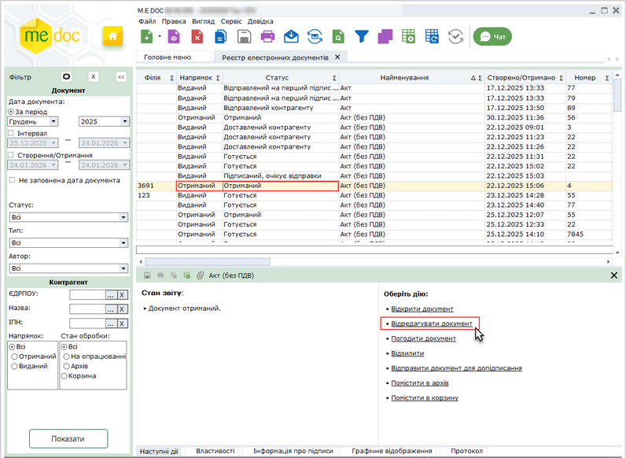

Натисніть, щоб збільшити малюнок

2. У вікні, що відкриється, введіть коментар до нової версії (що пояснює причину створення нової версії), натисніть ОК:

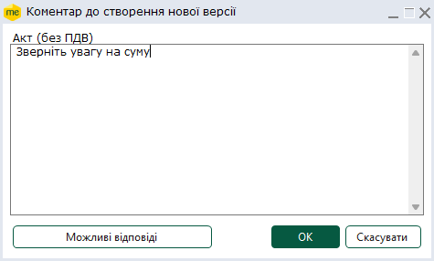

Можна обрати готовий коментар із довідника, натиснувши кнопку Можливі відповіді.

3. Відкриється вікно документа. Внесіть у документ бажані зміни.

Щоб надіслати нову версію контрагенту, підпишіть її всіма необхідними підписами.

4. Дата та час редагування документа, а також ПІБ особи, що вносила зміни у документ (за замовчанням, поточного авторизованого у системі користувача) автоматично фіксується на вкладці Версії документа.

При створенні версії вхідного (отриманого) документа коментар додається до останньої створеної версії отриманого документа:

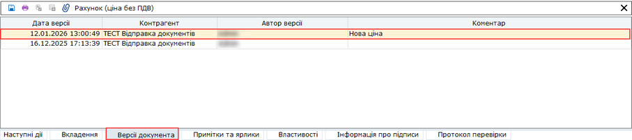

Натисніть, щоб збільшити малюнок

У разі потреби, у полі Коментар можна змінити або додати інформацію щодо поточної редакції документа.

- Вкладка Версії документа доступна у вікні відкритого документа.
- На вкладці Версії документа доступні для перегляду тільки ті версії, які користувач створив самостійно за допомогою функції Відредагувати документ.
- При виборі відповідного рядка вкладки Версії документа відкривається вміст документа, що відповідає обраній версії.

5. В свою чергу, контрагент вирішує, що робити з документом, який був змінений: [затвердити](PDocs_reestr_funkc.html#pdocs_reestr_funkc-pdocs_reestr_funkc_pryyom), [відхилити](PDocs_reestr_funkc.html#pdocs_reestr_funkc-pdocs_reestr_funkc_pryyom) або редагувати.

[До початку](#ucdfdocsrstnew-pdocs_reestr_funkc_vesii)

Створення версії вихідного документа

Для створення версії вихідного (виданого) документа:

1. У таблиці реєстру виділіть рядок вихідного документа, для якого потрібно створити версію, та виконайте команду Змінити документ на вкладці Наступні дії:

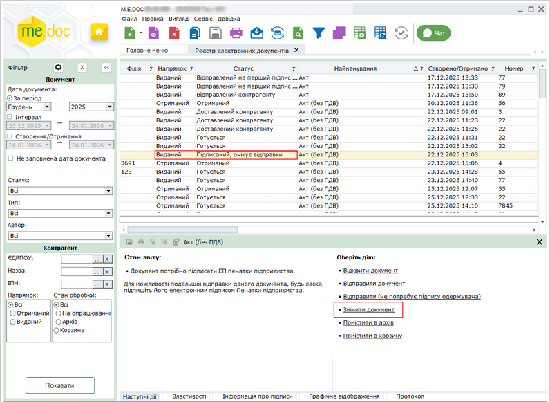

Натисніть, щоб збільшити малюнок

2. По виконанню команди Змінити документ для вихідного документа відкриється вікно повідомлення, у якому натисніть Так, щоб підтвердити створення нової версії документа:

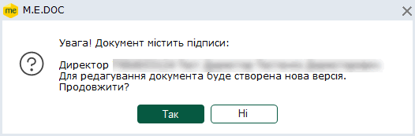

3. У вікні, що відкриється, введіть коментар до нової версії (що пояснює причину створення нової версії), натисніть ОК:

Можна обрати готовий коментар із довідника, натиснувши кнопку Можливі відповіді.

4. Відкриється вікно документа. Внесіть у документ бажані зміни.

Під час створення нової версії документа підписи з попередньої версії не видаляються. Щоб надіслати нову версію контрагенту, її потрібно підписати заново всіма необхідними підписами.

5. Дата та час редагування документа, а також ПІБ особи, що вносила зміни у документ (за замовчанням, поточного авторизованого у системі користувача) автоматично фіксується на вкладці Версії документа.

При створенні версії вихідного документа коментар додається до документа, на основі якого створено версію:

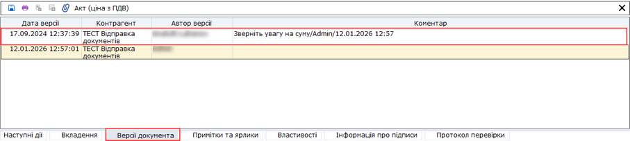

Натисніть, щоб збільшити малюнок

- Вкладка Версії документа доступна у вікні відкритого документа.
- При виборі відповідного рядка вкладки Версії документа відкривається вміст документа, що відповідає обраній версії.

У разі потреби, у полі Коментар можна змінити або додати інформацію щодо поточної редакції документа.

6. В свою чергу, контрагент вирішує, що робити з документом, який був змінений: [затвердити](PDocs_reestr_funkc.html#pdocs_reestr_funkc-pdocs_reestr_funkc_pryyom), [відхилити](PDocs_reestr_funkc.html#pdocs_reestr_funkc-pdocs_reestr_funkc_pryyom) або редагувати.

[До початку](#ucdfdocsrstnew-pdocs_reestr_funkc_vesii)

### Робота з вкладеннями

_Шлях у довідці: Розділи програми › Первинні документи › Реєстр електронних документів › Робота з вкладеннями_

В цьому розділі:

[Додавання вкладення](#ucdfdocsrstnew-pdocs_reestr_vklad)

[Дії із вкладеннями](#ucdfdocsrstnew-pdocs_reestr_vklad)

[Підписання вкладень](#ucdfdocsrstnew-pdocs_reestr_vklad)

У програмі можна додавати, видаляти, відкривати та зберігати вкладення в первинних документах.

Функція доступна за наявності ліцензії на модуль «Обмін документами з контрагентами (додаткові функції)».

До первинних документів можна додавати файли таких форматів: txt, rtf, doc, docx, xls, xlsx, pdf, png, jpeg, jpg, zip. Можна додати файли загальним обсягом до 30 МБ.

Додавання вкладення

Для додавання вкладення до первинного документа скористайтеся одним із способів:

За допомогою вкладки Вкладення

1. Відкрийте або виділіть у таблиці реєстру потрібний документ. Відкрийте вкладку Вкладення:

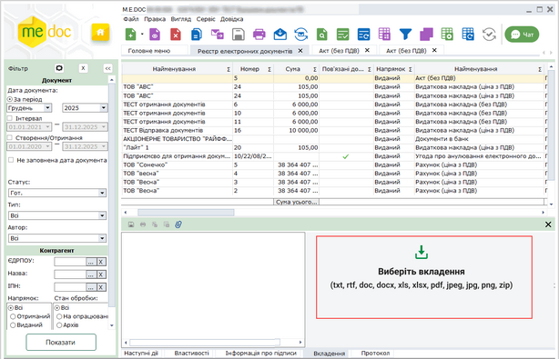

Натисніть, щоб збільшити малюнок.
Вкладка Вкладення у вікні відкритого документа

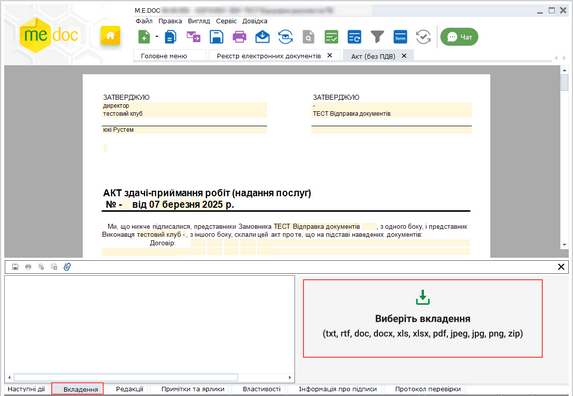

Натисніть, щоб збільшити малюнок.
Вкладка Вкладення у таблиці реєстру

2. На вкладці Вкладення натисніть кнопку  Виберіть вкладення.

3. У вікні, що відкриється, оберіть один або декілька файлів. Натисніть на кнопку Відкрити.

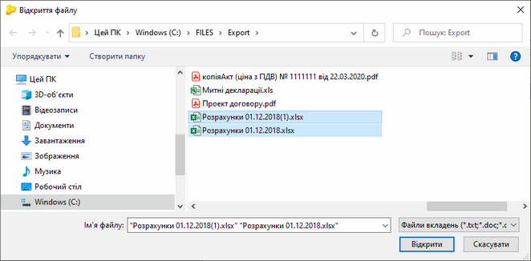

Натисніть, щоб збільшити малюнок

4. Додані файли відобразяться на вкладці Вкладення:

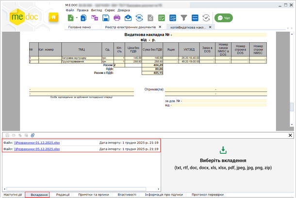

Натисніть, щоб збільшити малюнок.
Вкладка Вкладення у вікні відкритого документа

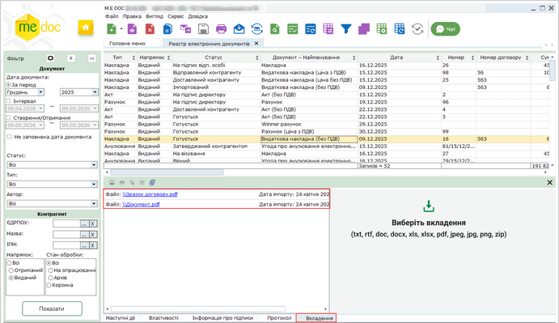

Натисніть, щоб збільшити малюнок.
Вкладка Вкладення у таблиці реєстру

Додати файл вкладення також можна, натиснувши кнопку  на панелі інструментів вкладки Вкладення або вкладки Наступні дії.

Додавання вкладення за допомогою меню Правка

1. У вікні відкритого первинного документа виберіть команду Правка - Додати вкладення.

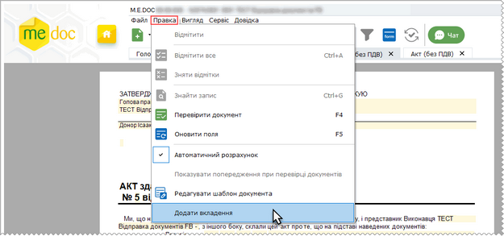

Натисніть, щоб збільшити малюнок

   На виконання відкриється стандартне вікно вибору файлів.

2. Оберіть один або декілька файлів.

3. Натисніть на кнопку Відкрити.

4. Додані файли відобразяться на вкладці Вкладення.

[До початку](#ucdfdocsrstnew-pdocs_reestr_vklad)

Дії із вкладеннями

Із доданим до первинного документа вкладенням можна виконати такі дії: зберегти файл, відкрити файл для перегляду, видалити вкладення з первинного документа.

Для вибору дії із вкладенням:

1. Відкрийте або виділіть у таблиці реєстру потрібний документ. На вкладці Вкладення натисніть на назву потрібного файлу.

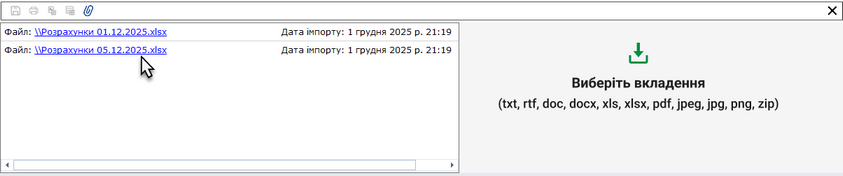

Натисніть, щоб збільшити малюнок

На виконання відкриється вікно вибору дій із файлом.

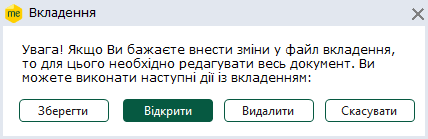

При натисканні на кнопки виконуються такі дії:

- Зберегти
відкривається вікно вибору папки для збереження. Зберігається файл вкладення та підписи, якщо файл підписаний. Підписи зберігаються окремими файлами p7s.

- Відкрити
файл відкривається для перегляду у програмі відповідно до формату файлу.

- Видалити
файл видаляється. Видалити вкладення можна тільки з непідписаних та невідправлених документів.

- Скасувати
вікно вибору дій закривається.

[До початку](#ucdfdocsrstnew-pdocs_reestr_vklad)

Підписання вкладень

При підписанні первинних документів виконується також і підписання вкладень.

При погодженні документа контрагентом виконується також допідписання вкладення у форматі p7s.

[До початку](#ucdfdocsrstnew-pdocs_reestr_vklad)

### Документ, що потребує заповнення з боку отримувача

_Шлях у довідці: Розділи програми › Первинні документи › Реєстр електронних документів › Документ, що потребує заповнення з боку отримувача_

У програмі є можливість обміну документами, що вимагають заповнення з боку отримувача, наприклад, таких як Акт звіряння.

Функція доступна для документів, крім ПН та РК та документів, для яких налаштовано [багатосторонній обмін](#ucdfdocsrstnew-obmin_shema).

Для створення документа, що вимагає заповнення з боку отримувача:

1. Перейдіть у розділ Первинні документи - Шаблони первинних документів та створіть або відредагуйте шаблон первинного документа для заповнення його з боку отримувача. Для цього у шаблоні документа додайте атрибут - Потребує заповнення з боку отримувача. Докладно про створення шаблонів дивіться у розділі [Шаблони первинних документів](UCRtfDocTemplate.html#ucrtfdoctemplate-pdocs_shablon_stvor).

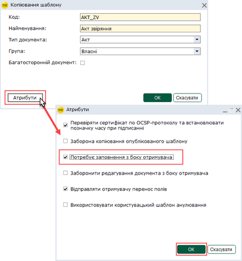

Натисніть, щоб збільшити малюнок

2. Забороніть редагування полів документа, які будуть заповнюватися на боці відправника. Для цього виділіть поле у шаблоні документа та встановіть опцію Заборонити редагування отримувачем:

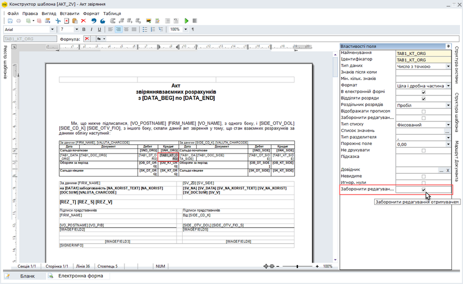

Натисніть, щоб збільшити малюнок

3. У розділі Первинні документи - Реєстр електронних документів [створіть документ](#ucdfdocsrstnew-pdocs_reestr_funkc_stvor) за шаблоном, для якого встановлено атрибут Потребує заповнення з боку отримувача. Заповніть необхідні поля документа. [Підпишіть та відправте документ](PDocs_reestr_funkc.html#pdocs_reestr_funkc-pdocs_reestr_funkc_vidp) контрагенту.

4. При відкритті документа, що потребує дозаповнення, на боці отримувача автоматично створюється [версія документа](#ucdfdocsrstnew-pdocs_reestr_funkc_vesii). У коментарі до редакції буде зазначено: "Створено автоматично у зв'язку з необхідністю заповнення з боку отримувача":

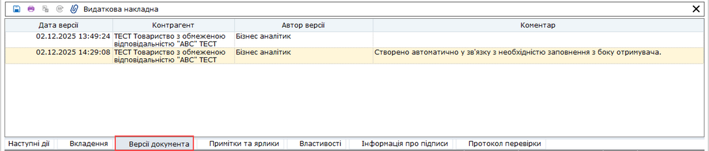

Натисніть, щоб збільшити малюнок

Поля, для яких у шаблоні була встановлена опція Заборонити редагування отримувачем, на боці отримувача недоступні для редагування.

5. Отримувач дозаповнює необхідні поля у редакції документа, підписує та відправляє редакцію документа відправнику.

6. Дата та час редагування документа, а також ПІБ особи, що вносила зміни у документ (за замовчуванням, користувач який перший відкрив отриманий документ) автоматично фіксується на вкладці Редакції.

Документ може редагуватись нескінчену кількість разів, поки остаточний варіант не влаштує обидві сторони. Вся історія змін (редагувань) документа фіксується у системі та може бути переглянута на вкладці Редакції. При виборі відповідного рядка вкладки Редакції відкривається вміст документа, що відповідає обраній редакції.

### Документ, що не підлягає обробці з боку отримувача

_Шлях у довідці: Розділи програми › Первинні документи › Реєстр електронних документів › Документ, що не підлягає обробці з боку отримувача_

У програмі є можливість обміну документами, що за певних умов можуть оформлюватися без підпису представника контрагента, відповідно до Закону України № 4791-IX від 24.02.2026 р. "Про внесення зміни до статті 9 Закону України "Про бухгалтерський облік та фінансову звітність в Україні" щодо спрощення оформлення первинних документів з надання послуг".

Функція доступна для вихідних електронних документів крім [звітності у банк](#ucdfdocsrstnew-pdocs_reestr_bank), [фінансової звітності до біржі](#ucdfdocsrstnew-pdocs_reestr_birzha), [угоди про анулювання документів](#ucdfdocsrstnew-pdocs_reestr_anulyuvannia), а також документів [багатостороннього обміну](#ucdfdocsrstnew-obmin_shema), що містять більше ніж 2 учасників документообігу.

Для створення документа, що оформлюватися без підпису представника контрагента:

1. У розділі Первинні документи - Реєстр електронних документів [створіть документ](#ucdfdocsrstnew-pdocs_reestr_funkc_stvor). Заповніть необхідні поля документа.

2. Щоб [підписати та відправити документ](PDocs_reestr_funkc.html#pdocs_reestr_funkc-pdocs_reestr_funkc_vidp) контрагенту, виконайте команду Відправити (не потребує підпису одержувача) на вкладці Наступні дії:

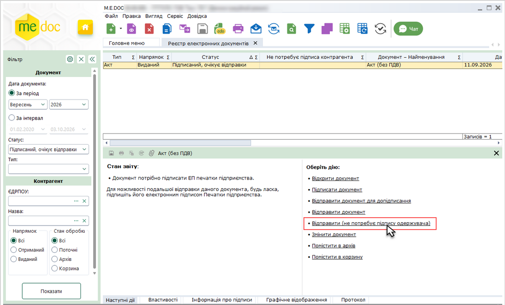

Натисніть, щоб збільшити малюнок

Команда Відправити (не потребує підпису одержувача) також доступна у вікні відкритого документа.

3. У вікні, що відкриється, оберіть сертифікат підписання згідно з налаштованим комплектом підписів. Після накладання підписів відкриється вікно, у якому оберіть сертифікат шифрування:

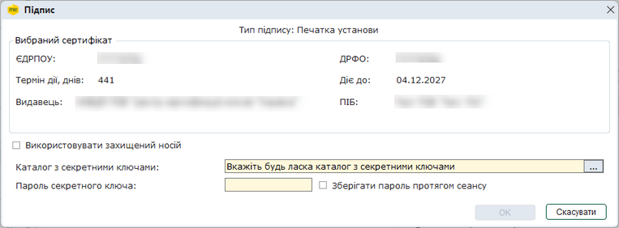

Натисніть, щоб збільшити малюнок

4. Після відправлення документ набуває статусу Відправлений контрагенту. Після успішної доставки статус документа змінюється на Доставлений (не потребує підпису одержувача).

Ознака документів, що були відправлені за допомогою команди Відправити (не потребує підпису одержувача), відображається у колонці реєстру Не потребує підпису контрагента - колонка містить позначку .

На боці контрагента (отримувача) документ набуває статус Отриманий (підпис не потрібен). Команди підписання, погодження, відхилення та інші дії з опрацювання документа отримувачу недоступні.

### Документ, що потребує першого підпису отримувача

_Шлях у довідці: Розділи програми › Первинні документи › Реєстр електронних документів › Документ, що потребує першого підпису отримувача_

Програма надає можливість надсилання первинного документа для отримання першого підпису від контрагента-отримувача.

Для отримання першого підпису від контрагента-отримувача виконайте дії:

1. Заповніть на перевірте документ, який потрібно відправити контрагенту для отримання першого підпису.

2. Відправте документ контрагенту на підпис, для цього на вкладці Наступні дії виконайте команду Відправити на перший підпис контрагенту:

- у вікні відкритого документа;
- у вікні реєстру, попередньо виділивши рядок документа:

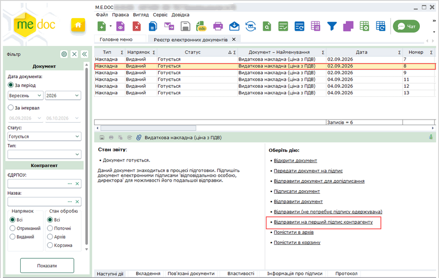

Натисніть, щоб збільшити малюнок

Команда Відправити на перший підпис контрагенту недоступна для Багатосторонніх документів, Звітності до банку та документів Анулювання.

3. Програма запропонує обрати сертифікат шифрування (можна обрати будь-який сертифікат шифрування підприємства), після чого виконується шифрування та відправка документа контрагенту:

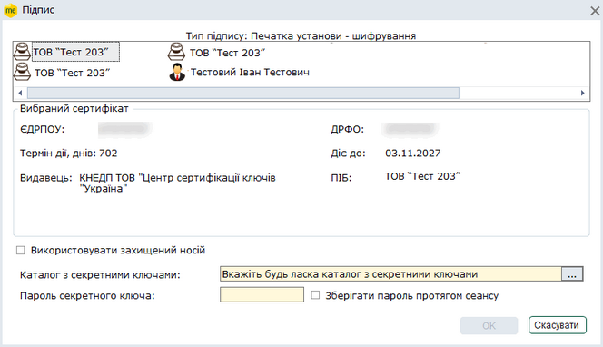

Натисніть, щоб збільшити малюнок

4. Після успішної відправки документ набуває статусу Відправлений на перший підпис контрагенту:

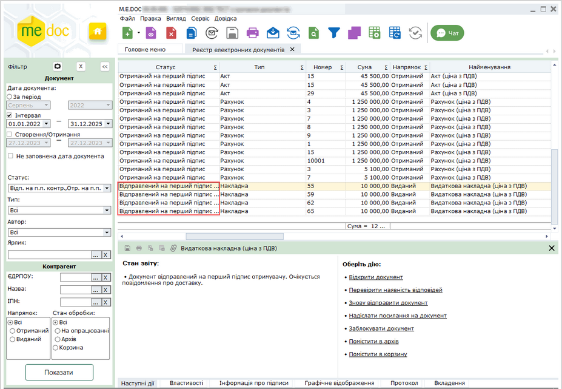

Натисніть, щоб збільшити малюнок

5. На боці отримувача документ набуває статусу Отриманий на перший підпис. Контрагент погоджує документ, за допомогою команди [Погодити документ](PDocs_reestr_funkc.html#pdocs_reestr_funkc-pdocs_reestr_funkc_pryyom). За цією командою документ підписується та відправляється ініціатору:

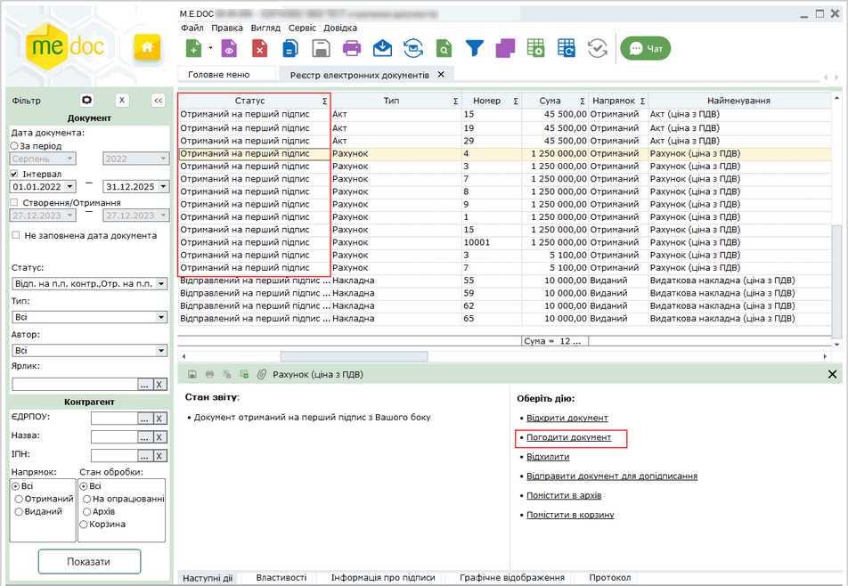

Натисніть, щоб збільшити малюнок

Можна одночасно погоджувати декілька документів, що мають статус Отриманий на перший підпис. Для цього виділіть потрібні документи у реєстрі та виконайте команду меню Файл - Погодити обрані документи.

6. Ініціатор отримує підписаний документ, який також набуває статусу Підписаний контрагентом, після чого може накласти власний підпис за допомогою команди [Погодити документ](PDocs_reestr_funkc.html#pdocs_reestr_funkc-pdocs_reestr_funkc_pryyom):

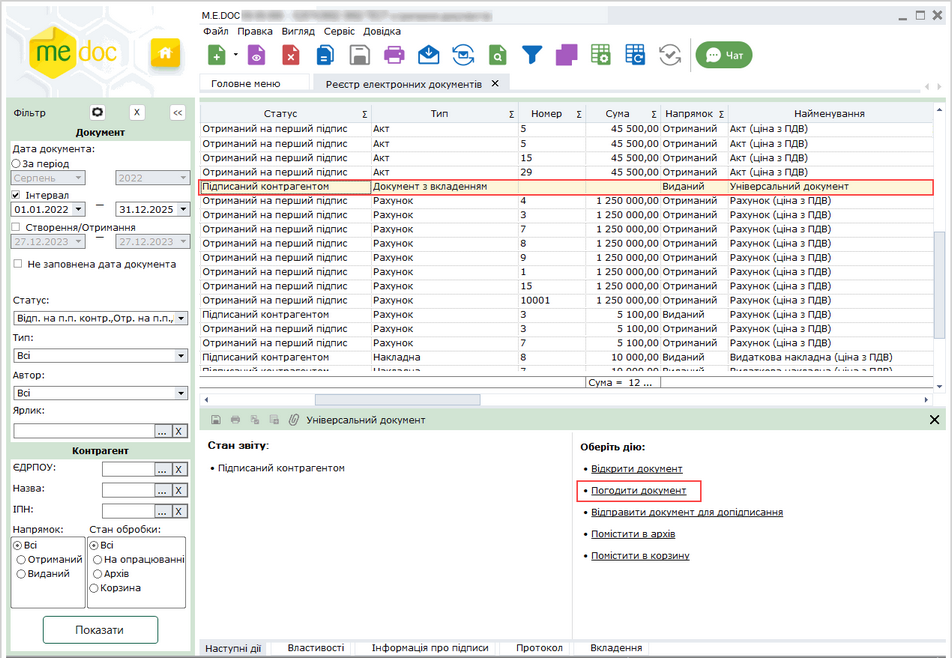

Натисніть, щоб збільшити малюнок

7. Після погодження документа ініціатором документ набуває статусу Затверджений контрагентом, на боці отримувача документ набуває статусу Затверджений.

Можлива автоматична обробка документів з ознакою відправки на перший підпис контрагенту у модулі Автоматична обробка документів та Сервісі універсальної автоматичної обробки документів.

При встановленій опції Автоматичне погодження первинних документів у розділі налаштувань Обробка вхідних документів виконуватиметься автоматичне накладання підписів на документи (погодження документів, відправлених на перший підпис) як на боці отримувача, так і на боці відправника документа.

Також можлива автоматична відправка документів на перший підпис контрагенту, для цього необхідно імпортувати у програму первинні документи з ознакою відправки на перший підпис контрагенту (SIDESIGN=2).

[До початку](#ucdfdocsrstnew-pdocs_reestr_pershyj_pidpys)

### Багатосторонній обмін документами

_Шлях у довідці: Розділи програми › Первинні документи › Реєстр електронних документів › Багатосторонній обмін документами_

В цьому розділі:

[Налаштування багатостороннього обміну первинними документами](#ucdfdocsrstnew-obmin_shema)

[Багатосторонній обмін з використанням посилання на первинний документ](#ucdfdocsrstnew-obmin_shema)

За допомогою функції Багатостороннього обміну документи можуть бути надіслані визначеній кількості отримувачів. Документи надсилаються отримувачам по черзі у визначеному порядку (за маршрутом документа).

Налаштування багатостороннього обміну первинними документами

Для здійснення багатостороннього обміну:

1. У модулі Первинні документи - Шаблони первинних документів для шаблона документа встановіть опцію Багатосторонній документ, у полі [Кількість отримувачів](UCRtfDocTemplate.html#ucrtfdoctemplate-pdocs_shablon_stvor) задайте кількість отримувачів, яким буде надсилатися документ. Для здійснення багатостороннього обміну у полі [Кількість отримувачів](UCRtfDocTemplate.html#ucrtfdoctemplate-pdocs_shablon_stvor) можна вказати від 1 до 5 отримувачів.

2. У шаблон документа додайте поля, у яких буде зазначатися ЄДРПОУ та код філії (за потреби) отримувачів. Докладно дивіться у модулі [Шаблони первинних документів](UCRtfDocTemplate.html#ucrtfdoctemplate-pdocs_shablon_constructor_func_2). Також, отримувачів документа можливо додати, замінити або видалити безпосередньо перед підписанням документа за допомогою команд вкладки [Маршрут документа](#ucdfdocsrstnew-obmin_shema).

3. Під час заповнення документа у відповідних полях заповніть реквізити отримувачів документа.

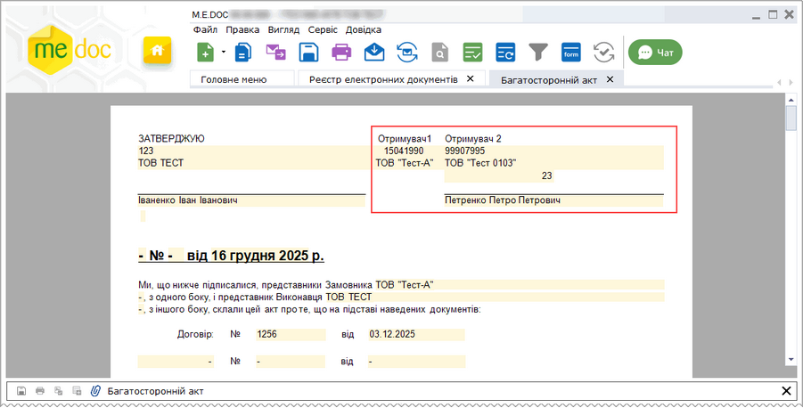

Натисніть на рисунок, щоб збільшити його

4. Якщо необхідно змінити маршрут документа, що встановленій за замовчуванням (порядок, у якому учасники багатостороннього обміну повинні отримувати документ, та кількість отримувачів документа), відкрийте документ та на вкладці Маршрут документа, за допомогою стрілок розташуйте отримувачів у потрібній послідовності:

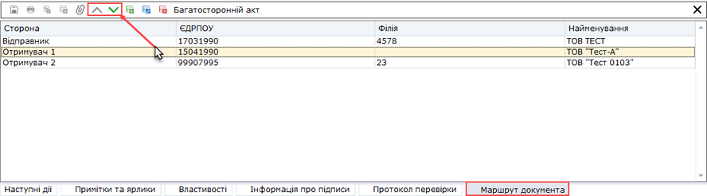

Натисніть на рисунок, щоб збільшити його

За замовчуванням, маршрут документа відповідає послідовності, у якій поля реквізитів отримувачів зазначені у на вкладці [Маршрут документа](UCRtfDocTemplate.html#ucrtfdoctemplate-pdocs_shablon_constructor_func_2) у Конструкторі шаблона.

5. У разі потреби можна відкоригувати маршрут документа за допомогою кнопок панелі інструментів:

- Видалити отримувача. Оберіть отримувача на вкладці Маршрут документа та натисніть кнопку . У вікні повідомлення, що відкриється, підтвердіть видалення, натиснувши Так.

Зверніть увагу! У маршруті обов'язково повинен бути присутній хоча б один отримувач документа!

- Додати отримувача. Натисніть кнопку . Відкриється вікно довідника Контрагенти, у якому оберіть контрагента, якого необхідно додати у маршрут.
- Змінити отримувача. Оберіть отримувача у списку та натисніть кнопку . Відкриється вікно довідника Контрагенти, у якому оберіть потрібного контрагента.

6. [Підпишіть та відправте документ](PDocs_reestr_funkc.html#pdocs_reestr_funkc-pdocs_reestr_funkc_vidp). Документ буде відправлено першому отримувачу, зазначеному у маршруті документа.

Кожен з учасників багатостороннього обміну з свого боку погоджує та підписує документ. Погоджений документ відправляється наступному отримувачу, згідно з визначеним маршрутом. Відправка документа далі за маршрутом здійснюється автоматично у момент його погодження учасником багатостороннього обміну.

Всім учасникам обміну, надсилаються квитанції про погодження та підписання документа від кожного отримувача.

Якщо ж документ було відхилено будь-яким з отримувачів, всім учасникам багатостороннього обміну, надсилається квитанція про відхилення документа. Обробка документа припиняється.

Інформація про погодження (відхилення) та підписання документа кожним учасником багатостороннього обміну відображається на вкладці Протокол.

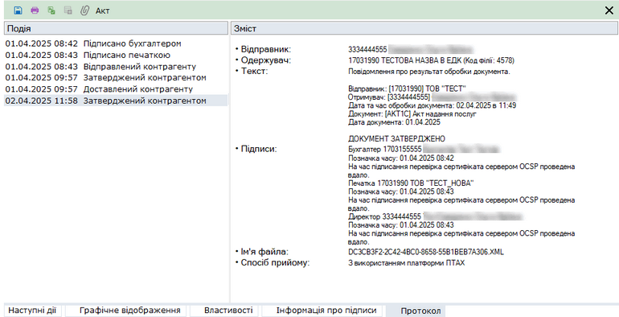

Натисніть на рисунок, щоб збільшити його

Після погодження та підписання документа останнім отримувачем з визначеного маршруту документ завершує цикл обробки.

Для відправлених багатосторонніх документів, що не набули кінцевого статусу опрацювання, є можливість заблокувати документ. Для блокування документа виконайте команду Заблокувати документ у головному меню Правка, контекстному меню або вкладці Наступні дії. Команда доступна лише для відправника документа.

Кнопки керування маршрутом багатостороннього обміну первинними документами доступні незалежно від статусу документа. При спробі змінити маршрут документа зі статусом Готується користувачу буде виведено підказку про необхідність передати документ на підпис.

[До початку](#ucdfdocsrstnew-obmin_shema)

Багатосторонній обмін з використанням посилання на первинний документ

Контрагенти можуть опрацьовувати та затверджувати документи, для яких налаштовано багатосторонній обмін, за отриманими посиланнями. Після затвердження за посиланням, документ буде відправлено наступному учаснику обміну згідно з налаштованим маршрутом.

Для організації багатостороннього обміну за допомогою посилань необхідно:

1. Налаштувати шаблон первинного документа. У модулі Первинні документи - Шаблони первинних документів для шаблона документа у полі [Кількість отримувачів](UCRtfDocTemplate.html#ucrtfdoctemplate-pdocs_shablon_stvor) задайте кількість отримувачів, яким буде надсилатися документ.

2. У [шаблон документа](UCRtfDocTemplate.html#ucrtfdoctemplate-pdocs_shablon_constructor_func_2) додати поля, у яких буде зазначатися ЄДРПОУ та код філії (за потреби) отримувачів. Або ж налаштувати список учасників багатостороннього обміну безпосередньо перед підписанням документа за допомогою команд вкладки [Маршрут документа](#ucdfdocsrstnew-obmin_shema).

3. Відправте посилання на документ першому отримувачу з маршруту. Відправка посилання на документ можлива у [автоматичному режимі](#ucdfdocsrstnew-obmin_link_sota), або вручну, для вже відправленого документа, за допомогою команди [Надіслати посилання на документ](#ucdfdocsrstnew-obmin_link_sota) (на вкладці Наступні дії) або команди меню [Сервіс - Отримати посилання на документ](#ucdfdocsrstnew-obmin_link_sota) (у вікні відкритого документа). Посилання, сформоване за допомогою команди меню Сервіс, необхідно відправити контрагенту електронно. поштою, або будь-якими іншим засобами для відправки електронних повідомлень.

4. Після отримання посилання контрагент може переглянути, погодити або відхилити первинний документ. Погоджений документ відправляється наступному отримувачу, згідно з визначеним маршрутом.

Автоматична відправка посилання на первинний документ наступному учаснику обміну виконується при встановлені для цього учасника опції [Відправляти посилання на документ](UCPartnerRst.html#ucpartnerrst-sprpartner) у Картці контрагента.

Якщо ж документ було відхилено, обробка документа припиняється.

[До початку](#ucdfdocsrstnew-obmin_shema)

### Відправка пакета документів у банк

_Шлях у довідці: Розділи програми › Первинні документи › Реєстр електронних документів › Відправка пакета документів у банк_

В цьому розділі:

[Створення Документів в банк](#ucdfdocsrstnew-pdocs_reestr_bank)

[Додавання звітності](#ucdfdocsrstnew-pdocs_reestr_bank)

[Додавання супровідних документів](#ucdfdocsrstnew-pdocs_reestr_bank)

[Операції із вкладеннями](#ucdfdocsrstnew-pdocs_reestr_bank)

[Підписання ЕП та відправка Документів в банк](#ucdfdocsrstnew-pdocs_reestr_bank)

[Копіювання Документів в банк](#ucdfdocsrstnew-pdocs_reestr_bank)

[Друк документів в PDF](#ucdfdocsrstnew-pdocs_reestr_bank)

Модуль надає можливість відправляти статистичну та фінансову звітність, а також супроводжуючі документи у банк.

Функція доступна для звітності, що була відправлена у контролюючі органи, та для якої була отримана позитивна Квитанція № 2.

Відправляти статистичну та фінансову звітність, що була відправлена у контролюючі органи, та для якої була отримана позитивна Квитанція № 2, також можна у модулі Реєстр звітів за допомогою команди [Наступні дії - Відправити у банк](UCDocRstByPer5.html#ucdocrstbyper5-rdoc_robota_stvor).

Створення Документів в банк

1. Оберіть один із способів:

- на панелі інструментів натисніть кнопку Створити - Обрати шаблон документа;
- виберіть команду Файл - Створити - Обрати шаблон документа;
- у контекстному меню оберіть команду Створити - Обрати шаблон документа.

Натисніть, щоб збільшити малюнок

2. Відкриється вікно Створення документа:

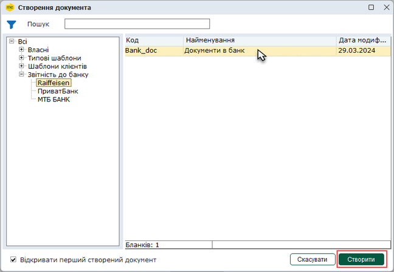

Натисніть, щоб збільшити малюнок

На панелі ліворуч оберіть розділ Звітність до банку. Оберіть назву банку, у який відправляється документ. Далі виділіть рядок Документи в банк, натисніть кнопку Створити.

2. Відкриється вкладка Документи в банк:

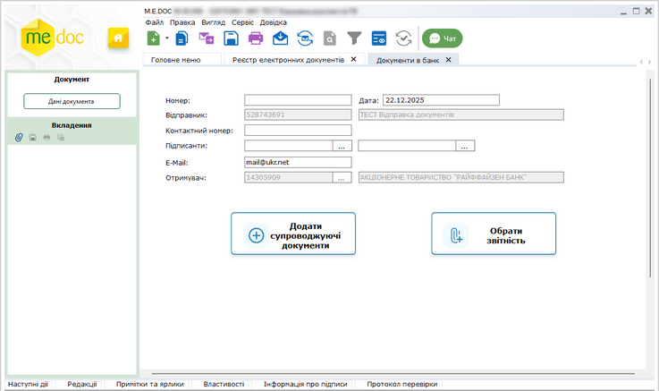

Натисніть, щоб збільшити малюнок

Заповніть поля документа:

- Номер - введіть номер документа;
- Дата - вкажіть дату документа, за замовчуванням встановлюється поточна дата;
- Підписанти - ім'я та прізвище відповідальних осіб, що підписують документ, можна обрати з довідника Відповідальні особи, натиснувши .
- E-mail - вкажіть електронну адресу відправника (заповнюється автоматично даними з Картки підприємства);
- Відправник - поле заповнюється за замовчуванням;
- Отримувач - поле заповнюється за замовчуванням.

3. Збережіть документ, натиснувши кнопку  або комбінацію клавіш Ctrl+S.

[До початку](#ucdfdocsrstnew-pdocs_reestr_bank)

Додавання звітності

- Які звіти можна відправити у банк
- ПриватБанк

На вкладці Документи в банк для відправки у ПриватБанк можна додати наступні звіти:

- S0100114 Ф1. Баланс
- S0100214 Ф2. Звіт про фінансові результати
- S0100309 Ф3. Звiт про рух грошових коштiв (за прямим методом)
- S0103354 Ф3-н. Звiт про рух грошових коштiв (за непрямим методом)
- S0100310 Ф3. Звiт про рух грошових коштiв (за прямим методом)
- S0110013 1-м, 2-м. Фінансовий звіт суб'єкта малого підприємництва
- S0111006 1-мс, 2-мс. Фінансова звітність мікропідприємства
- F0103307 (Квартал) Податкова декларація платника єдиного податку - фізичної особи - підприємця
- F0103405 (Рік) Податкова декларація платника єдиного податку - фізичної особи - підприємця
- F0103406 (І, ІІ група; Рік) Податкова декларація платника єдиного податку - фізичної особи - підприємця
- F0100112 (ФОП) Податкова декларація про майновий стан і доходи
- F0111411 Додаток Ф2. Розрахунок податкових зобов’язань з податку на доходи фізичних осіб та військового збору з доходів, отриманих самозайнятою особою
- J0500109 Податковий розрахунок сум доходу, нарахованого (сплаченого) на користь платників податків - фізичних осіб, і сум утриманого з них податку, а також сум нарахованого єдиного внеску
- F0500109 Податковий розрахунок сум доходу, нарахованого (сплаченого) на користь платників податків - фізичних осіб, і сум утриманого з них податку, а також сум нарахованого єдиного внеску
- S2700415 4-сг (річна). Звіт про посівні площі сільськогосподарських культур
- S2702916 29-сг. Звіт про площі та валові збори врожаю сільськогосподарських культур, плодів, ягід і винограду
- Райффайзен Банк

На вкладці Документи в банк для відправки у Райффайзен Банк можна додати наступні звіти:

- S0100114 Ф1. Баланс
- S0100214 Ф2. Звіт про фінансові результати
- S0103354 Ф3-н. Звiт про рух грошових коштiв (за непрямим методом)
- S0100310 Ф3. Звiт про рух грошових коштiв (за прямим методом)
- S0110013 1-м, 2-м. Фінансовий звіт суб'єкта малого підприємництва
- S0111006 1-мс, 2-мс. Фінансова звітність мікропідприємства
- F0103307 (Квартал) Податкова декларація платника єдиного податку - фізичної особи - підприємця
- F0103405 (Рік) Податкова декларація платника єдиного податку - фізичної особи - підприємця
- F0103406 (І, ІІ група; Рік) Податкова декларація платника єдиного податку - фізичної особи - підприємця
- F0100213 (ФОП) Податкова декларація про майновий стан і доходи
- F0111411 Додаток Ф2. Розрахунок податкових зобов’язань з податку на доходи фізичних осіб та військового збору з доходів, отриманих самозайнятою особою
- J0500109 Податковий розрахунок сум доходу, нарахованого (сплаченого) на користь платників податків - фізичних осіб, і сум утриманого з них податку, а також сум нарахованого єдиного внеску
- F0500106 Податковий розрахунок сум доходу, нарахованого (сплаченого) на користь платників податків - фізичних осіб, і сум утриманого з них податку, а також сум нарахованого єдиного внеску
- МТБ Банк

На вкладці Документи в банк для відправки у МТБ Банк можна додати наступні звіти:

- S0100114 Ф1. Баланс
- S0100214 Ф2. Звіт про фінансові результати
- J0510408 Додаток 4 (ДФ) Відомості про суми нарахованого доходу, утриманого та сплаченого податку на доходи фізичних осіб та військового збору
- S2700414 4-сг (річна). Звіт про посівні площі сільськогосподарських культур
- S2703011 37-сг. Звіт про збирання врожаю сільськогосподарських культур
- S2702117 50-сг (річна) Звіт про основні економічні показники роботи сільськогосподарських підприємств
- S0111006 1-мс, 2-мс. Фінансова звітність мікропідприємства
- S0110013 1-м, 2-м. Фінансовий звіт суб'єкта малого підприємництва
- S0111006 1-мс, 2-мс. Фінансова звітність мікропідприємства
- S0100310 Ф3. Звiт про рух грошових коштiв (за прямим методом)
- J0902002 Форма №3-кн Консолідований звіт про рух грошових коштів (за непрямим методом)
- S0103354 Ф3-н. Звiт про рух грошових коштiв (за непрямим методом)
- J0901703 Форма №1-к Консолідований баланс (Звіт про фінансовий стан)
- J0901801 Форма №2-к Консолідований звіт про фінансові результати (Звіт про сукупний дохід)
- SS100253 Ф.2-к. Консолідований звіт про фінансові результати (Звіт про сукупний дохід)
- J0901902 Форма №3-к Консолідований звiт про рух грошових коштiв (за прямим методом)
- SS100453 Ф.3-к. Консолідований звіт про рух грошових коштів (за прямим методом)
- S0104009 Ф4. Звіт про власний капітал
- S0105008 Ф5. Примітки до річної звітності
- J0510108 Додаток 1 (Д1) Відомості про нарахування заробітної плати (доходу, грошового забезпечення) застрахованим особам
- J0100122 - Податкова декларація з податку на прибуток підприємств
- J0510409 Додаток 4 (ДФ) Відомості про суми нарахованого доходу, утриманого та сплаченого податку на доходи фізичних осіб та військового збору
- F0510409 Додаток 4 (ДФ) Відомості про суми нарахованого доходу, утриманого та сплаченого податку на доходи фізичних осіб та військового збору

Для успішної відправки у банк у розділі Звітність - Реєстр звітів повинні бути наявні відповідні звіти, що були відправлені у контролюючі органи, та для яких була отримана позитивна Квитанція № 2.

1. У вікні відкритої вкладки Документи в банк натисніть кнопку Обрати звітність:

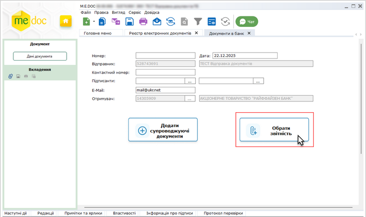

Натисніть, щоб збільшити малюнок

2. Відкриється вікно Обрання звітів, у якому оберіть період створення звітів та встановіть відмітки біля назв звітів, які необхідно додати до Документів в банк. Натисніть кнопку ОК.

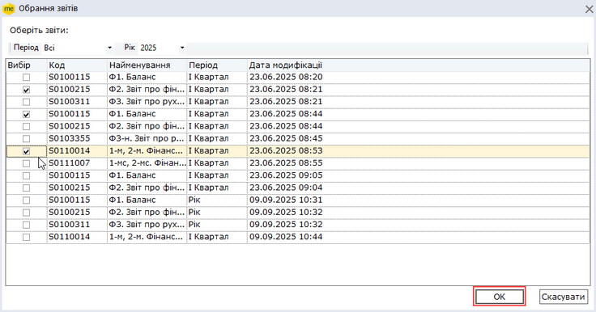

Натисніть, щоб збільшити малюнок

3. Назви доданих звітів будуть відображені на панелі Вкладення. Файли доданих звітів у форматі xml та pdf доступні на вкладці Вкладення:

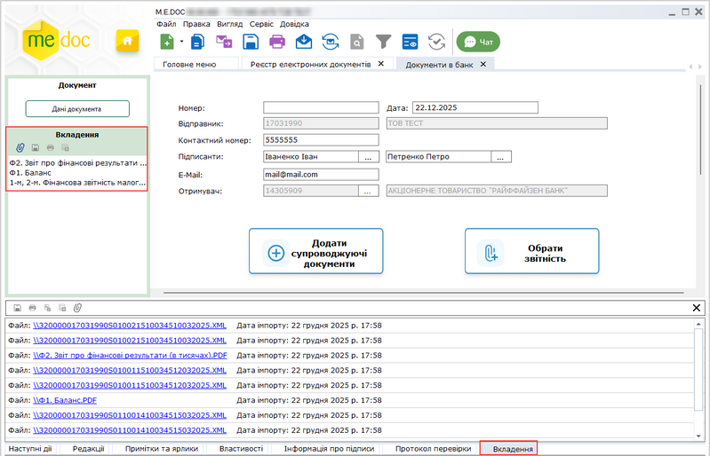

Натисніть, щоб збільшити малюнок

4. Натисніть на назві звіту на панелі Вкладення. Вміст документа буде відкрито у вкладці Документи в банк:

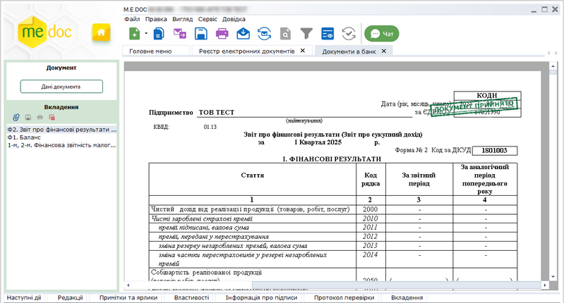

Натисніть, щоб збільшити малюнок

5. Щоб повернутися до вкладки Документи в банк та додати наступний Звіт, натисніть кнопку Дані документа на панелі Документ.

Також додати звіт можна, натиснувши іконку  на панелі Вкладення.

Щоб видалити Звіт, виділіть назву доданого звіту на панелі Вкладення у лівій частині вікна та натисніть кнопку .

[До початку](#ucdfdocsrstnew-pdocs_reestr_bank)

Додавання супровідних документів

Можна створювати та відправити у банк супровідні документи:

- Розшифровка рядка 2000 ф.2 - при відправці документів у Райффайзен Банк та ПриватБанк;
- Довідка про суми отриманої ММСП державної допомоги - при відправці документів у Райффайзен Банк.
- Ці документи недоступні у Реєстрі електронних документів та можуть бути створені, опрацьовані та відправлені лише у вигляді вкладень до Документа у банк.
- При відправці документів у ПриватБанк доступний лише супроводжуючий документ Розшифровка рядка 2000 ф.2.

1. У вікні відкритої вкладки Документи в банк натисніть кнопку Додати супроводжуючі документи:

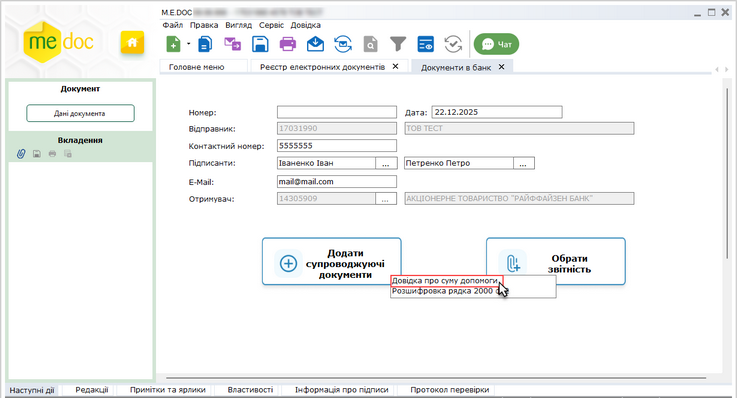

Натисніть, щоб збільшити малюнок

   У списку, що відкриється оберіть назву документа, який потрібно додати.

Назва обраного документа буде відображена на панелі Вкладення. Файли доданого документа у форматі xml та pdf доступні на вкладці Вкладення.

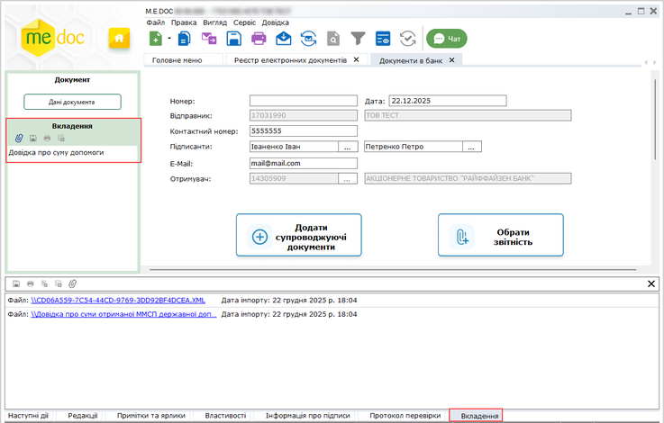

Натисніть, щоб збільшити малюнок

2. Заповніть супровідний документ. Натисніть на його назві на панелі Вкладення. Вміст документа буде відкрито у вкладці Документи в банк:

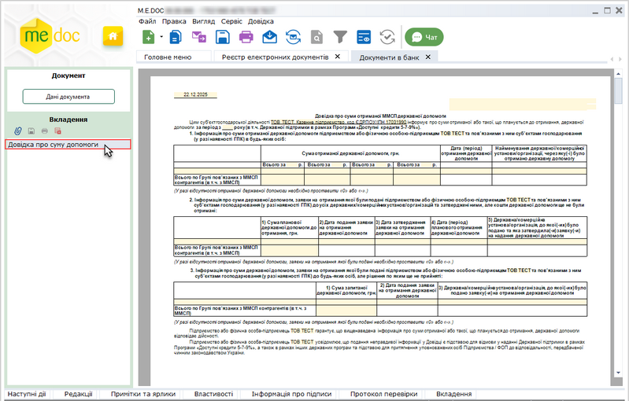

Натисніть, щоб збільшити малюнок

Поля, позначенні жовтим кольором, доступні для введення даних.

Заповніть необхідні поля. Збереження введених даних у супровідному документі виконується автоматично.

3. Щоб повернутися до вкладки Документи в банк та додати наступний супровідний документ, натисніть кнопку Дані документа на панелі Документ.

Щоб видалити супровідний документ, виділіть назву документа на панелі Вкладення у лівій частині вікна та натисніть кнопку :

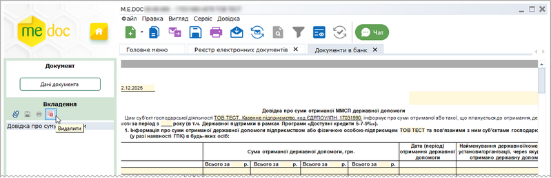

Натисніть, щоб збільшити малюнок

[До початку](#ucdfdocsrstnew-pdocs_reestr_bank)

Операції із вкладеннями

Для виконання операцій із доданими звітами та/або супровідними документами:

1. Оберіть документ із вкладеннями у Реєстрі електронних документів та перейдіть на вкладку Вкладення. (Або оберіть вкладку Вкладення у вікні відкритого документа Документи в банк).

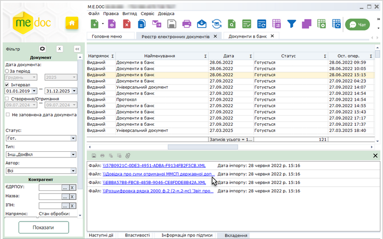

Натисніть, щоб збільшити малюнок

2. Натисніть лівою кнопкою миші на назві потрібного файлу. Відкриється вікно вибору операцій. Для непідписаних документів доступні операції:

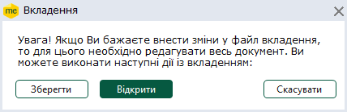

При натисканні на кнопки виконуються операції:

- Зберегти
відкривається вікно вибору папки для збереження.

- Відкрити
файл відкривається для перегляду у програмі відповідно до формату файлу.

- Скасувати
вікно вибору операції закривається.

Після натискання кнопки Зберегти, необхідно обрати шлях збереження вкладення.

[До початку](#ucdfdocsrstnew-pdocs_reestr_bank)

Підписання ЕП та відправка Документів в банк

Підписання та відправку документа у банк можна виконати одним із способів:

Із вкладки "Наступні дії"

Даний спосіб дозволяє відправити лише один документ - відкритий або виділений в Реєстрі електронних документів.

1. Виконайте перевірку документа Документи в банк, який необхідно відправити у банк. Для цього виділіть документ у таблиці реєстру та оберіть один із способів:

- на панелі інструментів Реєстру електронних документів натисніть кнопку ;
- виберіть команду Правка - Перевірити документ;
- виконайте команду  Перевірити документ на вкладці Наступні дії (доступна також у вікні відкритого документа);
- натисніть клавішу клавіатури <F4>.

Перевіряється правильність заповнення полів і у випадку помилок, система повідомить про виявлені помилки. Виправте помилки та знову виконайте перевірку.

2. Якщо документ не містить помилок, на вкладці Наступні дії доступні команди Підписати документ та Передати документ на підпис:

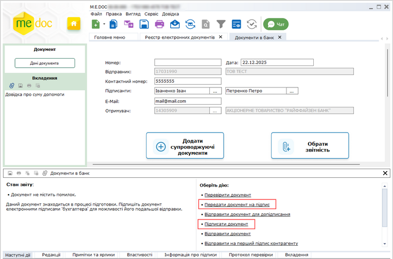

Натисніть, щоб збільшити малюнок

Передати документ на підпис

На виконання цієї команди документ блокується від редагування та набуває статусу На підпис відповідальній особі. Документ знаходиться в стані очікування.
Для подальшої обробки документа в Наступних діях необхідно виконати команду [Підписати документ](UC_ECP.html#uc_ecp-ecp).

Підписати документ

На виконання команди розпочнеться стандартний процес [підписання документа](UC_ECP.html#uc_ecp-ecp) ЕП.
Після накладення підписів програма повторно запропонує підписати файл сертифікатом шифрування, таким чином підписується "конверт", в який поміщається файл для відправки. Після чого буде виконано відправку документа у банк.

З "Реєстру електронних документів"

Даний спосіб дозволяє відправляти як один документ, так і групу виділених документів одночасно.

- Зверніть увагу, відправка документа за допомогою функції Відправити доступна без попереднього виконання перевірки правильності заповнення полів документа.
- Перед відправкою документа переконайтеся у правильності заповнення документа.

У реєстрі виберіть потрібний документ або групу документів та оберіть один із варіантів:

- на панелі інструментів натисніть кнопку Відправити - ;
- виберіть команду Файл - Відправити;
- у контекстному меню оберіть команду Відправити.

На виконання команди розпочнеться [підписання документа](UC_ECP.html#uc_ecp-ecp) ЕП та відправка документа у банк. Після закінчення процедури, система виведе протокол відправки документів.

- При підписанні документів виконується також і підписання вкладень.
- Також на вкладці Наступні дії для Документів в банк доступна функція [Відправка документа на допідписання](#ucdfdocsrstnew-obmin_link_sota).

[До початку](#ucdfdocsrstnew-pdocs_reestr_bank)

Копіювання Документів в банк

Для копіювання документа із вкладеннями:

1. Виділіть документ, копію якого потрібно створити. Для копіювання групи документів виділіть потрібне курсором миші, утримуючі клавіші <Ctrl> або <Shift>.

2. Оберіть один із способів копіювання:

- на панелі інструментів натисніть кнопку Копіювати - ;
- із контекстного меню команда Копіювати;
- команда Файл - Копіювати.

Із вікна відкритого документа копіюється тільки поточний документ.

3. На виконання функції копіювання відкриється вікно Дата виписки, у якому оберіть дату виписки копії документа.

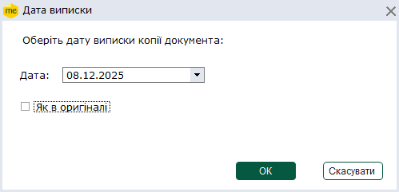

За замовчуванням встановлюється дата виписки документа, що копіюється.

Для того, щоб обрати іншу дату виписки, натисніть кнопку  у полі Дата. Відкриється вікно календаря, у якому оберіть потрібну довільну дату.

Якщо у копії необхідно зберегти дату виписки документа, встановіть позначку Як в оригіналі.

4. Після того, як дату обрано, натисніть кнопку ОК. Відкриється вікно копії документа. Скопійовані документи можна редагувати.

[До початку](#ucdfdocsrstnew-pdocs_reestr_bank)

Друк документів в PDF

Дана функція дозволяє зберегти обрані Документи в банк разом з доданими до них Супровідними документами та Звітами на диску комп’ютера у файлах формату .pdf.

Для друку документів у PDF необхідно виділити потрібні Документи в банк. Для групового друку документів виділіть потрібне курсором миші, утримуючі клавіші <Ctrl> або <Shift>.

Для друку документів у PDF виконайте дії у наступній послідовності:

1. Оберіть один із способів:

- із контекстного меню команда Друк в PDF;
- команда меню Файл - Друк в PDF.

2. У вікні Огляд папок вкажіть каталог, у якому потрібно зберегти файли .pdf.

3. Система повідомить про результат виконання операції.

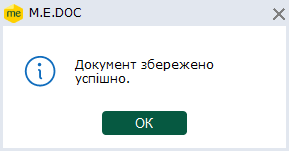

У обраному каталозі буде створено папку, з назвою Документи в банк. Всі вкладення та головний документ зберігаються у окремих файлах формату PDF.

У файлах PDF відображається факсиміле підписів, що накладені на документ та вкладення (за наявності), та інформація про підписантів (за наявності відмітки у розділі [Адміністрування – Параметри системи – Документообіг](FormCompanyParams.html#formcompanyparams-admcompanyparams_sdo) - Накладати інформацію про підписантів).

Також функція друку документа  у PDF доступна і у відкритій вкладці Документи в банк по команді меню Файл - Друк в PDF.

Із вікна відкритого документа у форматі PDF зберігається тільки поточний документ.

Зберегти документ у форматі PDF також можна, за допомогою вкладки Графічне відображення:

Вкладка Графічне відображення доступна для підписаних документів, готових до відправки, та/або відправлених документів.

1. Відкрийте вкладку Графічне відображення та натисніть посилання з назвою файлу:

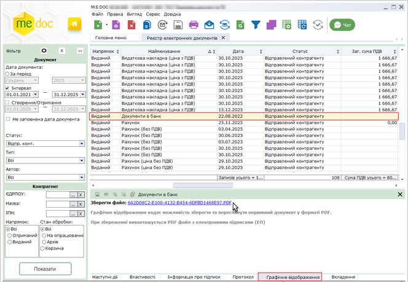

Натисніть, щоб збільшити

2. У вікні, що відкриється, У полі Шлях збереження вкажіть каталог, де зберегти експортований документ:

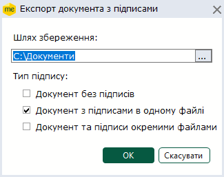

3. Оберіть режим збереження, встановивши відповідну опцію:

- Документ без підписів - документ буде експортовано у файл обраного формату PDF, без збереження підписів;
- Документ з підписами в одному файлі - документ та підписи зберігаються у одному файлі з розширенням .P7S;
- Документ та підписи окремими файлами - буде збережено .ZIP архів, який міститиме документ у файлі формату PDF та кожен підпис комплекту в окремому файлі в з розширенням .P7S.

4. Натисніть ОК.

5. Система повідомить про закінчення процесу експорту.

[До початку](#ucdfdocsrstnew-pdocs_reestr_bank)

### Відправка фінансової звітності до біржі

_Шлях у довідці: Розділи програми › Первинні документи › Реєстр електронних документів › Відправка фінансової звітності до біржі_

В цьому розділі:

[Створення Документів до біржі](#ucdfdocsrstnew-pdocs_reestr_birzha)

[Додавання звітності](#ucdfdocsrstnew-pdocs_reestr_birzha)

[Операції із вкладеннями](#ucdfdocsrstnew-pdocs_reestr_birzha)

[Підписання ЕП та відправка Документів до біржі](#ucdfdocsrstnew-pdocs_reestr_birzha)

[Копіювання Документів до біржі](#ucdfdocsrstnew-pdocs_reestr_birzha)

[Друк документів в PDF](#ucdfdocsrstnew-pdocs_reestr_birzha)

Модуль надає можливість відправляти документи фінансової звітності можна до бірж ТОВ «Українська енергетична біржа» та ТОВ «Українська універсальна біржа».

Функція доступна для звітності, що була відправлена у контролюючі органи, та для якої була отримана позитивна Квитанція № 2.

Відправляти статистичну та фінансову звітність, що була відправлена у контролюючі органи, та для якої була отримана позитивна Квитанція № 2, також можна у модулі Реєстр звітів за допомогою команди [Наступні дії - Відправити у банк](UCDocRstByPer5.html#ucdocrstbyper5-rdoc_robota_stvor).

Створення Документів до біржі

1. Оберіть один із способів:

- на панелі інструментів натисніть кнопку Створити - Обрати шаблон документа;
- виберіть команду Файл - Створити - Обрати шаблон документа;
- у контекстному меню оберіть команду Створити - Обрати шаблон документа.

Натисніть, щоб збільшити малюнок

2. Відкриється вікно Створення документа:

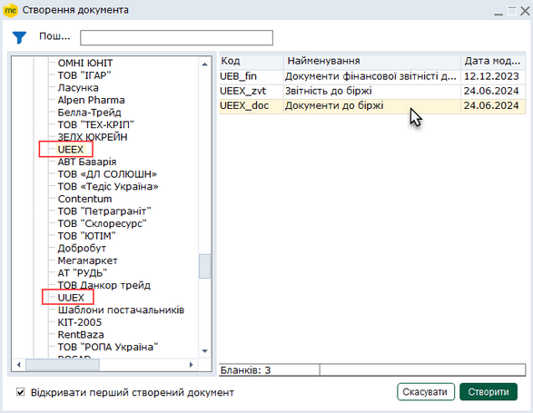

Натисніть, щоб збільшити малюнок

На панелі ліворуч оберіть розділ Шаблони клієнтів та оберіть групу шаблонів, що відповідає біржі, до якої буде відправлятися документ:

- UEEX – для відправки документів до ТОВ «Українська енергетична біржа»;
- UUEX – для відправки документів до ТОВ «Українська універсальна біржа».

Виділіть рядок Документи до біржі. Натисніть кнопку Створити.

Важливо! Код шаблона визначає біржу, до якої буде відправлятися документ:

- UEEX\_doc – для відправки документів до ТОВ «Українська енергетична біржа»;
- UUEX\_doc – для відправки документів до ТОВ «Українська універсальна біржа».

2. Відкриється вкладка Документи до біржі:

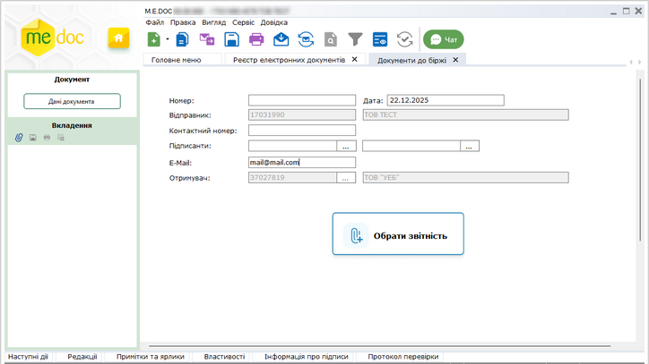

Натисніть, щоб збільшити малюнок

Заповніть поля документа:

- Номер - введіть номер документа;
- Дата - вкажіть дату документа, за замовчуванням встановлюється поточна дата;
- Підписанти - ім'я та прізвище відповідальних осіб, що підписують документ, можна обрати з довідника Відповідальні особи, натиснувши .
- E-mail - вкажіть електронну адресу відправника (заповнюється автоматично даними з Картки підприємства);
- Відправник - поле заповнюється за замовчуванням;
- Отримувач - поле заповнюється за замовчуванням та визначається обраним шаблоном Документа до біржі (UEEX\_doc або UUEX\_doc).

3. Збережіть документ, натиснувши кнопку  або комбінацію клавіш Ctrl+S.

[До початку](#ucdfdocsrstnew-pdocs_reestr_birzha)

Додавання звітності

- Які звіти можна відправити до біржі
- F0100213 Податкова декларація про майновий стан і доходи;
- F0100214 Податкова декларація про майновий стан і доходи;
- F0103308 (ІІІ група; Квартал) Податкова декларація платника єдиного податку - фізичної особи – підприємця;
- F0103406 (І, ІІ група; Рік) Податкова декларація платника єдиного податку - фізичної особи - підприємця;
- F0103805 Податкова декларація платника єдиного податку четвертої групи;
- J0103203 Податкова декларація платника єдиного податку третьої групи на період дії воєнного, надзвичайного стану в Україні;
- J0103507 Податкова декларація платника єдиного податку третьої групи (юридичні особи);
- J0103508 Податкова декларація платника єдиного податку третьої групи (юридичні особи);
- J0103804 Податкова декларація платника єдиного податку четвертої групи;
- J0103805 Податкова декларація платника єдиного податку четвертої групи;
- J0903203 Форма №1-дс Баланс;
- J0903303 Форма №2-дс Звіт про фінансові результати;
- J0903403 Форма №3-дс Звіт про рух грошових коштів;
- J0903502 Форма №4-дс Звіт про власний капітал;
- J0903602 Форма №5-дс Примітки до річної фінансової звітності;
- S0100114 Ф1. Баланс;
- S0100115 Ф1. Баланс;
- S0100214 Ф2. Звіт про фінансові результати (в тисячах);
- S0100215 Ф2. Звіт про фінансові результати (в тисячах);
- S0100310 Ф3. Звiт про рух грошових коштiв (за прямим методом);
- S0100311 Ф3. Звiт про рух грошових коштiв (за прямим методом);
- S0103354 Ф3-н. Звiт про рух грошових коштiв (за непрямим методом);
- S0103355 Ф3-н. Звiт про рух грошових коштiв (за непрямим методом);
- S0104009 Ф4. Звіт про власний капітал;
- S0105008 Ф5. Примітки до річної звітності;
- S0105009 Ф5. Примітки до річної звітності;
- S0106006 Ф6. Додаток до приміток до річної фінансової звітності «Інформація за сегментами»;
- S0106007 Ф6. Додаток до приміток до річної фінансової звітності «Інформація за сегментами»;
- S0110013 1-м, 2-м. Фінансова звітність малого підприємства;
- S0110014 1-м, 2-м. Фінансова звітність малого підприємства;
- S0111006 1-мс, 2-мс. Фінансова звітність мікропідприємства;
- S0111007 1-мс, 2-мс. Фінансова звітність мікропідприємства.

Для успішної відправки у банк у розділі Звітність - Реєстр звітів повинні бути наявні відповідні звіти, що були відправлені у контролюючі органи, та для яких була отримана позитивна Квитанція № 2.

1. У вікні відкритої вкладки Документи до біржі натисніть кнопку Обрати звітність:

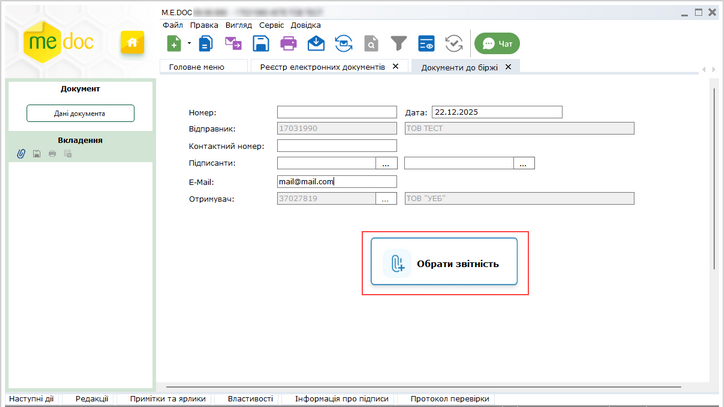

Натисніть, щоб збільшити малюнок

2. Відкриється вікно Обрання звітів, у якому оберіть період створення звітів та встановіть відмітки біля назв звітів, які необхідно додати до Документів до біржі. Натисніть кнопку ОК.

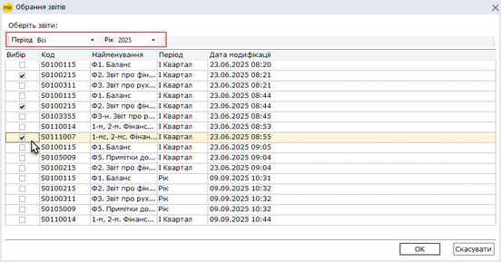

Натисніть, щоб збільшити малюнок

3. Назви доданих звітів будуть відображені на панелі Вкладення. Файли доданих звітів у форматі xml та pdf доступні на вкладці Вкладення:

Натисніть, щоб збільшити малюнок

4. Натисніть на назві звіту на панелі Вкладення. Вміст документа буде відкрито у вкладці Документи до біржі:

Натисніть, щоб збільшити малюнок

5. Щоб повернутися до вкладки Документи до біржі та додати наступний Звіт, натисніть кнопку Дані документа на панелі Документ.

Також додати звіт можна, натиснувши іконку  на панелі Вкладення.

Щоб видалити Звіт, виділіть назву доданого звіту на панелі Вкладення у лівій частині вікна та натисніть кнопку .

[До початку](#ucdfdocsrstnew-pdocs_reestr_birzha)

Операції із вкладеннями

Для виконання операцій із доданими звітами:

1. Оберіть документ із вкладеннями у Реєстрі електронних документів та перейдіть на вкладку Вкладення. (Або оберіть вкладку Вкладення у вікні відкритого документа Документи до біржі).

Натисніть, щоб збільшити малюнок

2. Натисніть лівою кнопкою миші на назві потрібного файлу. Відкриється вікно вибору операцій. Для непідписаних документів доступні операції:

При натисканні на кнопки виконуються операції:

- Зберегти
відкривається вікно вибору папки для збереження.

- Відкрити
файл відкривається для перегляду у програмі відповідно до формату файлу.

- Скасувати
вікно вибору операції закривається.

Після натискання кнопки Зберегти, необхідно обрати шлях збереження вкладення.

[До початку](#ucdfdocsrstnew-pdocs_reestr_birzha)

Підписання та відправку документа до біржі можна виконати одним із способів:

Із вкладки "Наступні дії"

Даний спосіб дозволяє відправити лише один документ - відкритий або виділений в Реєстрі електронних документів.

1. Виконайте перевірку документа Документи до біржі, який необхідно відправити до біржі. Для цього виділіть документ у таблиці реєстру та оберіть один із способів:

- на панелі інструментів Реєстру електронних документів натисніть кнопку ;
- виберіть команду Правка - Перевірити документ;
- виконайте команду  Перевірити документ на вкладці Наступні дії (доступна також у вікні відкритого документа);
- натисніть клавішу клавіатури <F4>.

Перевіряється правильність заповнення полів і у випадку помилок, система повідомить про виявлені помилки. Виправте помилки та знову виконайте перевірку.

2. Якщо документ не містить помилок, на вкладці Наступні дії доступні команди Підписати документ та Передати документ на підпис:

Натисніть, щоб збільшити малюнок

Передати документ на підпис

На виконання цієї команди документ блокується від редагування та набуває статусу На підпис відповідальній особі. Документ знаходиться в стані очікування.
Для подальшої обробки документа в Наступних діях необхідно виконати команду [Підписати документ](UC_ECP.html#uc_ecp-ecp).

Підписати документ

На виконання команди розпочнеться стандартний процес [підписання документа](UC_ECP.html#uc_ecp-ecp) ЕП.
Після накладення підписів програма повторно запропонує підписати файл сертифікатом шифрування, таким чином підписується "конверт", в який поміщається файл для відправки. Після чого буде виконано відправку документа до біржі.

З "Реєстру електронних документів"

Даний спосіб дозволяє відправляти як один документ, так і групу виділених документів одночасно.

- Зверніть увагу, відправка документа за допомогою функції Відправити доступна без попереднього виконання перевірки правильності заповнення полів документа.
- Перед відправкою документа переконайтеся у правильності заповнення документа.

У реєстрі виберіть потрібний документ або групу документів та оберіть один із варіантів:

- на панелі інструментів натисніть кнопку Відправити - ;
- виберіть команду Файл - Відправити;
- у контекстному меню оберіть команду Відправити.

На виконання команди розпочнеться [підписання документа](UC_ECP.html#uc_ecp-ecp) ЕП та відправка документа до біржі. Після закінчення процедури, система виведе протокол відправки документів.

- При підписанні документів виконується також і підписання вкладень.
- Також на вкладці Наступні дії для Документів в банк доступна функція [Відправка документа на допідписання](#ucdfdocsrstnew-obmin_link_sota).

[До початку](#ucdfdocsrstnew-pdocs_reestr_birzha)

Копіювання Документів до біржі

Для копіювання документа із вкладеннями:

1. Виділіть документ, копію якого потрібно створити. Для копіювання групи документів виділіть потрібне курсором миші, утримуючі клавіші <Ctrl> або <Shift>.

2. Оберіть один із способів копіювання:

- на панелі інструментів натисніть кнопку Копіювати - ;
- із контекстного меню команда Копіювати;
- команда Файл - Копіювати.

Із вікна відкритого документа копіюється тільки поточний документ.

3. На виконання функції копіювання відкриється вікно Дата виписки, у якому оберіть дату виписки копії документа.

За замовчуванням встановлюється дата виписки документа, що копіюється.

Для того, щоб обрати іншу дату виписки, натисніть кнопку  у полі Дата. Відкриється вікно календаря, у якому оберіть потрібну довільну дату.

Якщо у копії необхідно зберегти дату виписки документа, встановіть позначку Як в оригіналі.

4. Після того, як дату обрано, натисніть кнопку ОК. Відкриється вікно копії документа. Скопійовані документи можна редагувати.

[До початку](#ucdfdocsrstnew-pdocs_reestr_birzha)

Друк документів в PDF

Дана функція дозволяє зберегти обрані Документи до біржі разом з доданими до них Звітами на диску комп’ютера у файлах формату .pdf.

Для друку документів у PDF необхідно виділити потрібні Документи до біржі. Для групового друку документів виділіть потрібне курсором миші, утримуючі клавіші <Ctrl> або <Shift>.

Для друку документів у PDF виконайте дії у наступній послідовності:

1. Оберіть один із способів:

- із контекстного меню команда Друк в PDF;
- команда меню Файл - Друк в PDF.

2. У вікні Огляд папок вкажіть каталог, у якому потрібно зберегти файли .pdf.

3. Система повідомить про закінчення операції друку.

У обраному каталозі буде створено папку, з назвою Документи до біржі. Всі вкладення та головний документ зберігаються у окремих файлах формату PDF.

У файлах PDF відображається факсиміле підписів, що накладені на документ та вкладення (за наявності), та інформація про підписантів (за наявності відмітки у розділі [Адміністрування – Параметри системи – Документообіг](FormCompanyParams.html#formcompanyparams-admcompanyparams_sdo) - Накладати інформацію про підписантів).

Також функція друку документа  у PDF доступна і у відкритій вкладці Документи до біржі:

- команда меню Файл - Друк в PDF.

Із вікна відкритого документа у форматі PDF зберігається тільки поточний документ.

Зберегти документ у форматі PDF також можна, за допомогою вкладки Графічне відображення:

Вкладка Графічне відображення доступна для підписаних документів, готових до відправки, та/або відправлених документів.

1. Відкрийте вкладку Графічне відображення та натисніть посилання з назвою файлу:

Натисніть, щоб збільшити

2. У вікні, що відкриється, У полі Шлях збереження вкажіть каталог, де зберегти експортований документ:

3. Оберіть режим збереження, встановивши відповідну опцію:

- Документ без підписів - документ буде експортовано у файл обраного формату PDF, без збереження підписів;
- Документ з підписами в одному файлі - документ та підписи зберігаються у одному файлі з розширенням .P7S;
- Документ та підписи окремими файлами - буде збережено .ZIP архів, який міститиме документ у файлі формату PDF та кожен підпис комплекту в окремому файлі в з розширенням .P7S.

4. Натисніть ОК.

5. Система повідомить про закінчення процесу експорту.

[До початку](#ucdfdocsrstnew-pdocs_reestr_birzha)

### Посилання на первинний документ

_Шлях у довідці: Розділи програми › Первинні документи › Реєстр електронних документів › Посилання на первинний документ_

В цьому розділі:

[Автоматичне створення та відправка посилання на документ](#ucdfdocsrstnew-obmin_link_sota)

[Створення посилання на документ, що вже був відправлений контрагенту](#ucdfdocsrstnew-obmin_link_sota)

[Копіювання посилання на відправлений документ](#ucdfdocsrstnew-obmin_link_sota)

[Відправка посилання без відправки документа](#ucdfdocsrstnew-obmin_link_sota)

[Відправка документа на допідписання](#ucdfdocsrstnew-obmin_link_sota)

M.E.Doc надає можливість згенерувати посилання на необхідний первинний документ та відправити це посилання контактній особі контрагента за допомогою електронної пошти.

Увага!

Функція доступна для документів, обмін якими здійснюється через платформу «ПТАХ».

Електронні адреси контрагентів, на які можливо відправляти посилання, повинні бути попередньо налаштовані у розділі Контактні дані модуля [Довідники – Контрагенти – Картка контрагента](UCPartnerRst.html#ucpartnerrst-sprpartner).

За отриманим посиланням контрагент зможе переглянути, погодити або відхилити документ. Контрагент засвідчує виконання операцій з первинним документом за допомогою електронного підпису.

Можливо зберегти графічне відображення документа у вигляді файлу PDF з накладеними на нього електронними підписами.

Інформація про відправлені контрагентам посилання зберігається на вкладці документа Протокол.

Відправити контрагенту посилання на документ можливо як у автоматичному режими, так і у ручному режимі.

- Виконується автоматична перевірка актуальності статусу документа, який було відправлено на обробку за посиланням, перед його підписанням або візуванням у програмі.

Якщо статус документа змінився, при спробі виконати відповідну операцію з'явиться повідомлення: «Увага, статус документа було змінено. Буде ініційовано прийом пошти для отримання актуального статусу». Після натискання кнопки ОК у вікні повідомлення ініціюється прийом пошти для отримання актуальної версії документа.

- Контроль актуального статусу документа також виконується при автоматичній обробці документів у розділі Автоматична обробка документів та у сервісі Універсальна автоматична обробка документів.

Автоматичне створення та відправка посилання на документ

Для автоматичної відправки посилання на документ:

1. Виконайте налаштування контактних осіб, що повинні отримувати посилання, як описано у розділі Контактні дані модуля [Довідники – Контрагенти – Картка контрагента](UCPartnerRst.html#ucpartnerrst-sprpartner).

2. У розділі Контактні дані обов'язково встановіть опцію Відправляти посилання на документ.

3. Під час відправки документа програма M.E.Doc автоматично сформує посилання та відправить його на вказані у розділі Контактні дані електронні адреси.

Посилання та адреси, на яке воно було відправлене, наводиться на вкладці Протокол та у вікні відкритого відправленого документа на вкладці Відправлено контрагенту.

Якщо ж для контрагента відсутня можливість документообігу у програмі, буде показане відповідне повідомлення, на вказані для контрагента контактні адреси буде відправлено посилання. Контрагент зможе переглянути, погодити або відхилити документ за отриманим посиланням.

[До початку](#ucdfdocsrstnew-obmin_link_sota)

Створення посилання на документ, що вже був відправлений контрагенту

Можливо створити та відправити посилання на первинні документи:

1. Виділіть первинний документ, на який потрібно створити посилання. У вікні відкритого документа перейдіть на вкладку Наступні дії та оберіть команду Надіслати посилання на документ:

Натисніть, щоб збільшити

Якщо картка контрагента відсутня у довіднику Контрагенти, вона буде створена автоматично.

2. Відкриється вікно Вибір адресата.

Натисніть, щоб збільшити

3. У полі Назва контакту оберіть найменування адресата, якому потрібно відправити посилання на документ:

Натисніть, щоб збільшити

Щоб мати можливість обирати адресатів зі списку, електронні адреси для відправки посилань на документи повинні бути заздалегідь [збережені у Картці контрагента](UCPartnerRst.html#ucpartnerrst-sprpartner), який зазначений у документі.

4. У полі Email автоматично відобразиться перелік електронних адрес, визначений для обраного адресата:

Натисніть, щоб збільшити

Якщо відправляти посилання на якусь з адрес не потрібно, натисніть на іконку  праворуч від e-mail, щоб видалити адресу з поля.

Якщо потрібної адреси нема у переліку, встановіть курсор у поле з адресами та введіть потрібну адресу вручну. Для підтвердження введення нової адреси натисніть <Enter>, "," або ";".

У полі Назва контакту можна вручну додати найменування нового контакту, а у полі Email додати нові електронні адреси для відправки посилання на документ.

Щоб відредагувати обрану електронну адресу, натисніть на ній лівою кнопкою миші. Можна редагувати адреси, які були введені у поле Email вручну або адреси, що [збережені у Картці контрагента](UCPartnerRst.html#ucpartnerrst-sprpartner) та автоматично відображаються у полі Email при виборі адресата у полі Назва контакту.

Щоб швидко знайти електронні адреси контрагента, у полі Email натисніть Швидкий пошук. Програма автоматично підставить усі доступні адреси цього контрагента, які використовуються для ЕДО.

- Щоб дізнатися докладніше, натисніть тут.

1. У полі Email натисніть Швидкий пошук. (При наведенні курсору миші з'являється вікно підказки.)

Натисніть, щоб збільшити

2. У полі Email програма автоматично підставить усі доступні адреси цього контрагента, які використовуються для ЕДО:

Натисніть, щоб збільшити

Після натискання Швидкий пошук та відображення електронних адрес ЕДО поле Назва контакту стає неактивним.

3. Кількість доступних адрес, що не відображені у вікні, наводиться у полі праворуч. Щоб переглянути всі доступні адреси, натисніть ще:

Натисніть, щоб збільшити

Щоб повернути поле до попереднього розміру, натисніть .

4. Якщо відправляти посилання на якусь з адрес не потрібно, натисніть на іконку  праворуч від e-mail, щоб видалити адресу з поля. Якщо потрібної адреси нема у переліку, введіть потрібну адресу вручну, для цього натисніть на кнопку Додати новий контакт та введіть потрібні адреси.

5. Якщо необхідно додати ще одного отримувача, натисніть на кнопку Додати новий контакт:

Натисніть, щоб збільшити

У вікні з'явиться додаткова пара полів для вибору ще одного адресата та його електронних адрес.

6. Якщо додану вручну адресу необхідно зберегти у Картці контрагента, натисніть на кнопку  Зберегти зміни в довіднику.

Кнопка стає доступною після додавання вручну хоча б однієї електронної адреси у полі Email.

По натисканню на кнопку  додані групи отримувачів та їх електронні адреси будуть збережені у Картці контрагента. У разі якщо не вказано групу отримувачів, нові електронні адреси зберігаються у групі Створені автоматично.

7. Оберіть або додайте дані всіх потрібних адресатів та натисніть кнопку Відправити.

8. Після відправки посилання відкриється вікно з протоколом відправки.

Натисніть, щоб збільшити

Команда Надіслати посилання на документ також доступна у вікні відкритого документа.

[До початку](#ucdfdocsrstnew-obmin_link_sota)

Копіювання посилання на відправлений документ

1. Відкрийте відправлений контрагенту первинний документ (що має статус Відправлений контрагенту або Доставлений контрагенту).

2. Виконайте команду головного меню Сервіс – Отримати посилання на документ.

Натисніть, щоб збільшити

3. Відкриється вікно, що містить посилання на обраний документ.

Для копіювання посилання натисніть кнопку Скопіювати.

Скопійоване посилання зберігається у буфері обміну та може бути відправлене отримувачу будь-якими зручним способом.

[До початку](#ucdfdocsrstnew-obmin_link_sota)

Відправка посилання без відправки документа

Функція відправки посилання без відправки документа буде корисна для контрагентів, з якими відсутня можливість електронного документообігу (сертифікати контрагентів відсутні, відсутня картка контрагента у довіднику). Такі контрагенти можуть опрацьовувати первинні документи за посиланням.

1. Оберіть готовий до відправки первинний документ.

2. На вкладці Наступні дії виконайте команду Відправити документ.

Натисніть, щоб збільшити

3. Якщо відсутні сертифікати шифрування отримувача, відкриється вікно, що повідомляє про неможливість завантажити сертифікат контрагента:

3. Якщо отримувач не використовує ЕДО M.E.Doc, відкриється вікно повідомлення:

Для відправки посилання натисніть Так.

4. Відкриється вікно Вибір адресата. Оберіть адресатів та електронні адреси, на які потрібно відправити посилання, як описано у розділі [Створення посилання на документ, що вже був відправлений контрагенту](#ucdfdocsrstnew-obmin_link_sota). Натисніть кнопку Відправити.

Натисніть, щоб збільшити

Дані контактних осіб можна додати, змінити або видалити безпосередньо у вікні Вибір адресата.

5. Після відправки посилання відкриється вікно з протоколом відправки.

Відправити посилання на документ, у разі якщо сертифікати контрагента відсутні, можна також по команді Знову відправити документ.

[До початку](#ucdfdocsrstnew-obmin_link_sota)

Відправка документа на допідписання

За допомогою цієї функції виконується створення та відправка посилання на первинний документ, за яким співробітники підприємства-відправника можуть підписати документ.

Функція доступна для документів, обмін якими здійснюється через платформу «ПТАХ».

1. Оберіть невідправлений первинний документ, який необхідно підписати співробітнику підприємства.

2. На вкладці Наступні дії виконайте команду Відправити документ для допідписання.

Натисніть, щоб збільшити

3. Відкриється вікно Персоніфікація допідписання. У області Відправник посилання оберіть або введіть контактні дані користувача, який відправляє посилання на документ. Дані можна обирати з довідника Користувачі, щоб відкрити вікно довідника натисніть . (Дані користувачів зберігаються у Картці користувача у модулі [Управління користувачами](UCAdminUsers.html#ucadminusers-admusr).)

Натисніть, щоб збільшити

У області Отримувач посилання оберіть співробітника, якому потрібно відправити посилання на документ (дані обираються з довідника Співробітники по натисканню  або вводяться вручну).

У разі потреби, у полі Коментар введіть додаткову інформацію про документ.

Для продовження натисніть ОК.

5. Виконайте підписання документа комплектом ЕП.

6. Після відправки посилання відкриється вікно з протоколом відправки.

Вказані контактні дані відправника та посилання на документ будуть зазначені у листі-повідомленні, що надходить на електронну адресу отримувача.

За отриманим посиланням співробітник виконує підписання документа ЕП. Підписання здійснюється комплектом підписів, що налаштований у програмі для відповідного типу документів.

Статус документа у програмі синхронізується після прийому пошти. Підписаний співробітником документ набуває статусу Готовий до відправки.

[До початку](#ucdfdocsrstnew-obmin_link_sota)

### Візування електронного документа

_Шлях у довідці: Розділи програми › Первинні документи › Реєстр електронних документів › Візування електронного документа_

В цьому розділі:

[Візування документа](#ucdfdocsrstnew-pdocs_reestr_viza)

[Візування документа за посиланням](#ucdfdocsrstnew-pdocs_reestr_viza)

[Відправка документа для візування](#ucdfdocsrstnew-pdocs_reestr_viza)

[Групове візування документів](#ucdfdocsrstnew-pdocs_reestr_viza)

M.E.Doc надає можливість відповідальним особам візувати вхідні та вихідні документи. Візування здійснюється співробітниками, які зазначені у користувацькому комплекті підписів, у межах організації.

Візування може здійснюватися як безпосередньо у програмі M.E.Doc, так і за посиланням на необхідний первинний документ, що надходить на вказану електронну пошту співробітника. Візування за посиланням надає можливість здійснювати візування документів користувачам, у яких на момент підписання документа відсутній доступ до програми.

Співробітник засвідчує виконання операцій візування або відхилення візування первинного документа за допомогою електронного підпису.

- Функція доступна для документів, обмін якими здійснюється через платформу «ПТАХ».
- Функція візування доступна, якщо для документів налаштовано підпис з типом Візування у розділі програми [Первинні документи - Сценарії підписання первинних документів](UCPDocSignSettings.html#ucpdocsignsettings-ucpdocsignsettings).
- Візування документів підтримується у сервісах Автоматичної обробки документів та Універсальної автоматичної обробки. Автоматична відправка посилань налаштовується у підписі з типом Візування.

Візування документа

Для візування документа у програмі M.E.Doc:

1. Для візування документа на вкладці Наступні дії виконайте команду Візувати документ:

Натисніть, щоб збільшити

2. На виконання команди відкриється вікно Візування документа, у якому оберіть результат візування документа: Завізувати документ або Відхилити візування та, у разі потреби, введіть коментар:

У вікні Візування документа наводиться перелік всіх осіб, які можуть завізувати документ. Зверніть увагу, візування документів здійснюється лише однією особою із визначеного переліку - співробітником, який першим завізує документ.

Якщо документи повинні бути завізовані кількома співробітниками, необхідно для кожного співробітника [налаштувати окремий підпис](UCPDocSignSettings.html#ucpdocsignsettings-ucpdocsignsettings) з типом Візування.

3. Натисніть кнопку ОК.

4. Відкривається вікно підтвердження операції візування за допомогою електронного підпису відповідальної особи:

Оберіть каталог з секретними ключами, введіть пароль та натисніть ОК.

5. Якщо візування документа виконується кількома співробітниками (для документа [налаштовано кілька підписів](UCPDocSignSettings.html#ucpdocsignsettings-ucpdocsignsettings) з типом Візування), відповідальні особи візують документ у послідовності, яка визначеній для цих підписів у розділі [Користувацькі налаштування комплектів підписів](UCPDocSignSettings.html#ucpdocsignsettings-ucpdocsignsettings).

Відкриється вікно Візування документа, що містить інформацію про наступного співробітника, який повинен завізувати документ. Документ перебуває у статусі На візування:

Натисніть, щоб збільшити

- Якщо наступний співробітник не готовий завізувати документ, закрийте вікно Візування документа, натиснувши Скасувати. У такому випадку документ перебуває у статусі На візування.
- Продовжити візування можна у будь-який час, виконавши команду Наступні дії - Візувати документ.
- Подальша обробка документа можлива лише після візування документа всіма визначеними відповідальними особами.

6. Після успішного візування документа всіма відповідальними особами статус документа змінюється на На підписання ... (відповідно до налаштованого користувацького комплекту підписів). Інформація про візування документа відображається на вкладці Протокол:

Натисніть, щоб збільшити

Інформація про візування також наводиться на вкладках Документ завізовано або Візування відхилено (залежно від обраного результату візування) у вікні відкритого документа, кількість вкладок відповідає кількості осіб, що візували документ:

Натисніть, щоб збільшити

7. Для завізованого документа стають доступними операції подальшої обробки документа, які залежать від напрямку документа (виданий або отриманий).

Зверніть увагу, для завізованих документів значення колонки Статус відповідає наступній операції, яка повинна бути виконана для документа.

8. Якщо візування було відхилено хоча б одним із співробітників (у вікні Візування документа встановлено відмітку Відхилити візування), документ набуває статусу Візування відхилено. Подальше візування документа скасовується. Для такого документа стають доступними операції залежно від напрямку документа:

- Виданий документ - доступна операція Змінити документ;
- Отриманий документ - доступні операції Редагувати документ та Відхилити документ.

Команда Візувати документ також доступна у вікні відкритого документа.

[До початку](#ucdfdocsrstnew-pdocs_reestr_viza)

Візування документа за посиланням

- Електронні адреси співробітників, на які можливо відправляти посилання, повинні бути попередньо налаштовані у розділі [Довідники – Співробітники – Картка співробітника](UCSharePers.html#ucsharepers-sprperson).
- Створення та відправка посилання на первинний документ для візування виконується за умови, якщо для підпису з типом Візування у розділі програми [Первинні документи - Користувацькі налаштування комплектів підписів](UCPDocSignSettings.html#ucpdocsignsettings-ucpdocsignsettings) встановлено опцію  Підписати за посиланням.

За отриманим посиланням співробітник зможе переглянути, завізувати документ або відхилити візування.

1. Переконайтеся, що для підпису з типом Візування у розділі програми [Первинні документи - Користувацькі налаштування комплектів підписів](UCPDocSignSettings.html#ucpdocsignsettings-ucpdocsignsettings) встановлено опцію  Підписати за посиланням.

2. На вкладці Наступні дії виконайте команду Візувати документ:

Натисніть, щоб збільшити

3. У вікні повідомлення натисніть Так, щоб підтвердити формування та відправку посилання:

4. Відкриється вікно Персоніфікація допідписання. У області Відправник посилання оберіть або введіть контактні дані користувача, який відправляє посилання на документ. Дані можна обирати з довідника Користувачі, щоб відкрити вікно довідника натисніть . (Дані користувачів зберігаються у Картці користувача у модулі [Управління користувачами](UCAdminUsers.html#ucadminusers-admusr).)

Натисніть, щоб збільшити

- У разі потреби, можна відправити посилання для візування довільному співробітнику, не зазначеному у комплекті підписів Візування. Для цього введіть ім'я та електронну адресу вручну або натисніть  та оберіть значення з довідника Співробітники.
- Зверніть увагу, візування документа хоча б одним співробітником, визначеним у комплекті підписів Візування, є обов’язковим.

Натиснувши кнопку Відмінити, можна скасувати відправку посилання та виконати візування документа безпосередньо у програмі M.E.Doc, як описано у розділі [Візування документа](#ucdfdocsrstnew-pdocs_reestr_viza).

5. Відкривається вікно підтвердження операції візування за допомогою електронного підпису. Оберіть каталог з секретними ключами, введіть пароль та натисніть ОК.

6. Відкривається вікно протоколу відправки посилання.

Інформація про відправку посилання наводиться на вкладці Протокол.

У Реєстрі електронних документів перелік осіб, яким відправлено посилання, наводиться у колонці Відправлено на візування/допідписання, ПІБ, також заповнюються колонки Дата відпр. на візування/допідписання та К-сть днів на візуванні/допідписанні. Після візування документа ці поля очищуються:

Натисніть, щоб збільшити

Статус документа зміниться На візування. Якщо для документа [налаштовано кілька підписів](UCPDocSignSettings.html#ucpdocsignsettings-ucpdocsignsettings) з типом Візування, відправити посилання для візування наступному співробітнику можна після отримання результату візування попередньої відповідальної особи.

Зверніть увагу, візування документів здійснюється лише однією особою із визначеного переліку - співробітником, який першим завізував документ.

Команда Візувати документ також доступна у вікні відкритого документа.

[До початку](#ucdfdocsrstnew-pdocs_reestr_viza)

Відправка документа для візування

За допомогою цієї функції виконується створення та відправка посилання на первинний документ, за яким співробітники підприємства можуть візувати документ.

Створення та відправка посилання на первинний документ для візування виконується, якщо для документів налаштовано підпис з типом Візування у розділі програми [Первинні документи - Користувацькі налаштування комплектів підписів](UCPDocSignSettings.html#ucpdocsignsettings-ucpdocsignsettings).

1. На вкладці Наступні дії виконайте команду Відправити документ для візування.

Натисніть, щоб збільшити

2. У вікні, що відкривається, оберіть співробітника, якому потрібно відправити посилання на документ (дані обираються з довідника Співробітники або вводяться вручну):

Натисніть, щоб збільшити

Натисніть кнопку ОК.

- Можна відправити посилання для візування довільному співробітнику, не зазначеному у комплекті підписів Візування.
- Зверніть увагу, візування документа співробітниками, визначеним у комплекті підписів Візування, є обов’язковим.

3. Виконайте підписання документа комплектом ЕП.

4. Після відправки посилання відкриється вікно з протоколом відправки.

За отриманим посиланням співробітник виконує підписання документа ЕП. Підписання здійснюється комплектом підписів, що налаштований у програмі для відповідного типу документів.

Статус документа у програмі синхронізується після прийому пошти.

[До початку](#ucdfdocsrstnew-pdocs_reestr_viza)

Групове візування документів

За допомогою цієї функції можна одночасно візувати кілька документів, що виділені у таблиці реєстру.

Функція доступна, якщо для виділених документів налаштовано підпис з типом Візування у розділі програми [Первинні документи - Користувацькі налаштування комплектів підписів](UCPDocSignSettings.html#ucpdocsignsettings-ucpdocsignsettings).

1. У таблиці реєстру натисніть та утримуйте клавіші <Ctrl> або <Shift> та за допомогою лівої кнопки миші виділіть документи, які необхідно візувати.

2. Оберіть команду одним із способів:

- у головному меню Файл - Візувати;
- у контекстному меню Візувати.

3. На виконання команди відкриється вікно Візування документа, у якому оберіть результат візування документа: Завізувати документ або Відхилити візування та, у разі потреби, введіть коментар, далі натисніть кнопку ОК та підтвердіть операцію візування за допомогою електронного підпису візування як описано у розділі [Візування документа](#ucdfdocsrstnew-pdocs_reestr_viza).

[До початку](#ucdfdocsrstnew-pdocs_reestr_viza)

### Анулювання первинного документа

_Шлях у довідці: Розділи програми › Первинні документи › Реєстр електронних документів › Анулювання первинного документа_

M.E.Doc надає можливість анулювати первинний документ, що був затверджений всіма учасниками документообігу.

Анулювання можливе для первинних документів, що мають статус Затверджений контрагентом (на боці відправника) та Затверджений (на боці отримувача документа).

Для анулювання первинного документа:

1. Виділіть первинний документ, що мають статус Затверджено контрагентом (на боці відправника) або Затверджено (на боці отримувача документа).

2. Оберіть один із способів:

- на вкладці Наступні дії оберіть команду Анулювати;
- виберіть команду головного меню Правка – Анулювати документ;
- у контекстному меню оберіть команду Анулювати документ.

Натисніть, щоб збільшити

2. Відкриється вкладка документа Угода про анулювання документа:

Натисніть, щоб збільшити

У разі відсутності додаткових користувацьких налаштувань, Угода про анулювання електронного документа створюється за шаблоном, що пропонується у програмі за замовчуванням.

[Створити користувацькі шаблони](UCRtfDocTemplate.html#ucrtfdoctemplate-pdocs_shablon_stvor) документа Угода про анулювання первинного документа та налаштувати [використання окремих шаблонів](UCRtfDocTemplate.html#ucrtfdoctemplate-pdocs_shablon_stvor) Угоди для різних первинних документів можна у розділі програми [Шаблони первинних документів](UCRtfDocTemplate.html#ucrtfdoctemplate-pdocs_shablon_stvor).

В Угоді про анулювання, яка створюється за шаблоном, що пропонується у програмі за замовчуванням, присутні поля з інформацією про документ, що анулюється. Ці поля заповнюються автоматично та недоступні для редагування.

За замовчуванням для Угоди про анулювання передбачено [багатосторонній обмін](#ucdfdocsrstnew-obmin_shema), Угода наслідує маршрут обробки первинного документа, який анулюється.

Заповніть необхідні поля Угоди. За потреби, відкоригуйте маршрут обробки Угоди на вкладці [Маршрут документа](#ucdfdocsrstnew-obmin_shema).

Первинний документ, що анулюється, та Угода про анулювання є пов'язаними документами, інформація про які відображаються на вкладці Пов'язані документи.

3. Підпишіть Угоду про анулювання документа за допомогою КЕП та відправте документ першому отримувачу.

Після відправки Угоди про анулювання первинний документ, який анулюється, набуває статусу Заявлений до анулювання. При отриманні Угоди (на боці отримувача) документ, що анулюється, набуває статусу Заявлений до анулювання.

4. Кожен з учасників багатостороннього обміну з свого боку погоджує та підписує Угоду про анулювання документа. Після погодження Угоди про анулювання всіма учасниками документообігу первинний документ набуває статусу Анульований. Формується квитанція про анулювання первинного документа, яка відправляється всім учасникам документообігу.

При відхиленні Угоди про анулювання хоча б одним учасником документообігу первинний документ знову отримує статус Затверджений, у свою чергу Угода отримує статус Відхилений.

Також зверніть увагу:

- При видаленні первинного документа також видаляється Угода про анулювання, що була створена для цього первинного документа.
- При видаленні Угоди про анулювання, що перебуває у статусі Доставлений контрагенту, Отриманий , Відправлений контрагенту, Затверджений, також видаляється первинний документ, для якого вона була створена.
- Повторно створити Угоду про анулювання можливо лише після відхилення попередньої Угоди хоча б одним учасником документообігу.

[До початку](#ucdfdocsrstnew-pdocs_reestr_anulyuvannia)

### Відкликання первинного документа

_Шлях у довідці: Розділи програми › Первинні документи › Реєстр електронних документів › Відкликання первинного документа_

Відкликання можливе для документів, які ще не набули юридичної сили, тобто не погоджені всіма учасниками документообігу.

Якщо електронні документи відправлені контрагенту, і він ще не встиг їх  затвердити або відхилити, такі первинні документи можна відкликати.

Відкликання документа можливе лише з боку відправника (ініціатора документа). Отримувач, який не погоджується з одержаним первинним документом, має змогу тільки [відхилити](PDocs_reestr_funkc.html#pdocs_reestr_funkc-pdocs_reestr_funkc_pryyom) такий документ.

Відкликати також можна [багатосторонній документ](#ucdfdocsrstnew-obmin_shema). Відкликання документів багатостороннього документообігу можливе, якщо документ ще не завершив маршрут.

Для багатосторонніх документів, які завершили весь маршрут з погодженням (документ має фінальний статус Затверджений контрагентом), або якщо документ був відхилений одним із учасників, відкликання недоступне.

Зверніть увагу! Різниця між відкликанням та [анулюванням](#ucdfdocsrstnew-pdocs_reestr_anulyuvannia) полягає в статусі документів, які обробляються. Анулюються вже підписані та затверджені документи, відкликаються - ті, які ще не затверджені та не підписані всіма сторонами.

Анулювання можливе для первинних документів, що вже мають статус Затверджений контрагентом (на боці відправника) та Затверджений (на боці отримувача документа).

Можна відкликати документи зі статусами (статуси на стороні відправника): Відправлений контрагенту, Доставлений контрагенту та Підписаний контрагентом (для документів, відправлених [на перший підпис контрагенту](#ucdfdocsrstnew-pdocs_reestr_pershyj_pidpys), або [багатосторонніх документів](#ucdfdocsrstnew-obmin_shema)).

Відкликання можливе із реєстру та із відкритого вікна документа.

Для відкликання документа виконайте дії.

1. У таблиці модуля Реєстр електронних документів оберіть доставлений контрагенту документ, який необхідно відкликати.

2. Оберіть закладку Наступні дії і натисніть Відкликати документ.

Натисніть, щоб збільшити малюнок

3. У вікні, що відкриється вкажіть причину відкликання та натисніть ОК.

Натисніть, щоб збільшити малюнок

Ви можете ввести пояснення вручну або обрати його з довідника, натиснувши кнопку Можливі відповіді. Причина відкликання доступна на вкладці Протокол відкликаного документа.

4. Після успішного виконання операції для контрагента-отримувача документа функції затвердження та відхилення документа будуть недоступні.

Документ набуває статусу Відкликаний.

[До початку](#ucdfdocsrstnew-pdocs_reestr_vidklyk)

### Ярлики та примітки до документів

_Шлях у довідці: Розділи програми › Первинні документи › Реєстр електронних документів › Ярлики та примітки до документів_

В цьому розділі:

[Ярлики для первинного документа](#ucdfdocsrstnew-doc_label)

[Примітка до первинного документа](#ucdfdocsrstnew-doc_label)

Ярлики для первинного документа

Ярлики надають можливість пришвидшити пошук документів за їх додатковими ознаками.

Встановлення ярликів для документів

1. У таблиці модуля виділіть потрібний документ (чи кілька документів) та оберіть команду одним із способів:

- у головному меню Правка - Додати ярлик;
- у контекстному меню Додати ярлик;
- у вікні відкритого документа на вкладці Примітки та ярлики натисніть кнопку Додати ярлик.

Натисніть, щоб збільшити малюнок

2. Відкриється вікно довідника Ярлик, у якому оберіть найменування ярлика, що потрібно встановити для документа (документів).

Довідник Ярлик заповнюється користувачем. При першому відкритті довідник не містить значень!

Якщо довідник не містить потрібного ярлика, натисніть кнопку . У вікні, що відкриється, введіть найменування ярлика та, за потреби, його опис, натисніть ОК.

Опис ярлика може містити не більше 200 символів.

Щоб змінити найменування ярлика, оберіть його у вікні довідника та натисніть кнопку .  Для видалення ярлика з довідника натисніть .

3. Встановлений для документа ярлик буде відображено у колонці Ярлик:

Натисніть, щоб збільшити малюнок

Відобразити або приховати колонку таблиці можна за допомогою кнопки  на панелі інструментів.

Для видалення ярлика оберіть документ у таблиці та виконайте команду головного меню Правка – Видалити ярлик або команду контекстного меню Видалити ярлик.

Ярлики доступні лише для документів, що знаходяться у роботі. Для документів, що переміщені у архів, ярлики не зберігаються!

Переглянути історію додавання/видалення ярликів можна у вікні відкритого документа на вкладці Примітки та ярлики. На вкладці зазначається час додавання/видалення ярлика та ім'я користувача, який додав/видалив ярлик:

Натисніть, щоб збільшити малюнок

Відбір документів у таблиці модуля за їх ярликами

Для відбору документів за ярликами:

1. На панелі Фільтр у полі Ярлик натисніть кнопку .

Щоб відобразити/приховати поле Ярлик на панелі Фільтру, скористайтеся кнопкою .

2. У вікні, що відкриється, оберіть найменування ярлика (чи кількох ярликів), за яким необхідно здійснити пошук.

Натисніть, щоб збільшити малюнок

3. Натисніть кнопку Показати на панелі Фільтр. У таблиці модуля будуть відображені документи, що мають обрані ярлики.

Також, відібрати документи за значенням колонки Ярлик можна за допомогою фільтру на панелі інструментів, натиснувши кнопку .

[До початку](#ucdfdocsrstnew-doc_label)

Примітка до первинного документа

Примітки надають можливість внесення будь-якої додаткової інформації стосовно документа та пришвидшити пошук документів за їх додатковими ознаками.

Додавання приміток за допомогою команди Додати примітку

1. У таблиці модуля виділіть потрібний документ (чи кілька документів) та оберіть команду одним із способів:

- у головному меню Правка - Додати примітку;
- у контекстному меню Додати примітку.

Натисніть, щоб збільшити малюнок

2. Відкриється вікно довідника Примітка, у якому оберіть найменування ярлика, що потрібно встановити для документа (документів).

Щоб додати у довідник нову примітку, натисніть кнопку . У вікні, що відкриється, введіть текст примітки, натисніть Зберегти.

Щоб змінити текст примітки, оберіть рядок у вікні довідника та натисніть кнопку .  Для видалення примітки з довідника натисніть .

3. Текст примітки відображається в колонці Примітка реєстру.

Натисніть, щоб збільшити малюнок

Відобразити або приховати колонку таблиці можна за допомогою кнопки  на панелі інструментів.

Історію додавання/змінення приміток буде відображено на вкладці Примітки та ярлики у вікні відкритого документа. На вкладці зазначається час додавання/видалення примітки та ім'я користувача, який додав/видалив примітку:

Натисніть, щоб збільшити малюнок

Для видалення примітки оберіть документ у таблиці та виконайте команду головного меню Правка – Видалити примітку або команду контекстного меню Видалити примітку.

Додавання тексту приміток на вкладці Примітки та ярлики

1. У вікні відкритого документа перейдіть на вкладку Примітка та ярлики.

2. У полі у нижній частині вкладки введіть текст примітки:

Натисніть, щоб збільшити малюнок

3. Натисніть кнопку Зберегти примітку. Введений текст примітки буде відображений на вкладці:

Натисніть, щоб збільшити малюнок

Текст примітки для податкових документів (ПН/РК) додається тільки у вікні відкритого документа безпосередньо на вкладці Примітка

Відбір документів у таблиці модуля за примітками

Для відбору документів за примітками натисніть кнопку  на панелі інструментів та у колонці Примітка введіть слова чи символи, що містить примітка. У таблиці модуля будуть відображені документи, примітки, яких містять введені символи:

Натисніть, щоб збільшити малюнок

[До початку](#ucdfdocsrstnew-doc_label)

### Синхронізація електронних документів з системою Medoc ЕДО

_Шлях у довідці: Розділи програми › Первинні документи › Реєстр електронних документів › Синхронізація електронних документів з системою Medoc ЕДО_

M.E.Doc надає можливість синхронізації (передачі та прийому) документів між системою Medoc ЕДО та програмою M.E.Doc. Передача та прийом документів між системами здійснюється через сервіс ПТАХ.

Для синхронізації документів із системою Medoc ЕДО у Реєстрі електронних документів виконайте дії:

1. У таблиці реєстру оберіть документ (або кілька документів), для якого потрібно виконати синхронізацію.

Щоб обрати кілька документів одночасно натисніть та утримуйте клавішу Ctrl (щоб обрати окремі документи) або Shift (для вибору кількох рядків документів, розташованих поруч).

2. Оберіть один із способів:

- на панелі інструментів натисніть кнопку Синхронізувати документи в Medoc ЕДО  ;
- виберіть команду Файл - Синхронізувати документи в Medoc ЕДО;
- у контекстному меню оберіть команду Синхронізувати документи в Medoc ЕДО.

Натисніть, щоб збільшити

3. Відкриється вікно Підпис:

Натисніть, щоб збільшити

Оберіть каталог з секретними ключами, введіть пароль секретного ключа, натисніть кнопку ОК.

4. Розпочнеться процес синхронізації. Синхронізація виконується у фоновому режимі та не відволікає від роботи з програмою. Про виконання синхронізації та про її результат програма повідомляє за допомогою спливаючих сповіщень Windows:

Натисніть, щоб збільшити

5. Якщо синхронізацію всіх обраних документів виконано вдало, з'явиться сповіщення:

Натисніть, щоб збільшити

Докладно результати синхронізації документів фіксуються у [Журналі подій](UCLogs.html#uclogs-admlogs) розділу Адміністрування.

Програма перевіряє можливість синхронізації обраних документів. Якщо частина документів не може бути синхронізована, виводиться відповідне сповіщення:

Натисніть, щоб збільшити

Синхронізація можлива для Виданих електронних документів, що мають статус Затверджений контрагентом та Отриманих електронних документів, що мають статус Затверджений.

Статуси документів, для яких доступна синхронізація, будуть розширюватися у наступних оновленнях програми.

6. Документи, які були успішно синхронізовані, отримують ознаку синхронізації. Ознака синхронізації з'являється у колонці Синхронізація та відображається у вигляді індикатора:

-  – переданий в Medoc ЕДО;
-  – отриманий з Medoc ЕДО;
-  – передача виконана в обидві сторони.

Натисніть, щоб збільшити

Відображення колонки Синхронізація можна вимикати та вмикати за допомогою Конфігуратора таблиці (кнопка панелі інструментів ).

[До початку](#ucdfdocsrstnew-pdocs_reestr_synhro)

### Експорт електронних документів

_Шлях у довідці: Розділи програми › Первинні документи › Реєстр електронних документів › Експорт електронних документів_

В цьому розділі:

[Експорт електронних документів](#ucdfdocsrstnew-exp_perv_el)

[Збереження документів у форматі PDF](#ucdfdocsrstnew-exp_perv_el)

[Експорт документів з історією ярликів та приміток](#ucdfdocsrstnew-exp_perv_el)

[Експорт таблиці реєстру](#ucdfdocsrstnew-exp_perv_el)

Експорт первинних документів призначений для збереження документів у обраному каталозі або електронному носії, доступні типи експорту:

- експорт вмісту документа;
- експорт документа з підписами;
- експорт (друк) в PDF;
- експорт графічного відображення документа (функція також доступна на вкладці [Графічне відображення](Exp_perv.html#exp_perv-exp_perv) підписаного документа);
- експорт вкладень документа (функція також доступна на вкладці [Вкладення](#ucdfdocsrstnew-pdocs_reestr_vklad) підписаного документа);
- експорт протоколу документа - збереження протоколу руху документа та пов’язаних з ним повідомлень/квитанцій.

Експорт документів в каталог чи на електронний носій можливий тільки в повній робочій версії ПК M.E.Doc.

У Реєстрі електронних документів можливо експортувати як один файл, так і групу файлів одночасно. Для групового експорту документів виділіть рядки потрібних документів лівою кнопкою миші, утримуючи клавіші <Ctrl> або <Shift>.

Експорт документів

Дана функція призначена для збереження звіту на електронному носії чи у обраному каталозі.

Експорт документів виконується у наступній послідовності:

1. Виділіть потрібний для експорту документ у Реєстрі електронних документів.

2. Оберіть команду експорту документа одним із наступних способів:

- команда меню Файл - Експорт - Експорт документа;
- у контекстному меню команда Експорт - Експорт документа.

3. Відкриється вікно Експорт документа. Оберіть опції, що визначають тип експорту документа:

- Шлях збереження – вкажіть каталог, де зберегти експортовані дані;

для налаштування каталогів експорту файлів можна скористатися опціями:

- Групувати документи по контрагентам – якщо опція встановлена, у каталозі, вказаному у полі Шлях збереження, для збереження документів створюється окрема підпапка для кожного контрагента, якщо у документі не вказано контрагента, документ зберігається у підпапці з іменем Невизначений контрагент;

Якщо опція Групувати документи по контрагентам активована, доступні опції для налаштування імені підпапки, у якій зберігаються експортовані документи:

- ЄДРПОУ та назва контрагента – якщо опцію активовано, назва папки міститиме ЄДРПОУ та назву контрагента;
- Тільки ЄДРПОУ контрагента – якщо опцію активовано, назва папки міститиме тільки ЄДРПОУ контрагента;
- Тільки назва контрагента – якщо опцію активовано, назва папки міститиме тільки назву контрагента.
- Експортувати документи в окремі папки – якщо опція встановлена, у каталозі, вказаному у полі Шлях збереження, створюється підпапка з іменем, що містить назву, номер та дату документа, (якщо встановлено опцію Групувати документи по контрагентам, підпапка створюється у підкаталозі, що відповідає контрагенту).
- встановіть опції для вибору типу файлу для збереження: можна обрати тип PDF та/або XML, якщо обрано обидва типи одночасно, документ буде збережено у 2-х форматах (файли у форматі PDF зберігаються без графічних відображень підписів);
- Вкладення до документу - якщо опцію встановлено, виконується збереження вкладення до документа у окремому файлі у форматі PDF;
- у області налаштувань Тип підпису оберіть тип збереження підписів, накладених на документ (опції доступні за наявності підпису на документі):
- без підписів - документ буде експортовано у файл обраного формату PDF або XML без збереження підписів;
- з підписами в одному файлі (\*.CADES) - всі підписи, накладені на документ, та безпосередньо документ зберігаються у одному файлі формату CAdES;
- підписи окремими файлами (\*.P7S) -  зберігаються файли підписів у форматі p7s;
- підписи в архіві (ASіC-E) - зберігається архів підписів ASіC-E;
- у області налаштувань Додаткові опції можна обрати тип експорту документів:
- Експорт для обміну звітністю (XML та вкладення) - збереження документа у форматі XML, для обміну документами з іншими установами;
- Друк в PDF (з графічним відображенням підписів) – збереження документа у форматі PDF з графічним зображенням накладених на документ підписів;
- Протокол документа – збереження протоколу документа.

4. Натисніть ОК.

5. Після закінчення експорту система виведе протокол експорту документів. Якщо для експорту було обрано групу документів, у разі вдалого виконання операції, у протоколі вказано кількість сформованих звітів та імена файлів, у яких збережено дані.

[До початку](#ucdfdocsrstnew-exp_perv_el)

Збереження документів у форматі PDF

Зберегти документ у форматі PDF також можна, за допомогою вкладки Графічне відображення:

Вкладка Графічне відображення доступна для підписаних документів, готових до відправки, та/або відправлених документів.

1. Відкрийте вкладку та натисніть посилання з назвою файлу:

Натисніть, щоб збільшити

2. У вікні, що відкриється, У полі Шлях збереження вкажіть каталог, де зберегти експортований документ:

3. Оберіть режим збереження, встановивши відповідну опцію:

- Документ без підписів - документ буде експортовано у файл обраного формату PDF, без збереження підписів;
- Документ з підписами в одному файлі - документ та підписи зберігаються у одному файлі з розширенням .P7S;
- Документ та підписи окремими файлами - буде збережено .ZIP архів, який міститиме документ у файлі формату PDF та кожен підпис комплекту в окремому файлі в з розширенням .P7S.

4. Натисніть ОК.

5. Система повідомить про закінчення процесу експорту.

Примітка:

Якщо ви отримали подібний документ, ви можете перевірити достовірність електронних підписів, що додані до документа, за допомогою сервісу Міністерства юстиції України, за посиланням [http://czo.gov.ua/verify](http://czo.gov.ua/verify).

[До початку](#ucdfdocsrstnew-exp_perv_el)

Експорт документів з історією ярликів та приміток

Дана функція призначена для збереження електронних документів у обраному каталозі разом з інформацією про створення та змінення [ярликів та приміток](#ucdfdocsrstnew-doc_label) до документів.

Функція доступна, якщо серед документів, виділених у Реєстрі електронних документів наявний хоча б один документ, що містить ярлик та/або примітку.

Експорт документів виконується у наступній послідовності:

1. Виділіть у Реєстрі електронних документів потрібний для експорту документ, що містить ярлик або примітку (можна обрати кілька документів).

2. Оберіть команду експорту документа одним із наступних способів:

- команда меню Файл - Експорт - Експорт документа з історією ярликів та приміток;
- у контекстному меню команда Експорт документа з історією ярликів та приміток.

3.  У наступному вікні оберіть каталог, де зберегти експортовані дані:

4. Натисніть ОК.

5. Відкриється повідомлення про успішне збереження даних:

Експортовані документи зберігаються у обраному каталозі у підпапці з іменем Експорт документів з історією від <дата збереження > <час збереження>. Документи зберігаються у вигляді pdf-файлів. Історія приміток та ярликів зберігається на окремій сторінці pdf-файлу кожного документа.

[До початку](#ucdfdocsrstnew-exp_perv_el)

Експорт таблиці в Excel

Дана функція призначена для збереження даних, що відображені на момент експорту у вікні реєстру.

Експорт документів виконується у наступній послідовності:

1. У меню Файл оберіть Експорт реєстру та далі Експорт таблиці Excel.

2. Відкривається вікно діалогу збереження файлів ОС Windows, у якому вкажіть ім'я файлу для збереження даних.

3. Натисніть кнопку Зберегти.

4. Система повідомить про закінчення процесу експорту.

Також можна роздрукувати або зберегти у PDF-файл дані, що відображені у вікні реєстру. Для цього:

1. У меню Файл оберіть Експорт реєстру та далі Друк реєстру.

2. Відкривається вікно діалогу для вибору принтера, у якому вкажіть ім'я принтера для друку або оберіть друк у PDF-файл для збереження даних.

3. Натисніть кнопку Друк. Якщо обрано друк у PDF-файл, відкривається вікно діалогу збереження файлів ОС Windows, у якому вкажіть ім'я файлу для збереження даних, натисніть кнопку Зберегти.

4. Система повідомить про закінчення процесу друку.

[До початку](#ucdfdocsrstnew-exp_perv_el)


