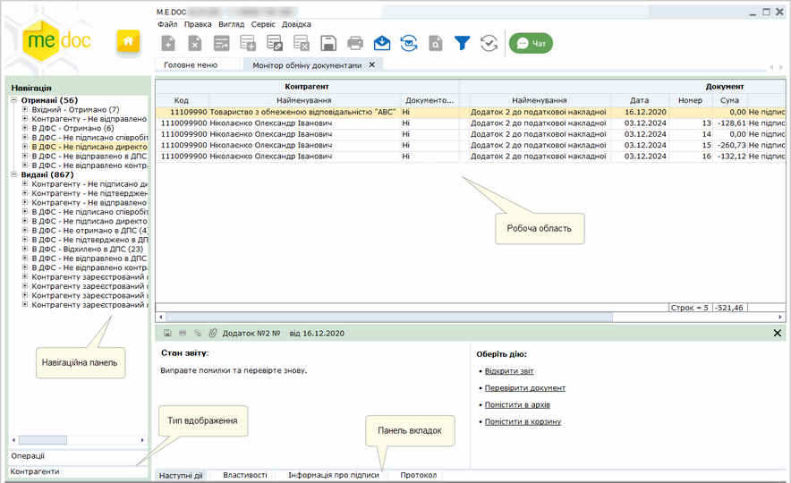

[← Зміст довідки](../)


# Монітор обміну документами

## Монітор обміну документами

_Шлях у довідці: Розділи програми › Первинні документи › Монітор обміну документами_

Монітор обміну документами призначений для відображення первинних документів, які в поточний момент знаходяться в обробці.
Монітор дозволяє відслідковувати весь процес проходження документів по маршрутам: від моменту створення первинного документа до затвердження цього документа контрагентом. Документи, переміщені в Архів, в Моніторі не відображаються.

Для зручності документи згруповані по статусам, що відповідають етапам обробки, або по контрагентам.

Натисніть на рисунок, щоб збільшити його

Навігаційна панель

Навігаційна панель представляє собою ієрархічний перелік документів, який представлений в двох розрізах в залежності від обраного типу відображення:

- Операції - відображається хід обробки документів по статусам, в яких вони знаходяться в поточний момент.
- Більш детально про статуси документів
- Не підписано директором/бухгалтером/співробітником/печаткою - документи, які готуються та очікують підпису директором/бухгалтером/співробітником/печаткою.
- Не відправлено контрагенту - підписана комплектом підписів податкова накладна (інший первинний документ), але не відправлена контрагенту. Документ набуває цього статусу за умови вибору повного циклу обробки документів.
- Не відправлено в ДПС - підписана комплектом підписів податкова накладна, але не відправлена на реєстрацію в ЄРПН. Документ набуває цього статусу за умови вибору  скороченого циклу обробки документів.
- Не отримано контрагентом - первинний документ, що знаходиться в дорозі до контрагента (не доставлено).
- Не отримано в ДПС - документ, що знаходиться в дорозі до податкової (ще не доставлено).
- Не підтверджено в ДПС - документи, відправлені в ДПС, доставлені та очікують обробки (не отримано квитанцій).
- Відхилено в ДПС - документи, на які отримано квитанцію від ДПС про відхилення.
- Не підтверджено контрагентом - документи, відправлені контрагенту, доставлені та очікують обробки (не отримано квитанцій).
- Відхилено контрагентом - документи, що були відхилені контрагентом.
- Відхилено контрагентом, прийнято в ДПС - документи, які були зареєстровані в ЄРПН, але відхилені контрагентом.
- Перевищено термін обробки - документи, які обробляються більше встановленого в налаштуваннях ліміту часу. Для візуального виокремлення виділяються іншим кольором.
- Контрагенти - відображає умовні дві гілки: "Вхідні" та "Вихідні"; кожна з гілок містить перелік Контрагентів, з якими в поточний момент відбувається обмін документами.

Робоча область

Містить безпосередньо записи Монітору: відображає записи, що відповідають статусам, обраним в навігаційній панелі.

Панель вкладок звіту

Містить службову інформацію щодо обраного документа. Панель доступна як у відкритому документі, так і з Реєстру первинних документів (за умови виділення потрібного документа).

- Наступні дії – містить інформацію щодо поточного стану документа, а також перелік можливих дій з документом у цьому стані. Слугує підказкою користувачу про доступні дії, які можна виконати з документом у поточному стані;
- Властивості – у режимі читання містить всю службову інформацію про документ, таку як: стан, період створення, дата та час останньої модифікації, інформація про сертифікати, якими підписано документ тощо. Інформація на цій вкладці постійно оновлюється та доповнюється при будь-яких змінах документа;
- Протокол – містить перелік подій, що відбулись з документом під час його обробки в хронологічному порядку. При виборі події справа на панелі відображається її детальний опис.


