[← Зміст довідки](../)


# Державна митна служба

## Державна митна служба

_Шлях у довідці: Додатково: UCDMSUMon › Державна митна служба_

Модуль Державна митна служба дозволяє формувати повідомлення щодо фінансових гарантій, для подальшого подання цих документів до Державної митної служби з метою реєстрації інформації гарантійних документів про надання фінансових гарантій, затверджувати та зашифровувати документи засобами ЕЦП, відправляти документи електронними каналами зв’язку, а також приймати і відображати квитанцій про доставку документів.

У даному розділі розглянуті такі теми:

- [Опис основних функціональних елементів інтерфейсу](#ucdmsumon-ucdmsumon_opys)
- [Як створити повідомлення щодо фінансових гарантій](#ucdmsumon-ucdmsum_stvor)
- [Відправлення документів електронним каналом зв’язку](#ucdmsumon-ucdmsumon_vidpr)
- [Прийом і відображення квитанцій про доставку документів та Файлів-відповідей](#ucdmsumon-ucdmsumon_pryyom)

### Опис основних функціональних елементів інтерфейсу

_Шлях у довідці: Додатково: UCDMSUMon › Державна митна служба › Опис основних функціональних елементів інтерфейсу_

Модуль умовно представлений у 2-х розрізах: Рік та Реєстр (панель відображення).

Реєстр повідомлень за РІК являє собою матрицю, де по горизонталі відображаються стани документів, розподілені по місяцях, по вертикалі - календарні дні місяців, а на перетині - кількість документів.

Тобто, у відображенні за рік можна побачити скільки документів було створено, відправлено, прийнято тощо на певну дату.

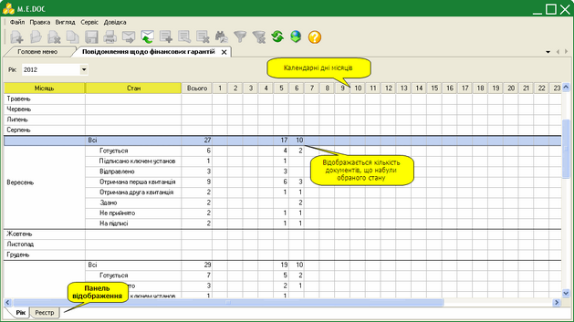

Натисніть на картинку, щоб збільшити її

РЕЄСТР побудований у вигляді таблиці, окремий рядок якої відображає коротку інформацію про кожний документ. Переглянути більш повну інформацію можна у окремій вкладці, яка відкривається подвійним кліком по потрібному запису.

У лівій частині модулю розташована навігаційна панель. Панель містить стани, що призначені для полегшення пошуку документів. При виборі певного стану на панелі навігації, в робочій області відображаються документи, що відповідають заданим умовам фільтрації.

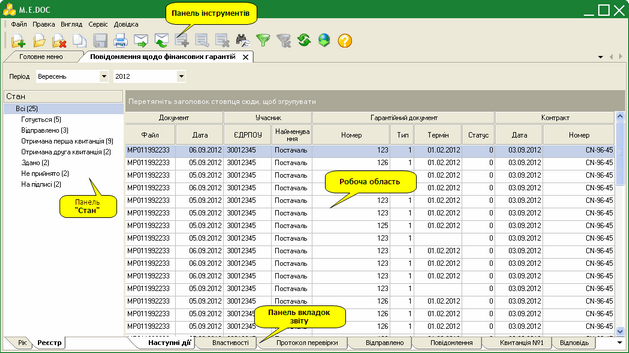

Натисніть на картинку, щоб збільшити її

Панель відображення:

- Рік - матриця, що відображає кількість всіх документи, що були створені за рік;
- Реєстр - відображає створені або імпортовані документи у заданому звітному періоді.

Панель Стан містить фільтри, що відповідають етапам роботи з документами:

- Готується - документи, що були створені та готуються до подання до органів державної митної служби;
- Відправлено - документи, відправлені електронною поштою у органи державної митної служби та очікують обробки (не отримано повідомлення та квитанцій);
- Отримана перша квитанція - документи, на які отримано Квитанцію №1 та повідомлення про доставку документу;
- Отримана друга квитанція - документ, на які отримано Квитанцію №2 про прийняття/відхиленні інформації гарантійних документів про надання фінансових гарантій;
- Здано - документи, на які отримані Файли-відповіді;
- Не прийнято - документи, на які отримано Квитанцію №2 з повідомленням про помилки.

Панель інструментів містить кнопки виклику таких функцій:

|  |  |
| --- | --- |
|  | Створення документу |
|  | Перегляд (редагування) поточного документу |
|  | Вилучення поточного документу |
|  | Створення копії документу. |
|  | Відправити документ електронною поштою за допомогою вбудованого поштового клієнта |
|  | Отримати повідомлення |

Також на панелі інструментів міститься панель вибору звітного періоду .

Робоча область містить безпосередньо записи повідомлень щодо фінансових гарантій.

Для зручності роботи у модулі, реалізована функція ГРУПУВАННЯ записів по колонкам таблиці.
За необхідності можна групувати данні: на додаткову панель над робочою областю перетягніть потрібні колонки таблиці.

Панель вкладок звіту містить службову інформацію щодо обраного документу. Панель доступна як у відкритому документі, так і з реєстру документів (за умови виділення потрібного документу).

Містить наступні вкладки:

- Наступні дії – містить інформацію щодо поточного стану документу, а також перелік можливих дій з документом у цьому стані. Слугує певною підказкою користувачу про доступні дії, які можна виконати з документом у певному стані;
- Властивості – у режимі читання містить всю службову інформацію про документ, таку як: стан, період створення, дата та час останньої модифікації, інформація про сертифікати, якими підписано документ тощо. Інформація на цій вкладці постійно оновлюється та доповнюється при будь-яких змінах документу;
- Відправлено – дана вкладка з’являється на панелі після відправлення документу адресату. Містить службову інформацію що стосується відправки документу, таку як: реквізити одержувача, дату та час відправлення, текст документу у форматі xml тощо;
- Повідомлення – дана вкладка з’являється на панелі після отримання повідомлення про доставку документу. Містить дату/час доставки та текст повідомлення. При наявності непрочитаного повідомлення дана вкладка виділяється мерехтінням маркеру зліва від назви вкладки.
Текст Повідомлення можна роздрукувати, а також зберегти у форматі \*.RTF. Для цього призначені кнопки  - Зберегти та  - Роздрукувати, що розміщені біля заголовку вкладки;

- Квитанція №1 – дана вкладка з’являється на панелі після отримання першої квитанції (про прийом документу). Містить дату/час доставки та текст квитанції.
Текст Квитанції №1 можна роздрукувати, а також зберегти у форматі \*.RTF. Для цього призначені кнопки  - Зберегти та  - Роздрукувати, що розміщені біля заголовку вкладки;

- Квитанція №2 – дана вкладка з’являється на панелі після отримання другої квитанції (з результатами перевірки). Містить дату/час доставки та текст квитанції.
Текст Квитанції №2 можна роздрукувати, а також зберегти у форматі \*.RTF. Для цього призначені кнопки  - Зберегти та  - Роздрукувати, що розміщені біля заголовку вкладки.

- Відповідь – дана вкладка з'являється на панелі після отримання Файлу-відповіді, містить реквізити, що бути привласнені документу після прийняття, або код та опис помилки.

### Як створити повідомлення щодо фінансових гарантій

_Шлях у довідці: Додатково: UCDMSUMon › Державна митна служба › Як створити повідомлення щодо фінансових гарантій_

Для створення повідомлення щодо фінансових гарантій виконайте дії у наступній послідовності:

1. Оберіть період в якому потрібно створити документ.

2. Для створення нового документу скористайтесь одним із наступних способів:

- на панелі інструментів натисніть кнопку Створити;
- виберіть команду Файл/Створити;
- у контекстному меню оберіть команду Створити;
- натисніть комбінацію клавіш Ctrl+N.

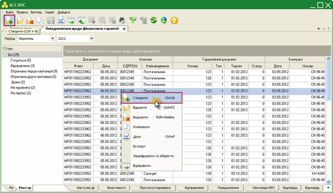

Натисніть на картинку, щоб збільшити її

4. Щойно створений файл відкриється у окремій вкладці.

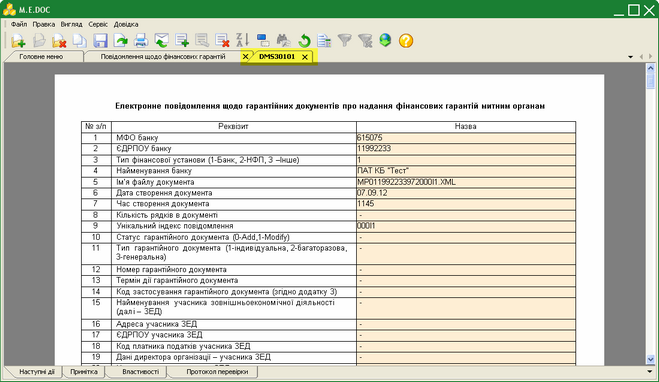

Натисніть на картинку, щоб збільшити її

6. Заповніть документ вручну із клавіатури, використовуючи наступні правилами заповнення документів:

- Поля, які можна заповнювати та редагувати виділені жовтим кольором. Якщо курсор встановити у такому полі, колір зміниться на зелений.
- Для переходу до наступного поля, що потрібно заповнити, використовуються функціональна клавіша Tab, стрілки Вверх, Вниз, Вправо, Вліво клавіатури та ліва кнопка миші.
- При внесенні або редагуванні значень у полях, що заповнюються, доступні стандартні функції Windows – відмінити (Ctrl+Z), вирізати (Ctrl+X), копіювати (Ctrl+C) та вставити (Ctrl+V). Ці функції викликаються із меню Правка та кнопками на панелі інструментів вікна.

Додавання нового рядка під обраним відбувається одним із наступних способів:

►

за допомогою кнопки  на панелі інструментів вікна;

►

за допомогою кнопки  зліва від обраного рядка у таблиці;

►

натиснувши комбінацію клавіш Ctrl+I.

Вилучення обраного рядка відбувається одним із наступних способів:

►

за допомогою кнопки  на панелі інструментів вікна;

►

за допомогою кнопки  зліва від обраного рядка у таблиці;

►

натиснувши комбінацію клавіш Ctrl+Y.

7. Оберіть команду Правка/Перевірити документ  або  F4 для перевірки звіту.

Перевіряється правильність заповнення полів і у випадку помилок, система підсвітить червоним кольором поля, що необхідно виправити. Виправте помилки та знову виконайте перевірку.

8. Збережіть звіт, натиснувши кнопку  або комбінацію клавіш Ctrl+S.

9. Всі подальші дії з підготовки документу для подання до органів державної митної служби (друк, збереження на електронному носії) виконуються із вікна відкритого документу.

### Відправлення документів електронним каналом зв’язку

_Шлях у довідці: Додатково: UCDMSUMon › Державна митна служба › Відправлення документів електронним каналом зв’язку_

В цьому розділі:

[Підписання документів засобами ЕЦП](#ucdmsumon-ucdmsumon_vidpr)

[Відправлення документів електронним каналом зв'язку](#ucdmsumon-ucdmsumon_vidpr)

Підписання документів засобами ЕЦП

Для роботи з усіма сертифікатами у програмі використовується універсальна бібліотека, тому процедура підпису для всіх сертифікатів однакова.

1. Відкрийте документ, що потрібно відправити до органів державної митної служби.

2. На панелі вкладок документу, у закладці Наступні дії оберіть опцію Передати документ на підпис.

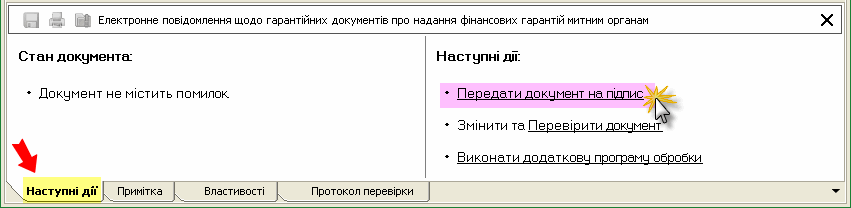

Відкриється вікно Підпис, тип підпису «Відповідальна особа». Далі вкажіть шлях до розміщення каталогу з секретними ключами та введіть пароль секретного ключа відповідної посадової особи у однойменні поля форми.

Зверніть увагу! Якщо встановити галочку у полі «Зберігати пароль протягом сеансу», то при наступному підписанні даним сертифікатом в межах поточного сеансу користування дана процедура виконається автоматично.

Натисніть ОК для продовження.

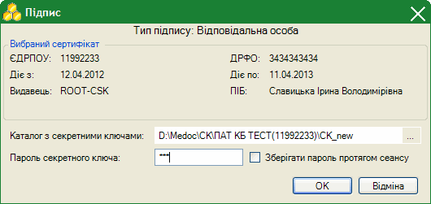

Згідно з налаштованим комплектом підписів наступним кроком потрібно підписати документ Печаткою установи. Процедура підписання печаткою аналогічна описаній вище, за винятком вибору сертифікату.

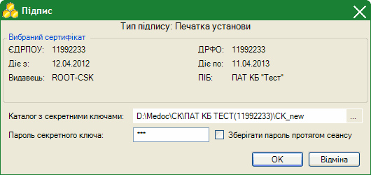

[Наверх](#ucdmsumon-ucdmsumon_vidpr)

Відправлення документів електронним каналом зв'язку

Після того, як документ був підписаний згідно з налаштованим комплектом підписів, на панелі стану документу стає доступною опція Відправити у контролюючий орган

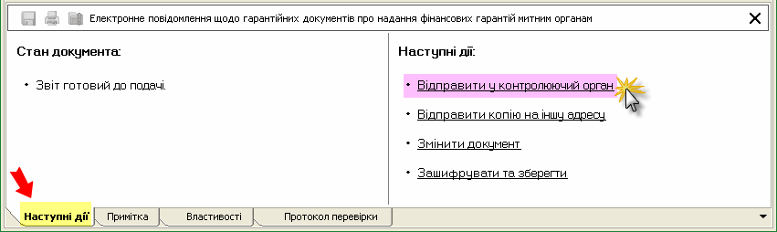

На виконання цієї команди, система повторно запропонує підписати файл сертифікатом печатки установи - таким чином підписується "конверт", в який поміщається файл для відправки.

Зверніть увагу! Якщо при підписанні печаткою установи раніше була встановлена галочка у полі «Зберігати пароль протягом сеансу», то дана процедура виконається автоматично (в межах поточного сеансу користування).

Відкриється вікно «Вибір адресата». Оберіть адресу ДМСУ.

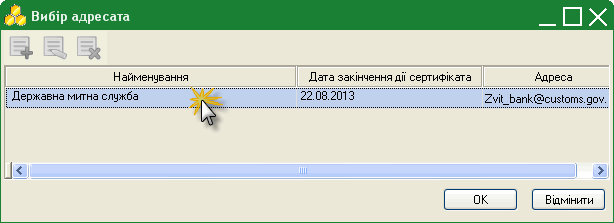

Повідомлення відправлено. При цьому, на панелі стану документу з’явиться додаткова вкладка «Відправлено», що містить інформацію про код та назву одержувача звіту, адресу одержувача, дата та час відправлення тощо.

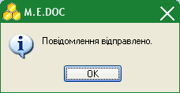

[Наверх](#ucdmsumon-ucdmsumon_vidpr)

### Прийом і відображення квитанцій про доставку документів та Файлу-відповіді

_Шлях у довідці: Додатково: UCDMSUMon › Державна митна служба › Прийом і відображення квитанцій про доставку документів та Файлу-відповіді_

Як тільки в органах Державної митної служби був прийнятий документ, генерується Повідомлення про доставку документу та Квитанція №1 з результатами обробки документу, які надсилаються відправникові.

Повідомлення та квитанція надходять як звичайна вхідна кореспонденція. Для цього потрібно натиснути кнопку на панелі інструментів  (Отримати повідомлення) або функціональну клавішу F9. При наявності відповідей система повідомить про це.

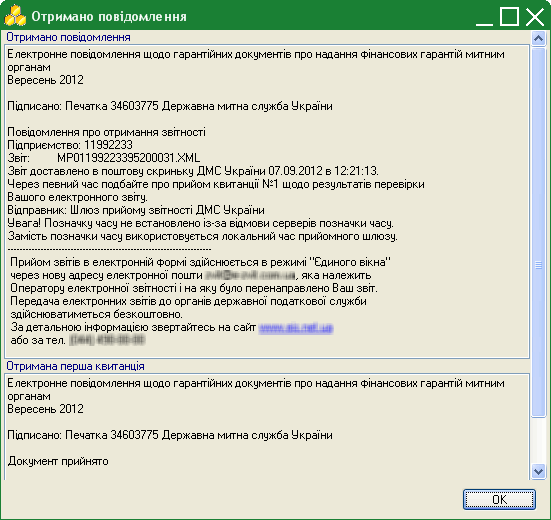

Файли Повідомлення та Квитанції прикріпляються до документу, що відправлявся. Вміст прийнятих Повідомлення та Квитанції можна переглянути на панелі стану документу, де з’являються додаткові вкладки «Повідомлення» та «Квитанція №1» відповідно.

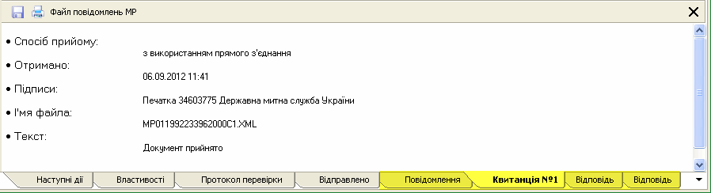

Також надсилається два Файли-відповіді. Він так само отримується як звичайна кореспонденція, про що повідомляє система.

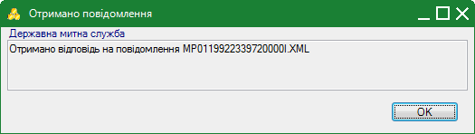

Файл-відповідь також прикріплюється до документу, на який її було отримано. Відповідь можна переглянути у відкритому вікні документу, де з'являється додаткова вкладка Відповідь.

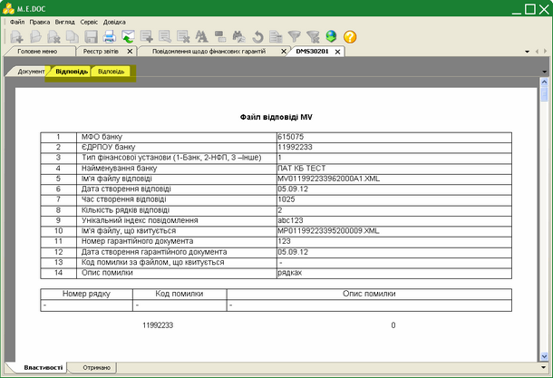

Натисніть на картинку, щоб збільшити її


