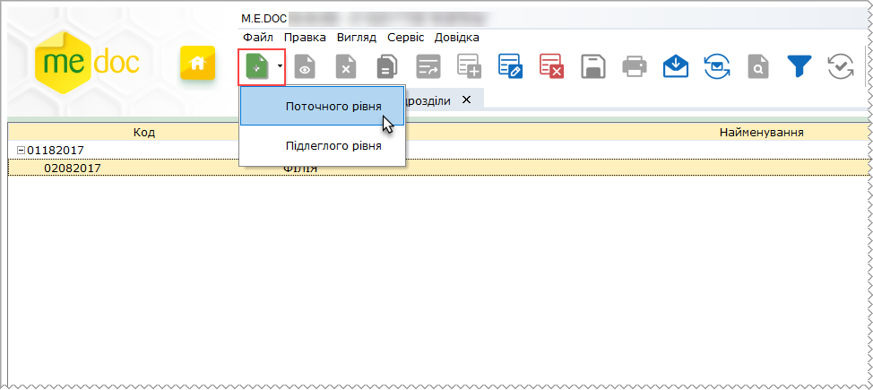
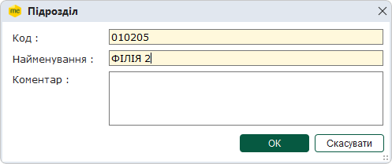
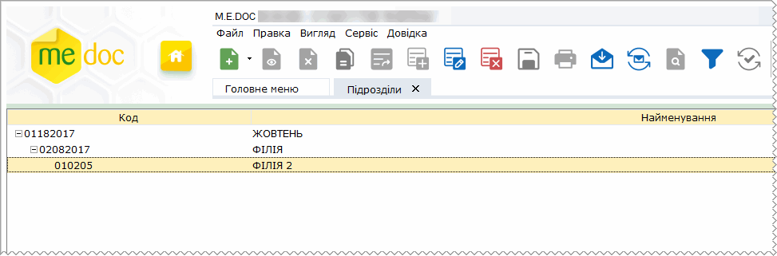

[← Зміст довідки](../)


# Підрозділи

## Підрозділи

_Шлях у довідці: Розділи програми › Довідники › Підрозділи_

Довідник Підрозділи призначений для опису організаційної структури підприємства. Структура представлена у вигляді ієрархічного списку, що відображає склад, підпорядкованість і зв'язок структурних одиниць організації.

Інформація зазначена в довіднику використовується в інших модулях, наприклад, при налаштуванні програмного комплексу.

У програмі, під структурою підприємства розуміють його внутрішній устрій, при якому кожен нижчий рівень підпорядковується вищому. Елемент самого верхнього рівня - це, як правило, головна установа; елементи підлеглого рівня - підпорядковані структурні підрозділи.

Кожна складова ланка підприємства описується кодом та найменуванням організаційної одиниці.

Для зручності дозволяє створювати багато установ з їх розгалуженою організаційною структурою.

Для того, щоб побудувати багаторівневу структуру підприємства (на кшталт дерева), виділіть рядок відносно якого буде додаватись підрозділ. На панелі інструментів або у контекстному меню оберіть команду Створити.

При створенні першого запису у довіднику відразу виберіть команду Створити. Для створення буде доступно тільки організаційна одиниця поточного рівня.

Далі вкажіть потрібний рівень ієрархії:

- поточний рівень - дозволяє створювати структурну одиницю рівнозначну по ієрархії виділеній;
- підлеглий рівень - дозволяє створювати підпорядкований елемент.

Для прикладу оберемо опцію Підлеглого рівня.

Відкриється окреме вікно Підрозділ. Заповніть запропоновані поля форми.

Поля, що підсвічені жовтим кольором, є обов'язковими для заповнення.

Для збереження внесених даних натисніть кнопку ОК. Для скасування натисніть Скасувати.

В указаному місці з'явиться запис обраного рівня.

В списку організаційної структури підприємства також доступні наступні функції:

|  |  |
| --- | --- |
| Видалити | Дозволяє безповоротно вилучити запис. |
| Редагувати | Редагування даних в разі необхідності. |


