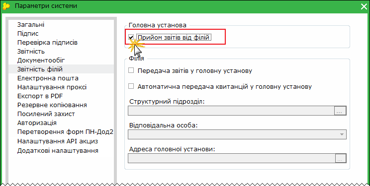
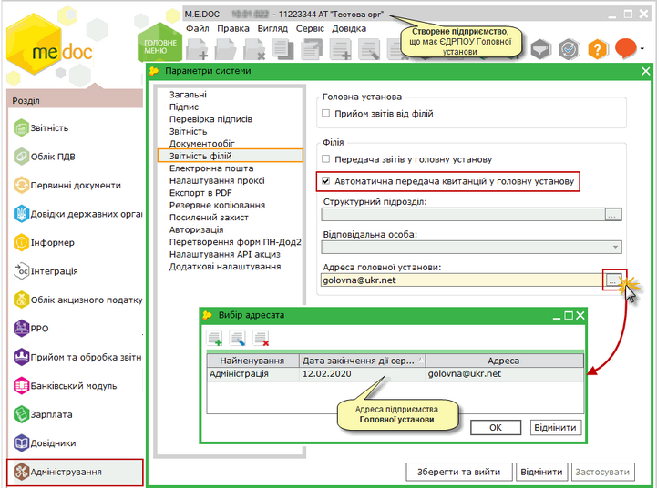
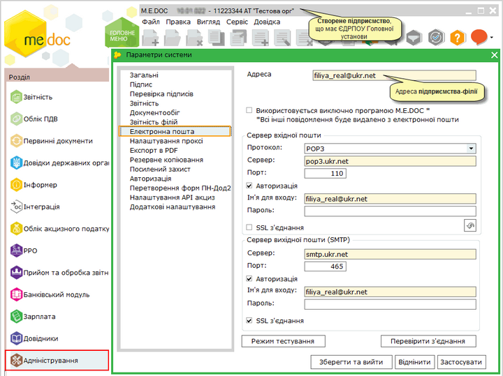
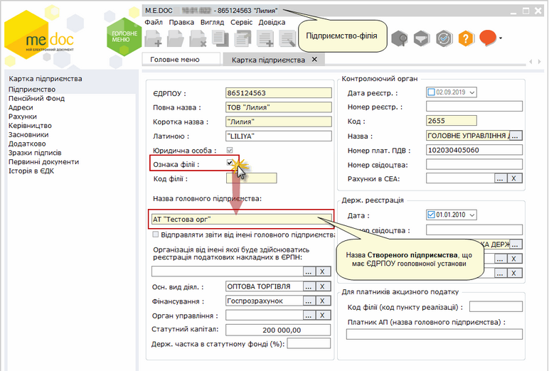
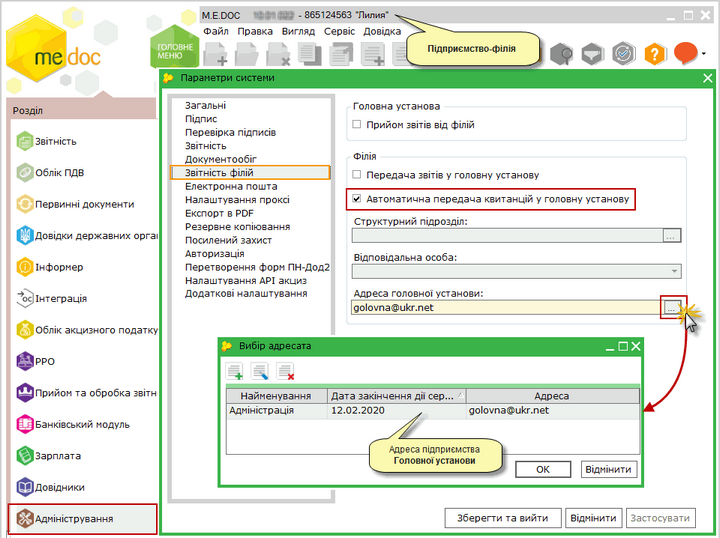

[← Зміст довідки](../)


# Реєстрація ПН та Дод.2 філіями

## Реєстрація ПН та Дод.2 філіями

_Шлях у довідці: Допоміжні сервіси › Реєстрація ПН та Дод.2 філіями_

Для підприємств з розгалуженою ієрархічною структурою, в програмному комплексі "M.E.Doc" передбачена можливість реєстрації Податкових накладних, Додатків 2 в ЄРПН, а також виконувати Запит щодо отримання відомостей з ЄРПН філіями від імені Головної установи.

На відміну від [обміну документами між філією та Головною установою](UCDeptReps.html#ucdeptreps-ucdeptreps), відправка на реєстрацію в ЄРПН Податкових Накладних та Додатків 2 відбувається безпосередньо з підприємства-філії.

Для здійснення цієї можливості виконайте налаштування:

У програмному комплексі "M.E.Doc", що використовується Головною установою, у підприємстві Головної установи виконайте дії:

1. Оберіть розділ [Адміністрування - Параметри системи - Звітність філій](FormCompanyParams.html#formcompanyparams-admcompanyparams_rep).

2. Встановіть позначку Прийом звітів від філій.

У програмному комплексі "M.E.Doc", що використовується Філією виконайте операції:

1. [Створіть підприємство](Connect_org.html#connect_org-connect_org) з кодом ЄДРПОУ Головної установи.

2. У вікні Вибір установи оберіть створене підприємство та натисніть кнопку ОК.

3. [Завантажте](UCAsignCert.html#ucasigncert-admcert_cert) всі актуальні сертифікати ЕЦП Головної установи.

4. Оберіть розділ [Адміністрування - Параметри системи - Звітність філій](FormCompanyParams.html#formcompanyparams-admcompanyparams_rep).

5. Встановіть опцію Автоматична передача квитанцій у головну установу.

Натисніть, щоб збільшити малюнок

4. У полі Адреса головної установи, натисніть на кнопку вибору . Відкриється вікно Вибір адресата, що містить перелік Підрозділів підприємства з [Адресної книги](UCAddrBook.html#ucaddrbook-spraddrbook). Оберіть запис Головної установи.

Увага! Не потрібно встановлювати позначку в полі Передача звітів у головну установу!

Обов'язково переконайтесь, що електронна адреса Головної установи реальна!

5. Перейдіть у розділ [Параметри системи - Електронна пошта](FormCompanyParams.html#formcompanyparams-admcompanyparams_emaile) та вкажіть електронну адресу підприємства-філії.

Натисніть, щоб збільшити малюнок

6. У вікні Вибір установи оберіть підприємство-філію та натисніть кнопку ОК.

7. У підприємстві-філії перейдіть у розділ [Довідники - Картка підприємства - Підприємство](UCOrg.html#ucorg-sprorg_org) та вкажіть організацію, від імені якої буде здійснюватися реєстрація податкових накладних в ЄРПН. Це має бути підприємство, додане у[п.1](#ucdeptnn-ucdeptreps).

Натисніть, щоб збільшити малюнок

8. Перейдіть у розділ [Параметри системи - Звітність філій](FormCompanyParams.html#formcompanyparams-admcompanyparams_rep) та встановіть позначку у полі Автоматична передача квитанцій у головну установу.

Натисніть, щоб збільшити малюнок

9. У полі Адреса головної установи, натисніть на кнопку вибору . Відкриється вікно Вибір адресата, що містить перелік Підрозділів підприємства з [Адресної книги](UCAddrBook.html#ucaddrbook-spraddrbook). Оберіть запис Головної установи.

Увага! Не потрібно встановлювати позначку в полі Передача звітів у головну установу!

Обов'язково переконайтесь, що електронна адреса Головної установи реальна!

Відправка документів в ЄРПН філіями від імені Головної установи відбувається за наступною схемою:

1. У підприємстві-філії створюється документ (Податкова накладна / Додаток 2 / Запит щодо отримання відомостей з ЄРПН). В момент створення документ автоматично заповнюється реквізитами Головної установи.

2. Документ [підписується](UC_ECP.html#uc_ecp-ecp) встановленим комплектом підписів Головної установи та [відправляється](UC_ECP.html#uc_ecp-ecp) в ДПС з метою реєстрації документа в ЄРПН або отримання відомостей з ЄРПН.

3. Повідомлення про доставку та Квитанція 1 з результатами обробки буде прийнято підприємством-філією при перевірці пошти.

Примітка:

При перевірці пошти використовуються сертифікати Головної установи.

4. Як тільки отримано Повідомлення про доставку та Квитанція 1 з результатами обробки, документ відправляється в реальну Головну установу.


