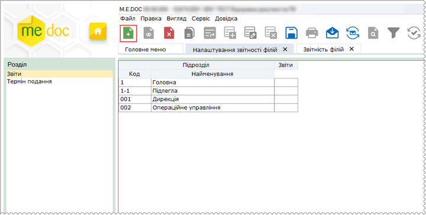
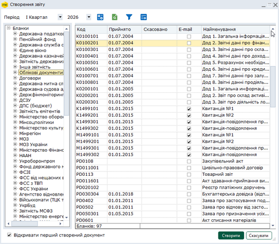
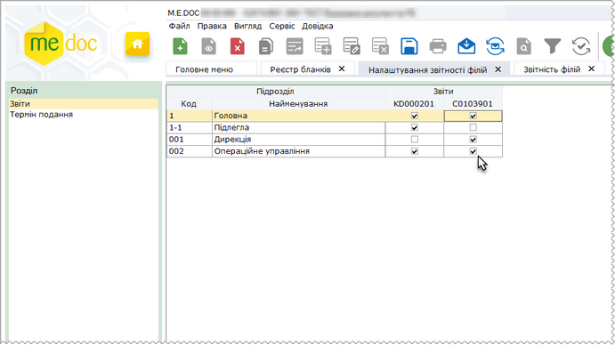
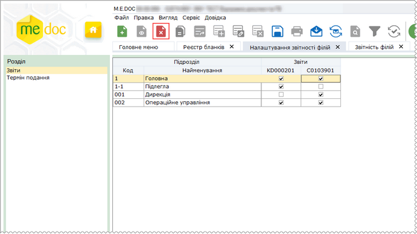
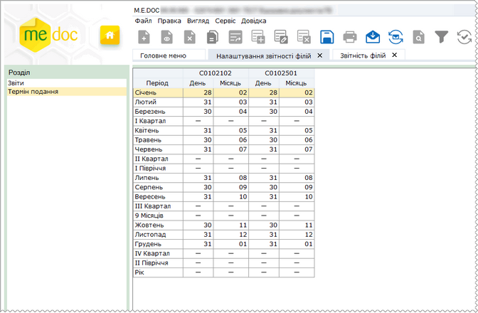

[← Зміст довідки](../)


# Налаштування звітності філій

## Налаштування звітності філій

_Шлях у довідці: Розділи програми › Адміністрування › Налаштування звітності філій_

Модуль призначений для налаштування параметрів подання звітів структурними підрозділами у головну установу:
- визначення переліку звітних форм для окремих філій;
- визначення кінцевих дат подання звітів у головну установу, в залежності від звітного періоду.

Даний модуль доступний для налаштування тільки для Головної установи підприємства, тобто в модулі Параметри системи - Звітність філій у полі [Прийом звітів від філій](FormCompanyParams.html#formcompanyparams-admcompanyparams_rep) має стояти відмітка.

Модуль містить 2 розділи:

- [Звіти](#ucdepttermset-coprdeptset_rep). Матриця подання звітів на підписання у головну установу для структурних підрозділів підприємства.
Дозволяє змінювати склад звітів та налаштовувати набори звітів для окремих філій.

- [Термін подання](#ucdepttermset-coprdeptset_term). Таблиця кінцевих дат подання звітів у головну установу для філій відносно звітного періоду.
Дозволяє змінювати кінцеві дати подання в залежності від вимог підприємства.

### Звіти

_Шлях у довідці: Розділи програми › Адміністрування › Налаштування звітності філій › Звіти_

В цьому розділі:

[Додавання звітів у таблицю подання звітності філіями](#ucdepttermset-coprdeptset_rep)

[Видалення звітів із таблиці подання звітності філіями](#ucdepttermset-coprdeptset_rep)

У підрозділі формується перелік звітів, що подаються структурними підрозділами на підписання у головну установу.

У рядках таблиці наводяться найменування всіх філій підприємства. Перелік підрозділів підприємства автоматично формується за даними довідника [Підрозділи](UCDepartments.html#ucdepartments-sprdepartment). Змінити перелік підрозділів безпосередньо у модулі Налаштування звітності філій - Звіти неможливо.

Звіти, що подаються певним підрозділом на підписання у головну установу визначаються користувачем. Інформація по кожному звіту відображається у окремому стовпці таблиці. Заголовок стовпця містить код бланка звіту.

На перетинах рядків та стовпців встановлюється відмітка, що свідчить про зобов'язання філії подавати звіт у головну установу.

Додавання звітів у таблицю подання звітності філіями

Для того, щоб додати звіт у таблицю, на панелі інструментів виберіть команду Створити, або натисніть комбінацію клавіш Ctrl+N.

Натисніть, щоб збільшити малюнок

Відкриється вікно Створення звіту. Оберіть відповідний розділ та групу звітності. Виділіть потрібний звіт, та натисніть кнопку Створити.

Детальніше про роботу у модулі див. у розділі [Створення звіту](UCDocRstByPer5.html#ucdocrstbyper5-rdoc_robota_stvor).

Натисніть, щоб збільшити малюнок

Вибраний звіт додасться у таблицю. За замовчанням у стовпчику щойно доданого звіту проставлені позначки для всіх філій. Якщо якась філія не зобов'язана подавати звіт зніміть, позначку напроти філії.

Натисніть, щоб збільшити малюнок

По закінченню формування таблиці подання звітності філій, збережіть дані натиснувши на кнопку  або натисніть комбінацію клавіш Ctrl+S.

[До початку](#ucdepttermset-coprdeptset_rep)

Видалення звітів із таблиці подання звітності філіями

Зніміть або встановіть будь-яку позначку у стовпчику звіту, що видаляється. Далі на панелі інструментів виберіть команду Видалити, або натисніть комбінацію клавіш Shift+Del.

Натисніть, щоб збільшити малюнок

По закінченню формування таблиці подання звітності філій, збережіть дані натиснувши на кнопку  або натисніть комбінацію клавіш Ctrl+S.

[До початку](#ucdepttermset-coprdeptset_rep)

### Термін подання

_Шлях у довідці: Розділи програми › Адміністрування › Налаштування звітності філій › Термін подання_

У даному підрозділі представлена таблиця кінцевих дат подання звітів у головну установу для філій відносно звітного періоду.

Перелік звітів у таблиці відповідає набору звітів, що був сформований у розділі [Звіти](#ucdepttermset-coprdeptset_rep) цього модуля.

Дата кінцевого подання для кожного звіту відносно звітного періоду у таблиці встановлюється згідно вказаних даний у [властивостях бланка](UCSelectReport.html#ucselectreport-sprtmpl). Якщо кінцева дата подання у властивостях бланка не визначена (поле не заповнено), встановлюється дата останнього для наступного місяця від звітного періоду.

При необхідності, можна вручну змінювати дати подання в залежності від вимог підприємства. Для цього виберіть потрібну клітинку і змініть дату.

Натисніть, щоб збільшити малюнок

По закінченню редагування таблиці, збережіть дані натиснувши на кнопку  або натисніть комбінацію клавіш Ctrl+S.


