[← Зміст довідки](../)


# Реєстр виданих та отриманих податкових накладних

## Реєстр виданих та отриманих податкових накладних

_Шлях у довідці: Розділи програми › Облік ПДВ › Реєстр виданих та отриманих податкових накладних_

У модулі формуються та зберігаються Реєстри виданих та отриманих податкових накладних.

Модуль представлений у вигляді таблиці, окремий рядок якої відображає коротку основну інформацію податкової накладної. Переглянути більш детальніше документ можна у окремому вікні, яке відкривається подвійним кліком по потрібному запису. Заповнена таблиця модуля і є Реєстром податкових накладних - отриманих або виданих.

В електронній таблиці Реєстру податкових накладних в нижньому окремому рядку відображаються розраховані програмою підсумкові суми відповідних колонок реєстру.

Документи в модулі розподілені по закладках: Отримані, Видані та Відсутні у реєстрі.

Сформований Реєстр виданих та отриманих податкових накладних відображається також у модулі Реєстр звітів у відповідному звітному періоді. У цьому модулі Реєстр податкових накладних можна роздрукувати, підписати ЕП та відправити електронною поштою.

У даному розділі довідки розглянуто наступне:

- [Правила роботи у Реєстрі](#ucdocnaklrstmain5-docnaklrst_pravyla)
- [Опис основних функціональних елементів інтерфейсу](#ucdocnaklrstmain5-docnaklrst_int)
- [Робота з Pеєстром податкових накладних](#ucdocnaklrstmain5-docnaklrst_rab)

­

[Заповнення Pеєстру податкових накладних](#ucdocnaklrstmain5-docnaklrst_zapov)

­

[Створення податкової накладної та додатків до неї](#ucdocnaklrstmain5-docnaklrst_stvor_nn)

­

[Копіювання документів у реєстрі](#ucdocnaklrstmain5-docnaklrst_copy_nn)

­

[Друк податкових накладних](#ucdocnaklrstmain5-docnaklrst_druk_nn)

­

[Імпорт Реєстру та податкових накладних створених в інших бухгалтерських системах](#ucdocnaklrstmain5-docnaklrst_import)

­

[Експорт із Реєстру податкових накладних](#ucdocnaklrstmain5-docnaklrst_exp)

­

[Додаткові сервісні функції](#ucdocnaklrstmain5-docnaklrst_func)

­

[Групова заміна виду та коду документів](#ucdocnaklrstmain5-docnaklrst_func_group)

­

[Створення копії Реєстру податкових накладних](#ucdocnaklrstmain5-docnaklrst_cop)

­

[Друк Реєстру податкових накладних у PDF](#ucdocnaklrstmain5-docnaklrst_print_pdf)

­

[Додаткові сервісні функції](#ucdocnaklrstmain5-docnaklrst_func)

­

[Створення пакету звітів](#ucdocnaklrstmain5-reestr_pak)

­

[Відправлення Реєстру накладних електронною поштою](#ucdocnaklrstmain5-docnaklrst_mail)

- [Порції Реєстру податкових накладних](#ucdocnaklrstmain5-docnaklrst_porcyy)

### Правила роботи у Реєстрі

_Шлях у довідці: Розділи програми › Облік ПДВ › Реєстр виданих та отриманих податкових накладних › Правила роботи у Реєстрі_

Реєстр податкових накладних представляє собою електронну таблицю з даними, але фактично це один документ. Працювати у Реєстрі в будь який час може лише один користувач, одночасна робота декількох користувачів (в мережевій версії програми) неможлива.

1. Реєстр є формою для запису (реєстрації) отриманих та виданих податкових накладних.

- У Реєстрі… можна створювати електронні податкові накладні та друкувати ці накладні.
- У Реєстр… можна імпортувати електронні податкові накладні (з електронних носіїв – флеш-диску, CD-диску та електронною поштою).
- У Реєстр.. можна імпортувати Реєстр виданих та отриманих податкових накладних з інших бухгалтерських систем (у форматі xml, zdi, txt, dbf).
- Реєстр… можна заповнювати вручну із клавіатури, для цього потрібно ввести відповідні реквізити із паперової форми податкової накладної чи додатку 2 у таблицю.

2. Електронні податкові накладні створюються у закладці Видані накладні модуля.

3. Електронні податкові накладні імпортуються у закладку Отримані накладні (та можуть імпортуватися у Видані накладні).

4. Після імпорту (як з електронного носія, так і прийняті електронною поштою) податкові накладні та додатки одразу не додаються у Реєстр…, а попередньо поміщаються у програмі в архів Відсутні у реєстрі. Із цього архіву існує можливість переглянути такі накладні, а вже потім їх потрібно або ж імпортувати у програму у цей модуль, або ж видалити.

5. Додавання нових рядків у Реєстр відбувається за допомогою кнопки  (Ctrl+I), помилковий запис видаляється кнопкою видалення рядка таблиці  (Ctrl+Y).

6. У електронній таблиці Реєстру… є декілька додаткових колонок, у поля яких підключені довідники, що  полегшують його заповнення. Наприклад, колонка Код, до якої підключені довідники Податкові зобов’язання (Податковий кредит). Правильне заповнення коду у цій колонці гарантує коректне заповнення відповідних рядків Декларації з ПДВ.

7. Ви можете обмінюватись податковими накладними з Вашими контрагентами за допомогою електронної пошти (з використанням ЕП). Для цього Вам потрібно мати сертифікат ЕП печатки цих контрагентів.

8. У Реєстрі реалізовані додаткові функції: Перевірка стану платників ПДВ (із бази ДПС) та Видалення некоректних символів з ІПН.

9. Порядок заповнення рядка З них включено до уточнюючих розрахунків [описаний далі](#ucdocnaklrstmain5-docnaklrst_func).

10. У графі Ознака здійснення с/г операцій позначка проставляється виключно платниками податку на додану вартість – сільськогосподарськими товаровиробниками у разі здійснення ними операцій з постачання власновироблених товарів, отриманих за результатами видів діяльності, визначених пунктом 161.3 статті 161 Закону України від  24.06.2004  №  1877-IV  "Про державну підтримку сільського господарства України".

11. Форма Реєстр виданих та отриманих  податкових накладних відкривається для перегляду та друку за допомогою кнопки .

12. Якщо у програмі ведеться робота з Реєстром отриманих та виданих податкових накладних великих об’ємів (імпорт, експорт) технічні характеристики комп'ютера повинні бути значно кращі, а саме:

- Процесор Pentium - з тактовою частотою 1,7 ГГц або швидший;
- Оперативна пам'ять (ОЗУ) не менше 2 Гб (або файл підкачки повинен бути не менше 2 Гб у разі, коли ОЗУ комп'ютера меншого об'єму).

### Опис основних функціональних елементів інтерфейсу

_Шлях у довідці: Розділи програми › Облік ПДВ › Реєстр виданих та отриманих податкових накладних › Опис основних функціональних елементів інтерфейсу_

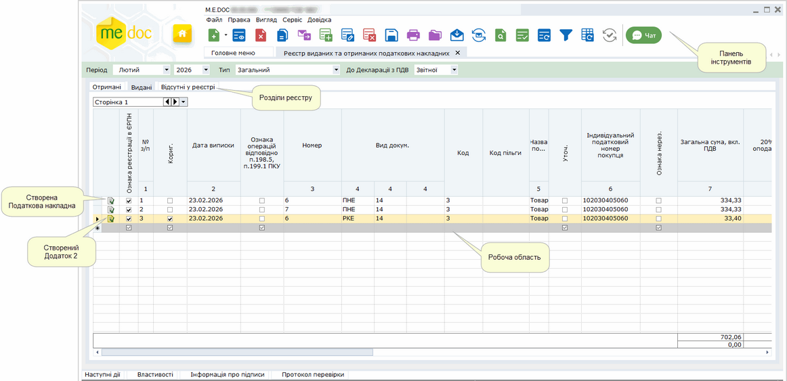

Натисніть, щоб збільшити малюнок

Робоча область містить безпосередньо записи реєстру: представлено у вигляді таблиці, окремий рядок якої відображає коротку основну інформацію податкової накладної. Переглянути більш детальніше документ можна у окремому вікні, яке відкривається подвійним кліком по потрібному запису. Заповнена таблиця модуля і є Реєстром податкових накладних - отриманих або виданих.

В нижньому окремому рядку відображаються розраховані програмою підсумкові суми відповідних колонок реєстру.

Документи, що були створені або імпортовані у реєстр, позначаються піктограмами:  - податкові накладні та  - додатки (коригування). Наявність піктограми вказую на те, що документ існує в базі, його можна переглянути та відредагувати. Зареєстровані документи позначаються піктограмами -  та  відповідно.

Відповідно, документи, що були внесені у реєстр [вручну із клавіатури](#ucdocnaklrstmain5-docnaklrst_zapov), а також проімпортовані реєстри, сформовані в інших бухгалтерських системах, графічного відображення не мають, вони не відкриваються для перегляду та не існують у програмі у вигляді документа.

Розділи реєстру. Документи в модулі розподілені по розділах: Отримані, Видані та Відсутні у реєстрі.

Відсутні у реєстрі - архів завантажених у систему, але не імпортованих у реєстр податкових накладних

Панель інструментів містить кнопки виклику таких функцій:

|  |  |
| --- | --- |
|  | Відкриття списку додатків |
|  | Перегляд паперової форми Реєстру податкових накладних |
|  | Додати рядок |
|  | Вилучити рядок |
|  | Редагувати запис |
|  | Друкування Реєстру податкових накладних |

Окрім інструментів, які надають швидкий доступ до функцій, що найчастіше використовуються, у верхній частині вікна розташована додаткова панель, що дозволяє управляти реєстром.

1. Для початку роботи з реєстром треба вказати період відображення і тип оподаткування підприємства:

2. В режимі Корпорація відображається поле Філія, яка дозволяє фільтрувати документи підзвітних установ.

### Робота з Pеєстром податкових накладних

_Шлях у довідці: Розділи програми › Облік ПДВ › Реєстр виданих та отриманих податкових накладних › Робота з Pеєстром податкових накладних_

У даному розділі довідки розглянуто наступне:

- [Заповнення Pеєстру податкових накладних](#ucdocnaklrstmain5-docnaklrst_zapov)
- [Створення податкової накладної та додатків до неї](#ucdocnaklrstmain5-docnaklrst_stvor_nn)
- [Друк податкових накладних](#ucdocnaklrstmain5-docnaklrst_druk_nn)
- [Імпорт Реєстру та податкових накладних створених в інших бухгалтерських системах](#ucdocnaklrstmain5-docnaklrst_import)
- [Експорт із Реєстру податкових накладних](#ucdocnaklrstmain5-docnaklrst_exp)
- [Додаткові сервісні функції](#ucdocnaklrstmain5-docnaklrst_func)

­

[Групова заміна виду та коду документів](#ucdocnaklrstmain5-docnaklrst_func_group)

- [Створення копії Реєстру податкових накладних](#ucdocnaklrstmain5-docnaklrst_cop)
- [Створення пакету звітів](#ucdocnaklrstmain5-reestr_pak)
- [Відправлення Реєстру накладних електронною поштою](#ucdocnaklrstmain5-docnaklrst_mail)

#### Заповнення Pеєстру податкових накладних

_Шлях у довідці: Розділи програми › Облік ПДВ › Реєстр виданих та отриманих податкових накладних › Робота з Pеєстром податкових накладних › Заповнення Pеєстру податкових накладних_

За наявності первинних документів, що не входять до складу Реєстру, ці документи відображаються на вкладці Відсутні у реєстрі.

Виконати завантаження документів у Реєстр можливо, скориставшись пунктом Заповнити звіт згідно первинних документів вкладки Наступні дії на панелі стану документа або з архіву [Відсутні у реєстрі](#ucdocnaklrstmain5-docnaklrst_import).

Зверніть увагу! Із архіву податкові документи можна завантажити вибірково, тоді як із вкладки Наступні дії, завантажується весь список документів, що відсутні у реєстрі.

Податкові зобов'язання та Податковий кредит

Для документів, в яких має бути заповнено поля Податкові зобов’язання або Податковий кредит, відсутній відповідний код податкового зобов'язання/кредиту, відразу після завантаження система запропонує вказати цей код у окремому вікні.

Для того, щоб вказати код податкового зобов'язання/кредиту, необхідно подвійним кліком лівої клавіші миші відкрити документ. У полях Податкові зобов’язання або Податковий кредит потрібно обрати відповідний код із однойменних підключених довідників.

Податкові зобов’язання та Податковий кредит - додаткові поля розробника, вони відсутні у друкованій формі податкової накладної. Але код, який обирається у цих полях, призначений для коректного перенесення даних із Податкової  накладної  або Додатку 2 у Реєстр, і потім, при експорті дані правильно перенесуться до Додатків 1,5,6 та відповідних рядків Декларації.

Видані накладні

У Виданих податкових накладних потрібно [обирати код](#ucdocnaklrstmain5-docnaklrst_stvor_nn) у полі Податкові зобов’язання.

НЕ ЗАПОВНЮЄТЬСЯ код у цьому полі у випадку, якщо операції по накладній відповідають:

- рядку 1.1 Декларації з ПДВ "операції, що оподатковуються за основною ставкою";
- рядку 1.2 Декларації з ПДВ "операції, що оподатковуються за ставкою 7 %";
- рядку 1.3 Декларації з ПДВ "операції, що оподатковуються за ставкою 14 %";
- рядку 2.1 Декларації з ПДВ "операції, що оподатковуються за основною ставкою";
- рядку 3 Декларації з ПДВ "інші операції, що оподатковуються за нульовою ставкою".

Отримані накладні

У Отриманих податкових накладних потрібно обирати код у полі Податковий кредит.

НЕ ЗАПОВНЮЄТЬСЯ код у цьому полі у випадку, якщо операції відповідають оподаткуванню за:

- рядку 10.1 Декларації з ПДВ - "основною ставкою та  нульовою";
- рядку 10.2 Декларації з ПДВ - "ставкою 7 %";
- рядку 10.3 Декларації з ПДВ - "ставкою 14 %".

Заповнення Реєстру виданих та отриманих податкових накладних

Реєстр виданих та отриманих податкових накладних заповнюється наступними можливими способами:

- видані (вихідні) та отримані (вхідні) податкові накладні, що були створені (отримані) у модулі [Податкові накладні](UCNaklExchangeRst.html#ucnaklexchangerst-ucnaklexchangerst_), автоматично додаються у Реєстр при його відкритті ([див. вище](#ucdocnaklrstmain5-docnaklrst_zapov));
- в розділі Видані реєстру створюються податкові накладні та додатки;
- [імпортуються](#ucdocnaklrstmain5-docnaklrst_import) Реєстр або накладні та додатки в електронному вигляді (формат XML), сформовані в інших бухгалтерських системах;
- вносяться дані виданих та отриманих накладних в таблицю Реєстру вручну із клавіатури.

Документи, що були створені або імпортовані у реєстр, позначаються піктограмами:  - податкові накладні та  - додатки (коригування). Наявність піктограми вказую на те, що документ існує в базі, його можна переглянути та відредагувати.
Відповідно, документи, що були внесені у реєстр вручну із клавіатури, а також проімпортовані реєстри, сформовані в інших бухгалтерських системах, графічного відображення не мають, вони не відкриваються для перегляду та не існують у програмі у вигляді документа.

Правила заповнення Реєстру при внесенні даних вручну із клавіатури

1. У поле колонки 2 Дата виписки (або Дата отримання) внести дату - вручну із клавіатури або обрати із підключеного календаря.

2. У колонку 3 Номер вноситься номер податкової накладної.

3. Колонка Вид документа:

Для виданих податкових накладних колонка 4 Вид документа розділено на 3 поля:

- 1 поле - вид документа - обирається із підключеного довідника Вид документа;
- 2 поле - тип причини у разі складення ПН або РК за окремими операціями згідно Порядку заповнення ПН. Обирається із підключеного довідника Особливі примітки в податковій накладній;
- 3 поле - автоматично проставляється літера "У" у випадку, якщо дані документа включаються до уточнюючих розрахунків за звітний (податковий) період, тобто встановлена галочка у полі "Уточ.Розш.". (Якщо галочку зняти, літера "У" автоматично зникає).

Для отриманих податкових накладних колонка 5 "Вид документа" розділено на 4 поля:

- 1 поле - вид документа - згідно із зміненими позначеннями - обирається із підключеного довідника;
- 2 поле - літери КО (у разі якщо вид документа БО та ним підтверджується здійснення контрольованої операції з постачання);
- 3 поле - вписується вручну літера "Р", якщо платником проводиться розподіл сум податкового кредиту;
- 4 поле - автоматично проставляється літера "У" у випадку, якщо дані документа включаються до уточнюючих розрахунків за звітний (податковий) період, тобто встановлена галочка у полі Уточ.Розш. (Якщо галочку зняти, літера "У" автоматично зникає).

4. У колонці Код за необхідності проставити відмітку. До поля колонки підключений довідник Податкові зобов'язання (закладка Видані накладні) та довідник Податковий кредит (закладка Отримані накладні). Код, який обирається, призначений для коректного перенесення даних із Податкової накладної (Додатку 2) у Реєстр і потім при експорті дані правильно перенесуться до відповідних рядків Декларації.

Код обирається із підключеного довідника, крім випадків наведених нижче:

Видані накладні

НЕ ЗАПОВНЮЄТЬСЯ код у цьому полі у випадку, якщо операції по накладній відповідають:

- рядку 1.1 Декларації з ПДВ "операції, що оподатковуються за основною ставкою";
- рядку 1.2 Декларації з ПДВ "операції, що оподатковуються за ставкою 7 %";
- рядку 1.3 Декларації з ПДВ "операції, що оподатковуються за ставкою 14 %";
- рядку 2.1 Декларації з ПДВ "операції, що оподатковуються за основною ставкою";
- рядку 3 Декларації з ПДВ "інші операції, що оподатковуються за нульовою ставкою".

Отримані накладні

НЕ ЗАПОВНЮЄТЬСЯ код у цьому полі у випадку, якщо операції відповідають оподаткуванню за:

- рядку 10.1 Декларації з ПДВ - "основною ставкою та  нульовою";
- рядку 10.2 Декларації з ПДВ - "ставкою 7 %";
- рядку 10.3 Декларації з ПДВ - "ставкою 14 %";

5. До поля колонки 5 Назва покупця (Постачальник) підключений Довідник контрагентів.

6. У колонку 6 ІПН вноситься автоматично при виборі контрагента, або ж вводиться із клавіатури.

7. У колонці Ознака нерезидента проставляється відповідна позначка.

8. Дані в інші колонки таблиці вносяться відповідно до вимог нормативних документів.

9. Для збереження внесених у рядок Реєстру даних потрібно перейти до іншого рядка.

Заповнення Реєстру в режимі "Корпорація"

В режимі Корпорація можна заповнити Реєстр за допомогою  функції Заповнити звіт згідно первинних документів в Наступних діях.

Виконується імпорт ПН\РК філій з вкладки Відсутні у реєстрі.

Функція працює, якщо увімкнений параметр Відображення документів філій в [Реєстрі податкових документів](UCDFDocsRst.html#ucdfdocsrst-pdocs_reestr).

#### Створення податкової накладної та додатків до неї

_Шлях у довідці: Розділи програми › Облік ПДВ › Реєстр виданих та отриманих податкових накладних › Робота з Pеєстром податкових накладних › Створення податкової накладної та додатків до неї_

В цьому розділі:

[Створення Податкової накладної або Додатку 2](#ucdocnaklrstmain5-docnaklrst_stvor_nn)

[Створення Додатку 1 до Податкової накладної](#ucdocnaklrstmain5-docnaklrst_stvor_nn)

[Заповнення Податкової накладної](#ucdocnaklrstmain5-docnaklrst_stvor_nn)

Створення Податкової накладної або Додатку 2

1. Оберіть період, рік в якому потрібно створити податкову накладну та тип оподаткування підприємства. За замовчанням встановлено поточний період.

2. На панелі інструментів виберіть команду Створити та далі оберіть документ потрібного типу: Податкова накладна або Додаток 2.

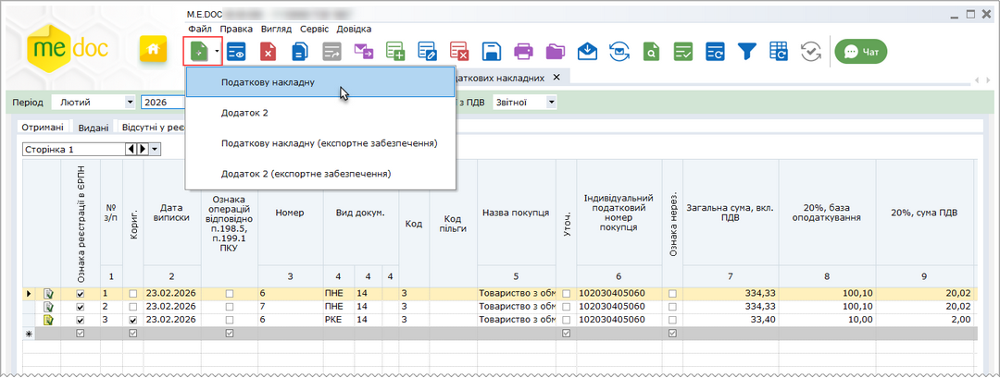

Натисніть, щоб збільшити малюнок

3. У окремому вікні відкриється бланк документа, який потрібно заповнити.

Поля, що підсвічені жовтим кольором, доступні для введення даних та редагування.

4. На панелі стану документа виберіть закладку Наступні дії і натисніть Перевірити документ.

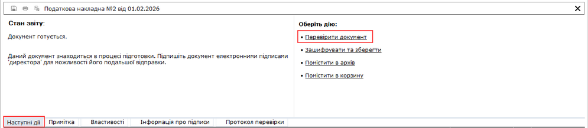

Натисніть, щоб збільшити малюнок

Перевіряється наявність заповнення обов’язкових полів у документі і у випадку відсутності обов’язкових даних, система підсвітить червоним кольором поля, що необхідно заповнити.

Виправте помилки та знову виконайте перевірку.

5. Збережіть документ, натиснувши кнопку  або комбінацію клавіш Ctrl+S.

[До початку](#ucdocnaklrstmain5-docnaklrst_stvor_nn)

Створення Додатку 1 до Податкової накладної

1. Виділіть в таблиці документ, на основі якого потрібно створити Додаток 1.

2. На панелі інструментів або у контекстному меню оберіть команду Відкрити список додатків.

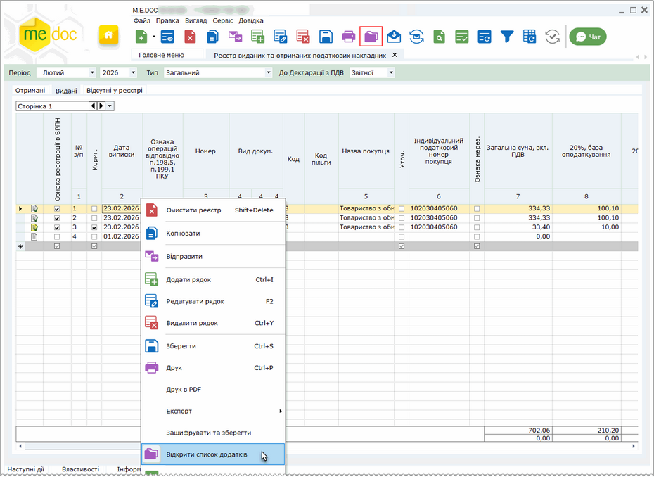

Натисніть, щоб збільшити малюнок

3. Відкриється вікно Додаток 1 до податкової накладної.

Для створення додатку натисніть кнопку .

При збереженні внесених даних у відкритий бланк додатку у полі Дата заповнення з’явиться запис про дату створеного додатку.

У подальшому такий додаток можна відкрити для перегляду та редагування - подвійним натисканням лівою кнопкою миші по запису.

Додаток 1 можна створювати у необмеженій кількості.

Помилковий запис Додатку № 1 можна вилучити за допомогою кнопки .

[До початку](#ucdocnaklrstmain5-docnaklrst_stvor_nn)

Заповнення податкової накладної

1. Порядковий номер податкової накладної заповнюється вручну користувачем за наступним алгоритмом:

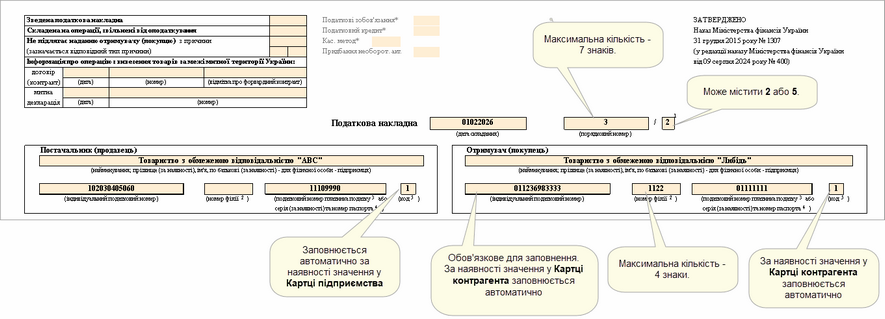

Натисніть, щоб збільшити малюнок

2. Накладна [заповнюється аналогічно](UCPravila.html#ucpravila-pravyla) іншим звітним документам.

3. До відповідних полів форми Податкова накладна підключено довідники, які викликаються натисканням  або за допомогою клавіші F3:

- Контрагенти;
- УКТЗЕД та умовних кодів товару;
- Довідник кодів послуг;
- Номенклатура товарів та послуг;
- Одиниці виміру (значення заносяться у графи 4 та 5);
- Співробітники (підпис та прізвище особи, яка склала податкову накладну);
- Особливі примітки в податковій накладній;
- Код ставки (графа 8);
- Довідник пільг (графа 9);
- Код виду діяльності (графа 12);
- Податкові зобов'язання;
- Податковий кредит;
- Код ознаки джерела податкового номера.

Із однойменних довідників у полях Податкові зобов’язання або Податковий кредит потрібно обрати відповідний код. Це додаткові поля, вони відсутні у друкованій формі податкової накладної, але код, який обирається у цих полях, призначений для коректного перенесення даних із Податкової накладної (Додатку 2) у Реєстр і потім, при експорті в Декларацію з ПДВ, дані правильно перенесуться до відповідних рядків Декларації. Відмітка поля Придбання необорот. акт. відображається у колонці Ознака придбання необоротних активів на вкладці реєстру Отримані.

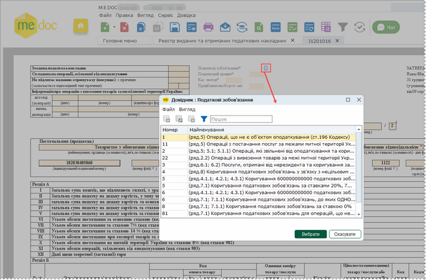

Натисніть, щоб збільшити малюнок

У полі Кас. метод встановлюється позначка «+» у випадку, якщо суми податку включаються до складу податкового кредиту за касовим методом відповідно до п. 187.10 ст. 187 ПКУ.

У такому випадку під час формування Додатку 1 сума ПДВ, що включена до податкового кредиту за касовим методом, буде автоматично виділена у окремий рядок.

Код обирається із підключеного довідника, крім випадків наведених нижче:

Видані накладні

У Виданих податкових накладних потрібно [обирати код](#ucdocnaklrstmain5-docnaklrst_stvor_nn) у полі Податкові зобов’язання.

НЕ ЗАПОВНЮЄТЬСЯ код у цьому полі у випадку, якщо операції по накладній відповідають:

- рядку 1.1 Декларації з ПДВ "операції, що оподатковуються за основною ставкою";
- рядку 1.2 Декларації з ПДВ "операції, що оподатковуються за ставкою 7 %";
- рядку 1.3 Декларації з ПДВ "операції, що оподатковуються за ставкою 14 %";
- рядку 2.1 Декларації з ПДВ "операції, що оподатковуються за основною ставкою";
- рядку 3 Декларації з ПДВ "інші операції, що оподатковуються за нульовою ставкою".

[До початку](#ucdocnaklrstmain5-docnaklrst_stvor_nn)

#### Копіювання документів у реєстрі

_Шлях у довідці: Розділи програми › Облік ПДВ › Реєстр виданих та отриманих податкових накладних › Робота з Pеєстром податкових накладних › Копіювання документів у реєстрі_

В цьому розділі:

[Копіювання Податкової накладної або Додатку 2](#ucdocnaklrstmain5-docnaklrst_copy_nn)

[Копіювання ПН  отримувачем (покупцем) послуг від нерезидента, місце постачання яких розташоване на митній території України](#ucdocnaklrstmain5-docnaklrst_copy_nn)

Копіювання Податкової накладної або Додатку 2

Функція Копіювання доступна для податкових накладних та розрахунків коригування і можлива у вкладках Видані та Отримані.

Копіювання дозволяє спростити створення документів, які містять схожі реквізити та номенклатуру товарів.

1. Виділіть документ, для якого потрібно створити копію.

2. Оберіть Копіювати одним із способів:

- із меню Файл - Копіювати,
- із контекстного меню Копіювати,
- на панелі інструментів виберіть кнопку Копіювати:

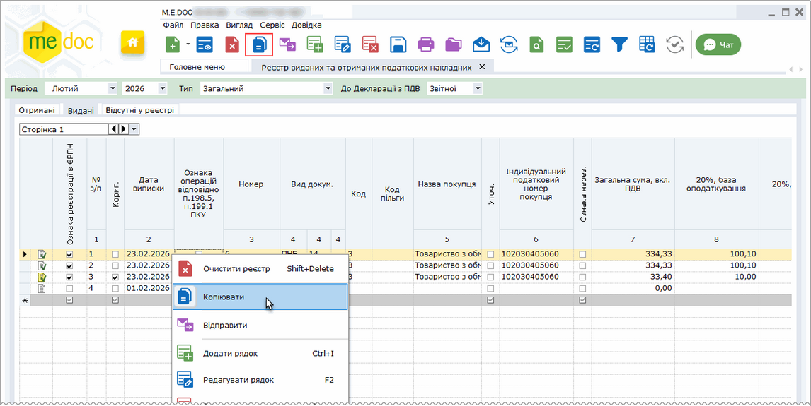

Натисніть, щоб збільшити малюнок

3. Відкриється вікно Копіювання...

Вкажіть період, у який потрібно скопіювати документ та тип Видані.

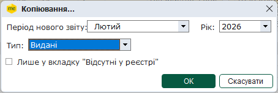

4. У окремому вікні відкриється копія документа, відредагуйте та збережіть його, натиснувши кнопку .

5. Відредагований документ також поміщається у Реєстр податкових документів.

[До початку](#ucdocnaklrstmain5-docnaklrst_copy_nn)

Копіювання ПН  отримувачем (покупцем) послуг від нерезидента, місце постачання яких розташоване на митній території України

1. У разі складання податкової накладної отримувачем (покупцем) послуг від нерезидента, податкові накладні копіюються у вкладку Отримані.

У вікні Копіювання... оберіть тип документа Отримані.

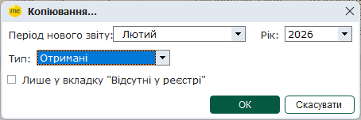

2. Скопійований документ також додається у Реєстр податкових документів як вхідний та у колонці Походження документа позначається як Копіювання в РПН , статус такого документа Дублікат.

[До початку](#ucdocnaklrstmain5-docnaklrst_copy_nn)

#### Друк податкових накладних

_Шлях у довідці: Розділи програми › Облік ПДВ › Реєстр виданих та отриманих податкових накладних › Робота з Pеєстром податкових накладних › Друк податкових накладних_

В системі реалізована можливість друку оригіналів і копій податкових накладних та розрахунку коригування як одночасно, так і окремо.

Особливість даної функції полягає в тому, що передбачена можливість роздруковувати підписані та відправлені поштою податкові накладні та розрахунки коригування, тобто документи, що заблоковані від редагування.

1. Відкрийте податкову накладку (розрахунок коригування), яку потрібно роздрукувати.

2. На панелі інструментів натисніть кнопку .

3. Відкриється вікно Призначення документу.

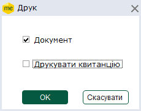

4. Встановіть позначки напроти потрібної опції або обидва варіанти одночасно.

5. Натисніть кнопку ОК.

6. Відкриється стандартне вікно Друк. Встановіть потрібні параметри згідно налаштувань вашого принтера та натисніть кнопку Друк.

#### Імпорт Реєстру та податкових накладних створених в інших бухгалтерських системах

_Шлях у довідці: Розділи програми › Облік ПДВ › Реєстр виданих та отриманих податкових накладних › Робота з Pеєстром податкових накладних › Імпорт Реєстру та податкових накладних створених в інших бухгалтерських системах_

В цьому розділі:

[Імпорт Реєстру виданих та отриманих податкових накладних](#ucdocnaklrstmain5-docnaklrst_import)

[Імпорт податкових накладних](#ucdocnaklrstmain5-docnaklrst_import)

[Імпорт податкових накладних із архіву](#ucdocnaklrstmain5-docnaklrst_import)

В системі передбачений імпорт Реєстру виданих та отриманих податкових накладних та файлів податкових накладних створених в інших бухгалтерських системах. Функція імпорту запускається із меню Файл - Імпорт.

Імпорт Реєстру виданих та отриманих податкових накладних

1. У меню Файл оберіть команду Імпорт та далі потрібний формат.

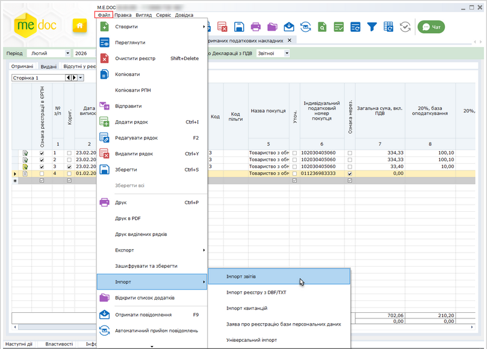

Натисніть, щоб збільшити малюнок

2. Відкриється вікно вибору файлів вказаного формату, які імпортуються.

Вкажіть шлях до каталогу розміщення файлів. Оберіть файли та натисніть Відкрити для початку процесу імпорту.

3. По закінченні процедури, система виведе протокол імпорту даних.

[До початку](#ucdocnaklrstmain5-docnaklrst_import)

Імпорт податкових накладних

1. На виконання команди Файл - Імпорт відкриється вікно вибору файлів вказаного формату, які імпортуються.

2. Вкажіть шлях до каталогу розміщення файлів. Оберіть файли та натисніть Відкрити для початку процесу імпорту.

3. По закінченні процедури, система виведе протокол імпорту даних.

4. Імпортовані документи поміщаються у архів Відсутні у реєстрі. У архіві документи можна переглянути (кнопка  на панелі інструментів) та видалити (кнопка ) за необхідності.

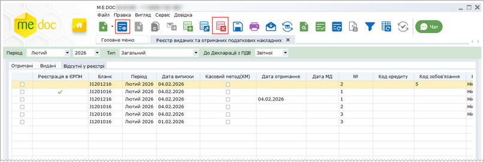

Натисніть, щоб збільшити малюнок

Для того, щоб ці накладні увійшли до Реєстру..., їх необхідно імпортувати у програму (див. далі).

[До початку](#ucdocnaklrstmain5-docnaklrst_import)

Імпорт податкових накладних із архіву

Якщо при відкритті Реєстру користувач відмовився відразу завантажувати документи та після імпорту податкових з жорсткого диску, вони поміщаються у архів Відсутні у реєстрі. Звідси їх можна завантажити пізніше.

Із архіву податкові документи можна завантажити вибірково, тоді як скориставшись пунктом Заповнити звіт згідно первинних документів вкладки Наступні дії на панелі стану документа, завантажується весь список документів, що відсутні у реєстрі.

У архіві документи можна переглянути та видалити за необхідності. Для того, щоб ці накладні увійшли до Реєстру..., їх необхідно додати.

1. Виберіть закладку Відсутні у реєстрі.

2. Позначте обрані накладні галочкою.

3. На панелі інструментів виберіть команду  Додати у реєстр (Ctrl+I).

Зверніть увагу! Друга зліва колонка відображає відмітку реєстрації податкової накладної в ЄРПН. Слугує підказкою для користувача, які накладні необхідно додати в першу чергу.

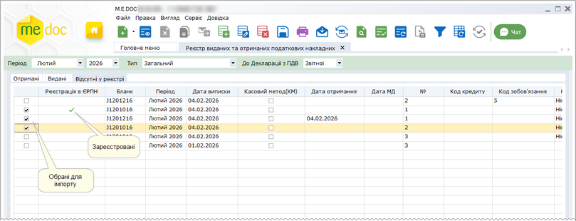

Натисніть, щоб збільшити малюнок

2. Відкриється вікно вибору періоду імпорту документів. Оберіть період імпорту та тип оподаткування.

Натисніть кнопку ОК для початку імпорту.

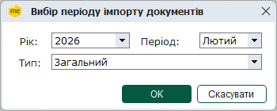

3. По закінченні процедури, система виведе результат імпорту даних.

[До початку](#ucdocnaklrstmain5-docnaklrst_import)

#### Експорт із Реєстру податкових накладних

_Шлях у довідці: Розділи програми › Облік ПДВ › Реєстр виданих та отриманих податкових накладних › Робота з Pеєстром податкових накладних › Експорт із Реєстру податкових накладних_

В цьому розділі:

[Універсальний експорт](#ucdocnaklrstmain5-docnaklrst_exp)

[Експорт у форми звітності](#ucdocnaklrstmain5-docnaklrst_exp)

[Фомування уточнюючого Додатку 1](#ucdocnaklrstmain5-docnaklrst_exp)

[Експорт реєстру у PDF](#ucdocnaklrstmain5-docnaklrst_exp)

Універсальний експорт

Функція експорту даних реєстру податкових накладних, податкових накладних та витягу з Єдиного реєстру податкових накладних реалізовано з метою виявлення зареєстрованих податкових накладних у Єдиному реєстрі податкових накладних. Дозволяє вивантажувати дані окремих полів звітів у формати \*.xls або \*.dbf.

Для виконання експорту даних виконайте дії у наступній послідовності:

1. У меню Файл оберіть команду Експорт та далі Універсальний експорт.

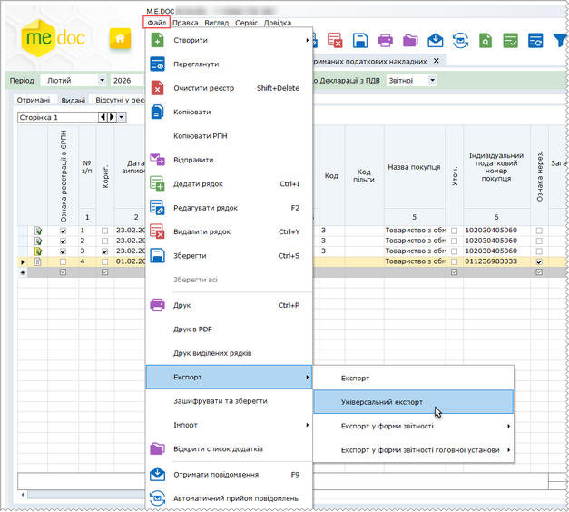

Натисніть, щоб збільшити малюнок

2. Відкривається вікно Експорт. Доступні наступні налаштування:

2.1. Вкладка Налаштування:

- Оберіть тип файлу для експорту - DBF або Exсel;
- Вкажіть шлях для вивантаження даних у полі Оберіть каталог для експорту;
- Кнопка Відновити назви полів - відновлює назви полів за замовчанням, якщо вони були змінені на наступних вкладках даного вікна.

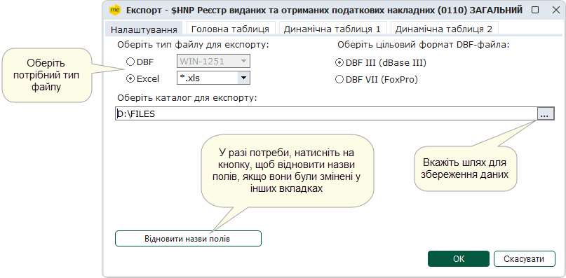

2.2. Вкладка Головна таблиця, Динамічна таблиця 1, Динамічна таблиця 2

- Встановіть галочки напроти полів, дані яких потрібно вивантажити або оберіть всі поля;
- За необхідності, змініть назви полів вручну.

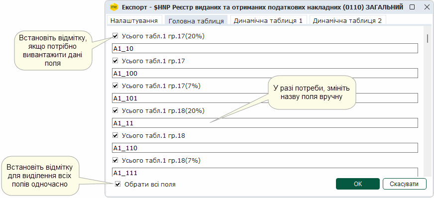

3. Натисніть ОК.

4. Система повідомить про успішне завершення вивантаження даних.

[До початку](#ucdocnaklrstmain5-docnaklrst_exp)

Експорт у форми звітності

Для початку експорту в меню Файл оберіть функцію Експорт - Експорт у форми звітності і далі Створити пакет звітів.

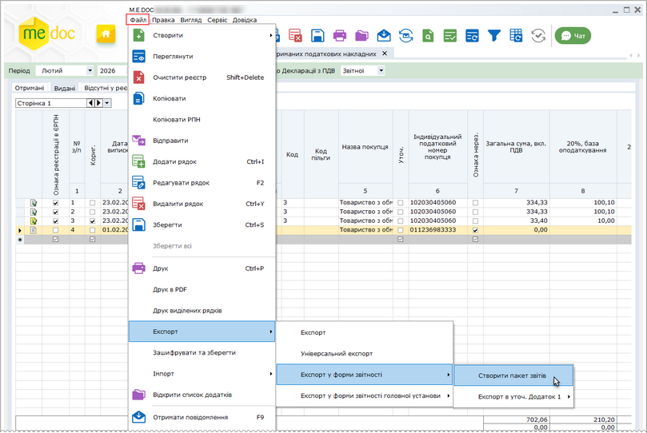

Натисніть, щоб збільшити малюнок

Відкриється модальне вікно Перелік звітів. Позначте галочками документи, що потрібно сформувати. Натисніть кнопку ОК.

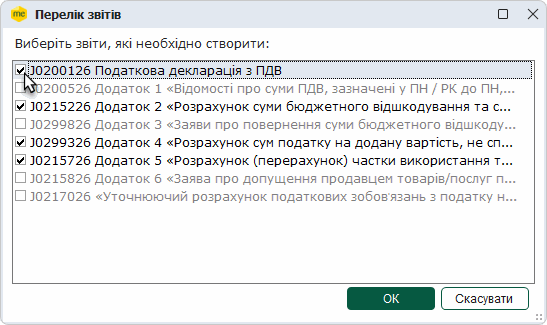

Створений пакет документів можна переглянути у модулі [Реєстр звітів](UCDocRstByPer5.html#ucdocrstbyper5-rdocs_paket).

[До початку](#ucdocnaklrstmain5-docnaklrst_exp)

Фомування уточнюючого Додатку 1

Формування уточнюючого Додатку 1 відбувається за допомогою функції експорту даних із Реєстру.

1. В меню Файл оберіть функцію Експорт - Експорт у форми звітності і далі Експорт в уточ. Додаток1 - Повна (J0200526).

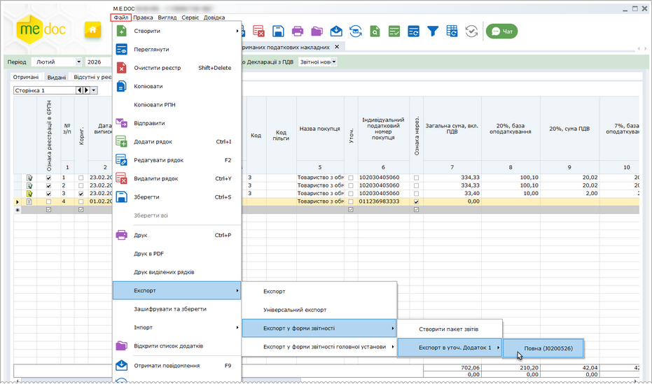

Натисніть, щоб збільшити малюнок

2. У наступному вікні натисніть Так, щоб підтвердити формування Додатку 1:

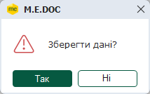

3. Відкриється вікно Пачки звітів. Оберіть пакет, у якому потрібно створити Додаток 1 - оберіть пачку Нова чи Існуюча. Якщо обрано Існуюча, оберіть у яку саме пачку треба додати звіт. Натисніть кнопку ОК:

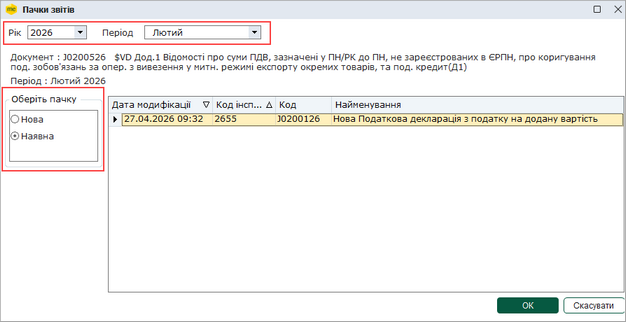

Натисніть, щоб збільшити малюнок

4. Відкриється вікно створеного Додатку 1:

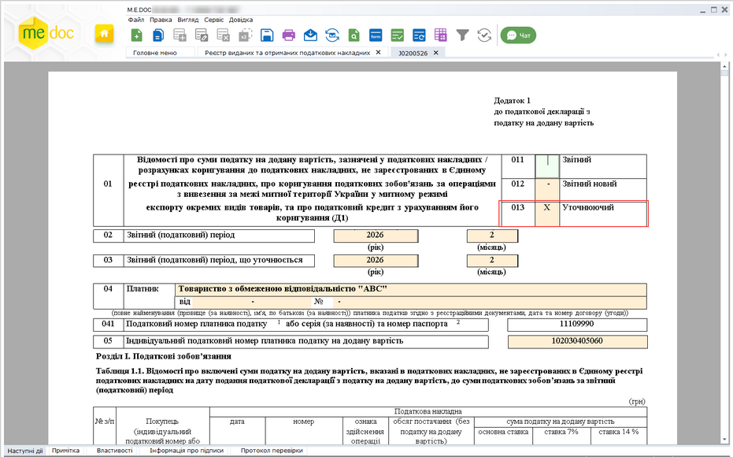

Натисніть, щоб збільшити малюнок

5. Перевірте заповнення звіту та виправте або дозаповніть потрібні поля. Створений звіт можна переглянути у модулі [Реєстр звітів](UCDocRstByPer5.html#ucdocrstbyper5-rdocs_paket).

[До початку](#ucdocnaklrstmain5-docnaklrst_exp)

Експорт реєстру у PDF

Для виконання експорту виконайте дії у наступній послідовності:

1. Оберіть вкладку, дані якої необхідно зберегти у файлі формату PDF: Отримані, Видані або Відсутні у реєстрі.

2. У головному меню оберіть команду Сервіс - Експорт реєстру у PDF:

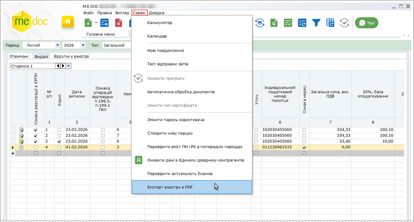

Натисніть, щоб збільшити малюнок

3. У вікні, що відкриється, оберіть шлях для збереження та ім'я файлу PDF:

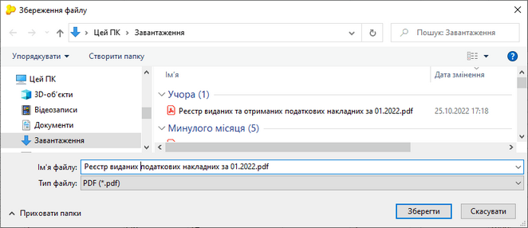

Натисніть, щоб збільшити малюнок

За замовчуванням пропонується назва у форматі: Реєстр виданих та отриманих податкових накладних за <обраний у реєстрі період>.pdf.

Зберігаються записи лише обраної вкладки, що відображені у реєстрі на момент друку, відповідно до застосованих фільтрів.

4. Дані обраної вкладки реєстру буде збережено у файлі з вказаним іменем.

[До початку](#ucdocnaklrstmain5-docnaklrst_exp)

#### Створення копії Реєстру податкових накладних

_Шлях у довідці: Розділи програми › Облік ПДВ › Реєстр виданих та отриманих податкових накладних › Робота з Pеєстром податкових накладних › Створення копії Реєстру податкових накладних_

Для створення копії Реєстру податкових накладних виконайте дії у наступній послідовності:

1. Відкрийте Реєстр.., дані якого потрібно скопіювати у інший звітний період.

2. У меню Файл оберіть команду Копіювати РПН.

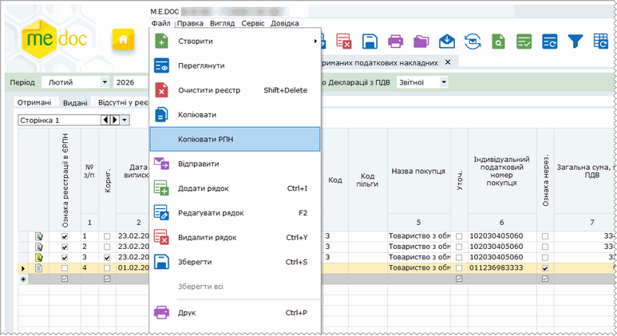

Натисніть, щоб збільшити малюнок

3. Відкриється вікно Копіювання...

У полі Період оберіть звітний період, в який копіювати дані Реєстру..
За умови копіювання [Порції](#ucdocnaklrstmain5-docnaklrst_porcyy) припустиме копіювання у той же самий звітний період, поряд імпорту при цьому має бути В нову порцію.

Оберіть порядок імпорту:

- Додати рядки - податкові накладні додаються в останню Порцію. Якщо кількість податкових перевищить визначену, створиться нова Порція, куди буде розміщено решта податкових;
- Замінити дані - повне видалення всіх даних, що присутні у тому звітному періоді, в який виконується копіювання, та заміна новими, скопійованими даними. В разі вибору даного варіанту, система додатково перепитає, чи користувач впевнений, що бажає замінити дані.;
- В нову порцію - при копіювання буде створено нову [порцію Реєстру](#ucdocnaklrstmain5-docnaklrst_porcyy), в яку буде поміщено всі дані, що копіюються.

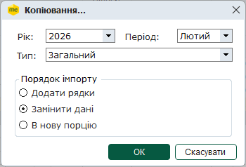

4. Для початку копіювання даних натисніть кнопку ОК.

5. Система повідомить про успішне закінчення копіювання.

Зверніть увагу!

При копіюванні Реєстру виданих та отриманих податкових накладних в інший звітний період або у нову Порцію дата отримання та дата виписки податкових накладних змінюється на перше число звітного періоду, в який виконувалось копіювання.

#### Друк Реєстру податкових накладних у PDF

_Шлях у довідці: Розділи програми › Облік ПДВ › Реєстр виданих та отриманих податкових накладних › Робота з Pеєстром податкових накладних › Друк Реєстру податкових накладних у PDF_

Дана функція дозволяє зберегти документ Реєстр виданих та отриманих податкових накладних на диску комп’ютера у файлі формату .pdf.

Для друку реєстру у PDF виконайте дії у наступній послідовності:

1. Оберіть один із способів:

- із контекстного меню команда Друк в PDF;
- команда меню Файл - Друк в PDF.

2. У вікні Огляд папок вкажіть каталог, у якому потрібно зберегти файли .pdf.

Також функція друку документа у PDF доступна і у відкритому вікні документа:

- команда меню Файл - Друк в PDF.

Із вікна відкритого документа у форматі PDF зберігається тільки поточний документ. Друк виконується як описано у розділі [Друк первинних документів у PDF](PDocs_reestr_funkc.html#pdocs_reestr_funkc-pdocs_reestr_print_pdf).

- Друк форми «Реєстр виданих та отриманих податкових накладних» (J1201508) доступний у Реєстрі звітів.
- Для перегляду та друку форми необхідно зберегти зміни, що були виконані у Реєстрі виданих та отриманих податкових накладних. При збереженні змін форма створюється автоматично та відображається у Реєстрі звітів.
- При кожному збереженні змін у Реєстрі виданих та отриманих податкових накладних автоматично оновлюються дані у формі J1201508, що відображається у Реєстрі звітів.

#### Додаткові сервісні функції

_Шлях у довідці: Розділи програми › Облік ПДВ › Реєстр виданих та отриманих податкових накладних › Робота з Pеєстром податкових накладних › Додаткові сервісні функції_

У Реєстрі отриманих та виданих податкових накладних в меню Правка доступні такі сервісні функції:

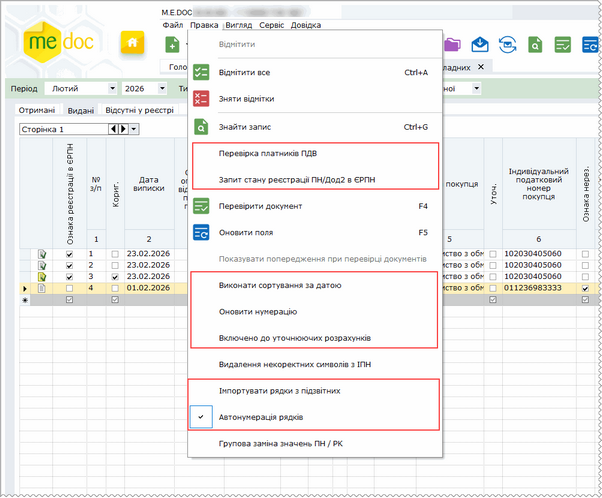

Натисніть, щоб збільшити малюнок

Перевірка платників ПДВ

Функція звіряння статусу контрагентів із базою ДПС України, тобто перевірки наявності реєстрації платників ПДВ.

На виконання функції із програми формується запит до ДПС, який містить перелік Ваших контрагентів. Перевірка відбувається за ІПН контрагента.

Запит підписується печаткою установи та відправляється електронною поштою на ЦОЕЗ ДПС.

Примітка:

Для відправлення запиту комп'ютер користувача повинен мати доступ до мережі Інтернет.

Одразу після відправки на панелі вкладок звіту з'являється вкладка Платники ПДВ. На вкладці  міститься перелік ІПН контрагентів, стан яких перевіряється.

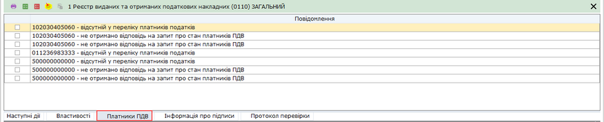

Натисніть, щоб збільшити малюнок

Під час прийому вхідної кореспонденції, користувач отримує повідомлення Отримано інформаційну довідку.
Для перегляду результатів перевірки, натисніть повторно Правка - Перевірка платників ПДВ.
На вкладці Платники ПДВ відобразиться перелік контрагентів, які не зареєстровані як платники ПДВ або дані помилкові.

Запит стану реєстрації ПН/Дод2 в ЄРПН

Перевірка наявності реєстрації певної податкової накладної або групи накладних (як отриманих так і виданих) в Єдиному реєстрі податкових накладних.

На виконання команди формується "Запит щодо отримання відомостей з Єдиного реєстру податкових накладних", який можна сформувати для виділених у Реєстрі документів, всіх документів у Реєстрі або за даними наявних Рішень про реєстрацію в ЄРПН (для автоматичного отримання розблокованих ПН\РК відповідно до даних Рішень). Налаштування способу формування Запиту виконується у вікні, що відкриється на виконання команди.

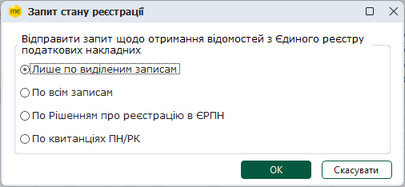

Натисніть, щоб збільшити малюнок

При формуванні Запиту по записам реєстру відбувається розділення та відправлення запитів по 1000 рядків (у випадку, якщо обрано більше ніж 1000 документів для формування Запиту).

Запит також можна сформувати у модулі [Реєстр податкових документів](UCDFDocsRst.html#ucdfdocsrst-pdocs_reestr) за допомогою команди меню Правка - Запит стану реєстрації ПН/Дод2 в ЄРПН. Докладно про формування Запиту дивіться у розділі Довідки державних органів - Інформаційна довідка - [Автоматичне створення запиту до ЄРПН](UCGovQry.html#ucgovqry-ucgovqry_info).

Переглянути відповідь на Запит можна у модулі [Інформаційна довідка](UCGovQry.html#ucgovqry-ucgovqry) - Витяг з Єдиного реєстру податкових накладних №...

Виконати сортування за датою

Виконує впорядкування записів таблиці в порядку зростання дати отримання податкових (в розділі Отримані) або дати виписки (в розділі Видані).

Оновити нумерацію

Дозволяє оновити нумерацію записів реєстру у колонці 1 (№ з/п), як помісячно, так і з початку року.
Використовується, наприклад, після імпорту Реєстру.. створеного в інших бухгалтерських системах.

На виконання функції відкривається вікно Оновити нумерацію.

Оберіть спосіб нумерації:

- помісячно - оновлює нумерацію записів реєстру кожного місяця, починаючи з 1;
- з початку поточного періоду - відбувається нумерація записів реєстру в межах місяця, при цьому, накладні за попередні періоди нумеруються в останню чергу в кінці реєстру;
- з початку року - наскрізна нумерація рядків реєстру з початку календарного року. Обравши цей спосіб, при необхідності, можна задати початкові значення номерів для виданих і отриманих податкових накладних окремо.

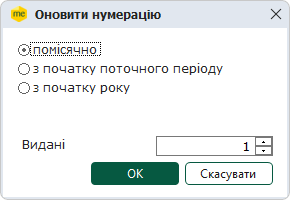

Включити до уточнюючих розрахунків

У формі Реєстру отриманих та виданих податкових накладних присутній рядок З них включено до уточнюючих розрахунків. Цей рядок Реєстру… заповнюється не в електронній таблиці, а в окремій картці. Картка викликається із меню Правка - Включено до уточнюючих розрахунків.

Облік у рядку ведеться окремо для отриманих та виданих податкових накладних, тому дані у цьому рядку заповнюються для обох закладок.

У вікні з назвою Включено до уточнюючих розрахунків в потрібних рядках із клавіатури вносяться відповідні дані. Назва рядків відповідає назві колонок у обраній закладці Реєстру…

Після заповнення картку потрібно закрити, натиснувши кнопку ОК.

Всі дані, заповнені у картці, переносяться у рядок реєстру "З них включено до уточнюючих розрахунків" у потрібну закладку.

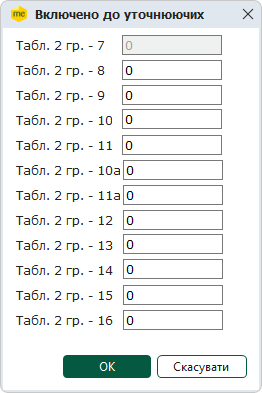

Видалення некоректних символів з ІПН

Перевірка кількості цифр та наявності некоректних символів в податковому номері контрагента.

За наявності у записі ІПН некоректних символів або кількість цифр у ІПН не відповідає встановленій довжині програма надсилає повідомлення про помилку.

Така ситуація може виникнути при імпорті з інших бухгалтерських систем, або ж якщо при створенні контрагентів у програмі був неправильно внесений індивідуальний податковий номер (ІПН) - у записі присутні прочерки, крапки та інші недопустимі символи.

Після обрання цієї функції із записів ІПН у колонці Реєстру некоректні символи видаляються автоматично.

Автонумерація рядків

Автоматична нумерації доданих у таблиці рядків. Наявність помітки означає, що функція включена.

Очищення реєстру

Автоматична нумерації доданих у таблиці рядків. Наявність помітки означає, що функція включена.

##### Групова заміна значень

_Шлях у довідці: Розділи програми › Облік ПДВ › Реєстр виданих та отриманих податкових накладних › Робота з Pеєстром податкових накладних › Додаткові сервісні функції › Групова заміна значень_

В цьому розділі:

[Групова заміна значень ПН/РК на вкладках Отримані та Видані](#ucdocnaklrstmain5-docnaklrst_func_group)

[Групова заміна значень на вкладці Відсутні у реєстрі](#ucdocnaklrstmain5-docnaklrst_func_group)

Групова заміна значень ПН/РК на вкладках Отримані та Видані

Для здійснення заміни даних виконайте дії в наступній послідовності:

1. Якщо заміну потрібно виконати для вибіркових записів, виділіть ці записи в реєстрі на вкладці Отримані або Видані. Для заміни даних в усьому реєстрі виділяти записи не потрібно.

2. У меню Правка оберіть функцію Групова заміна значень ПН / РК.

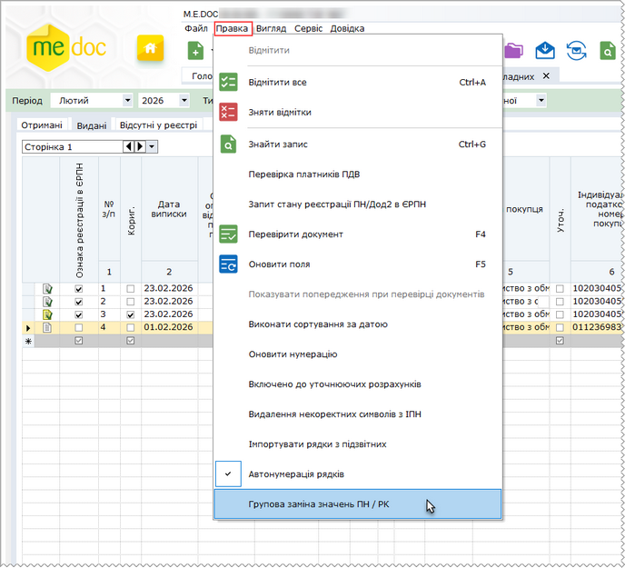

Натисніть, щоб збільшити малюнок

3. Відкриється вікно Нові значення. Діалогове вікно вибору параметрів групової заміни відрізняється в залежності від обраного реєстру – отриманого чи виданого:

|  |  |
| --- | --- |
| 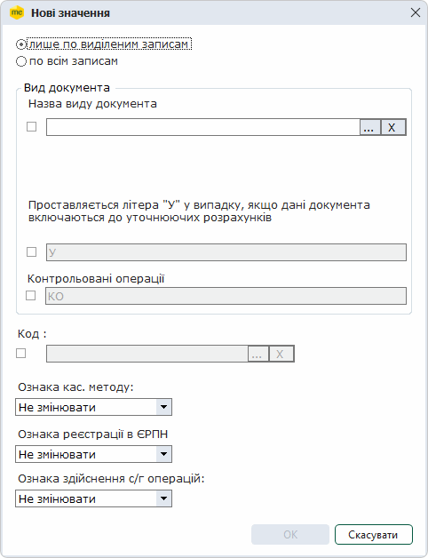 | 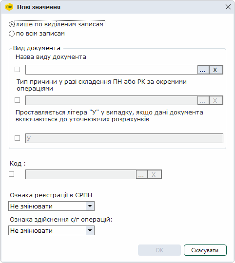 |
| Для отриманих накладних | Для виданих накладних |

4. Оберіть необхідні параметри заміни даних в реєстрі:

- якщо потрібно виконати заміну в обраних записах, встановіть позначку в полі лише по виділеним записам, інакше оберіть значення по всім записам;
- для вибору значень заміни із довідників, встановіть галочки у відповідних полях та натисніть кнопку . Оберіть у довіднику потрібне значення. Якщо потрібно замінити дані на пусте значення, лишіть поле із ввімкненою галочкою незаповненим;

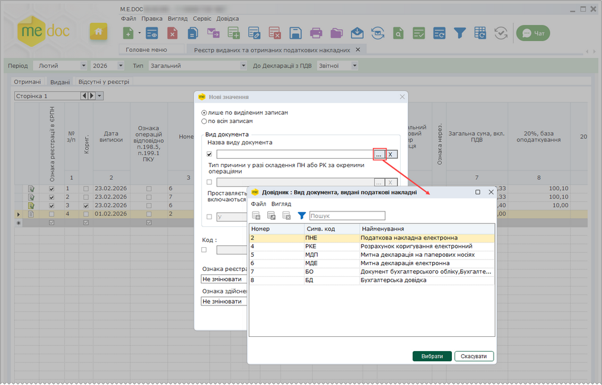

Натисніть, щоб збільшити малюнок

- у полі Ознака реєстрації в ЄРПН можна обрати одне з 3 значень:
- Не змінювати - залишити значення графи Ознака реєстрації в ЄРПН без змін;
- Зняти відмітку - очистити графу Ознака реєстрації в ЄРПН всіх або обраних документів;
- Встановити відмітку - проставити відмітки у графі Ознака реєстрації в ЄРПН всіх або обраних документів.

Встановлення даної ознаки виконується у розділі Видані для імпортованого у форматі xml реєстру виданих та отриманих податкових накладних (у імпортованому реєстрі відсутня ознака реєстрації ПН/РК в ЄРПН). Встановлена ознака сприяє коректному вивантаженню незареєстрованих ПН в таблицю 1.1. Додатку 5.

- у полі Ознака здійснення с/г операцій можна обрати одне з 3 значень:
- Не змінювати - залишити значення графи Ознака здійснення с/г операцій без змін;
- Зняти відмітку - очистити графу Ознака здійснення с/г операцій всіх або обраних документів;
- Встановити відмітку - проставити відмітки у графі Ознака здійснення с/г операцій всіх або обраних документів.

5. Після внесення потрібних параметрів натисніть кнопку ОК (якщо в діалоговому вікні вимкнути всі галочки, кнопка ОК неактивна). Система повідомить про закінчення процедури.

[До початку](#ucdocnaklrstmain5-docnaklrst_func_group)

Групова заміна значень на вкладці Відсутні у реєстрі

Для здійснення заміни даних виконайте дії:

1. Якщо заміну потрібно виконати для вибіркових записів, виділіть ці записи в реєстрі на вкладці Відсутні у реєстрі. Для заміни даних в усьому реєстрі виділяти записи не потрібно.

2. У меню Правка оберіть функцію Групова заміна.

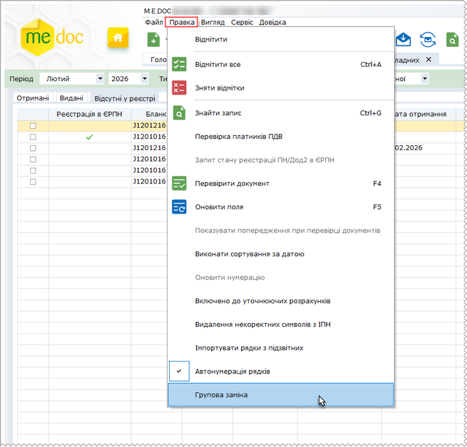

Натисніть, щоб збільшити малюнок

3. Відкриється вікно Групова заміна. Діалогове вікно вибору параметрів групової заміни відрізняється в залежності від обраного реєстру – отриманого чи виданого:

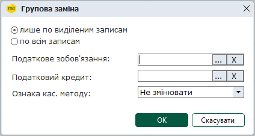

4. Оберіть необхідні параметри заміни даних в реєстрі:

- якщо потрібно виконати заміну в обраних записах, встановіть позначку в полі лише по виділеним записам, для заміни значень у всіх записах реєстру оберіть значення по всім записам;
- для вибору значень заміни у полях Податкове зобов'язання та/або Податковий кредит натисніть кнопку . Оберіть у довіднику потрібне значення. Якщо потрібно замінити дані на пусте значення, лишіть поле незаповненим;
- для вибору значення заміни у полях Ознака кас. методу оберіть нове значення зі списку, що відкривається.

5. Після внесення потрібних параметрів натисніть кнопку ОК.

[До початку](#ucdocnaklrstmain5-docnaklrst_func_group)

##### Очищення реєстру

_Шлях у довідці: Розділи програми › Облік ПДВ › Реєстр виданих та отриманих податкових накладних › Робота з Pеєстром податкових накладних › Додаткові сервісні функції › Очищення реєстру_

Для очищення реєстру виконайте дії:

1. Перейдіть на вкладку Отримані або Видані, у якій необхідно очистити дані.

2. Оберіть період, за який необхідно очистити документи.

3. Скористайтесь одним із способів:

- на панелі інструментів натисніть кнопку Очистити реєстр
- виберіть команду Файл - Очистити реєстр;
- у контекстному меню оберіть команду Очистити реєстр.

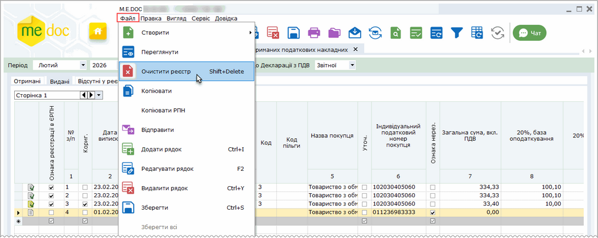

Натисніть, щоб збільшити малюнок

4. У вікні повідомлення, що відкриється, натисніть Так, щоб підтвердити очищення реєстру:

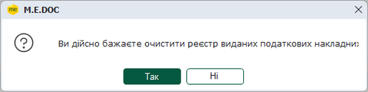

Натисніть, щоб збільшити малюнок

5. На виконання команди Очистити реєстр всі наявні у обраному періоді документи із розділу, у якому виконувалась команда (Видані або Отримані), переміщуються до розділу Відсутні у реєстрі.

#### Створення пакету звітів

_Шлях у довідці: Розділи програми › Облік ПДВ › Реєстр виданих та отриманих податкових накладних › Робота з Pеєстром податкових накладних › Створення пакету звітів_

На підставі Реєстру виданих та отриманих податкових накладних у модулі формуються такі документи в єдиний пакет:

У заголовку сторінки оберіть тип звіту, який потрібно створити: звітний або новий:

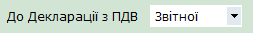

При створенні пакета у формі "Податкова декларація з податку на додану вартість" буде проставлена відповідна позначка у графі 011 або 012.

Для формування пакету документів, на панелі стану документа виберіть закладку Наступні дії і натисніть Створити пакет звітів.

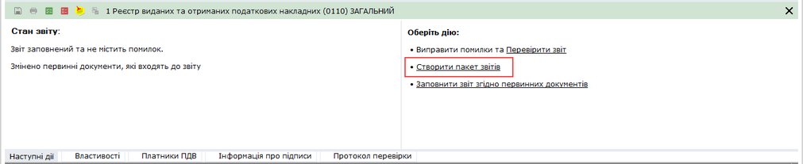

Натисніть, щоб збільшити малюнок

Відкриється модальне вікно Перелік звітів. Позначте галочками документи, що потрібно сформувати. Натисніть кнопку ОК.

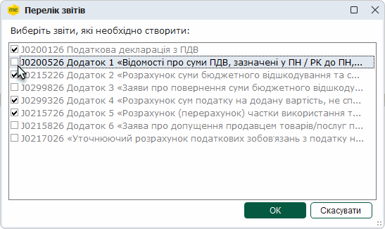

Створені документи можна переглянути у модулі Реєстр звітів.

#### Відправлення Реєстру накладних електронною поштою

_Шлях у довідці: Розділи програми › Облік ПДВ › Реєстр виданих та отриманих податкових накладних › Робота з Pеєстром податкових накладних › Відправлення Реєстру накладних електронною поштою_

З 01.02.2015 Реєстри виданих та отриманих податкових накладних не подаються в ДПС.

Але платник податків може вести Реєстри за власним бажанням, оскільки за даними із реєстрів формуються пакети звітності з ПДВ.

### Порції Реєстру податкових накладних

_Шлях у довідці: Розділи програми › Облік ПДВ › Реєстр виданих та отриманих податкових накладних › Порції Реєстру податкових накладних_

В цьому розділі:

[Створення Порції Реєстру податкових накладних](#ucdocnaklrstmain5-docnaklrst_porcyy)

[Імпорт Порцій Реєстру податкових накладних](#ucdocnaklrstmain5-docnaklrst_porcyy)

[Експорт Порцій Реєстру податкових накладних](#ucdocnaklrstmain5-docnaklrst_porcyy)

[Експорт у форми звітності при наявності Порцій у Реєстрі](#ucdocnaklrstmain5-docnaklrst_porcyy)

[Створення копії Порцій у Реєстрі](#ucdocnaklrstmain5-docnaklrst_porcyy)

У програмному комплексі реалізовано можливість створення порцій Реєстру виданих та отриманих податкових накладних.

Порції РПН – це окремі документи в системі,  що містять визначену кількість податкових накладних.

Створення Порції Реєстру податкових накладних

Нові Порції створюються у Реєстрі, який вже має записи. У пустому Реєстрі створити Порцію неможливо.

Для створення нової Порції в меню Сервіс оберіть команду Створити нову порцію.

На панелі інструментів у полі з назвою Порція буде додана порція з № 2.

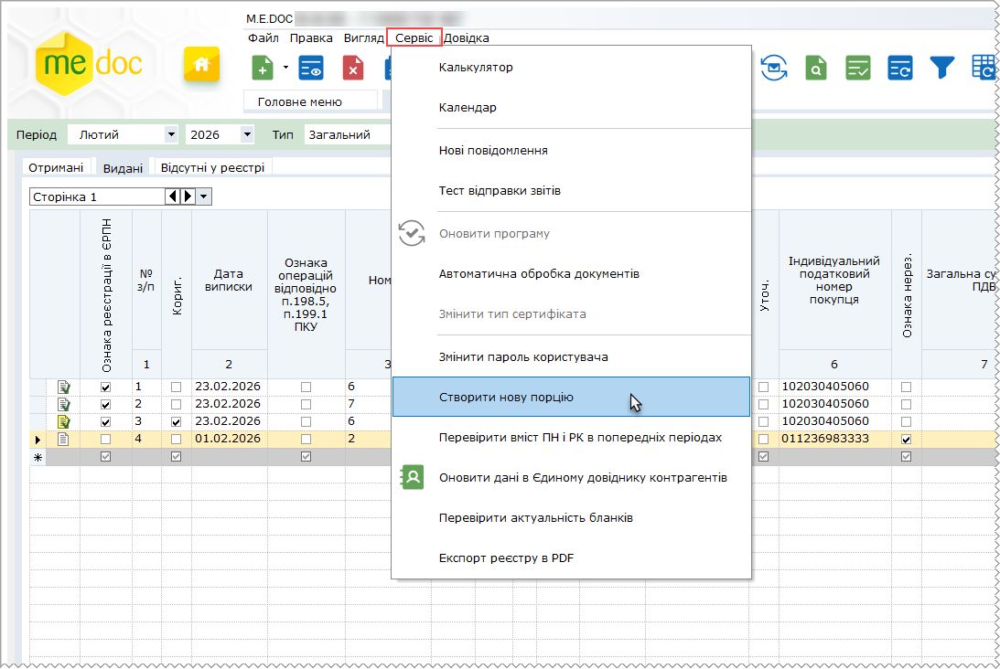

Заповніть реєстр для створеної порції та збережіть дані.

У верхній частині вікна з'явиться поле Порція, у якому обирається режим перегляду реєстру:

- Режим Всі - у таблиці реєстру відображаються всі документи для обраного періоду. Цей режим призначений виключно для перегляду, всі функції меню Правка заблоковані (окрім Запит стану реєстрації ...).
- Для роботи з певною Порцією оберіть її номер із списку поля Порція. У вікні будуть відображені документи обраної порції.
- Податкові накладні, що імпортуються із архіву Відсутні у Реєстрі додаються в останню Порцію, при цьому, записи, що вже були присутні - не дублюються.
- Всі перерахунки зведених документів проводяться із режиму Всі.

Для того, щоб в режимі Всі було зрозуміло до якої Порції відноситься податкова накладна, передбачено наявність колонки Порція

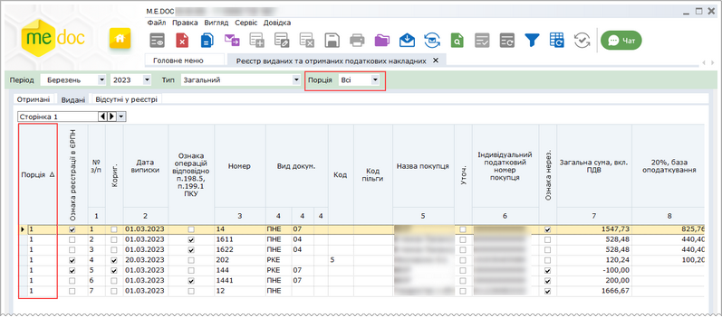

Натисніть, щоб збільшити малюнок

[До початку](#ucdocnaklrstmain5-docnaklrst_porcyy)

Імпорт Порцій Реєстру податкових накладних

При [імпорті](#ucdocnaklrstmain5-docnaklrst_import) Реєстру виданих та отриманих податкових накладних, у якому вже є створені користувачем порції, дані імпортуються у останню порцію.

[До початку](#ucdocnaklrstmain5-docnaklrst_porcyy)

Експорт Порцій Реєстру податкових накладних

1. Виконайте команду Експорт контекстного меню або у меню Файл. У вікні, що відкриється, оберіть формат для обміну звітністю:

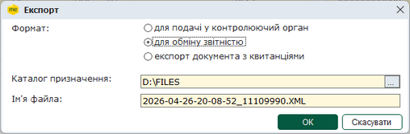

Натисніть, щоб збільшити малюнок

Буде створений окремий файл, що містить дані тільки обраної Порції.

2. При експорті Реєстру податкових накладних [для обміну звітністю](UCDocRstByPer5.html#ucdocrstbyper5-rdoc_robota_export) створюється єдиний файл, який включатиме всі наявні порції.

3. При експорті документа з квитанціями будуть експортовані всі порції, що присутні у обраному періоді, незалежно від значення, обраного у порі Порція.

[До початку](#ucdocnaklrstmain5-docnaklrst_porcyy)

Експорт у форми звітності при наявності Порцій у Реєстрі

При [створенні документів, які автоматично формуються](#ucdocnaklrstmain5-docnaklrst_exp) на підставі Реєстру виданих та отриманих податкових накладних, у форми звітності експортуються дані, які є у всіх Порціях.

[До початку](#ucdocnaklrstmain5-docnaklrst_porcyy)

Створення копії Порцій у Реєстрі

Копіювання як окремої Порції, так і всіх порцій разом виконується аналогічно [створенню копії Реєстру податкових накладних](#ucdocnaklrstmain5-docnaklrst_cop).

За умови копіювання Порції припустиме копіювання Реєстру у той же самий звітний період, при цьому порядок імпорту має бути В нову порцію.

[До початку](#ucdocnaklrstmain5-docnaklrst_porcyy)


