[← Зміст довідки](../)


# Реєстр звітів

## Реєстр звітів

_Шлях у довідці: Розділи програми › Звітність › Реєстр звітів_

Розділ Реєстр звітів призначений для створення, збереження та обробки бухгалтерської та фінансової звітності з метою подачі до контролюючих органів електронними засобами зв'язку. Містить як створені у програмному комплексі документи, так і імпортовані з інших бухгалтерських систем.

У даному розділі довідки розглянуто наступне:

- [Опис основних функціональних елементів інтерфейсу Реєстру звітів](#ucdocrstbyper5-rdocs_interface)
- [Вікно відкритого документа](#ucdocrstbyper5-rdocs_interface_open)
- [Створення, заповнення та редагування звітів](#ucdocrstbyper5-rdoc_robota_stvor)
- [Відправка документів у банк](#ucdocrstbyper5-rdoc_robota_stvor)
- [Відправка фінансової звітності до біржі](#ucdocrstbyper5-rdoc_robota_stvor)
- [Функції Реєстру звітів](#ucdocrstbyper5-rdoc_robota_function)
- [Імпорт звітів із інших бухгалтерських систем](#ucdocrstbyper5-rdoc_robota_import)
- [Завантаження звітів з Кабінета платника податків](#ucdocrstbyper5-rdoc_robota_zavantazhennia-kabinet)
- [Експорт звітних документів](#ucdocrstbyper5-rdoc_robota_export)
- [Відправлення звітів на підпис](#ucdocrstbyper5-rdoc_robota_na_pidpus)
- [Особливості роботи із Реєстром звітів для установ з комплектом бланків «Бюджетна конфігурація»](#ucdocrstbyper5-rdoc_budjet)
- [Експорт звітів у формат НКЦПФР](#ucdocrstbyper5-rdocs_nkcpfr)
- [Пакет звітних документів](#ucdocrstbyper5-rdocs_paket)

### Опис основних функціональних елементів інтерфейсу Реєстру

_Шлях у довідці: Розділи програми › Звітність › Реєстр звітів › Опис основних функціональних елементів інтерфейсу Реєстру_

Розділ побудований у вигляді таблиці - реєстру, окремий рядок якої відображає коротку інформацію про кожний документ. Переглянути більш повну інформацію можна у окремій вкладці, яка відкривається подвійним кліком по потрібному запису.

У лівій частині розділу розташована навігаційна панель. Панель містить області, що призначені для полегшення пошуку документів. При виборі певного значення на панелі навігації, в робочій області відображаються документи, що відповідають заданим умовам фільтрації.

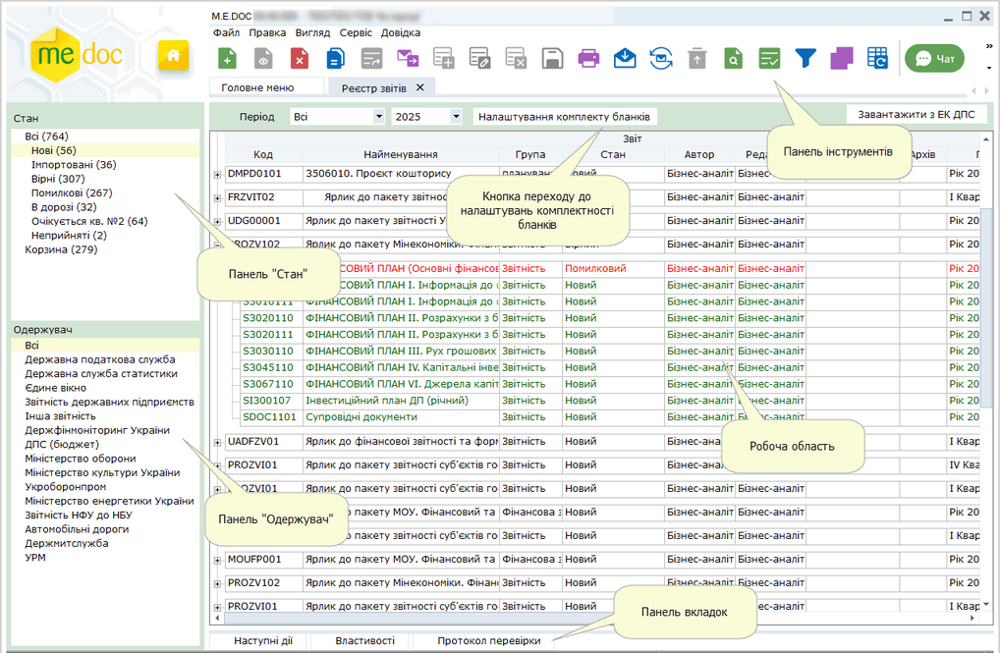

Натисніть, щоб збільшити малюнок

Панель інструментів

Містить кнопки виклику таких функцій:

|  |  |
| --- | --- |
|  | Створення документа |
|  | Перегляд (редагування) поточного документа |
|  | Вилучення поточного документа |
|  | Створення копії документа. Копія документа створюється, якщо він може повторюватися у рамках звітних періодів, а також у випадку, якщо потрібно відредагувати та повторно відіслати раніше відправлений електронною поштою звіт (у тому числі і підписаний ЕП) |
|  | Друкування обраного документа |
|  | Відправити документ |
|  | Отримати повідомлення |

Також на панелі інструментів міститься панель вибору звітного періоду  та кнопка швидкого доступу до [налаштувань комплекту бланків](#ucdocrstbyper5-rdocs_interface) 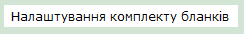.

Робоча область

Містить записи реєстру: створені та імпортовані документи у вибраному звітному періоді, в залежності від стану документа, записи реєстру можуть позначатись різними кольорами:

- збережені документи, у яких програма внутрішніх розрахунків не виявила помилок (тобто перевірені) позначаються чорним кольором;
- збережені документи, у якому програма внутрішніх розрахунків виявила помилки (помилкові) позначаються червоним кольором;
- скопійовані у програму звітні документи позначаються зеленим кольором;

У Реєстрі звітів можна перемістити у архів пакет документів, необхідний для остаточного рішення Комісії ДПС щодо прийняття або відхилення ПН/РК, повідомлення про подання пояснень та копій документів СМКОР, що перебувають у фінальному статусі Прийнятий або Неприйнятий з доданими до пакетів Документами довільного формату:

- Повідомлення про подання пояснень та копій документів щодо податкових накладних/розрахунків коригування, реєстрацію яких зупинено;
- Повідомлення про подання інформації та копій документів щодо невідповідності платника податку критеріям ризиковості платника податку;
- Таблиця даних платника податків на додану вартість;
- СКАРГА щодо рішення про відмову в реєстрації ПН/РК в Єдиному реєстрі податкових накладних.

Переміщені у архів документи позначаються  у колонці Архів.

Для зручності роботи у реєстрі, реалізована функція ГРУПУВАННЯ записів реєстру по колонкам таблиці реєстру.
Для активації цієї функції необхідно в меню Вигляд поставити позначку в полі Групування даних. Над реєстром з'явиться додаткова панель. Перетягніть на цю панель потрібні колонки таблиці.

Панель вкладок звіту

Містить службову інформацію щодо обраного документа. Панель доступна як у відкритому документі, так і з реєстру документів (за умови виділення потрібного документа).

Містить наступні вкладки:

- Наступні дії – містить інформацію щодо поточного стану документа, а також перелік можливих дій з документом у цьому стані. Слугує певною підказкою користувачу про доступні дії, які можна виконати з документом у певному стані;
- Примітка – текстове поле для внесення будь-якої інформації стосовно поточного документа. Дана вкладка доступна тільки у відкритому документі і тільки до моменту відправлення його засобами електронного зв’язку. Інформація, яка внесена в дане поле також відображається в колонці "Примітка" реєстру;
- Властивості – у режимі читання містить всю службову інформацію про документ, таку як: стан, період створення, дата та час останньої модифікації, інформація про сертифікати, якими підписано документ тощо. Інформація на цій вкладці постійно оновлюється та доповнюється при будь-яких змінах документа;
- Протокол перевірки – містить результати перевірки документа програмою внутрішніх розрахунків на наявність помилок.
Тобто, при обранні помилкового документа (виділений червоним кольором) в робочій області Реєстру (незалежно від того підписаний  ЕП або відправлений документ чи ні) відображається перелік помилок на вкладці. Подвійний клік лівою клавішею миші відкриває цей помилковий документ у окремій вкладці з позиціонуванням курсору на полі, що містить помилку;

- Відправлено – дана вкладка з’являється на панелі після відправлення документа адресату. Містить службову інформацію що стосується відправки документа, таку як: реквізити одержувача, дату та час відправлення, текст документа у форматі xml тощо;
- Повідомлення – дана вкладка з’являється на панелі після отримання повідомлення про доставку документа у контролюючий орган. Містить дату/час доставки та текст повідомлення.
Текст Повідомлення можна роздрукувати, а також зберегти у форматі \*.RTF. Для цього призначені кнопки  - Зберегти та  - Роздрукувати, що розміщені біля заголовку вкладки;

- Квитанція №1 – дана вкладка з’являється на панелі після отримання першої квитанції (про прийом документа на центральному рівні). Містить дату/час доставки та текст квитанції.
Текст Квитанції №1 можна роздрукувати, а також зберегти у форматі \*.RTF. Для цього призначені кнопки  - Зберегти та  - Роздрукувати, що розміщені біля заголовку вкладки;

- Квитанція №2 – дана вкладка з’являється на панелі після отримання другої квитанції (з результатами перевірки на районному рівні). Містить дату/час доставки та текст квитанції.
Текст Квитанції №2 можна роздрукувати, а також зберегти у форматі \*.RTF. Для цього призначені кнопки  - Зберегти та  - Роздрукувати, що розміщені біля заголовку вкладки.

Панель Стан

Містить фільтри, що відповідають етапам роботи з документами:

- Новий - документ, що був створений, але не перевірений та не збережений;
- Імпортований - документ, що був імпортований у систему;
- Вірний - збережений документ в роботі, в якому у результаті [перевірки](UCProgramy.html#ucprogramy-programy) (програма внутрішніх розрахунків) не виявлено помилок;
- Помилковий - збережений документ в роботі, в якому у результаті [перевірки](UCProgramy.html#ucprogramy-programy) (програма внутрішніх розрахунків) виявлено помилки. У реєстрі такі документи позначаються червоним кольором;
- На підпис бухгалтеру - документ, що був відправлений на підпис та очікує підписання сертифікатом ЕП з типом Бухгалтер;
- На підпис директору - документ, що був відправлений на підпис та очікує підписання сертифікатом ЕП з типом Директор;
- На підпис печаткою - документ, що був відправлений на підпис та очікує підписання сертифікатом ЕП з типом Печатка;
- Готовий до подачі - документ, що був підписаний повним комплектом підписів та очікує відправки у контролюючі органи;
- В дорозі - документ, відправлений у контролюючий орган;
- Очікується кв. №1 - документ, доставлений у контролюючий орган та очікує обробки (отримано повідомлення, не отримано квитанцій);
- Очікується кв. №2 - документ у процесі обробки у контролюючому органі (документ має Квитанцію №1);
- Прийнятий - документ, на який отримано квитанції контролюючих установ про прийняття звітів на центральному та на районному рівнях;
- Неприйнятий - документ, на який отримано квитанції контролюючих установ про неприйняття звітів на центральному та на районному рівнях;
- Архів - документи, що набули фінального статусу обробки та були переміщені у файл архіву, який [підключений до програми](UCArchiveMngr.html#ucarchivemngr-ucarchivemngr).

На панелі відображено лише ті фільтри, для яких існують документи з відповідним статусом. Наприклад, якщо у реєстрі відсутні документи зі статусом Помилковий, фільтр Помилковий не відображається на панелі Стан.

Панель Одержувач

Містить фільтри, що відповідають назвам звітних органів, відображають документи за призначенням відповідно.

Налаштування комплектності бланків

По натисканню кнопки , що розташована у верхній частині вкладки, відкривається вікно:

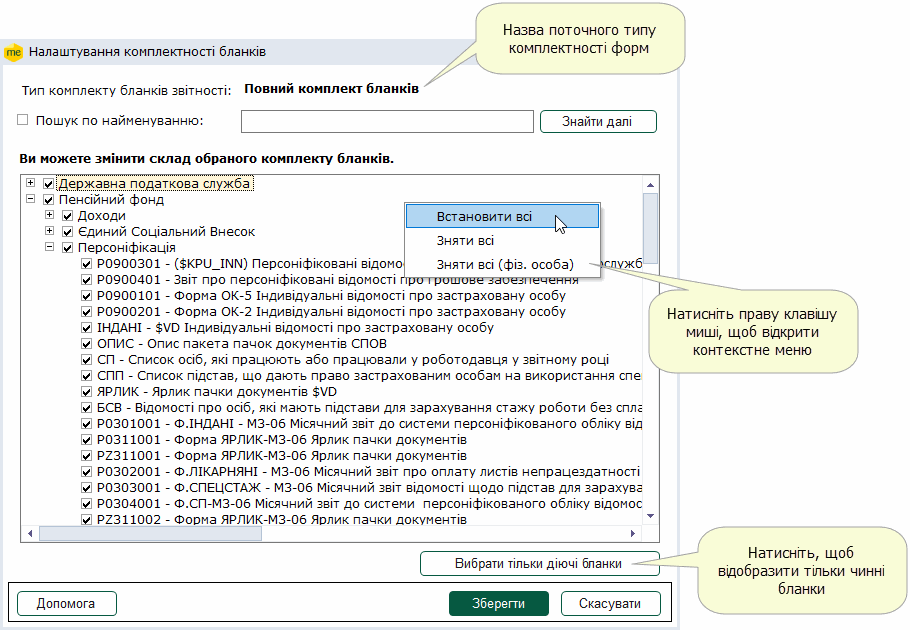

У вікні можна змінити склад обраного при [створенні підприємства](Connect_org.html#connect_org-connect_org_1_8_2) комплекту бланків.

Детально про налаштування комплектності бланків установи див. за посиланням: [Адміністрування > Налаштування комплектності бланків](FormSheetMain.html#formsheetmain-admcmpl).

### Вікно відкритого документа

_Шлях у довідці: Розділи програми › Звітність › Реєстр звітів › Вікно відкритого документа_

Активізація функції створення чи редагування звіту викликає вікно роботи з документом. Вікно містить у заголовку код цього документа.

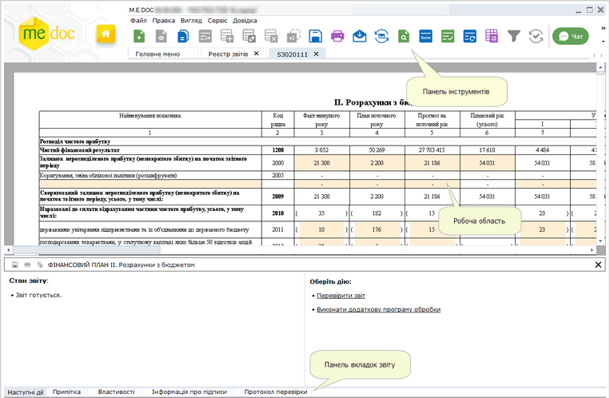

Натисніть, щоб збільшити малюнок

У разі, якщо є необхідність порівняти вміст кількох документів, можна відкрити ці документи у [окремих вікнах програми](UCPravila.html#ucpravila-pravyla). Щоб відкрити документ у окремому вікні, виділіть документ у таблиці реєстру та скористайтеся одним із способів:

- у головному меню програми виконайте команду Вигляд – Перегляд у вікні;
- виконайте команду контекстного меню Перегляд у вікні.

Панель інструментів

Містить кнопки виклику найчастіше використовуваних функцій програми та деяких стандартних функцій ОС Windows:

|  |  |
| --- | --- |
|  | Створення документа |
|  | Створення копії документа |
|  | Збереження документа |
|  | Друкування обраного документа |
|  | Отримати повідомлення |
|  | Додати рядок у таблицю документа. Кнопка активна тільки під час редагування полів таблиці. Додає рядок під виділеним рядком. |
|  | Видалити рядок із таблиці документа. Кнопка активна тільки під час редагування полів таблиці. Видаляє виділений рядок. |
|  | Копіювання запису таблиці. Скопійований рядок поміщається під виділеним |
|  | Оновлення полів звіту у випадку змін відповідних полів у картці установи, реєстрі співробітників, довідниках, тощо |
|  | Перерахунок документа. Примусовий запуск функції перерахування розрахункових полів документа |

Робоча область

Містить документ, у якому заповнюються поля.
В усіх документах жовтим кольором виділені поля, обов'язкові для заповнювання. Якщо курсор встановити у такому полі, колір зміниться на зелений. Якщо курсор встановити у полі, в якому значення має обиратися із підключеного довідника, у правій частині поля з'явиться кнопка .

- При створенні нового документа, запускається вбудована програма створення документа, у результаті виконання якої автоматично заповнюються поля "шапки" документа даними із картки установи користувача.
- Створений раніше документ чи імпортований у програму відкривається для редагування із уже заповненими полями.
- Відкритий документ на екрані монітора виглядає, як звичайний паперовий бланк. За бажанням, можна змінити масштаб відображення бланка, викликавши із контекстного меню функцію зміни масштабу відображення - від 70% до 150%.
- В процесі відкриття, заповнення, збереження та закриття документа у ньому виконуються створені розробником [вбудовані програми](UCProgramy.html#ucprogramy-programy), які відслідковують дії користувача та повідомляють про помилки чи внесення некоректних даних.

Панель вкладок звіту

Містить службову інформацію щодо обраного документа. Панель доступна як у відкритому документі, так і з реєстру документів (за умови виділення потрібного документа). Детальний опис вкладок дивись у розділі [Опис основних функціональних елементів інтерфейсу](#ucdocrstbyper5-rdocs_interface)

### Створення, заповнення та редагування звітів

_Шлях у довідці: Розділи програми › Звітність › Реєстр звітів › Створення, заповнення та редагування звітів_

В цьому розділі:

[Створення звітів](#ucdocrstbyper5-rdoc_robota_stvor)

[Правила заповнення та редагування звітів](#ucdocrstbyper5-rdoc_robota_stvor)

[Підказки щодо заповнення бланка та полів бланка](#ucdocrstbyper5-rdoc_robota_stvor)

[Перегляд та редагування раніше створених документів](#ucdocrstbyper5-rdoc_robota_stvor)

[Відправка документів у банк](#ucdocrstbyper5-rdoc_robota_stvor)

[Відправка фінансової звітності до біржі](#ucdocrstbyper5-rdoc_robota_stvor)

[Автоматичний розрахунок ЗМПЗ у Додатку 3 версії J0138306, F0138306](#ucdocrstbyper5-rdoc_robota_stvor)

[Заповнення пакету Податкової декларації платника єдиного податку четвертої групи з Додатками за допомогою додаткових програм обробки](#ucdocrstbyper5-rdoc_robota_stvor)

[Автоматичне заповнення дати виплати коштів для Повідомлення про виплату коштів застрахованим особам](#ucdocrstbyper5-rdoc_robota_stvor)

[Автоматичне створення Документів довільного формату на основі обраних PDF-файлів вкладень](#ucdocrstbyper5-rdoc_robota_stvor)

[Створення пакету документів, необхідного для остаточного рішення Комісії ДПС щодо прийняття або відхилення ПН/РК](#ucdocrstbyper5-rdoc_robota_stvor)

- [Створення Повідомлення про подання пояснень та копій документів щодо податкових накладних/розрахунків коригування, реєстрацію яких зупинено та Документа довільного формату (для подання сканкопій документів)](#ucdocrstbyper5-rdoc_robota_stvor)
- [Створення Додатку 5 до Порядку зупинення реєстрації податкової накладної/розрахунку коригування (Таблиця даних платника податку на додану вартість)](#ucdocrstbyper5-rdoc_robota_stvor)
- [Створення ПОВІДОМЛЕННЯ про подання інформації та копій документів щодо невідповідності платника податку критеріям ризиковості платника податку](#ucdocrstbyper5-rdoc_robota_stvor)

[Пакет документів для оскарження рішення Комісії ДПС щодо відхилення ПН/РК](#ucdocrstbyper5-rdoc_robota_stvor)

- [Створення СКАРГИ щодо рішення про відмову у реєстрації ПН/РК в Єдиному реєстрі податкових накладних](#ucdocrstbyper5-rdoc_robota_stvor)
- [Копіювання Документів довільного формату (для подання сканкопій документів)](#ucdocrstbyper5-rdoc_robota_stvor)

Створення звітів

Дана функція дозволяє створити новий документ у потрібному звітному періоді на основі обраного бланка.

1. Оберіть період в якому потрібно створити звіт. За замовчанням встановлено поточний період.

2. Для створення нового документа скористайтесь одним із наступних способів:

- на панелі інструментів натисніть кнопку Створити;
- виберіть команду Файл - Створити;
- у контекстному меню оберіть команду Створити;
- натисніть комбінацію клавіш Ctrl+N.

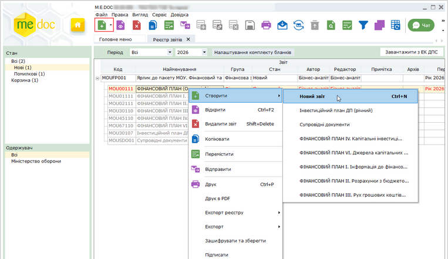

Натисніть, щоб збільшити малюнок

Для створення нового звіту оберіть команду Новий звіт.

Якщо у реєстрі виділено будь-який документ, що входить до пакету звітів, програма запропонує створити додатки, що входять у цей пакет звітів, або Документа довільного формату, якщо у виділеному документі передбачено можливість додавання документа довільного формату для [подання сканкопій документів](#ucdocrstbyper5-rdoc_robota_stvor).

3. Відкриється вікно Створення звіту.

- Більш докладно про вибір бланка створюваного звіту

Вікно Створення звіту містить навігаційну панель (ліворуч), в якій у вигляді дерева зображені розділи звітності та групи бланків комплекту, на основі яких створюються звіти. При виборі групи (ліворуч) у вікні справа відображається перелік бланків, що відносяться до цієї групи. Кількість форм залежить від [встановленого комплекту звітності](FormSheetMain.html#formsheetmain-admcmpl) та обраного звітного періоду.

Перелік містить такі колонки:

- Код - службовий код;
- Прийнято - дата, починаючи з якої даний документ діє;
- Відмінено - дата, починаючи з якої даний документ припиняє свою дію;
- E-Mail - відмітка, що вказую на можливість відправлення даної форми електронною поштою;
- Найменування - найменування звітної форми.

УВАГА! ЗГІДНО З НОРМАТИВНО-ПРАВОВИМИ АКТАМИ БЛАНКИ ПОДАТКОВОЇ ЗВІТНОСТІ ЮРИДИЧНИХ ОСІБ МІСТЯТЬ У ПОЗНАЧЕННІ БУКВУ J, БЛАНКИ ЗВІТНОСТІ ФІЗИЧНИХ ОСІБ - ВІДПОВІДНО БУКВУ F.

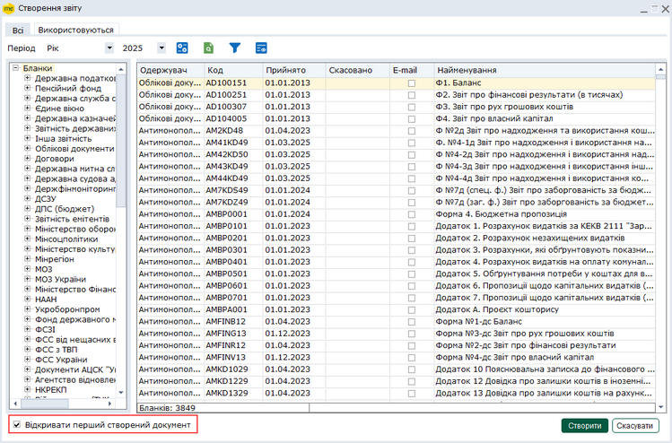

Натисніть, щоб збільшити малюнок

Із переліку можна обрати один або декілька бланків. Вибір декількох бланків відбувається за стандартною для ОС Windows процедурою:

- при натиснутій клавіші Ctrl лівою кнопкою миші обираються довільно розташовані бланки;
- при натиснутій клавіші Shift - лівою кнопкою миші обирається діапазон розташованих підряд бланків.

Після вибору бланка (або бланків) для початку процесу створення звітів натисніть кнопку Створити у нижній частині вікна або натисніть подвійним кліком лівої клавіші миші по потрібному бланку (в разі створення одного звіту).

Якщо у полі Відкривати перший створений документ стоїть позначка, одразу відкриється створений звіт, а при груповому створенні звітів відкриється тільки перший у переліку документ. Якщо позначка у цьому полі не проставлена, запис про створений документ поміщається одразу в реєстр звітів. Такий документ матиме статус Новий, його можна пізніше обрати та відкрити для редагування.

4. Із загальної групи Бланки оберіть відповідний розділ та групу звітності. Оберіть потрібний для створення бланк документа та відкрийте його подвійним кліком лівої клавіші миші або натисніть на кнопку Створити.

5. Бланк звіту після відкриття автоматично заповнюється даними із [картки установи](UCOrg.html#ucorg-sprorg) та іншою наведеною в системі інформацією.

Поля, що підсвічені жовтим кольором, доступні для заповнення та редагування.

6. Внесіть дані в поля, які потребують заповнення із клавіатури.

- Про заповнення звітів більш докладно описано у розділі [Правила заповнювання та редагування звітних документів](UCPravila.html#ucpravila-pravyla).
- Перегляд підказки по заповненню окремих полів бланків та бланка в цілому описано у розділі [Довідка щодо заповнення бланка та полів бланка](UCHintBl.html#uchintbl-uchintbl).

7. Перевірте правильність заповнення полів:

-  на панелі інструментів кнопкою
-  із меню Правка - Перевірити документ;
- на вкладці Наступні дії - команда Перевірити звіт;
- за допомогою клавіші F4.

Перевіряється правильність заповнення полів і у випадку помилок, система підсвітить червоним кольором поля, що необхідно виправити. Виправте помилки та знову виконайте перевірку.

Також для звіту (у вікні відкритого документа) можна виконати операції:

­

Оновлення полів (модифікація) - оновлення (модифікації) полів у документі у випадку змін відповідних полів у картці установи, реєстрі співробітників, довідниках тощо. Запускається одним із способів:

-  на панелі інструментів кнопкою
-  із меню Правка - Оновити поля
- за допомогою функціональної клавіші F5.

­

Перерахунок документа - примусовий перерахунок розрахункових полів документа, наприклад, при відключеному автоперерахунку. Запускається одним із способів:

-  на панелі інструментів кнопкою
-  із меню Правка - Перерахувати документ
- за допомогою функціональної клавіші F6.

8. Збережіть звіт, натиснувши кнопку  або комбінацію клавіш Ctrl+S. (Під час збереження виконується автоматична перевірка правильності заповнення полів звіту.)

9. Всі подальші дії з підготовки звіту для подання до контролюючого органу (друк, збереження на електронному носії) виконуються із вікна відкритого документа.

Важливо!

Якщо у заповнений звіт внесено правки, необхідно обов'язково виконати перерахунок розрахункових полів звіту. Для цього у вікні відкритого документа виконайте команду головного меню Перерахувати документ або натиснути клавішу F6.

Обов'язковим є виконання перерахунку розрахункових полів Звітів у разі, якщо дані в Додатках змінено або перераховано, Для перерахунку полів у вікні відкритого Звіту послідовно виконайте функції:

1. Оновити поля (F5).

2. Перерахувати документ (F6).

3. Перевірити документ (F4).

[До початку](#ucdocrstbyper5-rdoc_robota_stvor)

Правила заповнення та редагування звітів

Правила заповнення та редагування звітів описано у розділі [Правила заповнення та редагування документів](UCPravila.html#ucpravila-pravyla).

Для помилкових звітів, які заблоковані від редагування (підписані ЕП або відправлені електронним каналом зв’язку), реалізовано можливість перегляду помилок.

У відкритому документі поля, що містять помилки, підсвічуються червоним кольором та при позиціонуванні на полі, що містить помилку, відображається підказка, в чому саме полягає помилка.

При обранні помилкового документа в робочій області Реєстру (незалежно від того заблокований документ чи ні) перелік помилок документа відображається у вкладці Протокол перевірки. Оберіть подвійним кліком миші помилку на вкладці Протокол перевірки - відкриється документ з позиціонуванням курсору на полі, що містить обрану помилку.

[До початку](#ucdocrstbyper5-rdoc_robota_stvor)

Підказки щодо заповнення бланка та полів бланка

Перегляд підказки по заповненню окремих полів бланків та бланка в цілому описано у розділі [Довідка щодо заповнення бланка та полів бланка](UCHintBl.html#uchintbl-uchintbl).

[До початку](#ucdocrstbyper5-rdoc_robota_stvor)

Перегляд та редагування раніше створених документів

Функція відкриває обраний у реєстрі створений раніше або імпортований звітний документ для перегляду чи редагування.

Викликається:

- на панелі інструментів натисніть кнопку Відкрити - ;
- подвійним кліком лівої клавіші миші на назві звіту у таблиці реєстру;
- із контекстного меню команда Відкрити;
- команда Файл/Створити;
- на панелі вкладок звіту оберіть закладку Наступні дії і натисніть Відкрити звіт;
- натисніть комбінацію клавіш Ctrl+F2.

В режимі перегляду раніше створених звітів діють основні правила заповнення звітних документів описані у розділі [Правила заповнення та редагування документів](UCPravila.html#ucpravila-pravyla)

[До початку](#ucdocrstbyper5-rdoc_robota_stvor)

Відправка документів у банк

Сервіс надає можливість відправляти статистичну та фінансову звітність у банк.

Функція доступна для звітності, що була відправлена у контролюючі органи, та для якої була отримана позитивна Квитанція № 2.

Відправка документів у банк також доступна у розділі [Первинні документи - Реєстр електронних документів](UCDFDocsRstNew.html#ucdfdocsrstnew-pdocs_reestr_bank).

- Переглянути перелік звітів, для яких доступна відправка у банк, можна [тут](UCDFDocsRstNew.html#ucdfdocsrstnew-pdocs_reestr_bank).

Для відправки у банк:

1. У реєстрі модуля оберіть звіт, який потрібно відправити у банк. Важливо, звіт повинен бути відправлений у контролюючий органи, та у відповідь на відправлений звіт була отримана позитивна Квитанція № 2.

2. Перейдіть на вкладку Наступні дії та виконайте команду Відправити у банк:

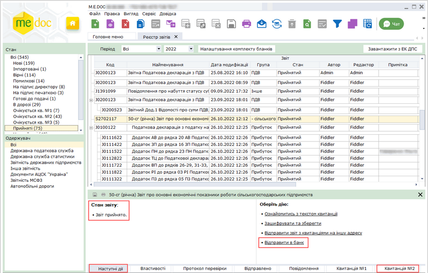

Натисніть, щоб збільшити малюнок

3. Якщо відправляється пакет звітів, відкриється вікно Обрання звітів з переліком документів пакету. Встановіть відмітки біля документів, які потрібно відправити у банк, та натисніть ОК:

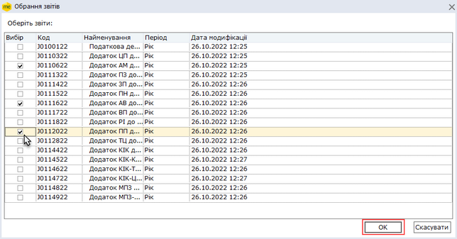

Натисніть, щоб збільшити малюнок

4. У наступному вікні оберіть банк, у якій потрібно відправити звітність, наразі доступна відправка документів у Райффайзен Банк. Натисніть Вибрати:

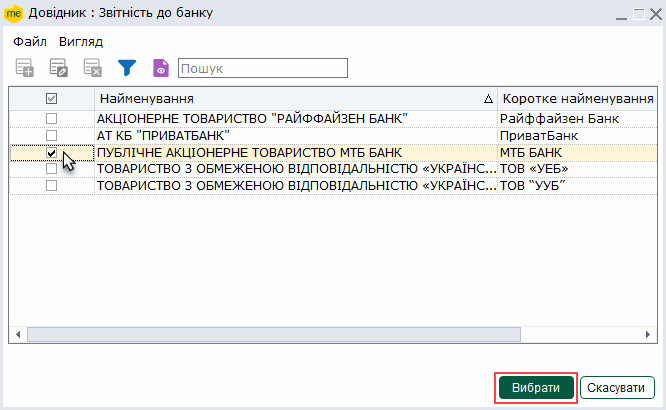

5. Запуститься [процедура підпису та відправки документа](UC_ECP.html#uc_ecp-ecp). Програма пропонує підписати документ комплектом підпису Звітність, що налаштований у розділі [Адміністрування - Параметри системи - Підпис](FormCompanyParams.html#formcompanyparams-admcomanyparams_pen).

Для відправки у банк створюється електронний документ, що містить у якості вкладень обрані звіти. Після відправки у банк цей документ доступний для перегляду у модулі Реєстр електронних документів. Також у банк відправляються Квитанції №2.

6. Для відправлених у банк звітів інформація про дату, час, банки, підписи, які були накладені під час відправки, відображаються на вкладці Відправлено в банк:

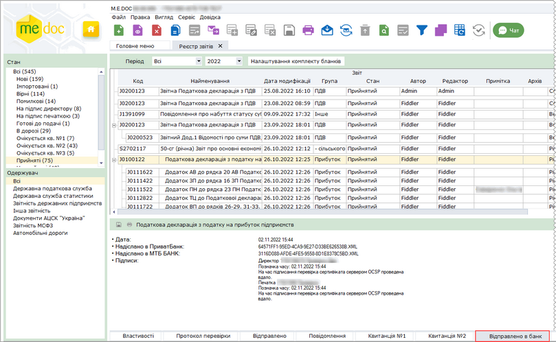

Натисніть, щоб збільшити малюнок

[До початку](#ucdocrstbyper5-rdoc_robota_stvor)

Відправка фінансової звітності до біржі

Сервіс надає можливість відправляти фінансову звітність до біржі.

Функція доступна для звітності, що була відправлена у контролюючі органи, та для якої була отримана позитивна Квитанція № 2.

- Відправка документів у банк також доступна у розділі [Первинні документи - Реєстр електронних документів](UCDFDocsRstNew.html#ucdfdocsrstnew-pdocs_reestr_bank).
- Переглянути перелік звітів, для яких доступна відправка у банк, можна [тут](UCDFDocsRstNew.html#ucdfdocsrstnew-pdocs_reestr_bank).

Для відправки фінансової звітності до біржі:

1. У реєстрі модуля оберіть звіт, який потрібно відправити до біржі. Важливо, звіт повинен бути відправлений у контролюючий органи, та у відповідь на відправлений звіт була отримана позитивна Квитанція № 2.

2. Перейдіть на вкладку Наступні дії та виконайте команду Відправити у банк:

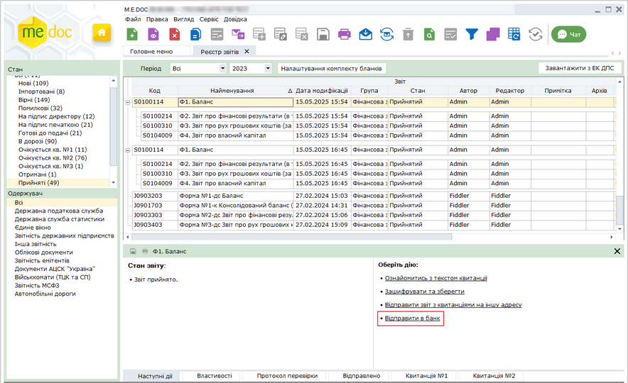

Натисніть, щоб збільшити малюнок

3. Якщо відправляється пакет звітів, відкриється вікно Обрання звітів з переліком документів пакету. Встановіть відмітки біля документів, які потрібно відправити до біржі, та натисніть ОК:

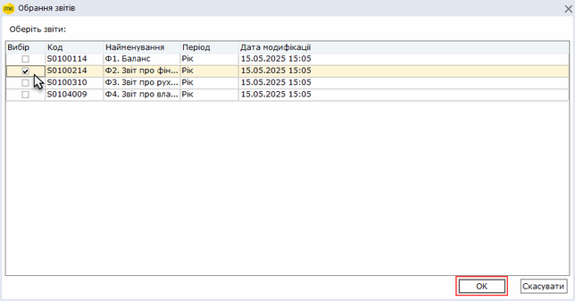

Натисніть, щоб збільшити малюнок

4. У наступному вікні оберіть біржу, до якої потрібно відправити звітність, доступна відправка документів до ТОВ «Українська енергетична біржа» (ТОВ "УЕБ") та до ТОВ «Українська універсальна біржа» (ТОВ "УУБ") . Натисніть Вибрати:

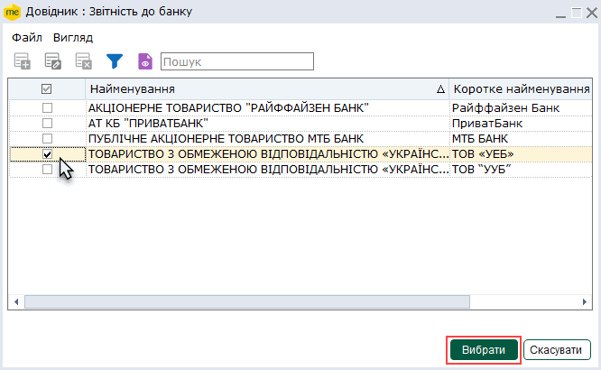

5. Запуститься [процедура підпису та відправки документа](UC_ECP.html#uc_ecp-ecp). Програма пропонує підписати документ комплектом підпису Звітність, що налаштований у розділі [Адміністрування - Параметри системи - Підпис](FormCompanyParams.html#formcompanyparams-admcomanyparams_pen).

Для відправки до біржі створюється електронний документ, що містить у якості вкладень обрані звіти. Після відправки до біржі цей документ доступний для перегляду у модулі Реєстр електронних документів. Також до біржі відправляються Квитанції №2.

6. Для відправлених до біржі звітів інформація про дату, час, біржу, підписи, які були накладені під час відправки, відображаються на вкладці Відправлено в банк.

[До початку](#ucdocrstbyper5-rdoc_robota_stvor)

Виконання автоматичного розрахунку загального мінімального податкового зобов’язання (ЗМПЗ) у Додатку 3 версії J0138306, F0138306

Для автоматичного розрахунку необхідно:

1. У заповненому належним чином Додатку 3 до податкової декларації платника єдиного податку четвертої групи версії J0138306, F0138306 введіть необхідні показники відповідної ділянки:

­

Площа земельної ділянки – може бути власною або орендованою, відповідні значення заповнюються у графах 3 або 5;

­

Частка ріллі, % - значення заповнюються у графах 4 та 6, для заповнення однотипними даними введіть значення у поля розробника (у заголовку граф 4 та 6) та виконайте додаткову програму обробки Частка риллі;

­

Нормативно грошова оцінка – (НГО) може бути проведеною або не проведеною, відповідні значення заповнюються у графах 7 або 8. У графі 7 зазначається ціна всієї ділянки, а в колонці 8 зазначається ціна 1 га з урахуванням коефіцієнта індексації;

­

Коефіцієнт для визначення МПЗ - графа 9, алгоритм визначення показника описано у примітці 3 до Додатка 3;

­

Кількість календарних місяців - графа 10, алгоритм визначення значення описаний у примітці 4 до Додатка 3.

- Можна скористатися додатковою програмою обробки – Перенесення даних з J0138106 (Перенесення даних з F0138106 - для ФОП). Та додатковою програмою обробки – Перенесення даних з J0138305 (Перенесення даних з F0138305 - для ФОП) для автоматичного перенесення даних з попередньої версії Додатка 3.
- Зверніть увагу! Для коректного переносу дані по орендованій та власній ділянці мають зазначатись в окремих рядках Додатка 1.

2. Після заповнення граф 3 - 8 та введення кількості календарних місяців у графі 10 автоматично розрахується одне з двох значень Мінімального податкового зобов’язання:

­

для ділянки, НГО якої проведена, (значення у графі 11);

­

для ділянки, НГО якої не проведена, (значення у графі 12).

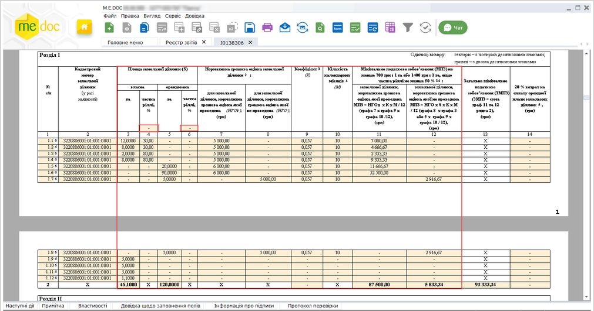

Натисніть, щоб збільшити малюнок

3. ЗВЕРНІТЬ УВАГУ! Відповідно до п.74 підр.10 розд. ХХ «Перехідні положення» ПКУ розмір МПЗ не може бути меншим за 700 грн/га, а для земель, де частка ріллі становить не менше 50% — 1400 грн/га.

Для автоматичного приведення суми МПЗ до норми відповідно до п.74 підр.10 розд. ХХ «Перехідні положення» ПКУ перейдіть на вкладку Наступні дії та виконайте додаткову програму обробки Перерахунок з урах. мінімал. допустимої суми МПЗ.

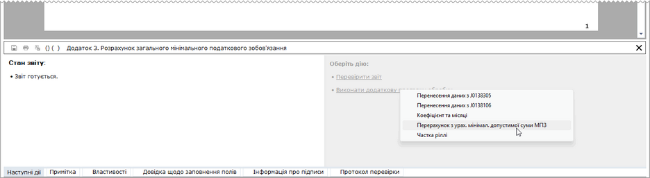

Натисніть, щоб збільшити малюнок

Для коректного перерахунку дані про власну та орендовану ділянки мають бути в окремих рядках.

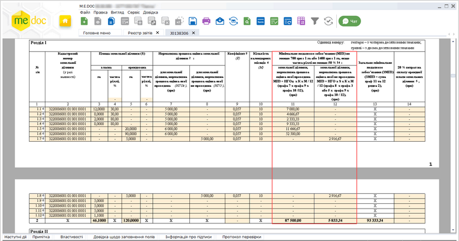

Натисніть, щоб збільшити малюнок

4. Також автоматично буде розраховано значення Загального МПЗ (зазначається у графі 13) як сума всіх рядків у графах 11 та 12.

[До початку](#ucdocrstbyper5-rdoc_robota_stvor)

Заповнення пакету Податкової декларації платника єдиного податку четвертої групи з Додатками за допомогою додаткових програм обробки

Поля розробника, не друкуються, не експортується, не відправляється в ДПС.

1. Заповніть Додаток 1 (J0138106, F0138106).

1.1. Заповнення пакета рекомендуємо розпочати з Додатка 1 (J0138106, F0138106). У разі потреби перенесіть дані із попередньої версії бланку. Для цього у вікні відкритого Додатку 1 виконайте додаткову програму обробки для перенесення показників із версії (J0138105, F0138105):

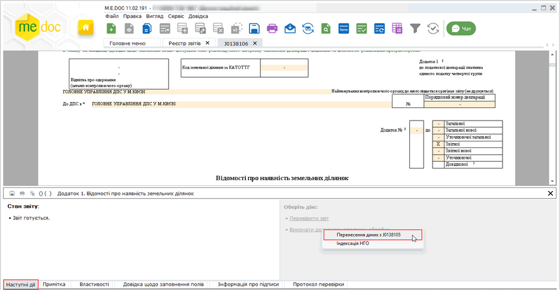

Натисніть, щоб збільшити малюнок

1.2. Заповніть Додаток 1 показниками за допомогою довідника [Господарські одиниці/Акцизні склади/Земельні ділянки](UCEconomicUnits.html#uceconomicunits-uceconomicunits). Для цього попередньо у довіднику створіть запис по кожній ділянці. Заповніть розділи довідника Загальні дані, Адреса та Земельна ділянка. Якщо земельна ділянка орендована, на вкладці Земельна ділянка встановіть відмітки Земельна ділянка та Оренда. Уважно введіть дані щодо категорії та виду земельної ділянки, при наявності вкажіть частку ріллі, зазначте площу земельної ділянки в га та НГО, яка проведена за одиницю площі (за 1 га) та за площу всієї ділянки, або НГО земельної ділянки, яка не проведена за одиницю площі.

Врахуйте що :

- у Додатку 3, відповідно до примітки 2, для ділянки, в якої НГО проведена, відображається ціна всієї ділянки (НГОд), а для ділянки, в якої НГО не проведена, відображається ціна 1 га;
- у Податковій декларації платника єдиного податку четвертої групи в розрахунковій частині відображається нормативна грошова оцінка за одиницю площі (за 1 га).

Перенести дані у звіт можна методом множинного вибору із довідника Господарські одиниці/Акцизні склади/Земельні ділянки. Для цього у довіднику виконайте фільтрацію записів окремо за кожним видом земельної ділянки та оберіть записи для обраного Виду земельної ділянки (рілля, сіножаті, пасовища, багаторічні насадження, землі водного фонду):

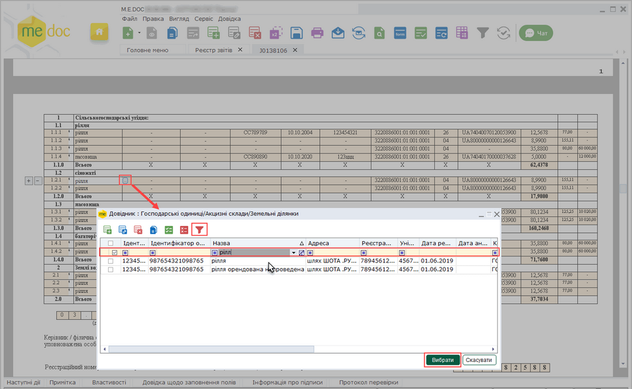

Натисніть, щоб збільшити малюнок

Після наповнення Додатка 1 даними з довідника Господарські одиниці/Акцизні склади/Земельні ділянки поля розробника: за площу ділянки, НГО проведена та за одиницю площі, НГО яких проведена чи не проведена, буде заповнено. Також будуть внесені показники у приховане поле - Частка ріллі. Дані цих полів далі будуть перенесені додатковою програмою обробки в Додаток 3.

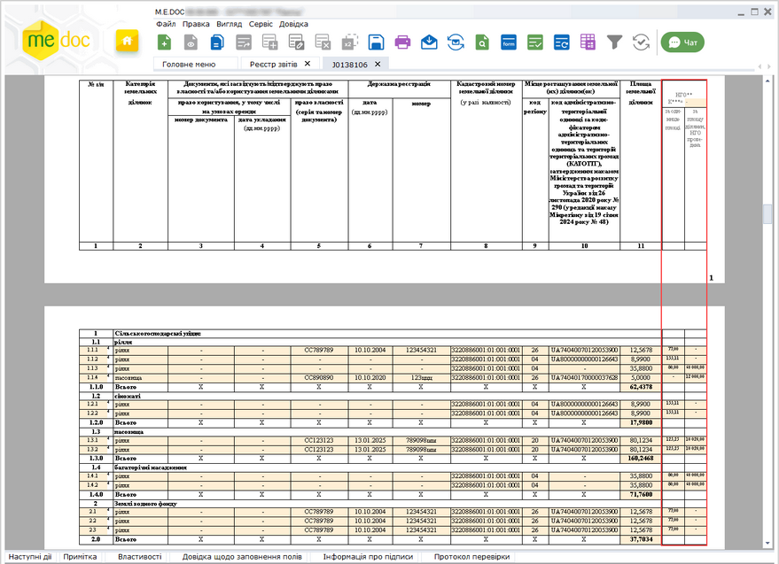

Натисніть, щоб збільшити малюнок

1.3. У разі потреби рекомендуємо виконати програму обробки Індексація НГО. Проставте необхідний коефіцієнт у заголовку полів розробника та виконайте додаткову програму обробки Наступні дії – Виконати додаткову програму обробки – Індексація НГО.

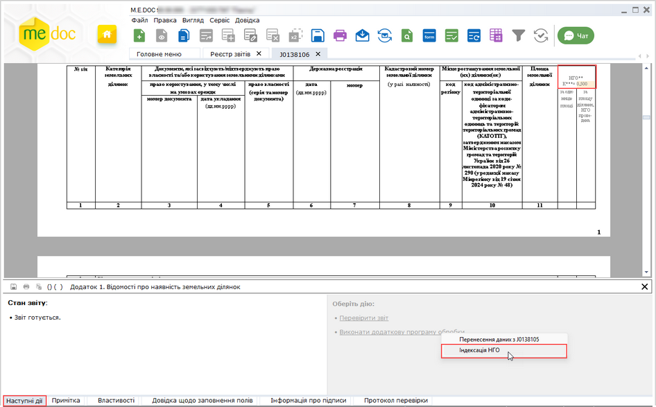

Натисніть, щоб збільшити малюнок

2. Заповніть Додаток 3 (J0138306, F0138306).

2.1. У разі потреби перенесіть дані із попередньої версії бланку. Додаток 3 містить програму користувача для перенесення показників із версії (J0138305, F0138305). Виконується перенос наступних полів: Кадастровий номер земельної ділянки (ЗД), Площа ЗД власна та орендована, НГОд ЗД (проведена), НГО за 1 га ЗД (непроведена), Коефіцієнт, Кількість календарних місяців:

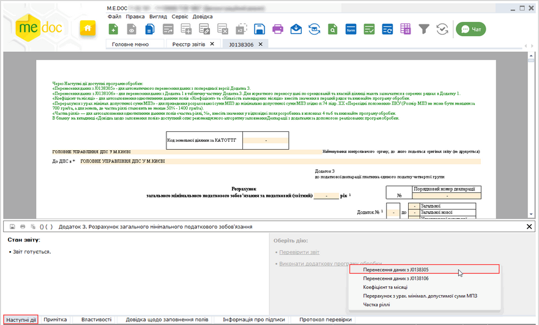

Натисніть, щоб збільшити малюнок

2.2. Для заповнення Додатка 3 на основі даних Додатка 1 виконайте програму обробки Наступні дії – Виконати додаткову програму обробки – Перенесення даних з JF0138106.

Виконається автоматичне заповнення даних:

­

Кадастровий номер земельної ділянки (графа 2);

­

Площа земельної ділянки (графа 3 власна/графа 5 орендована);

­

Частка ріллі (графа 4/6);

­

Нормативна грошова оцінка земельної ділянки (з урахуванням індексації, якщо  додаткову програму Індексація НГО було виконано):

- графа 7 для ділянки, НГОд якої проведена (за загальну площу);
- графа 8 для ділянки, НГО якої не проведена (за одиницю площі).
- Додаток 3 буде заповнено у повному обсязі, якщо в Додаток 1 були внесені дані за допомогою довідника Господарські одиниці/Акцизні склади/Земельні ділянки.
- Якщо Додаток 1 був заповнений вручну, то показники у «прихованому» полі - Частка ріллі будуть відсутні.

2.3. Для автозаповнення графи 9 Коефіцієнт та графи 10 Кількість календарних місяців введіть значення у відповідних графах першого рядка та виконайте програму обробки «Коефіцієнт та місяці». По виконанню програми всі рядки графи 9 та графи 10 будуть заповнені відповідними однотипними даними.

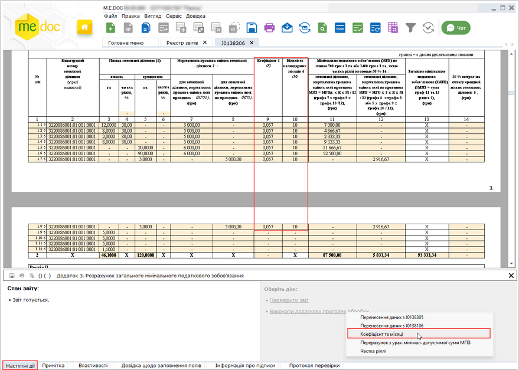

Натисніть, щоб збільшити малюнок

2.4. Після введення даних зг. пп.1-3 автоматично розрахується Мінімальне податкове зобов'язання (МПЗ) для ділянки, НГО якої проведена – графа 11, для ділянки, НГО якої не проведена – графа 12.

Для приведення розрахованої суми МПЗ до мінімально допустимої суми МПЗ згідно до п.74 підр.10 розд. ХХ «Перехідні положення» ПКУ (Розмір МПЗ не може бути меншим за 700 грн/га, а для земель, де частка ріллі становить не менше 50% — 1400 грн/га) виконайте програму обробки Перерахунок з урах. мінімал. допустимої суми МПЗ.

Для коректного перерахунку дані про власну та орендовану ділянки мають бути в окремих рядках.

2.5. Загальне МПЗ (графа 13), також автоматично розрахується, як сума всіх рядків у графах 11 та 12.

3. Після повного заповнення додатків перейдіть в основний звіт Декларацію (J0103806, F0103806).

3.1. Для перенесення інформації про земельні ділянки з Додатків 1 до Декларації виконайте програму обробки Наступні дії – Виконати додаткову програму обробки – За показниками з JF0138106:

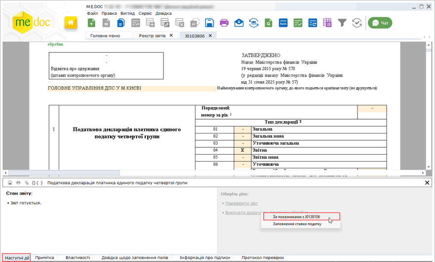

Натисніть, щоб збільшити малюнок

Виконається автоматичне заповнення графи 3 Площа земельної ділянки та графи 4 Нормативна грошова оцінка одиниці площі земельної ділянки з сумуванням площ земельних ділянок, для яких встановлені однакові значення системного поля Нормативна грошова оцінка за видами (категоріями) ділянок.

Якщо у пакеті наявні декілька Додатків 1, показники площі виводяться у декларацію окремо по кожному додатку.

3.2. Щоб заповнити Ставку податку у кожному рядку наявних видів (категорій) ділянок, проставте ставки у полі розробника (зверху над таблицею, зелений текст) та виконайте програму обробки Наступні дії – Виконати додаткову програму обробки – Заповнення ставки податку. Ставки проставляються у кожному рядку, де наявна Площа земельної ділянки та автоматично буде розраховано Річну суму податку у графі 6 з розбиттям по кварталах у графах 7-10.

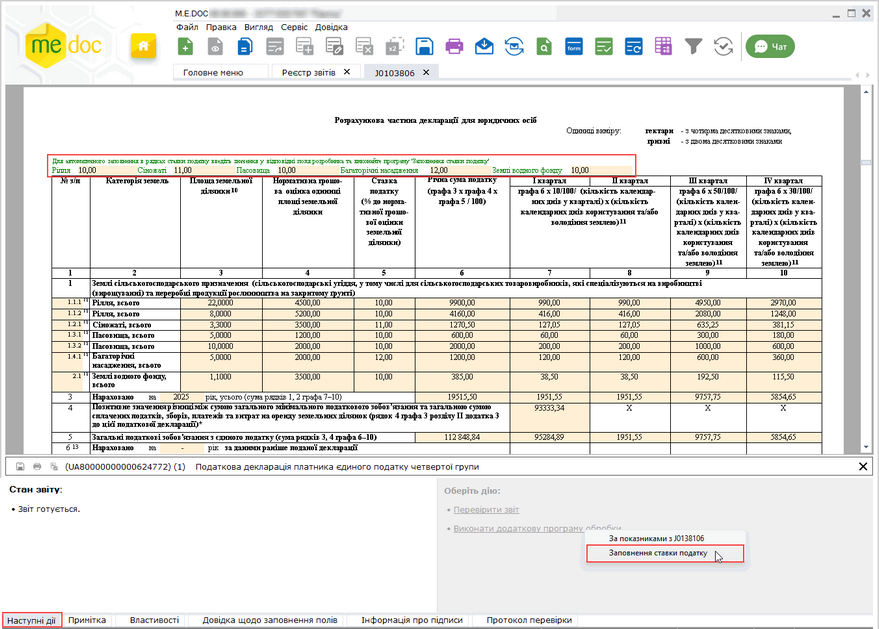

Натисніть, щоб збільшити малюнок

[До початку](#ucdocrstbyper5-rdoc_robota_stvor)

Автоматичне заповнення дати виплати коштів для Повідомлення про виплату коштів застрахованим особам

Функція надає можливість автоматичного заповнення дати виплати коштів для звіту Повідомлення про виплату коштів застрахованим особам.

Для автоматичного заповнення необхідно:

1. У заповненому належним чином звіті Повідомлення про виплату коштів застрахованим особам виконати команду головного меню Правка – Заповнити дату виплати коштів:

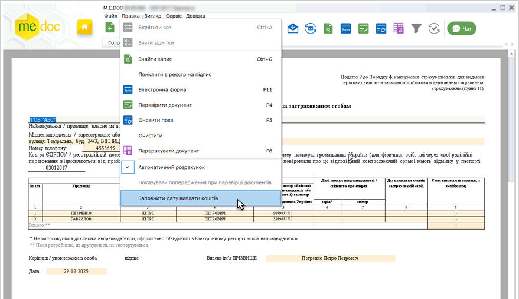

Натисніть, щоб збільшити малюнок

2. У вікні, що відкриється, оберіть потрібну дату та натисніть ОК:

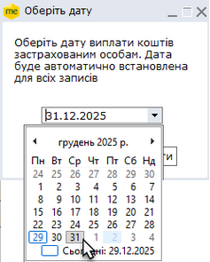

Натисніть, щоб збільшити малюнок

3.Обрана дата автоматично встановлюється для всіх записів звіту:

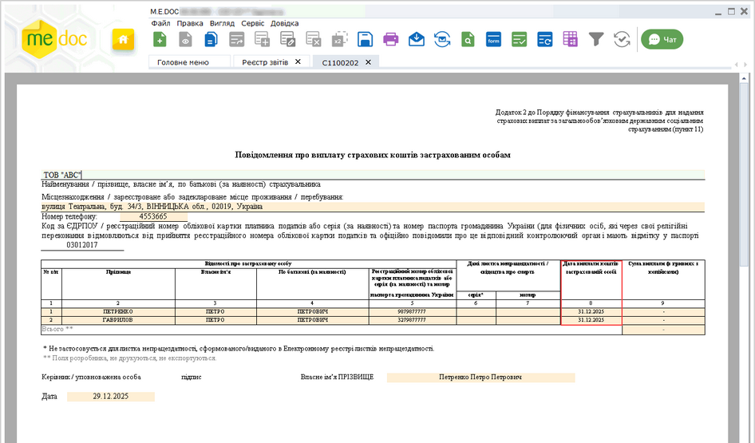

Натисніть, щоб збільшити малюнок

4. У разі потреби, змініть дати для відповідних осіб.

Щоб змінити дату для всіх записів, виконайте команду Правка – Заповнити дату виплати коштів та оберіть іншу дату.

5. Збережіть звіт, натиснувши кнопку  або комбінацію клавіш Ctrl+S. (Під час збереження виконується автоматична перевірка правильності заповнення полів звіту.)

[До початку](#ucdocrstbyper5-rdoc_robota_stvor)

Автоматичне створення Документів довільного формату на основі обраних PDF-файлів вкладень

Створити Документи довільного формату на основі обраних файлів-вкладень формату PDF можна для наступних документів:

- «Повідомлення про подання пояснень та копій документів щодо податкових накладних/розрахунків коригування, реєстрацію яких зупинено»;
- «Таблиця даних платника податків на додану вартість»;
- «ПОВІДОМЛЕННЯ про подання інформації та копій документів щодо невідповідності платника податку критеріям ризиковості платника податку»;
- «СКАРГА на рішення про відмову у реєстрації ПН/РК в Єдиному реєстрі податкових накладних»;
- «Повідомлення про подання додаткових пояснень та/або документів, необхідних для розгляду питання прийняття комісією регіонального рівня рішення про реєстрацію податкової накладної/розрахунку коригування»;
- «Заява про повернення помилково та/або надміру сплачених сум грошових зобов’язань та пені»;
- «Форма №8-ОПП Заява про ліквідацію або реорганізацію платника податків»;
- «Форма №5-ОПП Заява (для осіб, які провадять незалежну професійну діяльність)»;
- «Скарга щодо рішення про неврахування таблиці даних платника податку на додану вартість».

Для автоматичного створення Документів довільного формату:

1. У головному меню оберіть команду головного меню Файл – Імпорт – Створити пакет документів з PDF-файлів:

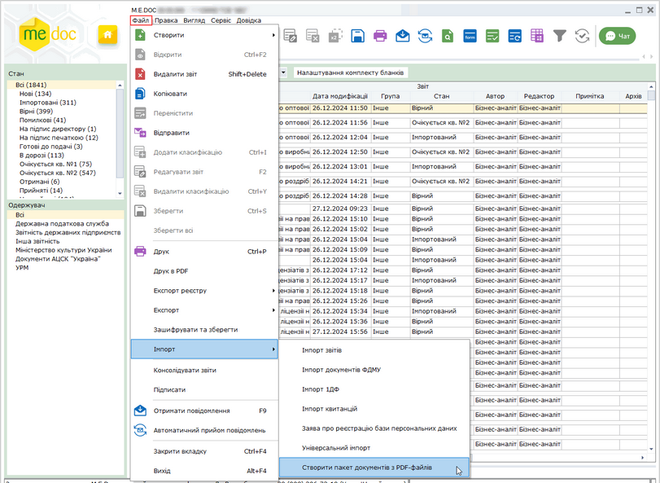

Натисніть, щоб збільшити малюнок

2. У вікні оберіть звіт, для якого створюються Документи довільного формату, та період, у якому потрібно створити звіт:

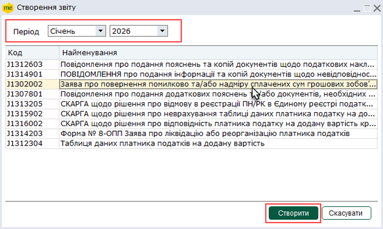

Натисніть, щоб збільшити малюнок

3. У вікні, що відкриється, оберіть каталог, у якому зберігаються PDF-файли вкладень:

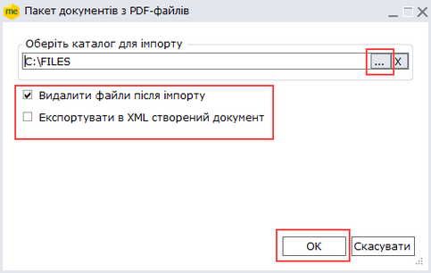

Натисніть, щоб збільшити малюнок

Зверніть увагу! Назви файлів вкладень повинні відповідати шаблону: <Назва документа>\_<Номер документа>\_<Дата в форматі ДД.ММ.РРРР>.pdf. Якщо ім'я не відповідає шаблону, імпорт файлу не виконується!

Рекомендуємо зберігати PDF-файли вкладень, що необхідно додати до певного звіту, у окремому каталозі (імпортуються всі PDF-файли, що зберігаються у обраному каталозі, та імена яких відповідають шаблону).

За потреби встановіть опції:

- Видалити файли після імпорту - при встановленій опції успішно імпортовані PDF-файли будуть видалені з каталогу.
- Експортувати в XML створений документ - якщо опцію встановлено, після створення звіти будуть експортовані у «форматі для обміну звітністю». Звіти зберігаються у файлах з іменами формату <РРРР-ММ-ДД-ГГ-ХХ-СС>\_<ЄДРПОУ>.xml (дата, час, ЄДРПОУ) у каталог, що обраний у полі Оберіть каталог для імпорту (з якого виконується імпорт PDF-вкладень). Зверніть увагу, поля звіту не заповнені!

4. Підтвердіть створення звіту, натиснувши кнопку ОК. Програма повідомить про результати виконання операції.

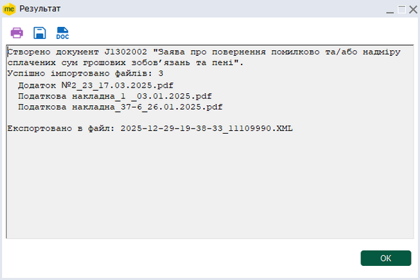

Натисніть, щоб збільшити малюнок

5. У Реєстрі звітів буде створено обраний звіт, до якого будуть додані Документи довільного формату, що міститимуть PDF-вкладення з обраного каталогу. Кількість Документів довільного формату відповідає кількості імпортованих PDF-вкладень. Створені звіти та Документи довільного формату набувають стану Імпортований:

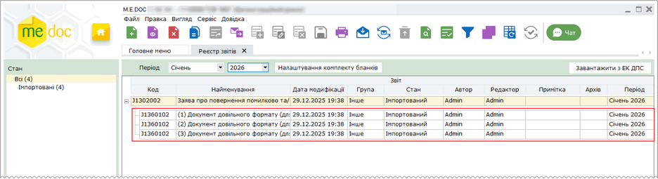

Натисніть, щоб збільшити малюнок

6. Перевірте відповідність доданих вкладень та заповніть необхідні поля звіту та Документів довільного формату.

У створених Документах довільного формату поля: Назва документу, Номер документу, Дата документу заповнюються автоматично згідно з назвою імпортованого вкладення:

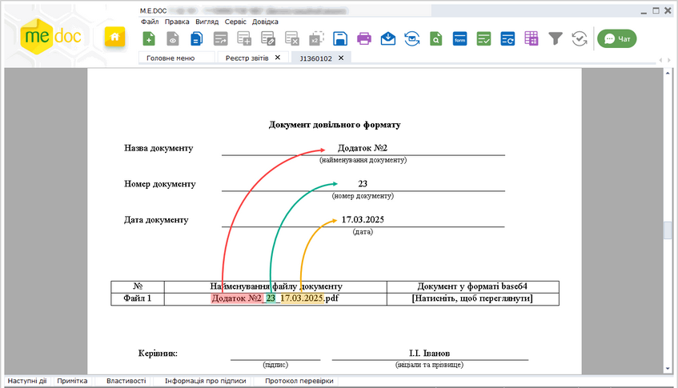

Натисніть, щоб збільшити малюнок

Додати Документ довільного формату (для подання сканкопій) також можна і з таблиці Реєстру звітів. Для цього у таблиці оберіть документ, до якого додається Документ довільного формату, та оберіть один із способів:

- на панелі інструментів натисніть кнопку Створити, у вікні Створення звіту оберіть Документ довільного формату (для подання сканкопій);
- виберіть команду Створити - Документ довільного формату (для подання сканкопій);
- у контекстному меню оберіть команду Створити - Документ довільного формату (для подання сканкопій).

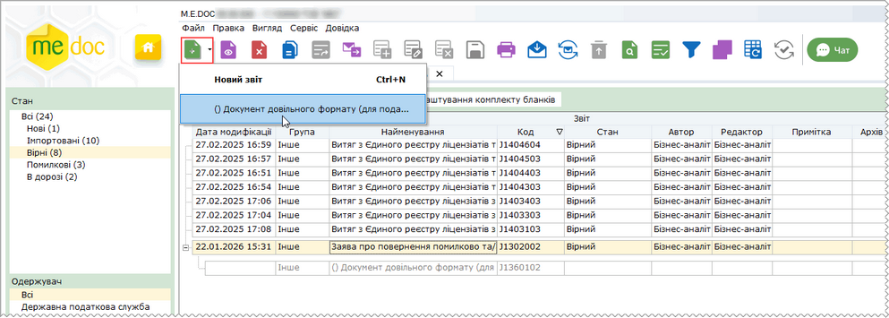

Натисніть, щоб збільшити малюнок

[До початку](#ucdocrstbyper5-rdoc_robota_stvor)

Створення пакету документів, необхідного для остаточного рішення Комісії ДПС щодо прийняття або відхилення ПН/РК

У разі призупинення реєстрації Податкової накладної/Розрахунку коригування з причини наявності Критеріїв оцінки ризиків Продавець (Покупець) заповнює та відправляє у ДПС пакет документів, що підтверджує операції ПН/РК, та є достатнім для прийняття Комісією ДПС остаточного рішення про прийняття або відхилення ПН/РК. Платник має можливість подавати документи за формами:

- Повідомлення про подання пояснень та копій документів щодо податкових накладних/розрахунків коригування, реєстрацію яких зупинено, що містить номер ПН/РК, по якій відмовлено у реєстрації в ЄРПН, та надаються пояснення і, при необхідності, вказується кількість документів, які підтверджують операції, зазначені у призупиненій ПН/РК (кількість додатків). Документ створюється як головний документ пакету.
- Документ довільного формату (для подання сканкопій), у якому кріпляться сканкопії, які підтверджують операції, зазначені у призупинених ПН/РК. Для кожної сканкопії створюється окремий документ. Документ створюється як підпорядкований документ пакету до Повідомлення щодо подачі документів....
- Додаток 5 до Порядку зупинення реєстрації податкової накладної/розрахунку коригування (Таблиця даних платника податку на додану вартість) - створюється як окремий документ - у разі виявлення критеріїв ризиковості здійснення операцій.
- ПОВІДОМЛЕННЯ про подання інформації та копій документів щодо невідповідності платника податку критеріям ризиковості платника податку - у разі виявлення критеріїв ризиковості платника податку.
- При формуванні пакета можна автоматично оновлювати дати для всіх документів пакета. Для цього виділіть у таблиці реєстру головний документ пакета (або кількох пакетів) та виконайте команду головного меню Правка – Оновити Дату документів в пакеті. Команда доступна для непідписаних та не переданих на підпис пакетів.
- На виконання команди програма запропонує підтвердити операцію оновлення дати. Після підтвердження операції у документах обраного пакета (пакетів) поле Дата звіту заповнюється поточною датою.
- У реєстрі дата звіту відображається у полі Дата модифікації. Для відображення нової дати оновіть таблицю реєстру (кнопка на панелі інструментів , меню Правка - Оновити поля або клавіша <F5>).

Створення Повідомлення про подання пояснень та копій документів щодо податкових накладних/розрахунків коригування, реєстрацію яких зупинено та Документа довільного формату (для подання сканкопій документів)

Можна автоматично створити Повідомлення про подання пояснень та копій документів та додати до нього необхідні документи, скориставшись командою меню[Файл – Імпорт – Створити пакет документів з PDF-файлів](#ucdocrstbyper5-rdoc_robota_stvor).

1. Для створення документа скористайтесь одним із наступних способів:

- на панелі інструментів натисніть кнопку Створити;
- виберіть команду Файл - Створити;
- у контекстному меню оберіть команду Створити;
- натисніть комбінацію клавіш Ctrl+N.

Повідомлення про подання пояснень та копій документів ... можна створити у розділі Первинні документи, для цього оберіть ПН/РК, що маються статус Реєстрація зупинена, та виконайте команду [Створити на основі -  Повідомлення про подання пояснень та копій документів СМКОР](Creat_doc_.html#creat_doc_-creat_doc_). Створений таким чином документ також буде збережений у модулі Реєстр звітів.

2. Відкриється вікно Створення звіту.

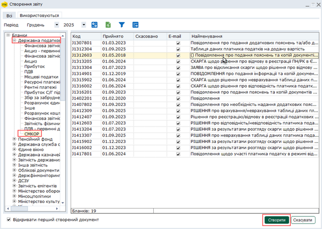

Натисніть, щоб збільшити малюнок

3. Із загальної групи Бланки оберіть розділ Державна податкова служба та групу звітності СМКОР. Оберіть для створення бланк документа Повідомлення про подання пояснень та копій документів щодо податкових накладних/розрахунків коригування, реєстрацію яких зупинено та відкрийте його подвійним кліком лівої клавіші миші або натисніть на кнопку Створити.

4. Внесіть дані в поля, які потребують заповнення (обов'язкові поля підсвічені жовтим кольором).

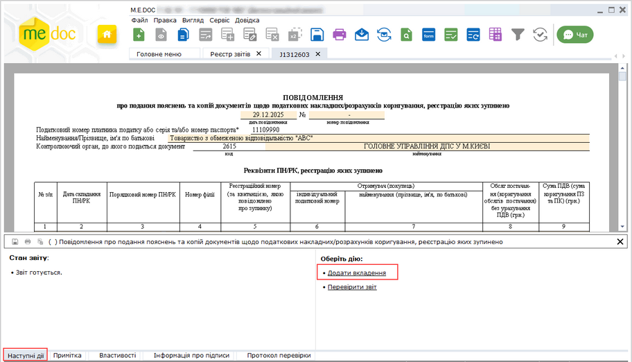

Натисніть, щоб збільшити малюнок

5. Щоб додати сканкопії необхідних документів, у відкритому Повідомленні щодо подачі документів на вкладці Наступні дії оберіть команду Додати вкладення.

6. Відкриється вкладка документа Документ довільного формату (для подання сканкопій). Заповніть необхідні поля документа.

7. Щоб додати сканкопію документа, встановіть курсор у поле Найменування файлу документа та натисніть кнопку . У вікні, що відкриється, оберіть потрібний файл. Назва обраного файлу відобразиться у полі документа.

Можна прикріпити файл тільки у PDF форматі, розміром не більше 2 Мб.

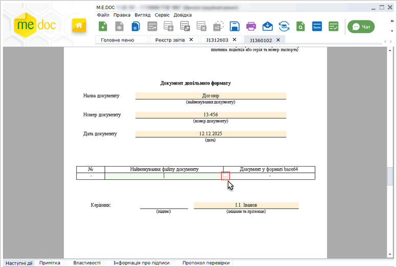

Натисніть, щоб збільшити малюнок

8. Збережіть Документ довільного формату (для подання сканкопій), натиснувши кнопку  , або комбінацію клавіш Ctrl+S. У таблиці реєстру Документ довільного формату (для подання сканкопій) буде відображено як підпорядкований документ пакету до Повідомлення щодо подачі документів.

Під час збереження виконається перевірка правильності заповнення полів і, у випадку помилок, система підсвітить червоним кольором поля, що необхідно виправити. Виправте помилки та знову збережіть документ.

Перевірити документ також можливо, обравши команду меню Правка - Перевірити документ, натиснувши F4, або, виконавши команду Перевірити звіт на вкладці Наступні дії.

Щоб швидко повернутися до головного документа, на вкладці Наступні дії натисніть Відкрити головний документ.

9. Якщо необхідно додати сканкопію наступного документа, виконайте дії, описані у пунктах [5 - 9](#ucdocrstbyper5-rdoc_robota_stvor). Для кожної сканкопії створюється окремий Документ довільного формату (для подання сканкопій).

Зверніть увагу! Кількість додатків Документ довільного формату (для подання сканкопій) повинно дорівнювати загальній кількості сканкопій, що зазначається у формі Повідомлення про подання пояснень та копій документів щодо податкових накладних/розрахунків коригування, реєстрацію яких зупинено у графі Кількість додатків.

Додати Документ довільного формату (для подання сканкопій) також можливо і з таблиці Реєстру звітів. Для цього оберіть головний документ Повідомлення про подання пояснень та копій документів щодо податкових накладних/розрахунків коригування, реєстрацію яких зупинено у таблиці та оберіть один із способів:

- на панелі інструментів натисніть кнопку Створити, у вікні Створення звіту оберіть Документ довільного формату (для подання сканкопій);
- виберіть команду Створити - Документ довільного формату (для подання сканкопій);
- у контекстному меню оберіть команду Створити - Документ довільного формату (для подання сканкопій).

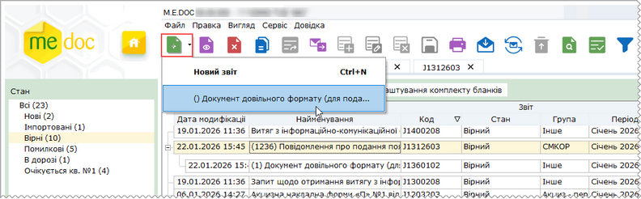

Натисніть, щоб збільшити малюнок

[До початку](#ucdocrstbyper5-rdoc_robota_stvor)

Створення Додатку 5 до Порядку зупинення реєстрації податкової накладної/розрахунку коригування (Таблиця даних платника податку на додану вартість)

1. Для створення документа скористайтесь одним із наступних способів:

- на панелі інструментів натисніть кнопку Створити;
- виберіть команду Файл - Створити;
- у контекстному меню оберіть команду Створити;
- натисніть комбінацію клавіш Ctrl+N.

2. Відкриється вікно Створення звіту.

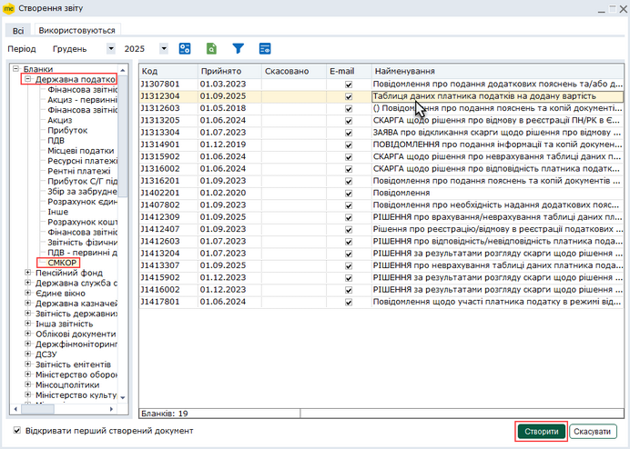

Натисніть, щоб збільшити малюнок

3. Із загальної групи Бланки оберіть розділ Державна податкова служба та групу звітності СМКОР. Оберіть для створення бланк документа Таблиця даних платника податків та відкрийте його подвійним кліком лівої клавіші миші, або натисніть на кнопку Створити.

4. Внесіть дані в поля, які потребують заповнення (обов'язкові поля підсвічені жовтим кольором). Значення можливо обрати з довідників, натиснувши кнопку .

У документі заповнюється:

- Таблиця даних платника податку, у яку вносить Код згідно з КВЕД;
- одна з колонок Код згідно УКТ ЗЕД/ДКПП (придбання (отримання), ввезення на митну територію України) або Код згідно УКТ ЗЕД/ДКПП (постачання/надання). Заповнення обох колонок одночасно не допускається.

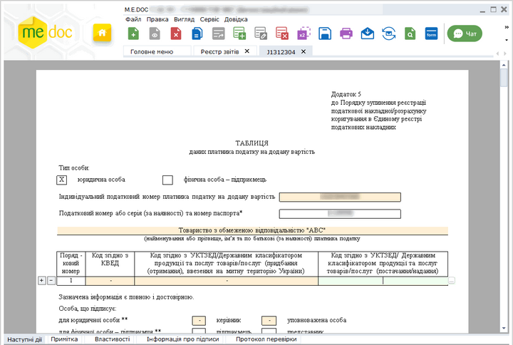

Натисніть, щоб збільшити малюнок

5. Щоб додати наступний рядок таблиці, натисніть кнопку . Відповідно, щоб видалити рядок, натисніть .

6. Перевірте правильність заповнення полів, обравши команду меню Правка - Перевірити документ, натиснувши F4 або, виконавши команду Перевірити звіт на вкладці Наступні дії. У випадку помилок, система підсвітить червоним кольором поля, що необхідно виправити. Виправте помилки та перевірте документ ще раз. Також, перевірка правильності заповнення виконується під час збереження документа.

7. Збережіть документ, натиснувши кнопку  або комбінацію клавіш Ctrl+S. У таблиці реєстру Таблиця даних платника податків буде відображена як окремий документ.

[До початку](#ucdocrstbyper5-rdoc_robota_stvor)

Створення ПОВІДОМЛЕННЯ про подання інформації та копій документів щодо невідповідності платника податку критеріям ризиковості платника податку

Можна автоматично створити Повідомлення про подання інформації та копій документів щодо невідповідності платника податку критеріям ризиковості платника податку та додати до нього необхідні документи, скориставшись командою меню[Файл – Імпорт – Створити пакет документів з PDF-файлів](#ucdocrstbyper5-rdoc_robota_stvor).

1. Для створення документа скористайтесь одним із наступних способів:

- на панелі інструментів натисніть кнопку Створити;
- виберіть команду Файл - Створити;
- у контекстному меню оберіть команду Створити;
- натисніть комбінацію клавіш Ctrl+N.

2. Відкриється вікно Створення звіту.

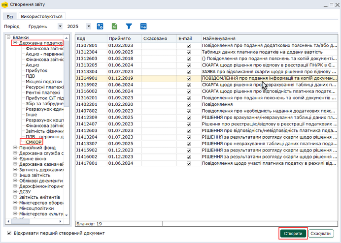

Натисніть, щоб збільшити малюнок

3. Із загальної групи Бланки оберіть розділ Державна податкова служба та групу звітності СМКОР. Оберіть для створення бланк документа ПОВІДОМЛЕННЯ про подання інформації та копій документів щодо невідповідності платника податку критеріям ризиковості платника податку та відкрийте його подвійним кліком лівої клавіші миші або натисніть на кнопку Створити.

4. Внесіть дані в поля, які потребують заповнення (обов'язкові поля підсвічені жовтим кольором).

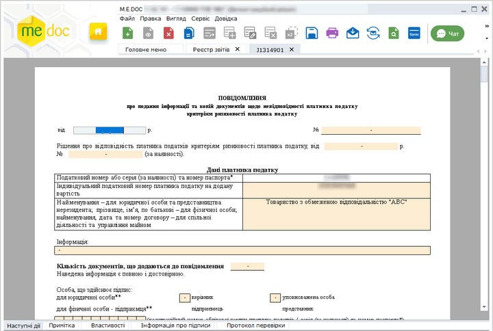

Натисніть, щоб збільшити малюнок

5. Щоб додати сканкопії необхідних документів, перейдіть на вкладку Реєстр звітів та натисніть 2 рази лівою кнопкою миші на рядку Документ довільного формату (для подання сканкопій) або оберіть один із способів:

- на панелі інструментів натисніть кнопку Створити, у вікні Створення звіту оберіть Документ довільного формату (для подання сканкопій);
- виберіть команду Створити - Документ довільного формату (для подання сканкопій);
- у контекстному меню оберіть команду Створити - Документ довільного формату (для подання сканкопій).

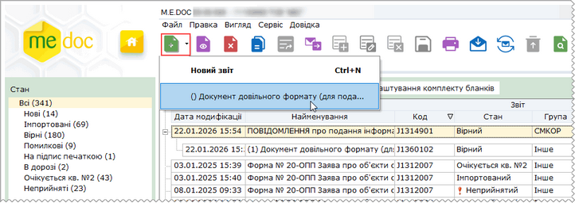

Натисніть, щоб збільшити малюнок

6. Відкриється вкладка документа Документ довільного формату (для подання сканкопій). Заповніть необхідні поля документа.

7. Щоб додати сканкопію документа, встановіть курсор у поле Найменування файлу документа та натисніть кнопку . У вікні, що відкриється, оберіть потрібний файл. Назва обраного файлу відобразиться у полі документа.

Можна прикріпити файл тільки у PDF форматі, розміром не більше 2 Мб.

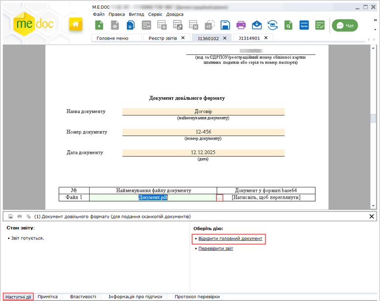

Натисніть, щоб збільшити малюнок

8. Збережіть Документ довільного формату (для подання сканкопій), натиснувши кнопку  , або комбінацію клавіш Ctrl+S. У таблиці реєстру Документ довільного формату (для подання сканкопій) буде відображено як підпорядкований документ пакету до Повідомлення щодо подачі документів.

Під час збереження виконається перевірка правильності заповнення полів і, у випадку помилок, система підсвітить червоним кольором поля, що необхідно виправити. Виправте помилки та знову збережіть документ.

Перевірити документ також можливо, обравши команду меню Правка - Перевірити документ, натиснувши F4, або, виконавши команду Перевірити звіт на вкладці Наступні дії.

Щоб швидко повернутися до головного документа, на вкладці Наступні дії натисніть Відкрити головний документ.

9. Якщо необхідно додати сканкопію наступного документа, виконайте дії, описані у пункті [5](#ucdocrstbyper5-rdoc_robota_stvor). Для кожної сканкопії створюється окремий Документ довільного формату (для подання сканкопій).

Зверніть увагу! Кількість додатків Документ довільного формату (для подання сканкопій) повинно дорівнювати загальній кількості сканкопій, що зазначається у формі ПОВІДОМЛЕННЯ у графі Кількість документів, що додаються до повідомлення.

[До початку](#ucdocrstbyper5-rdoc_robota_stvor)

Пакет документів для оскарження рішення Комісії ДПС щодо відхилення ПН/РК

Якщо платник податку на додану вартість не згідний з рішенням Комісії ДПС щодо відмови у реєстрації ПН/РК, він має право подати скаргу на рішення комісій. Скарги подаються платником податку на додану вартість до ДПС протягом 10 календарних днів з дня набрання чинності рішенням комісії про відмову у реєстрації ПН/РК в Єдиному реєстрі податкових накладних.

Скарга подається платником податку в електронній формі, детально про створення пакету документів, що необхідний для оскарження рішення Комісії ДПС. До скарги можуть додаватися пояснення та копії документів, які підтверджують інформацію, зазначену у ПН/РК, реєстрація яких зупинена.

Створення СКАРГИ щодо рішення про відмову у реєстрації ПН/РК в Єдиному реєстрі податкових накладних

Можна автоматично створити документ СКАРГА щодо рішення про відмову у реєстрації ПН/РК в Єдиному реєстрі податкових накладних та додати до нього необхідні документи, скориставшись командою меню[Файл – Імпорт – Створити пакет документів з PDF-файлів](#ucdocrstbyper5-rdoc_robota_stvor).

1. Для створення документа скористайтесь одним із наступних способів:

- на панелі інструментів натисніть кнопку Створити;
- виберіть команду Файл - Створити;
- у контекстному меню оберіть команду Створити;
- натисніть комбінацію клавіш Ctrl+N.

2. Відкриється вікно Створення звіту.

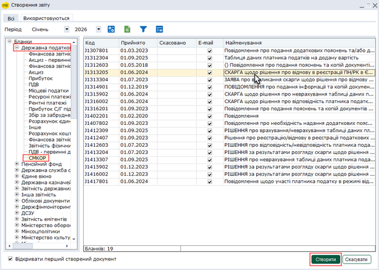

Натисніть, щоб збільшити малюнок

3. Із загальної групи Бланки оберіть розділ Державна податкова служба та групу звітності СМКОР. Оберіть для створення бланк документа Скарги щодо рішення про відмову у реєстрації ПН/РК в Єдиному реєстрі податкових накладних та відкрийте його подвійним кліком лівої клавіші миші або натисніть на кнопку Створити.

4. Внесіть дані в поля, які потребують заповнення (обов'язкові поля підсвічені жовтим кольором).

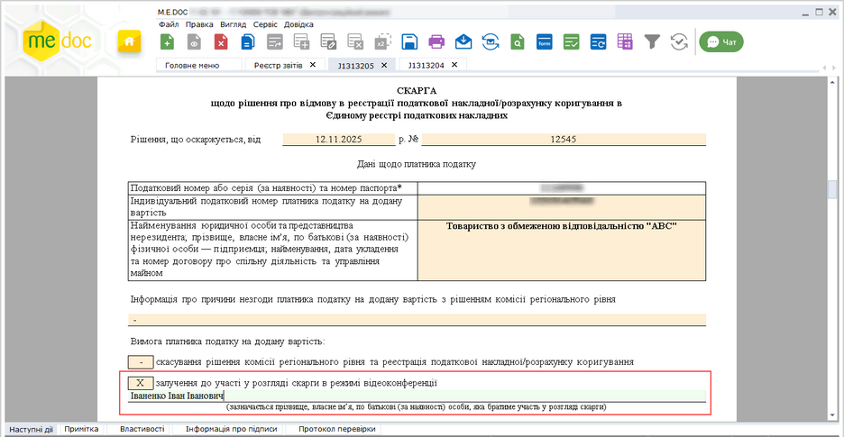

Натисніть, щоб збільшити малюнок

У СКАРЗІ платник податків може заявити про своє бажання бути присутнім особисто або через свого представника при розгляді матеріалів скарги в режимі відеоконференції. Щоб повідомити про бажання взяти участь у розгляді скарги, необхідно встановити позначку залучення до участі у розгляді скарги в режимі відеоконференції у формі СКАРГИ.

У такому випадку контролюючий орган надсилає платнику ПОВІДОМЛЕННЯ про дату та час засідання комісії, а також посилання для підключення до відеоконференції не пізніше ніж за п’ять календарних днів до дати розгляду такої скарги. Повідомлення про розгляд скарги у режимі відеоконференції надсилається платнику податків в електронний кабінет.

5. Щоб додати сканкопії необхідних документів, у відкритому документі Скарги щодо рішення про відмову у реєстрації ПН/РК в Єдиному реєстрі податкових накладних на вкладці Наступні дії оберіть команду Додати вкладення.

6. Відкриється вкладка документа Документ довільного формату (для подання сканкопій). Заповніть необхідні поля документа.

7. Щоб додати сканкопію документа, встановіть курсор у поле Найменування файлу документу та натисніть кнопку . У вікні, що відкриється, оберіть потрібний файл. Назва обраного файлу відобразиться у полі документа.

Можна прикріпити файл тільки у PDF форматі, розміром не більше 2 Мб.

8. Збережіть Документ довільного формату (для подання сканкопій), натиснувши кнопку  , або комбінацію клавіш Ctrl+S. У таблиці реєстру Документ довільного формату (для подання сканкопій) буде відображено як підпорядкований документ пакету до Повідомлення щодо подачі документів.

Під час збереження виконається перевірка правильності заповнення полів і, у випадку помилок, система підсвітить червоним кольором поля, що необхідно виправити. Виправте помилки та знову збережіть документ.

Перевірити документ також можливо, обравши команду меню Правка - Перевірити документ, натиснувши F4, або, виконавши команду Перевірити звіт на вкладці Наступні дії.

Щоб швидко повернутися до головного документа, на вкладці Наступні дії натисніть Відкрити головний документ.

9. Якщо необхідно додати сканкопію наступного документа, виконайте дії, описані у пунктах [5 - 9](#ucdocrstbyper5-rdoc_robota_stvor). Для кожної сканкопії створюється окремий Документ довільного формату (для подання сканкопій).

Під Зверніть увагу! Кількість додатків Документ довільного формату (для подання сканкопій) повинно дорівнювати загальній кількості сканкопій, що зазначається у формі Скарги щодо рішення про відмову у реєстрації ПН/РК в Єдиному реєстрі податкових накладних  у графі Кількість документів, що додаються до скарги.

Додати Документ довільного формату (для подання сканкопій) можна з таблиці Реєстру звітів. Для цього оберіть головний документ Скарги щодо рішення про відмову у реєстрації ПН/РК в Єдиному реєстрі податкових накладних  у таблиці Реєстру звітів та оберіть один із способів:

- на панелі інструментів натисніть кнопку Створити, у вікні Створення звіту оберіть Документ довільного формату (для подання сканкопій);
- виберіть команду Створити - Документ довільного формату (для подання сканкопій);
- у контекстному меню оберіть команду Створити - Документ довільного формату (для подання сканкопій).

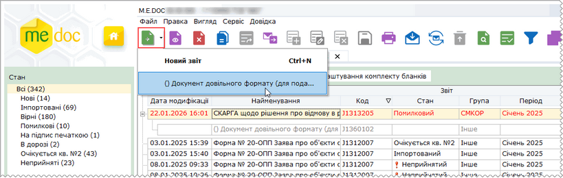

Натисніть, щоб збільшити малюнок

[До початку](#ucdocrstbyper5-rdoc_robota_stvor)

Копіювання Документів довільного формату (для подання сканкопій документів) для додавання їх у Скаргу щодо рішення про відмову у реєстрації ПН/РК в Єдиному реєстрі податкових накладних

Також можливо скопіювати існуючі Документи довільного формату (для подання сканкопій) (наприклад, з Повідомлення про подання пояснень та копій документів щодо податкових накладних/розрахунків коригування, реєстрацію яких зупинено) та додати до Скарги на рішення комісії. Для цього:

1. У таблиці Реєстру звітів виділіть Документи довільного формату (для подання сканкопій), які необхідно додати у Скаргу щодо рішення про відмову у реєстрації ПН/РК в Єдиному реєстрі податкових накладних . Щоб обрати декілька Документів одночасно, при виділенні документів мишею натисніть та утримуйте клавішу <Ctrl> (обрати певні документи) або <Shift> (обрати перший та останній документ групи).

2. Виконайте команду Копіювати:

- на панелі інструментів натисніть кнопку Копіювати;
- виберіть команду Файл - Копіювати;
- у контекстному меню оберіть команду Копіювати;

3. Відкриється вікно Пачки звітів:

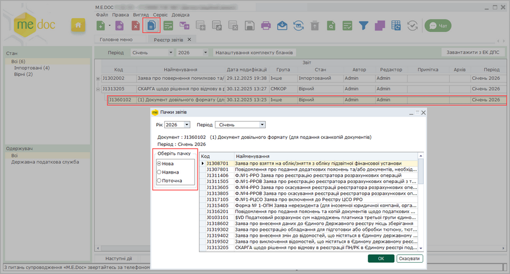

Натисніть, щоб збільшити малюнок

Оберіть головний документ Скарга на рішення комісії, до якого будуть додані Документи довільного формату. Можливо обрати вже існуючий документ, або створити новий, обравши відповідну опцію у області Оберіть пачку.

4. Для копіювання документів натисніть ОК. Скопійовані Документи довільного формату будуть додані у обрану Скарга щодо рішення про відмову у реєстрації ПН/РК та відображені у таблиці реєстру.

За результатами розгляду Скарги комісія ДФС з питань розгляду скарг приймає та надсилає платнику податку на додану вартість РІШЕННЯ за результатами розгляду скарги на рішення про відмову у реєстрації податкової накладної/розрахунку коригування в Єдиному реєстрі податкових накладних.

Під Платник податку на додану вартість може відкликати подану Скаргу щодо рішення про відмову у реєстрації ПН/РК до прийняття рішення комісією ДФС з питань розгляду скарг. Для відкликання Скарги платник подає ЗАЯВУ про відкликання скарги на рішення про відмову у реєстрації податкової накладної/розрахунку коригування в Єдиному реєстрі податкових накладних.

[До початку](#ucdocrstbyper5-rdoc_robota_stvor)

### Функції Реєстру звітів

_Шлях у довідці: Розділи програми › Звітність › Реєстр звітів › Функції Реєстру звітів_

В цьому розділі:

[Створення копії документа](#ucdocrstbyper5-rdoc_robota_function)

[Видалення помилкового документа](#ucdocrstbyper5-rdoc_robota_function)

[Друк документа](#ucdocrstbyper5-rdoc_robota_function)

[Друк документа у PDF](#ucdocrstbyper5-rdoc_robota_function)

[Налаштування комплектності бланків](#ucdocrstbyper5-rdoc_robota_function)

[Консолідація звітів](#ucdocrstbyper5-rdoc_robota_function)

[Відправка звітів з квитанціями у головну установу](#ucdocrstbyper5-rdoc_robota_function)

[Оновлення реєстру звітів](#ucdocrstbyper5-rdoc_robota_function)

Створення копії документа

Копія документа створюється, якщо він може повторюватися у рамках звітних періодів, а також у випадку, якщо потрібно відредагувати та повторно відіслати раніше відправлений електронною поштою звіт, у тому числі і підписаний ЕП.

Зазвичай, у властивостях бланка документів, які повторюються, проставляється відмітка у полі Може повторюватися у рамках періоду.

Для копіювання звітів необхідно виділити потрібні документи.
У Реєстрі звітів реалізована можливість копіювати як один файл, так и групу файлів одночасно. Для групового копіювання записів реєстру виділіть потрібне курсором миші використовуючи стандартні методи виділення декількох записів ОС Windows.

Функція копіювання звітів викликається:

- на панелі інструментів натисніть кнопку Копіювати - ;
- із контекстного меню команда Копіювати;
- команда Файл/Копіювати.

Також функція копіювання документа доступна і у відкритому вікні документа: на панелі інструментів кнопка Копіювати -  та у меню Файл - Копіювати.

Із вікна відкритого документа копіюється тільки поточний документ.

На виконання функції копіювання відкривається модальне вікно Копіювання звіту, де запропоновано обрати звітний період для нового звіту.

- Якщо відбувається копіювання звіту у період, в якому більше не може бути даного звіту, система повідомить про неможливість виконання цієї дії та запропонує обрати інший період (для деяких звітів система точно вкаже, в який саме період можна виконати копіювання).
- Копіювання документа "Реєстр отриманих та виданих податкових накладних" в інші звітні періоди заборонено для запобігання можливості внесення користувачем змін у податкові накладні у поточному звітному періоді.
- Копіювання звітів, які містять класифікатори, дозволено тільки у інший період.

[До початку](#ucdocrstbyper5-rdoc_robota_function)

Видалення помилкового документа

Дана функція дозволяє вилучити помилковий чи непотрібний запис із реєстру.

Для видалення звітів необхідно виділити потрібні документи.
У Реєстрі звітів реалізована можливість видаляти як один файл, так и групу файлів одночасно. Для групового видалення записів реєстру виділіть потрібне курсором миші використовуючи стандартні методи виділення декількох записів ОС Windows.

Функція видалення документа викликається:

- на панелі інструментів натисніть кнопку Видалити - ;
- із контекстного меню команда Видалити;
- команда Файл - Видалити;
- натисніть комбінацію клавіш Shift+Delete.

Також функція видалення документа доступна і у відкритому вікні документа:

- на панелі інструментів кнопка Видалити - ;
- та у меню Файл - Видалити;
- комбінація клавіш Shift+Delete.

Із вікна відкритого документа видаляється тільки поточний документ.

Відкриється стандартне вікно-попередження про видалення запису, і у разі підтвердження поточний запис буде безповоротно видалений із реєстру.

Зверніть увагу! При видаленні документа Реєстр отриманих та виданих податкових накладних із таблиці розділу Реєстр звітів, електронні накладні, які входять до цього реєстру, із програми не видаляються, а поміщаються у розділ [Відсутні у реєстрі](UCDocNaklRstMain5.html#ucdocnaklrstmain5-docnaklrst_import), із якого їх можна видалити чи імпортувати у новий реєстр.

[До початку](#ucdocrstbyper5-rdoc_robota_function)

Друк документа

Дана функція дозволяє роздрукувати обраний у реєстрі документ.

Для роздрукування звітів необхідно виділити потрібні документи.
У Реєстрі звітів реалізована можливість друку як одного файлу, так и групи файлів одночасно. Для групового друку записів реєстру виділіть потрібне курсором миші використовуючи стандартні методи виділення декількох записів ОС Windows.

Функція друку документа із Реєстру викликається:

- на панелі інструментів натисніть кнопку Друк - ;
- із контекстного меню команда Друк;
- команда Файл/Друк;
- натисніть комбінацію клавіш Ctrl+P.

Також функція друку документа доступна і у відкритому вікні документа:

- на панелі інструментів кнопка Друк -  ;
-  меню Файл - Друк;
- комбінація клавіш Ctrl+P.

Із вікна відкритого документа друкується тільки поточний документ.

В обох випадках відкривається вікно для вибору принтера та настроювання параметрів друку.

[До початку](#ucdocrstbyper5-rdoc_robota_function)

Друк документа у PDF

Дана функція дозволяє зберегти обрані документи на диску комп’ютера у файлах формату .pdf.

Для друку звітів у PDF необхідно виділити потрібні документи.
У Реєстрі звітів реалізована можливість друку як одного файлу, так и групи файлів одночасно. Для групового друку документів виділіть потрібне курсором миші, використовуючи стандартні методи виділення декількох записів ОС Windows.

Друк документів у PDF виконується у наступній послідовності:

1. Оберіть функцію друку документа у PDF одним з способів:

- із контекстного меню команда Друк в PDF;
- команда меню Файл - Друк в PDF.

2. Якщо обрані документи містять додатки, відкриється вікно Друк.

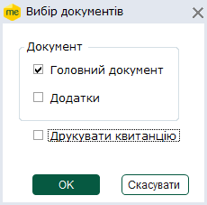

Встановіть позначки, що відповідають документам, які необхідно зберегти:

- Головний документ - друкувати у PDF головний документ звіту;
- Додатки - друкувати у PDF додатки до головного документа;
- Друкувати квитанцію - у файл PDF зберігати квитанції (квитанції зберігаються у файлі  головного документа та/або додатка).

Для продовження виконання операції натисніть кнопку ОК.

3. У вікні Огляд папок вкажіть каталог, у якому потрібно зберегти файли .pdf.

4. Система повідомить про закінчення операції друку.

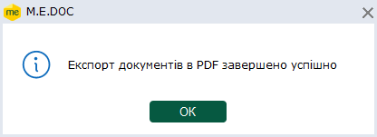

Також функція друку документа  у PDF доступна і у відкритому вікні документа:

- команда меню Файл - Друк в PDF.

Із вікна відкритого документа друкується тільки поточний документ.

[До початку](#ucdocrstbyper5-rdoc_robota_function)

Налаштування комплектності бланків

Налаштування комплектності бланків установи відбувається у розділі Адміністрування. Проте [доступ до цього розділу](Help.html#help-adm) мають тільки користувачі під обліковим записом Адміністратор.

Для користувачів, які не мають прав Адміністратора, передбачена можливість налаштовувати комплектність бланків згідно вимог своєї установи безпосередньо у Реєстрі звітів.

Для цього у меню Сервіс оберіть опцію Налаштування комплектності бланків.

Або натисніть кнопку Налаштування комплекту бланків.

Відкриється модальне вікно Налаштування комплектності бланків.

Детально про налаштування комплектності бланків установи див. за посиланням: [Адміністрування - Налаштування комплектності бланків](FormSheetMain.html#formsheetmain-admcmpl).

[До початку](#ucdocrstbyper5-rdoc_robota_function)

Консолідація звітів

Консолідація даних являє собою корисний спосіб об'єднання даних з декількох документів в одному звіті. Наприклад, при наявності зведеного звіту про витрати для кожної з регіональних філій за допомогою консолідації даних можна виконати зведення цих значень до звіту про витрати для цілої організації.

Умова для консолідації - документи мають бути з однаковим чар-кодом.

Функція призначена тільки для консолідації окремих звітів, пачки звітів не консолідуються.

Консолідація звітів в один підсумковий документ відбуваються у наступній послідовності:

1. У Реєстрі звітів виділіть необхідні для зведення документи з однаковим чар-кодом.

2. У меню Файл оберіть команду Консолідувати Звіти.

Натисніть, щоб збільшити малюнок

3. Система виконає зведення документів. Результатом зведення буде новий документ, у Реєстрі він буде виділений жирним шрифтом і розташований під останнім виділеним документом.

[До початку](#ucdocrstbyper5-rdoc_robota_function)

Відправка звітів з квитанціями у головну установу

Філії можуть відправляти прийняті звіти з квитанціями у головну установу. Для головної установи функція надає можливість відстежувати прийняті звіти філій.

Щоб відправити прийнятий звіт до головної у станови, на боці філії виконайте дії:

1. Виділіть прийнятий звіт у таблиці Реєстру звітів та відкрийте вкладку Наступні дії (або скористайтеся вкладкою Наступні дії у вікні відкритого прийнятого звіту).

2. Виконайте команду Відправити звіт з квитанціями на іншу адресу. Команда доступна для звітів, що мають стан Прийнятий.

Натисніть, щоб збільшити малюнок

3. У вікні Вибір адресата, оберіть електронну адресу головної установи та натисніть ОК.

Натисніть, щоб збільшити малюнок

4. Відкриється вікно Підпис, у якому програма пропонує [підписати звіт ЕП](UC_ECP.html#uc_ecp-ecp) (посадових осіб та печатки установи). Після підписання розпочнеться процедура відправки звіту.

Відправка звітів відбувається з використанням електронної пошти у форматі XML, крім даних документів відправляється інформація, що міститься у квитанціях.

На боці головної установи отримані звіти з квитанціями, що були відправлені філіями, доступні у розділі програми [Прийом та обробка звітності – Реєстр консолідованих звітів](ConsRst.html#consrst-m_e_doc-corp_dod_reestr_cons).

[До початку](#ucdocrstbyper5-rdoc_robota_function)

Оновлення реєстру звітів

За умови використання мережевого варіанту програмного комплексу, користувачі мають змогу одночасної роботи у Реєстрі декількох користувачів, при цьому одні користувачі можуть змінювати дані у звітах незалежно один від одного. Система регулярно оновлює відображення даних через певні проміжки часу або при переході між вікнами. Проте користувач може самостійно вивести поточні дані, оновивши записи.

Для оновлення записів Реєстру натисніть команду  - Оновити.

[До початку](#ucdocrstbyper5-rdoc_robota_function)

### Імпорт звітів із інших бухгалтерських систем

_Шлях у довідці: Розділи програми › Звітність › Реєстр звітів › Імпорт звітів із інших бухгалтерських систем_

У програмі передбачений імпорт звітних документів, створених в інших бухгалтерських системах (формат XML, pfz, dbf, zvb, txt) та файли передачі даних (формат ZDI).

Примітка:

Імпорт звітів можливий як у робочу версію програми, так і у демоверсію.
Проте, для звітів, імпортованих у демоверсію програми, редагування та наступне збереження звітів НЕМОЖЛИВЕ, звіти подаються "як є".

У M.E.Doc передбачено імпорт:

- звітів XML - у цьому форматі імпортуються: податкові звіти, звіти до ФСС з ТВП, архіви XML-файлів місячної персоніфікованої звітності (які мають формат .pfz), податкові накладні, реєстри отриманих та виданих податкових накладних;
- звітів PCK, ZVB - формат PCK призначений для перенесення звітів у програму, встановлену на іншому комп'ютері (тобто, для перенесення звітів з одного комп'ютера на інший); цей формат також використовується для подання звітів до деяких звітних органів. У форматі ZVB імпортуються дані у бюджетній конфігурації програми;
- 1ДФ - призначено для імпорту форми 1ДФ "Податковий розрахунок сум доходу, нарахованого (сплаченого) на користь платників податку, і сум, утриманого з них податку" із dbf-файлу;
- з файлів передачі даних (.ZDI) - це файл передачі даних, використовуються для передачі даних із бухгалтерських систем. Представляє собою текстовий файл, який генерується у іншій бухгалтерській системі, містить перелік ідентифікаторів реквізитів звіту та їх значення. На основі даних цього файлу формується відповідний звітний документ у ПК.

Імпорт звітів із інших бухгалтерських систем відбувається за наступним алгоритмом:

1. у меню Файл оберіть команду Імпорт і далі - формат із якого необхідно імпортувати файли.

2. У вікні Відкриття файлу, що відкриється, оберіть каталог, де розташовано потрібний файл.

3. Розпочнеться імпорт, по закінченню якого система повідомить у який період та яку кількість файлів імпортовано.

Для імпортованих у M.E.Doc звітів обов'язково потрібно [виконати програму](UCProgramy.html#ucprogramy-programy) перерахунку, модифікації, перевірити їх та зберегти, оскільки в деяких бухгалтерських програмах структури XML файлів містять не всі реквізити документа, необхідні для проходження контролів (валідації) при прийманні в ДПС.

### Завантаження звітів з Кабінета платника податків

_Шлях у довідці: Розділи програми › Звітність › Реєстр звітів › Завантаження звітів з Кабінета платника податків_

M.E.Doc надає можливість користувачам швидко завантажити звітність, що подавалась до ДПС з інших систем та зберігається у Електронному кабінеті платника податків.

Звіти, що зберігаються в Електронному кабінеті платника податків, можна завантажити у Реєстрі звітів або модулі Об'єднана звітність ПДФО та ЄСВ.

Для завантаження звітів виконайте дії:

1. Відкрийте Реєстр звітів або модуль Об'єднана звітність ПДФО та ЄСВ.

2. У заголовку реєстру натисніть кнопку Завантажити з ЕК ДПС:

Натисніть, щоб збільшити малюнок
Кнопка Завантажити з ЕК ДПС у Реєстрі звітів

Натисніть, щоб збільшити малюнок
Кнопка Завантажити з ЕК ДПС у модулі Об'єднана звітність ПДФО та ЄСВ

3. У вікні, що відкриється, оберіть період в якому подавався звіт. За замовчанням встановлено поточний період. Натисніть Завантажити:

Натисніть, щоб збільшити малюнок

4. У вікні, що відкриється, оберіть сертифікат та введіть пароль. Натисніть ОК:

Натисніть, щоб збільшити малюнок

5. Завантаження звітів відбувається в фоновому режимі.

6. Після завантаження звіти відображаються у відповідному реєстрі. У Реєстрі звітів для звітів, отриманих з Кабінету платника податків, встановлюється статус Завантажено з ЕК:

Натисніть, щоб збільшити малюнок

7. Результати завантаження звітів фіксуються у журналі Звітність - Завантаження звітів з електронного кабінету ДПС.

Для налаштування відображення даних у журналі встановіть дату початку та закінчення періоду. Для відображення записів за обраними параметрами натисніть кнопку Показати.

Натисніть, щоб збільшити малюнок

У журналі також можна виконати завантаження звітності, обравши період та натиснувши кнопку Завантажити у верхній частині вкладки журналу.

### Експорт звітних документів

_Шлях у довідці: Розділи програми › Звітність › Реєстр звітів › Експорт звітних документів_

В цьому розділі:

[Експорт документів у формат XML для подання у контролюючі органи](#ucdocrstbyper5-rdoc_robota_export)

[Експорт документів у формат XML для подання у Головну установу](#ucdocrstbyper5-rdoc_robota_export)

[Експорт документів з квитанціями](#ucdocrstbyper5-rdoc_robota_export)

[Експорт кошторису в форматі ДКСУ](#ucdocrstbyper5-rdoc_robota_export)

[Експорт 7-х в форматі ДКСУ](#ucdocrstbyper5-rdoc_robota_export)

[Експорт змін до кошторису в форматі ДКСУ](#ucdocrstbyper5-rdoc_robota_export)

[Експорт квартальних форм в форматі ДКСУ](#ucdocrstbyper5-rdoc_robota_export)

[Експорт річних форм в форматі ДКСУ](#ucdocrstbyper5-rdoc_robota_export)

[Експорт квитанцій](#ucdocrstbyper5-rdoc_robota_export)

Експорт документів призначений для збереження документів у обраному каталозі з метою подачі вивантажених звітів як у контролюючі органи, так і для подачі звітів у Головну установу (для підзвітних організацій).

При експорті звіту із програми його назва та розширення відповідають регламентованим правилам подання звітів до певних контролюючих органів. Звіти перевіряються на заповнюваність обов'язкових реквізитів у документі згідно затверджених схем XSD. Ці перевірки аналогічні тим, які виконуються при прийманні документів у контролюючих органах.

Експорт документів для подання у контролюючі органи

Цей вид експорту призначений для збереження звітів і використовується для всіх розділів податкової звітності.

Експорт документів виконується у наступній послідовності:

1. Виділіть потрібний для експорту документ у Реєстрі звітів.

У Реєстрі звітів реалізована можливість експортувати як один файл, так и групу файлів одночасно. Для групового видалення записів реєстру виділіть потрібне курсором миші, утримуючи клавіші <Ctrl> або <Shift>.

2. Експорт документа викликається одним із наступних способів:

- команда Файл - Експорт - Експорт;
- із контекстного меню команда Експорт.

Функція експорту доступна і у відкритому вікні документа у меню Файл - Експорт - Експорт. Із вікна відкритого документа експортується тільки поточний документ.

3. На виконання команди відкриється вікно Експорт. Оберіть опцію для подачі у контролюючий орган.

4. Вкажіть каталог, де зберегти створений файл у полі Каталог призначення.

При збереженні звіту його назва та розширення регламентовані правилами подання звітів до певного контролюючого органу - xml, pfz, dbf, zvb, txt та файли передачі даних (формат zdi). Переважно це звіти у форматі .xml.

5. Натисніть ОК.

6. Система повідомить про закінчення процесу експорту.

[До початку](#ucdocrstbyper5-rdoc_robota_export)

Експорт документів у формат XML для подання у Головну установу

Цей вид експорту призначений для збереження звітів на електронному носії чи у обраному каталозі з метою передачі у Головну установу для подальшого аналізу або консолідації звітів. Експорт звітів для подання у Головну установу виконується у форматі "внутрішній (нотивний) XML".

Експорт документів виконується у наступній послідовності:

1. Виділіть потрібний для експорту документ у Реєстрі звітів.

У Реєстрі звітів реалізована можливість експортувати як один файл, так и групу файлів одночасно. Для групового видалення записів реєстру виділіть потрібне курсором миші, утримуючи клавіші <Ctrl> або <Shift>.

2. Експорт документа викликається одним із наступних способів:

- команда Файл - Експорт - Експорт;
- із контекстного меню команда Експорт.

Функція експорту доступна і у відкритому вікні документа у меню Файл - Експорт - Експорт. Із вікна відкритого документа експортується тільки поточний документ.

3. На виконання команди відкриється вікно Експорт. Оберіть опцію для обміну звітністю.

4. Вкажіть каталог, де зберегти створений файл у полі Каталог призначення.

Ім'я файлу згенерується автоматично, містить в собі дату, час створення та код ЄДРПОУ підприємства.

5. Натисніть ОК.

6. Система повідомить про закінчення процесу експорту.

[До початку](#ucdocrstbyper5-rdoc_robota_export)

Експорт документів з квитанціями

Цей вид експорту призначений для збереження звітів, для яких отримано квитанції. Експорт звітів виконується у форматі XML, крім даних документів зберігається інформація, що міститься у квитанціях.

Експорт документів виконується у наступній послідовності:

1. Виділіть потрібний для експорту документ у Реєстрі звітів.

У Реєстрі звітів реалізована можливість експортувати як один файл, так и групу файлів одночасно. Для групового видалення записів реєстру виділіть потрібне курсором миші, утримуючи клавіші <Ctrl> або <Shift>.

2. Експорт документа викликається одним із наступних способів:

- команда Файл - Експорт - Експорт;
- із контекстного меню команда Експорт.

Функція експорту доступна і у відкритому вікні документа у меню Файл - Експорт - Експорт. Із вікна відкритого документа експортується тільки поточний документ.

3. На виконання команди відкриється вікно Експорт. Оберіть опцію експорт документа з квитанцією.

4. Вкажіть каталог, де зберегти створений файл у полі Каталог призначення.

Ім'я файлу згенерується автоматично, містить в собі дату, час створення та код ЄДРПОУ підприємства.

5. Натисніть ОК.

6. Система повідомить про закінчення процесу експорту.

[До початку](#ucdocrstbyper5-rdoc_robota_export)

Експорт кошторису в форматі ДКСУ

Функція призначена для збереження кошторису в форматі ДКСУ.

Експорт кошторису відбувається в звітному періоді Рік.

Для експорту документів виконайте дії:

1. У меню Файл оберіть Експорт та далі Експорт кошторису в форматі ДКСУ.

2. Відкриється вікно Огляд папок. Вкажіть каталог, де зберегти створений файл та натисніть ОК.

3. Система повідомить про закінчення процесу експорту.

[До початку](#ucdocrstbyper5-rdoc_robota_export)

Експорт 7-х в форматі ДКСУ

Функція призначена для збереження 7-х в форматі ДКУ.

Для вивантаження форми повинні бути заповнені.

Для виконання експорту:

1. У меню Файл оберіть Експорт – Експорт 7-х форм в форматі ДКСУ. Відкриється вікно Експорт:

2. Оберіть параметри експорту:

- встановіть період для експорту даних у полях Рік та Період (за замовчуванням встановлено період, що обрано у реєстрі);
- в залежності від вказаної періодичності (місячна, квартальна, річна, І півріччя, 9 місяців), система виведе список звітів, встановіть галочки напроти звітів, які потрібно експортувати;
- у разі потреби, введіть інші параметри експорту, заповнивши відповідні поля: Код розпорядника у мережі, Код обл. управ. ДКУ, Код району, Код рай. управ. ДКУ, КПКВ.

Натисніть кнопку Експорт.

3. Відкриється вікно Огляд папок. Вкажіть каталог, де зберегти створений файл та натисніть ОК.

4. Система повідомить про закінчення процесу експорту.

Після виконання експорту дані зберігаються у файлі формату dbf.

[До початку](#ucdocrstbyper5-rdoc_robota_export)

Експорт змін до кошторису в форматі ДКСУ

Дана функція призначена для збереження в форматі ДКСУ на електронному носії чи у обраному каталозі звітів:

- Довідка про зміни до кошторису (FDK0SH03);
- Довідки про зміни до плану асигнувань … (FDPLAZ03).

Для вивантаження форми повинні бути заповнені.

Для виконання експорту:

1. У меню Файл оберіть Експорт – Експорт змін до кошторису в форматі ДКСУ. Відкриється вікно Експорт змін до кошторису в форматі ДКСУ:

2. Оберіть параметри експорту:

- встановіть період для експорту даних: у полі Рік - оберіть потрібний рік, у полі Період - оберіть місяць, за який треба експортувати дані (за замовчуванням встановлено період, що обрано у реєстрі);
- оберіть форму для експорту, встановивши позначку у відповідному рядку, у списку відображаються форми FDK0SH03 та FDPLAZ03, створені за обраний період (експорт можливий лише для одного із звітів FDK0SH03 та/або FDPLAZ03);
- встановіть опцію, що відповідає виду експорту: за довідками головного розпорядника або за довідками МФУ.

Натисніть кнопку Експорт.

3. Відкриється вікно Огляд папок. Вкажіть каталог, де зберегти створений файл та натисніть ОК.

4. Система повідомить про закінчення процесу експорту.

Після виконання експорту дані зберігаються у файлі формату dbf. Ім’я файлу містить значення Коду одержувача коштів, що зазначений у експортованому звіті.

[До початку](#ucdocrstbyper5-rdoc_robota_export)

Експорт квартальних форм в форматі ДКСУ

Для вивантаження форми повинні бути заповнені.

Для виконання експорту:

1. У меню Файл оберіть Експорт – Експорт квартальних форм в форматі ДКСУ. Відкриється вікно Експорт:

2. Оберіть параметри експорту:

- встановіть період для експорту даних: у полі Рік - оберіть потрібний рік, у полі Період - оберіть квартал, за який треба експортувати дані (за замовчуванням встановлено період, що обрано у реєстрі);
- оберіть форму для експорту, встановивши позначку у відповідному рядку, у списку відображаються форми, створені за обраний період;
- у разі потреби, для збереження інформації за певним КПКВ, введіть код КПКВ.

Натисніть кнопку Експорт.

3. Відкриється вікно Огляд папок. Вкажіть каталог, де зберегти створений файл та натисніть ОК.

4. Система повідомить про закінчення процесу експорту.

Після виконання експорту дані зберігаються у файлі формату dbf.

[До початку](#ucdocrstbyper5-rdoc_robota_export)

Експорт річних форм в форматі ДКСУ

Для вивантаження форми повинні бути заповнені.

Для виконання експорту:

1. У меню Файл оберіть Експорт – Експорт річних форм в форматі ДКСУ. Відкриється вікно Експорт:

2. Оберіть параметри експорту:

- у полях Рік та Період встановлено період, що обрано у реєстрі;
- оберіть форму для експорту, встановивши позначку у відповідному рядку, у списку відображаються форми, створені за обраний період;
- у разі потреби, для збереження інформації за певним КПКВ, введіть код КПКВ.

Натисніть кнопку Експорт.

3. Відкриється вікно Огляд папок. Вкажіть каталог, де зберегти створений файл та натисніть ОК.

4. Система повідомить про закінчення процесу експорту.

Після виконання експорту дані зберігаються у файлі формату dbf.

[До початку](#ucdocrstbyper5-rdoc_robota_export)

Експорт квитанцій

Функція призначена для збереження інформації про квитанції документів.

Для експорту виконайте дії:

1. У таблиці реєстру виділіть документи, для яких потрібно експортувати інформацію про квитанції.

Для видалення кількох записів реєстру виділіть потрібне курсором миші, утримуючи клавіші <Ctrl> або <Shift>.

2. У меню Файл оберіть Експорт та далі Експорт квитанцій.

3. Відкриється вікно Огляд папок. Вкажіть каталог, де зберегти створений файл та натисніть ОК.

4. Система повідомить про закінчення процесу експорту. Інформація про квитанції буде збережена у файл формату rtf.

[До початку](#ucdocrstbyper5-rdoc_robota_export)

### Відправлення звітів на підпис

_Шлях у довідці: Розділи програми › Звітність › Реєстр звітів › Відправлення звітів на підпис_

Після заповнення та перевірки звіт відправляється на підпис. Підписати звіт можна із вікна відкритого документа або у Реєстрі звітів.

- Якщо користувач після створення звіту закриває його та в Реєстрі звітів обирає Відправити, спочатку запускається процедура підпису та вибір сертифікату звітного органу для шифрування.
- При відправленні звітів на підпис обов'язкова наявність доступу до мережі Інтернет на комп'ютері із встановленою програмою.
- Відправлення звіту на підпис із вікна відкритого документа
- Для локального варіанту програми

За умови використання [локального варіанту](Help.html#help-setup_installation_program_loc) програми, коли звіт почергово підписується всіма ЕП (посадових осіб та печатки установи) відправлення на підпис відбувається у наступній послідовності:

1. Після заповнення звіту потрібно його перевірити (F4) та зберегти (Ctrl+S).

2. Далі на панелі вкладок потрібно обрати вкладку Наступні дії та натиснути Передати звіт на підпис (ця дія стає доступною лише після [перевірки](UCProgramy.html#ucprogramy-programy) звіту).

3. Одразу запускається [процедура підпису звіту](UC_ECP.html#uc_ecp-ecp) і програма пропонує підписати його ЕП (посадових осіб та печатки установи). Для відправки документа виконуйте вказівки програми. (Відправити підписані документи можливо у будь-який час за допомогою команди вкладки Наступні дії - Відправити у контролюючий орган.)

- Для мережевого варіанту програми

Призначений для накладення ЕП на звіти у [мережевому варіанті](Help.html#help-setup_installation_program_server) програми. Цей розділ доступний для всіх користувачів мережі M.E.Doc.

1. Після перевірки (F4) та збереження (Ctrl+S), звіт відправляється на підпис для чого потрібно скористатись командою Помістити в реєстр на підпис в меню Правка.

2. Далі потрібно закрити звіт. Тепер документ має стан На підпис бухгалтеру і розміщений в однойменній групі на [панелі стану](#ucdocrstbyper5-rdocs_interface) у Реєстрі.

3. В групі документів На підпис бухгалтеру можна одночасно підписати декілька звітів, для чого необхідно виділити їх та запустити команду Підписати документи із меню Файл.

4. Одразу запускається [процедура підпису звіту](UC_ECP.html#uc_ecp-ecp) і програма пропонує підписати його ЕП (посадових осіб та печатки установи). Для відправки документа виконуйте вказівки програми. (Відправити підписані документи можливо у будь-який час за допомогою команди вкладки Наступні дії - Відправити у контролюючий орган.)

- Відправлення звіту на підпис із Реєстру звітів

Відправлення звітів на підпис із Реєстру відбувається у наступній послідовності:

1. Виділіть потрібний для підпису документ у Реєстрі звітів.

У Реєстрі звітів реалізована можливість відправки на підпис як один звіт, так и групу звітів одночасно. Для групового підписання записів реєстру виділіть потрібне курсором миші використовуючи стандартні методи виділення декількох записів ОС Windows.

2. Відправлення на підпис документа викликається одним із наступних способів:

- команда Файл - Підписати;
- із контекстного меню команда Підписати;
- на панелі вкладок звіту оберіть закладку Наступні дії і натисніть Передати звіт на підпис.

Натисніть, щоб збільшити малюнок

3. Запускається [процедура підпису звіту](UC_ECP.html#uc_ecp-ecp) і програма пропонує підписати його ЕП (посадових осіб та печатки установи).

Відправити підписані документи у контролюючий орган можливо у будь-який час, скориставшись одним із способів:

- натиснувши на панелі інструментів кнопку Відправити - ;
- обравши команду головного меню Файл - Відправити;
- обравши із контекстного меню команду Відправити;
- обравши на панелі вкладок звіту команду Наступні дії - Відправити у контролюючий орган.

Якщо ви відправили звіт в контролюючий орган і довгий час немає Повідомлення та Квитанцій, ймовірно є необхідність відправити той самий звіт ще раз. При цьому не потрібно робити копію звіту і змінювати назву.

Для перевірки наявності Квитанцій скористайтеся командою Перевірити наявність відповідей у вкладці Наступні дії.

Повторно відправити звіт можна за допомогою команди Знову подати звіт у вкладці Наступні дії.

### Особливості роботи із Реєстром звітів для установ з комплектом бланків «Бюджетна конфігурація»

_Шлях у довідці: Розділи програми › Звітність › Реєстр звітів › Особливості роботи із Реєстром звітів для установ з комплектом бланків «Бюджетна конфігурація»_

В цьому розділі:

[Створення казначейських звітів](#ucdocrstbyper5-rdoc_budjet)

[Експорт казначейських звітів](#ucdocrstbyper5-rdoc_budjet)

[Властивості звітів по класифікації та без класифікації](#ucdocrstbyper5-rdoc_budjet)

[Відображення консолідованих звітів](#ucdocrstbyper5-rdoc_budjet)

Створення казначейських звітів

Звіти із розділу звітності ДЕРЖКАЗНАЧЕЙСТВО створюються у наступній послідовності:

1. У Реєстрі звітів оберіть команду [створення звіту](#ucdocrstbyper5-rdoc_robota_stvor). Оберіть потрібний бланк звіту.

2. Рядок створеного звіту відображається у таблиці Реєстру звітів.

3. Для звітів із розділу звітності ДЕРЖКАЗНАЧЕЙСТВО у робочому вікні внизу додається панель Класифікаційний розріз звітів.

Натисніть, щоб збільшити малюнок

4. Оберіть потрібну класифікацію. Для цього із контекстного меню панелі Класифікаційний розріз звітів оберіть команду Створити запис.

5. У вікні Довідник класифікацій, що відкриється, оберіть потрібну класифікацію. Додана класифікація буде відображена на панелі Класифікаційний розріз звітів.

Натисніть, щоб збільшити малюнок

6. Відкрийте  та заповніть звіт, для цього натисніть 2 рази лівою кнопкою миші на рядку звіту у таблиці Реєстру звітів.

7. Аналогічним чином створіть та заповніть звіти за іншими потрібними класифікаціями.

8. Після відкриття звіту у Реєстрі звітів він автоматично перераховується, тобто відбувається консолідація. [Перевірте та збережіть звіт](UCProgramy.html#ucprogramy-programy).

[До початку](#ucdocrstbyper5-rdoc_budjet)

Експорт казначейських звітів

[Експорт пакета звітів для подання у Головну установу](#ucdocrstbyper5-rdoc_robota_export) виконується у форматі «внутрішній XML».

1. У реєстрі звітів виділіть потрібні для експорту звіти (рекомендуємо використовувати комбінацію клавіш Shift + стрілка вниз).

2. У меню Файл (або у контекстному меню) оберіть команду Експорт - Експорт.

3. У вікні Експорт оберіть опцію для обміну звітністю.

4. Вкажіть каталог, де зберегти створений файл. Ім'я файлу згенерується автоматично та містить в собі дату, час створення та код ЄДРПОУ підприємства.

5. Підтвердить експорт, натиснувши кнопку ОК. Система повідомить про завершення.

[До початку](#ucdocrstbyper5-rdoc_budjet)

Властивості звітів по класифікації та без класифікації

Переглянути властивості бланків можна у модулі [Довідники - Реєстр бланків](UCSelectReport.html#ucselectreport-sprtmpl).

1. У групі бланків Держказначейство оберіть потрібну групу та далі потрібний бланк документа.

2. У меню Файл оберіть команду Властивості (або у контекстному меню Властивості).

3. Відкриється вікно Властивості бланку. На закладці Атрибути у полі Класифікація відображається:

КПКВ (ТКВМБ)        –        для звітів по класифікації;

---                        –        для звітів без класифікації.

Всі зміни, які внесені у Властивостях бланка, у полі Класифікація, впливатимуть на властивості всіх документів, створених на основі даного шаблону. Класифікація звітів до державних органів налаштована на основі загальної інформації, наданої Державним казначейством України, ДПС та ДСА.

Радимо не змінювати властивості бланка у полі Класифікація.

[До початку](#ucdocrstbyper5-rdoc_budjet)

Відображення консолідованих звітів

Консолідовані звіти відображаються безпосередньо у Реєстрі звітів у верхній частині вікна. У нижній частині вікна на панелі Класифікаційний розріз звітів відображається вміст обраного консолідованого звіту.

[До початку](#ucdocrstbyper5-rdoc_budjet)

### Експорт звітів у формат НКЦПФР

_Шлях у довідці: Розділи програми › Звітність › Реєстр звітів › Експорт звітів у формат НКЦПФР_

В цьому розділі:

[Створення звітності емітентів](#ucdocrstbyper5-rdocs_nkcpfr)

[Експорт звітності емітентів у формат XML](#ucdocrstbyper5-rdocs_nkcpfr)

В програмному комплексі реалізовано можливість створення звітності емітентів та експорт її з програми у формат XML з подальшою передачею звітності в електронному вигляді до НКЦПФР.

Створення звітності емітентів

Звітність емітентів  створюється в Реєстрі звітів в каталозі Звітність емітентів.

Натисніть, щоб збільшити малюнок

В склад комплектів квартальної та річної звітності також входить фінансова звітність, яка створюється в Реєстрі звітів в каталозі Єдине вікно - Фінансова звітність.

Натисніть, щоб збільшити малюнок

[До початку](#ucdocrstbyper5-rdocs_nkcpfr)

Експорт звітності емітентів у формат XML

1. Для того щоб виконати експорт створених звітів з програми у формат XML, у меню Файл оберіть пункт Експорт і далі - Експорт у форматі НКЦПФР.

Натисніть, щоб збільшити малюнок

2. Відкриється вікно Вибір комплекту звітності.

3. Оберіть звітний період в полях Період та Рік.

4. Оберіть потрібний для експорту комплект звітності з меню, що відкриється.

Експорт звітності емітентів виконується для таких комплектів:

- Особлива інформація про емітента;
- Квартальна звітність емітентів;
- Річна звітність емітентів.

Натисніть, щоб збільшити малюнок

Для кожного з цих комплектів нижче у вікні "Вибір комплекту звітності" відображається перелік звітів згідно нормативних документів НКЦПФР.

Створені документи в колонці "Статус/Дата модифікації" містять дату та час останньої зміни в документі, документи, що не створені - статус "не створено".

За замовчанням створені документи відмічені галочкою, готові до експорту. Якщо якісь документи не потрібно експортувати, галочки можна зняти.

Для зручності користувачів, є можливість створювати звіти емітентів безпосередньо з вікна Вибір комплекту звітності.

Для цього натисніть двічі по записі потрібного звіту лівою клавішею миші (подвійний клік по записі створеного звіту відкриває його для зміни). Звіт відкриється у окремій вкладці. Заповніть, збережіть, закрийте звіт та знову зайдіть в модуль експорту звітності емітентів для продовження.

Експорт комплектів «Квартальна звітність емітентів» та «Річна звітність емітентів» обов'язково потребує вибору додаткових параметрів. При виборі цих комплектів з'являється кнопка Налаштування. Натисніть на кнопку та зробіть необхідні налаштування у вікні, що відкрилось.

5. Зніміть/встановіть галочки напроти документів, які потрібно експортувати та натисніть кнопку ОК.

6. Відкриється вікно Огляд папок. Оберіть каталог, в який вивантажувати звіти. Натисніть ОК.

7. Система повідомить про успішне виконання операції.

[До початку](#ucdocrstbyper5-rdocs_nkcpfr)

### Пакет звітних документів

_Шлях у довідці: Розділи програми › Звітність › Реєстр звітів › Пакет звітних документів_

В цьому розділі:

[Створення пакету звітності](#ucdocrstbyper5-rdocs_paket)

[Створення додатку до основного документа](#ucdocrstbyper5-rdocs_paket)

[Відправлення пакету звітних документів](#ucdocrstbyper5-rdocs_paket)

[Експорт пакету звітних документів](#ucdocrstbyper5-rdocs_paket)

[Імпорт пакету звітних документів](#ucdocrstbyper5-rdocs_paket)

[Створення копії пакету звітних документів](#ucdocrstbyper5-rdocs_paket)

[Переміщення звітів між пакетами](#ucdocrstbyper5-rdocs_paket)

[Видалення звітів з пакету](#ucdocrstbyper5-rdocs_paket)

[Повторне відправлення пакету звітних документів](#ucdocrstbyper5-rdocs_paket)

[Друк пакету звітних документів](#ucdocrstbyper5-rdocs_paket)

В програмному комплексі біля основного документа пакету звітних документів відображається / та нижче нього у вигляді дерева - додатки до основного документа.
Згорнути вміст пакету звітних документів можна натиснувши на  зліва від основного документа. Відповідно розгорнути вміст можна натиснувши на .

Створення пакету звітності

Пакет документів створюється як звичайний звіт - див. розділ [Створення звітів](#ucdocrstbyper5-rdoc_robota_stvor).

При створенні обирається головний документ, при цьому в Реєстрі звітів відображаються підлеглі йому додатки, які можуть бути створені до основного документа в даному пакеті, відповідно до періоду головного документа.

- Нестворені додатки до основного документа відображаються сірим кольором.
- Згорнути вміст пакету звітних документів можна натиснувши на  зліва від основного документа. Відповідно розгорнути вміст можна натиснувши на .

Натисніть, щоб збільшити малюнок

Правила заповнення та редагування основного документа описано у розділі [Правила заповнення та редагування документів](UCPravila.html#ucpravila-pravyla).

[До початку](#ucdocrstbyper5-rdocs_paket)

Створення додатку до головного документа

В реєстрі звітів створений додаток відображається чорним кольором (або червоним, якщо звіт помилковий).
Створені додатки завжди відображаються в пакеті зверху.

Правила заповнення та редагування додатків до основного документа описано у розділі [Правила заповнення та редагування документів](UCPravila.html#ucpravila-pravyla).

Передбачено декілька способів створення додатку до основного документа:

1. Для створення додатку до основного документа виберіть його із переліку вмісту пакету і двічі натисніть по ньому лівою клавішею миші. Додаток відкривається в окремому вікні програми.

Натисніть, щоб збільшити малюнок

Або виділіть основний документ або додаток до основного документа в пачці та скористайтесь одним із варіантів:

- на панелі інструментів натисніть кнопку Створити ;
- виберіть команду Файл - Створити;
- у контекстному меню (натисніть правою клавішею миші) оберіть команду Створити.

Відкриється додаткове меню, у якому відображається перелік лише тих додатків, які можливо створити в обраному пакеті, а саме:

- додатки, які ще не створені - перелік додатків, які можуть входити в пакет, але ще не створені в ньому;
- додатки, які можуть дублюватись в пакеті - якщо додаток вже створений, але може дублюватись в пакеті, він буде присутній в переліку можливих додатків.

Також додаток можна створити із вікна відкритого звіту (основного документа або додатку) для створення додатку оберіть один з варіантів:

- на панелі інструментів натисніть кнопку Створити ;
- виберіть команду Файл - Створити.

Відкриється вікно [Створення звіту](#ucdocrstbyper5-rdoc_robota_stvor). Оберіть відповідний розділ та групу звітності. Далі, оберіть потрібний для створення додаток до основного документа та відкрийте його подвійним кліком лівої клавіші миші або натисніть на кнопку Створити.

4. Якщо в Реєстрі звітів немає жодного пакету звітних документів – створюється новий пакет, в який додається обраний додаток (основний документ не заповнений).

Якщо в Реєстрі присутній один або декілька однотипних не підписаних/не відправлених пакетів – система пропонує обрати варіант створення звіту:

- додати в один з існуючих пакетів (опція Наявна);
- або створити новий пакет звітних документів (опція Нова):

Натисніть, щоб збільшити малюнок

Якщо є створений документ, який не редагується (підписаний) створюється новий пакет, в який поміщається документ.

Деякі додатки до основного документа можуть бути створені в декількох пакетах.

При створенні таких додатків система пропонує на вибір перелік пакетів, до якого даний додаток може бути створений (малюнок вище). Для вибору варіанту створення додатку встановіть опцію Нова або Наявна та оберіть назву основного документа, до якого потрібно створити додаток.

[До початку](#ucdocrstbyper5-rdocs_paket)

Відправлення пакету звітних документів

Перед відправкою документів електронною поштою переконайтесь в наявності в системі актуальних сертифікатів ЕП, налаштований відповідний комплект підписів, налаштовано поштове з’єднання для відправки/отримання документів в електронному вигляді.

Незалежно від способу відправки пакету звітних документів відправляється весь пакет документів: основний документ та всі створені до нього додатки.

У контролюючий орган пакет документів відправляється стандартним для програмного комплексу способом - див. розділ [Відправлення звітів на підпис](#ucdocrstbyper5-rdoc_robota_na_pidpus) та [Підписання документів ЕП та відправлення їх електронною поштою](UC_ECP.html#uc_ecp-ecp).

Пакет документів можливо відправити як у закритому вигляді, виділивши основний документ або додатки до нього у таблиці Реєстру звітів, так і з відкритого основного документа або відкритого додатку.

Після відправлення в усіх створених документах пакету змінюється стан, що зазначається у колонці Стан таблиці Реєстру звітів.

Якщо при відправці за будь-яких причин не відправився один або більше з документів пакету, необхідно відправити весь пакет знову.

Зверніть увагу! Документи, що були відправлені редагуванню не підлягають. Для внесення змін [скопіюйте звіт](#ucdocrstbyper5-rdocs_paket).

[До початку](#ucdocrstbyper5-rdocs_paket)

Експорт пакету звітних документів

Послідовність дій для експорту пакету звітних документів повністю відповідає процесу експорту звичайних звітних документів в Реєстрі звітів - див. розділ [Експорт звітних документів](#ucdocrstbyper5-rdoc_robota_export).

Особливості вивантаження пакету звітних документів:

- якщо в Реєстрі обрано основний документ або додаток до основного документа та формат експорту [для подачі у контролюючий орган](#ucdocrstbyper5-rdoc_robota_export) - вивантажується весь вміст пакету, але кожний звіт в окремий XML-файл;
- при виборі варіанту [для обміну звітністю](#ucdocrstbyper5-rdoc_robota_export) та/або експорт документа з квитанціями створюється один XML-файл.

[До](#ucdocrstbyper5-rdocs_paket)[початку](#ucdocrstbyper5-rdocs_paket)

Імпорт пакету звітних документів

Послідовність дій користувача для імпорту пакету звітних документів повністю відповідає імпорту звичайних документів - див. розділ [Імпорт звітів із інших бухгалтерських систем](#ucdocrstbyper5-rdoc_robota_import).

Особливості імпорту пакету звітних документів:

1. При одночасному імпорті декількох документів система аналізує склад імпортованих файлів, якщо серед них присутній основний файл та додатки до основного файлу, в яких співпадають Код інспекції, а також ознака Звітний, Новий звітний, Уточнюючий, такі файли автоматично збираються в один пакет.

2. При імпорті одного основного документа в Реєстрі завжди створюється новий пакет звітних документів. Новий пакет відповідно не буде містити створених додатків (відображатимуться можливі). Пакет набуває стан Імпортований.

3. При імпорті одного додатку до основного документа передбачено такі варіанти:

- якщо в Реєстрі звітів немає жодного пакету звітних документів – створюється новий пакет, в який додається імпортований додаток (основний документ не заповнений);
- якщо в реєстрі присутній один або декілька однотипних не підписаних/не відправлених пакетів – система запропонує обрати варіант імпорту: додати в один з існуючих пакетів або створити новий пакет звітних документів;

якщо є створений документ, який не редагується (підписаний) створюється новий пакет, в який поміщається імпортований документ;

- якщо додатки можуть дублюватись в пакеті звітних документів система пропонує перелік існуючих пакетів, в які можливо імпортувати даний додаток з врахуванням дублів або пропонує створити новий пакет;
- деякі додатки до основного документа можуть бути імпортовані в декілька пакетів.

При імпорті таких додатків система пропонує на вибір перелік нових пакетів, до яких даний документ може бути включений, або перелік існуючих в періоді пакетів.

[До початку](#ucdocrstbyper5-rdocs_paket)

Створення копії пакету звітних документів

Послідовність дій для копіювання звітів з пакету документів повністю відповідає копіюванню звичайних документів - див. розділ [Створення копії документа](#ucdocrstbyper5-rdoc_robota_function).

Особливості копіювання пакету звітних документів:

1. Якщо копіюється основний документ, то копіюється весь пакет звітних документів повністю.

2. При копіюванні додатку до основного документа вікно вибору періоду поєднано з вікном вибору пакету звітних документів, в який відбувається копіювання. Передбачено наступні варіанти:

- додаток копіюється в період, в якому відсутні пакети звітних документів - до вибору доступний варіант створення нового пакету документів;
- додаток копіюється в період, де присутні один або декілька пакетів документів, які готуються (не підписані ЕП), система пропонує перелік пакетів, в які можливо виконати копіювання (опція Наявна), а також доступний варіант створення нового пакету звітних документів;
- копіюється додаток, який може дублюватись в пакетах в обраному періоді, система пропонує перелік пакетів, в які можливо скопіювати звіти з врахуванням дублів;
- необхідно скопіювати додаток, в пакет, в якому він безпосередньо розташований - передбачено варіант вибору пакету - Поточний. Даний варіант доступний для вибору лише за умови, що додаток може дублюватись в пакеті звітних документів;
- деякі додатки до основного документа можуть бути скопійовані в декілька пакетів.

При копіюванні таких додатків система пропонує на вибір перелік нових пакетів, до яких даний документ може бути включений, або перелік існуючих в періоді пакетів.

Натисніть, щоб збільшити малюнок

[До початку](#ucdocrstbyper5-rdocs_paket)

Переміщення звітів між пакетами

Передбачена можливість переміщати додатки до основного документа між однотипними пакетами звітних документів.

Під переміщенням мається на увазі, що додаток фізично вирізається з одного пакету та вставляється в інший.

Перемістити можна лише з не підписаного ЕП пакету до іншого не підписаного ЕП пакету або в новий пакет звітних документів.

1. Виділіть додаток до основного документа, який необхідно перемістити в інший пакет звітності.

2. Скористайтесь одним із наступних способів:

- на панелі інструментів натисніть кнопку Перемістити ;
- виберіть команду Файл - Перемістити;
- у контекстному меню оберіть команду Перемістити.

3. Оберіть рік та місяць звітного періоду, в який необхідно виконати переміщення додатку до основного документа.

4. Оберіть один з існуючих пакетів чи створіть новий пакет звітних документів (опція Нова). В разі вибору варіанту Наявна у вікні відобразиться перелік доступних пакетів в обраному періоді, в які можливо виконати переміщення з врахуванням можливих дублів додатків в обраному пакеті звітних документів.

Натисніть, щоб збільшити малюнок

4. Для виконання переміщення натисніть кнопку ОК.

Деякі додатки до основного документа можуть бути переміщені в декілька пакетів. При переміщенні таких додатків система пропонує на вибір перелік нових пакетів, до яких даний документ може бути включений, або перелік існуючих в періоді пакетів.

[До початку](#ucdocrstbyper5-rdocs_paket)

Видалення звітів з пакету

Послідовність дій для видалення звітів в пакеті документів повністю відповідає видаленню звичайних документів - див. розділ [Видалення помилкового документа](#ucdocrstbyper5-rdoc_robota_function).

Особливості видалення звітів пакету документів:

При видаленні пакету звітних документів, який готується (не підписаний):

- при видаленні додатку до основного документа - видаляється тільки виділений файл (або група, якщо виділено групу файлів);
- якщо видаляється основний документ - в Корзину видаляється весь пакет документів;
- при видалені в Корзину звіти пакету втрачають зв'язок між собою та з основним документом;
- при відновленні з Корзини основного документа створюється новий пакет звітних документів;
- при відновленні з Корзини додатку до основного документа система спитає користувача чи додати звіт в один з існуючих пакетів чи створити новий пакет звітних документів;
- при видаленні з Корзини будь-якого документа - видаляється тільки виділений файл (або група, якщо виділено групу файлів).

При видаленні пакету звітних документів, який підписаний (заблокований від змін):

- при видаленні основного документа або додатку до основного документа - видаляється весь пакет звітних документів;
- видалені в Корзину звіти пакету зберігають зв'язок між собою та з основним документом, а також накладені підписи і квитанції (якщо вони є);
- при відновленні з Корзини основного документа або додатку до основного документа відновлюється весь пакет звітних документів у тому стані, в якому його було видалено, відповідно зберігаються всі накладені підписи та квитанції;
- при видаленні з Корзини пакету, який був підписаний, але не відправлений - назавжди видаляється весь пакет;
- пакет, який був підписаний та відправлений з Корзини не видаляється ніколи.

[До початку](#ucdocrstbyper5-rdocs_paket)

Повторне відправлення пакету звітних документів

Неприйнятий пакет документів

Якщо основний документ або додаток до основного документа не прийнятий Контролюючим органом (отримано квитанцію з результатами обробки про неприйняття) весь пакет звітних документів вважається неприйнятим.

Що необхідно зробити в цьому випадку:

1. [Скопіюйте](#ucdocrstbyper5-rdocs_paket) пакет звітних документів в той самий період.

2. Виправте помилки, зазначені в квитанції про неприйняття звіту.

3. Знову [відправте](#ucdocrstbyper5-rdocs_paket) пакет документів в Контролюючий орган.

Відправлено неповний пакет звітних документів

Якщо відправлено пакет звітних документів, який успішно прийнято Контролюючим органом, але раптом виявляється, що в пакет випадково не включили один або більше додатків.

Що необхідно зробити в цьому випадку:

1. [Скопіюйте](#ucdocrstbyper5-rdocs_paket) відправлений прийнятий пакет звітних документів в той самий період.

2. [Створіть додатки](#ucdocrstbyper5-rdocs_paket), які необхідно включити до пакету звітних документів.

3. В усіх документах пакету встановіть позначку Звітний новий.

4. Знову [відправте](#ucdocrstbyper5-rdocs_paket) пакет документів в Контролюючий орган.

Повторна відправка документа для отримання квитанції

Трапляються випадки, коли не на всі документи пакету надійшли квитанції з результатами обробки.

Що необхідно зробити в цьому випадку:

Знову [відправте](#ucdocrstbyper5-rdocs_paket) цей самий пакет документів в Контролюючий орган.

Особливість полягає в тому, що відправляться лише ті документи, які в статусі В дорозі.

Приклад:

Користувач відправив Податкову декларацію з ПДВ, Дод. 1 та Дод. 5.

Надійшла квитанція про прийняття Дод. 1 та Податкової декларації з ПДВ, на Дод. 5 квитанція не надійшла, Додаток знаходиться в статусі В дорозі.

Для того, щоб отримати квитанцію на Дод. 5 необхідно відправити цей самий пакет знову.

[До початку](#ucdocrstbyper5-rdocs_paket)

Друк пакету звітних документів

Дана функція дає можливість роздрукувати документи, що об'єднані у пакет, а також друкувати квитанцію про прийняття пакету.

Викликається:

1. Виділіть основний документ пакету, який потрібно друкувати.

2. Оберіть команду меню Файл - Друк.

3. У вікні Друк встановіть позначки, що відповідають документам, які потрібно друкувати:

- Головний документ - друкувати основний документ пакету;
- Додатки - друкувати додатки пакету;
- Друкувати квитанцію - друкувати квитанцію про прийняття пакету звітних документів.

Якщо пакет не містить квитанції, позначка Друкувати квитанцію відсутня. Виконується друк лише Квитанцій з підтвердженням. Квитанції, що містять негативну відповідь, не друкуються.

4. Натисніть кнопку ОК.

[До початку](#ucdocrstbyper5-rdocs_paket)


