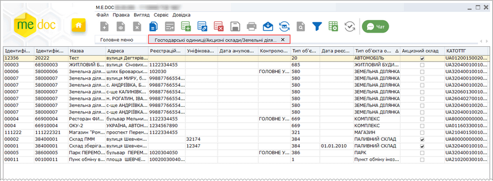
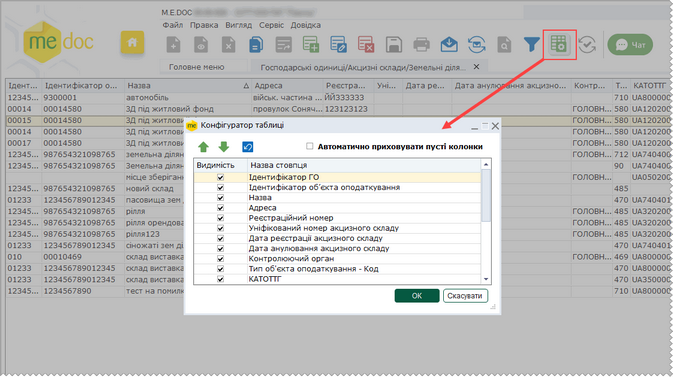
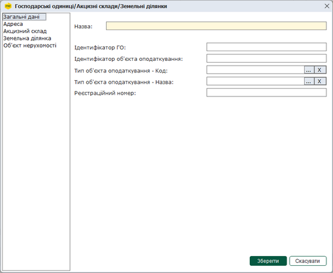
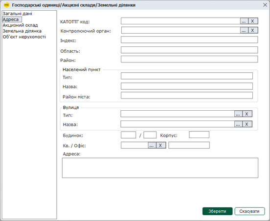
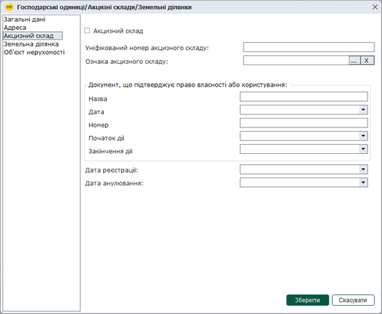
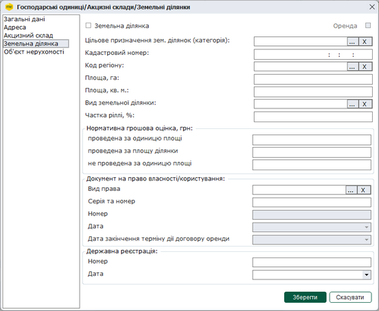
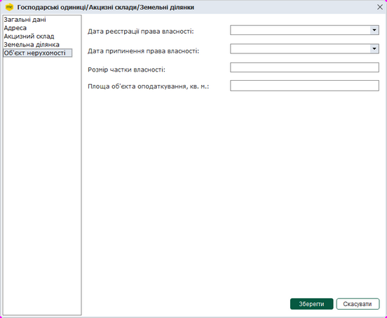
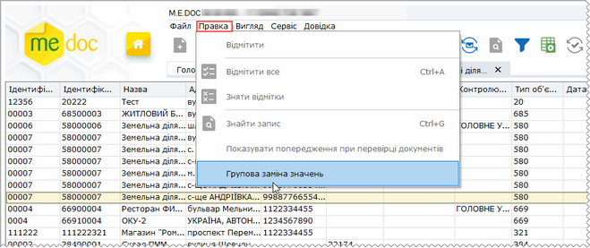
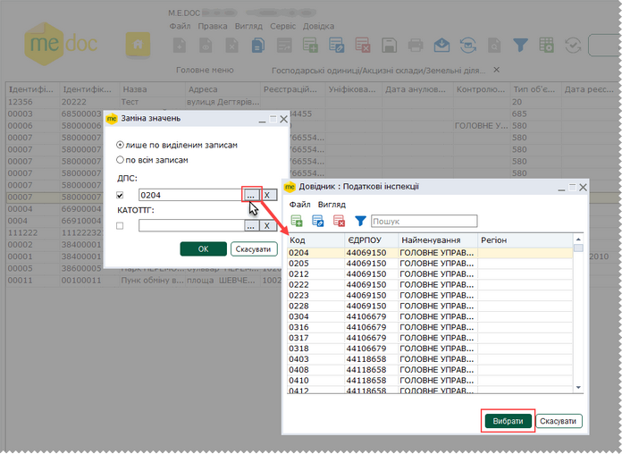

[← Зміст довідки](../)


# Господарські одиниці/Акцизні склади/Земельні ділянки

## Господарські одиниці/Акцизні склади/Земельні ділянки

_Шлях у довідці: Розділи програми › Довідники › Господарські одиниці/Акцизні склади/Земельні ділянки_

В цьому розділі:

[Додавання записів у довідник](#uceconomicunits-uceconomicunits)

[Групова заміна значень полів Контролюючий орган та КАТОТТГ](#uceconomicunits-uceconomicunits)

Довідник Господарські одиниці/Акцизні склади/Земельні ділянки - призначений для зберігання інформації щодо господарських одиниць користувача, у яких використовуються реєстратори розрахункових операцій. Також у довіднику зберігаються дані господарських одиниць, що мають статус акцизного складу, та зазначається інформація щодо земельної ділянки, для якої подається звітність (у разі потреби).

Дані Довідник заповнюється користувачем. При першому відкритті довідники не містять записів!

Довідник використовується при заповненні форм [документів РРО](UCRRORst.html#ucrrorst-ucrrorst), форм [акцизних документів](AkcizMain.html#akcizmain-akcizmain) та пакетів звітів "Податкової декларація з плати за землю" і "Податкова декларація з податку на нерухоме майно, відмінне від земельної ділянки".

Перейти до довідника можна з розділів програми Довідники, РРО та ПРРО, Облік акцизу, обравши пункт Господарські одиниці/Акцизні склади/Земельні ділянки. Відкриється вікно довідника:

Натисніть, щоб збільшити малюнок

Набором колонок у таблиці довідника та порядком їх розміщення можна керувати. Для цього натисніть на кнопку  на панелі інструментів.
Відкриється вікно Конфігуратор таблиці. Встановіть відповідні галочки для відображення колонок.

Натисніть, щоб збільшити малюнок

Скористайтесь кнопками  для встановлення порядку розташування колонки за власним бажанням, або  для встановлення порядку колонок за замовчанням. Також перемістити колонки у таблиці довідника можна, натиснувши лівою кнопкою на назві колонки, та, не відпускаючи кнопку, перетягнути колонку у потрібне місце.

Якщо встановлено опцію Автоматично приховувати пусті колонки, колонки, що не містять даних, не відображаються у таблиці довідника.

Для збереження змін натисніть кнопку ОК.

Додавання записів у довідник

Додавання записів у довідник виконується одним із способів:

- на панелі інструментів модуля натисніть кнопку  ,
- оберіть команду в меню Файл - Створити запис;
- оберіть із контекстного меню  Створити запис;
- сполученням клавіш <Ctrl+I>.

Відкриється вікно для введення даних:

Натисніть, щоб збільшити малюнок

Запис довідника можна змінити одним із способів:

- натисканням кнопки панелі інструментів ;
- командою в меню Файл - Редагувати запис;
- із контекстного меню Редагувати запис;
- клавіша F2.

або видалити одним із способів:

- натисканням кнопки панелі інструментів ;
- командою в меню Файл - Видалити запис;
- із контекстного меню Видалити запис;
- комбінацією клавіш <Ctrl+Y>.
- Дані довідника можливо зберегти у форматі XML. Для цього виконайте команду головного меню Файл - Експорт - Експорт в XML
- Збережені дані довідника можливо імпортувати за допомогою команди головного меню Файл - Імпорт - Імпорт із XML.

Загальні дані

На вкладці Загальні дані зазначається інформація:

- Назва ГО - назва господарської одиниці, обов'язкове для заповнення;
- Ідентифікатор ГО - унікальний внутрішній ідентифікатор господарської одиниці, визначається користувачем;
- Ідентифікатор об'єкта оподаткування - ідентифікатор підприємства, що є об'єктом оподаткування та через яке провадить діяльність господарська одиниця, повинно містити числове значення, що складається з коду типу об'єкту оподаткування та внутрішнього ідентифікатора, що вказаний у полі Ідентифікатор ГО.

Наприклад, для готелю ідентифікатор об'єкта оподаткування може мати значення 17900020, де 179 - код типу об'єкта оподаткування у відповідності до рекомендованого довідника типів об'єктів оподаткування, 00020 - внутрішній ідентифікатор, що застосовується користувачем;

- Тип об'єкта оподаткування - Код - код типу об'єкта оподаткування, оберіть значення з довідника Тип об'єктів оподаткування;
- Тип об'єкта оподаткування - Назва - назва типу об'єкта оподаткування, оберіть значення з довідника Тип об'єктів оподаткування;

Заповнення полів з довідника Тип об'єктів оподаткування здійснюється одночасно при виборі значення у будь-якому з полів, до якого підключено цей довідник.

- Реєстраційний номер - реєстраційний номер господарської одиниці, вказується у разі потреби, наприклад, для пунктів обміну валюти тощо.

Для збереження даних натисніть кнопку Зберегти.

Адреса

На вкладці Адреса зазначається інформація щодо адреси господарської одиниці:

Натисніть, щоб збільшити малюнок

КАТОТТГ код - код території по класифікатору за Кодифікатором адміністративно-територіальних одиниць та територій територіальних громад;

- Контролюючий орган - натисніть  та оберіть значення з довідника Податкові інспекції;

Індекс - введіть поштовий індекс;

- Поля Область, Район, Тип та Назва населеного пункту, Район міста - заповніть вручну;
- у полях Тип та Назва вулиці, Кв./Офіс - оберіть значення із підключених довідників, скориставшись кнопкою , номер квартири/офісу, будинку, корпусу введіть вручну.

Введені значення відображатимуться у полі Адреса.

Для збереження даних натисніть кнопку Зберегти.

Акцизний склад

На вкладці Акцизний склад зазначається інформація щодо господарських одиниць, які є акцизними складами:

Натисніть, щоб збільшити малюнок

- Акцизний склад - встановлена опція визначає, що господарська одинця має статус акцизного складу;
- Уніфікований номер акцизного складу - уніфікований номер акцизного складу в системі електронного адміністрування реалізації пального та спирту етилового;
- Ознака акцизного складу - ознака виду акцизного складу, оберіть значення з довідника Ознака виду акцизного складу, натиснувши ;
- Документ, що підтверджує право власності або користувача - у полях області введіть назву, дату, номер та дати початку та закінчення терміну дії документа, що підтверджують право власності або користування приміщеннями та/або територією, що відносяться до акцизного складу;
- Дата реєстрації - дата реєстрації акцизного складу;
- Дата анулювання - дата анулювання реєстрації акцизного складу.

Для збереження даних натисніть кнопку Зберегти.

Земельна ділянка

На вкладці Земельна ділянка зазначається інформація щодо земельної ділянки, для якої подається звітність.

Натисніть, щоб збільшити малюнок

- Земельна ділянка - встановлена опція визначає, що господарська одинця має земельну ділянку;
- Оренда - встановіть позначку, якщо земельна ділянка взята в оренду, опція доступна для встановлення тільки, якщо активовано опцію Земельна ділянка;

Якщо опція встановлена, доступні для заповнення поля Номер, Дата, Дата закінчення терміну дії договору оренди, у яких вводиться відповідна інформація щодо договору оренди земельної ділянки.

Поля Вид права та Серія та номер після встановлення опції Оренда стають недоступними для введення даних.

- Значення у полях Цільове призначення зем. ділянок (категорія), Код регіону, Вид земельної ділянки, Вид права оберіть з довідників, натиснувши ;
- Значення у полях Кадастровий номер, Площа, га, Площа, кв. м., Нормативна грошова оцінка, грн, Номер, Частка ріллі, %, проведена на одиницю площі, проведена на площу ділянки, не проведена на одиницю площі - введіть вручну;
- Значення у полях Дата можна обрати у вікні календаря або ввести вручну.

Для збереження даних натисніть кнопку Зберегти.

Об'єкт нерухомості

На вкладці Об'єкт нерухомості зазначається інформація щодо об'єкта нерухомості, відмінного від земельної ділянки, для якого подається звітність.

Натисніть, щоб збільшити малюнок

- Дата реєстрації права власності - дата реєстрації права власності об'єкта нерухомості, можна обрати у вікні календаря або ввести вручну;
- Дата припинення права власності - дата припинення права власності об'єкта нерухомості, можна обрати у вікні календаря або ввести вручну;
- Розмір частки власності - введіть вручну;
- Площа об'єкта оподаткування, кв. м - введіть вручну.

Для збереження даних натисніть кнопку Зберегти.

[До початку](#uceconomicunits-uceconomicunits)

Групова заміна значень полів Контролюючий орган та КАТОТТГ

Для групової заміни значень полів довідника Контролюючий орган та КАТОТТГ виконайте дії:

1. Якщо заміну потрібно виконати для певних записів, виділіть ці записи в реєстрі довідника. Для заміни даних у всіх записах довідника виділяти записи не потрібно.

2. У меню Правка оберіть функцію Групова заміна значень:

Натисніть, щоб збільшити малюнок

3. На виконання команди відкриється вікно Заміна значень, у якому можна обрати параметри заміни даних у довіднику:

Натисніть, щоб збільшити малюнок

4. Оберіть необхідні параметри заміни даних у довіднику:

- для заміни значень в обраних записах, встановіть позначку лише по виділеним записам, якщо необхідно змінити значення у всіх наявних записах довідника, встановіть позначку по всім записам;
- оберіть поле (поля), у якому потрібно змінити значення, встановіть відмітку біля відповідного поля ДПС та/або КАТОТТГ та оберіть нове значення із підключеного довідника, натиснувши .

5. Після вибору потрібних параметрів у вікні Заміна значень натисніть кнопку ОК. Нові значення будуть відображені на вкладці довідника Господарські одиниці/Акцизні склади/Земельні ділянки.

[До початку](#uceconomicunits-uceconomicunits)


