[← Зміст довідки](../)


# Об'єднана звітність ПДФО та ЄСВ

## Об'єднана звітність ПДФО та ЄСВ

_Шлях у довідці: Розділи програми › Звітність › Об'єднана звітність ПДФО та ЄСВ_

Об'єднана звітність ПДФО та ЄСВ формується за правилами, регламентованими:

- Законом України № 115-IX від 27.02.2020 "Про внесення змін до Закону України "Про збір та облік єдиного внеску на загальнообов’язкове державне соціальне страхування" щодо подання єдиної звітності з єдиного внеску на загальнообов’язкове державне соціальне страхування і податку на доходи фізичних осіб";
- Законом України  № 116-IX від 19.09.2019 "Про внесення змін до Податкового кодексу України щодо подання єдиної звітності з єдиного внеску на загальнообов'язкове державне соціальне страхування і податку на доходи фізичних осіб";
- Наказом Міністерства фінансів України № 773 від 15.12.2020 р. "Про внесення змін до наказу Міністерства фінансів України від 13 січня 2015 року № 4";
- Наказом Міністерства фінансів України № 278 від 19.05.2021 р. "Про внесення змін до наказу Міністерства фінансів України від 13 січня 2015 року № 4";
- Наказом Міністерства фінансів України № 189 від 04.07.2022 р. "Про внесення змін до наказу Міністерства фінансів України від 13 січня 2015 року № 4" (із змінами, внесеними згідно з Наказом Міністерства фінансів № 215 від 25.07.2022 р.);
- Наказом Міністерства фінансів України №113 від 02.03.2023 р. "Про внесення змін до наказу Міністерства фінансів України від 13 січня 2015 року № 4";
- Наказом Міністерства фінансів України від № 39 від 24 січня 2025 року "Про внесення змін до наказу Міністерства фінансів України від 13 січня 2015 року № 4";
- Наказом Міністерства фінансів України від № 53 від 30 січня 2025 року "Про внесення змін до наказу Міністерства фінансів України від 24 січня 2025 року № 39";
- Наказом Міністерства фінансів України № 243 від 07.05.2026 р. "Про внесення змін до наказу Міністерства фінансів України від 13 січня 2015 року № 4" (із змінами, внесеними згідно з Наказом Міністерства фінансів № 284 від 26.05.2026 р.).

Зверніть увагу!

Відповідно до наказу Міністерства фінансів України № 243 від 07.05.2026 р. "Про внесення змін до наказу Міністерства фінансів України від 13 січня 2015 року № 4" (із змінами, внесеними згідно з Наказом Міністерства фінансів № 284 від 26.05.2026 р.) впроваджено нову 11 версію форм звітності, головний документ пакета - Розрахунок J0500111, F0500111.

Фізичні особи-підприємці (ФОП) та особи, які провадять незалежну професійну діяльність, подають квартальну форми єдиної звітності з ПДФО, ВЗ та ЄСВ у строки, встановлені Податковим Кодексом, з розбивкою по місяцях звітного кварталу. Пакет F0500111 - подається щокварталу.

Юридичні особи подають форми єдиної звітності з ПДФО, ВЗ та ЄСВ у строки, встановлені Податковим Кодексом, для податкового місяця. Пакет J0500111 - подається щомісяця.

Юридичні особи вперше подають звітність за формами 11 версії за липень 2026 р.

У цьому розділі:

[Що потрібно зробити до початку формування звіту](#ucesv1dfrst-ucesv1dfrst_before)

- [Процедура формування єдиної звітності](#ucesv1dfrst-ucesv1dfrst_creation)
- [Додаток 1 "Відомості про нарахування заробітної плати (доходу, грошового забезпечення) застрахованим особам"](#ucesv1dfrst-ucesv1dfrst_creation_d1)
- [Додаток 4 "Відомості про суми нарахованого доходу, утриманого та сплаченого податку на доходи фізичних осіб та військового збору"](#ucesv1dfrst-ucesv1dfrst_creation)
- [Додаток 5 "Відомості про трудові відносини осіб та період проходження військової служби"](#ucesv1dfrst-ucesv1dfrst_creation_d5)
- [Додаток 6 "Відомості про наявність підстав для обліку стажу окремим категоріям осіб відповідно до законодавства"](#ucesv1dfrst-ucesv1dfrst_creation_d6)
- [Створення звітів з типом "Довідковий"](#ucesv1dfrst-ucesv1dfrst_creation_dovid)
- [Автоматичне заповнення Розрахунку](#ucesv1dfrst-ucesv1dfrst_creation)
- [Створення пакету об'єднаної звітності за відокремлений підрозділ](#ucesv1dfrst-ucesv1dfrst_creation)
- [Збереження пакету звітів на електронному носії (без підпису ЕП)](#ucesv1dfrst-ucesv1dfrst_saving)
- [Імпорт об'єднаної звітності](#ucesv1dfrst-ucesv1dfrst_import)
- [Копіювання звіту](#ucesv1dfrst-ucesv1dfrst_copy)
- [Консолідація звітів](#ucesv1dfrst-ucesv1dfrst_consolid)
- [Друк документів](#ucesv1dfrst-ucesv1dfrst_print)
- [Відправлення об'єднаної звітності](#ucesv1dfrst-ucesv1dfrsti_e-mail)

### Що потрібно зробити до початку формування звіту?

_Шлях у довідці: Розділи програми › Звітність › Об'єднана звітність ПДФО та ЄСВ › Що потрібно зробити до початку формування звіту?_

До початку формування звіту потрібно:

1. Переглянути Реєстр співробітників,

2. Переглянути картку установи.

У цих модулях повинні бути заповнені всі поля, які використовуються при формуванні звітів.

Ці дані потрібно встановити лише один раз і надалі вони будуть автоматично підтягуватися у відповідні таблиці звіту.

У Картці Фізичної особи:

Заповніть наступні параметри картки співробітника (Довідники - Співробітники - картка Фізична особа):

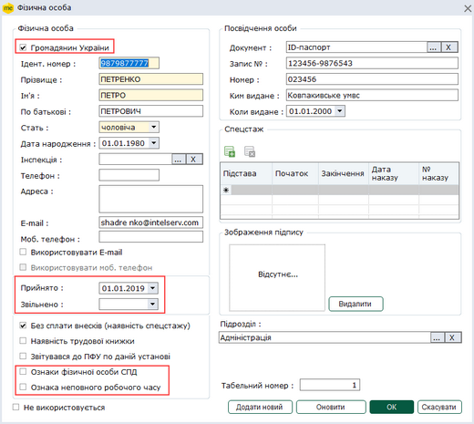

Натисніть, щоб збільшити малюнок

1. Для осіб, які є громадянами України, потрібно встановити відмітку у полі Громадянин України.

2. Для працівників, що є фізичними особами підприємцями (ФОП) - відмітьте поле Ознака фізичної особи СПД.

3. Перевірте, чи заповнені поля:

- Прийнято;
- Звільнено.

Ці дані використовуються при створенні [Додатка 5](#ucesv1dfrst-ucesv1dfrst_creation_d5) та [Додатка 4](#ucesv1dfrst-ucesv1dfrst_creation_d4).

4. Якщо працівник має право на спецстаж, потрібно заповнити групу параметрів з назвою Спецстаж:

- у полі Код підстави оберіть код із підключеного довідника,
- у полях Дата початку та Дата закінчення внесіть дати початку та закінчення дії спецстажу;

Поле Дата початку обов'язкове для заповнення!

- у полі Дата наказу  - оберіть дату прийняття наказу про атестацію робочого місця в установі, що дає право працюючому на спецстаж,
- у полі № наказу – внесіть номер цього наказу.

Поля Дата наказу та № наказу можуть бути незаповнені, але в [Додаток 6](#ucesv1dfrst-ucesv1dfrst_creation_d6) в такому разі буде виводитися попередження і вона матиме статус Помилковий.

Записи із групи Спецстаж "підтягуються" у [Додаток 6](#ucesv1dfrst-ucesv1dfrst_creation_d6).

5. Поле Ознака неповного робочого часу - проставляється для співробітників, які працюють неповний робочий час.

Ознака автоматично переноситься в [Додаток 1](#ucesv1dfrst-ucesv1dfrst_creation_d1).

Докладно про заповнення картки дивіться розділ [Довідники - Співробітники](UCSharePers.html#ucsharepers-sprperson).

Ці дані потрібно внести в картку співробітника лише один раз і надалі вони будуть автоматично підтягуватися у відповідні таблиці звіту. Якщо не внести ці дані в картку, потрібно буде кожного разу заповнювати їх у таблицях.

НАПОЛЕГЛИВО РЕКОМЕНДУЄМО ПІДТРИМУВАТИ РЕЄСТР СПІВРОБІТНИКІВ У АКТУАЛЬНОМУ СТАНІ, і вносити одразу всі зміни в картки фізичних осіб. ЗА ДАНИМИ ІЗ РЕЄСТРУ АВТОМАТИЧНО ФОРМУЮТЬСЯ ДОДАТКИ 1 та 4.

[До початку](#ucesv1dfrst-ucesv1dfrst_before)

У Картці підприємства:

У вкладці Підприємство:

1. У полі Назва перевірте правильність обраного із довідника органу ДПСУ.

2. Оберіть із довідника дані в полі Організаційно правова форма.

У вкладці Додатково:

1. Оберіть із довідника дані в полі Основний вид діяльності за КВЕД.

2. Перевірте код, обраний у полі Код за КАТОТТГ, це значення буде використовуватися при формуванні [Розрахунку](#ucesv1dfrst-ucesv1dfrst_creation). Значення КАТОТТГ використовується незалежно від того, який довідник обрано для використання за замовчуванням (встановлено позначку).

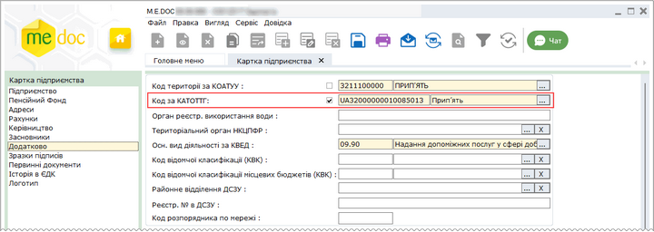

Натисніть, щоб збільшити малюнок

У вкладці Пенсійний фонд:

Заповніть наступні параметри:

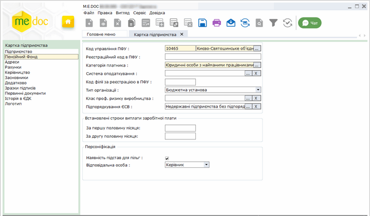

Натисніть, щоб збільшити малюнок

1. В полі Код управління ПФУ:

Для підприємств, створених після 01.10.2013 р. при відсутності коду управління ПФУ потрібно вибрати із довідника код 28000 Пенсійний фонд України. Цей код починає діяти з 18.11.2013.

Для установ, які були зареєстровані платниками ЄСВ до цієї дати, використовуються дані реєстрації в ПФУ.

Поле "Код філії за реєстрацією в ПФУ" не заповнюється.

2. У полі Тип організації оберіть значення із списку. Поле може бути незаповненим ("пусто"), якщо тип установи не відповідає ні одному із наведених варіантів.

Ці дані використовуються при формуванні [Розрахунку](#ucesv1dfrst-ucesv1dfrst_creation).

3. Клас проф. ризику виробництва - для всіх організацій обирається із підключеного довідника згідно присвоєному установі класу при його реєстрації в Фонді соціального страхування від нещасних випадків.

4. У полі Підпорядкування ЄСВ оберіть дані із підключеного довідника.

5.  Якщо на підприємстві існують пільги на сплату єдиного внеску, відмітьте поле Наявність підстав для пільг.

6. Відповідальна особа:

Оберіть із списку (Керівник, Головний бухгалтер, Інша особа) посадову особу, яка в установі відповідає за подання звітів.

Якщо обрана Інша особа, з'являться додаткові поля для заповнення:

- ІПН відповідальної особи;
- ПІБ відповідальної особи.

[До початку](#ucesv1dfrst-ucesv1dfrst_before)

### Процедура формування єдиної звітності

_Шлях у довідці: Розділи програми › Звітність › Об'єднана звітність ПДФО та ЄСВ › Процедура формування єдиної звітності_

В цьому розділі:

[Створення пакету об'єднаної звітності](#ucesv1dfrst-ucesv1dfrst_creation)

[Автоматичне заповнення Розрахунку даними Додатка 1 та Додатка 2](#ucesv1dfrst-ucesv1dfrst_creation)

[Створення пакету об'єднаної звітності за відокремлений підрозділ](#ucesv1dfrst-ucesv1dfrst_creation)

[Налаштування лічильника документів об'єднаної звітності](#ucesv1dfrst-ucesv1dfrst_creation)

Модуль Об'єднана звітність ПДФО та ЄСВ викликається із Головного меню - Звітність - Об'єднана звітність ПДФО та ЄСВ.

Перед початком роботи рекомендуємо ознайомитись з нормативними матеріалами щодо створення та заповнення об'єднаної звітності:

- [Наказ Міністерства фінансів України № 773 від 15.12.2020 р. "Про внесення змін до наказу Міністерства фінансів України від 13 січня 2015 року № 4"](https://zakon.rada.gov.ua/laws/show/z1304-20#Text);
- [Наказом Міністерства фінансів України № 278 від 19.05.2021 р. "Про внесення змін до наказу Міністерства фінансів України від 13 січня 2015 року № 4"](https://zakon.rada.gov.ua/laws/show/z0838-21#Text);
- [Наказом Міністерства фінансів України № 189 від 04.07.2022 р. "Про внесення змін до наказу Міністерства фінансів України від 13 січня 2015 року № 4"](https://zakon.rada.gov.ua/laws/show/z0804-22#Text)(із змінами, внесеними згідно з Наказом Міністерства фінансів № 215 від 25.07.2022 р.);
- [Наказом Міністерства фінансів України №113 від 02.03.2023 р. "Про внесення змін до наказу Міністерства фінансів України від 13 січня 2015 року № 4"](https://zakon.rada.gov.ua/laws/show/z0650-23#Text);
- Наказом Міністерства фінансів України № 39 від 24 січня 2025 року "Про внесення змін до наказу Міністерства фінансів України від 13 січня 2015 року № 4";
- Наказом Міністерства фінансів України № 53 від 30 січня 2025 року "Про внесення змін до наказу Міністерства фінансів України від 24 січня 2025 року № 39";
- Наказом Міністерства фінансів України № 243 від 07.05.2026 р. "Про внесення змін до наказу Міністерства фінансів України від 13 січня 2015 року № 4" (із змінами, внесеними згідно з Наказом Міністерства фінансів № 284 від 26.05.2026 р.).

У вікні модуля представлені всі документи об'єднаної звітності. Відображення пакета звітності залежить від періоду створення звітів, що обирається у полі Період.

Створення місячного пакета звітів для юридичних осіб:

Зверніть увагу!

Відповідно до наказу Міністерства фінансів України № 243 від 07.05.2026 р. "Про внесення змін до наказу Міністерства фінансів України від 13 січня 2015 року № 4" (із змінами, внесеними згідно з Наказом Міністерства фінансів № 284 від 26.05.2026 р.) впроваджено нову 11 версію форм звітності, головний документ пакета - Розрахунок J0500111, F0500111.

Юридичні особи подають форми єдиної звітності з ПДФО, ВЗ та ЄСВ у строки, встановлені Податковим Кодексом, для податкового місяця - пакет J0500111 подається щомісяця.

Юридичні особи вперше подають звітність за формами 11 версії за липень 2026 р.

Оберіть створення звітності у періоді місяць - у полі Період оберіть місяць та рік, за які потрібно створити звітність. Пакет форм звітності містить по одному рядку кожного Додатку для створення у обраному місяці:

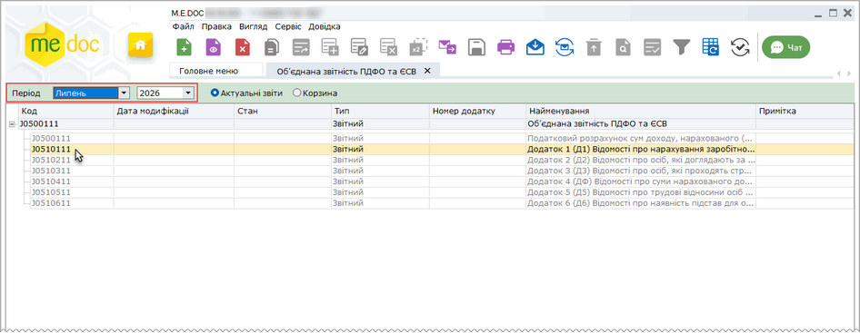

Натисніть, щоб збільшити малюнок

Для створення звіту натисніть 2 рази лівою кнопкою миші на відповідному рядку.

Зверніть увагу. При спробі створити звіт за квартал програма повідомить про неможливість створення звітності за цей період:

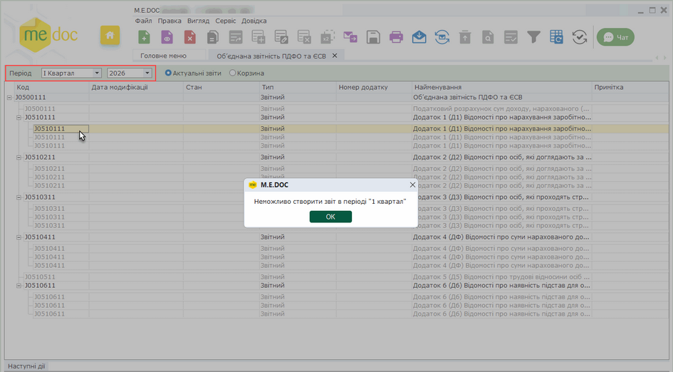

Натисніть, щоб збільшити малюнок

Створення квартального пакета звітів для ФОП:

Зверніть увагу!

Відповідно до наказу Міністерства фінансів України № 243 від 07.05.2026 р. "Про внесення змін до наказу Міністерства фінансів України від 13 січня 2015 року № 4" (із змінами, внесеними згідно з Наказом Міністерства фінансів № 284 від 26.05.2026 р.) впроваджено нову 11 версію форм звітності, головний документ пакета - Розрахунок J0500111, F0500111.

Фізичні особи-підприємці (ФОП) та особи, які провадять незалежну професійну діяльність, подають квартальну форми єдиної звітності з ПДФО, ВЗ та ЄСВ у строки, встановлені Податковим Кодексом, з розбивкою по місяцях звітного кварталу. Пакет F0500111 - подається щокварталу.

Оберіть створення звітності у періоді квартал - у полі Період оберіть квартал та рік, за які потрібно створити звітність.

Кожен з Додатків 1 - 4 та 6 відображається 3-ма рядками - для створення звіту за кожен місяць кварталу. Якщо необхідно сформувати один з додатків за певний місяць кварталу, необхідно обрати додаток, розміщений на відповідній позиції в списку Додатків.

Додаток 5 відображається 1 рядком, так як створюється та подається за квартал:

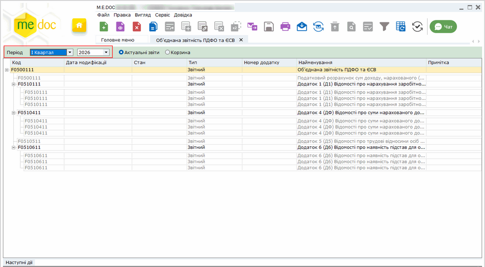

Натисніть, щоб збільшити малюнок

Для створення звіту натисніть 2 рази лівою кнопкою миші на відповідному рядку.

Зверніть увагу. При спробі створити звіт за місяць програма повідомить про неможливість створення звітності за цей період:

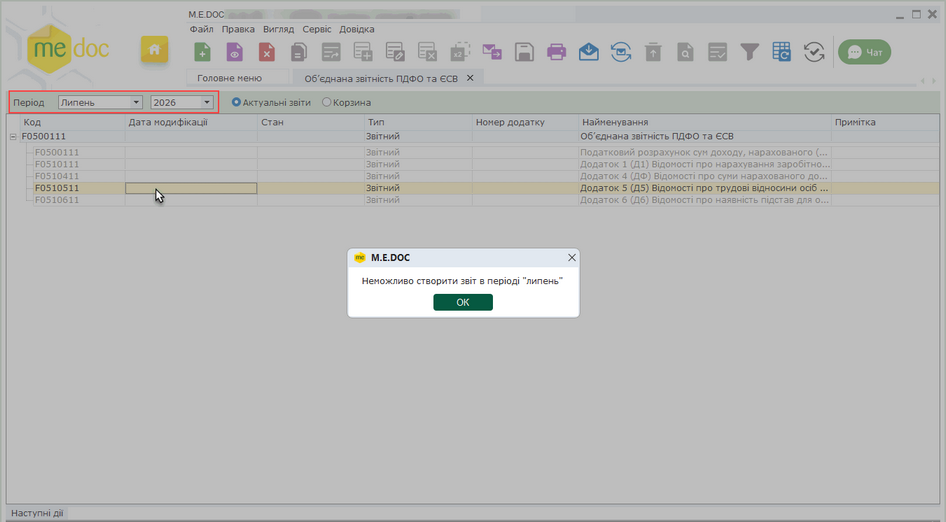

Натисніть, щоб збільшити малюнок

Головний документ Податковий розрахунок сум доходу, нарахованого (сплаченого) на користь платників податків - фізичних осіб, і сум утриманого з них податку, а також сум нарахованого єдиного внеску відкривається у вигляді електронної форми (що представляє документ, який подається в ДПСУ).

Додатки 1 - 6 відкриваються у вигляді таблиці для зручного заповнення та редагування. Щоб переглянути електронну форму Додатка, оберіть пункт головного меню Правка - Електронна форма, або натисніть клавішу <F11>. Редагування документів у цьому вигляді неможливе.

Оновити записи у реєстрі можна одним із способів:

- виконати команду головного меню Вигляд – Оновити реєстр;
- натиснути кнопку  на панелі інструментів.

[До початку](#ucesv1dfrst-ucesv1dfrst_creation)

Створення пакета об'єднаної звітності

Зверніть увагу!

Відповідно до наказу Міністерства фінансів України № 243 від 07.05.2026 р. "Про внесення змін до наказу Міністерства фінансів України від 13 січня 2015 року № 4" (із змінами, внесеними згідно з Наказом Міністерства фінансів № 284 від 26.05.2026 р) впроваджено нову 11 версію форм звітності, головний документ пакета - Розрахунок J0500111, F0500111.

У полі Період оберіть період, за який буде створюватися звітність (місяць - для юридичних осіб та квартал - для ФОП). Всі документи, які ви відкриватимете далі, будуть створюватися у заданому звітному періоді:

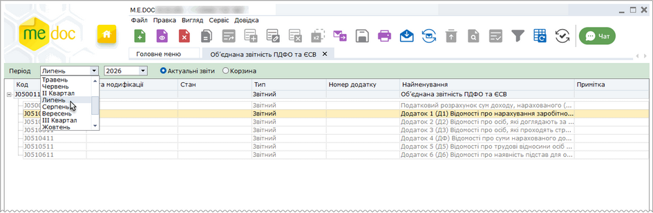

Натисніть, щоб збільшити малюнок

Для створення пакету виділіть рядок документа у реєстрі та оберіть один із способів:

- натисніть 2 рази лівою кнопкою миші на рядку звіту;
- оберіть команду головного меню Файл - Створити;
- натисніть кнопку на панелі інструментів .

У вікні, що відкриється введіть Номер розрахунку та оберіть Тип розрахунку.

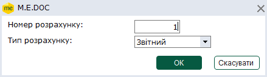

Оберіть Тип розрахунку:

- Звітний - подається за звітний (податковий) період перший раз. Розрахунок з типом Звітний, який прийнятий контролюючим органом та пройшов всі контролі, у тому числі під час завантаження до Реєстру страхувальників та до Реєстру застрахованих осіб, залишається чинним під час прийняття контролюючим органом наступного Розрахунку за такий звітний (податковий) період;
- Звітний новий - подається наступним за звітний (податковий) період до закінчення граничного строку подання з даними про уточнення в сумах нарахованого податку на доходи фізичних осіб, військового збору, єдиного внеску та/або реквізитах. Подається у разі виявлення помилок у сумах нарахованого податку на доходи фізичних осіб, військового збору, єдиного внеску та містить виключно коригування даних на підставі інформації з попередньо поданих за такий звітний (податковий) період Звітів з типом Звітний або Звітний новий, як передбачено порядком коригування даних Розрахунку (додатків), заповнюється як передбачено порядком коригування даних Розрахунку/Додатків;
- Уточнюючий - подається після закінчення граничного строку подання для відповідного звітного (податкового) періоду з даними про уточнення в сумах нарахованого податку на доходи фізичних осіб, військового збору, єдиного внеску та/або реквізитах. Подається у разі виявлення помилок у сумах нарахованого податку на доходи фізичних осіб, військового збору, єдиного внеску та містить виключно коригування даних на підставі інформації з попередньо поданих за минулий звітний (податковий), як передбачено порядком коригування даних Розрахунку/Додатків;

Тип розрахунку вказано у електронній формі документа (перегляд по <F11>) та у таблиці модуля  Об'єднана звітність ПДФО та ЄСВ в колонці Тип.

У разі створення додаткових пакетів вони будуть додані у таблиці розділу окремими рядками:

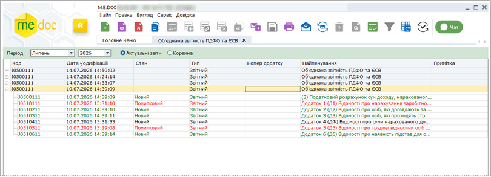

Натисніть, щоб збільшити малюнок

Номер розрахунку, вказаний у колонці Найменування перед назвою Розрахунку.

Якщо Ви помилково створили звіт, який не повинні подавати або ж у поточному періоді звіт не заповнюється через відсутність даних, його потрібно видалити.

Для видалення помилкового звіту необхідно виділити його курсором миші в таблиці та виконати команду Видалити у головному меню Файл або у контекстному меню (кнопка  на панелі інструментів). Зверніть увагу, при видаленні Розрахунку, видаляється весь пакет звітів.

Видалені звіти вилучаються з обробки та переміщаються до Корзини. Щоб переглянути вилучені звіти, у заголовку розділу встановіть позначку Корзина. У таблиці модуля будуть відображені лише звіти, що були вилучені з обробки. Для відновлення вилученого звіту, виділіть його рядок та скористайтеся одним із способів:

- виконайте команду головного меню Правка – Відновити з корзини;
- оберіть команду контекстного меню Відновити з корзини;
- натиснути кнопку  на панелі інструментів.

Для Додатків 1 -3 можливо виконати перерахунок сум, які у звітах розраховуються автоматично. Для цього у вікні відкритого документа скористайтеся одним із способів:

- на панелі інструментів натисніть кнопку ;
- виконайте команду головного меню Правка - Перерахувати документ;
- натисніть клавішу <F6>.

У разі, якщо є необхідність порівняти вміст кількох документів, можна відкрити ці документи у [окремих вікнах програми](UCPravila.html#ucpravila-pravyla). Щоб відкрити документ у окремому вікні, виділіть документ у таблиці реєстру та скористайтеся одним із способів:

- у головному меню програми виконайте команду Вигляд - Перегляд у вікні;
- виконайте команду контекстного меню Перегляд у вікні.

[До початку](#ucesv1dfrst-ucesv1dfrst_creation)

Автоматичне заповнення Розрахунку даними Додатка 1 та Додатка 2

У модулі, за замовчуванням, встановлений режим автоматичного заповнення Розрахунку даними Додатка 1 та Додатка 2 - у головному меню Правка відмічені пункти:

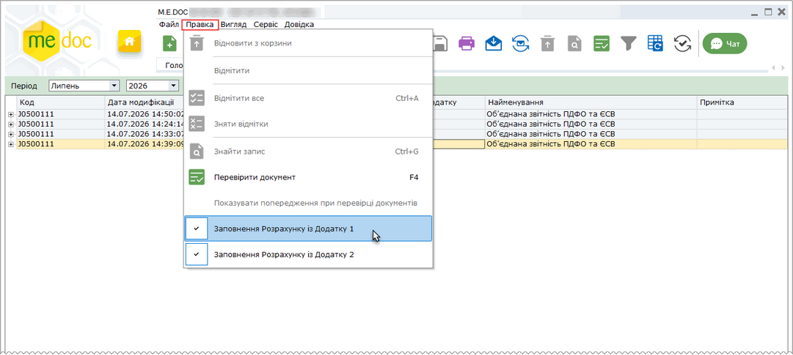

Натисніть, щоб збільшити малюнок

Дані Додатків переносяться у відповідні їм рядки Розрахунку.

Заповнення Розрахунку за даними Додатків можна відключити - обрати меню Правка та зняти відмітки Заповнення Розрахунку із Додатку 1 та/або Заповнення Розрахунку із Додатку 2.

Після відкриття Розрахунку поля "шапки" автоматично заповнюються даними із Картки підприємства.

Зверніть увагу!

Якщо вже після формування звітів змінювалися дані у Картці підприємства чи у Додатках 1 та/або 2 (у разі автоматичного заповнення Розрахунку з цих Додатків), потрібно знову відкрити Розрахунок та виконати операції:

- оновити поля (F5);
- перерахувати звіт (F6);
- перевірити звіт (F4);
- зберегти (Ctrl+S).

Якщо потрібно вручну відредагувати та зберегти дані в Розрахунку:

1. Відключити пункт (зняти "галочку") в меню Правка - Заповнення Розрахунку із Додатку 1 та Заповнення Розрахунку із Додатку 2.

2. Відкрити Розрахунок.

3. Відключити авторозрахунок даних (зняти "галочку" меню Правка - Автоматичний розрахунок).

Після цього відключиться автосумування в підсумовуючих рядках таблиці.

[До початку](#ucesv1dfrst-ucesv1dfrst_creation)

Створення пакета об'єднаної звітності за відокремлений підрозділ

У разі якщо відокремлений підрозділ юридичної особи не уповноважений нараховувати, утримувати і сплачувати (перераховувати) податок до бюджету та який не має окремого балансу і самостійно не веде розрахунки із застрахованими особами для сплати єдиного внеску на небюджетні рахунки, то Розрахунок за такий підрозділ подає юридична особа, Розрахунок подається до контролюючого органу за основним місцем обліку юридичної особи.

Юридична особа під час подання Розрахунку за відокремлений підрозділ зазначає дані про відокремлений підрозділ у заголовній частини Розрахунку:

- рядок 032 - зазначається код Кодифікатора за місцезнаходженням відокремленого підрозділу;
- рядок 033 - зазначаються дані про відокремлений підрозділ юридичної особи (повне найменування відокремленого підрозділу).

У Додатках, які подаються за відокремлений підрозділ, зазначаються відомості щодо фізичних осіб (працюючих) цього підрозділу.

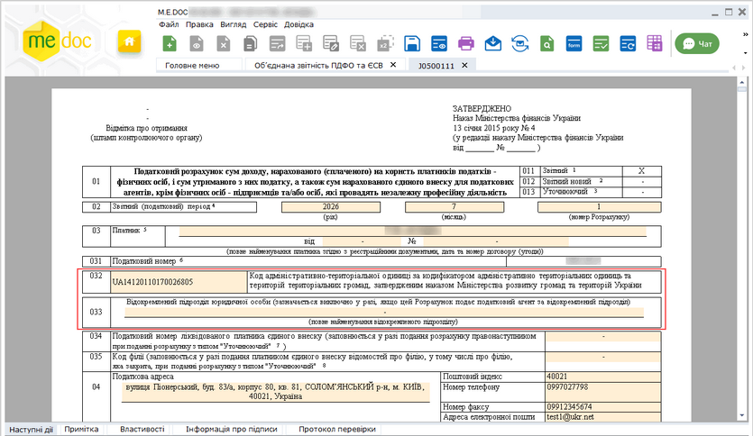

Натисніть, щоб збільшити малюнок

До рядка 033 підключено довідник Відокремлений підрозділ. У довіднику Відокремлений підрозділ користувачі мають змогу налаштувати персональний довідник відокремлених підрозділів, за які юридична особа зазначає відомості щодо фізичних осіб (працюючих) цього підрозділу.

Щоб обрати підрозділ з довідника, встановіть курсор у рядок 033 та натисніть кнопку . У вікні довідника, що відкриється, оберіть потрібний підрозділ. Значеннями з довідника будуть автоматично заповнені рядки 032 та 033.

Для додавання відокремленого підрозділу у довідник:

1. Натисніть кнопку  у рядку 033.

2. У вікні довідника Відокремлений підрозділ натисніть кнопку .

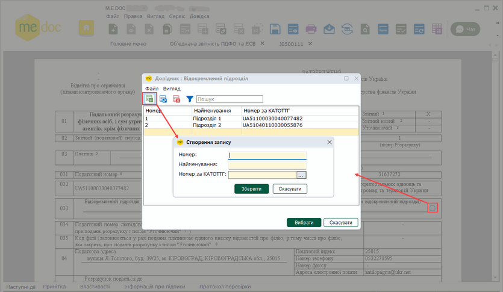

Натисніть, щоб збільшити малюнок

3. У вікні Створення запису, що відкриється, заповніть поля:

- Номер - порядковий номер підрозділу у довіднику;
- Найменування - найменування відокремленого підрозділу;
- Номер за КАТОТТГ -  код Кодифікатора за місцезнаходженням відокремленого підрозділу, обирається з довідника Коди території (КОАТУУ/КАТОТТГ).

4. У вікні Створення запису натисніть кнопку Зберегти. Дані відокремленого підрозділу будуть збережені в довіднику.

Дані підрозділів, що додані у довідник, можна редагувати, натиснувши кнопку , та видаляти - по натисканню кнопки .

[До початку](#ucesv1dfrst-ucesv1dfrst_creation)

Налаштування лічильника документів об'єднаної звітності

Для зручності обробки документів можна налаштовувати порядковий номер документа у періоді (лічильник документа).

Налаштування інтервалу номерів у періоді дозволяє уникнути дублювання імен файлів звітів або зберегти правильну нумерацію документів у випадку:

- переходу з іншого програмного забезпечення на M.E.Doc;
- перевстановлення програми M.E.Doc, у такому випадку нумерація документів почнеться з 0.

1. У вікні відкритого документа на панелі інструментів натисніть кнопку Показати бланк .

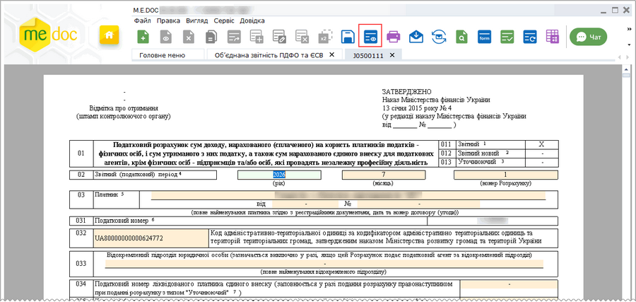

Натисніть, щоб збільшити малюнок

2. Відкриється вкладка Перегляд бланка. Оберіть команду головного меню Файл – Властивості або натисніть кнопку на панелі інструментів .

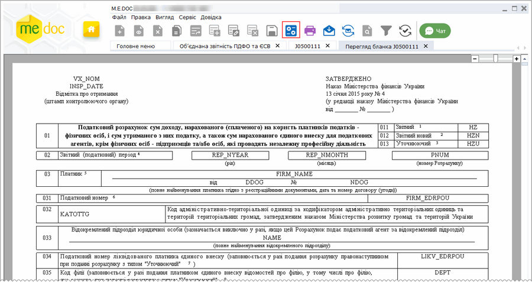

Натисніть, щоб збільшити малюнок

3. Відкриється вікно Властивості бланка. Перейдіть на вкладку Додатково та виконайте необхідні налаштування для кожного періоду.

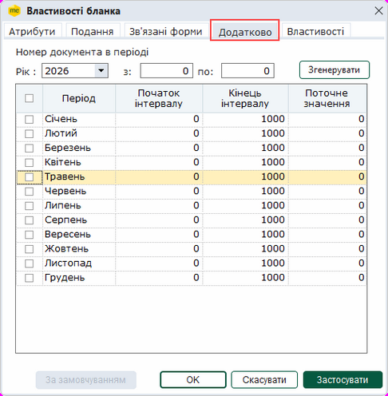

Натисніть, щоб збільшити малюнок

За замовчуванням, у полі Початок інтервалу встановлено значення "0", а у полі Кінець інтервалу - значення "1000". Тобто, нумерація у імені файлу починається з нуля і збільшується на 1 для кожного нового відправленого документа, що створюється за певним бланком у одному періоді.

Щоб встановити нумерацію для окремих періодів:

1. Встановіть позначку у рядках періодів, в яких необхідно застосувати нумерацію.

2. У полях Початок інтервалу та Кінець інтервалу вкажіть початкове та кінцеве значення номерів для кожного обраного періоду.

3. Для збереження налаштувань натисніть кнопку ОК або Застосувати.

У полі Поточне значення відображено останнє значення номера документа у періоді, який був відправлений у контролюючий орган.

Зверніть увагу! Початкове значення нової нумерації не повинно бути менше значення, зазначеного у полі Поточне значення, тобто менше ніж номер останнього документа, який був відправлений у контролюючий орган.

Номер документа у періоді зазначається у імені файлу у тексті Квитанції.

[До початку](#ucesv1dfrst-ucesv1dfrst_creation)

#### Додаток 1 "Відомості про нарахування заробітної плати (доходу, грошового забезпечення) застрахованим особам"

_Шлях у довідці: Розділи програми › Звітність › Об'єднана звітність ПДФО та ЄСВ › Процедура формування єдиної звітності › Додаток 1 "Відомості про нарахування заробітної плати (доходу, грошового забезпечення) застрахованим особам"_

Для заповнення Додатка 1 виконайте дії:

1. Натисніть 2 рази лівою кнопкою миші на рядку Додатка 1, що відповідає порядковому номеру місяця у кварталі, за який потрібно заповнити звіт.

2. Відкриється вкладка звіту. Далі для кожної особи заповніть необхідні дані.

Щоб додати новий рядок, натисніть кнопку  на панелі інструментів. Для вибору значення графи з довідника встановіть курсор у потрібне поле та натисніть .

При виборі значення графи ІПН або додаванні нового рядка у вікні довідника Співробітники можна одночасно обрати кілька рядків. Для цього виділяйте рядки довідника мишею, утримуючі клавіші <Ctrl> або <Shift>.

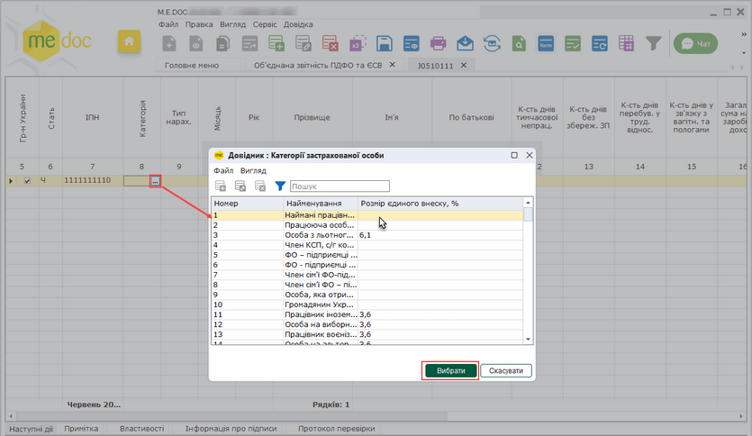

Натисніть, щоб збільшити малюнок

Для автоматичного заповнення рядків даними з карток Фізичних осіб, у меню Правка оберіть функцію Заповнити на основі довідника співробітників.

Дані з картки співробітника будуть перенесені в поля таблиці:

- Громадянин України (відмітку можна також проставити вручну);
- Чоловік/Жінка (можна також вибрати у відповідній колонці):
- Ознака наявності трудової книжки ("галочку" можна також проставити вручну):
- Спецстаж - якщо заповнена група Спецстаж ("галочку" можна також проставити вручну);
- Ознака неповного робочого часу.
- ПІБ.

Перевірте коректність перенесених даних та дозаповніть необхідні поля звіту.

Якщо у вас наявна ліцензія на використання модуля M.E.Doc.Зарплата, у вікні відкритого Додатка 1 на панелі інструментів доступна кнопка Заповнити , за допомогою якої можна автоматично заповнити Додаток 1 даними, які внесені у модулі M.E.Doc.Зарплата.

3. У полі Категорія оберіть для працівника відповідну категорію із підключеного довідника Категорії застрахованої особи. Також категорію можна вносити вручну із клавіатури.

4. Якщо по одному співробітнику у звітному місяці потрібно внести декілька записів (заробітна плата, відпускні, лікарняні…), потрібно додати новий рядок (рядки) з записом такого співробітника (із довідника Співробітники) і в них вказати різні категорії ЗО.

Для цього потрібно:

- натиснути на кнопку ;
- у відкритому довіднику Співробітники вибрати працівника;
- обрати запис подвійним натисканням лівою кнопкою миші чи кнопкою Вибрати;
- запис із довідника переноситься у таблицю, додатковий запис для такого працівника поміщається під вже існуючим.

Можна скопіювати запис співробітника. Для цього виділіть запис, який потрібно копіювати, та натисніть на кнопку  або оберіть команду Скопіювати запиc у головному меню Файл.

5. До поля Тип нарахувань підключений довідник, із якого обирається код типу нарахувань. Дані у це поле вносяться тільки в окремих випадках, перелік яких наведений у звіті і переглянути їх можна, відкривши друковану форму за допомогою клавіші F11. Це поле може бути не заповненим.

6. Обов’язково потрібно вручну внести місяць та рік, у яких проводяться нарахування, у відповідні колонки. Варіанти заповнення колонки Місяць та рік перераховані у виносці під таблицею. Переглянути їх можна, якщо переключитись у друковану форму (F11).

Зверніть увагу!

У таблиці реалізована можливість автоматичного групового заповнення даних про співробітників: категорія, місяць, рік, кількість днів перебування у трудових відносинах. Оберіть Правка - Групова заміна полів та заповніть необхідні дані.

7. Суми нарахувань та суму єдиного внеску потрібно внести вручну у відповідні колонки.

У Додатку 1 можна автоматично заповнити дані у полях:

- Категорія (поле Код застрахованої особи у вікні Групова заміна);
- Тип нарахувань (поле Код типу нарахувань у вікні Групова заміна);
- Місяць;
- Рік;
- Кількість днів перебування у трудових відносинах;
- Загальна сума нарах. заробітку / доходу;
- Ознака (0,1).

У вікні відкритого Додатка оберіть команду головного меню Правка - Групова заміна полів. У вікні, що відкриється, оберіть параметри заповнення даних:

- якщо потрібно виконати заповнення даних в обраних записах, встановіть опцію лише по виділеним записам, інакше - встановіть опцію по всім записам;
- встановіть позначку біля поля, яке необхідно заповнити, та оберіть потрібне значення, натисніть ОК:

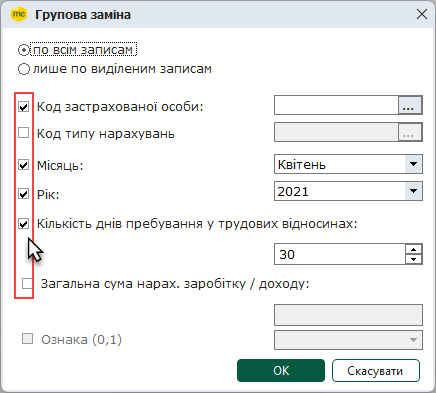

Зверніть увагу, при виконанні групової обробки виконується заміна вмісту граф обраними значенням!

Заповнити дані у полі Ознака (0,1) можна тільки у Додатку 1 з типом Звітний новий або Уточнюючий.

Після формування таблиці потрібно оновити поля (команда Правка - Оновити поля або F5), перевірити звіт (на вкладці Наступні дії команда Перевірити звіт) та зберегти (Ctrl+S).

Для зручної роботи з даними є можливість сортувати дані співробітників за ІПН, ПІБ та іншими параметрами. Для сортування натисніть на заголовок відповідної колонки.

Також можна зберегти Додаток 1 у форматі pdf. Для цього у вкладці відкритої таблиці виконайте команду меню Файл - Друк у pdf.

Щоб зберегти порядок сортування записів у роздрукованому або збереженому у форматі pdf Додатку 1, перед друком відсортуйте таблицю за потрібною колонкою та виконайте команду меню Файл – Зберегти сортування таблиці.

#### Додаток 4 "Відомості про суми нарахованого доходу, утриманого та сплаченого податку на доходи фізичних осіб та військового збору"

_Шлях у довідці: Розділи програми › Звітність › Об'єднана звітність ПДФО та ЄСВ › Процедура формування єдиної звітності › Додаток 4 "Відомості про суми нарахованого доходу, утриманого та сплаченого податку на доходи фізичних осіб та військового збору"_

Для заповнення Додатка 4 виконайте дії:

1. Натисніть 2 рази лівою кнопкою миші на рядку Додатка 4, що відповідає порядковому номеру місяця у кварталі, за який потрібно заповнити звіт. Відкриється вкладка звіту. Далі для кожної особи заповніть необхідні дані Розділів І, ІІ та Розділу ІІІ.

Щоб додати новий рядок, натисніть кнопку  на панелі інструментів. Введіть необхідні дані або оберіть значення з підключених довідників. Для вибору значення графи з довідника встановіть курсор у потрібне поле та натисніть .

Для додавання даних фізичних осіб з довідника натисніть кнопку . Відкриється довідник Співробітники. У вікні довідника можна одночасно обрати кілька рядків. Для цього виділяйте рядки довідника мишею, утримуючі клавіші <Ctrl> або <Shift>.

2. Для заповнення даних Розділу І та Розділу ІІ натисніть кнопку Розділ І, ІІ у верхній частині вкладки звіту:

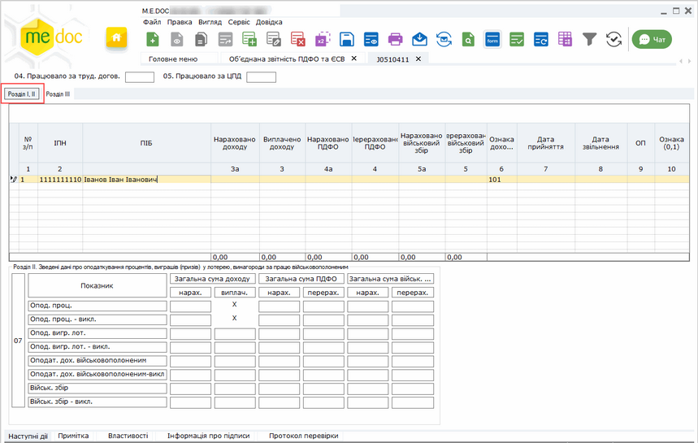

Натисніть, щоб збільшити малюнок

У Розділі І можна автоматично заповнити дані:

- заповнення даних у графах Нараховано доходу, Ознака доходу (ОД), Ознака (0,1):

Виділіть рядок, для якого потрібно заповнити дані, та оберіть команду головного меню Правка - Групова заміна полів. У вікні, що відкриється, встановіть позначку біля поля, заповніть необхідні дані та натисніть ОК:

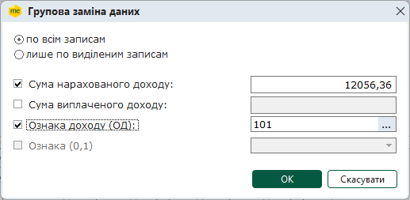

Якщо потрібно виконати заповнення даних в обраних записах, встановіть опцію лише по виділеним записам, інакше - встановіть опцію по всім записам.

Заміна значення графи Ознака (0,1) виконується лише для Додатків з типом Звітний новий або Уточнюючий.

- заповнення рядків даними з карток Фізичних осіб:

У меню Правка оберіть функцію Заповнити на основі довідника співробітників.

Відкриється вікно, у якому можна обрати довідник (довідники), на основі яких потрібно створити звіт: співробітники, пайовики та інші.

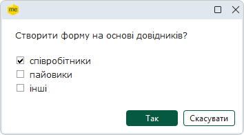

Довідник Співробітники, обраний за замовчуванням.

Для створення звіту за даними довідників встановіть відповідні позначки, та натисніть кнопку Так. Буде створено звіт на основі даних обраних довідників. Перевірте коректність перенесених даних та дозаповніть необхідні поля звіту.

Якщо у вас наявна ліцензія на використання модуля M.E.Doc.Зарплата, у вікні відкритого Додатка 4 на панелі інструментів доступна кнопка Заповнити , за допомогою якої можна автоматично заповнити Додаток 4 даними, які внесені у модулі M.E.Doc.Зарплата.

При заповненні звіту можна копіювати записи. Для цього виділіть запис, який потрібно копіювати, та натисніть на кнопку  або оберіть команду Скопіювати запиc у головному меню Файл.

- автоматичний розрахунок значень у графах: Нараховано ПДФО, Перераховано ПДФО, Нараховано військовий збір, Перераховано військовий збір:

Зверніть увагу! Розрахунок ПДФО та військового збору здійснюється без урахування пільг!

Функція дозволяє виконувати автоматичний розрахунок ПДФО та військового збору для обраних рядків або для всіх наявних рядків Додатка 4.

Якщо потрібно виконати розрахунок по окремим рядкам, виділіть рядок (або декілька рядків одночасно, утримуючі клавіші <Ctrl> або<Shift>) та оберіть команду головного меню Правка -  Розрахувати ПДФО та військовий збір.

У вікні, що відкриється, встановіть відмітку на пункті виконання розрахунку: лише по виділеним записам:

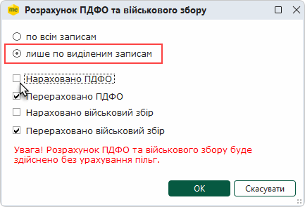

Якщо потрібно виконати розрахунок по всім рядкам, оберіть команду головного меню Правка -  Розрахувати ПДФО та військовий збір. У вікні, що відкриється, встановіть відмітку на пункті виконання розрахунку: по всім записам (обрано за замовчуванням):

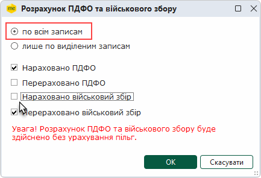

Далі оберіть графи, для яких необхідно виконати автоматичний розрахунок, встановивши відповідні опції у вікні Розрахунок ПДФО та військового збору: Нараховано ПДФО, Перераховано ПДФО, Нараховано військовий збір, Перераховано військовий збір (за замовчуванням обрано всі графи).

Натисніть на кнопку ОК.

- автоматичне перенесення даних із Додатка 1 до Додатка 4:

Оберіть команду головного меню Правка - Перенести дані із Додатка 1.

При виконанні цієї команди здійснюється автоматичне перенесення даних із Додатка 1 до Додатка 4. Якщо для одного ІПН у Додатку 1 заповнено кілька рядків із різними категоріями ЗО, при перенесенні у Додаток 4 дані групуються за ІПН, категоріями ЗО та з урахуванням типів нарахувань.

3. За потреби, у Розділі II заповніть рядок 07 Оподаткування процентів, виграшів (призів) у лотерею:

- у рядку Оподаткування процентів зазначається загальна сума доходу, нарахованого у вигляді процентів, загальна сума нарахованого податку на доходи фізичних осіб та загальна сума перерахованого до бюджету податку на доходи фізичних осіб відображаються, у національній валюті (у гривнях з копійками). Відомості про фізичну особу - платника податку, якій нараховані доходи у вигляді процентів, не зазначаються;
- рядок Оподаткування виграшів (призів) у лотерею повинен містити загальну сума нарахованого доходу у вигляді виграшів (призів) у лотерею, загальна сума виплаченого доходу у вигляді виграшів (призів) у лотерею, загальна сума нарахованого податку на доходи фізичних осіб та загальна сума перерахованого до бюджету податку на доходи фізичних осіб, у національній валюті (у гривнях з копійками). Відомості про фізичну особу - платника податку, якій нараховані доходи у вигляді виграшів (призів) у лотерею, не зазначаються.

4. Для заповнення даних Розділу ІІІ натисніть кнопку Розділ ІІІ:

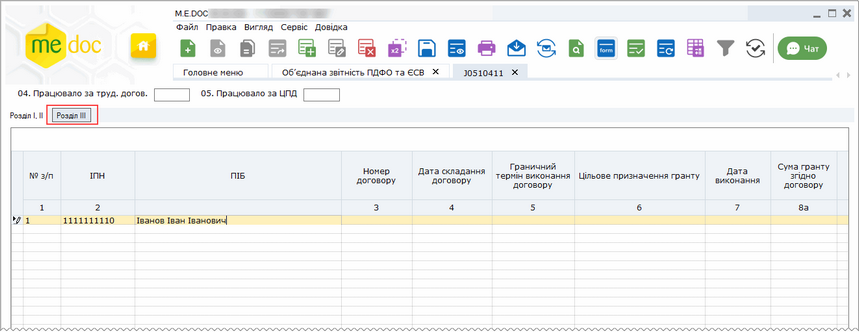

Натисніть, щоб збільшити малюнок

5. Збережіть звіт, натиснувши кнопку  або комбінацію клавіш <Ctrl+S>.

[До початку](#ucesv1dfrst-ucesv1dfrst_creation_d4)

#### Додаток 5 "Відомості про трудові відносини осіб та період проходження військової служби"

_Шлях у довідці: Розділи програми › Звітність › Об'єднана звітність ПДФО та ЄСВ › Процедура формування єдиної звітності › Додаток 5 "Відомості про трудові відносини осіб та період проходження військової служби"_

Для заповнення Додатка 5 виконайте дії:

Натисніть 2 рази лівою кнопкою миші на рядку Додатка 5. Відкриється вкладка звіту.

У Додатку 5 заповніть рядки з записами прийнятих та звільнених працівників, та тих, у яких змінились ці дані.

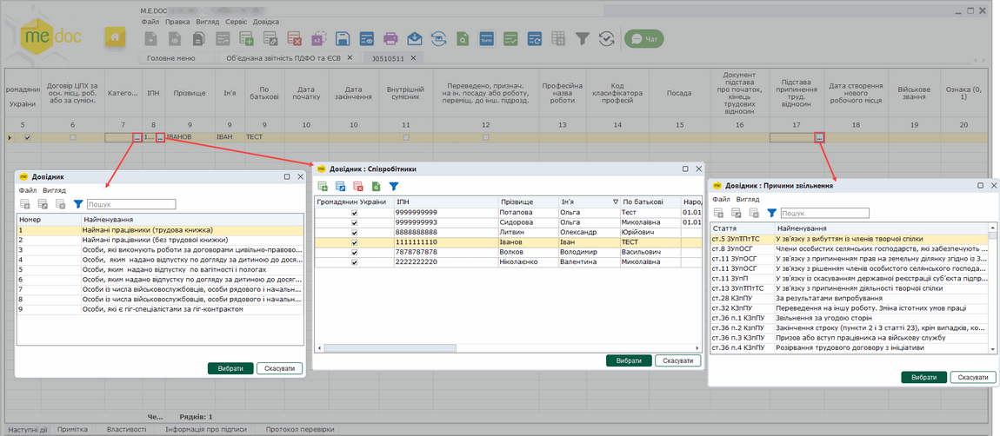

Натисніть, щоб збільшити малюнок

Для автоматичного заповнення  рядків даними з карток Фізичних осіб, у меню Правка оберіть функцію Заповнити на основі довідника співробітників. Перевірте коректність перенесених даних та дозаповніть необхідні поля звіту.

Якщо у вас наявна ліцензія на використання модуля M.E.Doc.Зарплата, у вікні відкритого Додатка 5 на панелі інструментів доступна кнопка Заповнити , за допомогою якої можна автоматично заповнити Додаток 5 даними, які внесені у модулі M.E.Doc.Зарплата.

- У звіт можна додавати записи за допомогою кнопки  на панелі інструментів або комбінацією клавіш Ctrl+I. Це можуть бути, наприклад, працівники, яким надано відпустки по догляду за дитиною чи пологах. Записи в Додатку 5 можуть бути додані лише із довідника Співробітники.
- У полі Категорія підключений довідник Категорії застрахованої особи, із якого потрібно обрати відповідну категорію. Також категорію можна вносити вручну із клавіатури.
- У полі Підстава припинення труд. відносин підключений довідник Причини звільнення. Із довідника обирається стаття КЗпПУ, на підставі якої працівник звільнений з посади.
- У полях Професійна назва роботи, Код класифікатор професій та Код ЗКППТР підключений довідник Класифікатор професій ДК 003:2010 (користувача). Поле Код ЗКППТР необов'язкове для заповнення.
- У довіднику Класифікатор професій ДК 003:2010 (користувача) користувачі мають змогу налаштувати персональний класифікатор професій, що застосовується на підприємстві. У вікні довідника можливо самостійно додати код КП та професійну назву роботи, або, натиснувши кнопку З довідника, обрати професію з Класифікатора професій ДК 003:2010:

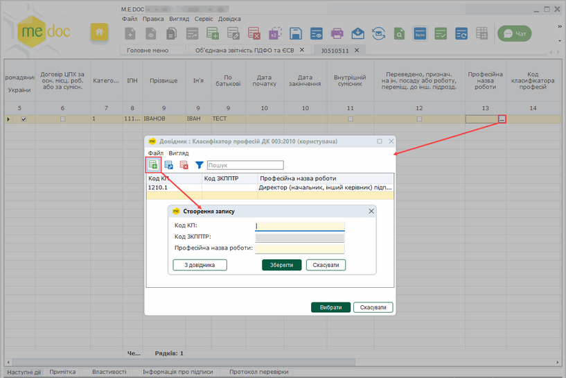

Натисніть, щоб збільшити малюнок

Будьте уважні при самостійному введенні інформації у довідник, переконайтеся у коректності даних, що вводяться.

- Значення поля Військове звання обирається з однойменного довідника.

У випадку, якщо дані у картці Фізична особа не актуальні, їх можна відредагувати безпосередньо із таблиці. Якщо співробітник новий, і він відсутній у довіднику, існує можливість спочатку додати його в довідник, а потім перенести в таблицю.

У Додатку 5 з типом Звітний новий або Уточнюючий можна автоматично заповнити дані у полі Ознака (0,1).

У вікні відкритого Додатка оберіть команду головного меню Правка - Групова заміна полів. У вікні, що відкриється, оберіть параметри заповнення даних:

- якщо потрібно виконати заповнення даних в обраних записах, встановіть опцію лише по виділеним записам, інакше - встановіть опцію по всім записам;
- встановіть позначку біля поля Ознака (0,1) та оберіть потрібне значення зі списку та натисніть ОК:

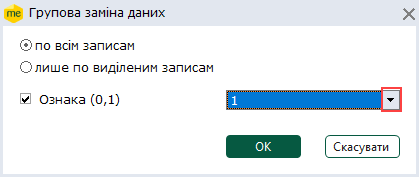

Зверніть увагу, при виконанні групової обробки виконується заміна вмісту графи Ознака (0,1) обраним значенням!

Для редагування неактуальних даних співробітника:

1) натисніть на кнопку  на панелі інструментів відкритого Додатка 5;

2) у вікні довідника Співробітники, що відкриється, знайдіть та виділіть потрібний запис;

3) натисніть кнопку  на панелі інструментів вікна Співробітники, щоб відкрити картку Фізична особа;

4) в картці виправте помилкові дані чи неточності, збережіть внесені зміни та закрийте картку Фізична особа;

5) у вікні довідника Співробітники оберіть виправлений запис та натисніть на кнопку Вибрати, щоб додати запис в новий рядок таблиці Додатка 5.

Для додавання нового співробітника у довідник Співробітники:

1) натисніть на кнопку  на панелі інструментів відкритого Додатка 5;

2) у вікні довідника Співробітники, що відкриється, натисніть кнопку , щоб додати запис нового співробітника;

3) внесіть та збережіть дані нового працівника;

4) натисніть на кнопку Вибрати у вікні довідника Співробітники для внесення нового працівника у Додаток 5.

Після формування таблиці потрібно оновити поля (команда Правка - Оновити поля або <F5>), перевірити звіт (на вкладці Наступні дії команда Перевірити звіт) та зберегти (<Ctrl+S>).

Для зручної роботи з даними є можливість сортувати дані співробітників за ІПН, ПІБ та іншими параметрами. Для сортування натисніть на заголовок відповідної колонки.

Також можна зберегти Додаток 5 у форматі pdf. Для цього у вкладці відкритої таблиці виконайте команду меню Файл - Друк у pdf.

Щоб зберегти порядок сортування записів у роздрукованому або збереженому у форматі pdf Додатку 5, перед друком відсортуйте таблицю за потрібною колонкою та виконайте команду меню Файл – Зберегти сортування таблиці.

[До початку](#ucesv1dfrst-ucesv1dfrst_creation_d5)

#### Додаток 6 "Відомості про наявність підстав для обліку стажу окремим категоріям осіб відповідно до законодавства"

_Шлях у довідці: Розділи програми › Звітність › Об'єднана звітність ПДФО та ЄСВ › Процедура формування єдиної звітності › Додаток 6 "Відомості про наявність підстав для обліку стажу окремим категоріям осіб відповідно до законодавства"_

Попередньо у Картці пі6дприємства на закладці Пенсійний фонд потрібно відмітити поле Наявність підстав для пільг. Рекомендуємо заповнити у картках Фізична особа дані про спецстаж працівників.

Для заповнення Додатка 6 виконайте дії:

1. Натисніть 2 рази лівою кнопкою миші на рядку Додатка 6, що відповідає порядковому номеру місяця у кварталі, за який потрібно заповнити звіт. Відкриється вкладка звіту. Заповніть необхідні поля.

Для автоматичного заповнення рядків даними з карток Фізичних осіб, у меню Правка оберіть функцію Заповнити на основі довідника співробітників.

Дані заповнюються відповідно до періоду, зазначеному при створенні Додатка 6.

При перенесенні даних в таблицю із картки співробітника враховується інформація, внесена у полях:

- Прийнято;
- Звільнено;
- наявність відмітки у полі Ознака фізичної особи СПД;
- наявність відмітки у полі Не використовується.

Перевірте коректність перенесених даних та дозаповніть необхідні поля звіту.

Якщо у вас наявна ліцензія на використання модуля M.E.Doc.Зарплата, у вікні відкритого Додатка 6 на панелі інструментів доступна кнопка Заповнити , за допомогою якої можна автоматично заповнити Додаток 6 даними, які внесені у модулі M.E.Doc.Зарплата.

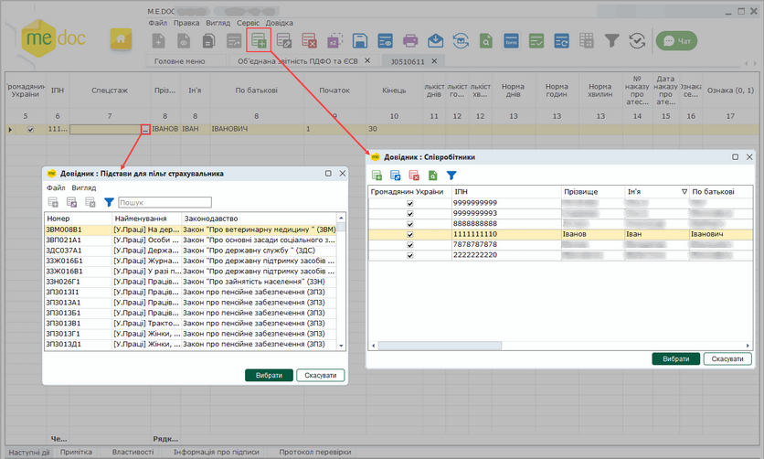

Натисніть, щоб збільшити малюнок

У випадку, якщо в картку Фізична особа не внесені дані про спецстаж працівника, є можливість при додаванні рядків внести інформацію про спецстаж у картку співробітника.

Для цього:

1)  натисніть на кнопку  панелі інструментів у вкладці Додатка 6;

2)  у вікні довідника Співробітники оберіть працівника, який має підстави для нарахування спеціального стажу (в тому числі і без сплати внесків);

3)  у вікні довідника натисніть кнопку  , щоб відкрити картку Фізична особа обраного співробітника;

4)  внесіть у картку дані про спецстаж та збережіть їх, закрийте картку Фізична особа;

5)  для внесення працівника у таблицю Додатка 6 оберіть його у вікні довідника Співробітники та натисніть на кнопку Вибрати.

Примітка:

Якщо спецстаж доданий у картку співробітника, при формуванні Додатка 6 у наступному звітному періоді в запис такого співробітника дані про спецстаж будуть перенесені автоматично.

Можна скопіювати запис співробітника. Для цього виділіть запис, який потрібно копіювати, та натисніть на кнопку  або оберіть команду Скопіювати запиc у головному меню Файл.

2. Дані про спецстаж оберіть із підключеного довідника у полі Спецстаж. Проте, якщо не внести ці дані в картку співробітника, цю операцію потрібно буде повторювати при формуванні таблиці у наступних звітних періодах.

3. Дані у поля Початок та Кінець потрібно внести вручну (дати повинні бути у межах поточного періоду).

4. Заповніть колонки, в які вносяться одиниці виміру спецстажу – заповнюється один із параметрів – або кількість днів, або кількість годин та хвилин, або ж кількість нормо-змін.

5. У колонку Норма внести дані про тривалість роботи.

6. Також повинні бути внесені дані у колонки № наказу про атестацію та Дата наказу про атестацію.

- Якщо такі дані не внесені, програма при перевірці виводить спеціальне попередження і звіт приймає статус Помилковий, але такі звіти зі статусом Помилковий можна експортувати із програми.
- Якщо ці дані внесені у картці співробітника, вони автоматично перенесуться у відповідні колонки таблиці.

7. За необхідності, заповнити колонку Ознака сезону, обравши із списку відповідне значення.

У Додатку 6 з типом Звітний новий або Уточнюючий можна автоматично заповнити дані у полі Ознака (0,1).

У вікні відкритого Додатка оберіть команду головного меню Правка - Групова заміна полів. У вікні, що відкриється, оберіть параметри заповнення даних:

- якщо потрібно виконати заповнення даних в обраних записах, встановіть опцію лише по виділеним записам, інакше - встановіть опцію по всім записам;
- встановіть позначку біля поля Ознака (0,1) та оберіть потрібне значення зі списку та натисніть ОК:

Зверніть увагу, при виконанні групової обробки виконується заміна вмісту графи Ознака (0,1) обраним значенням!

Після формування таблиці потрібно оновити поля (команда Правка - Оновити поля або <F5>), перевірити звіт (на вкладці Наступні дії команда Перевірити звіт) та зберегти (<Ctrl+S>).

Для зручної роботи з даними є можливість сортувати дані співробітників за ІПН, ПІБ та іншими параметрами. Для сортування натисніть на заголовок відповідної колонки.

Також можна зберегти Додаток 6 у форматі pdf. Для цього у вкладці відкритої таблиці виконайте команду меню Файл - Друк у pdf.

#### Групова перевірка звітів

_Шлях у довідці: Розділи програми › Звітність › Об'єднана звітність ПДФО та ЄСВ › Процедура формування єдиної звітності › Групова перевірка звітів_

Для виконання групової перевірки, виділіть у таблиці модуля документ пакета, який потрібно перевірити, та оберіть один із способів:

- команда головного меню Правка - Перевірити документ;
- натиснути кнопку на панелі інструментів .
- за допомогою клавіші F4.

Після перевірки відкривається загальний протокол перевірки всіх звітів пакету, в якому відображаються помилки звітів  (за наявності):

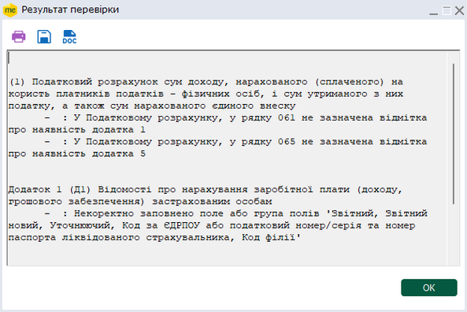

Натисніть, щоб збільшити малюнок

Із вікна можна надрукувати протокол (кнопка ), зберегти у файлі .rtf (кнопка ) та експортувати у Word (кнопка ).

В електронній таблиці модуля у колонці Статус змінюється відображення статусу всіх звітів пакету. Звіти з помилками будуть виділені червоним кольором та набудуть стану Помилковий.

Для виправлення помилок потрібно послідовно відкрити кожен звіт зі статусом Помилковий та перевірити його (F4). Перелік помилок буде наведений на вкладці Протокол перевірки, а помилкові рядки підсвічені червоним кольором.

#### Створення звітів з типом "Довідковий"

_Шлях у довідці: Розділи програми › Звітність › Об'єднана звітність ПДФО та ЄСВ › Процедура формування єдиної звітності › Створення звітів з типом "Довідковий"_

Функція доступна тільки для форм звітності версії 09.

Відповідно до наказів Міністерства фінансів України:

- [№113 від 02.03.2023 р. "Про внесення змін до наказу Міністерства фінансів України від 13 січня 2015 року № 4"](https://zakon.rada.gov.ua/laws/show/z0650-23#Text);
- № 39 від 24 січня 2025 року «Про внесення змін до наказу Міністерства фінансів України від 13 січня 2015 року № 4» із змінами, внесеними наказом Міністерства фінансів України № 53 від 30 січня 2025 року «Про внесення змін до наказу Міністерства фінансів України від 24 січня 2025 року № 39»

форми звітності версії 09, головний документ пакета - Розрахунок J0500109, F0500109, подавався щоквартально, з 01 жовтня 2023 до 01.01.2025 року.

Якщо Розрахунок подається платником єдиного внеску з типом Звітний як Довідковий, у додатках міститься інформація щодо призначення пенсії застрахованим особам або матеріального забезпечення, страхових виплат.

З типом Довідковий можуть створюватися Додаток1, Додаток5 та Додаток 6.

Довідковий звіт містить інформацію щодо призначення пенсії застрахованим особам або матеріального забезпечення, страхових виплат (з позначкою призначення пенсії або призначення матеріального забезпечення, страхових виплат).

1. Для створення звіту виділіть рядок документа у реєстрі та оберіть один із способів:

- натисніть 2 рази лівою кнопкою миші на рядку звіту;
- оберіть команду головного меню Файл - Створити;
- натисніть кнопку на панелі інструментів .

У вікні, що відкриється введіть Номер розрахунку.

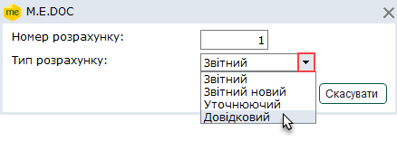

2. Оберіть Тип розрахунку - Довідковий.

3. Натисніть кнопку ОК.

4. У вікні розділу буде створено додатковий пакет звітів з типом Довідковий:

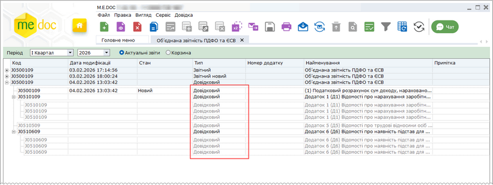

Натисніть, щоб збільшити малюнок

5. Натисніть 2 рази лівою кнопкою миші на рядку Додатка, який потрібно заповнити. Відкриється вкладка Додатка, на якій введіть необхідні данні.

При створенні Розрахунку з типом Довідковий встановлюються відмітки у рядках 011 та 014:

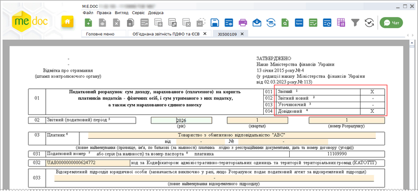

Натисніть, щоб збільшити малюнок

#### Створення звітів з типом "Уточнюючий"

_Шлях у довідці: Розділи програми › Звітність › Об'єднана звітність ПДФО та ЄСВ › Процедура формування єдиної звітності › Створення звітів з типом "Уточнюючий"_

Розрахунок з типом Уточнюючий, подається у випадку уточнення (зменшення або збільшення) показників сум єдиного внеску, відображених у Розрахунку з типом Звітний або Звітний новий, поза межами звітного (податкового) періоду.

Якщо Додаток подається в складі Розрахунку з типом Уточнюючий він має містити виключно коригування даних відповідно до передбаченого для цього додатка порядку коригування рядків.

1. Для створення звіту виділіть рядок документа у реєстрі та оберіть один із способів:

- натисніть 2 рази лівою кнопкою миші на рядку звіту;
- оберіть команду головного меню Файл - Створити;
- натисніть кнопку на панелі інструментів .

У вікні, що відкриється введіть Номер розрахунку.

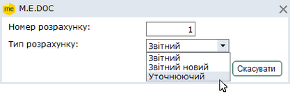

Натисніть, щоб збільшити малюнок
Для форм версії 11

2. Оберіть Тип розрахунку - Уточнюючий.

3. Натисніть кнопку ОК.

4. У вікні розділу буде створено додатковий пакет звітів з типом Уточнюючий:

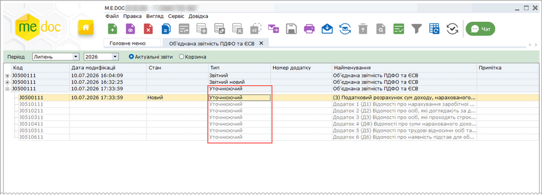

Натисніть, щоб збільшити малюнок

5. Натисніть 2 рази лівою кнопкою миші на рядку Додатка, який потрібно заповнити. Відкриється вкладка Додатка, на якій введіть необхідні данні.

При створенні Розрахунку з типом Уточнюючий встановлюються відмітки у рядку 013:

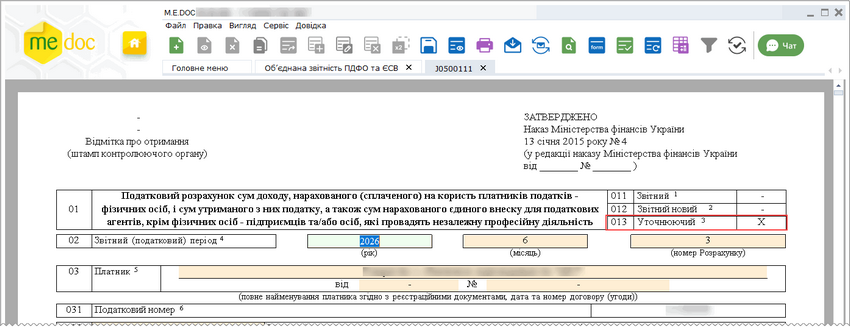

Натисніть, щоб збільшити малюнок

### Збереження пакету звітів на електронному носії

_Шлях у довідці: Розділи програми › Звітність › Об'єднана звітність ПДФО та ЄСВ › Збереження пакету звітів на електронному носії_

В цьому розділі:

[Експорт документів для подання у контролюючі органи](#ucesv1dfrst-ucesv1dfrst_saving)

[Експорт документів у формат XML для обміну звітністю](#ucesv1dfrst-ucesv1dfrst_saving)

[Експорт документів з квитанціями](#ucesv1dfrst-ucesv1dfrst_saving)

[Експорт у форматі dbf](#ucesv1dfrst-ucesv1dfrst_saving)

Експорт звітів призначений для збереження документів у обраному каталозі з метою подачі вивантажених звітів як у контролюючі органи, так і у Головну установу (для підзвітних організацій).

Збереження комплекту звітів виконується за допомогою функції Експорт. Після обрання користувачем такої функції програма повідомляє про наявність неперевірених чи помилкових звітів у окремому інформаційному повідомленні.

Із програми дозволений експорт звітів зі статусом Помилковий, але програма завжди попереджає про наявність звітів з таким статусом.

Функція експорту доступна і у відкритому вікні документа. Із вікна відкритого документа експортується тільки поточний документ.

- Можна виконувати експорт кількох пакетів документів Об'єднаної звітності ПДФО та ЄСВ одночасно.

Для виконання групового експорту виділіть декілька головних документів пакетів «Податковий розрахунок сум доходу …» та виконайте команду головного меню Файл – Експорт або команду контекстного меню Експорт.

- Можна передавати у/завантажувати із СОТА документи об'єднаної звітності. Для цього у модулі Об'єднана звітність ПДФО та ЄСВ необхідно виконати відповідну команду головного меню: Сервіс – Передати документ в СОТА або Сервіс – Завантажити документи з СОТА. Докладно дивіться у розділі [Обмін документами з СОТА](DataMedocOnline.html#datamedoconline-dataflow).

Експорт документів для подання у контролюючі органи

Для збереження пакету звітів на електронному носії потрібно:

1. У модулі виділити головний документ пакета (встановити курсор на рядок документа). Для одночасного експорту кількох пакетів виділіть головні документи потрібних пакетів, утримуючи клавішу <Ctrl>.

2. Виконайте команду Експорт одним із способів:

- із меню Файл - Експорт;
- із контекстного меню Експорт

3. Якщо в комплекті є неперевірені чи помилкові документи, програма попереджає про їх наявність. Якщо помилкові або неперевірені звіти експортувати не потрібно, відмініть експорт - натисніть Ні, після чого виправте або перевірте такі звіти.

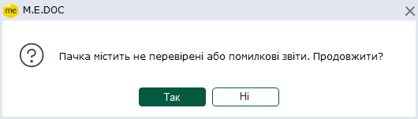

4. У вікні Експорт оберіть опцію для подачі у контролюючий орган та вкажіть диск чи каталог, у який буде збережений файл.

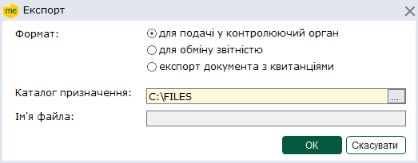

5. Ім'я файлу програма сформує автоматично згідно вимог контролюючого органу. Звіт зберігається на диску непідписаним (без ЕП).

6. Після завершення процедури експорту програма у окремому вікні повідомляє про результат експорту.

7. Документи будуть збережені у обраному каталозі в файли з розширенням .xml.

Сформований XML файл основного документа пакету (Розрахунок) містить посилання на всі створені таблиці, і відповідно, у всіх таблицях є посилання на основний документ.

За цими ознаками в Центрі обробки електронних звітів (шлюзі прийому звітності) виконується контроль повноти надісланого пакету.

[До початку](#ucesv1dfrst-ucesv1dfrst_saving)

Експорт документів у формат XML для обміну звітністю

Дана функція призначена для збереження звітів на електронному носії чи у обраному каталозі з метою передачі його у Головну установу.

1. У модулі виділити головний документ пакета (встановити курсор на рядок документа). Для одночасного експорту кількох пакетів виділіть головні документи потрібних пакетів, утримуючи клавішу <Ctrl>.

2. Виконайте команду Експорт одним із способів:

- команда Файл - Експорт - Експорт;
- із контекстного меню команда Експорт.

3. На виконання команди відкриється вікно Експорт. Оберіть опцію для обміну звітністю.

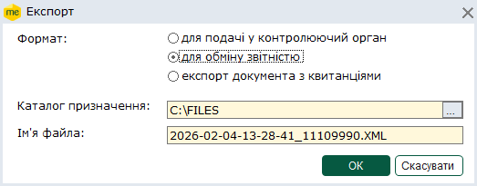

4. У полі Каталог призначення вкажіть каталог, де зберегти експортовані файли. Імена файлів генеруються автоматично, містять дату, час створення та код ЄДРПОУ підприємства.

5. Натисніть ОК.

6. Система повідомить про закінчення процесу експорту.

[До початку](#ucesv1dfrst-ucesv1dfrst_saving)

Експорт документів з квитанціями

Дана функція призначена для збереження звітів на електронному носії чи у обраному каталозі, для яких отримано квитанції. Експорт звітів виконується у форматі XML, крім даних документів зберігається інформація, що міститься у квитанціях.

1. У модулі виділити головний документ пакета (встановити курсор на рядок документа). Для одночасного експорту кількох пакетів виділіть головні документи потрібних пакетів, утримуючи клавішу <Ctrl>.

2. Виконайте команду Експорт одним із способів:

- команда Файл - Експорт - Експорт;
- із контекстного меню команда Експорт.

3. На виконання команди відкриється вікно Експорт. Оберіть опцію експорт документа з квитанцією.

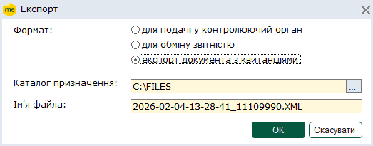

4. У полі Каталог призначення вкажіть каталог, де зберегти експортований файл. Імена файлів генеруються автоматично, містять дату, час створення та код ЄДРПОУ підприємства.

5. Натисніть ОК.

6. Система повідомить про закінчення процесу експорту.

[До початку](#ucesv1dfrst-ucesv1dfrst_saving)

Експорт у форматі DBF

Дана функція призначена для збереження звітів на електронному носії у форматі DBF.

1. Виділіть будь-який документ пакета у таблиці модуля.

2. Оберіть команду головного меню Файл - Експорт - Експорт в DBF.

3. На виконання команди відкриється вікно Параметри експорту в DBF.

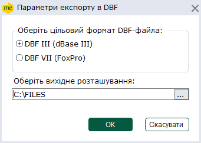

4. Оберіть формат експорту (за замовчуванням - DBF III). У полі Оберіть вихідне розташування вкажіть каталог, де зберегти створений файл.

5. Натисніть ОК.  Будуть експортовані всі звіти, що створені у обраному пакеті. Ім'я експортованих файлів генерується автоматично та містить код експортованого звіту:

- для звітів юридичних осіб (форми J) - <код додатка>.dbf, наприклад, J0510111.dbf - дані Додатка 1;
- для звітів фізичних осіб-підприємців (ФОП) та осіб, які провадять незалежну професійну діяльність (форми F) - <код додатка>\_<номер місяця у кварталі>.dbf, наприклад, F0510111\_3.dbf дані Додатка 1 за третій місяць кварталу.

6. Система повідомить про закінчення процесу експорту.

Пакет звітності буде збережено у підкаталозі PFUDBF(<N>) обраної папки. При кожному сеансі експорту буде створено новий підкаталог, до назви якого додається порядковий номер - N (PFUDBF(1), PFUDBF(2) тощо).

[До початку](#ucesv1dfrst-ucesv1dfrst_saving)

### Імпорт об'єднаної звітності

_Шлях у довідці: Розділи програми › Звітність › Об'єднана звітність ПДФО та ЄСВ › Імпорт об'єднаної звітності_

В цьому розділі:

[Імпорт xml файлів](#ucesv1dfrst-ucesv1dfrst_import)

[Імпорт із dbf файлів](#ucesv1dfrst-ucesv1dfrst_import)

[Імпорт додаткових рядків у Додатки за допомогою функції "Додати рядки з DBF"](#ucesv1dfrst-ucesv1dfrst_import)

У форматі xml здійснюється імпорт всього пакету документів або окремих документів пакету.

У форматі dbf у програму можна імпортувати вже заповнені в інших бухгалтерських програмах Додатки.

Імпорт xml файлів

1. Оберіть команду Файл - Імпорт - Імпорт звітів.

2. Відкриється вікно Відкриття файлу.

3. Оберіть каталог, де збережений файл.

4. Виділити цей файл курсором миші та натиснути кнопку Відкрити.

5. По закінченні процедури, система виведе протокол імпорту даних. Якщо імпорт не виконаний, буде повідомлена причина.

Імпортовані звіти поміщаються у модуль Об'єднана звітність з ПДФО та ЄСВ у відповідний звітний період. Імпортовані документи позначаються синім кольором.

[До початку](#ucesv1dfrst-ucesv1dfrst_import)

Імпорт із dbf файлів

Примітка:

Опис структури DBF для імпорту файлів у програму міститься у документі з назвою Структура файлів імпорту Додатків Об'єднаної звітності ПДФО та ЄСВ (DBF).pdf, який знаходиться у каталозі help\manuals\.

Збережіть файли dbf, призначені для імпорту у окремому каталозі. Файли dbf, що містять дані кожного Додатку, повинні обов'язково відповідати структурі, що описана у документі з назвою Структура файлів імпорту Додатків Об'єднаної звітності ПДФО та ЄСВ (DBF).pdf.

Важливо!

Для імпорту звітів юридичних осіб (форми J) рекомендуємо зберігати файли з іменами формату: <код додатка>.dbf.

Наприклад, J0510111.dbf - дані Додатка 1). У такому випадку відповідність файлів певним Додаткам під час налаштування імпорту буде визначено автоматично.

Для звітів фізичних осіб-підприємців (ФОП) та осіб, які провадять незалежну професійну діяльність (форми F) кожен dbf-файл повинен містити дані додатка за певний місяць кварталу.

Для автоматичного встановлення відповідності dbf файлу місяцю кварталу ім'я файлу повинно відповідати формату: <код додатка>-<номер місяця у кварталі>.dbf.

Наприклад, F0510111-3.dbf дані Додатка 1 за третій місяць кварталу.

За один сеанс імпорту виконується перенесення даних тільки за один квартал. Зберігайте файли dbf для відповідних кварталів у різних каталогах.

У якості роздільника у імені файлу можна використовувати символ "-" або "\_".

Для імпорту у програму Додатків (1-6) до Розрахунку у форматі dbf:

1. На вкладці модуля Об'єднана звітність ПДФО та ЄСВ  оберіть команду Файл - Імпорт - Імпорт з DBF.

2. Відкриється вікно Імпорт додатків звіту ПДФО та ЄСВ. У полі Оберіть кодування вкажіть потрібне значення. У полі Оберіть каталог для імпорту вкажіть шлях до каталогу розміщення dbf-файлів. Поля Додаток 1 - Додаток 6 заповняться автоматично, за умови наявності відповідних файлів в указаному каталозі

Щоб обрати файли для імпорту Додатків вручну, у полі (полях), що відповідає місяцю, натисніть  та оберіть потрібний файл.

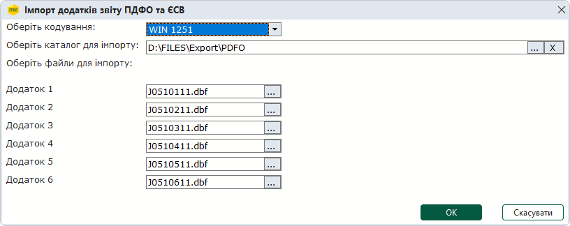

3. Натисніть ОК. У наступному вікні Імпорт звітів вкажіть параметри імпорту:

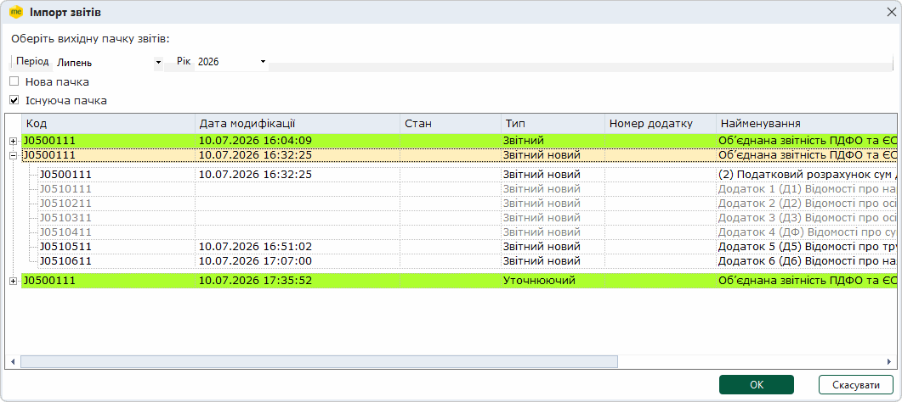

- Період нового звіту - оберіть звітний період, у який потрібно імпортувати звіт;
- Рік - оберіть рік, у який слід імпортувати пакет звітів.

Оберіть спосіб імпорту, встановивши опцію:

- Нова пачка - створити новий пакет документів, до якого імпортувати дані документів. При імпорті у новий пакет, звіти поміщаються у модуль, як Звітні.
- Існуюча пачка - імпортувати дані у пакет, що вже існує, у вікні необхідно виділити пакет, до якого необхідно виконати імпорт (обраний рядок виділяється сірим кольором). Якщо у пакеті вже присутній такий самий документ, що і імпортується, імпорт такого документа не виконується.

Натисніть ОК.

Якщо обрано імпорт до нового пакета документів (встановлено опцію Нова пачка), відкриється вікно, у якому введіть Номер розрахунку та оберіть Тип розрахунку:

4. Розпочнеться імпорт даних, що може тривати деякий час:

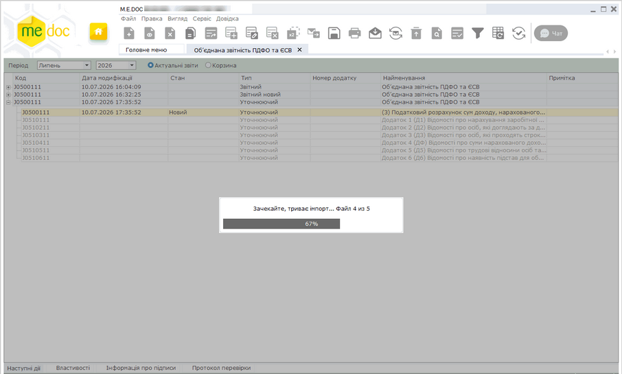

Натисніть, щоб збільшити малюнок

5. По закінченні процедури, система виведе протокол імпорту даних. Якщо імпорт не виконаний, буде повідомлена причина.

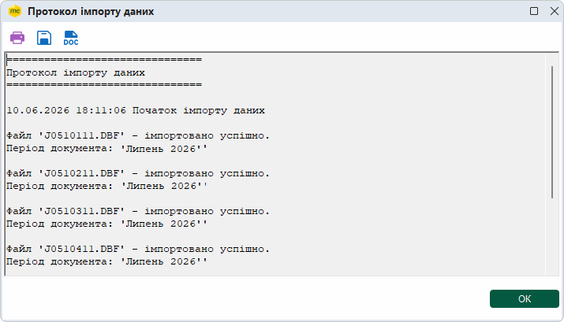

Всі імпортовані документи пакету будуть виділені синім кольором, їх можна відкривати та редагувати:

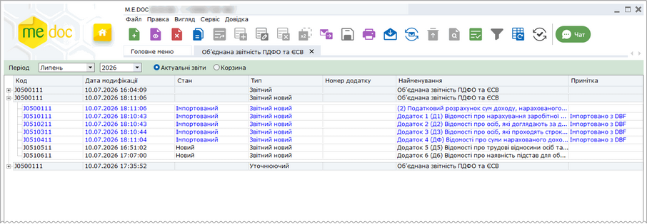

Натисніть, щоб збільшити малюнок

Всі Додатки після імпорту потрібно відкрити, перевірити (<F4>), оновити поля (<F5>) та зберегти (<Ctrl+S>).

Поля, які не передбачені у структурі DBF, заповняться поточними даними та даними із картки установи. Переглянути їх можна у електронній формі звіту (меню Правка - Електронна форма або <F11>).

Після перевірки всіх імпортованих звітів потрібно створити відсутні Додатки.

[До початку](#ucesv1dfrst-ucesv1dfrst_import)

Імпорт додаткових рядків у Додатки за допомогою функції "Додати рядки з DBF"

Функція Додати рядки з DBF дозволяє вносити додаткові записи у вже заповнені Додатки.

Під час операції імпорту додаються рядки тільки у один Додаток, який обраний у таблиці модуля.

1. Виділіть рядок Додатка, у який потрібно додати рядки.

2. Оберіть один із варіантів:

- меню Файл - Додати рядки з DBF;
- контекстне меню - Додати рядки з DBF:

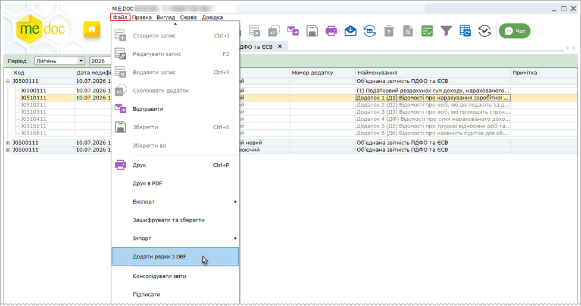

Натисніть, щоб збільшити малюнок

3. У вікні, що відкриється, оберіть  DBF-файл, рядки із якого потрібно додати у обраний Додаток:

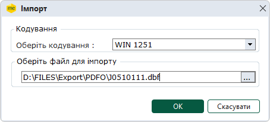

4. Виконається перевірка кодування DBF файлу, у випадку невідповідності кодування програма пропонує перекодувати файл.

Після закінчення імпорту відкривається Протокол імпорту даних, у якому повідомляється про результат імпорту. Якщо імпорт успішний, в обраний Додаток будуть додані нові записи.

Далі потрібно відкрити всі Додатки, в які додані рядки, перевірити (<F4>), оновити поля (<F5>) та зберегти (<Ctrl+S>).

[До початку](#ucesv1dfrst-ucesv1dfrst_import)

### Копіювання звіту

_Шлях у довідці: Розділи програми › Звітність › Об'єднана звітність ПДФО та ЄСВ › Копіювання звіту_

В цьому розділі:

[Копіювання Додатка у квартальних формах звітності](#ucesv1dfrst-ucesv1dfrst_copy)

[Копіювання Додатків](#ucesv1dfrst-ucesv1dfrst_copy)

[Копіювання пакета звітів](#ucesv1dfrst-ucesv1dfrst_copy)

Можливо копіювати пакет звітів у поточний період чи у інший звітний період, а також копіювати окремі Додатки у межах пакету.

Копіювання Додатка у квартальних формах звітності

Функція доступна тільки для квартальних для форм звітності.

- Можна копіювати Додаток 1, Додаток 2, Додатка 3, Додаток 4 та Додаток 6. Функція Скопіювати додаток недоступна для Додатка 5.
- Якщо у пакеті вже створено всі 3 Додатка певного виду, функція Скопіювати додаток для Додатка цього виду недоступна.
- Зверніть увагу! Для копіювання Додатків усі звіти пакету повинні бути закриті, інакше функція копіювання недоступна.

У таблиці модуля виділіть рядок Додатка, який потрібно копіювати, та оберіть один із способів:

- натисніть праву кнопку миші на рядку обраного Додатка та оберіть пункт контекстного меню Скопіювати додаток;
- оберіть команду головного меню Файл - Скопіювати додаток;
- натисніть кнопку на панелі інструментів .

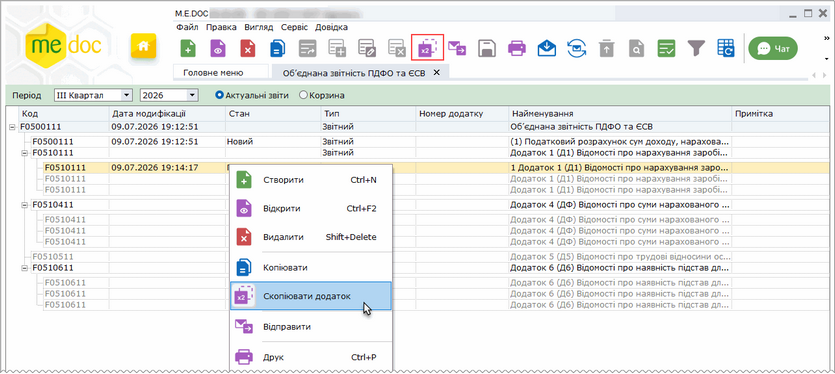

Натисніть, щоб збільшити малюнок

Програма повідомить про успішне копіювання. Натисніть ОК, щоб продовжити:

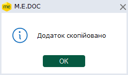

Рядок скопійованого Додатка з'явиться у таблиці розділу. Скопійовані документи пакету будуть виділені зеленим кольором, їх можна відкривати та редагувати:

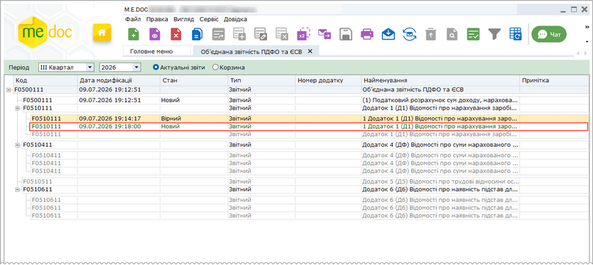

Натисніть, щоб збільшити малюнок

[До початку](#ucesv1dfrst-ucesv1dfrst_copy)

Копіювання Додатків

Копіювання додатків доступне лише для пакетів звітності версії 11.

При спробі копіювати Додатків звітності більш ранніх версій з'явиться повідомлення:

Натисніть, щоб збільшити малюнок

Щоб копіювати Додатки звітності більш ранніх версій, спочатку [скопіюйте весь пакет звітності](#ucesv1dfrst-ucesv1dfrst_copy), який містить потрібні додатки.

Зверніть увагу, копіювання Додатків в існуючий пакет можливе лише у пакет звітів того ж типу, що й пакет, з якого відбувається копіювання (Звітний - Звітний, Уточнюючий - Уточнюючий тощо).

Якщо у пакеті вже створено Додатки певного виду, функція Скопіювати додаток для Додатка цього виду недоступна.

1. У таблиці модуля виділіть рядок Додатка, який потрібно копіювати, та оберіть один із способів:

- натисніть праву кнопку миші та оберіть пункт контекстного меню Копіювати;
- оберіть команду головного меню Файл - Копіювати;
- натисніть кнопку на панелі інструментів .

2. У наступному вікні у полі Період оберіть звітний місяць, у який потрібно скопіювати Додаток.

Оберіть спосіб копіювання, встановивши опцію:

- Нова пачка - створити новий пакет документів, до якого скопіювати документи;
- Існуюча пачка - скопіювати документи у пакет, що вже існує, у вікні необхідно виділити пакет, до якого необхідно копіювати документи (обраний рядок виділяється сірим кольором).

Натисніть, щоб збільшити малюнок

Натисніть ОК.

Якщо було обрано копіювання у новий пакет, оберіть номер та тип розрахунку. Натисніть ОК.

Скопійований Додаток з'явиться у таблиці розділу. Скопійовані документи пакету будуть виділені зеленим кольором, їх можна відкривати та редагувати:

Натисніть, щоб збільшити малюнок

[До початку](#ucesv1dfrst-ucesv1dfrst_copy)

Копіювання пакета звітів

Під час копіювання пакета звітності виконується автоматична конвертація звітів у версію 11.

У таблиці модуля виділіть потрібний комплект документів (загальний рядок з назвою звіту або рядок Розрахунку) та оберіть один із способів:

- натисніть праву кнопку миші та оберіть пункт контекстного меню Копіювати;
- оберіть команду головного меню Файл - Копіювати;
- натисніть кнопку на панелі інструментів .

У наступному вікні Копіювання звіту вкажіть параметри копіювання звіту:

Натисніть, щоб збільшити малюнок

- Період нового звіту - оберіть звітний період, у який скопіювати звіт;
- Рік - оберіть рік, у який слід скопіювати пакет звітів;
- Номер розрахунку - введіть порядковий номер розрахунку у періоді;
- Тип розрахунку - із списку оберіть тип розрахунку.

Натисніть ОК.

Програма повідомить про успішне копіювання. Натисніть ОК, щоб продовжити.

Скопійований пакет звітів з'явиться у таблиці розділу:

Натисніть, щоб збільшити малюнок

Всі скопійовані документи пакету будуть виділені зеленим кольором, їх можна відкривати та редагувати.

[До початку](#ucesv1dfrst-ucesv1dfrst_copy)

### Консолідація звітів

_Шлях у довідці: Розділи програми › Звітність › Об'єднана звітність ПДФО та ЄСВ › Консолідація звітів_

Використовується у випадку, якщо в програму імпортовано декілька звітів і потрібно звести дані всіх цих звітів в один консолідований.

Ця функція призначена для установ, які повинні подавати єдиний звіт, а також у випадку, якщо документи однієї установи створювалися на різних комп'ютерах і були імпортовані у програму як окремі звіти.

1. Виконати команду головного меню Файл – Консолідувати звіти.

2. У вікні Вибір звітів встановіть відмітки у рядках пакетів, які потрібно консолідувати. Для консолідації потрібно обирати пакети одного типу (Звітний, Уточнюючий тощо):

Натисніть, щоб збільшити малюнок

Зверніть увагу, для квартальної звітності консолідація додатків виконується за номером місяця. Якщо у додатку не вказано номер місяця, консолідація для такого додатка не виконується.

Натисніть кнопку ОК.

3. У наступному вікні введіть номер розрахунку та натисніть ОК.

Поле Тип розрахунку заповнюється за замовчуванням та містить тип пакетів, що обрані для консолідації.

4. Консолідовані звіти позначаються у таблиці модуля жирним шрифтом:

Натисніть, щоб збільшити малюнок

Після консолідації потрібно відкрити всі Додатки, оновити поля (F5), перевірити (F4) та зберегти звіти (Ctrl+S).

### Оновлення реєстру співробітників за даними Додатка 1

_Шлях у довідці: Розділи програми › Звітність › Об'єднана звітність ПДФО та ЄСВ › Оновлення реєстру співробітників за даними Додатка 1_

Дана функція використовується, наприклад, у випадку, якщо документи імпортуються з інших бухгалтерських систем, а не формуються у модулі, при цьому довідник Співробітники не підтримується в актуальному стані.

Функція надає можливість оновити дані довідника Співробітники на основі даних про працівників, внесених у Додаток 1.

Для оновлення довідника Співробітники у вікні Додатка 1 виконайте команду головного меню Файл -  Оновити довідник співробітників.

У вікні, що відкриється, вкажіть спосіб оновлення - додати лише нові записи, чи додати нові з оновленням вже існуючих:

Натисніть, щоб збільшити малюнок

Після оновлення даних співробітників програма повідомляє про результат виконання операції.

Якщо необхідно оновити дані тільки певних співробітників, виділіть записи співробітників, які потрібно оновити, у таблиці Додатка 1. Для цього натискайте мишею на першій колонці таблиці, утримуючі клавіши <Ctrl> або <Shift>.

### Друк документів

_Шлях у довідці: Розділи програми › Звітність › Об'єднана звітність ПДФО та ЄСВ › Друк документів_

Друк звітів можливий як з реєстру модуля, так і з вікна відкритого документа.

Для друку звітів із реєстру:

1. У реєстрі виділіть потрібний документ (встановити курсор на рядок документа).

2. Оберіть один із способів:

- команда головного меню Файл - Друк;
- натисніть комбінацію клавіш <Сtrl+P>;
- натисніть кнопку  на панелі інструментів.

3. У вікні, що відкриється оберіть документи, які потрібно роздрукувати:

- Поточний документ - друкувати тільки поточний документ (виділений у реєстрі);
- Пакет звітів - друкувати всі документи пакета;
- Квитанції - друкувати квитанції документів (за наявності).

4. Натисніть ОК. У вікні Друк оберіть пристрій, на якому потрібно друкувати документи.

Із вікна відкритого документа можна надрукувати лише поточний документ.

### Відправлення об'єднаної звітності

_Шлях у довідці: Розділи програми › Звітність › Об'єднана звітність ПДФО та ЄСВ › Відправлення об'єднаної звітності_

Об'єднана звітність подається та приймається в пакеті, який представляє набір XML файлів.

Сформований XML файл основного документа пакету (Перелік таблиць звіту) містить посилання на всі створені таблиці, і відповідно, у всіх таблицях є посилання на основний документ.

За цими ознаками в Центрі обробки електронних звітів (шлюзі прийому звітності) виконується контроль повноти надісланого пакету.

Увага! Квитанції з результатами перевірки звіту приєднуються до кожної таблиці. Для того щоб впевнитись у прийнятті звіту, необхідно перевірити квитанції до кожної таблиці звіту. Якщо хоча б одна квитанція буде негативною, то весь звіт вважається неприйнятим (аналогічно до податкової звітності).

Для запуску процедури відправлення звіту електронною поштою потрібно виділити його у реєстрі звітів (встановити курсор на головний запис пакету) та обрати:

- оберіть команду головного меню Файл - Відправити;
- натиснути на кнопку  на панелі інструментів вікна модулю;
- із контекстного меню оберіть команду Відправити;
- у вкладці Наступні дії - Підписати звіт.

Спочатку формується файл звіту для відправлення, виконується накладення підписів на звіт, його шифрування та відправлення.

Накладення підписів

Після формування файлу звіту запускається його підписання - бухгалтером, директором, печаткою (програма запросить наявні для установи сертифікати).

Послідовність накладення підписів на звітні документи визначається звітним органом. Перелік підписів, які повинні накладатися на документи, встановлюється у модулі Адміністрування - Параметри системи - Підписи - Налаштувати комплект підписів. У групі Звітність потрібно відмітити посадових осіб та печатку, які підписуватимуть звіти.

Для накладення підпису потрібно у полі Каталог з секретними ключами встановити шлях до каталогу, а у полі Пароль секретного ключа - ввести пароль. Аналогічним чином накладаються всі підписи з визначеного комплекту підписів.

Далі необхідно вибрати одержувача, обрати сертифікат шифрування звіту, звіт буде відправлено на обрану адресу.

Відправлення звіту

Відкриється вікно Вибір адресата. Оберіть адресу потрібного контролюючого органу та натисніть на кнопку ОК.

На виконання цієї команди, система запропонує підписати файл будь-яким сертифікатом шифрування із [налаштованого](FormCompanyParams.html#formcompanyparams-admcomanyparams_pen) комплекту підписів Звітність - таким чином підписується "конверт", в який поміщається файл для відправки.

Приймання електронних квитанцій

Якщо звіт було відправлено безпосередньо із програми, приймання повідомлень та квитанцій виконується за допомогою функції Отримати повідомлення.

Електронні квитанції надходять на поштову скриньку, із якої відправлявся звіт. Прийняти квитанції із програми можна одним із способів:

- із меню Файл - Отримати повідомлення;
- за допомогою функціональної клавіші F9;
- кнопкою  на панелі інструментів головного вікна програми.

Після цього запускається перевірка наявності вхідних повідомлень і якщо такі повідомлення є, вони завантажуються. Для прийняття у програму їх потрібно розшифрувати (ввести пароль захисту секретного ключа печатки установи):

Якщо надійшли повідомлення (та квитанції), спочатку відкриється вікно Отримано повідомлення.

Після закриття цього вікна Повідомлення та квитанції поміщаються безпосередньо у звіт, який було відправлено (з'являються вкладки на нижній панелі вкладок).


