[← Зміст довідки](../)


# Аналітичні довідки

## Аналітичні довідки

_Шлях у довідці: Розділи програми › Облік ПДВ › Аналітичні довідки_

Модуль Аналітичні довідки надає користувачам можливість формувати вибірки аналітичних даних по отриманим і виданим ПН/РК та Митним деклараціям у розрізі кодів товарів/послуг, за заданими критеріями відбору, у тому числі за відповідністю деяким критеріям ризиковості, при наявності таких у ПН/РК.

Модуль містить підрозділи:

- Аналіз товарів/послуг за кодами УКТЗЕД/ДКПП (у т. ч. ризиковими) - призначений для формування вибірок даних по ПН/РК та Митним деклараціям у розрізі кодів товарів/послуг та напрямку документів, також у підрозділі можна створити документ «Таблиця даних платника податків на додану вартість» (J1312303, F1312303) на основі даних розділу;
- Реєстр Митних декларацій - призначений для створення та ведення реєстру митних декларацій.

У даному розділі довідки розглянуто наступне:

- [Основні елементи інтерфейсу](#ucevalbyucgs-ucevalbyucgs_int)
- [Робота з розділом Аналіз товарів/послуг за кодами УКТЗЕД/ДКПП (у т. ч. ризиковими)](#ucevalbyucgs-ucevalbyucgs_rob)
- [Реєстр Митних декларацій](#ucevalbyucgs-ucevalbyucgs_myto)

### Основні елементи інтерфейсу

_Шлях у довідці: Розділи програми › Облік ПДВ › Аналітичні довідки › Основні елементи інтерфейсу_

Дані у розділі Аналіз товарів/послуг за кодами УКТЗЕД/ДКПП (у т. ч. ризиковими) представлені у вигляді таблиці, окремий рядок якої відображає дані ПН/РК та Митних декларацій (за відповідних налаштувань), що консолідовані за ознаками: напрямок Отриманий/Виданий та Код товару УКТ ЗЕД/ДКПП за обраний період.

Розділ складається з 4 основних частин:

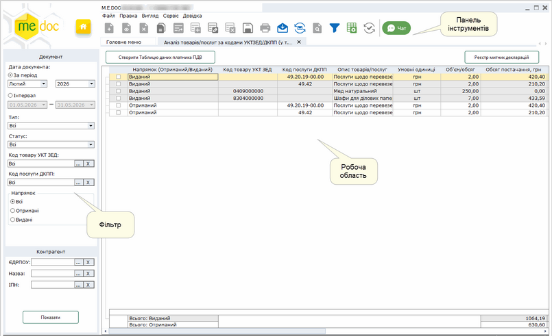

Натисніть, щоб збільшити малюнок

Фільтр

Робота з Реєстром акцизних документів розпочинається з Фільтру - зручного і потужного інструменту відбору потрібних документів.

У Фільтрі максимально зібрані атрибути документів, за якими здійснюється пошук та сортування. Фільтрація відбувається по будь-якому відомому параметру.

Після встановлення параметрів фільтрації натисніть на кнопку Показати. В робочій області відобразиться перелік документів згідно заданих параметрів пошуку.

Для того, щоб очистити поле від даних, натисніть на кнопку .

Відбір даних доступний за параметрами:

Документ

- Дата документа - встановіть позначку для вибору певного періоду або довільного періоду:
- За період - вкажіть місяць та рік, в межах якого були створені потрібні документи;
- Інтервал - вкажіть дату початку та закінчення довільного інтервалу, в межах якого були виписані потрібні документи;
- Тип - якщо потрібно відобразити дані за документами певного типу (Додаток 2, Податкова накладна та/або Митна декларація), оберіть тип у списку, що випадає. За замовчанням встановлено значення Всі, тобто відбір даних відбувається за заданими параметрами серед Додатків 2, Податкових накладних та Митних декларацій.
- Статус - оберіть із списку, що випадає, назву статусу, що відповідає етапу обробки документа. За замовчанням встановлено значення "Всі", тобто пошук відбувається за заданими параметрами серед усіх документів.
- Код товару УКТ ЗЕД - оберіть значення з довідника;
- Код послуги ДКПП - оберіть значення з довідника;

Напрямок

Містить перемикач між напрямками акцизних документів. Передбачені наступні варіанти:

- Всі - всі дані незалежно від напрямку документів;
- Отриманий - дані за документами, отриманими від контрагентів;
- Виданий - дані за вихідними документами.

Контрагент

- ЄДРПОУ - використовувати дані документів певного контрагента. Значення вводиться з клавіатури або обирається з підключеного довідника (кнопка вибору ).
- Назва - дозволяє знайти документи, які були виписані на ім'я або отримані від певного контрагента. Найменування контрагента можна ввести як з клавіатури, так і вибрати із довідника Контрагенти, який відкривається після натиснення на кнопку вибору .
- ІПН - дозволяє знайти дані документів, які були виписані на ім'я або отримані від контрагентів, якщо відомий їх індивідуальний податковий номер. Значення вводиться з клавіатури або обирається з підключеного довідника (кнопка вибору ).

Також, відібрати потрібні записи реєстру за даними потрібних колонок можна за допомогою кнопки  на панелі інструментів.

Робоча область

Набором колонок у таблиці розділу та порядком їх розміщення можна керувати. Для цього натисніть на кнопку  на панелі інструментів.
Відкриється вікно Конфігуратор таблиці. Встановіть відповідні галочки для відображення колонок.

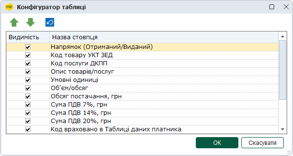

Скористайтесь кнопками  та  для встановлення довільного порядку за власним бажанням, або  для встановлення порядку колонок за замовчанням.

Для збереження змін натисніть кнопку ОК.

Панель інструментів

Містить кнопки, що надають швидкий доступ до найбільш часто використовуваних функцій. Наведіть покажчик миші на інструмент і чекайте протягом секунди, для відображення короткої підказки, що описує його призначення.

### Робота з модулем Аналіз товарів/послуг за кодами УКТЗЕД/ДКПП (у т. ч. ризиковими)

_Шлях у довідці: Розділи програми › Облік ПДВ › Аналітичні довідки › Робота з модулем Аналіз товарів/послуг за кодами УКТЗЕД/ДКПП (у т. ч. ризиковими)_

В цьому розділі:

[Відбір даних](#ucevalbyucgs-ucevalbyucgs_rob)

[Опрацювання даних Митних декларацій](#ucevalbyucgs-ucevalbyucgs_rob)

[Cтворення «Таблиці даних платника податків на додану вартість»](#ucevalbyucgs-ucevalbyucgs_rob)

[Формування розшифровки по обраному коду УКТЗЕД/ДКПП](#ucevalbyucgs-ucevalbyucgs_rob)

Відбір даних

1. Оберіть значення параметрів для відбору даних на панелі Фільтр.

2. Натисніть кнопку Показати. Дані, що відповідають обраним параметрам, будуть відображені у таблиці модуля:

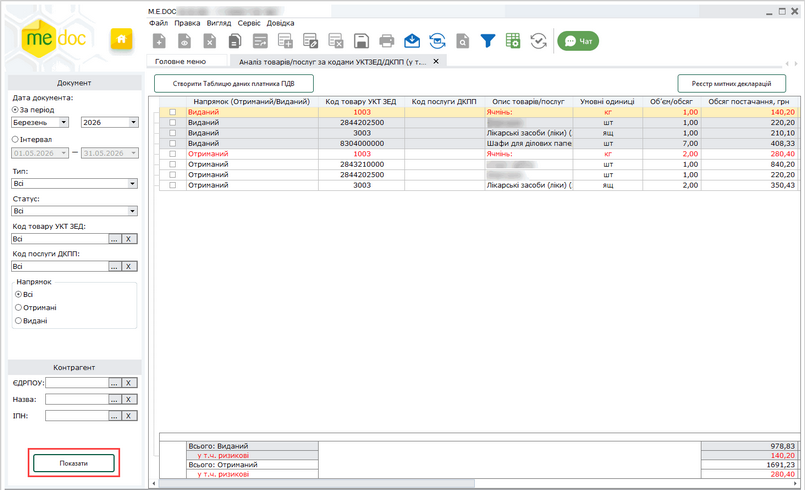

Натисніть, щоб збільшити малюнок

Відображення рядків документів відповідає наступним правилам:

1. Консолідація даних в рядках таблиці здійснюється за ознаками: напрямок Отриманий/Виданий та Код товару УКТ ЗЕД/ДКПП (з урахуванням значення графи Умовні одиниці) за обраний період. (Виконується групування даних по кожному коду УКТ ЗЕД/ДКПП в розрізі напрямку документа Отриманий/Виданий. При однакових значеннях кодів УКТ ЗЕД/ДКПП але різних одиницях виміру дані виводяться окремим рядком.)

2. Згруповані по кожному коду та напрямку дані виводяться окремими рядками.

3. Підсумок показників ПН та РК у графах Об’єм/обсяг та Обсяг постачання, грн розраховується за кожним кодом та за напрямком документа.

Значення у графах Сума ПДВ 7%, грн, Сума ПДВ 14%, грн, Сума ПДВ 20%, грн розраховується у розрізі коду ставки.

Графа Код враховано в Таблиці даних платника може містити значення:

- Так – якщо даний код присутній в прийнятому ДПС документі Таблиця даних платника податків на додану вартість.
- Ні - якщо даний код відсутній в прийнятому ДПС документі Таблиця даних платника податків на додану вартість. У такому разі на основі даних розділу можна створити таблицю даних платника за допомогою кнопки [Створити Таблицю даних платника ПДВ](#ucevalbyucgs-ucevalbyucgs_rob).

4. Рядки таблиці з ризиковими кодами УКТ ЗЕД/ДКПП виділяються червоним кольором.

Записи таблиці можна відсортувати, натиснувши лівою кнопкою миші на назві колонки.

[До початку](#ucevalbyucgs-ucevalbyucgs_rob)

Опрацювання даних Митних декларацій

Зверніть увагу, для опрацювання Митних декларацій попередньо потрібно заповнити необхідні дані у [Реєстрі митних декларацій](#ucevalbyucgs-ucevalbyucgs_myto).

Щоб додати до аналітичних даних інформацію про Митні декларації:

1. На панелі Фільтр у полі Тип встановіть відмітку МД Митна декларація.

За замовчанням у полі Тип встановлено значення Всі, тобто, за замочуванням у таблиці модуля відображається інформація з урахуванням даних Митних декларацій.

2. Оберіть інші параметри для відбору даних на панелі Фільтр та натисніть кнопку Показати.

3. Опрацьовані дані Митних декларацій додаються за напрямком Отриманий до даних ПН/РК. За відсутності коду УКТ ЗЕД в ПН, РК за даними Митної декларації створюється окремий рядок таблиці.

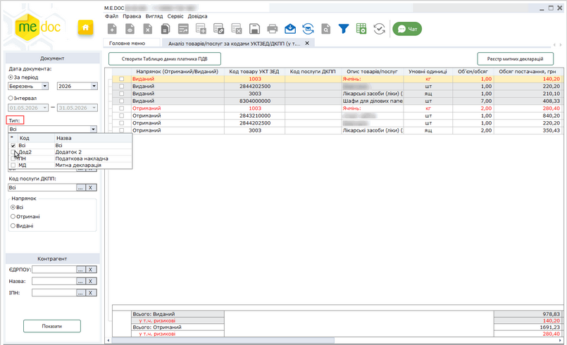

Натисніть, щоб збільшити малюнок

Для даних Митних декларацій виконується групування у розрізі кодів УКТ ЗЕД, підсумовуються значення граф Обсяг постачання, Сума ПДВ у розрізі ставок ПДВ (7%, 14%, 20%).

Щоб виключити з обробки дані Митних декларацій, у полі Тип встановіть лише відмітки Додаток 2 та/або Податкова накладна та натисніть кнопку Показати.

[До початку](#ucevalbyucgs-ucevalbyucgs_rob)

Cтворення «Таблиці даних платника податків на додану вартість»

Якщо код УКТЗЕД/ДКПП відсутній в прийнятому ДПС документі Таблиця даних платника податків на додану вартість, графа Код враховано в Таблиці даних платника містить значення Ні.

Для створення документа Таблиця даних платника податків на додану вартість на основі даних модуля:

1. Оберіть рядки даних, за якими буде створюватися Таблиця даних платника податків на додану вартість. Встановіть відмітки на початках необхідних рядків.

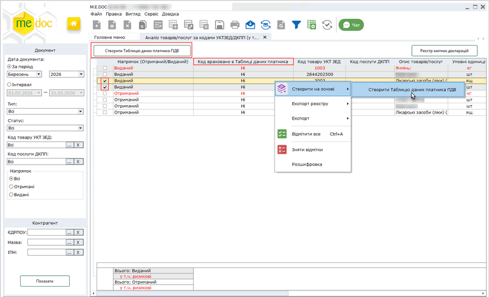

Натисніть, щоб збільшити малюнок

2. Оберіть один із способів:

- натиснути кнопку Створити Таблицю даних платника ПДВ;
- виконати команду головного меню Файл – Створити на основі – Створити Таблицю даних платника ПДВ;
- у контекстному меню обрати команду Створити на основі - Створити Таблицю даних платника ПДВ.

3. Відкриється вікно створеного документа:

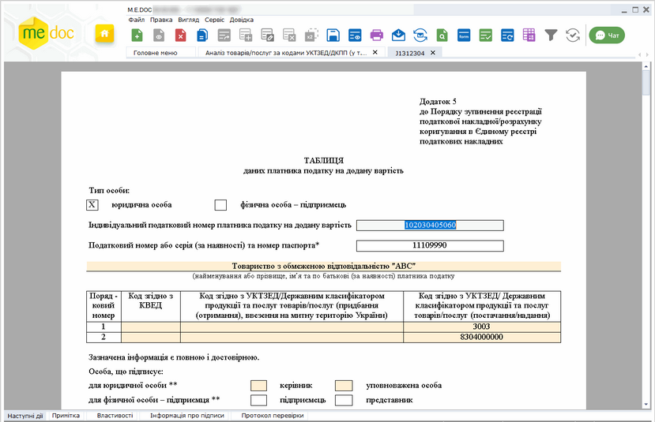

Натисніть, щоб збільшити малюнок

4. Перевірте коректність заповнення полів документа, введіть необхідні данні.

5. Збережіть звіт, натиснувши кнопку  або комбінацію клавіш <Ctrl+S>. (Під час збереження виконується автоматична перевірка правильності заповнення полів звіту.)

Створений документ зберігається у модулі Реєстр звітів.

[До початку](#ucevalbyucgs-ucevalbyucgs_rob)

Формування розшифровки по обраному коду УКТЗЕД/ДКПП

Щоб сформувати розшифровку аналітичних даних по обраному коду УКТЗЕД/ДКПП, виконайте дії:

1. На панелі Фільтр оберіть значення параметрів для відбору даних та оберіть період, за який потрібно здійснити аналіз для коду УКТЗЕД/ДКПП.

2. Натисніть кнопку Показати. Дані, що відповідають обраним параметрам, будуть відображені у таблиці модуля:

Натисніть, щоб збільшити малюнок

3. Виділіть рядок у реєстрі, що містить інформацію про потрібний код УКТЗЕД/ДКПП. Для формування розшифровки скористайтесь одним із способів:

- виконайте команду Розшифровка у головному меню Вигляд;
- виконайте команду Розшифровка у контекстному меню.

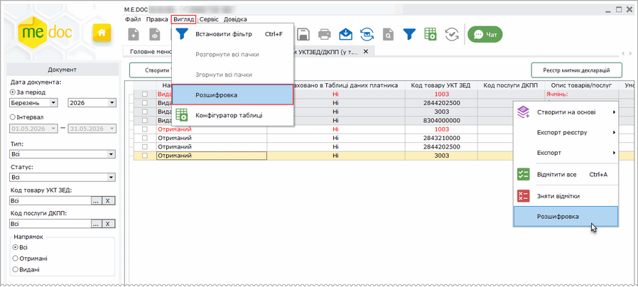

Натисніть, щоб збільшити малюнок

4. Розшифровка виділеного рядка реєстру буде відкрита у окремій вкладці у вигляді таблиці з інформацією про документи, які містять обраний код УКТЗЕД/ДКПП.

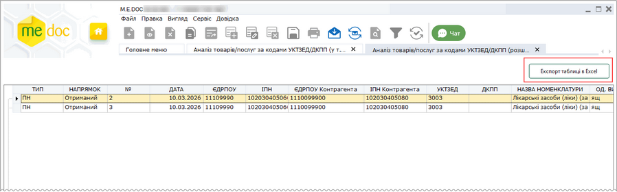

Натисніть, щоб збільшити малюнок

Дані розшифровки можна зберегти у файл формату Excel, натиснувши на кнопку Експорт таблиці в Excel.

Перед формуванням розшифровки по іншому коду УКТЗЕД/ДКПП обов’язково закрийте вкладку попередньої розшифровки.

[До початку](#ucevalbyucgs-ucevalbyucgs_rob)

### Реєстр Митних декларацій

_Шлях у довідці: Розділи програми › Облік ПДВ › Аналітичні довідки › Реєстр Митних декларацій_

В цьому розділі:

[Як відкрити Реєстр митних декларацій](#ucevalbyucgs-ucevalbyucgs_myto)

[Введення даних у Реєстр митних декларацій](#ucevalbyucgs-ucevalbyucgs_myto)

[Експорт Реєстру митних декларацій у форматі Excel](#ucevalbyucgs-ucevalbyucgs_myto)

[Імпорт Реєстру митних декларацій у форматі Excel](#ucevalbyucgs-ucevalbyucgs_myto)

Як відкрити Реєстр митних декларацій

Реєстр митних декларацій призначений для зберігання та обробки даних Митних декларацій.

У таблиці розділу відображаються Митні декларації, які відповідають параметрам, встановленим на панелі Фільтр розділу Аналіз товарів/послуг за кодами УКТЗЕД/ДКПП (у т. ч. ризиковими).

Щоб перейти до роботи з Реєстром митних декларацій:

1.  У розділі Аналіз товарів/послуг за кодами УКТЗЕД/ДКПП (у т. ч. ризиковими) встановіть параметри відбору даних на панелі Фільтр та натисніть кнопку Показати.

2.  Далі натисніть на кнопку Реєстр митних декларацій:

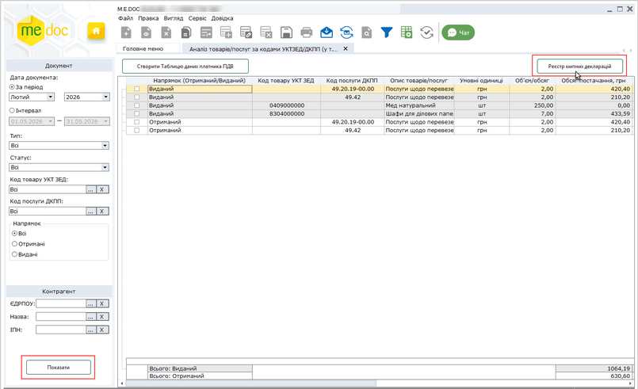

Натисніть, щоб збільшити малюнок

2.  Відкриється вкладка Реєстр митних декларацій:

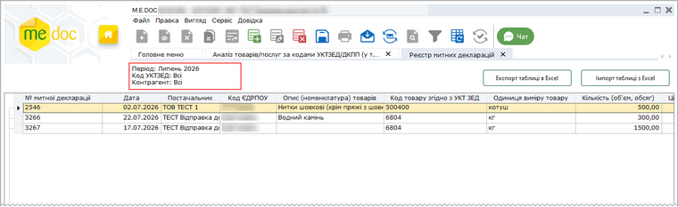

Натисніть, щоб збільшити малюнок

У таблиці розділу відображаються Митні декларації, які відповідають параметрам, встановленим на панелі Фільтр розділу Аналіз товарів/послуг за кодами УКТЗЕД/ДКПП (у т. ч. ризиковими). У заголовку розділу відображаються значень полів фільтру, за якими здійснювався відбір даних:

- Період – місяць та рік або дата початку та закінчення довільного інтервалу, в межах якого були створені потрібні документи;
- Код УКТЗЕД – коди товарів УКТ ЗЕД;
- Контрагент – коди ЄДРПОУ контрагентів.

Введення даних у Реєстр митних декларацій

1. Оберіть один із способів:

- натисніть на кнопку Створити запис  на панелі інструментів;
- виконайте команду головного меню Файл – Створити запис;
- у контекстному меню обрати команду Створити запис;
- натисніть комбінацію клавіш <Ctrl+I>.

2. У таблиці розділу з'явиться новий рядок:

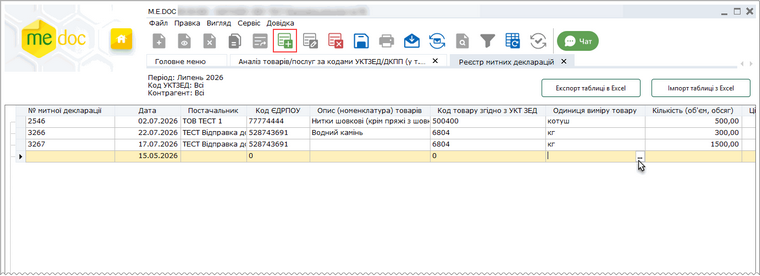

Натисніть, щоб збільшити малюнок

3. Заповніть дані Митної декларації. Дані можна вводити вручну з клавіатури, або обрати з відповідного довідника, натиснувши на кнопку .

4. Збережіть введені дані, натиснувши на кнопку панелі інструментів .

5. Буде виконано автоматичну перевірку введених даних. У разі виявлення невідповідностей, програма повідомить про необхідність виправити помилки.

Поля таблиці, що містять некоректні дані, будуть позначені червоним кольором.

Відкоригуйте та збережіть дані.

Записи таблиці можна відсортувати, натиснувши лівою кнопкою миші на назві колонки.

Для видалення Митної декларації оберіть рядок, що відповідає документу, та оберіть один із способів:

- натисніть на кнопку Видалити запис  на панелі інструментів;
- виконайте команду головного меню Файл – Видалити запис;
- у контекстному меню обрати команду Видалити запис;
- натисніть комбінацію клавіш <Ctrl+Y>.

[До початку](#ucevalbyucgs-ucevalbyucgs_myto)

Експорт Реєстру митних декларацій у форматі Excel

Експорт Реєстру митних декларацій призначений для збереження даних документів у файлі формату Excel у обраному каталозі або електронному носії.

Для виконання експорту:

1. Натисніть кнопку Експорт таблиці в Excel:

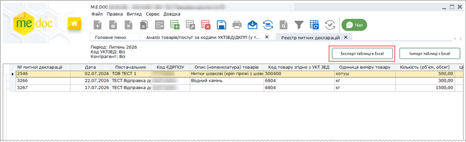

Натисніть, щоб збільшити малюнок

2. У вікні Збереження файлу, яке відкриється, введіть ім'я файлу для збереження даних та натисніть кнопку Зберегти.

[До початку](#ucevalbyucgs-ucevalbyucgs_myto)

Імпорт Реєстру митних декларацій у форматі Excel

Імпорт здійснюється із файлу Excel (формату .xls та .xlsx), що містять дані щодо Митної декларації.

Попередньо необхідно зберегти дані у файлі Excel, структура якого повинна відповідати наступним вимогам:

- файл містить перший рядок-заголовок з назвами колонок файлу, що відповідають параметру, який в них зберігається (наприклад, Номер митної декларації, Дата тощо);
- файл повинен містити обов'язкові поля (колонки): Дата, Назва постачальника, Код ЄДРПОУ постачальника, Код товару згідно з УКТЗЕД, Ставка ПДВ, Обсяг постачання, грн, якщо обов'язкові поля у файлі відсутні, імпорт не виконується;
- кожній Митній декларації відповідає окремий рядок файлу;
- кожен параметр Митній декларації зберігається у окремій клітинці файлу.

Шаблон файлу для імпорту Customs\_blank.xlsx можна завантажити по натисканню кнопки Завантажити шаблон файлу у вікні Імпорт даних із Excel:

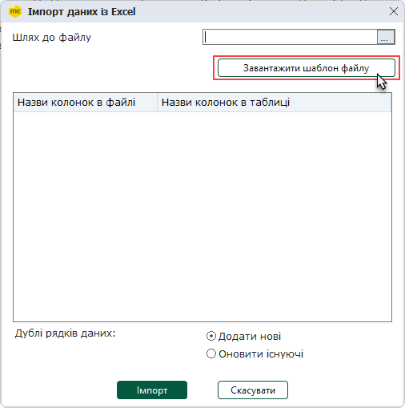

Шаблон містить рядок-заголовок з переліком параметрів, що можуть бути імпортовані у Реєстр митних декларацій.

Для виконання імпорту:

1. Натисніть кнопку Імпорт таблиці в Excel:

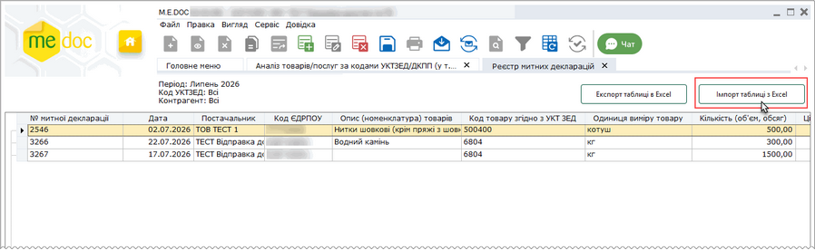

Натисніть, щоб збільшити малюнок

2. У вікні Імпорт даних із Excel оберіть шлях до підготованого файлу імпорту:

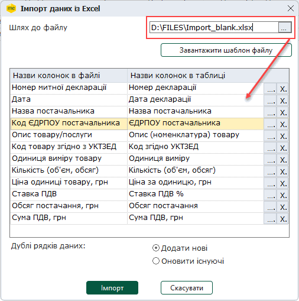

Після вибору файлу у вікні буде відображено відповідність колонок файлу, що імпортується, графам Реєстру митних декларацій.

3. Перевірте встановлену відповідність. Якщо для поля не знайдено відповідність у Реєстрі, або відповідність визначена некоректно, натисніть лівою кнопкою миші у полі колонки Назви колонок в таблиці , потім натисніть кнопку , та у вікні, що відкриється, зі списку оберіть потрібну графу Реєстру:

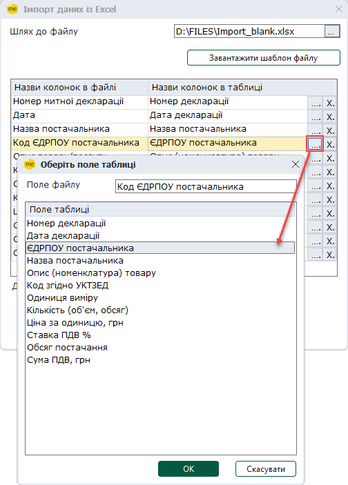

Для видалення значення поля Назви колонок в таблиці натисніть кнопку  у відповідному рядку.

4. У вікні Імпорт даних із Excel оберіть спосіб імпорту даних, що дублюються, встановіть потрібну опцію:

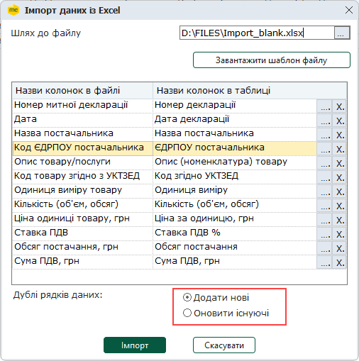

Якщо у Реєстрі вже присутня Митна декларація з таким самим номером та кодом УКТЗЕД/ДКПП при встановленні опції:

- Додати нові  - імпортовані дані будуть додані у Реєстр окремим рядком;
- Оновити існуючі - дані існуючих Митних декларацій будуть замінені даними, що імпортуються.

5. Натисніть кнопку Імпорт. Програма перевірить налаштування відповідності полів. У разі виявлення невідповідностей буде виведено відповідне повідомлення. Відкоригуйте налаштування полів у вікні Імпорт даних із Excel та виконайте імпорт.

6. Якщо відповідність полів налаштовано коректно, розпочнеться процес імпорту даних. Після завершення імпорту програма повідомить про результати виконання операції. Імпортовані дані будуть відображені у таблиці Реєстру митних декларацій.

[До початку](#ucevalbyucgs-ucevalbyucgs_myto)


