[← Зміст довідки](../)


# Реєстр акцизних документів (спирт етиловий)

## Реєстр акцизних документів (спирт етиловий)

_Шлях у довідці: Розділи програми › Облік акцизу › Реєстр акцизних документів (спирт етиловий)_

Реєстри акцизних документів призначені для створення, редагування та збереження акцизних документів, з метою їх реєстрації в ДПС та обміну ними з контрагентами. Також у реєстрі зберігаються документи, отримані від ДПС.

Реєстр акцизних документів (спирт етиловий) – модуль призначений для опрацювання та збереження акцизних документів щодо діяльності, пов’язаної з виробництвом, зберіганням та торгівлею спиртом етиловим. У модулі доступні документи:

- Акцизна накладна форми "С";
- Розрахунок коригування форми "С";
- Заявка на поповнення/коригування залишку СЕ;
- Акт інвентаризації обсягів залишку СЕ;
- Заява про реєстрацію платника акцизного податку;
- Довідка про обладнання АС (витратоміри-лічильники);
- Довідка про зведені за добу дані;
- Заявка про переміщення.

Документи:

- Ф.№1-АКПС Заява про реєстрацію платника акцизного податку з реалізації пального або спирту етилового та/або акцизних складів;
- Заявка на переміщення пального або спирту етилового транспортними засобами, що не є акцизними складами пересувними

можуть створюватися як у розділі Реєстр звітів, так і у відповідних модулях розділу Облік акцизного податку: Реєстр акцизних документів (пальне) або Реєстр акцизних документів (спирт етиловий).

При створенні (редагуванні), залежно від встановленого поля: Реалізація пального або Реалізація спирту етилового (Пальне або Спирт етиловий), документи будуть доступні у відповідному розділі: Реєстр акцизних документів (пальне) або Реєстр акцизних документів (спирт етиловий).

При створенні документів у розділах Реєстр акцизних документів (пальне) або Реєстр акцизних документів (спирт етиловий) відповідне поле встановлюється автоматично.

Ф.№1-АКПС Заява про реєстрацію платника акцизного податку з реалізації пального або спирту етилового та/або акцизних складів;

Може бути створена у розділі Реєстр звітів на основі поданого документа Ф. 20-ОПП Дод. 10 до Порядку обліку платників податків і зборів.

Для цього скористайтеся функцією у вікні відкритого документа Ф. 20-ОПП  на вкладці Наступні дії – Виконати додаткову програму обробки – Створити Заяву про реєстрацію платника акцизного податку.

У даному розділі довідки розглянуто наступне:

- [Опис основних функціональних елементів інтерфейсу](#ucexcisealcorst-ucexcisealcorst_inter)
- [Фільтр - початок роботи з Реєстром акцизних документів (спирт етиловий)](UCExciseRst.html#ucexciserst-akciz_reestr_filtr)
- [Архів документів](UCExciseRst.html#ucexciserst-akciz_reestr_arhiv)
- [Робота з акцизними документами (спирт етиловий)](#ucexcisealcorst-doc_alco_work_1)
- [Довідники](Akciz_dovidnyky.html#akciz_dovidnyky-akciz_dovidnyky)
- [Господарські одиниці/Акцизні склади](UCEconomicUnits.html#uceconomicunits-uceconomicunits)

### Опис основних функціональних елементів інтерфейсу

_Шлях у довідці: Розділи програми › Облік акцизу › Реєстр акцизних документів (спирт етиловий) › Опис основних функціональних елементів інтерфейсу_

Реєстр акцизних документів складається з 4 основних функціональних частин:

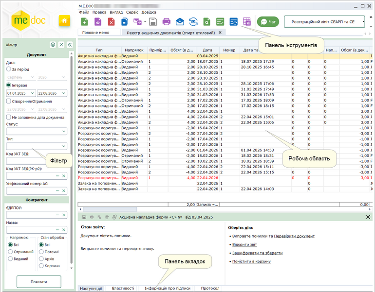

Натисніть, щоб збільшити малюнок

Фільтр

Робота з Реєстром акцизних документів розпочинається з Фільтру - зручного і потужного інструменту відбору потрібних документів.

У Фільтрі максимально зібрані атрибути документів, за якими здійснюється пошук та сортування. Фільтрація відбувається по будь-якому відомому параметру.

Передбачена можливість самостійно задавати відображення параметрів відбору в Реєстрі. Натисніть на кнопку  та в окремому вікні, що відкрилось, встановіть/зніміть галочки напроти потрібного реквізиту.

Після встановлення параметрів фільтрації натисніть на кнопку Показати. В робочій області відобразиться перелік документів згідно заданих параметрів пошуку.

Для того, щоб очистити Фільтр від даних, натисніть на кнопку .

Якщо Фільтр не потрібен та/або заважає, його можна згорнути. Для цього натисніть на кнопку . Щоб розгорнути Фільтр, натисніть на згорнуту панель.

Детальний опис Фільтру та роботи з ним описано в розділі даної довідки [Фільтр Реєстру акцизних документів](UCExciseRst.html#ucexciserst-akciz_reestr_filtr).

Робоча область

Містить безпосередньо записи Реєстру акцизних документів: відображає записи, що відповідають заданим умовам фільтрації та сортування.

Набором колонок у таблиці Реєстру та порядком їх розміщення можна керувати. Для цього натисніть на кнопку  на панелі інструментів.
Відкриється вікно Конфігуратор таблиці. Встановіть відповідні галочки для відображення колонок.

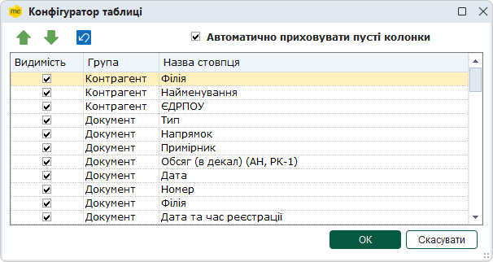

Скористайтесь кнопками   для встановлення довільного порядку за власним бажанням, або  для встановлення порядку колонок за замовчанням.

Якщо встановлено опцію Автоматично приховувати пусті колонки, колонки, що не містять даних, не відображаються у Робочій області.

Для збереження змін натисніть кнопку ОК.

Для зручності роботи у реєстрі, реалізована функція ГРУПУВАННЯ записів реєстру по колонкам таблиці реєстру.
Для активації цієї функції необхідно вибрати в меню Вигляд - Групування даних або натиснути на кнопку  на панелі інструментів.

Над реєстром з'явиться додаткова панель. За допомогою миші перетягніть на цю панель потрібні колонки таблиці.

Щоб відкрити документ, оберіть його у списку та скористайтеся одним із способів:

- натисніть 2 рази лівою кнопкою миші на документі у списку;
- виконайте команду меню Файл - Відкрити;
- оберіть команду Відкрити у контекстному меню;
- натисніть кнопку Відкрити  на панелі інструментів;
- скористайтесь комбінацією клавіш Ctrl+F2.

Можливо відкрити декілька документів одночасно, для цього виділіть потрібні документи у списку та скористайтеся одним із способів, що вказані вище. При спробі відкрити більше 20 документів, виводиться повідомлення про можливе уповільнення роботи програми, через велику кількість відкритих документів.

Панель вкладок звіту

Містить службову інформацію щодо обраного документа. Панель доступна як у відкритому документі, так і з Реєстру акцизних документів (за умови виділення потрібного документа).

- Наступні дії – містить інформацію щодо поточного стану документа, а також перелік можливих дій з документом у цьому стані. Слугує підказкою користувачу про доступні дії, які можна виконати з документом у поточному стані;
- Властивості – у режимі читання містить всю службову інформацію про документ, таку як: стан, період створення, дата та час останньої модифікації, інформація про сертифікати, якими підписано документ тощо. Інформація на цій вкладці постійно оновлюється та доповнюється при будь-яких змінах документа;
- Протокол – містить перелік подій, що відбулись з документом під час його обробки в хронологічному порядку. При виборі події справа на панелі відображається її детальний опис.

Панель інструментів

Містить кнопки, що надають швидкий доступ до найбільш часто використовуваних функцій. Наведіть покажчик миші на інструмент і чекайте протягом секунди, для відображення короткої підказки, що описує його призначення.

### Робота з акцизними документами (спирт етиловий)

_Шлях у довідці: Розділи програми › Облік акцизу › Реєстр акцизних документів (спирт етиловий) › Робота з акцизними документами (спирт етиловий)_

В цьому розділі:

[Створення акцизних документів (спирт етиловий)](#ucexcisealcorst-doc_alco_work_1)

[Створення другого примірника Акцизної накладної форми "С" на основі першого примірника](#ucexcisealcorst-doc_alco_work_1)

[Створення виданої Акцизної накладної форми "С" на основі отриманої](#ucexcisealcorst-doc_alco_work_1)

[Створення Розрахунку коригування "С" на основі Акцизної накладної форми "С"](#ucexcisealcorst-doc_alco_work_1)

[Створення другого примірника Розрахунку коригування "С" на основі першого примірника](#ucexcisealcorst-doc_alco_work_1)

[Створення Коригуючої довідки на основі Основної довідки](#ucexcisealcorst-doc_alco_work_1)

[Створення документів за власними налаштуваннями](#ucexcisealcorst-doc_alco_work_1)

Створення акцизних документів (спирт етиловий)

Для створення нового акцизного документа виконайте дії в наступній послідовності:

1. Скористайтесь одним із способів:

- на панелі інструментів натисніть кнопку Створити;
- виберіть команду Файл - Створити;
- у контекстному меню оберіть команду Створити;
- натисніть комбінацію клавіш <Ctrl+N>.

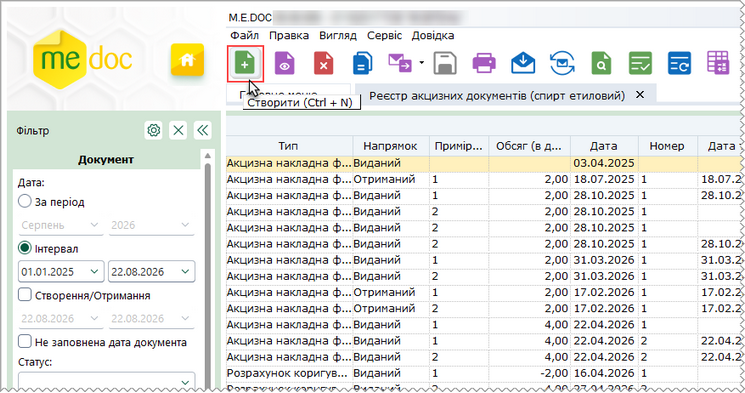

Натисніть, щоб збільшити малюнок

2. Оберіть потрібний тип акцизного документа.

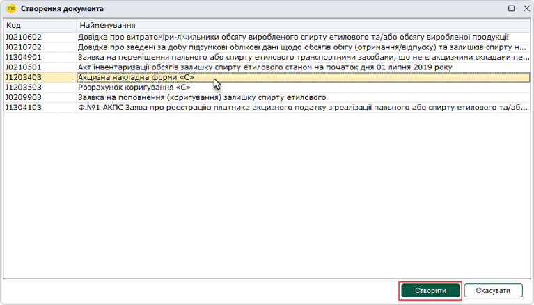

Натисніть, щоб збільшити малюнок

3. У окремому вікні відкриється бланк документа, який потрібно заповнити.

Поля, що підсвічені жовтим кольором, доступні для заповнення та редагування.

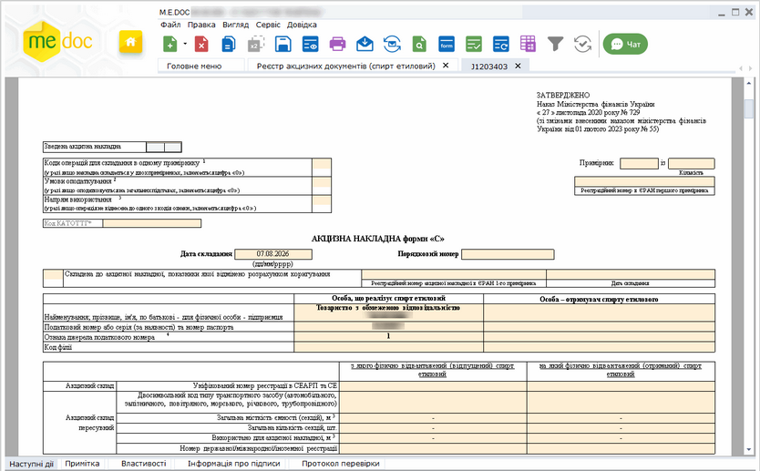

Натисніть, щоб збільшити малюнок

4. Внесіть дані в поля, які потребують заповнення із клавіатури.

5. Оберіть команду Правка - Перевірити документ або F4 для перевірки звіту.

Перевіряється правильність заповнення полів і у випадку помилок, система підсвітить червоним кольором поля, що необхідно виправити. Виправте помилки та знову виконайте перевірку.

6. Збережіть документ, натиснувши кнопку  або комбінацію клавіш Ctrl+S.

[До початку](#ucexcisealcorst-doc_alco_work_1)

Створення другого примірника Акцизної накладної форми "С" на основі першого примірника

Функція доступна для перших примірників виданих АН, для яких в установленому законодавством порядку передбачається складання 2-го примірника (у полі Примірник встановлено значення «1», у полі Кількість встановлено значення «2»).

Функція доступна як для одного обраного у реєстрі документа , так і для групи виділених документів.

1. У реєстрі оберіть перший виданий примірник Акцизної накладної форми «C» (або кілька перших примірників АН), на підставі якої необхідно створити другий примірник.

2. Оберіть один із способів:

- виберіть команду меню Файл - Створити на основі - Примірник 2;
- у контекстному меню оберіть команду Створити на основі -  Примірник 2:

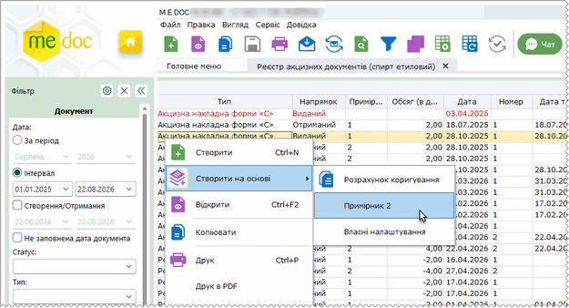

Натисніть, щоб збільшити малюнок

3. Відкриється вкладка другого примірника Акцизної накладної форми «С»:

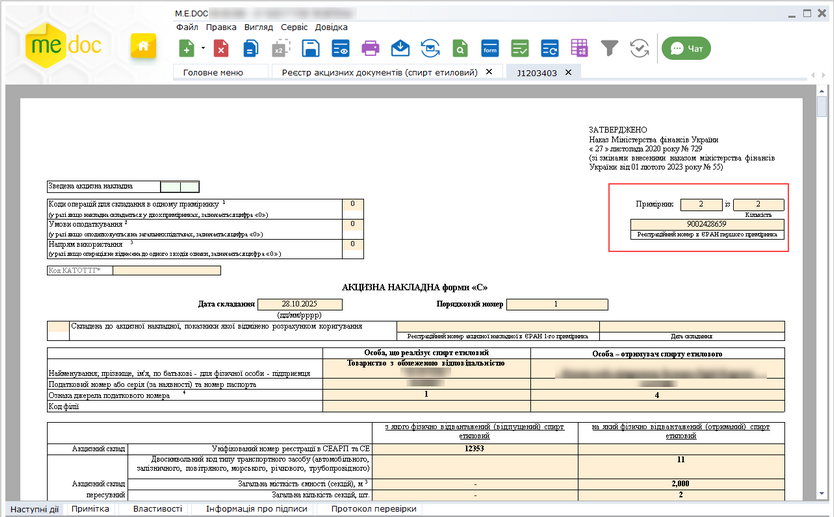

Натисніть, щоб збільшити малюнок

Поля другого примірника АН автоматично заповнюються значеннями з першого примірника. У поле Реєстраційний номер в ЄРАН заноситься значення реєстраційного номера першого примірника АН (якщо такий наявний). У полях Примірник та Кількість встановлюється значення «2».

4. Перевірте коректність заповнення документа. Для збереження створеного документа натисніть на кнопку  на панелі інструментів.

[До початку](#ucexcisealcorst-doc_alco_work_1)

Створення виданої Акцизної накладної форми "С" на основі отриманої

Для створення виданої АН на основі отриманої:

1. У вікні реєстру оберіть отриману Акцизну накладну форми "С", на підставі якої необхідно створити видану АН.

2. Оберіть один із способів:

- виберіть команду меню Файл - Створити на основі - Створити видану АН на основі отриманої;
- у контекстному меню оберіть команду Створити на основі - Створити видану АН на основі отриманої:

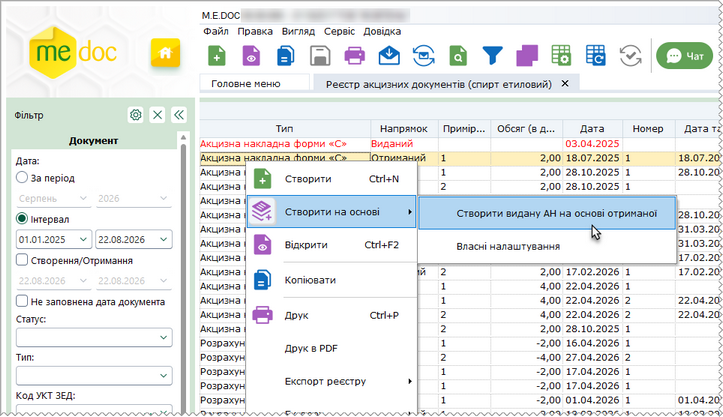

Натисніть, щоб збільшити малюнок

3. Відкриється вкладка, що відповідає створюваній АН. Поля створеного документа автоматично заповнюються даними вихідного документа ("отриманої" АН). Заповніть область з даними про отримувача.

4. Для збереження створеного документа натисніть на кнопку  на панелі інструментів.

[До початку](#ucexcisealcorst-doc_alco_work_1)

Створення Розрахунку коригування "С" на основі Акцизної накладної форми "С"

Створення РК можливо на основі виданої Акцизної накладної форми "С". На виконання функції створюється Розрахунок коригування «С».

Для створення РК на основі виданої АН виконайте наступне:

1. У вікні реєстру оберіть видану Акцизну накладну (або декілька виданих АН), на підставі якої необхідно створити розрахунок коригування.

2. Оберіть один із способів:

- виберіть команду меню Файл - Створити на основі - Розрахунок коригування;
- у контекстному меню оберіть команду Створити на основі - Розрахунок коригування:

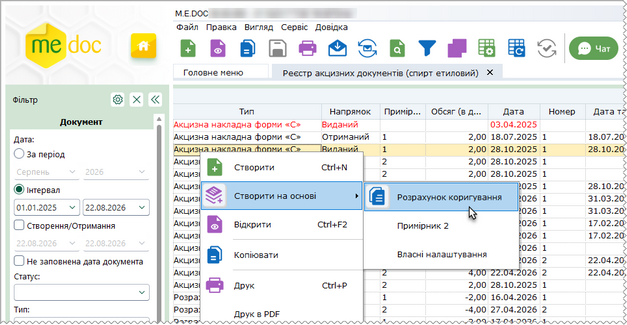

Натисніть, щоб збільшити малюнок

3. Відкриється вкладка нового РК: Розрахунок коригування «С»:

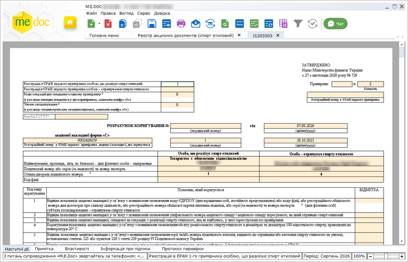

Натисніть, щоб збільшити малюнок

Поля створеного документа автоматично заповнюються даними з АН.

4. Для збереження створеного документа натисніть на кнопку  на панелі інструментів.

[До початку](#ucexcisealcorst-doc_alco_work_1)

Створення другого примірника Розрахунку коригування "С" на основі першого примірника

Функція доступна для перших примірників виданих РК, для яких в установленому законодавством порядку передбачається складання 2-го примірника (у полі Примірник встановлено значення «1», у полі Кількість встановлено значення «2»).

Функція доступна як для одного обраного у реєстрі документа , так і для групи виділених документів.

1. У реєстрі оберіть перший виданий примірник Розрахунку коригування акцизної накладної форми «C» (або кілька перших примірників РК), на підставі якої необхідно створити другий примірник.

2. Оберіть один із способів:

- виберіть команду меню Файл - Створити на основі - Примірник 2;
- у контекстному меню оберіть команду Створити на основі -  Примірник 2:

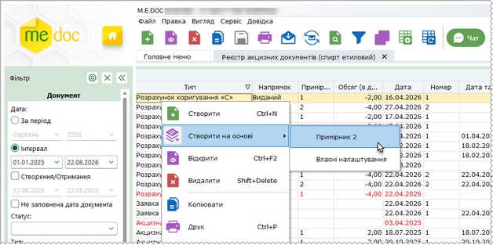

Натисніть, щоб збільшити малюнок

3. Відкриється вкладка другого примірника Розрахунку коригування акцизної накладної форми «C»:

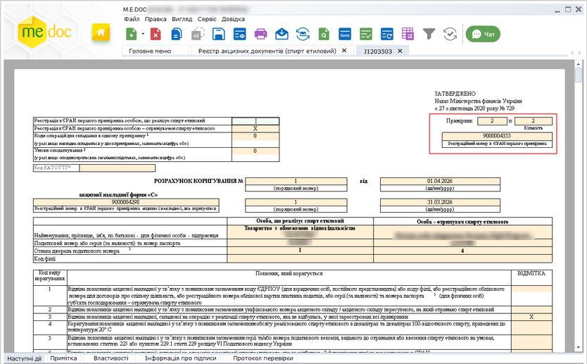

Натисніть, щоб збільшити малюнок

Поля другого примірника РК автоматично заповнюються значеннями з першого примірника. У поле Реєстраційний номер в ЄРАН заноситься значення реєстраційного номера першого примірника РК (якщо такий наявний). У полях Примірник та Кількість встановлюється значення «2».

4. Перевірте коректність заповнення документа. Для збереження створеного документа натисніть на кнопку  на панелі інструментів.

[До початку](#ucexcisealcorst-doc_alco_work_1)

Створення Коригуючої довідки на основі Основної довідки

Створення Коригуючої довідки виконується на основі виданих основних документів (встановлена ознака у полі основна):

- Довідка про витратоміри-лічильники обсягу виробленого спирту етилового та/або обсягу виробленої продукції;
- Довідка про зведені за добу підсумкові облікові дані щодо обсягів обігу (отримання/відпуску) та залишків спирту на акцизному складі виробника спирту та/або виробника окремих видів продукції.

Функція доступна як для одного документа, так і для групи документів, обраних у реєстрі.

Для створення Коригуючої довідки виконайте наступне:

1. У вікні Реєстру акцизних документів (спирт етиловий) оберіть видану основну Довідку, на підставі якої необхідно створити Коригуючу довідку.

2. Оберіть один із способів:

- виберіть команду меню Файл – Створити на основі – Коригуючу довідку;
- у контекстному меню оберіть команду Створити на основі – Коригуючу довідку:

3. Відкриється вкладка Коригуючої довідки, у створеному документі автоматично встановлюється ознака у полі коригуюча. Поля створеного документа автоматично заповнюються даними з основної Довідки.

4. Для збереження створеного документа натисніть на кнопку  на панелі інструментів.

[До початку](#ucexcisealcorst-doc_alco_work_1)

Створення документів за власними налаштуваннями

Для створення первинних документів за власними налаштуваннями:

1. У вікні реєстру оберіть документ, для якого [налаштовано](UCRtfFromDocSettings.html#ucrtffromdocsettings-ucrtffromdocsettings) створення документів за власними налаштуваннями:

- Акцизна накладна форми "С";
- Розрахунок коригування форми "С".

2. Оберіть один із способів:

- виберіть команду меню Файл - Створити на основі - Власні налаштування;
- у контекстному меню оберіть команду Створити на основі - Власні налаштування.

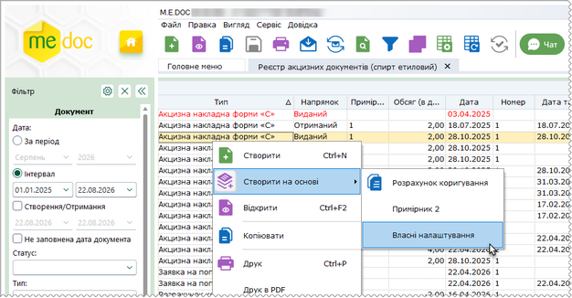

Натисніть, щоб збільшити малюнок

3. Відкриється вікно Довідник.

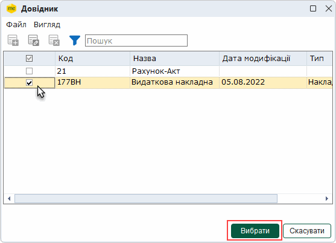

4. Якщо для обраного документа [налаштовано](UCRtfFromDocSettings.html#ucrtffromdocsettings-ucrtffromdocsettings) створення кількох дочірніх документів, у вікні Довідники будуть відображені всі доступні шаблони дочірніх документів. Щоб обрати потрібний шаблон (шаблони), встановіть позначку у відповідному рядку. Натисніть кнопку Вибрати.

5. Відкриється вкладка, що відповідає створюваному документу. Поля створеного документа автоматично заповнюються даними головного документа, відповідність полів документів налаштовується у розділі [Налаштування переносу полів для функції Створити на основі](UCRtfFromDocSettings.html#ucrtffromdocsettings-ucrtffromdocsettings).

Документи, створені на основі існуючих, зберігаються у відповідних реєстрах: Податкова накладна та Додаток 2 - у Реєстрі податкових документів, інші первинні документи - у Реєстрі електронних документів.

У модулі Реєстр первинних документів можна створювати АН/РК до АН на основі первинних документів за допомогою команди Створити на основі - Власні налаштування. Відповідно, для первинних документів повинно бути [налаштовано](UCRtfFromDocSettings.html#ucrtffromdocsettings-ucrtffromdocsettings) створення АН/РК до АН як дочірніх документів.

[До початку](#ucexcisealcorst-doc_alco_work_1)

### Групова обробка полів

_Шлях у довідці: Розділи програми › Облік акцизу › Реєстр акцизних документів (спирт етиловий) › Групова обробка полів_

Групова обробка пустих полів надає можливість автоматизувати заповнення граф документів Акцизна накладна форми "C" та Розрахунок коригування до акцизної накладної форми "C" .

Групове заповнення граф здійснюється у непідписаних виданих документах.

При груповому заповненні граф виконується заміна вмісту відповідних граф АН/РК обраним значенням.

Для внесення даних у документи виконайте дії в наступній послідовності:

1. Якщо заміну потрібно виконати для вибіркових документів, виділіть записи цих документів у таблиці реєстру. Для заповнення даних у всіх документах записи виділяти не потрібно.

2. У меню Правка оберіть функцію Групова обробка полів АН/РК.

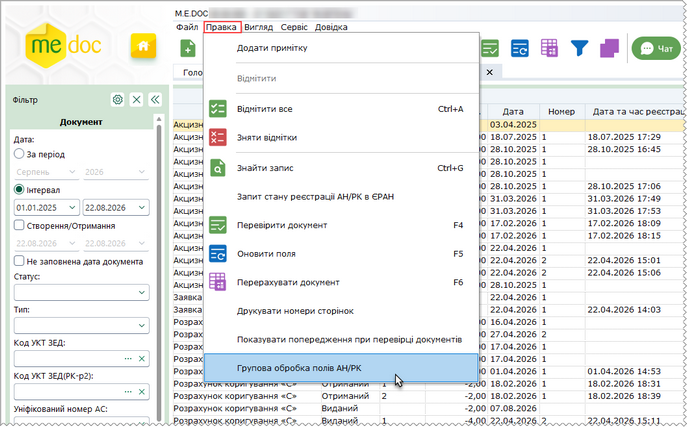

Натисніть, щоб збільшити малюнок

3. Відкриється вікно Групова обробка полів АН/РК.

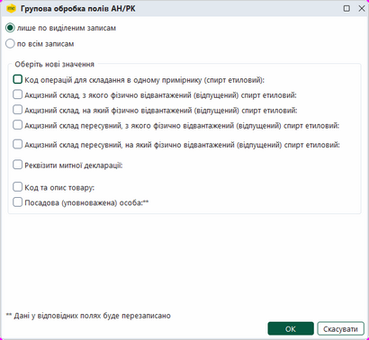

Натисніть, щоб збільшити малюнок

4. Оберіть необхідні параметри:

- якщо потрібно виконати заповнення даних в обраних записах, встановіть позначку в полі лише по виділеним записам, інакше оберіть значення по всім записам;
- для вибору значень із довідників, встановіть позначки у відповідних полях. У вікні з'являться додаткові поля для вибору значень. Натисніть кнопку . Оберіть у довіднику потрібне значення:

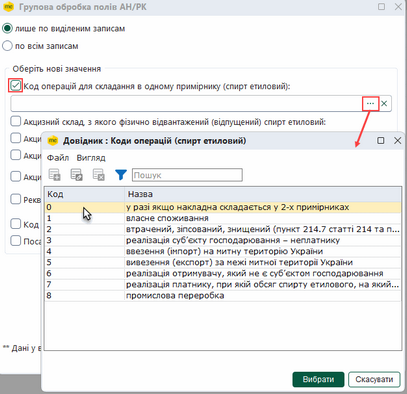

Натисніть, щоб збільшити малюнок

- якщо потрібно видалити дані, обрані з довідника, у відповідному полі натисніть кнопку ;
- При виборі параметрів Акцизний склад пересувний, з якого фізично відвантажений (відпущений) спирт етиловий, Акцизний склад пересувний, на який фізично відвантажений (відпущений) спирт етиловий та Реквізити митної декларації заповніть значення додаткових параметрів, що з'являться у вікні:

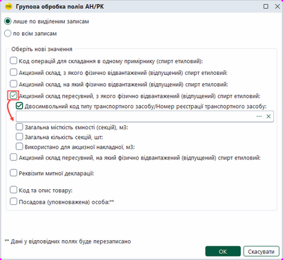

Натисніть, щоб збільшити малюнок

5. Після внесення потрібних параметрів у вікні Групова обробка полів АН/РК натисніть кнопку ОК.

6. Система повідомить про закінчення процедури.

### Автоматичне створення запиту до Єдиного реєстру акцизних накладних

_Шлях у довідці: Розділи програми › Облік акцизу › Реєстр акцизних документів (спирт етиловий) › Автоматичне створення запиту до Єдиного реєстру акцизних накладних_

Запит за списком обраних документів можливо сформувати у модулі Реєстр акцизних документів (спирт етиловий):

1. Виділіть документи, для яких необхідно сформувати запит, у таблиці модуля.

2. Виконайте команду меню Правка - Запит стану реєстрації АН/РК в ЄРАН.

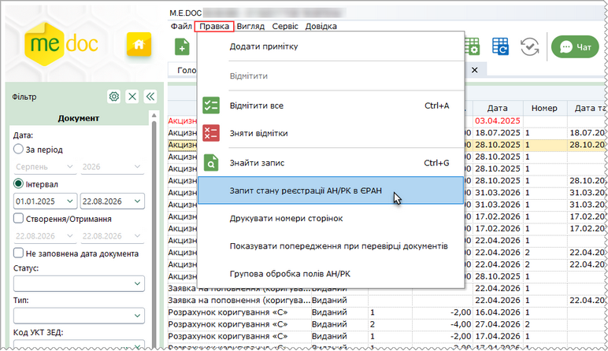

Натисніть, щоб збільшити малюнок

3. Відкриється вікно Запит стану реєстрації:

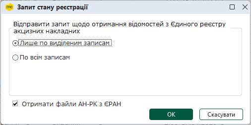

Встановіть позначку Лише по виділеним записам. У запит автоматично будуть додані документи, що були виділені у таблиці модуля.

Якщо встановлено позначку По всім записам, виконується формування запитів для всіх документів, що присутні у списку модуля.

Встановіть опцію Отримати файли АН-РК з ЄРАН для отримання з ЄРАН зареєстрованих документів з квитанціями, що зазначені у запиті.

4. Натисніть кнопку ОК. Розпочнеться процедура підписання документа.

Якщо ви бажаєте відправити запит пізніше, у вікні Підпис натисніть кнопку Відміна. Сформований запит буде доступний для редагування та відправки у модулі Інформаційна довідка.

Запит документів виконується лише при встановленій опції Отримати файли АН-РК з ЄРАН у вікні Запит стану реєстрації. Якщо опція не встановлена, запит формується у режимі отримання відомостей про стан реєстрації документів у ЄРАН.


