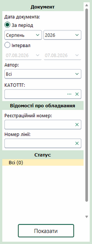
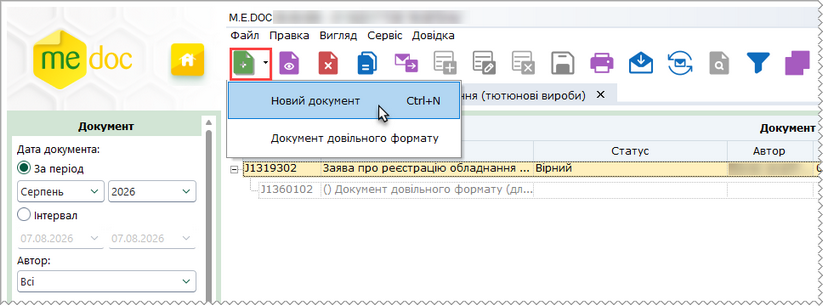
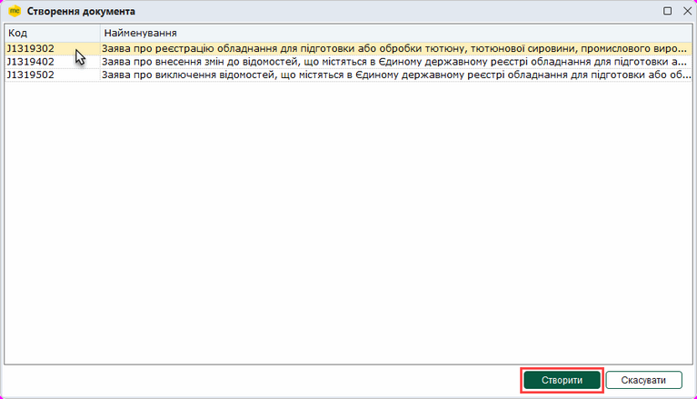
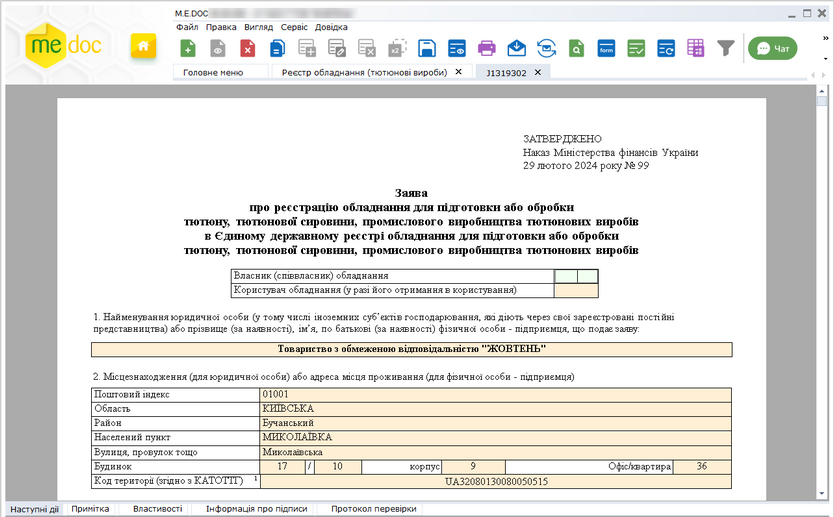
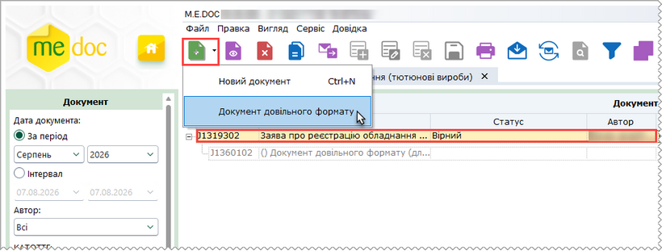
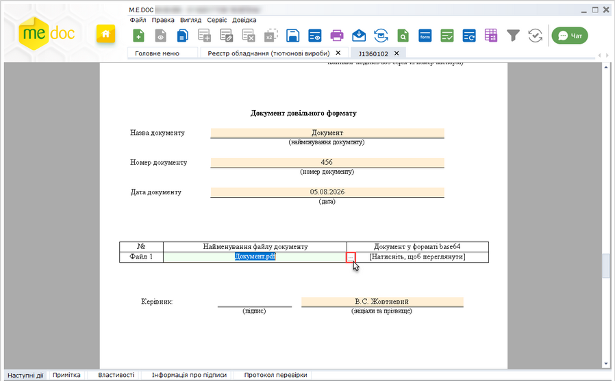
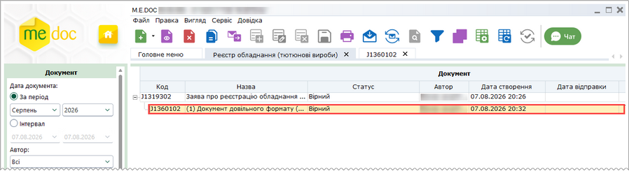

[← Зміст довідки](../)


# Реєстр обладнання (тютюнові вироби)

## Реєстр обладнання (тютюнові вироби)

_Шлях у довідці: Розділи програми › Облік акцизу › Реєстр обладнання (тютюнові вироби)_

В цьому розділі:

[Фільтр Реєстру обладнання (тютюнові вироби)](#ucexciseequiprst-ucexciseequiprst)

[Створення Заяв про внесення даних/змін або виключення відомостей, що містяться в Єдиному державному реєстрі обладнання](#ucexciseequiprst-ucexciseequiprst)

[Створення Документа довільного формату (для подання сканкопій документів)](#ucexciseequiprst-ucexciseequiprst)

Реєстр обладнання (тютюнові вироби) - призначений для створення, редагування, збереження та відправки до контролюючого органу Заяв про внесення даних, Заяв внесення змін до Єдиного державного реєстру обладнання або Заяв щодо виключення даних із Єдиного державного реєстру обладнання для підготовки або обробки тютюну, тютюнової сировини, промислового виробництва тютюнових виробів.

У модулі для створення доступні документи:

- Заява про реєстрацію обладнання у Єдиному державному реєстрі обладнання для підготовки або обробки тютюну, тютюнової сировини, промислового виробництва тютюнових виробів;
- Заява про внесення змін до відомостей, що містяться в Єдиному державному реєстрі обладнання для підготовки або обробки тютюну, тютюнової сировини, промислового виробництва тютюнових виробів;
- Заява про виключення відомостей, що містяться в Єдиному державному реєстрі обладнання для підготовки або обробки тютюну, тютюнової сировини, промислового виробництва тютюнових виробів;
- Документ довільного формату (для подання сканкопій документів).

Після розгляду Заяв від органів ДПС надходить рішення, що містить наступні документи (набір документів залежить від прийнятого рішення та Заяви, що розглядалась):

- Витяг з Єдиного реєстру обладнання;
- Витяг з розпорядження про внесення відомостей про обладнання;
- Витяг з розпорядження про внесення змін;
- Витяг з розпорядження про виключення обладнання;
- Витяг з Єдиного реєстру обладнання;
- Повідомлення про недоліки.

Фільтр Реєстру обладнання (тютюнові вироби)

Для відбору потрібних документів в реєстрі документів встановіть необхідні параметри відбору на панелі Фільтр:

Натисніть, щоб збільшити малюнок

Документ

- Дата документа - встановіть позначку для вибору певного періоду або довільного періоду:
- За період - вкажіть місяць та рік, в межах якого були створені потрібні документи;
- Інтервал - вкажіть дату початку та закінчення довільного інтервалу, в межах якого були виписані потрібні документи;
- Автор - дозволяє знайти документи, які були створені певним користувачем;
- КАТОТТГ - оберіть значення з довідника КАТОТТГ.

Відомості про обладнання

- Реєстраційний номер - дозволяє знайти документи за реєстраційним номером обладнання в Єдиному реєстрі обладнання;
- Номер лінії - пошук документів за номером лінії.

Статус

Дозволяє знайти документи, що перебувають на певному етапі обробки (мають визначений обробкою статус). Для відбору документів встановіть позначку, що відповідає потрібному статусу. Якщо обрано Всі, відображаються всі документи реєстру, окрім видалених.

Після встановлення параметрів фільтрації натисніть на кнопку Показати. В робочій області відобразиться перелік документів згідно заданих параметрів пошуку.

[До початку](#ucexciseequiprst-ucexciseequiprst)

Створення Заяв про внесення даних/змін або виключення відомостей, що містяться в Єдиному державному реєстрі обладнання

Для створення нових Заяв виконайте дії в наступній послідовності:

1. Скористайтесь одним із способів:

- на панелі інструментів натисніть кнопку Створити - Новий документ (або Створити, якщо реєстр не містить документів);
- виберіть команду Файл - Створити - Новий документ (або Створити, якщо реєстр не містить документів);
- у контекстному меню оберіть команду Створити - Новий документ (або Створити, якщо реєстр не містить документів);
- натисніть комбінацію клавіш <Ctrl+N>.

2. Оберіть потрібний тип документа.

Натисніть, щоб збільшити малюнок

3. У вікні, що відкриється, оберіть потрібний документ та натисніть Створити:

Якщо за обраний період у реєстрі не створено жодного документа, вікно Створення документа відкривається безпосередньо по виконанню команди Створити.

Натисніть, щоб збільшити малюнок

4. У окремому вікні відкриється бланк документа, який потрібно заповнити.

Поля, що підсвічені жовтим кольором, доступні для заповнення та редагування.

Натисніть, щоб збільшити малюнок

5. Внесіть дані в поля, які потребують заповнення із клавіатури.

6. Оберіть команду Правка - Перевірити документ або F4 для перевірки звіту.

Перевіряється правильність заповнення полів, і у випадку помилок система підсвітить червоним кольором поля, що необхідно виправити. Виправте помилки та знову виконайте перевірку.

7. Збережіть документ, натиснувши кнопку  або комбінацію клавіш Ctrl+S.

[До початку](#ucexciseequiprst-ucexciseequiprst)

Створення Документа довільного формату (для подання сканкопій документів)

Щоб додати до заяви Документ довільного формату, виконайте наступні дії:

1. У таблиці реєстру виділіть документ пакета, у якому необхідно додати Документ довільного формату та оберіть один із способів:

- на панелі інструментів натисніть кнопку Створити - Документ довільного формату;
- виберіть команду Файл - Створити - Документ довільного формату;
- у контекстному меню оберіть команду Створити - Документ довільного формату;
- натисніть 2 рази лівою кнопкою миші на рядку Документ довільного формату (для додавання першого документа).

Натисніть, щоб збільшити малюнок

2. У окремому вікні відкриється бланк документа, який потрібно заповнити.

3. Щоб додати сканкопію документа, встановіть курсор у поле Найменування файлу документу та натисніть кнопку . У вікні, що відкриється, оберіть потрібний файл. Назва обраного файлу відобразиться у полі документа.

- До Документа довільного формату можна прикріпити лише один файл формату PDF, розміром не більше 10 Мб.
- Для однієї Заяви можна створити кілька Документів довільного формату.

Натисніть, щоб збільшити малюнок

4. Внесіть необхідні данні та збережіть документ натиснувши кнопку  або комбінацію клавіш Ctrl+S.

У реєстрі Документ довільного формату (для подання сканкопій) відображається як документ, прикріплений до Заяви:

Натисніть, щоб збільшити малюнок

[До початку](#ucexciseequiprst-ucexciseequiprst)


