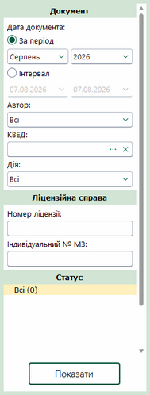
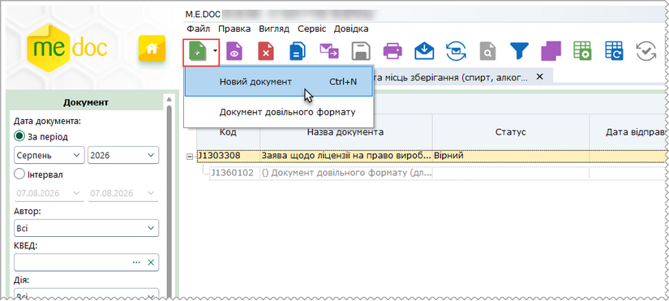
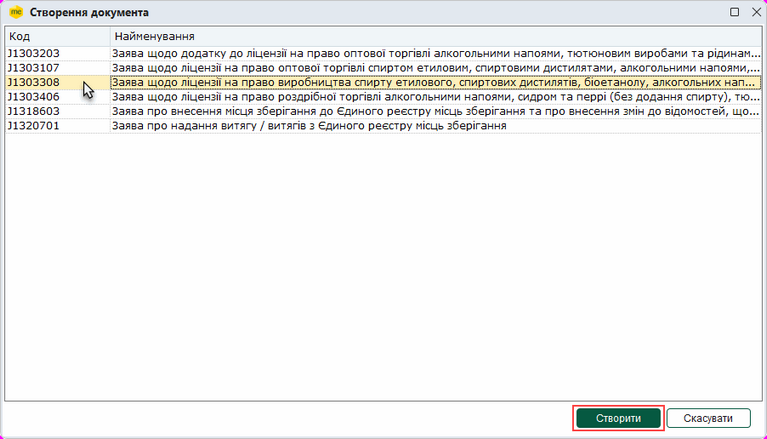
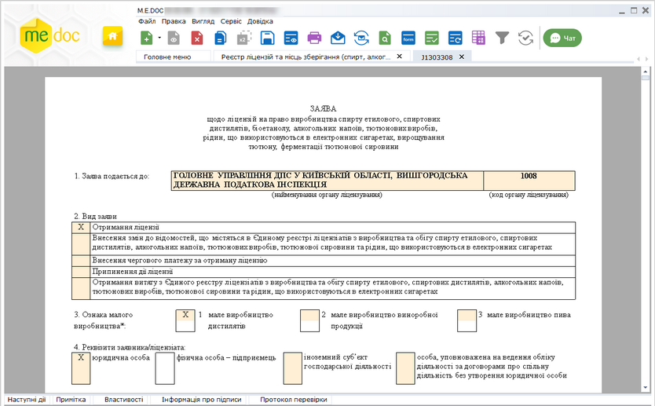
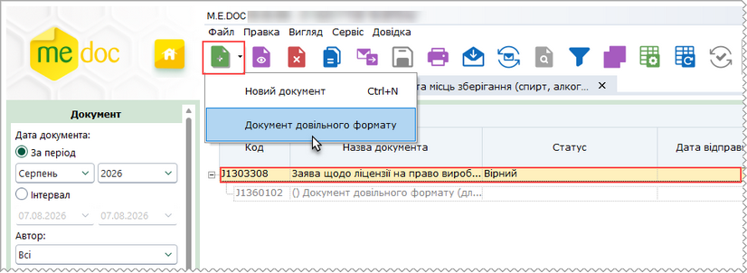
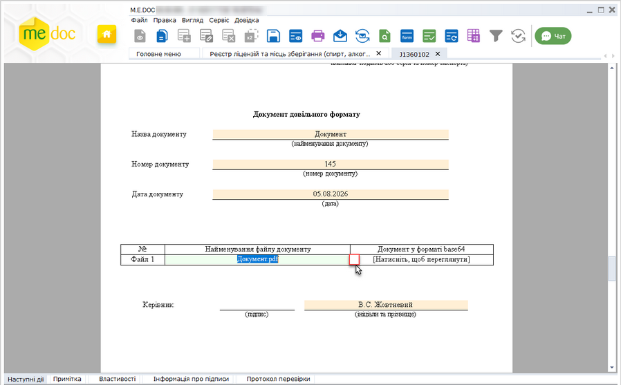

[← Зміст довідки](../)


# Реєстр ліцензій та місць зберігання (спирт, алкоголь, тютюн)

## Реєстр ліцензій та місць зберігання (спирт, алкоголь, тютюн)

_Шлях у довідці: Розділи програми › Облік акцизу › Реєстр ліцензій та місць зберігання (спирт, алкоголь, тютюн)_

В цьому розділі:

[Фільтр Реєстру ліцензій та місць зберігання (спирт, алкоголь, тютюн)](#ucexciselicenserst-ucexciselicenserst)

[Створення Заяв щодо ліцензій та місць зберігання](#ucexciselicenserst-ucexciselicenserst)

[Створення Документа довільного формату (для подання сканкопій документів)](#ucexciselicenserst-ucexciselicenserst)

Реєстр ліцензій та місць зберігання (спирт, алкоголь, тютюн) призначений для створення, редагування та збереження документів, щодо ліцензування діяльності, пов’язаної з виробництвом, зберіганням, оптовою та роздрібною торгівлею спиртом, алкогольними та тютюновими виробами з метою їх створення та подачі у ДПС. Також у розділі зберігатимуться документи, отримані від ДПС.

Фільтр Реєстру ліцензій та місць зберігання (спирт, алкоголь, тютюн)

Для відбору потрібних документів в реєстрі документів встановіть необхідні параметри відбору на панелі Фільтр:

Натисніть, щоб збільшити малюнок

Документ

- Дата - встановіть позначку для вибору певного періоду або довільного періоду:
- За період - вкажіть місяць та рік, в межах якого були створені потрібні документи;
- Інтервал - вкажіть дату початку та закінчення довільного інтервалу, в межах якого були виписані потрібні документи;
- Автор - дозволяє знайти документи, які були створені певним користувачем;
- КВЕД - оберіть значення з довідника КВЕД;
- Дія  - пошук документів за значенням граф розділу Дія.

Ліцензійна справа

- Номер ліцензії - перегляд та опрацювання документів щодо ліцензій, а також отриманих від ДПС Повідомлень. Докладно у розділі [Сервіс "Ліцензійна справа"](AkcizMain.html#akcizmain-akciz_license);
- Індивідуальний № МЗ - пошук документів за значенням граф Індивідуальний номер місця зберігання.

Статус

Дозволяє знайти документи, що перебувають на певному етапі обробки (мають визначений обробкою статус). Для відбору документів встановіть позначку, що відповідає потрібному статусу. Якщо обрано Всі, відображаються всі документи реєстру, окрім видалених.

Після встановлення параметрів фільтрації натисніть на кнопку Показати. В робочій області відобразиться перелік документів згідно заданих параметрів пошуку.

[До початку](#ucexciselicenserst-ucexciselicenserst)

Створення Заяв щодо ліцензій та місць зберігання

Для створення нових заяв щодо ліцензій виконайте дії в наступній послідовності:

1. Скористайтесь одним із способів:

- на панелі інструментів натисніть кнопку Створити - Новий документ (або Створити, якщо реєстр не містить документів);
- виберіть команду Файл - Створити - Новий документ (або Створити, якщо реєстр не містить документів);
- у контекстному меню оберіть команду Створити - Новий документ (або Створити, якщо реєстр не містить документів);
- натисніть комбінацію клавіш <Ctrl+N>.

2. Оберіть потрібний тип документа.

Натисніть, щоб збільшити малюнок

3. У вікні, що відкриється, оберіть потрібний документ та натисніть Створити:

Якщо за обраний період у реєстрі не створено жодного документа, вікно Створення документа відкривається безпосередньо по виконанню команди Створити.

Натисніть, щоб збільшити малюнок

4. У окремому вікні відкриється бланк документа, який потрібно заповнити.

Поля, що підсвічені жовтим кольором, доступні для заповнення та редагування.

Натисніть, щоб збільшити малюнок

5. Внесіть дані в поля, які потребують заповнення із клавіатури.

6. Оберіть команду Правка - Перевірити документ або F4 для перевірки звіту.

Перевіряється правильність заповнення полів, і у випадку помилок система підсвітить червоним кольором поля, що необхідно виправити. Виправте помилки та знову виконайте перевірку.

7. Збережіть документ, натиснувши кнопку  або комбінацію клавіш Ctrl+S.

[До початку](#ucexciselicenserst-ucexciselicenserst)

Створення Документа довільного формату (для подання сканкопій документів)

Щоб додати до заяви Документ довільного формату, виконайте наступні дії:

1. У таблиці реєстру виділіть документ пакета, у якому необхідно додати Документ довільного формату та оберіть один із способів:

- на панелі інструментів натисніть кнопку Створити - Документ довільного формату;
- виберіть команду Файл - Створити - Документ довільного формату;
- у контекстному меню оберіть команду Створити - Документ довільного формату;
- натисніть 2 рази лівою кнопкою миші на рядку Документ довільного формату (для додавання першого документа).

Натисніть, щоб збільшити малюнок

2. У окремому вікні відкриється бланк документа, який потрібно заповнити.

3. Щоб додати сканкопію документа, встановіть курсор у поле Найменування файлу документу та натисніть кнопку . У вікні, що відкриється, оберіть потрібний файл. Назва обраного файлу відобразиться у полі документа.

- До Документа довільного формату можна прикріпити лише один файл формату PDF, розміром не більше 10 Мб.
- Для однієї Заяви можна створити кілька Документів довільного формату.

Натисніть, щоб збільшити малюнок

4. Внесіть необхідні данні та збережіть документ натиснувши кнопку  або комбінацію клавіш Ctrl+S.

[До початку](#ucexciselicenserst-ucexciselicenserst)


