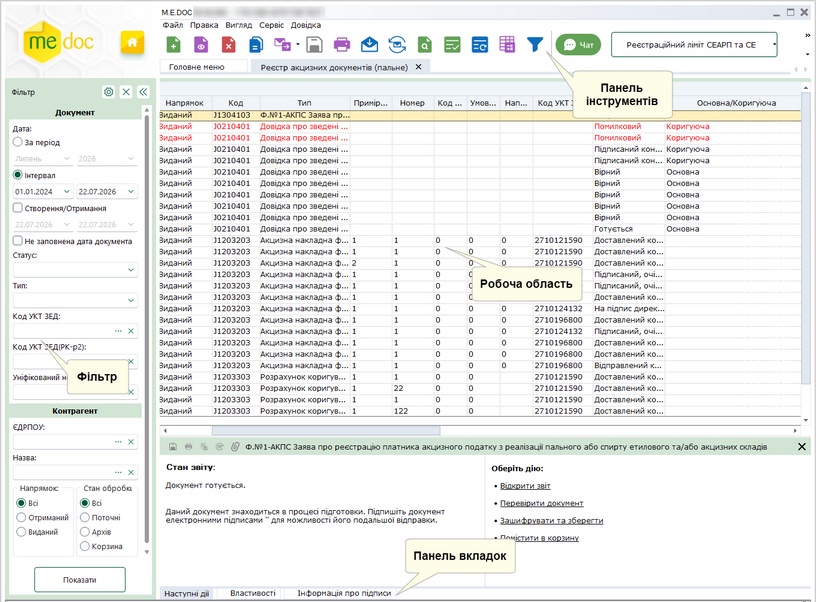
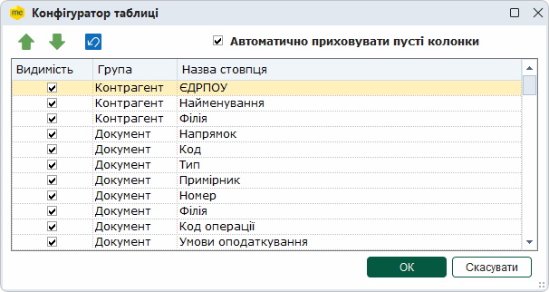
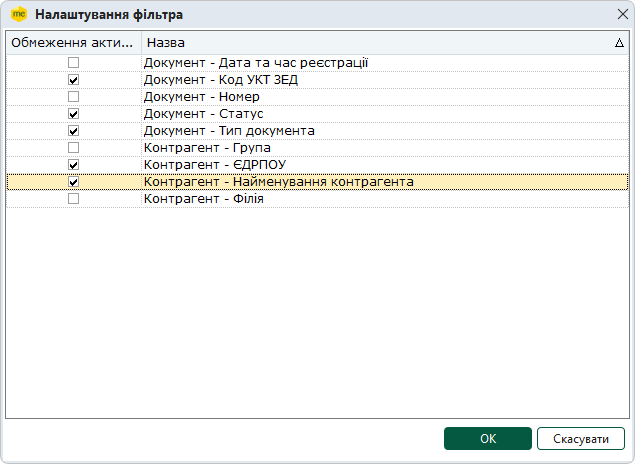
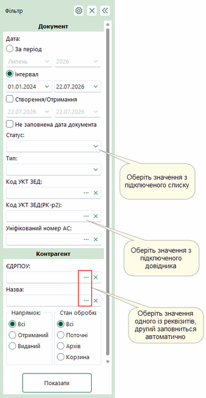
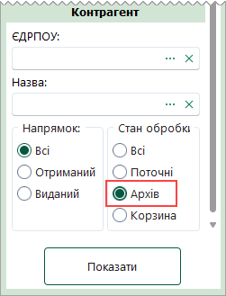
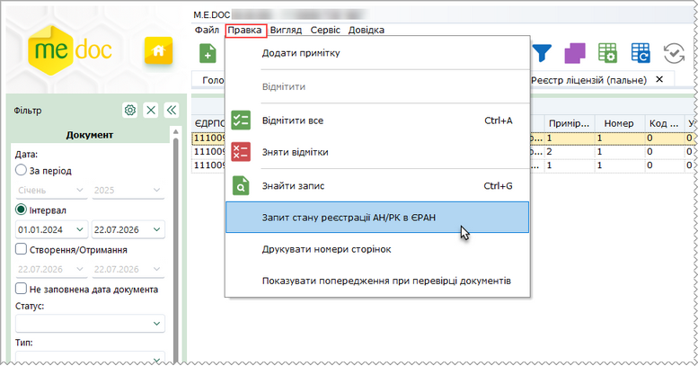
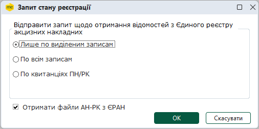

[← Зміст довідки](../)


# Реєстр акцизних документів (пальне)

## Реєстр акцизних документів (пальне)

_Шлях у довідці: Розділи програми › Облік акцизу › Реєстр акцизних документів (пальне)_

Реєстри акцизних документів призначені для створення, редагування та збереження акцизних документів, з метою їх реєстрації в ДПС та обміну ними з контрагентами. Також у реєстрі зберігаються документи, отримані від ДПС.

Реєстр акцизних документів (пальне) – модуль призначений для створення, редагування та збереження акцизних документів, щодо діяльності, пов’язаної з виробництвом, зберіганням, оптовою та роздрібною торгівлею пальним.

У модулі можливо створювати та опрацьовувати документи:

- Акцизна накладна форми "П";
- Розрахунок коригування форми "П";
- Заявка на поповнення/коригування залишку пального;
- Заява про реєстрацію платника акцизного податку;
- Довідка про обладнання АС (резервуари, лічильники);
- Довідка про зведені за добу дані.
- Заявка на переміщення.

Документи:

- Ф.№1-АКПС Заява про реєстрацію платника акцизного податку з реалізації пального або спирту етилового та/або акцизних складів;
- Заявка на переміщення пального або спирту етилового транспортними засобами, що не є акцизними складами пересувними

можуть створюватися як у розділі Реєстр звітів, так і у відповідних модулях розділу Облік акцизного податку: Реєстр акцизних документів (пальне) або Реєстр акцизних документів (спирт етиловий).

При створенні (редагуванні), залежно від встановленого поля: Реалізація пального або Реалізація спирту етилового (Пальне або Спирт етиловий), документи будуть доступні у відповідному розділі: Реєстр акцизних документів (пальне) або Реєстр акцизних документів (спирт етиловий).

При створенні документів у розділах Реєстр акцизних документів (пальне) або Реєстр акцизних документів (спирт етиловий) відповідне поле встановлюється автоматично.

Ф.№1-АКПС Заява про реєстрацію платника акцизного податку з реалізації пального або спирту етилового та/або акцизних складів;

Може бути створена у розділі Реєстр звітів на основі поданого документа Ф. 20-ОПП Дод. 10 до Порядку обліку платників податків і зборів.

Для цього скористайтеся функцією у вікні відкритого документа Ф. 20-ОПП  на вкладці Наступні дії – Виконати додаткову програму обробки – Створити Заяву про реєстрацію платника акцизного податку.

У даному розділі довідки розглянуто наступне:

- [Опис основних функціональних елементів інтерфейсу](#ucexciserst-akciz_reestr_int)
- [Фільтр - початок роботи з Реєстром акцизних документів (пальне)](#ucexciserst-akciz_reestr_filtr)
- [Архів документів](#ucexciserst-akciz_reestr_arhiv)
- [Робота з акцизними документами (пальне)](AkcizRstFunkc.html#akcizrstfunkc-akcizrstfunk)
- [Автоматичне створення запиту до Єдиного реєстру акцизних накладних](#ucexciserst-chek_eran_fluel)
- [Показники рівнемірів/витратомірів](UCSIURSpr.html#ucsiurspr-ucsiurspr)
- [Довідники](Akciz_dovidnyky.html#akciz_dovidnyky-akciz_dovidnyky)
- [Господарські одиниці/Акцизні склади](UCEconomicUnits.html#uceconomicunits-uceconomicunits)

### Опис основних функціональних елементів інтерфейсу

_Шлях у довідці: Розділи програми › Облік акцизу › Реєстр акцизних документів (пальне) › Опис основних функціональних елементів інтерфейсу_

Реєстр акцизних документів складається з 4 основних функціональних частин (на прикладі Реєстру акцизних документів (пальне)):

Натисніть, щоб збільшити малюнок

Фільтр

Робота з Реєстром акцизних документів розпочинається з Фільтру - зручного і потужного інструменту відбору потрібних документів.

У Фільтрі максимально зібрані атрибути документів, за якими здійснюється пошук та сортування. Фільтрація відбувається по будь-якому відомому параметру.

Передбачена можливість самостійно задавати відображення параметрів відбору в Реєстрі. Натисніть на кнопку  та в окремому вікні, що відкрилось, встановіть/зніміть галочки напроти потрібного реквізиту.

Після встановлення параметрів фільтрації натисніть на кнопку Показати. В робочій області відобразиться перелік документів згідно заданих параметрів пошуку.

Для того, щоб очистити Фільтр від даних, натисніть на кнопку .

Якщо Фільтр не потрібен та/або заважає, його можна згорнути. Для цього натисніть на кнопку . Щоб розгорнути Фільтр, натисніть на згорнуту панель.

Детальний опис Фільтру та робота з ним описані в розділі довідки [Фільтр Реєстру акцизних документів](#ucexciserst-akciz_reestr_filtr).

Робоча область

Містить безпосередньо записи Реєстру акцизних документів: відображає записи, що відповідають заданим умовам фільтрації та сортування.

Набором колонок у таблиці Реєстру та порядком їх розміщення можна керувати. Для цього натисніть на кнопку  на панелі інструментів.
Відкриється вікно Конфігуратор таблиці. Встановіть відповідні галочки для відображення колонок.

Скористайтесь кнопками   для встановлення довільного порядку за власним бажанням, або  для встановлення порядку колонок за замовчанням.

Якщо встановлено опцію Автоматично приховувати пусті колонки, колонки, що не містять даних, не відображаються у Робочій області.

Для збереження змін натисніть кнопку ОК.

Для зручності роботи у реєстрі, реалізована функція ГРУПУВАННЯ записів реєстру по колонкам таблиці реєстру.
Для активації цієї функції необхідно вибрати в меню Вигляд - Групування даних або натиснути на кнопку  на панелі інструментів.

Над реєстром з'явиться додаткова панель. За допомогою миші перетягніть на цю панель потрібні колонки таблиці.

Щоб відкрити документ, оберіть його у списку та скористайтеся одним із способів:

- натисніть 2 рази лівою кнопкою миші на документі у списку;
- виконайте команду меню Файл - Відкрити;
- оберіть команду Відкрити у контекстному меню;
- натисніть кнопку Відкрити  на панелі інструментів;
- скористайтесь комбінацією клавіш Ctrl+F2.

Можливо відкрити декілька документів одночасно, для цього виділіть потрібні документи у списку та скористайтеся одним із способів, що вказані вище. При спробі відкрити більше 20 документів, виводиться повідомлення про можливе уповільнення роботи програми, через велику кількість відкритих документів.

Панель вкладок звіту

Містить службову інформацію щодо обраного документа. Панель доступна як у відкритому документі, так і з Реєстру акцизних документів (за умови виділення потрібного документа).

- Наступні дії – містить інформацію щодо поточного стану документа, а також перелік можливих дій з документом у цьому стані. Слугує підказкою користувачу про доступні дії, які можна виконати з документом у поточному стані;
- Властивості – у режимі читання містить всю службову інформацію про документ, таку як: стан, період створення, дата та час останньої модифікації, інформація про сертифікати, якими підписано документ тощо. Інформація на цій вкладці постійно оновлюється та доповнюється при будь-яких змінах документа;
- Протокол – містить перелік подій, що відбулись з документом під час його обробки в хронологічному порядку. При виборі події справа на панелі відображається її детальний опис.

Панель інструментів.

Містить кнопки, що надають швидкий доступ до найбільш часто використовуваних функцій. Наведіть покажчик миші на інструмент і чекайте протягом секунди, для відображення короткої підказки, що описує його призначення.

### Фільтр Реєстру акцизних документів

_Шлях у довідці: Розділи програми › Облік акцизу › Реєстр акцизних документів (пальне) › Фільтр Реєстру акцизних документів_

Фільтр - це зручний і потужний інструменту відбору потрібних документів в Реєстрі акцизних документів.

1. Задайте відображення параметрів відбору в Реєстрі. Натисніть на кнопку . Відкриється вікно Налаштування фільтра. Зніміть (або встановіть для відновлення відображення параметру) галочки напроти потрібного реквізиту та натисніть ОК.

2. Встановіть необхідні параметри відбору акцизних документів в Реєстрі:

Натисніть, щоб збільшити малюнок

Документ

- Дата - встановіть позначку для вибору певного періоду або довільного періоду:
- За період - вкажіть місяць та рік, в межах якого були створені потрібні документи;
- Інтервал - вкажіть дату початку та закінчення довільного інтервалу, в межах якого були виписані потрібні документи;
- Створення/Отримання - вкажіть дату початку та закінчення довільного інтервалу, в межах якого були створенні або отриманні потрібні документи;
- Не заповнена дата документа - у вибірку за цим параметром потрапляють документи, у яких не вказана дата створення. Увага! У вибірки за іншими періодами ці документи не потрапляють.
- Номер - використовується для пошуку документів за номером.

Якщо відома тільки частина номеру, можна використовувати символи узагальнення для пошуку серед документів, що містять цю частину номеру. Наприклад, за запитом "\*123\*" будуть знайдені документи з номером "1234567", "654123987".

Є можливість здійснювати пошук документів за декількома номерами, або їх частинами. Для цього у полі Номер вкажіть значення номерів через кому. У вікні буде відображено документи, номери яких містять вказані значення. Наприклад, за запитом "1,2,3" будуть знайдені документи з номером "1234567", "6521987", "Вер-13";

- Статус - оберіть із списку, що випадає, назву статусу, що відповідає етапу обробки документа. За замовчанням встановлено значення "Всі", тобто пошук відбувається за заданими параметрами серед усіх акцизних документів.
- Тип - якщо потрібно відобразити документи певного типу, оберіть тип у списку, що випадає. За замовчанням встановлено значення "Всі", тобто пошук відбувається за заданими параметрами серед усіх акцизних документів.
- Код УКТ ЗЕД - оберіть значення з довідника Коди УКТ ЗЕД (пальне або спирт етиловий);
- Код УКТ ЗЕД(РК-р2) - оберіть значення з довідника Коди УКТ ЗЕД (пальне або спирт етиловий) для відбору Розрахунків коригування за значенням другого рядка;
- Уніфікований номер АС - оберіть значення з довідника Господарські одиниці/Акцизні склади або введіть номер вручну для перегляду інформації про відправлені (створені) довідки у розрізі акцизних складів за уніфікованим номером акцизного складу.

Контрагент

- Група - дозволяє знайти документи, які були виписані на ім'я або отримані від контрагентів певної групи.
При виборі групи блокується фільтрування за полями Найменування, ЄДРПОУ.

- ЄДРПОУ - дозволяє знайти документи контрагента, що були відправлені/прийняті, якщо відомо його код установи за Єдиним державним реєстром підприємств та організацій України. Вводиться з клавіатури, обирається з підключеного довідника (кнопка вибору ) або заповнюється автоматично при виборі інших даних контрагента з довідника.
- Назва - дозволяє знайти документи, які були виписані на ім'я або отримані від певного контрагента.
Найменування контрагента можна ввести як з клавіатури, так і вибрати із довідника Контрагенти, який відкривається після натиснення на кнопку вибору . При виборі контрагента із довідника, автоматично заповнюється поля ЄДРПОУ;

- Філія - номер філії контрагента.

Напрямок

Містить перемикач між напрямками акцизних документів. Передбачені наступні варіанти:

- Всі - всі документи Реєстру акцизних документів незалежно від напрямку;
- Отриманий - отримані документи електронним каналом зв'язку від контрагентів;
- Виданий - створені документи, призначені для відправлення контрагентам електронним каналом зв'язку.

Стан обробки

Містить перемикач між призначеннями акцизних документів. Передбачені наступні варіанти:

- Всі - всі документи Реєстру акцизних документів, окрім видалених;
- Поточні - документи, які знаходяться безпосередньо в роботі;
- Архів - документи, які досягли кінцевого стану обробки, тобто були затверджені або відхилені. Детальніше про Архів описано в розділі даної довідки [Архів документів](#ucexciserst-akciz_reestr_arhiv).
- Корзина - документи, які були видалені з Реєстру.

3. Після встановлення параметрів фільтрації натисніть на кнопку Показати. В робочій області відобразиться перелік документів згідно заданих параметрів пошуку.

Для того, щоб очистити Фільтр від даних, натисніть на кнопку .

Якщо Фільтр не потрібен та/або заважає, його можна згорнути. Для цього натисніть на кнопку . Щоб розгорнути Фільтр, натисніть на згорнуту панель.

### Архів документів

_Шлях у довідці: Розділи програми › Облік акцизу › Реєстр акцизних документів (пальне) › Архів документів_

В Реєстрі акцизних документів створено сховище документів - Архів.
Архів призначений для зберігання документів, які пройшли повний цикл обробки, тобто були затверджені або відхилені контрагентом, або зареєстровані в ЄРПН. Також передбачено примусове переміщення в архів документів, які не досягли кінцевого циклу обробки, але втратили свою актуальність, або документи внутрішнього використання на підприємстві.

Архівні документи доступні лише для перегляду, їх не можна змінювати та редагувати.

Для відображення архівних документів необхідно у [Фільтрі](#ucexciserst-akciz_reestr_filtr) обрати напрямок Архів.

У робочій області відобразяться документи в режимі Для перегляду.

Архівні документи можна відправляти контрагентам та у ДПС:

- Для архівних документів в статусі Зареєстровано на вкладці Наступні дії доступна команда Відправити контрагенту.
- Для архівних документів в статусі Затверджено контрагентом та Відхилено контрагентом на вкладці Наступні дії доступна команда Відправити в ДПС.

### Автоматичне створення запиту до Єдиного реєстру акцизних накладних

_Шлях у довідці: Розділи програми › Облік акцизу › Реєстр акцизних документів (пальне) › Автоматичне створення запиту до Єдиного реєстру акцизних накладних_

Запит за списком обраних документів можливо сформувати у модулі Реєстр акцизних документів (пальне):

1. Виділіть документи, для яких необхідно сформувати запит, у таблиці модуля.

2. Виконайте команду меню Правка - Запит стану реєстрації АН/РК в ЄРАН.

Натисніть, щоб збільшити малюнок

3. Відкриється вікно Запит стану реєстрації:

Встановіть позначку Лише по виділеним записам. У запит автоматично будуть додані документи, що були виділені у таблиці модуля.

Якщо встановлено позначку По всім записам, виконується формування запитів для всіх документів, що присутні у списку модуля.

Встановіть опцію Отримати файли АН-РК з ЄРАН для отримання з ЄРАН зареєстрованих документів з квитанціями, що зазначені у запиті.

4. Натисніть кнопку ОК. Розпочнеться процедура підписання документа.

Якщо ви бажаєте відправити запит пізніше, у вікні Підпис натисніть кнопку Відміна. Сформований запит буде доступний для редагування та відправки у модулі Інформаційна довідка.

Запит документів виконується лише при встановленій опції Отримати файли АН-РК з ЄРАН у вікні Запит стану реєстрації. Якщо опція не встановлена, запит формується у режимі отримання відомостей про стан реєстрації документів у ЄРАН.


