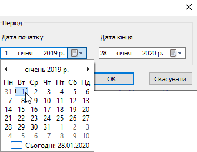
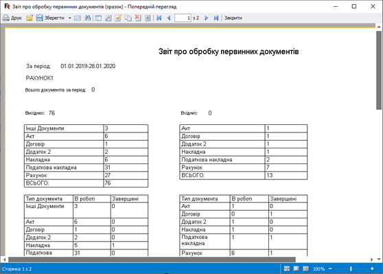

[← Зміст довідки](../)


# Реєстр шаблонів звітів

## Реєстр шаблонів звітів

_Шлях у довідці: Розділи програми › Первинні документи › Реєстр шаблонів звітів_

Модуль Реєстр шаблонів звітів призначений для зберігання шаблонів Fast Reports та формування звітів.

Шаблони звітів надаються розробником.

За замовчуванням у модулі збережено шаблон Звіту про обробку первинних документів, який призначений для отримання детальної інформації про результати обробки первинних документів за вказаний період.

Щоб додати у модуль шаблон, отриманий від розробника, виконайте команду головного меню Файл - Імпорт - Імпорт. У вікні Відкриття файлу оберіть файл звіту Fast Reports та натисніть кнопку Відкрити. Назва імпортованого шаблона з'явиться у таблиці модуля.

Для формування звіту:

1. Натисніть два рази лівою кнопкою миші на рядку звіту, наприклад, Звіт про обробку первинних документів.

2. У вікні, що відкриється, оберіть дату початку та дату закінчення періоду, за який потрібно сформувати звіт.

3. Натисніть OK.

4. Сформований звіт відкриється в окремому вікні спеціального редактору. Звіт відображається тільки в режимі перегляду, його не можна редагувати.

У вікні редактору доступні такі функції:

- Друк - дозволяє надрукувати сформований звіт;
- Зберегти - дозволяє зберегти звіт в одному із найуживаніших форматів.

Натисніть, щоб збільшити малюнок


